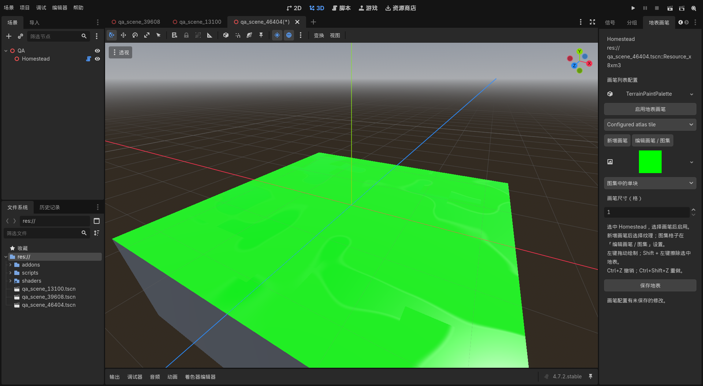

# 地表画笔

在 Godot 编辑器中绘制现有 Terrain 地形。画笔列表可配置和扩展，每支画笔支持整张纹理、图集单块或四角过渡图集。默认保留当前草地、道路，不自动增加新的美术或铺设。

1. 用「地图切换」打开正式连续地图，选中场景树里的 `Homestead`。
2. 打开右侧「地表画笔」标签，点击「启用地表画笔」。标签被挤出时，用标签栏右侧箭头滚动查找。
3. 选择「草地」或「卵石道路」，设置画笔尺寸。1 格适合细修，3 / 5 / 7 / 9 格适合大片绘制；当前每格为 1.6 米，鼠标处显示实际格子范围。
4. 在 3D 视口中左键拖动绘制。按住 Shift 再左键拖动可擦除选中的自定义地表，恢复底面；原道路画笔擦除道路，草地画笔恢复草地底面。
5. 点击「保存地表」，或使用 Ctrl+S。正式地图的地形格写入 `data/world/world_terrain.tres`，自由笔刷与完整铺装写入 `data/world/world_surface.res`，重新打开或运行仍保留修改。自由地表使用 Godot 原生无损压缩资源，笔刷与游戏直接读写同一份数据并保留原 UID，不另存运行缓存。

Ctrl+Z 撤销整笔，Ctrl+Shift+Z 重做。右键与中键继续使用 Godot 的视图操作；完成后点击「停止绘制」。画笔仅命中地形顶面与坡道，不绘制建筑或台地侧壁，也不修改地形高度、坡道、水体或桥梁标记。

绘制和撤销/重做更新现有地表纹理，不重建地形网格、碰撞或全图地编。一笔结束时，只检查改动格与相邻格的缓存实例，隐藏石板/道路下的草花，擦除后恢复原位置；根部阴影同步更新局部像素。此前未铺地编的新草地区域需要生成植物时，可使用 `GroundDressing` 的「刷新预览」。改变高度、水体、区域或撒布配置仍走正常重建。

插件已在项目配置中启用。若正在运行的编辑器还没显示该标签，接受 `project.godot` 的外部修改提示，或在「项目 → 项目设置 → 插件」启用「地表画笔」。

## 配置更多画笔

1. 选中 `Homestead`，在「地表画笔」点击「新增画笔」。新画笔立即进入下拉列表。
2. 在列表下方的纹理选择框中拖入图片，或用菜单加载 `Texture2D`。
3. 选择「整张纹理」「图集中的单块」或「四角过渡图集」。点击「编辑画笔 / 图集」，在 Inspector 中修改名称与图集参数。
4. 回到「地表画笔」选择配置好的画笔，启用后绘制。点击「保存地表」同时保存地图与配置；Ctrl+S 也会保存外部配置。

正式地图的列表内嵌于 `scenes/world/world.tscn` 的 `Homestead → 地表画笔配置 → paint_palette`；`data/world/spawn_paint_palette.tres` 保留共用基线配置。新广场画笔引用 `data/world/brushes/plaza_*.tres`，两份列表共用这些资源。点击面板顶部的配置资源可编辑整个 `brushes` 数组，包括增加、隐藏或重排。其他 Terrain 可绑定独立配置资源；配置内嵌时随场景保存，保存成 `.tres` 后可复用。

## 已配置的现有纹理

正式地图显示 14 支画笔：保留草地、道路和已绘制的编号 1、11，加入 10 支 Meowa 修正版广场画笔。当前未使用的旧编号 2–10 从下拉列表隐藏，配置与编号仍保留，兼容已有存档和种植原型。新画笔使用原生颜色图、配套轻微法线、干湿受光；不会自动重铺地图。

| 画笔名称 | 模式 | 自定义编号 |
| --- | --- | --- |
| 草地 | 整张纹理，原草地底层 | — |
| 卵石道路 | 四角自动过渡，原道路覆盖层 | — |
| 卵石铺装（图集单块） | 4×4 图集第 3 列、第 2 行；坐标 `(2, 1)` | 1 |
| 南侧修正版石板 | 保留南侧既有完整铺装 | 11 |
| 广场石板 | 世界对齐的基础石板 | 12 |
| 裂纹石板 | 世界对齐的裂纹石板 | 13 |
| 菱形铺装 | 世界对齐的装饰石板 | 14 |
| 横向分隔带 | 透明装饰叠在广场石板上 | 15 |
| 纵向分隔带 | 透明装饰叠在广场石板上 | 16 |
| 十字接口 | 透明装饰叠在广场石板上 | 17 |
| 转角接口 | 透明装饰叠在广场石板上 | 18 |
| 菱形饰块 | 透明装饰叠在广场石板上 | 19 |
| 方向箭头 | 透明装饰叠在广场石板上 | 20 |
| 八角纹章 | 透明装饰叠在广场石板上 | 21 |

新广场选项引用 `assets/meowa/city_plaza/fixed/`，保留原始像素与透明度，按 40 像素／米重复；相邻格共享纹理坐标，Q/E 旋转不改变铺装。完整装饰跨度约 2.4–3 米，可用 3 格画笔铺出完整图案，再以 1 格细修边界。水面、岩壁继续由对应地形材质负责。

“图集单块”把一张包含多个地块的大图中的一格取出来，绘制时重复铺贴这格。下面的示例与已配置的卵石单块画笔一致；四角自动过渡则使用整张图集，根据邻接关系选择边缘和拐角。

## 参数含义

| 画笔参数 | 含义 |
| --- | --- |
| `label` | 下拉列表显示名称 |
| `show_in_painter` | 是否显示在画笔下拉列表；隐藏不删除固定编号或已有铺设 |
| `texture` / `mode` | 来源纹理；整张铺贴、图集切片或四角自动过渡 |
| `texture_meters` | 普通纹理的世界重复尺寸；零值保留一格一张，过渡图集继续沿用格子规则 |
| `underlay_paint_id` | 透明装饰下的普通铺装编号；0 透出原地表，新广场装饰使用编号 12 |
| `atlas_grid` | 等距矩形图集的列数、行数，尺寸必须可整除 |
| `atlas_tile` | 单块模式选中的列、行，均从 0 开始 |
| `corner_tiles` | 过渡模式的 16 个图集格子坐标；默认是当前 Meowa 4×4 顺序，可改成其他排列与网格大小 |
| `tint` | 地表颜色乘数 |
| `roughness` / `metallic` / `wet_response` | 粗糙度、金属度、天气湿润响应 |
| `is_grass` | 接入草地光照，并允许现有地编在这里铺设草花；默认关闭 |
| `target` | 新画笔默认自定义地表；原草地底层和道路覆盖层保留各自标记 |
| `paint_id` | 自定义画笔固定编号 1–255，同一配置内不重复；重排列表不改变绘制对应。已铺设的画笔保留编号，不复用给另一种地表 |

过渡图集按四角组合选择格子：`左上 1 + 左下 2 + 右上 4 + 右下 8`，索引 0 为空、15 为完整覆盖。边缘部分应有透明背景，让下面的地表透出。整张纹理与单块图集按地形格铺贴，格子边缘保持直接接合；需要圆角或边缘混合时使用过渡图集。

新增但未选纹理的画笔只禁用自身，其他已配置画笔仍可使用。重复编号、超出图集范围等问题会显示说明。顶面、坡道和侧壁铺装衔接共用画笔采样；地形高度、碰撞以及水、桥、坡道标记保持原有数据。

## 验证

`tests/test_terrain_palette.gd` 检查图集取块、过渡映射、固定编号、重排、未配置画笔、绘制/擦除、撤销/重做、地形扩展、保存重读和数据纹理。运行原生渲染器覆盖纹理数组读回；headless 跳过该项。

编辑器验证覆盖实际新增画笔、纹理与模式选择、列表更新、整笔撤销/重做，以及保存按钮和 Ctrl+S 保存配置。实际地图的纹理、图集切片和自动过渡显示已通过 D3D12 验证；验证用的额外铺设仅存在于运行时副本。

