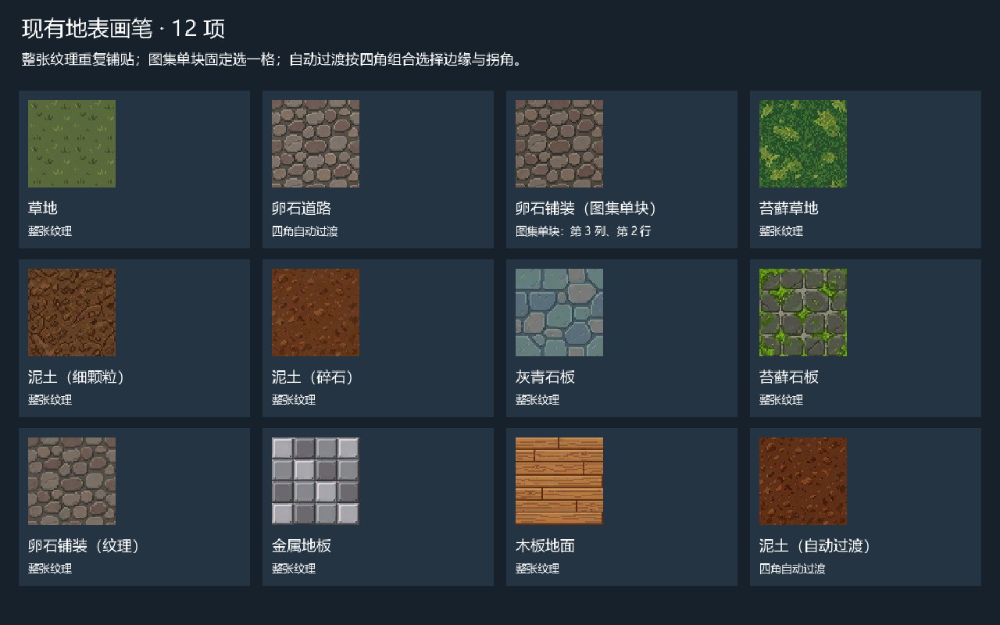
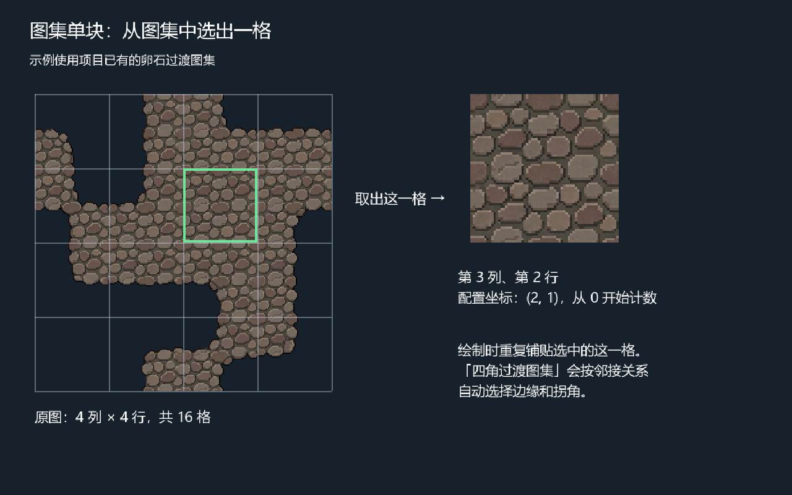

# 地表画笔

在 Godot 编辑器中绘制现有 Terrain 地形。画笔列表可配置和扩展，每支画笔支持整张纹理、图集单块或四角过渡图集。默认保留当前草地、道路，不自动增加新的美术或铺设。

1. 用「地图切换」打开正式连续地图，选中场景树里的 `Homestead`。
2. 打开右侧「地表画笔」标签，点击「启用地表画笔」。标签被挤出时，用标签栏右侧箭头滚动查找。
3. 选择「草地」或「卵石道路」，设置画笔尺寸。1 格适合细修，3 / 5 / 7 / 9 格适合大片绘制；当前每格为 1.6 米，鼠标处显示实际格子范围。
4. 在 3D 视口中左键拖动绘制。按住 Shift 再左键拖动可擦除选中的自定义地表，恢复底面；原道路画笔擦除道路，草地画笔恢复草地底面。
5. 点击「保存地表」，或使用 Ctrl+S。正式地图写入自己的 `data/spawn_terrain.tres`，重新打开或运行仍保留修改。

Ctrl+Z 撤销整笔，Ctrl+Shift+Z 重做。右键与中键继续使用 Godot 的视图操作；完成后点击「停止绘制」。画笔仅命中地形顶面与坡道，不绘制建筑或台地侧壁，也不修改地形高度、坡道、水体或桥梁标记。

插件已在项目配置中启用。若正在运行的编辑器还没显示该标签，接受 `project.godot` 的外部修改提示，或在「项目 → 项目设置 → 插件」启用「地表画笔」。

## 配置更多画笔

1. 选中 `Homestead`，在「地表画笔」点击「新增画笔」。新画笔立即进入下拉列表。
2. 在列表下方的纹理选择框中拖入图片，或用菜单加载 `Texture2D`。
3. 选择「整张纹理」「图集中的单块」或「四角过渡图集」。点击「编辑画笔 / 图集」，在 Inspector 中修改名称与图集参数。
4. 回到「地表画笔」选择配置好的画笔，启用后绘制。点击「保存地表」同时保存地图与配置；Ctrl+S 也会保存外部配置。

正式地图的列表资源是 `res://data/spawn_paint_palette.tres`，绑定于 `Homestead → 地表画笔配置 → paint_palette`。点击面板顶部的配置资源可编辑整个 `brushes` 数组，包括增加、删除或重排。其他 Terrain 可绑定独立配置资源；配置内嵌时随场景保存，保存成 `.tres` 后可复用。

## 已配置的现有纹理

当前列表共 12 支画笔，选中后即可绘制。原草地、道路配置保留；原两个空白项补齐纹理并保留固定编号。

| 画笔名称 | 模式 | 自定义编号 |
| --- | --- | --- |
| 草地 | 整张纹理，原草地底层 | — |
| 卵石道路 | 四角自动过渡，原道路覆盖层 | — |
| 卵石铺装（图集单块） | 4×4 图集第 3 列、第 2 行；坐标 `(2, 1)` | 1 |
| 苔藓草地 | 整张纹理，允许草花铺设 | 2 |
| 泥土（细颗粒） | 整张纹理 | 3 |
| 泥土（碎石） | 整张纹理 | 4 |
| 灰青石板 | 整张纹理 | 5 |
| 苔藓石板 | 整张纹理 | 6 |
| 卵石铺装（纹理） | 整张纹理 | 7 |
| 金属地板 | 整张纹理 | 8 |
| 木板地面 | 整张纹理 | 9 |
| 泥土（自动过渡） | 4×4 四角过渡图集 | 10 |

这些选项引用项目已有的 `assets/ground` 与 `assets/meowa/homestead` 资源，由用户选择后铺设。水面、岩壁等资源继续由对应地形材质负责，没有作为普通顶面画笔加入。

“图集单块”把一张包含多个地块的大图中的一格取出来，绘制时重复铺贴这格。下面的示例与已配置的卵石单块画笔一致；四角自动过渡则使用整张图集，根据邻接关系选择边缘和拐角。

## 参数含义

| 画笔参数 | 含义 |
| --- | --- |
| `label` | 下拉列表显示名称 |
| `texture` / `mode` | 来源纹理；整张铺贴、图集切片或四角自动过渡 |
| `atlas_grid` | 等距矩形图集的列数、行数，尺寸必须可整除 |
| `atlas_tile` | 单块模式选中的列、行，均从 0 开始 |
| `corner_tiles` | 过渡模式的 16 个图集格子坐标；默认是当前 Meowa 4×4 顺序，可改成其他排列与网格大小 |
| `tint` | 地表颜色乘数 |
| `roughness` / `metallic` / `wet_response` | 粗糙度、金属度、天气湿润响应 |
| `is_grass` | 接入草地光照，并允许现有地编在这里铺设草花；默认关闭 |
| `target` | 新画笔默认自定义地表；原草地底层和道路覆盖层保留各自标记 |
| `paint_id` | 自定义画笔固定编号 1–255，同一配置内不重复；重排列表不改变绘制对应。已铺设的画笔保留编号，不复用给另一种地表 |

过渡图集按四角组合选择格子：`左上 1 + 左下 2 + 右上 4 + 右下 8`，索引 0 为空、15 为完整覆盖。边缘部分应有透明背景，让下面的地表透出。整张纹理与单块图集按地形格铺贴，格子边缘保持直接接合；需要圆角或边缘混合时使用过渡图集。

新增但未选纹理的画笔只禁用自身，其他已配置画笔仍可使用。重复编号、超出图集范围等问题会显示说明。顶面、坡道和侧壁铺装衔接共用画笔采样；地形高度、碰撞以及水、桥、坡道标记保持原有数据。

## 验证

`tests/test_terrain_palette.gd` 检查图集取块、过渡映射、固定编号、重排、未配置画笔、绘制/擦除、撤销/重做、地形扩展、保存重读和数据纹理。运行原生渲染器覆盖纹理数组读回；headless 跳过该项。

编辑器验证覆盖实际新增画笔、纹理与模式选择、列表更新、整笔撤销/重做，以及保存按钮和 Ctrl+S 保存配置。实际地图的纹理、图集切片和自动过渡显示已通过 D3D12 验证；验证用的额外铺设仅存在于运行时副本。

