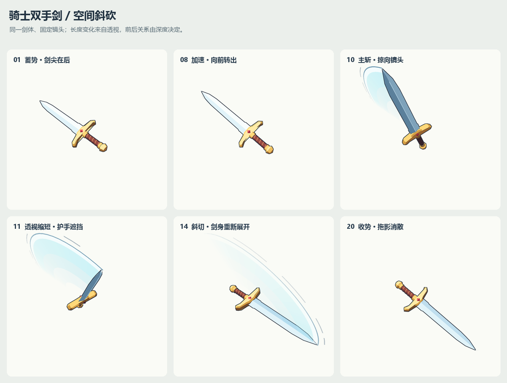

# 骑士双手剑空间斜砍逐帧约束说明

这段动画的空间感来自五项共同约束：所有帧使用同一把刚性剑、同一台透视相机、连续的空间姿态、按深度计算的遮挡，以及由历史运动轨迹构成的拖影。每张图的剑身长度和刀光形状都由这些条件共同决定。

本次实际使用 Python、NumPy 和 Pillow 完成几何投影、软件光栅化和漫画风着色。24 张透明 PNG 来自同一套几何和时间函数。本文中的参数对应已交付版本。

实现源文件：[render_knight_greatsword_slash.py](render_knight_greatsword_slash.py)。



## 全部帧共同遵守的约束

| 约束对象 | 本次采用的规则 | 对画面的作用 |
| --- | --- | --- |
| 剑的身份与比例 | 剑刃、护手、长握柄、缠带、剑首与宝石共用固定几何 | 透视变化期间仍能认出同一把剑 |
| 剑体尺寸 | 护手附近基准点至剑尖固定为 3.45 建模单位 | 画面中的长短变化有明确空间依据 |
| 刚性 | 每帧只施加正交旋转与整体平移 | 剑刃、护手和握柄一起转动，比例稳定 |
| 相机 | 位置、焦距、投影原点与画幅全程固定 | 剑靠近镜头时的变化能归因于动作本身 |
| 挥动轨道 | 剑的长轴沿固定的倾斜空间平面转动 | 蓄势、掠向镜头和右下收势连成一个动作 |
| 握点 | 基准点只做小幅平移，转动占主要部分 | 保持以握持位置带动剑身的感觉 |
| 光照与材质 | 固定光向、固定材质分区和三档明暗色 | 剑面翻转时呈现稳定的体积变化 |
| 拖影来源 | 从同一套姿态函数取过去的刀刃位置 | 刀光沿剑实际经过的区域展开 |
| 遮挡 | 剑体逐像素取最近表面，拖影再逐像素比较深度 | 护手、握柄、剑刃和刀光具有前后关系 |
| 输出边界 | 同一画布原点；每帧包含完整的剑和拖影 | 帧序列播放时不会因独立裁切而抖动 |

这些约束分为两层。几何、相机和材质是全部帧共享的固定条件；轨道角、滚转、基准点位置与历史拖影是由时间函数计算的变化条件。制作时主要调整时间函数和少量全局参数，24 帧随之一起更新。

## 剑体和握点如何保持一致

剑在局部坐标中沿正 Y 轴延伸，X 轴表示剑宽，Z 轴表示厚度。护手附近的基准点设在 `y = 0`，剑尖位于 `y = 3.45`。可见刀刃的几何从 `y = 0.10` 开始，因此可见刀刃的轴向跨度是 3.35 单位。后文的“投影长”统一使用基准点至剑尖这条 3.45 单位线段。

剑刃采用有中央脊线的菱形截面，并向剑尖收窄。护手有实体厚度和倒角，握柄与缠带也具有几何厚度。这让剑转向镜头时仍有可见的侧面、截面和相互遮挡的部件。

每一帧的空间变换为：

```text
P_world(t) = R(t) × P_local + T(t)
R(t)ᵀ × R(t) = I
```

`R` 是正交旋转矩阵，保证任意两个剑体顶点之间的距离不变。`T` 是整把剑共用的平移。剑体没有逐帧缩放，也没有弯曲形变。

基准点平移由平滑函数控制：

```text
s = clamp((t - 0.22) / 0.58, 0, 1)
p = s² × (3 - 2s)
T(t) = (-0.05 + 0.16p, -0.13p, 0.02)
```

这段位移的最大分量为横向 0.16、竖向 0.13，均明显小于 3.45 的剑长基准。它让握点在出手时略微跟进，同时保留以握点为中心挥动的读感。

## 透视缩短如何由同一把剑产生

### 固定投影条件

相机位于 `(0, 0, 7)`，沿负 Z 方向观察。正 Z 方向表示向镜头靠近。最终画幅为 640 × 640，投影参数为：

| 参数 | 数值 |
| --- | --- |
| 相机 Z 坐标 | 7.0 |
| 最终画幅中的焦距 | 558 像素 |
| 投影原点 | `(304, 329.6)` 像素 |
| 内部渲染尺寸 | 1280 × 1280 |
| 输出处理 | 2 倍超采样后缩至 640 × 640 |

对已经变换到世界空间的点 `(X, Y, Z)`，最终像素坐标是：

```text
D = 7 - Z
x_screen = 304 + 558 × X / D
y_screen = 329.6 - 558 × Y / D
```

剑尖和握点通常具有不同的 `D`，所以两端分别投影，再测量两点间的屏幕距离。这样会同时得到朝向引起的缩短和近大远小引起的变化。

### 倾斜的挥动平面

剑长轴方向由两条相互垂直的单位向量构成：

```text
U ≈ (-0.723900, 0.689905, 0.000000)
W ≈ ( 0.185586, 0.194731, 0.963140)

剑长轴方向 n(t) = U × cosθ(t) + W × sinθ(t)
```

`U` 指向画面左上方；`W` 大部分指向镜头，同时保留约 0.269 的屏幕平面分量。这个侧向分量让挥动平面投影后仍有可见宽度，刀光能够展开为弧面。

这里的 `θ` 是轨道角：0° 对齐 `U`，90° 对齐 `W`，180° 对齐 `-U`。它不等于“剑与屏幕平面的夹角”。例如，第 11 帧的轨道角为 86.85°，剑长轴已经接近镜头方向，但仍保留一定侧向轮廓。

最终序列中的关键变化为：

| 帧 | 基准点至剑尖投影长 | 剑尖至相机的轴向深度 D | 画面意义 |
| --- | ---: | ---: | --- |
| 01 | 208.58 px | 8.395 | 剑尖处于偏后方，呈完整斜向轮廓 |
| 09 | 306.02 px | 6.070 | 剑向前展开，轮廓变长 |
| 11 | 141.64 px | 3.662 | 剑尖掠向镜头，长轴投影明显缩短 |
| 14 | 319.46 px | 5.156 | 转过掠镜头姿势，剑身重新展开 |
| 24 | 300.55 px | 6.315 | 收势稳定在右下前方 |

最短投影约为最长投影的 44.3%。这些数值表示数学投影后的轴线距离，实际可见轮廓还会受到剑宽、厚度和部件遮挡影响。

## 连续姿态如何控制速度和翻面

轨道角使用带切线的三次 Hermite 插值，控制点包含位置与角速度：

| 动作参数 t | 轨道角 θ 弧度 | 切线角速度 dθ/dt | 动作作用 |
| ---: | ---: | ---: | --- |
| 0.00 | -0.44 | 0.00 | 起始姿势 |
| 0.16 | -0.64 | 0.00 | 小幅后引，到达蓄势转折 |
| 0.24 | -0.54 | 2.00 | 开始向前出手 |
| 0.34 | 0.18 | 12.00 | 快速加速 |
| 0.44 | 1.58 | 12.00 | 掠向镜头 |
| 0.54 | 2.44 | 5.20 | 转入右下方向并减速 |
| 0.72 | 2.91 | 0.55 | 收势接近完成 |
| 0.84 | 2.94 | 0.00 | 停住 |
| 1.00 | 2.94 | 0.00 | 保持结束姿势 |

快挥阶段的帧间角度差较大，蓄势和收势阶段较小。插值同时约束相邻区间的角速度连续性，避免分段动作在连接处突然改变速度。插值区间内的速度可以高于控制点切线值；第 10 帧附近的采样速度约为 15.00。

剑体还绕自身长轴做小幅滚转：

```text
roll(t) = 0.13 + 0.17 × sin(θ(t) + 0.4)
```

24 帧中的滚转约在 5.17° 至 16.83° 之间。它让刀面、中央脊线和侧面在快挥期间发生可见变化，帮助观众读取翻面过程。滚转随轨道角连续变化，剑刃、护手与握柄使用同一个滚转结果。

## 遮挡如何在每张图中成立

### 剑体内部的遮挡

每张图先将剑体表面拆成三角形，光栅化后对每个像素保留最靠近相机的表面。深度使用屏幕重心坐标对倒数深度插值：

```text
D_fragment = 1 / (b0 / D0 + b1 / D1 + b2 / D2)
```

其中 `b0、b1、b2` 是像素在投影三角形中的重心坐标。较小的 `D_fragment` 覆盖较大的深度。剑尖朝向镜头时，握柄、护手和刀身的重叠顺序随姿态自然变化。

这项约束在第 10 至 12 帧尤其重要：长轴投影变短，部件集中在较小区域，必须保留正确的厚度和相互遮挡，才能读成一把向镜头伸来的剑。

### 剑与拖影的遮挡

拖影的每个片元都和该像素处的剑体深度比较：

```text
若 D_trail < D_sword - 0.009：放入前侧拖影
其余情况：放入后侧拖影

最终合成：后侧拖影 → 剑体与描边 → 前侧拖影
```

`0.009` 是建模单位中的深度偏置，用来减少刀光和当前刀刃深度接近时的穿插闪点。描边外扩区域也获得邻近剑体深度的近似值，让后方刀光能够被轮廓线遮住。

剑体使用浮点深度；描边外扩深度采用量化后的邻域最小值近似。拖影面片之间按平均 Z 排序，因此复杂刀光自交时，透明层之间的顺序仍有近似；剑体与刀光之间则逐片元比较深度。本次涉及剑体与刀光的遮挡，尚未加入骑士人体。

## 拖影如何受到轨迹和时间约束

### 每帧只保留一段历史

在当前动作参数 `t`，取以下历史区间的 35 个采样时刻：

```text
history_start = max(0.24, t - 0.190)
history_end = t
```

当 `t ≤ 0.25` 时不生成拖影。其余时刻用相邻采样姿态连接成带状面片。历史长度 `0.190` 以归一化动作时间计；按约一秒动作理解，约对应 190 毫秒的轨迹范围。它不是每张图的曝光时长。

拖影位置取自同一把剑的局部参考点：

```text
trail_point(τ, r) = R(τ) × (0, 3.45r, 0.035) + T(τ)
```

`τ` 是历史时刻，`r` 是沿剑长的相对位置。拖影继承历史姿态的旋转、滚转和平移，所以整条弧面也有透视和深度。

### 刀光从内侧到外缘分层

| 相对剑长范围 r | RGB 色值 | 基础不透明度 | 约束目的 |
| --- | --- | ---: | --- |
| 0.320 至 0.570 | `(130, 206, 234)` | 0.12 | 内侧轻薄，保留握点和护手的可读性 |
| 0.570 至 0.770 | `(117, 210, 237)` | 0.24 | 连接内侧与主弧面 |
| 0.770 至 0.955 | `(160, 234, 248)` | 0.50 | 承担主要刀光体积 |
| 0.955 至 1.005 | `(244, 254, 255)` | 0.90 | 用明亮窄边强调剑尖轨迹 |
| 1.005 至 1.014 | `(47, 111, 149)` | 0.76 | 用细暗边约束漫画轮廓 |

主体拖影从剑长的 32% 处开始，避开护手附近最密集的结构。主刀光外缘延至剑长的 101.4%，包含少量漫画夸张。更外侧的断续速度线位于 106.5% 至 107.3%，它们是轨迹强调线。

### 亮度同时受历史速度和年龄控制

```text
age = (t - τ) / 0.190
speed = abs(dθ/dτ)
strength = min(1, speed / 7) × max(0, 1 - age)^0.85
最终不透明度 = 基础不透明度 × strength
```

速度高的历史片段更明显，较旧的片段更淡。`strength < 0.012` 的面片直接跳过。出手时拖影先窄后强；收势时，前面快速挥动留下的刀光继续衰减，避免在剑刚停住时整片消失。

外侧速度线另外要求 `speed > 5`，并使用时间分段形成断续。这让快挥阶段拥有额外方向提示，低速收势阶段保持干净。

## 二十四张图各自的空间约束

帧号对应 `slash_01.png` 至 `slash_24.png`，采样参数为 `t = (帧号 - 1) / 23`。表中角度单位为度，投影长单位为最终输出像素。轨道角、滚转和投影长均由现有脚本计算。

| 帧 | t | 轨道角 θ | 滚转 | 投影长 px | 这一帧需要守住的关系及原因 |
| --- | ---: | ---: | ---: | ---: | --- |
| 01 | 0.0000 | -25.21 | 7.06 | 208.58 | 先给出完整的剑、护手和长握柄，建立后续透视变化的比例基准。此时不加拖影。 |
| 02 | 0.0435 | -27.29 | 6.71 | 202.54 | 小幅后引，剑尖继续向后，投影轻微缩短；全剑部件共用同一旋转。 |
| 03 | 0.0870 | -31.69 | 5.96 | 189.66 | 延续后引方向，让长度和刀面变化连续，形成出手前的准备。 |
| 04 | 0.1304 | -35.64 | 5.30 | 177.97 | 接近蓄势转折，后引速度减小，给观众读清姿势的时间。 |
| 05 | 0.1739 | -36.44 | 5.17 | 175.61 | 采样姿势最接近后引极限；轨道已开始回转，保留清晰剑尖和护手轮廓。 |
| 06 | 0.2174 | -33.39 | 5.68 | 184.64 | 开始回到出手方向，轮廓重新展开；拖影仍未启动。 |
| 07 | 0.2609 | -27.17 | 6.73 | 202.93 | 首次生成短历史拖影，仅覆盖刚出手的一小段轨迹，让刀光从刃后逐渐出现。 |
| 08 | 0.3043 | -10.89 | 9.48 | 248.64 | 加速并增加滚转，刀面开始明显翻动；拖影贴合相同姿态函数。 |
| 09 | 0.3478 | 15.89 | 13.55 | 306.02 | 剑向前展开，刀光增强。此时剑尖已转到基准点前方，遮挡继续按深度求解。 |
| 10 | 0.3913 | 51.54 | 16.83 | 287.96 | 处于最快的采样区段，剑身开始缩短；保持厚度、刀面和护手的空间关系，拖影明显展开。 |
| 11 | 0.4348 | 86.85 | 16.61 | 141.64 | 全序列最短长轴投影。用刀身厚度、护手与握柄遮挡说明剑尖朝向镜头；保留后方历史弧面。 |
| 12 | 0.4783 | 113.98 | 14.10 | 233.60 | 穿过掠镜头姿势后转向右下，投影迅速恢复。拖影仍连接过去的左上轨迹，片元按前后深度分层。 |
| 13 | 0.5217 | 133.71 | 11.31 | 304.51 | 剑身进一步展开，历史中仍含快挥阶段，刀光保持可见宽度，同时开始减速。 |
| 14 | 0.5652 | 146.70 | 9.20 | 319.46 | 达到全序列最长投影。保持 3.45 的空间长度基准，以投影展开表达出剑，避免另加伸长形变。 |
| 15 | 0.6087 | 155.89 | 7.65 | 316.96 | 进入较明显的减速，帧间姿态差缩小；早期强刀光逐步变淡。 |
| 16 | 0.6522 | 162.06 | 6.60 | 310.49 | 保持右下收势方向，逐渐恢复较小滚转，让刀面和剑柄稳定下来。 |
| 17 | 0.6957 | 165.66 | 6.00 | 305.24 | 接近结束姿势，剑尖位移继续减小；残留拖影按年龄衰减。 |
| 18 | 0.7391 | 167.27 | 5.72 | 302.61 | 只保留少量继续下沉的动作，弱化刀光，恢复完整清楚的武器轮廓。 |
| 19 | 0.7826 | 168.10 | 5.59 | 301.19 | 握点接近最终位置，剑与护手关系保持稳定；历史拖影继续退出。 |
| 20 | 0.8261 | 168.43 | 5.53 | 300.59 | 当前角速度已经很低，接近停住；较早的运动片段仍允许留下微弱残影。 |
| 21 | 0.8696 | 168.45 | 5.53 | 300.55 | 剑体完全保持结束姿势，剩余变化来自历史拖影消散。 |
| 22 | 0.9130 | 168.45 | 5.53 | 300.55 | 继续锁定姿势，只留下极少达到强度阈值的拖影片段。 |
| 23 | 0.9565 | 168.45 | 5.53 | 300.55 | 拖影面片已全部低于输出条件，展示干净的最终剑体。 |
| 24 | 1.0000 | 168.45 | 5.53 | 300.55 | 保持最终姿势，并在播放中额外停留 360 毫秒，让一次斜砍完整结束。 |

第 10 至 12 帧是透视变化的核心。它们的投影长依次约为 288、142、234 像素，但每帧的剑体空间尺寸相同。保持这个尺寸不变，并连续改变朝向和部件遮挡，才能把短暂缩短读成掠向镜头的动作。

## 二十四张图各自的拖影约束

下表的角速度单位为弧度每单位动作参数，通过姿态函数的中心差分估计。历史窗口也以动作参数计；它和 GIF 的毫秒时钟分开管理。

| 帧 | 当前角速度 | 本帧历史窗口 | 刀光应呈现的变化 |
| --- | ---: | --- | --- |
| 01 | 约 0 | 关闭 | 起始武器轮廓完整可读 |
| 02 | -1.48 | 关闭 | 后引过程保持干净 |
| 03 | -1.86 | 关闭 | 后引过程保持干净 |
| 04 | -1.13 | 关闭 | 接近转折，强调姿势 |
| 05 | 0.56 | 关闭 | 回转起步，仍保留清楚轮廓 |
| 06 | 1.74 | 关闭 | 将蓄势与正式刀光区分开 |
| 07 | 4.29 | 0.2400 至 0.2609 | 历史范围很短，生成窄拖影 |
| 08 | 8.71 | 0.2400 至 0.3043 | 历史扩大，刀光亮度与弧长增加 |
| 09 | 12.87 | 0.2400 至 0.3478 | 快挥弧面与速度线明显出现 |
| 10 | 15.00 | 0.2400 至 0.3913 | 强调快速扫过的弧面和明亮外缘 |
| 11 | 12.59 | 0.2448 至 0.4348 | 保留完整长度的历史窗口，衬托当前剑身缩短 |
| 12 | 9.40 | 0.2883 至 0.4783 | 历史包含掠镜头过程，刀光跨过不同深度 |
| 13 | 6.44 | 0.3317 至 0.5217 | 当前减速，过去高速片段仍提供主要亮度 |
| 14 | 4.36 | 0.3752 至 0.5652 | 主弧面开始退出，沿实际历史位置消散 |
| 15 | 3.05 | 0.4187 至 0.6087 | 最快片段逐渐离开窗口，整体转淡 |
| 16 | 1.93 | 0.4622 至 0.6522 | 留下较薄的收尾弧面 |
| 17 | 0.99 | 0.5057 至 0.6957 | 继续减弱，减少对剑体轮廓的覆盖 |
| 18 | 0.44 | 0.5491 至 0.7391 | 主要表现少量余光 |
| 19 | 0.23 | 0.5926 至 0.7826 | 低速历史片段继续衰减 |
| 20 | 0.05 | 0.6361 至 0.8261 | 剑接近停止，历史余光仍可保留 |
| 21 | 0.00 | 0.6796 至 0.8696 | 姿势固定，余光独立衰减 |
| 22 | 0.00 | 0.7230 至 0.9130 | 仅少量片段仍达到强度阈值 |
| 23 | 0.00 | 0.7665 至 0.9565 | 全部片段低于输出条件，无拖影 |
| 24 | 0.00 | 0.8100 至 1.0000 | 无拖影，保持结束姿势 |

第 21、22 帧说明拖影依赖历史运动：当前剑体已经停住，之前的刀光仍可短暂存在。第 23、24 帧才完全恢复为单独的剑体。

## 漫画风和透明输出的约束

钢、金、皮革和宝石分别拥有固定的暗、中、亮三档颜色。光照方向固定，表面法线随剑体旋转。当法线与光向的点积超过 0.63 时使用亮档，超过 0.12 时使用中档，其余使用暗档。着色使用朝向视点的法线方向，以保持双面材质的可读性。

外轮廓使用深蓝黑色 `(26, 35, 49)`。内部渲染在 1280 × 1280 进行，轮廓外扩半径为 3 个内部像素，约相当于最终画面中的 1.5 像素。显著的表面折角另加细线，避免把三角形剖分本身画成可见网格。

刀光采用预乘透明度合成，完成全部前后层次后再转换为普通 RGBA 输出。帧文件只包含剑和刀光；预览 GIF 的底色、标题、帧号和底部说明在另一步加入。

本次输出是经过抗锯齿的漫画风位图。后续若制作原生像素版本，需要重新决定像素尺寸、轮廓阶梯和色块安排，并保留这里的空间与时间约束。

## 已完成的验证和复用入口

实现中的验证检查覆盖以下条件：

| 检查 | 本次结果 | 作用 |
| --- | --- | --- |
| 刚性与长度 | 在 101 个动作参数位置检查旋转矩阵正交和 3.45 基准长度 | 确认连续轨迹中的剑体比例稳定 |
| 投影缩短 | 最短与最长投影比约 0.443，小于设定阈值 0.48 | 确认掠镜头姿态具有足够明显的缩短 |
| 前后刀光 | 同时出现位于剑前和剑后的重叠片元 | 确认深度分层实际参与画面 |
| 图像边界 | 24 帧非空，透明内容包围盒均保留边距 | 避免剑尖、刀光和速度线被裁切 |
| 透明通道 | 24 张 PNG 均为 RGBA，每张同时含完全透明和完全不透明像素 | 保留独立合成能力 |
| 帧序列包 | ZIP 含 24 张 PNG，CRC 校验通过 | 保证帧序列完整 |
| 播放时长 | 常速 1360 ms，半速 2720 ms | 确认出手和额外停留时间一致 |

24 张姿态按 `t = i / 23` 均匀采样；常速 GIF 使用重复的 `40、40、40、50、40、40` 毫秒帧时长组合，基础显示时间共 1000 毫秒，最后一帧额外增加 360 毫秒。它是约一秒动作加结束停留的展示循环。透明 APNG 会合并相同的停留画面，合并后总时长保持不变。

复用时，主要修改以下入口：

| 想调整的效果 | 源码入口 | 应一起保持的条件 |
| --- | --- | --- |
| 剑的造型 | `Sword.build()` | 固定局部坐标、护手基准点和所有部件的相对位置 |
| 斜砍方向与空间幅度 | `U`、`W`、`pose()` | 两条轨道基向量正交归一，旋转矩阵保持正交 |
| 蓄势、加速和收势 | `KEY_T`、`KEY_A`、`KEY_V`、`angle_at()` | 姿态连续，分段连接处的速度一致 |
| 翻面程度 | `pose()` 中的 `roll` | 剑刃、护手和握柄使用同一个刚性变换 |
| 透视强弱 | `CAMERA_Z`、`FOCAL`、`ORIGIN`、`project()` | 相机在同一次动作的全部帧中固定，修改后重新检查边界 |
| 刀光持续时间与宽度 | `trail_geometry()` 的 `life` 和 `bands` | 轨迹仍取自同一姿态函数，并继续参与深度测试 |
| 刀光前后关系 | `render_trail()` | 每个片元和剑体深度比较，最后按前后层合成 |
| 漫画明暗与轮廓 | `MATERIALS`、`shade()`、`render_sword()` | 材质身份、光向和描边规则跨帧保持一致 |

输出目录：[骑士双手剑斜砍动画产物](.)。
