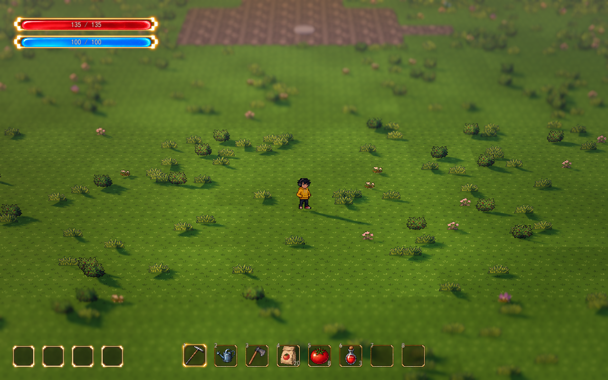
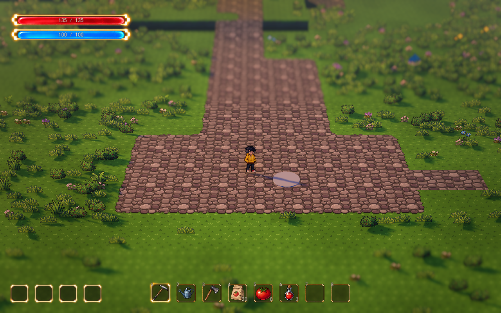
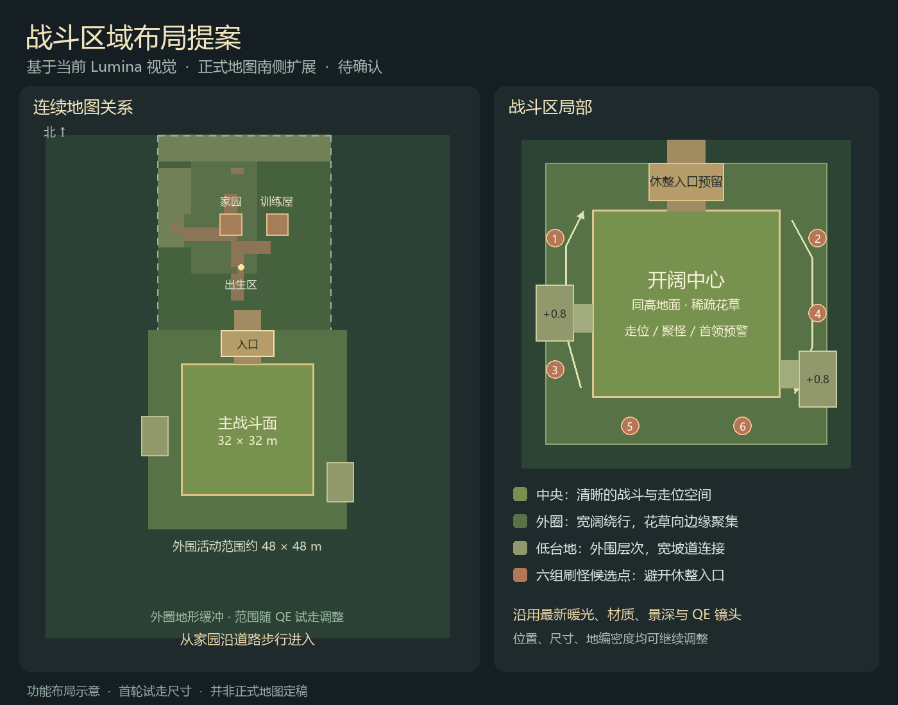

# 南侧战斗区域

2026-10-13 · 用户已确认按南侧扩展方案搭建，第一版已接入正式连续地图。以下尺寸与候选位置是首轮试走基线，可继续调整。

从小院沿南侧卵石路步行，到入口平台灰色圆点附近按 **F** 开始基础波次。清波后由 F 主动继续，结算后 ESC 返回小院；挑战 UI 保持隐藏。六处生成区域现已接入波次资源，按各波配置从西、东、南侧分批进场；安全距离、寻路与通行检查继续生效。当前攻击与成长基础流程见 [A01 自动扇击](fan-auto-attack.md) 和 [本局经验与升级](run-growth.md)。

区域组件为 `scenes/world/battle_area.tscn`，正式地图节点为 `BattleArea`。完整地形保存到 `data/world_terrain.tres`，原 `spawn_terrain.tres` 保留为出生区基准；新区域与小院共用同一 `Homestead` 地形和效果连接。

## 当前实际基准

当前工作场景为 `demoWithMeowa/1/scenes/world/world.tscn`。以该场景的实际覆盖值和 `VisualSample` 运行后参数为准，旧视觉测试地图的镜头参数不覆盖正式地图的新配置。

- 当前为 Lumina 黄金时段：自然草地、卵石道路、成簇花草、土岩台地侧壁、柔和暖主光与冷色环境光。沿用现有晴天、雨天和夜间预设。
- 透视 FOV 28°、跟随距离 28 米、俯角 32°、焦点高度 0.9 米；深度景深开启，强度 0.065。Q/E 连续旋转沿用当前控制。
- 地形格 1.6 米，层高 0.8 米；原出生区 X 范围为 -21.6～20 米、Z 范围为 -26.4～24.8 米。扩展后完整地形 X 为 -52～52 米、Z 为 -26.4～96.8 米，保留原格子坐标。
- 家园实际位置为 `(-4, 0.8, -4.8)`，训练屋为 `(7.2, 0, -4.8)`；出生点附近与已有建筑构图保留。

搭建前，南侧草地旋转到侧面时能看到地图边缘。现已补齐外围可见地形，并在主战斗面降低花草密度。

## 已确认布局：南侧开阔草甸台地

沿现有南侧道路延伸，让玩家从小院自然步行进入战斗区域。主场地中心为世界 XZ `(0, 44.8)`，主战斗面约 32×32 米；核心边界约为 X `-16～16`、Z `28.8～60.8`。外围通过花草簇、低台地和零散卵石过渡，草图中的矩形用于表示空间预算。

| 部分 | 首轮布局 | 作用 |
| --- | --- | --- |
| 进入道路 | 延续现有卵石路，近场地逐步展开；连接段约 6.4 米宽 | 从家园进入时动线清楚，进入后可向两侧避让 |
| 休整入口 | 北侧 `(0, 0, 25.6)`，核心外一块卵石地面 | 接入已有基础波次入口，休整与主动继续规则保持原样 |
| 主战斗面 | 约 32×32 米，地面同高，花草稀疏 | 保留穿透、回旋、范围预告和聚怪所需的连续视线与走位空间 |
| 外围绕行带 | 核心外约 8 米，整体活动范围约 48×48 米 | 玩家能顺时针或逆时针绕行，也能横穿中心改变路线 |
| 外围低台地 | 先布置两处 0.8 米高的侧缘台地，坡道有效宽度至少 4.8 米 | 延续当前高低层次，不切碎主战斗面；基础通行不依赖跳跃 |
| 刷怪候选扇区 | 西、东、南侧共六组候选位置，避开北侧入口 | 为以后按波次选择进场方向预留空间；候选数量不代表同时启用 |
| 镜头地形缓冲 | 活动范围外预留 28 米，远侧有低密花草与平顶台地 | 已按最新镜头验证中心、四角和边缘的 QE 各朝向 |

主战斗面的同高处理只用于保证战斗可读性；整个地图仍保留顶面平整、外围高低错落的台地结构。场地中心保持多方向可通行，外围台地可绕过，不形成单一狭窄入口或密集迷宫。

## 视觉表现

使用更新后的草地、卵石、土岩侧壁及花草资源。中心主要通过材质与低密花草保留细节，植被向边缘成簇聚集；入口以卵石路引导，外围台地通过受光面与侧壁阴影形成空间层次。

光影延续当前 Lumina 预设和稀疏局部点缀：暖光与冷色环境光共同表现地表，局部亮斑保持克制。场地建设中保留天气、风摆、人物受光和现有景深；从同一相机位置比较地编密度和遮挡。

第一版以地形、地表、低矮植被与现有光影完成可步行场地。怪物外形、武器效果、技能成长、战斗边界规则与正式美术地标仍按各自讨论推进。

## Godot 调节入口

选中正式地图中的 `BattleArea`：

| 参数 | 当前值 | 含义 |
| --- | --- | --- |
| 节点位置 | `(0, 0, 44.8)` | 场地主平面中心，移动后重建地形 |
| `core_size` | `(32, 32)` | 主战斗面 X/Z 尺寸，米 |
| `loop_width` | 8 | 绕行带宽度，米；基础波次范围随之同步 |
| `scenery_margin` | 28 | 活动区外的镜头可见地形宽度，米 |
| `entry_width` | 6.4 | 连接道路宽度，米 |
| `terrace_levels` | 1 | 台地层数；0 关闭，1/2 为 0.8/1.6 米；两层时坡道向外延伸 |
| `ramp_width` | 4.8 | 侧台地坡道的通行宽度，米 |
| `layout_seed` | 13102026 | 远侧台地轮廓与稀疏卵石的固定随机种子 |
| `core_density` | 0.08 | 中央花草密度倍率，仅使用低草与矮花 |
| `edge_density` | 0.38 | 绕行带花草密度倍率，沿用现有资源 |
| `scenery_density` | 0.10 | 外围景观的花草密度倍率 |

三种密度参数即时预览，乘以现有 `GroundDressing` 的草花密度。布局参数改变后点击 **重建战斗区地形**，检查效果，再点击 **保存战斗区地形** 并保存场景。重建保留出生区已有地形和手绘铺装，战场部分重新生成地形及铺装；手工细修战场地表适合放在布局稳定后进行。普通打开或运行沿用保存的数据，保留地表画笔绘制。

灯光、天气和镜头继续在 `VisualSample` 与 `MapEffects` 的检查器中调节。原始 / Lumina 预设、像素材质与色阶分别提供开关；视觉调节不占用 F1–F12 按键。

选中 `Homestead` 可继续使用现有地表画笔，保存目标为 `world_terrain.tres`。区域组件独立维护，游戏中直接连续步行进入。

## 已完成验证

1. 实机从出生点沿路走到入口，步行登上东西两侧台地，均不需要跳跃。
2. 中心、四角与四个边缘位置，每 15° 检查一次，共 216 个朝向。画面四角投向地面的交点均在扩展地形内；实际 QE 连续转过一整圈正常。
3. 六处候选生成位置均有到入口的可通行路线；出生区原有高度、区域类型、建筑落位及最新镜头保持一致。
4. 晴、雨、夜间均在实际渲染器下查看，截图为 1280×800，采用当前 Lumina 与统一像素美术配置。
5. 地形参数测试、既有基础波次测试与怪物混合波次核心测试通过。实机场地检查 27 项通过；十种攻击、增益及首领招式需在制作后继续验证实际可读性。

检查脚本：`tests/test_battle_area.gd`、`tests/test_wave_prototype.gd`、`tests/test_wave_core.gd`。布局讨论使用 game-assets 的 Game Designer 文本评审，随后由 Godot 实机验证；本轮复用已有美术。

侧台地与 QE：[台地截图](battle-area-preview/terrace.png)、[侧向旋转](battle-area-preview/qe.png)、[外围台地](battle-area-preview/edge.png)。天气：[细雨](battle-area-preview/rain.png)、[夜间](battle-area-preview/night.png)。
