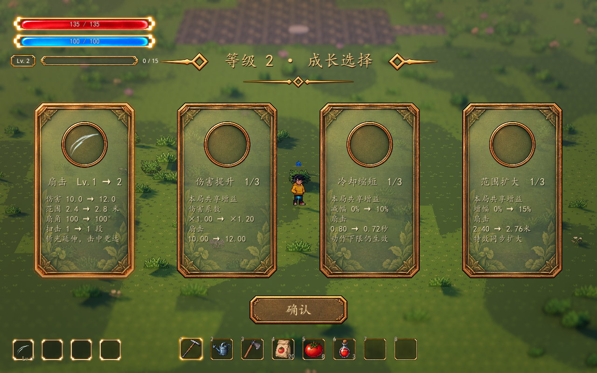

# 本局战斗增益

2026-10-13。已按用户确认接入伤害、冷却、范围三种升级选项，作为本局全局属性；当前扇击和后续支持对应属性的武器共用。数值为可调整的试玩基线。

| 条目 | 每级收益 | 默认等级上限 | 基础扇击对应结果 |
| --- | --- | ---: | --- |
| P01 伤害提升 | 基础伤害 +20% | 3 | 10 → 12 → 14 → 16 |
| P02 冷却缩短 | 基础攻击间隔减少 10% | 3 | 0.80 → 0.72 → 0.64 → 0.56 秒 |
| P03 范围扩大 | 基础覆盖半径 +15% | 3 | 2.40 → 2.76 → 3.12 → 3.48 米 |

同类按基础值累加：两级冷却为基础间隔 × `(1 − 0.1 × 2)`，不是连续乘两次 0.9。伤害与范围分别乘 `(1 + 本局对应增幅)`，范围不额外提高伤害。

## 升级与局内保留

- 吸取经验升级后，与已有武器升级一起进入同一个候选池；选择一种即获得一个等级。当前未加入随机三选一抽取，数量随有效池变化，首级为扇击升级加三种增益共四张卡。
- 卡片展示选择后的增益等级、总系数或总减幅、当前武器实际数值的前后变化。预览不授予效果，不改写配置资源；展示期间调整配置，也不会改变这张已展示卡片的奖励。
- 每种默认可重复选择三次。满级、达到总增幅上限、当前没有适用武器或实际数值不再变化的选项退出候选池。全部有效候选耗尽后继续记录人物升级，跳过无奖励的选择，不堵住清波。
- 确认时在恢复战斗前应用增益；连续升级下一张卡读取新值。波次之间与休整期间保留，结束、撤退、失败、新挑战及重试清空，不写入装备、训练或永久存档。
- 已起手的扫击使用起手时的全局属性快照，升级不会把进行中的斩光突然拉长或给剩余目标换伤害；下一次起手使用新值。持续旋转攻击在恢复后读取新值。

## 攻击与表现边界

伤害系数应用一次，作用于武器对应等级的伤害，不重复乘算已经结算的命中。武器等级倍率和本局属性属于两组，例如扇击二级基础伤害 12，加两级 P01 为 `12 × 1.4 = 16.8`。

范围扩大同时改变锁敌、实际命中、地面裁切和特效半径，扇角保持由武器自身控制；高差、墙体、断层和水面检查继续生效。后续纯投射物应只回传其支持的属性，不把“范围”自动解释为弹丸射程。

冷却缩短不把起手、扫击和收尾动画加速。周期扇击受到完整动作所需间隔限制；动作已经成为瓶颈时，没有实际收益的冷却卡不出现。持续旋转斩击只缩短同体命中间隔，不再同时加速旋转，避免同一增益重复提速。未来持续区应将铺设间隔接入共享冷却，跳伤间隔由其自身规则控制。

## Godot 调节入口

打开正式地图，选中 `WavePrototype/RunBuffs`，展开 `Definitions` 中三种资源。也可在“参数总览 → 战斗与成长”搜索“每级增益”“等级上限”“总增幅”。

| 参数 | 含义 |
| --- | --- |
| Bonus Per Level | 每级比例；0.20 是 +20%，冷却 0.10 是基础间隔减少 10% |
| Max Level | 每种增益的可选择次数，默认 3 |
| Bonus Cap | 同类总增幅上限；伤害默认 0 表示不额外封顶，冷却默认 0.50、范围默认 0.75；冷却始终保留非零间隔 |
| Attribute | 作用于伤害、冷却或范围 |
| ID / Title / Icon / Enabled | 稳定标识、卡片标题、可替换图标与候选开关；ID 不重复，不在出战中改 ID |

资源分别是 `demoWithMeowa/1/data/growth/damage.tres`、`cooldown.tres`、`range.tres`。武器的基础伤害、范围、间隔仍在 `WavePrototype/FanAutoAttack`，不被升级覆盖。修改增益配置后重开挑战比较数值，已领取的数值不会因调整资源偷偷重算。

卡片沿用已有 Meowa 底纹、卡框与交互，增益图标当前留空。`GrowthChoiceUI → Card Text Color` 可调整标题和内容文字颜色，现使用暖白字与轻阴影提升透明底上的可读性；字号、尺寸、间距和底纹透明度沿用原入口。

## 扩展接口与验证

`WavePrototype.combat_modifiers` 是本局唯一的属性状态。攻击组件登记战斗冻结后，提供 `get_combat_stats(modifiers)`，回传支持的 `damage`、`interval`、`range` 键与 `name`；成长系统据此判断实际收益并生成卡面。武器命中和特效必须读取同一套最终值，未支持的属性不应回传占位值。

`RunBuffs` 负责候选和授予，`GrowthBuffDefinition` 负责配置，`RunCombatModifiers` 负责相加、等级、封顶与无副作用预览。`RunSkills` 合并武器与增益候选；后续新增技能继续使用现有获得链路。

`tests/test_combat_buffs.gd` 原生 D3D12 63 项通过，覆盖同类累加、封顶、真实混合候选池、卡面与奖励快照、实际扣血、真实扩距、动作瓶颈过滤、进行中攻击快照、武器等级组合、旋转冷却、休整保留、未来武器适用性、候选耗尽与重试。既有扇击 32 项、成长协调 24 项、成长／波次集成 25 项、选择 UI 36 项及参数索引检查通过。实机截图沿用正式地图现有镜头和景深。
