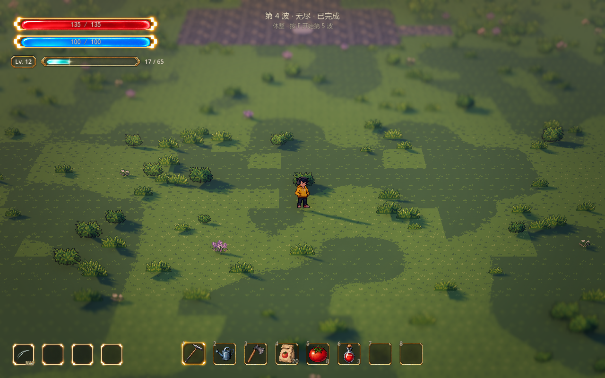

# 无尽波次

2026-10-13。按用户要求将正式地图刷怪改为无尽模式，并确认保留清波休整、按 F 主动继续。

前三波仍使用已有分区资源，数量为 18、28、40。第三波清完不再触发胜利，进入安全休整；按 F 开始第四波，以后波数继续增加。失败、ESC 撤退或离开战区仍结束本局，T 重试回到第一波。

## 后续波次

- 第四波开始沿用末波的怪物种类、分区比例、预告和增援结构，每波总数暂增加 8 只：48、56、64、72……，达到每波 160 只后保持数量，波数继续增加。
- 各组按原比例分配整数数量，保持总数准确；第四波的三组为 12、22、14 只。后续替换末波或配置混合怪物后，同一生成接口继续复用。
- 组内间隔每波减少原值的 3%，总减幅最多 50%，最短 0.18 秒。原间隔更短时保留原值，避免把增长变成减速。原先分开的相邻组保留刷怪间歇，数量增加时顺延后续组。
- 同场仍最多 24 只，满员等待空位，不丢弃已登记任务；每帧生成预算、入口禁刷、玩家安全距离、间距、碰撞和可达检查继续生效。
- 每波生命、移动、攻击伤害与经验奖励仍来自原怪物资源，本版不随波数增加这些属性。刷怪曲线和上限是可调试玩基线。

本局只保留三个开场模板，后续波次在开始时按需生成，不预先存储无限波次，也不随波数累计历史模板。模式、模板和新增递增参数在开始时建立本局快照；编辑器或远程检查器修改后，新挑战／重试生效。

## 成长与休整

清波先收取剩余经验，完成连续升级选择，再进入休整。升级界面继续只冻结战斗，天气和声音运行。人物等级、武器等级与全局增益在波次间保留，挑战结束或重试按原规则清空。当前奖励池耗尽后仍可继续升级与清波，不新增占位奖励。

休整没有倒计时，不自动生成下一波；按 F 继续，ESC 可撤退。顶部显示“第 N 波 · 无尽”和下一波操作提示，不显示有限总波数。

## Godot 参数

选中 `scenes/world/world.tscn` 的 `WavePrototype → 无尽波次`，也可在“参数总览 → 战斗与成长”搜索“无尽”。

| 参数 | 正式地图基线 | 含义 |
| --- | ---: | --- |
| Endless Mode | true | 启用无尽；关闭后恢复有限编排和最终胜利，用于开发对照 |
| Endless Enemies Per Wave | 8 | 超过开场模板后，每波增加的总数；0 为重复末波数量 |
| Endless Max Enemies | 160 | 后续每波总数上限，不限制波数；须不小于末波数量、不超过总登记预算 |
| Endless Interval Reduction | 0.03 | 每波减少基础组内间隔的比例，最多累计 50% |
| Endless Min Spawn Interval | 0.18 秒 | 无尽生成的组内间隔下限 |
| Waves | 原三份资源 | 开场编排；最后一份也是续波模板，支持混合怪物 |
| Max Active Enemies | 24 | 同时在场上限，包含预告中的怪物 |
| Max Spawns Per Wave | 512 | 单波登记总预算，包含延迟分裂／召唤 |

`waves` 留空时，无尽模式以 `first_wave_enemies` 和 `spawn_interval` 生成一个开场模板，再使用上述无尽增量。有限模式继续沿用 `total_waves`、`enemies_per_wave`。共享控制器默认保留有限模式兼容，正式地图显式启用无尽。

`get_run_state()` 新增 `endless` 标识，无尽时 `wave_count = 0` 表示没有有限总数，调用方应使用该标识判断；`wave_label(number)` 提供对应显示文本。`wave_cleared` 逐波通知，无尽不会自动发出胜利或 `run_ended`。

## 验证

`tests/test_endless_waves.gd` 原生 D3D12 593 项、0 失败：实际完成七波共 326 只史莱姆，验证 F 续波、清波升级冻结、增益保留、休整不自动开始、无最终胜利、危险与队列清理、配置快照、失败／撤退／重试及空编排兼容；另外按十亿波序号生成计划，验证数量与刷新间隔上限，开场模板仍只保留三份。此项是计划计算检查，不代表实际游玩十亿波。

既有刷新检查 66 项、成长／波次集成 25 项、全局增益 63 项及有限模式生命周期、参数总览检查通过。截图保持正式地图实际相机与景深，未改地图、美术或声音。
