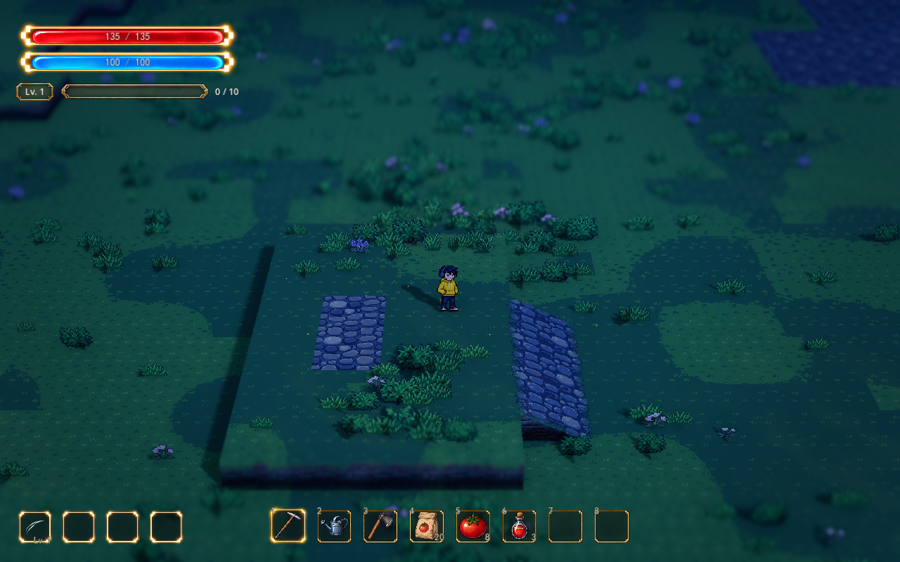

# 环境动态的时段与区域差异

2026-10-13。正式地图 `demoWithMeowa/1/scenes/world/world.tscn` 已接入独立的 `EnvironmentDynamics` 组件，复用现有自然风、花草和光点。用户确认全地图雨量一致，区域差异只作用于风摆与光点，保留现有地面落雨反馈。

## 实机预览

[家园黄金时段](environment-dynamics-preview/home-day.png) · [家园夜晚](environment-dynamics-preview/home-night.png) · [细雨](environment-dynamics-preview/home-rain.png) · [战区外围](environment-dynamics-preview/battle-night.png)。

预览为原生 D3D12 / Forward+ 实机，1280×800、16:10；镜头使用正式地图的 FOV 28°、距离 28 米、俯角 32°、景深 0.065。三张家园图保持相同人物位置和镜头，仅切换现有 Style。动画使用相同镜头的原生帧，没有裁切、缩放或二次像素化。画面包含取样时其他会话已经接入的材质与成长内容。

## 当前行为

时段沿用现有 Style，不新增自动昼夜循环。R 和检查器切换 Style 时，自然风摆幅、节奏及光点可见比例约用 1.5 秒平滑变化；照明、雨量和声音继续使用原有控制。

| Style | 自然风摆幅倍率 | 风摆时间倍率 | 光点可见比例 |
| --- | ---: | ---: | ---: |
| 原始光影 | 1.0 | 1.0 | 1.0 |
| 黄金时段 | 0.70 | 0.80 | 0.18 |
| 细雨 | 1.10 | 1.05 | 0.04 |
| 夜晚 | 0.50 | 0.65 | 1.0 |

这些倍率继续乘以 Weather 的自然风设置，包括原有雨天风力增加。它们只作用于自然风，不衰减闪身压弯和回弹。风摆时间连续积分，切换速度不会重置相位。夜间光点默认放大到基础尺寸的 1.8 倍，提高当前镜头下的识别度；其他时段平滑恢复基础尺寸。

| 区域 | 自然风摆幅倍率 | 光点可见比例 |
| --- | ---: | ---: |
| 家园 | 0.70 | 1.0 |
| 战区中心 | 0.55 | 0.05 |
| 外围绕行带 | 1.0 | 0.80 |
| 远侧地形 | 0.90 | 0.45 |

时段与区域倍率相乘。例如黄金时段家园自然风为原风力的 0.49 倍，夜晚战区中心为 0.275 倍。家园范围取原出生区地形；战区中心、绕行带取当前 `BattleArea` 的实际矩形。着色器按每丛花草或每颗光点的世界坐标计算，边界过渡宽度默认 4 米，因此人物移动、Q/E 或镜头朝向不会重排区域。

家园原有三处光点保留，战区西、东、南三处外围复用 `fireflies.tscn`，每处 24 颗、种子固定；发射器贴合所在台地高度。新增光点不占战区中心，不增加真实灯光。时段改变通过稳定的粒子选择和透明度渐变减少可见数量，不重新创建或随机撒布粒子。粒子自身的漂浮和独立明暗呼吸继续沿用原组件。

地表雨纹的大小、密度、强度和雨量保持当前设置；草地湿亮斑关闭状态保持。这里不调整雨幕、镜头水滴、雨声音源或风声音量。家园、战区和外围都使用同一场雨。

## 调节入口

在正式地图选择 **EnvironmentDynamics**，或在「参数总览」搜索「时段风摆」「区域光点」「环境动态」。新参数归入「视觉」，主要参数进入常用筛选。

| 参数 | 含义 |
| --- | --- |
| Enabled | 总开关；关闭恢复原自然风与家园光点，隐藏新增战区光点 |
| Editor Preview | 编辑器中是否应用动态差异 |
| Transition Seconds | 时段动态倍率的平滑变化时间；99% 接近目标所需时间约为此值 |
| Region Blend Width | 区域边界两侧的过渡宽度，米 |
| Style Wind / Style Wind Tempo / Style Fireflies | 四个分量依次为 X 原始、Y 黄金、Z 细雨、W 夜晚 |
| Night Firefly Size | 夜间光点尺寸倍率，默认 1.8；1 为原尺寸 |
| Region Wind / Region Fireflies | 四个分量依次为 X 家园、Y 战区中心、Z 绕行带、W 远侧 |
| Battle Fireflies Enabled | 独立开关三处新增外围光点 |
| Battle Firefly Height | 新光点相对当地地面的高度，默认 0.9 米 |

Weather 的风向、风力、速度、草花摆幅，以及 ArtDirection 的光点颜色、尺寸、亮度、呼吸速度仍是基础设置；本组件使用独立倍率，不能通过时段切换覆盖这些原参数。已有全局光点开关继续有效。

时段和区域变化只更新材质，不重建花草、地形或建筑，不修改植物落点、尺寸、种子或种植遮罩。背包、训练和成长选择期间仍运行环境；成长冻结继续只影响战斗对象。共享四境预览未接入此组件，保持原动态。

组件：`scenes/shared/environment_dynamics.tscn`；脚本：`scripts/world/environment_dynamics.gd`；区域函数：`shaders/environment_dynamics.gdshaderinc`。没有调用 Meowa 或制作新美术。

## 验证

在 `D:\.codexfile\work\environment-dynamics\validation` 的独立项目副本中验证，关闭存档写入，避免与其他会话运行实例互相影响。

- `test_environment_dynamics.gd`：38 项原生 D3D12 / Forward+ 检查通过，覆盖首帧、时段渐变、连续风摆时间、基础参数保留、独立自然风与闪身、开关恢复、外围光点高度、全局光点开关、战斗冻结期间继续运行、镜头、植物分布及存档保持、参数总览。
- 既有 Style 切换 83 项、闪身环境 34 项检查通过。闪身环境 headless 回归退出时仍有已有资源清理提示；新组件原生验证及实机预览日志无解析、着色器或运行错误。
- 同镜头拍摄黄金、细雨、夜晚，以及夜间外围连续 24 帧。中间脚本、日志与原始帧保存在上述任务目录。

相关规则见[参数与 Style](parameters-and-styles.md)、[花草样板](foliage-visual-sample.md)和[地图效果](map-effects.md)。
