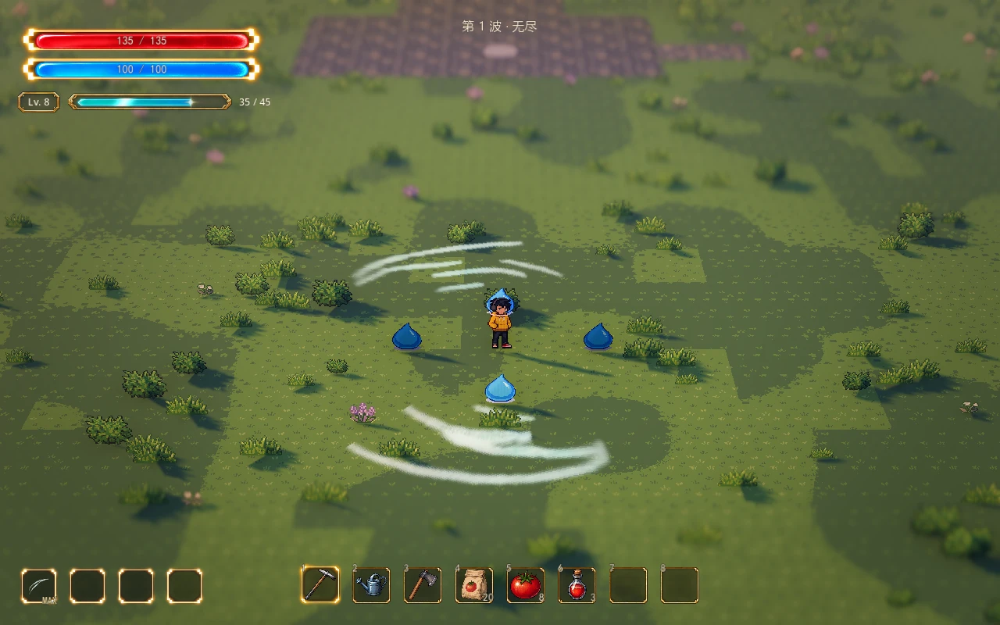
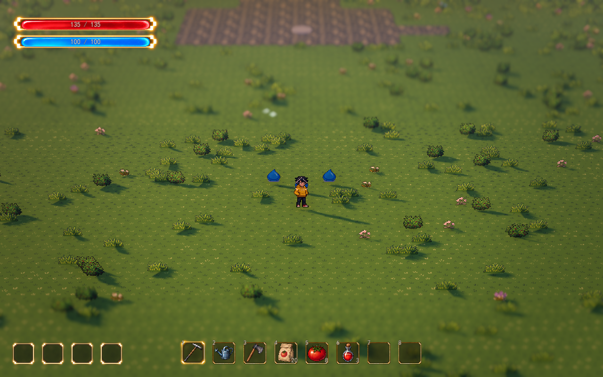

# 第一种自动攻击：A01 扇击

2026-10-13。第一种扇形自动攻击已接入新战场，并按最新确认接入本局等级和实际升级选项。人物沿用现有动画，武器独立表现；成长从单段扇击发展到多段连斩、连续旋转与高速双刃。以下八级与数值是可调制作基线，不固定后续技能的等级上限。

## 本局八级成长

经验升级使用现有卡片。选择扇击升级后立即应用下一等级，卡片显示真实伤害、范围和形态；左下技能栏显示同一份本局等级，满级显示 MAX。波间保留，重试、新挑战和返回家园恢复 1 级。Tab 技能页显示本局实际技能，不从旧学习目录免费装配。

| 技能等级 | 每次命中伤害 | 半径 | 动画与行为 |
| --- | ---: | ---: | --- |
| 1 | 10 | 2.40 米 | 原有单段 100° 扇击 |
| 2 | 12 | 2.76 米 | 斩光延伸 |
| 3 | 14 | 3.00 米 | 扇面展开到 140° |
| 4 | 17 | 3.24 米 | 两段交错扫击，各段独立命中 |
| 5 | 20 | 3.60 米 | 160° 三段连斩 |
| 6 | 60 | 3.96 米 | 单刃周身持续旋转，210°/秒，同体间隔 0.40 秒 |
| 7 | 75 | 4.44 米 | 双刃持续旋转，300°/秒，同体间隔 0.30 秒 |
| 8 | 100 | 5.04 米 | 高速双刃无缝旋转，420°/秒，同体间隔 0.20 秒 |

表中是不含通用增益的默认基础配置。旋转覆盖指斩光随时间绕过周身，仍按实际弧面命中；不在每帧无条件伤害整个圆内的敌人。后期提高伤害是为了避免由三段连斩变为单刃旋转时实际输出下降，未做完整敌人组合与整局平衡。



[1 级](fan-attack-preview/level-1.png) · [4 级](fan-attack-preview/level-4.png) · [8 级](fan-attack-preview/level-8.png) · [实际升级选项](fan-attack-preview/upgrade.png) · [旋转进化选项](fan-attack-preview/rotation-upgrade.png)。均为正式地图、当前 Lumina 镜头；画面中的高生命静止史莱姆仅用于检查持续动画，正式怪物资源未改。

## 配置与后续技能接口

`FanAutoAttack.skill_definition` 引用 `data/skills/fan_slash.tres`，每级对应一个 `CombatSkillLevel`。基础伤害、范围、扇角、间隔及外观仍在攻击组件调节；等级只在运行时计算倍率，不改写场景基础值或永久存档。参数总览可搜索“本局技能定义”“技能等级列表”“等级倍率与行为参数”。

| 等级参数 | 含义 |
| --- | --- |
| `damage_multiplier` / `range_multiplier` | 相对于攻击组件基础伤害／半径的倍率 |
| `angle_multiplier` / `interval_multiplier` | 基础扇角／起手间隔倍率；整组连斩保留动作所需时长 |
| `sweep_count` / `repeat_gap` / `combo_turn` | 每组段数、段间空隙（秒）、后续斩击的交错角度（度） |
| `continuous_rotation` | 大于 0 时切换为持续旋转 |
| `rotation_speed` / `spin_blades` | 旋转速度（度/秒）与刃数 |
| `hit_interval` | 旋转对同一目标的最短命中间隔；所有刃共用 |
| `energy_multiplier` | 特效基础亮度倍率 |

`RunSkills` 维护实际技能等级并为 `RunGrowth` 提供动态候选，满级条目退出池。新增技能组件提供 `get_skill_definition()`、`apply_skill_level(level)`、`describe_skill_upgrade(from, to)`，在 `RunSkills.skill_paths` 登记路径，并沿用 `register_combat_node` 的战斗冻结接口即可参加同一升级流程；各技能自行解释对应参数、动画和判定。

按用户确认，技能等级与并行开发的 [本局全局增益](combat-buffs.md) 共存。等级先产生攻击参数，通用伤害、范围与间隔增益只应用一次；卡片读取同一结果。冷却增益不会重复加速旋转角速度。技能满级后仍可选择有效增益，整个有效池耗尽时跳过选择并保留经验等级，不生成空卡、额外恢复或其它奖励。

动画复用原有 Meowa 八帧斩光，低等级播放完整扫击，高等级保留末段三帧并持续旋转。技能图标通过 AtlasTexture 直接裁取第一帧有效区域，源 PNG 不变。人物不争抢新的攻击动作。用户最新确认闪避不打断攻击：扫击、连斩和旋转均保留进度、方向、冷却与命中记录，特效立即跟随实际落点并重新贴合地表；不沿瞬移路径拖出伤害，也不重启旋转的同体命中间隔。

以下保留最初单段扇击的接入记录与基础参数。



动画预览使用实际 1280×800 渲染画面，展示八个扫击姿态、收尾和休整。为看清特效，前半段隔离三只敌人取帧；随后让三只史莱姆真实追击，由自动扇击清波。原场景的刷怪默认值和相机配置保持原样。

## 试玩与调节

运行正式地图 `demoWithMeowa/1/scenes/world/world.tscn`，沿南侧道路到新战场入口 `(0, 0, 25.6)` 附近按 **F** 开始。敌人进入攻击范围后自动出手；走位、跳跃、闪身和 QE 沿用原控制。清波后 F 主动继续，结果后 ESC 返回小院。挑战 UI 沿用隐藏设置。

在正式地图选择 **WavePrototype / FanAutoAttack**。已开启波次实例的子节点编辑，可直接改 Inspector 参数并保存场景；要改变所有地图的通用默认值，打开 `scenes/combat/fan_auto_attack.tscn`。

| 参数 | 默认 | 含义 |
| --- | --- | --- |
| `enabled` | 开启 | 关闭后停止扇击，方便单独观察怪物 |
| `damage` | 10 | 每次扫击对每只怪的伤害；0 可仅观察特效 |
| `attack_range` | 2.4 米 | 世界 XZ 覆盖距离，特效同步缩放 |
| `fan_angle` | 100° | 前方扇区角度，特效同步展开；保留侧后方薄弱面 |
| `attack_interval` | 0.8 秒 | 两次起手的最短间隔；不能短于起手加扫击时长 |
| `windup_time` | 0.1 秒 | 自动选定方向后到斩光出现的等待时间 |
| `sweep_time` | 0.18 秒 | 斩光从左到右扫过的时间，同时控制逐步命中 |
| `fade_time` | 0.12 秒 | 扫击后的特效收尾时间，不额外扣血 |
| `height_tolerance` | 0.55 米 | 起点地面和敌人地面的高度差限制，避免隔层命中 |
| `knockback_distance` | 0.25 米 | 史莱姆受到的轻微物理击退，可设为 0 |
| `effect_color` | 白色乘色 | 保留 Meowa 原配色；可调整整体色调 |
| `effect_opacity` | 0.85 | 特效透明度 |
| `effect_energy` | 0.6 | 特效自身亮度；保持场景可读性 |
| `effect_height` | 0.16 米 | 特效离地高度，避免与地面重叠闪烁 |
| `frames` | Meowa 八帧斩击 | 可替换的透明动画资源 |

参数修改会用于后续攻击与实时特效。默认史莱姆 20 生命，1 级扇击伤害 10，正常两次命中击杀。范围扩大不额外提高单体伤害；当前本局技能等级与通用增益均已接入，不读取装备攻击，不消耗魔力，也未接入暴击或敌人状态。

## 行为与命中规则

攻击组件独立计时，自动选择范围内最近、可见且可达的目标，锁定这一击的世界方向。没有有效目标时保持就绪，不空挥。QE 只改变观察角度；扫击期间普通移动继续，特效圆心随人物实际位置移动，方向不随目标重新旋转。

斩光逐步扫过前方扇区，每次扫击对同一只怪只结算一次；一击可命中多只怪，伤害不按数量分摊。提高帧率不会增加命中次数。闪身期间攻击继续，保留这一段的去重记录和已开始的冷却；特效直接移到落点，后续只在人物当前攻击范围内判定，不把伤害沿闪身路径拉长。

命中同时检查范围、角度、扫过时机、地面高差、墙体遮挡和导航可达性。跳跃使用脚下实际地面作为攻击起点，不改变成隔层攻击。视觉网格沿坡面采样，遇到墙体、断层或水面裁切；史莱姆的击退使用真实碰撞，不穿墙或被击落台地。

清波、失败、撤退和重试清理当前玩家攻击。组件通过波次的战斗节点接口登记，成长选择可冻结它自己的计时和效果，不占用人物移动动画。击杀回调如果冻结或结束战斗，同次调用立即停止继续伤害。

## Meowa 美术与接入

可复用组件：`scenes/combat/fan_auto_attack.tscn`；行为脚本：`scripts/combat/fan_auto_attack.gd`；特效材质：`shaders/fan_slash.gdshader`。

美术位于 `assets/meowa/combat/fan_slash/`：

- `frames.tres`：八帧非循环 SpriteFrames。
- `slash.png`：原生 640×640 帧组成的 4×2 RGBA 图集，未缩放或重新像素化。
- `source/source.png`：Meowa 生成的透明斩光起始素材。
- `source/slash.webp`：Meowa 受关键帧约束的完整透明动画，8 帧、原播放时长 0.8 秒。运行时按 `sweep_time` 播放，再由材质淡出。

动画来源采用 Meowa 通用图片生成与受左、中、右三个姿态约束的关键帧动画。人物没有新增攻击动作；网格与材质负责在世界中铺展、裁切和播放 Meowa 斩光。

Shader 显式按每帧的 AtlasTexture 区域采样，不把整张图集当作当前帧。透明效果使用最近邻采样、保持深度遮挡、关闭投影，方向与扇区使用真实世界坐标。

此前的两次攻击声音生成失败并退款。2026-10-13 用户确认“柔和利落：空气切割感、轻微能量尾音”后，已重新使用 Meowa 制作并接入两种挥击声和两种较轻的命中声；此前的 BGM、天气和人物移动声音沿用原配置。

## 攻击音效

在正式地图选择 **WavePrototype / FanAutoAttack → 攻击音效**，也可在参数总览的“声音”分类搜索中文名。通用音源保存在 `scenes/combat/fan_auto_attack.tscn`，正式地图自动继承。

| 参数 | 默认 | 含义 |
| --- | --- | --- |
| `audio_enabled` | 开启 | 攻击声音总开关；关闭立即停止已在播放的攻击声 |
| `sweep_sounds` | 两种 Meowa 挥击声 | 斩光出现时播放，相邻两次避免重复同一音源 |
| `hit_sounds` | 两种 Meowa 命中声 | 真正扣除敌人生命时播放；0 伤害不播放命中声 |
| `audio_volume_db` | -10 dB | 挥击声音总音量；越接近 0 越响 |
| `hit_volume_db` | -6 dB | 命中相对增益，默认最终音量为 -16 dB |
| `audio_pitch` / `audio_pitch_variation` | 1 / 0.035 | 基础音高与轻微随机变化，不改变技能时长 |
| `hit_sound_limit` | 2 | 每段扫击最多两次命中声；0 可单独关闭命中反馈 |
| `hit_sound_interval` | 0.055 秒 | 群体命中时两次声音的最小间隔，不减少实际伤害或命中数量 |
| `rotation_sound_interval` | 0.55 秒 | 连续旋转声音的脉冲间隔，双刃共享；旋转挥击另降低 3 dB |
| `audio_manager` | 自动连接公共管理器 | 所有武器统一提交声音，播放到 Combat 分组 |

起手等待时保持安静，声音在实际扫击开始时触发。连斩各段重新触发；连续旋转只在附近有合法目标时播放较轻的挥击脉冲，不按帧数、刃数或敌人数重复堆叠。成长选择随武器一起冻结和恢复声音，闪身保留正在播放的攻击声和声音脉冲计时；失败、重试和返回清理旧声音，正常休整允许已命中的短尾音结束。

生产 WAV 位于 `assets/meowa/audio/combat`：`sweep_01.wav`、`sweep_02.wav`、`hit_01.wav`、`hit_02.wav`。每段 0.48 秒，48 kHz 单声道、16 位 PCM、非循环、无削波；去除直流偏移、控制增益并做短淡入淡出。Meowa 原始 MP3 保存在同目录 `source`，未经覆写。单段素材的 RMS 约 -22～-23 dBFS、峰值不高于 -7 dBFS，运行时再应用上述增益。

[游戏实际攻击音量试听](fan-attack-preview/skill-audio.wav)：依次展示基础挥击、连斩和旋转，只录制攻击声音，方便判断重复密度。`tests/test_fan_attack_audio.gd` 的 39 项检查覆盖实际地图绑定、起手／出声时间、真实命中、群体限制、连斩与旋转、参数、成长冻结、闪避声音延续、结束清理、四段声音完整播放，以及声音参数索引。

## 全局战斗音效管理

2026-10-13 已接入 `MapEffects / GameAudio`，随公共地图效果场景复用。后续武器、敌人和危险提示提交声音事件，不各自创建不限量播放器。管理器复用一个共享 3D 播放池，丢弃或合并声音不会减少伤害、命中、经验或其他战斗事件；不排队补播已过时的战斗声。

| 检查器参数 | 默认 | 含义 |
| --- | --- | --- |
| `enabled` / `max_voices` | 开启 / 12 | 战斗声音总开关与全地图同时播放上限 |
| `important_reserve` | 2 | 普通声音最多占 10 个槽，另留 2 个给重要反馈 |
| `per_cue_limit` | 3 | 同一种声音跨武器共享的同时播放限制 |
| `minimum_interval` | 0.035 秒 | 同一来源、同一声音不能在过短时间重播 |
| `merge_window` / `merge_radius` | 0.08 秒 / 2.5 米 | 同区域普通命中和死亡各自合并，跨武器生效 |
| `near_distance` / `far_distance` | 3 / 20 米 | 距人物近处保持清楚，远处衰减到不播放 |
| `distance_falloff` | 1.25 | 远近衰减曲线形状 |
| `offscreen_gain` | 0.45 | 较远、画面外普通声音的增益；近身、危险及受伤反馈保留 |
| `panning_strength` / `listener_height` | 0.35 / 0.75 米 | 左右声像程度与人物附近的听觉中心高度 |
| 五个 `*_volume_db` 分组增益 | 0 dB | Combat、Music、Ambience、UI、Movement 各自调节，叠加原音源增益 |
| `compression_enabled` / `compression_threshold_db` / `compression_ratio` | 开启 / -16 dB / 2 | 轻度压缩战斗峰值，不自动提高整体音量 |
| `limiter_enabled` / `limiter_ceiling_db` | 开启 / -1 dB | 控制 Master 最终输出峰值 |

默认优先级为人物受伤 100、危险提示 80、攻击 40、命中 10、死亡 5；事件可按需要覆盖 0～100。预算满时，较强优先级或同优先级中更清楚的声音可替换较弱者；普通命中不能挤掉重要警告。没有新建受伤、死亡或其他技能声音，这些分类当前提供接入接口。

听觉中心随人物位置，水平朝向随镜头。距离按人物计算，拉远镜头不会把近身攻击误当成远处声音；不修改 FOV、镜头距离、旋转、景深或布局。扇击声音随正在移动的武器，包括闪避落点，命中声留在真正被击中的位置。战斗冻结暂停整个战斗池及合并计时，天气、BGM、UI 与脚步独立；正常休整保留短尾音，其他阶段切换清理旧声音。

分组资源为 `demoWithMeowa/1/default_bus_layout.tres`。背景音乐、雨风、UI 操作和人物动作已分别路由到 Music、Ambience、UI、Movement，原播放器的音量数值保留；它们不占战斗池预算。参数总览“声音”分类可搜索以上配置。

后续组件的最小调用示例：

```gdscript
var audio := get_tree().get_first_node_in_group(&"game_audio") as GameAudio
audio.request({
    "source": self, # 生命周期拥有者；退出地图或取消攻击时用 stop_source(self)。
    "cue": &"weapon_sweep", # 同一音色族使用稳定标识，便于跨来源限流。
    "clips": sweep_sounds,
    "kind": GameAudio.Kind.ATTACK,
    "position": global_position,
    "volume_db": -10.0,
    "pitch": 1.0,
    "follow_source": true # 命中／爆炸留在原位置时设为 false。
})
```

`request()` 返回接受请求后的池内播放器，拒绝时返回 `null`；调用方不持有其生命周期，也不在拒绝后补发同一过时事件。`stop_source(self)` 只取消该来源，`stop_all()` 清理整个战斗池，`get_debug_state()` 返回播放、合并、预算过滤、距离过滤与替换计数。普通死亡声音若需播完，来源应是存活的波次或反馈组件，避免绑定即将销毁的怪物。

验证使用 `tests/test_game_audio.gd` 与更新后的扇击声音测试，覆盖 100 来源总预算、重要反馈预留与替换、100 次区域命中合并、距离、画面外优先级、QE 朝向、镜头拉远、来源移动／销毁、冻结恢复、静音、实时池大小和实际混音资源。原生 WASAPI 最终输出压力测试中，12 个同时放大的声音在 Combat 分组出现 +16.55 dBFS 峰值，经 Master 限幅后为约 -1.00 dBFS，录制无丢帧。

## 后续流派接口

这版以 A01 行为为起点，武器外形和动画独立于人物。其他攻击可增加自己的组件与计时，不需要争抢人物攻击动作。`strike_started(direction)` 与 `hit_landed(enemy, damage)` 提供后续攻击反馈和合法直击事件入口；状态附加仍须单独实现去重、间隔和伤害来源规则。

扇长、扇角、多段与旋转已按上方等级配置实现。命中事件继续保留给缓速、燃烧、导电等后续机制，再与其它攻击形成组合；这些状态和其它技能尚未接入。奖励仍由本局成长流程统一应用，不由攻击组件自行发放。

## 验证

新增 `tests/test_run_skills.gd`：67 项通过，包含真实经验选择、连续升级、满级过滤与池耗尽、HUD、波间保留、重试／返回重置、结束后失效回调、多技能接口、双／三段独立命中、连续旋转、墙体与高差、真实闪避期间双刃延续、冻结恢复以及技能与增益叠加。固定目标、每级六秒的实际总伤害依次为 80／96／112／272／340／420／1500／2800，逐级增加；这是隔离输出检查，不代替整局平衡。旋转在 30／120 Hz 的采样差异不超过一次离散命中，不按渲染帧反复结算。

现有扇击 35 项、成长协调 24 项、成长／波次集成 25 项、刷新 66 项、升级 UI 36 项、经验视觉 30 项，以及基础波次与混合怪物接口回归通过。并行增益 63 项和攻击音效 39 项共同通过。原生 D3D12 / Forward+ 验证 1／4／8 级、真实升级候选、图标与持续旋转，镜头保持 28 米、32°、FOV 28°、景深 0.065、16:10。

`tests/test_fan_auto_attack.gd` 覆盖自动目标、分时群体命中、单次去重、范围／角度／高差、墙体与特效裁切、运行时参数、30／120 Hz 一致伤害、QE、移动跟随、闪避不中断与落点命中、瞬移路径不扣血、物理击退、两击击杀、休整／失败／重试清理以及当前图集帧采样。既有波次测试改为调用独立扇击组件，保留循环与怪物接口验证。

当前自动扇击共 35 项检查通过，包含成长冻结／恢复与闪避延续兼容；既有波次循环检查通过。原生 D3D12 / Forward+ 实机播放全部八帧，三只史莱姆真实追击并被自动扇击击杀，随后进入安全休整。

实际场景保持当前 Lumina 镜头：FOV 28°、距离 28 米、俯角 32°、焦点高度 0.9 米、深度景深 0.065、16:10；没有为截图改动正式镜头、天气或地图布局。[静态效果](fan-attack-preview/sweep.png)。
