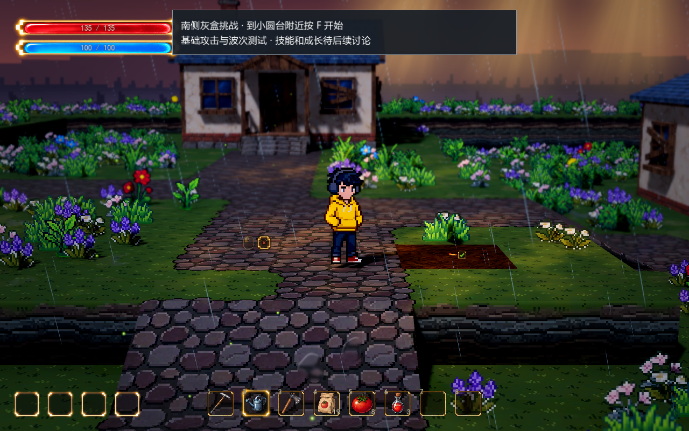
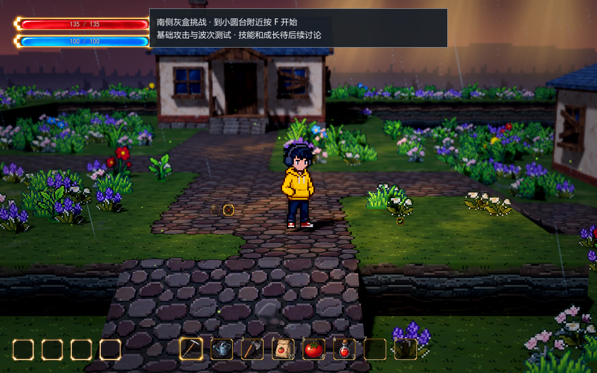

# 种植操作

正式地图 `demoWithMeowa/1/scenes/world/world.tscn` 已接入锄地、播种、浇水，以及取消种植恢复草地。在 Godot 打开该场景后按 F6 运行。

## 操作

| 操作 | 当前默认方式 |
| --- | --- |
| 选择物品 | 数字键 1–8 或单击物品栏；背包详情的“拿起使用”也能选择物品并返回地图 |
| 锄地 | 选中锄头，左键点击身边草地；初始快捷槽为 1 |
| 播种 | 选中番茄种子，左键点击耕地；初始快捷槽为 4，每次成功消耗 1 颗 |
| 浇水 | 选中洒水壶，左键点击耕地；初始快捷槽为 2 |
| 恢复草地 | 选中锄头，右键点击耕地，清除播种和浇水状态；当前默认退回已播种的种子 |

槽位可以重新绑定，数字只代表初始配置。“拿起使用”优先选中已有绑定；未绑定的物品优先放入空快捷槽，槽位已满时使用当前槽。

默认只允许开垦平整草地，包括配置为草地的自定义画笔。道路、坡道、水面、建筑和其他物体占据的格子不能耕作。人物需落地、站在同层地面并靠近目标；隔墙或远处地块不会触发操作。打开占用人物输入的界面时停止地面操作，世界继续运行。重复播种、重复浇水或重复恢复不会重复扣除或生成物品。

## 地表与保存

耕地复用 `data/spawn_paint_palette.tres` 中编号 3 的细颗粒泥土画笔，纹理是已有的 `assets/meowa/homestead/soil.png`。开垦时隐藏该格花草及投影，不重新随机周围植被；恢复时清除遮罩，原来的草地和花草回来。种粒取自已有 Meowa 物品图集的原生裁片，播种后贴在地表；浇水让泥土颜色加深。

操作修改运行时地形副本，编辑器原始 `data/spawn_terrain.tres` 保持原样。耕地、种子类型、浇水状态和库存统一保存在 `user://equipment_skills.json` 的版本 3。版本 1／2 的有效存档升级前分别保留 `.v1.bak`／`.v2.bak`，不重新补回已耗尽库存。种子扣除与播种、种子退回与恢复地块各自在一次状态通知中保存。

当前完成这些操作与状态保存。作物生长、成熟、收获、自动干燥、雨水灌溉、工具耐久和洒水壶补水仍待后续设计；当前浇水记录持续保留。

## 参数

在正式地图选择 `Farming` 节点调节：

| 参数 | 默认值 | 含义 |
| --- | --- | --- |
| `enabled` | true | 开关种植操作 |
| `reach` | 2.8 | 人物到目标格中心的水平操作距离，米 |
| `height_tolerance` | 0.35 | 允许的人物脚底与地块高差，米 |
| `action_interval` | 0.35 | 成功操作后的间隔，秒 |
| `only_grass` | true | 默认只在草地开垦；关闭后允许其他未占用、无覆盖标记的平面地表 |
| `use_button`／`restore_button` | 左键／右键 | 使用与恢复的鼠标按键，应保持不同 |
| `soil_paint_id` | 3 | 泥土画笔固定编号；更换后重新运行生效 |
| `refund_seed_on_restore` | true | 恢复已播种地块时是否退回种子 |
| `watered_darkening` | 0.68 | 浇水后的颜色倍率，越低越深；运行时可调 |
| `watered_roughness` | 0.72 | 浇水后粗糙度；运行时可调 |
| `seed_texture`／`seed_size` | 现有种粒／0.24 | 播种标记与大小；修改后重新运行生效 |
| `valid_color`／`invalid_color` | 暖金／暗红 | 可操作与无效目标格的边框颜色 |

`world_id` 关联地图存档，已有种植记录后应保留名称。地块与现有地形格对齐，当前为 1.6 米。物品用途由 `data/loadout_catalog.tres` 中 `ItemDefinition.farm_action` 配置，当前启用锄头、番茄种子和洒水壶。

验证覆盖真实鼠标与数字键操作、背包拿起使用、道路与建筑限制、范围和高差、库存同步、撤销退种、防重复操作及保存重载。预览沿用当前开发相机和景深参数。

