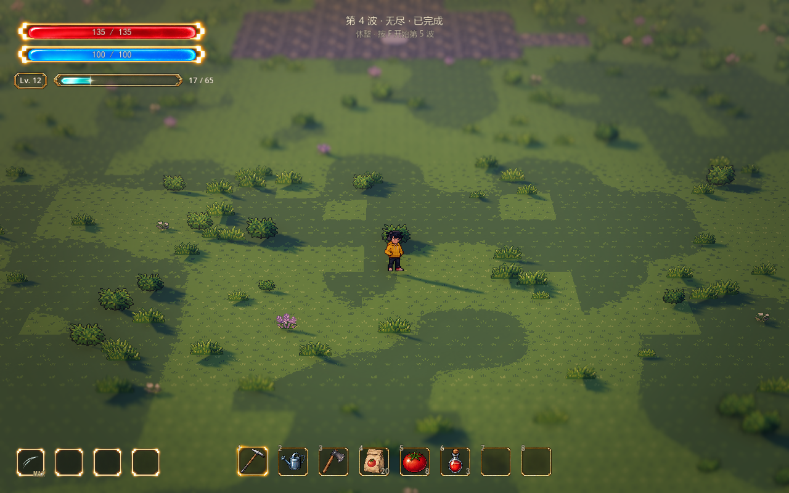

# 无尽波次

怪物接入与同场 500 只以上的后续规划见[怪物框架](enemy-framework.md)。正式地图已连接 `horde_128.tres` 和 `endless_health_growth.tres`，分别控制数量与生命；新挑战／重试生效。单游戏窗口 100 FPS 目标的验收按用户安排等待其它运行任务结束。

2026-10-13。按用户要求将正式地图刷怪改为无尽模式，并确认保留清波休整、按 F 主动继续。

前三波使用小股与怪潮交替的分区资源，主体数量为 18、28、40，集中怪潮分别为 10、14、18 只，第一波起混合五种主怪。怪潮自动读取目录权重，新怪登记后下一局自动加入；幼体不直接进入怪潮，仍只由壶兽分裂产生。第三波清完不触发胜利，进入安全休整；按 F 开始第四波，以后波数继续增加。失败、ESC 撤退或离开战区结束本局，T 重试回到第一波。具体编排见 [怪物刷新](wave-spawning.md)。

## 后续波次

- 第四波开始沿用末波的分区比例、预告和增援结构，混合怪潮继续从本局目录自动编排，不固定种类名单；每波总数增加 16 只：56、72、88、104……，第 25 波达到每波 384 只后保持数量，波数继续增加。
- 各组按原比例分配整数数量，保持主体总数准确；当前第四波六组为 11、25、6、6、5、3 只。壶兽死亡后额外登记幼体，幼体同样占用容量与单波登记预算。
- 怪潮每批数量随本组总数增长，受当前波同场／同种／分类／容量点上限约束；后期每批最多使用约一半同场容量，且不缩小原始每批规模。正式末波基础每批 18，后期可到每批 64；剩余成员按批间隔形成后续潮次。满批等位与集中入口沿用刷新队列，不退回逐只补怪。
- 组内间隔每波减少原值的 4%，总减幅最多 75%，最短 0.08 秒；怪潮模式下它是批间隔。原间隔更短时保留原值，避免把增长变成减速。原先分开的相邻组按实际批次数保留刷怪间歇，数量增加时顺延后续组。
- 前三波同场容量 24，第 4 波起每波增加 8，第 16 波达到 128 后保持。满员等待空位，不丢弃已登记任务；每帧生成预算、入口禁刷、玩家安全距离、间距、碰撞和可达检查继续生效。
- 第 4 波起每波生命增加基础值的 15%，倍率下限 1、上限 10，第 63 波达到十倍。史莱姆基础生命 20，最高 200；速度、攻击伤害和经验保持自身基础资源。召唤体与分裂体也按自己的基础生命应用出场波倍率，可按怪物关闭成长。有限模式不应用该曲线。

本局只保留三个开场模板，后续波次在开始时按需生成，不预先存储无限波次，也不随波数累计历史模板。模式、模板、怪物基础资源、数量规则和生命规则在开始时建立本局快照；编辑器或远程检查器修改后，新挑战／重试生效。已出生实例的最大生命保持出场时的值。

## 成长与休整

清波先收取剩余经验，完成连续升级选择，再进入休整。升级界面继续只冻结战斗，天气和声音运行。人物等级、武器等级与全局增益在波次间保留，挑战结束或重试按原规则清空。当前奖励池耗尽后仍可继续升级与清波，不新增占位奖励。

休整没有倒计时，不自动生成下一波；按 F 继续，ESC 可撤退。顶部显示“第 N 波 · 无尽”和下一波操作提示，不显示有限总波数。

## Godot 参数

选中 `scenes/world/world.tscn` 的 `WavePrototype → 波次配置`，展开 `Population Rules` 与 `Health Growth Rules`，也可在“参数总览 → 战斗与成长”搜索“怪潮”“生命成长”或具体参数。

| 参数 | 正式地图基线 | 含义 |
| --- | ---: | --- |
| Endless Mode | true | 启用无尽；关闭后恢复有限编排和最终胜利，用于开发对照 |
| Population Rules | horde_128.tres | 已连接的正式数量档位，优先于控制器旧数量参数 |
| First Active Limit / Max Active | 24 / 128 | 同场容量起点与终值，包含预告中的怪物 |
| Growth Start Wave / Active Growth Per Wave | 4 / 8 | 同场容量递增的起始波和增量 |
| Enemies Per Wave Increment / Max Wave Enemies | 16 / 384 | 开场模板后的单波总数增量和上限 |
| Interval Reduction Per Wave / Max Interval Reduction | 0.04 / 0.75 | 每波减少基础组内间隔的比例和累计上限 |
| Min Spawn Interval | 0.08 秒 | 无尽生成的组内间隔下限 |
| Max Queued Per Wave | 1024 | 单波登记总预算，包含延迟分裂／召唤 |
| Health Growth Rules | endless_health_growth.tres | 已连接的无尽生命规则 |
| Start Wave / Bonus Per Wave | 4 / 0.15 | 生命递增起始波与每波基础生命增幅 |
| Minimum Multiplier / Maximum Multiplier | 1 / 10 | 生命倍率上下限；上限不可超过十倍 |
| Waves | 原三份资源 | 开场编排；最后一份也是续波模板，支持混合怪物 |

数量规则为空时才使用控制器旧参数：每波 +8、总数 160、间隔减幅 3%／最多 50%、最短 0.18 秒；这些旧字段在正式地图已被数量资源覆盖。`waves` 留空时，无尽模式以 `first_wave_enemies` 和 `spawn_interval` 生成一个开场模板，再使用所选曲线。有限模式继续沿用 `total_waves`、`enemies_per_wave`。共享控制器默认保留有限模式兼容，正式地图显式启用无尽。

`get_run_state()` 的 `endless` 标识区分无尽模式，`wave_count = 0` 表示没有有限总数，`active_limit` 与 `enemy_health_multiplier` 暴露本波容量和生命倍率；`wave_label(number)` 提供显示文本。`wave_cleared` 逐波通知，无尽不会自动发出胜利或 `run_ended`。

## 验证

`tests/test_wave_health_growth.gd` 覆盖新正式规则连接、实际 128 只生成与容量封顶、数量曲线、生命成长与真实扣血、固定生命豁免、召唤、配置快照、重试、有限模式和错误规则清理。极大波号用于计划与封顶计算检查，不代表实际游玩相应波数。

`tests/test_endless_waves.gd` 显式关闭新资源，继续覆盖旧曲线七波共 326 只主体及实际分裂幼体的兼容性、混编模板保留、F 续波、清波升级冻结、增益保留、休整不自动开始、无最终胜利、危险与队列清理、配置快照、失败／撤退／重试及空编排。无界面测试直接向正式按键处理器传入 F，原生窗口测试使用输入分发。既有成长集成、参数总览与渲染一致性验证另行执行；性能验收尚待继续。
