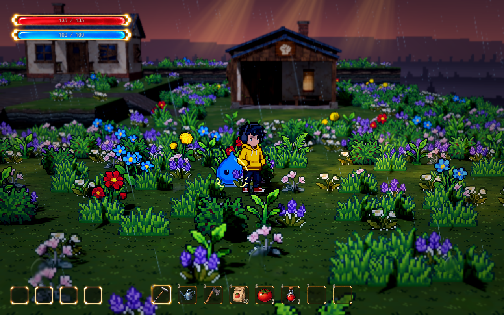

# 第一只怪物：蓝色史莱姆

本文保留第一只史莱姆的外观、巡逻与追踪原型说明。原小院展示位置 `(8, 0, 12.8)`、训练小屋附近的观察路径和下方截图属于历史布局；当前正式地图使用波次战斗实例，入口见 [正式地图说明](../../demoWithMeowa/1/scenes/world/README.md)，实际怪物目录与数值见 [怪物框架](enemy-framework.md)。

原展示模式完成外观、待机与跳动动画、巡逻、发现玩家后追踪、失去视线或超过活动边界后返回。地图独立展示实例靠近玩家后停下，不造成伤害。

同一场景已接入 [核心波次](wave-graybox.md)，战斗实例持续追击，接触造成伤害，可受伤和死亡。基础生命下通常两次一级扇击命中击杀，无尽生命成长与增益会改变所需次数。以下巡逻约定继续适用于保留的展示模式。



## 行为

- 初始出生点距史莱姆约 12 米，不会立即触发追踪。史莱姆在出生点周围随机选择巡逻目标，移动后短暂休息。
- 看见 6 米内的玩家后开始追踪。建筑、墙体和地形会遮挡发现视线；短暂失去视线后仍追踪，超过 1.5 秒则返回。
- 玩家或史莱姆距怪物出生点超过 10 米时，史莱姆返回原处；返回期间不重新切入追踪。回到出生点后恢复巡逻。
- 沿地形格生成的路线避开水面、悬崖与建筑，连接边缘实际相接的坡道。移动使用真实胶囊碰撞体，不穿墙；寻路不是跳跃或跨台阶能力。
- 打开背包、技能或训练界面时，史莱姆仍活动，人物控制由现有界面占用。

## 可调参数

在 Godot 打开当前地图，选择 `Slime`，Inspector 可调整：

| 参数 | 默认值 | 含义 |
|---|---:|---|
| Patrol Radius | 3 米 | 围绕怪物出生点的巡逻范围 |
| Patrol Speed | 0.9 米/秒 | 巡逻及返回速度 |
| Chase Speed | 1.8 米/秒 | 追踪玩家的速度 |
| Detect Distance | 6 米 | 有视线时触发发现的距离 |
| Leash Distance | 10 米 | 以怪物出生点为中心的追踪边界 |
| Stop Distance | 0.9 米 | 接近玩家后停下的距离 |
| Lost Sight Seconds | 1.5 秒 | 视线被挡后的追踪宽限时间 |
| Idle Seconds | 1.5～3.5 秒 | 两次巡逻之间的休息时长 |
| Random Seed | 12102026 | 固定巡逻随机序列，便于复现 |
| Body Radius / Height | 0.28 / 0.7 米 | 胶囊碰撞体半径和高度 |
| Gravity | 20 米/秒² | 接地与下落速度 |
| Route Interval | 0.45 秒 | 追踪路线刷新间隔 |
| Animation Speed | 1 | 动画速度倍率 |

外观大小可在可复用场景 `scenes/enemies/slime.tscn` 的 `Sprite` 调节 `Pixel Size`，当前为 `0.015625`；可见轮廓约 0.75 米高。调整外观大小时同步调整脚底偏移和碰撞体。受光与遮挡轮廓沿用人物材质；主体正常受草木和建筑遮挡，被挡部分显示像素轮廓。轮廓开关、颜色、宽度与透明度可在 `Sprite` 独立调整。

## 美术与预览

美术及动画来自 Meowa，与当前人物沿用同类像素风格。八方向原图为 64×64；每方向有 8 帧待机及 8 帧跳动，动画画布为 80×80，保留透明运动空间。运行时使用原始像素帧和最近邻采样，不重新像素化。

- 可复用场景：`demoWithMeowa/1/scenes/enemies/slime.tscn`
- 动画资源：`demoWithMeowa/1/assets/meowa/slime/animations.tres`
- 原始方向图、Meowa 动画与帧图集：`assets/meowa/slime/views`、`source`、`frames`
- [八方向外观](../media/slime-preview/directions.png)、[正面跳动动画](../media/slime-preview/hop.gif)
- [旋转至 -45°](../media/slime-preview/view-minus45.png)、[旋转至 90°](../media/slime-preview/view-90.png)

实机截图保留现有相机 FOV 30°、距离 11 米、俯角 10°、焦点高度 0.75 米与深度景深；只移动人物观察位置及旋转水平朝向，没有新增演示地图或改动植被布局。

## 验证

`tests/test_slime.gd` 共 47 项检查，已在无窗口模式和原生 D3D12 / Forward+ 下通过。覆盖首次落位、动画结构、共享遮挡轮廓、巡逻半径、检测与停止、视线遮挡、绕墙路线、丢失目标返回、回到出生点、界面开启时继续活动、地形重建后的路线恢复、真实坡道爬升、八方向切换保留动画相位，以及悬崖和水面隔离。人物台阶通行的 15 项检查也通过。

```powershell
& 'D:\Project\godot\Godot_v4.7.2\Godot_v4.7.2-stable_win64_console.exe' --headless --fixed-fps 60 --path 'D:\Project\HD-2DMap\demoWithMeowa\1' --script res://tests/test_slime.gd
```

顺带修复人物无属性来源时返回未指定类型的空字典所引发的初始化报错；不改变属性或战斗规则。
