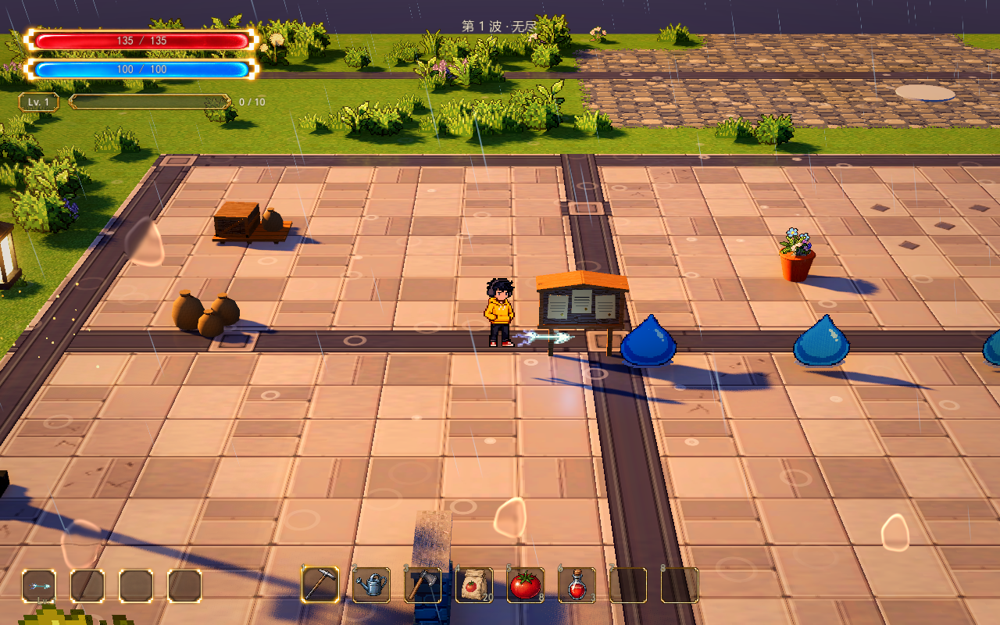

# A02 雷光贯穿

当前外观采用已确认的细雷刺参考，由 Meowa 制作原生小尺寸像素素材：青白亮芯、蓝紫分叉、三段断续电光与紧凑的八帧命中电弧。A02 已接入正式地图的实际战斗与局内成长，使用统一的初始选择、升级学习、技能栏及 Tab 技能页；A03 保留棱晶弹射，碰撞反馈素材独立。

## 获得与战斗

新挑战不自带技能，在入口按 F 后从有效技能池抽取三张选一张，确认后才开始刷怪。如果抽到 A02 可直接选择，也可先选择其它技能，再通过经验升级选择“学习 雷光贯穿”；之后继续选择它的升级。开局和升级共用每局三次重抽。取消初始选择返回准备状态，波间休整保留技能，重试重新选择。初始选择不消耗经验，不写永久存档。

自动向最近的有效目标发射，起手后方向锁定为世界坐标中的直线。连续球形扫掠覆盖本帧整个行程，按真实碰撞体进入的顺序命中；同一发只伤害同一只怪一次，达到目标数量上限后结束。墙体、无桥水面、断层及地图边界阻挡，出场预告和明显不同高度的敌人不作为目标。

Q/E 只改变观察角度，跳跃使用脚下的地表作为发射平面。闪避保留冷却，已经发射的枪锋继续原来的世界轨迹，下一发从新落点出手；不沿瞬移路径追加伤害。升级只冻结战斗，枪锋、尾迹、星芒与冷却保留原进度，确认后继续。每发使用出手时的属性快照，新等级与增益用于下一发。

| 技能等级 | 伤害 | 最多命中 | 射程 | 飞速 | 实际碰撞宽度 |
| --- | ---: | ---: | ---: | ---: | ---: |
| 1 | 12 | 3 只 | 8 米 | 14 米/秒 | 0.36 米 |
| 2 | 14.4 | 5 只 | 8 米 | 14 米/秒 | 0.36 米 |
| 3 | 17.4 | 5 只 | 10 米 | 19.6 米/秒 | 0.36 米 |
| 4 | 20.4 | 5 只 | 10 米 | 19.6 米/秒 | 0.60 米 |

数值为可调试玩基线，默认发射间隔 1.15 秒。四级的雷刺、尾迹和命中电弧同步拓宽。本次外观调整保留全部攻击数值、贯穿判定与成长规则。P01 与 P02 分别对伤害和间隔生效一次；P03 不延长射程或扩大弹丸宽度。雷光是视觉名称，当前没有电击、连锁或控制状态。

正式地图选中 `WavePrototype/LightPierceAutoAttack` 调整基础伤害、射程、间隔、速度、贯穿数量、碰撞宽度和高差；等级资源为 `data/skills/light_pierce.tres`。外观仍由 `scenes/combat/light_pierce_effect.tscn` 配置，实战速度与高度由攻击组件传入。未学习的技能停止攻击、闲置物理更新及增益统计。

命中暂时沿用现有 Meowa 轻命中声音，走公共 `MapEffects/GameAudio` 的优先级、预算与混音；不额外添加雷鸣或爆炸声。独立雷光音色留待后续确认。

雷刺沿世界中的固定方向前进，身后三段蓝紫折线保留间隙并向后变暗；每次命中显示小十字闪光和分叉电弧，不生成大圆环或晶片爆炸。一盏无阴影的小光源随雷刺轻微映照附近地表，辉光保持短促。

## 查看与调整

实际试玩统一使用 `scenes/world/world.tscn`，通过普通模式的技能池或巨量怪潮的技能与等级配置观察。旧固定三只史莱姆的自动重放入口已清理，技能组件与自动回归保留。

在编辑器打开 `scenes/combat/light_pierce_effect.tscn` 调整可复用特效组件，实际出手与飞行距离沿用战斗技能参数。

| 参数 | 当前值 | 含义 |
| --- | --- | --- |
| Flight Speed | 14 米/秒 | 枪锋沿轨迹前进的速度 |
| Flight Height | 0.45 米 | 悬浮于发射地面的高度 |
| Head Width | 0.8 米 | 原生 48×16 雷刺画布的世界宽度 |
| Head Tip Anchor | 0.94 | 贴图尖端位置，绑定真实弹道，转镜头时不漂移 |
| Trail Length | 2.1 米 | 三段断续尾迹的整体长度 |
| Trail Width | 0.35 米 | 原生 128×16 尾迹的整体宽度，细电光保留清晰度 |
| Preserve Trail Pixel Scale | 开启 | 起手裁切已经走过的尾迹，维持固定世界像素尺寸 |
| Trail Fade Time | 0.22 秒 | 飞行结束后尾迹消退时间 |
| Impact Width | 1.12 米 | 原生 64×48 命中电弧画布宽度，主体约 0.5 米 |
| Impact Duration | 0.28 秒 | 完整八帧命中动画的播放时长 |
| Impact Height | 0.35 米 | 电弧相对于命中地面的高度 |
| Effect Opacity | 0.9 | 特效不透明度 |
| Effect Energy | 1.4 | 自发光及辉光贡献 |
| Trail Energy Multiplier | 2.5 | 单独让细尾迹的蓝紫／青色更清楚，保留雷刺与命中亮度 |
| Effect Tint | 白色 | 全套素材的颜色倍率 |
| Ground Light Enabled | 开启 | 随枪锋移动的短时地面映照 |
| Ground Light Energy / Range | 0.18 / 1.6 米 | 映照强度和范围，默认不投影 |

## 接口与素材

`LightPierceEffect.launch(origin, direction, distance)` 保留独立预览的自动飞行。实战传入第四个参数 `true`，由 `advance_flight(distance, ended)` 同步物理位置与收尾，渲染不单独推进弹道。`show_hit(ground_position)` 播放完整独立命中，`stop()` 清理轨迹、星芒与映照；全部播放结束发出 `finished`。视觉组件不结算伤害，正式战斗由 `LightPierceAutoAttack` 使用共用的 `ProjectileCollision` 查询器处理。

当前美术位于 `assets/meowa/combat/light_pierce/pixel/`：雷刺 48×16、尾迹 128×16、命中单帧 64×48。Meowa 原生图集为 192×144，3×3 排列，前八格含完整动画与最后透明帧；原始动画 WebP 和透明 GIF 保存在 `pixel/source/`。运行时按每帧 AtlasTexture 区域采样，最近邻过滤；没有缩图、重采样、再次像素化或本地去背景。一级雷刺与尾迹长轴约 60 像素／米，命中约 57 像素／米，以现有人物为标尺。

雷刺长轴沿世界弹道，短轴随镜头调整，纵深方向自然透视缩短。尖端位于真实弹丸位置，起手只露出已行进的部分。三段拖尾从雷刺后缘开始，沿真实轨迹构建窄带，按已经走过的长度裁切 UV，避免短尾迹压缩全部像素；命中电弧朝向镜头。Q/E 不改变碰撞与伤害位置。整套飞行组件与命中电弧按实际并发需要创建并复用，完整收尾后归还；不通过固定池上限丢弃攻击或命中效果。

A03 通过 `scenes/combat/prism_contact_effect.tscn` 继续使用旧光丝和晶体星芒。共享脚本的旧采样方式保留为默认，A02 场景单独开启像素模式。

## 实机验证

拖尾共用固定网格，仅更新实例变换与采样区域；命中电弧节点与材质在动画结束后复用，空闲停止更新。八帧动画、镜头响应与短时映照保留，说明见 [攻击性能与资源复用](attack-performance.md)。`tests/test_light_pierce_attack.gd` 验证战斗与学习，`tests/test_light_pierce_reuse.gd` 验证资源复用，`tests/test_light_pierce_pixel_style.gd` 验证原生尺寸、真实 alpha、帧区域、短尾迹像素密度、转镜头尖端定位与纵深缩短。`tests/test_prism_ricochet.gd` 覆盖 A03 回归。

当前正式地图已用 Godot 4.7.2 原生 Forward+ / D3D12 验证真实扣血、完整发射／命中／消退和 0°／90°／180° 镜头，镜头读取场景的 FOV 28°、距离 15 米、俯角 25.414°、景深关闭；窗口 1280×800。录制只固定人物与测试敌人的移动，不修改地表、光影、天气或镜头配置，不写人物或地图存档。

[正面](../media/light-pierce-pixel/front.png) · [侧面](../media/light-pierce-pixel/side.png) · [背面](../media/light-pierce-pixel/back.png)
