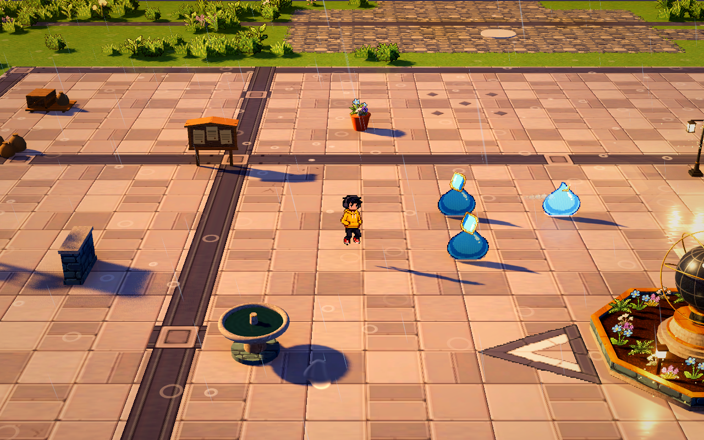
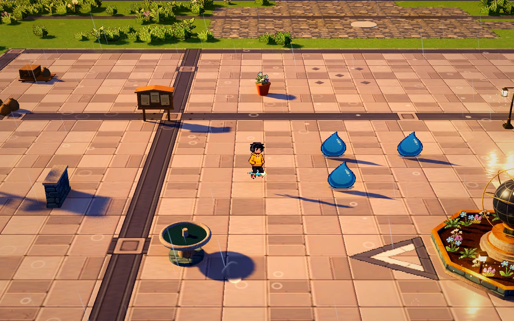

# 反射镜印

已注册到正式波次场景，可在初始抽卡或局内升级时学习。第一版有四级成长：单梭两次反射逐步成长为双梭五次反射，与现有伤害、冷却增益共同生效。纯弹丸不使用全局覆盖范围增益。

镜梭命中先造成伤害，再贴印并反射。首次贴印面向附近侧向敌人，没有合适目标时折向侧面；朝向此后固定在世界中，镜片只随怪物移动。后续镜梭按入射方向与保存法线反射，不能隔墙瞬间命中其它怪物。其它武器保留自身伤害，镜印不会给怪物护盾。致死命中在剩余反射预算内完成最后反射，随后镜片碎开。同一枚镜梭全程只对同一只怪物伤害一次，墙面与怪物共用反射预算。

存活镜印同时参与人物弹射与棱光弹射的真实碰撞，消耗来者自身的反弹预算，沿原有速度保留／行程规则继续运动；人物蓄力路线预览使用同一碰撞体和固定法线。镜片正反两侧均有效，宽度随原生镜片像素与人物实际像素密度变化，竖向从宿主脚底延到镜片顶端以覆盖贴地弹丸；镜片有界，不是无限反射平面。宿主转向或镜头旋转不改变首次保存的法线。

碰撞体与形状随镜片池复用，使用独立物理第三层（位值 4），仅人物飞行与可反弹查询参与。普通行走、怪物导航、不反弹的技能仍使用原有层。接触镜片触发原有闪光，棱光不在紧邻的回程对宿主多扣一次血；人物本体不新增碰撞伤害。到期、死亡、移除技能和清波当即关闭碰撞，碎裂动画不保留反射。后续弹射技能可复用 `ProjectileCollision.REFLECTION_MASK`、`reflection_normal()` 和 `show_reflection()`，仍自行处理伤害与反弹预算。

一级伤害 14、间隔 1.3 秒、速度 10 米／秒、累计行程 10 米、镜印时限 4 秒，当前 20 生命史莱姆两次命中击败。重复镜梭命中刷新时限；清波或结束挑战清理镜印与弹体，波间保留技能等级，重开清零。升级选择同时冻结弹体、镜印时限和动画，闪身保留冷却与已有弹道。

## 像素与动画

Meowa 原生透明素材：镜片 24×32、镜梭 32×16。运行时读取人物 Sprite3D 的 `pixel_size × 实际世界缩放`；当前为 `0.02 × 0.8 = 0.016` 米／像素。最近邻采样，升级不扩大像素颗粒。镜片用逐行显现和斜向逐像素闪光，死亡／到期后的四块原图切片保留原镜片的尺寸、位置、倾斜和显现／闪光进度，首帧完整重合，随后小幅分离、淡出；碎片不缩放，只沿原图轴向移动最多四个像素。弹体只留下短促原生像素残影。动画不改变人物动作，特效和逻辑各自结算，弹丸、镜片、残影、碎片与公共声音均复用现有框架或节点池。

## 调节入口

Godot「参数总览 → 战斗与成长 → MirrorMarkAutoAttack」可调伤害、攻击间隔、累计行程、速度、镜印时限、反射次数与人物像素匹配。各级配置位于 `demoWithMeowa/1/data/skills/mirror_mark.tres`。独立视觉参数位于两个特效场景中的 `pixel_size`、显现／闪光／碎裂时间及残影寿命；开启人物像素匹配时以实际人物尺度为准。

实际试玩统一使用 `scenes/world/world.tscn`；巨量怪潮模式可在 `WavePrototype.population_rules` 中配置持有技能与等级。旧独立试玩入口已清理，技能组件与下述回归保留。

验证入口：`tests/test_mirror_mark.gd`，覆盖伤害与反射、固定朝向和跟随、致死反射、墙面去重与遮挡、其它武器、成长与增益、暂停和清波、像素密度及资源复用。

联动验证：`tests/test_mirror_collision.gd`，隔离波次编排与存档，使用真实技能和人物胶囊检查镜面扫掠、人物及棱光反射、原镜梭兼容、预算耗尽、预览一致、移动／转向／高差、墙前优先、背面、宿主伤害去重、死亡／到期和复用。
