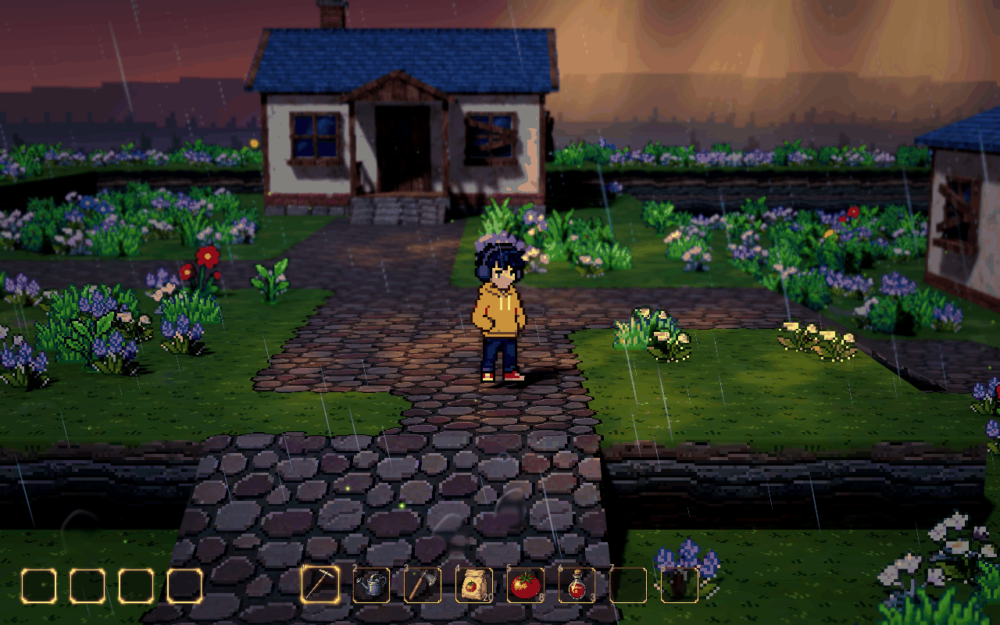

# 人物瞬移闪身

已接入当前人物控制器；正式地图与视觉预览地图共用。按 Shift 闪身，移动输入决定方向，没有输入时沿当前朝向闪身。动作期间保持朝向；碰撞体沿整段路径检查，遇到墙体或地图边界提前停止。

这版按“轻盈闪身”的反馈调整：Meowa 姿势从大弓步改为双腿收紧、微屈膝与轻微前倾；去掉起手和收尾的额外屈膝。人物位置一次跳转，原处与路径中间留下短暂、透明的姿势快照。定格结束后直接接回正常待机或跑步动画，避免移动时仍保持静止贴图。

## 可调参数

在人物节点的“瞬移闪身”分组调节。默认值来自 `scripts/player/player.gd`，场景中若另行覆盖，以场景设置为准。

| 参数 | 默认值 | 含义 |
| --- | --- | --- |
| Blink Enabled | 开启 | Shift 闪身开关 |
| Blink Distance | 2.4 米 | 最大水平位移，碰撞会缩短距离 |
| Blink Duration | 0.20 秒 | 动作状态的总时长 |
| Blink Anticipation | 0.025 秒 | 起手等待时间；实际执行按物理帧离散 |
| Blink Pose Hold | 0.06 秒 | 瞬移后姿势定格，结束即恢复走路与跑步动画 |
| Blink Cooldown | 0.28 秒 | 两次开始之间的最短间隔 |
| Blink Input Buffer | 0.12 秒 | 冷却末段的新按键短暂等待执行；0 关闭 |
| Blink Echo Count | 2 | 原处与路径上的残影数量；0 关闭 |
| Blink Echo Lifetime | 0.12 秒 | 残影淡出时长 |
| Blink Echo Opacity | 0.42 | 初始透明度；路径后方逐个减弱 |
| Blink Echo Color | 淡青色 | 残影着色 |
| Blink Echo Energy | 0.10 | 轮廓发光强度；0 关闭 |

UI 打开时阻止输入并取消尚未执行的瞬移，空中暂不允许闪身。当前包含位移、碰撞、节奏、冷却和输入缓存，尚未接入无敌帧或体力消耗。侧面采用新姿势并支持左右翻转；背向目前保留背向人物贴图与朝向。

## 闪身音效

采用 Meowa 生成的短风掠过与衣料摩擦音，接入共用的 `Player/MovementAudio`。它监听 `blink_travelled`，在碰撞检查后真正发生瞬移的同一事件中播放一次；完全被墙挡住、UI 阻止输入或起手被取消时不播放。

在 `Player/MovementAudio` 的“闪身”分组调节：`Blink Sound Enabled` 为独立开关，`Blink Sound` 可替换素材，`Blink Volume Db` 默认为相对总音量 +2 dB，`Blink Pitch` 默认为 1。当前总音量为 -8 dB，因此闪身播放增益为 -6 dB；也遵循人物动作音效的总开关与输出总线。

源文件保留在 `assets/meowa/audio/movement/source/blink.mp3`。游戏使用 `assets/meowa/audio/movement/blink.wav`：48 kHz 单声道、约 0.314 秒、不循环；移除开头静音并缩短录音时长，保持音高，柔化高频、平衡响度并淡化首尾，没有额外合成声音层。波形无削波。

[正式地图内实际触发的声音试听](../media/player-dodge-preview/blink.wav)。录音单独捕获人物音效总线，保留正式地图当前相机和环境设置。音效加载、一次播放、时机、增益/音高/总线、墙体与 UI 阻止、独立和总开关均已通过 `tests/test_blink_audio.gd`；已有脚步、起跳与落地测试也通过。

## 美术与残影

本体资源位于 `demoWithMeowa/1/assets/meowa/player/dodge/`：8 张 128×96 透明 PNG、`pose.png`、4×2 的 `sheet.png`，以及独立 `dodge.tres`（40 fps，不循环，0.2 秒）。

| 帧，从 0 计数 | 内容 |
| --- | --- |
| 0、1 | 项目已有 idle 的同一帧 |
| 2～5 | 同一张 Meowa 紧凑闪身姿势 |
| 6、7 | 与首帧相同的 idle |

关键姿势由 Meowa 的像素图像编辑生成。首尾直接复制已有 `idle_00.png`，中段重复同一姿势用于定格，没有让生成模型重画首尾。原 80×80 帧仅放入新画布的 `(24, 8)`，保持相对 Sprite3D 中心的位置与像素尺度，不重采样；人物脚底包围盒下沿保持 y=77。

游戏内由 `scripts/player/player_blink.gd` 独立控制起手、定格和收尾，使用上表的时间参数，不依靠 SpriteFrames 的均匀帧率驱动位置。收尾允许现有跑步动画继续播放。

残影由 Godot 创建独立 Sprite3D，复制当前 Meowa 姿势、翻转、像素尺寸与世界位置，通过 `shaders/character/player_echo.gdshader` 着色和淡出。残影留在原位置，随场景遮挡与景深正常显示。它是代码实现的效果，未另行生成残影美术。

## 预览与验证

`runtime.gif` 来自正式地图实际运行的连续截图，1280×800，不裁切、不缩小，帧间隔取自采集时间。沿用场景的跟随相机、景深和天气：FOV 30°、距离 11 米、俯角 10°、水平初始朝向 0°、焦点高度 0.75 米、平滑度 6、死区 0.1 米，景深开启且强度 0.02。

`in-place.gif`、`blink-demo.gif` 是素材与二维效果示意，含观看停顿，不用于评价实际输入响应。`endpoints.png` 展示首尾一致；`dodge.webp` 仅供文档预览，Godot 使用 PNG 导入。

验证包括真实 idle 首尾、定格与一次位移、朝向保持、残影位置和清理、收尾接回跑步、输入缓存、薄墙碰撞、地图边界、UI 取消与空中禁用，并回归既有台阶通行和跳跃检查。运行中的旧实例需要停止后重新运行场景，才能可靠加载新的脚本默认值。

中间文件位于 `D:/.codexfile/work/player-blink-integration/`；按当前要求不新增 Meowa 调用日志或记录页面。

## 闪身带动花草与雨滴（2026-10-12）

环境反馈采用用户确认的表现：沿真实闪身路径将附近草和花顺势压弯，随后轻轻反向回弹并恢复；人物高度附近的空中雨丝短暂顺势带偏，随后恢复原有下落方向。复用现有花草与雨丝材质。

正式地图选中 **MapEffects → Weather**，视觉预览地图选中 **Weather**。展开“闪身影响花草”与“闪身影响雨滴”即可调整，两者可以分别关闭；自然风摆继续叠加。

| 花草参数 | 默认值 | 含义 |
| --- | --- | --- |
| Blink Plants Enabled | 开 | 花草反馈总开关 |
| Blink Plant Radius | 0.85 米 | 路径两侧的影响范围，越远越弱 |
| Blink Plant Height | 0.5 米 | 植物根部相对人物脚底的高度容差，限制跨台地影响 |
| Blink Plant Strength | 0.16 米 | 草叶顶部的最大额外偏移；花簇使用 70% 幅度，0 关闭 |
| Blink Plant Duration | 0.85 秒 | 压弯、回弹到完全恢复的总时长 |
| Blink Plant Rebound | 0.2 | 回弹相对压弯的幅度，0 只平顺恢复 |

| 雨滴参数 | 默认值 | 含义 |
| --- | --- | --- |
| Blink Rain Enabled | 开 | 局部雨丝反馈总开关 |
| Blink Rain Radius | 1.1 米 | 路径两侧的影响范围 |
| Blink Rain Offset | 0.9 米 | 气流中心相对人物脚底的高度 |
| Blink Rain Height | 1.3 米 | 气流中心上下的影响范围 |
| Blink Rain Strength | 0.22 米 | 雨丝额外横向偏移，0 关闭偏移 |
| Blink Rain Tilt | 0.8 | 额外倾斜量，0 关闭倾斜；与偏移独立 |
| Blink Rain Duration | 0.45 秒 | 雨丝带偏到恢复的时间 |

环境反馈在实际瞬移发生时触发，路径终点采用碰撞和地图边界检查后的结果。起手被面板取消、完全被墙挡住或没有发生位移时，不产生扰动。路径固定在世界中，人物离开后花草继续完成回弹；每次闪身可叠加，最多保留八条未恢复的路径，叠加幅度有上限。

花草通过每丛的真实根部高度判断台地，顶端弯曲而根部固定。雨丝使用现有 GPU 粒子的局部渲染偏移和倾斜，自然风向与下落速度继续沿用天气设置。晴天闪身不会启动降雨。截图验证使用现有跟随相机：FOV 30°、距离 11 米、俯角 10°、水平朝向 0°、景深开启且强度 0.02、16:10 画面。

闪身弯曲按素材的实际可见高度计算，排除透明留白；强度作用到真正的叶尖，而非透明画布顶端。起手压弯约 0.05 秒达到峰值，恢复时间调长不会拖慢起手。原有自然风摆参数保持原计算方式。已用正式地图保存的强度 0.29、恢复时间 2 秒录制真实 Shift 闪身，核对明显压弯、回弹、恢复与根部固定。

验证脚本：`demoWithMeowa/1/tests/test_player_blink.gd` 检查实际位移与反馈事件，`demoWithMeowa/1/tests/test_blink_environment.gd` 检查正式地图与视觉预览的连接、独立开关、自然风叠加、重复闪身、恢复清理和植被重建。环境脚本也通过真实 D3D12 / Forward+ 渲染运行，核对植物根部数据并完成压弯、回弹、雨丝与恢复画面对比。临时验证产物保存在 `D:/.codexfile/work/blink-vegetation-20261012/`。
