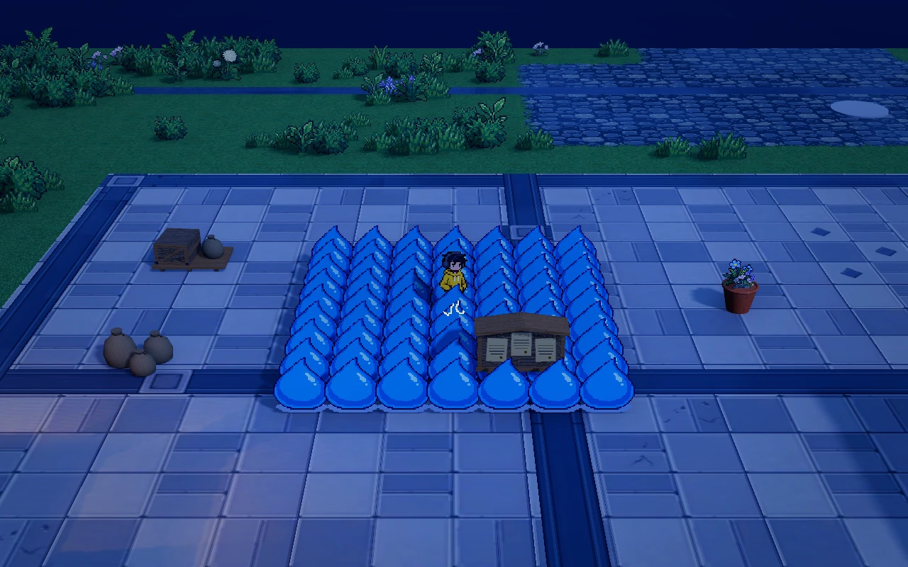
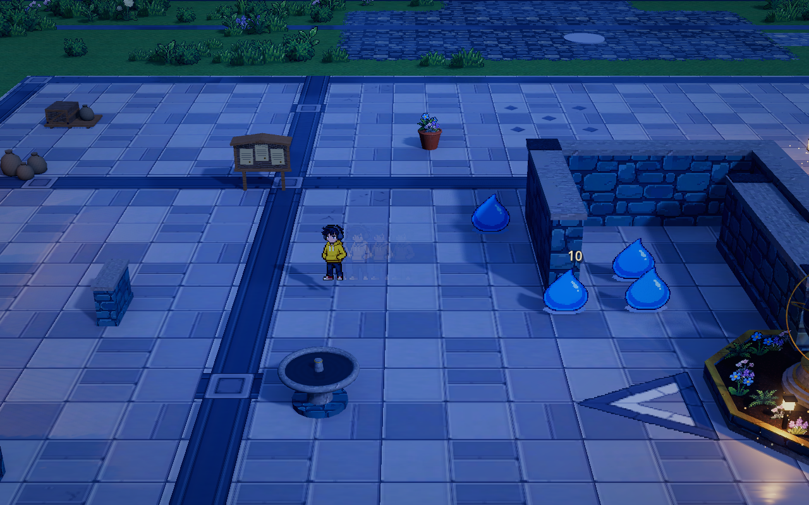
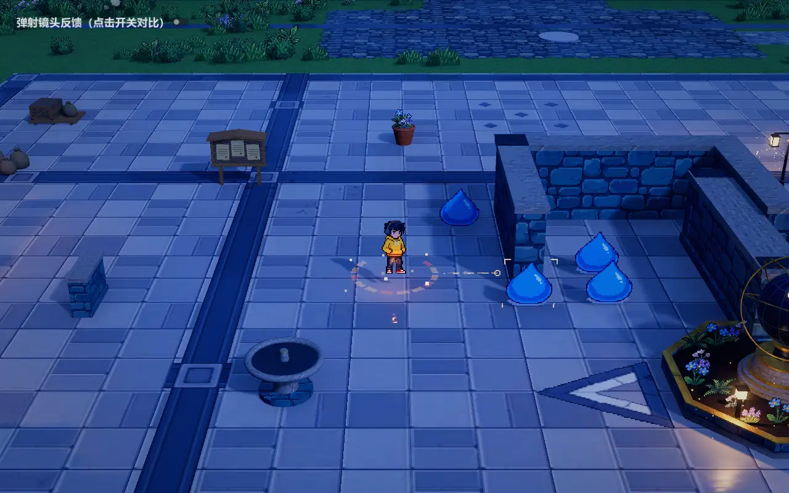
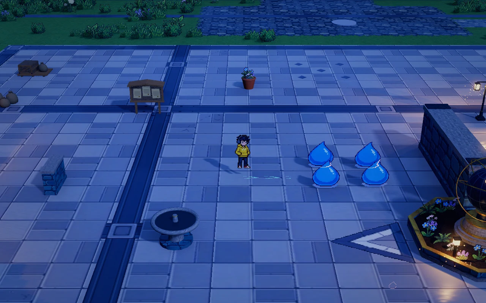

# 人物本体弹射框架

2026-10-16。正式入口 `demoWithMeowa/1/scenes/world/world.tscn`，F5 默认启动。当前实现运动、墙面反弹、人物沿怪群划弧、偏心回旋试玩与动作资源接口；人物仍使用现有素材。

## 操作与当前边界

| 输入 | 行为 |
| --- | --- |
| 左键 | 单击普攻、按住重复；弹射期间自动挥剑；环绕时朝沿途怪物出剑，左键不额外补刀 |
| 按住右键 | 接地时开始蓄力；鼠标在地面上的投影决定万向瞄准，蓄力时仍可走位 |
| 松开右键 | 沿锁定的世界方向发射，蓄力越久初速越快，满蓄力封顶 |
| 飞行中再次短按右键 | 偏心试玩沿外侧切线脱离，取消本次后续贴边转向；仍按余速飞行，不额外发射 |
| WASD／方向键 | 蓄力时可走位；发射时已按住的键继续按住不取消。飞行／自动环绕后重新按原键或新按其它方向键，才取消弹射并同帧恢复普通移动 |
| Space、Shift | 保留跳跃、闪身；跳跃／闪身取消未释放蓄力，飞行期间不叠加跳跃或闪身 |
| Q/E | 保留镜头旋转；已锁定的飞行方向和拨怪旋向保持世界方向 |

人物已接入[自带基础剑术](player-sword.md)：普攻和弹射挥剑独立于 A01，正式地图当前启用接群后自动沿外围持续绕行并朝沿途怪物出剑的环绕试玩；关闭该试玩时恢复基础外沿划弧、向侧外方脱离。正式地图关闭旧拨怪与附带眩晕，挥剑和奔雷仍按真实路线结算，伤害及成长保持原规则。本体不额外伤害、不消耗魔力、不提供无敌或减伤；敌人原有招式仍可伤害人物。五类人物动作槽继续保留，空槽沿用原有人物画面。

管理面板只占用输入：取消未释放蓄力，已发射运动继续，世界与人物物理继续运行。升级选择冻结弹射进度、动作播放、怪物外力和战斗计时；恢复后续接原进度。离开战斗、结算、重试或人物死亡取消进行中的弹射，避免残留输入导致自动发射。

方向移动接管只响应新的有效按下：键盘分别记录 WASD 与方向键的物理按键状态，发射前已经按住的键可以继续保持，发射首帧不被移动输入打断。飞行或自动环绕中，松开再按原键、新按其它方向键都会立即接管；仅松键、持续按住、按键自动重复或旋转镜头不会取消。`advance()` 第四参数接收原始按键位掩码；兼容原来的三参数外部输入，按移动向量归零后重新推动识别新请求。

接管仍复用 `PlayerRicochet.cancel()`：清零余速，释放怪群路线和本次弹射状态，取消飞行动作并通知原有残影、声音、奔雷与相机收尾；保留剩余发射冷却，直接回到 IDLE，不增加收势等待。`advance()` 当帧返回 false，普通人物物理立即按当前方向行走。升级冻结或管理输入占用期间持续同步按键状态但不接受中断，解除后不补发期间按住的旧请求。`tests/test_ricochet_speed.gd` 覆盖移动蓄力、带键发射、持续按住、松开再按、新键接管、斜向部分松键与输入屏蔽恢复。

## 当前弹射速度与续弹

人物的 `PlayerRicochet.flight_speed` 是本次弹射的真实当前速度。开始蓄力时固定初速、最低续弹速度、飞行衰减、固定碰撞耗速与保速的本次快照。释放时由蓄力比例决定初速；飞行中持续减速，接触怪群、墙体或镜面后，统一按 `碰撞后速度 = 当前速度 × 对应保速比例 − 固定碰撞耗速` 计算。剩余速度高于下限才执行新的反弹／接群转向；不足时在接触位置正常收势。没有固定总飞行时长或有效反弹次数上限，反弹统计仅用于反馈。

正式 World 起步／满蓄初速为 4／10 米每秒，下限 2 米每秒，飞行耗速 1.6 米每秒²，每次固定碰撞耗速 0.25 米每秒；怪群保速 100%、墙体和镜面保速 92%。100% 保速仍会支付固定耗速并继续承受飞行衰减。未叠加成长且无碰撞时，满蓄约滑行 5 秒、30 米，起步约 1.25 秒、3.75 米；开局保留自动环绕及适量耗速，长续航由弹射速度与动能维持逐步获得。两者各四级时空地理论续航约 20 秒，作为成型目标；后续仍可成长，不设置固定 20 秒截断。满蓄力需要 0.5 秒，收尾 0.06 秒；发射后冷却 0.2 秒，与飞行并行计时，结束飞行与收尾后且冷却已结束即可再次蓄力。增长初速会同时提高抵达下一个接触点的能力和余下的续弹空间。低蓄力和低速会更早收势，不额外增加伤害倍率。

位置使用恒定减速度的积分，不按物理步长累加近似距离；每个实际接触点反解已经使用的时间，再扣除碰撞损耗。短弧、墙面、镜面共用这份速度，不因换一种反弹而恢复速度。只终止连续无法产生位移的卡死接触，不按本帧有效反弹次数截断。正式地图活动边缘通过实体空气墙反弹，池水边界也已单独开启直接反弹；未开启边界反弹的水面、断层、缺失有效地形、死亡、取消与离开战斗继续正常终止运动。

预览与运动使用相同的速度计算。`preview_bounces` 只限制显示的墙面反弹次数，默认一次；正式蓄力仅预测首次响应和短尾段，不限制人物实际反弹能力。基础剑术、奔雷和人物残影保存运动段的起速与减速度，按真实的时间／距离关系采样，避免把减速片段当成匀速运动。升级冻结同时保留位置、速度和弧线进度；管理界面继续沿用只占输入的规则。

`flight_seconds` 和 `wall_bounce_limit` 仅作为旧资源字段保留，当前人物运动不读取它们，参数总览已标明停用。正式弹射成长收敛为 R01「弹射速度」、R02「动能维持」、R05「蓄力节奏」：分别提高短蓄／满蓄初速，统一减少飞行和碰撞损失，以及同时缩短满蓄与发射冷却。旧独立耗速、保速、收势与周转卡和全部专精退出正式池，原型接口保留，详见[本局共有成长](combat-buffs.md)。

`tests/test_ricochet_speed.gd` 使用真实胶囊检查多步长一致性、速度门槛、旧字段失效、单步多次反弹、统一耗速、冻结和成长映射；空地夹具为完整滑行预留空间，容许毫米以内的物理浮点误差。自然收势的极短尾段仍归为速度耗尽，地形裁短运动时才归为地形边界。预览、镜面及成长测试共用这套速度机制。

## 基础运动与旧拨怪兼容原型

本节的怪物外力、接力和眩晕机制由 `enemy_push_enabled` 控制；正式资源已关闭，只保留接口与旧参数。当前人物绕群见下一节。关闭时不提供无效拨怪升级，组合卡若无法实际支付拨怪代价也不提供。

人物用原有完整胶囊连续扫掠，遇到实际墙体法线后反射；动态移动的墙体立即生效。每次反弹消耗当前弹射速度，不按次数限制，也不恢复已损耗的速度。默认水面、缺失有效地形与超过允许高差的地表终止飞行。正式地图的 `Homestead.water_boundary_reflection_enabled` 单独允许人物借既有水域阻挡形状直接反弹，不增加石沿模型或碰撞体；实际运动与预览读取相同形状标记，声音、火花、耗速与镜头反馈复用原入口，其他场景默认关闭，弹丸规则保持。

正式地图由 `MapEffects` 沿当前 `Player.bounds` 生成四面的实体空气墙，人物胶囊在坐标越界保护之前先碰到墙面；可反弹弹丸也使用原有墙体查询。空气墙没有可见模型，使用现有墙体碰撞层，预览、反弹耗速、声音与镜头反馈均沿用真实碰撞。四个碰撞形状只在活动范围改变时更新并复用，不增加逐帧查询。`tests/test_map_boundary_collision.gd` 覆盖四边、斜入、角落、高速大步长、预览与实飞一致、范围更新和水面／断层终止。

人物沿实际移动线段形成的触发圆查找怪物，解析求首次进入圆周的点，避免高速或低帧率漏判。飞行先结算剑伤，存活、同高、出场完成、无遮挡的目标才进入绕行；同次发射直接与间接接触共用去重，后续剑伤照常结算。

### 从前排沿外沿绕到对侧

采用已确认的平滑椭圆方案：首次命中时，从受击怪开始通过空间索引找附近相连怪群，中心间距默认不超过 1.5 米，局部搜索半径 12 米；隔墙、预告中、异层和断开的远处散怪不参与。计算群体中心与主方向，再求包住身体及外沿余量的椭圆。细长或斜向怪群会得到相应朝向的长短轴；每片怪群只建立一次轮廓，本次移动中不重新追着圆心漂移。

受击怪从自己的真实位置出发，内排先平滑并入外沿，之后沿统一旋向绕行。首排约绕半圈，同一片区域的直接与接力目标都汇到最初受击侧的对面边沿；不是径向击散或穿过群体内部的直线位移。零散单怪使用小圆弧。Q/E 只改变观察角度，不改变世界轨迹或旋向。

`EnemyOrbitPath` 按空间长度预采样曲线，并保存累计弧长；移动按弧长而非角度推进，避免椭圆长短轴处忽快忽慢。速度平滑衰减，时长取 `push_seconds + 2 × 路程 / 抗性后参考速度`。`push_initial_speed` 控制参考速度，`push_seconds` 是附加的收势缓冲时长，时长增益始终有效；原有击退倍率同时缩短抗性目标的转角并减速，眩晕倍率仍独立。共享推力与时长成长继续接入，不把增强后的怪物转过对侧继续绕整圈。

每帧沿实际曲线逐段执行原胶囊碰撞和地表检查，低帧率也不会用穿过椭圆内部的直线抄近路。遇到墙、人物实体、水面、地图边界或断层即在接触处停止，动态障碍使用当前物理世界。其它攻击的新击退接管运动时，结束旧曲线，避免下一帧把怪物拉回旧轨迹。

### 碰撞同伴后加入同向绕行

绕行中的怪物实际碰到同伴时，使同伴眩晕并加入同一片椭圆轮廓、同一旋向和同一后沿落点区域。后沿扇区默认总宽 90°，落点按本群最大身体间距交错成排，保留横向宽度和前后厚度；不让每只怪各自绕半圈摊成空心环。已经位于后沿的同伴就近收势，避免为了排位再绕一整圈。默认最多传递四层，不按目标数量截断一层；同次发射全链共用目标 ID，不能互相反复续晕或重新绕圈。下一次发射使用独立记录，旧绕行不因开始新蓄力重置资格。

`EnemyPushWave` 只保存本次规则快照、目标 ID 和几何数据。每段真实位移先通过空间索引缩小候选，再以双方身体半径连续求接触点，传递前检查出场、高差、来向与实时遮挡。接触瞬时速度乘以 0.78 后传给同伴；低于 1.5 米每秒或达到层数上限则停止接力。新同伴从接触时的真实位置加入曲线，不瞬移、不附加伤害，也不开启怪物间刚性碰撞。

第 n 层基础眩晕为 `push_stun_seconds × push_chain_stun_retention^n`，再乘同伴自身的眩晕倍率。默认第二排 0.85 秒，重型第二排 0.425 秒。无法被移动的对象仍可眩晕，但不继续传播。眩晕提前结束时，尚未完成的外力仍接管位置，暂停追击、出招和接触伤害；外力与眩晕都结束后恢复正常 AI。

`WaveEnemy.apply_orbit()` 是曲线移动接口；当前全部史莱姆类怪物共用实现，未知移动类型默认拒绝曲线。原 `apply_push_impulse()` 保留独立直线外力用途。闲置不查询邻居，轮廓只在首次命中建立，生命周期跟随本次发射及仍在绕行的接收者，结束或重试正常释放。

正式地图的拨怪专项实采：固定人物与镜头，前排受击后沿外沿汇到后沿；暂时固定未受控怪物，便于观察位置变化。实际墙体、道具、地面和碰撞仍参与。

## 人物沿怪群外沿划弧

基础外沿路线在 `data/player/body_ricochet.tres` 配置，同时关闭旧拨怪。关闭偏心试玩或遇到孤立单怪时，人物触及真实前排后，平滑接入附近相连怪群的椭圆外沿，正式初始值最多绕行 100°、贴边最多 2.4 米，再向侧外方脱离，向外分量为 0.6。大怪群会提前脱离，不沿整团兜长弯。怪物继续按正常 AI 运动，不被本体接触或挥剑回调拨走、眩晕；单个怪物使用以自身为圆心的小弧线。本体不附加撞击伤害、无敌或减伤。

斜向接触按入射方向的切向分量选择侧方，正撞使用 `clockwise` 固定旋向。弧线借用初次接触时的群体轮廓曲率，以真实接触位置为锚，不先吸附到较大的椭圆边界。入弧控制点沿来向有序排列，避免先冲过头、后退再贴回去；曲率预留入弧前进量，保留前排两侧的身体间距。人物实际运动已离开旧弧线时，保持当前方向并放弃旧路径，同群接触锁继续保留到脱离，避免立即重新吸回。路径按空间小段采样，逐段使用真实人物胶囊、墙体与地形检查；不同物理步长沿同一折线运动。剑术、奔雷、人物残影与运镜继续消费真实运动段，不连接跨过怪群内部的伤害捷径。

一次发射共用初次接触时的怪群轮廓。接触区域只保存成员 ID 与几何数据；脱离这片区域并越过余量前，群内其它怪物不会重复改变人物方向。其它独立怪群可以继续触发绕行。弧线沿原弹射速度规则耗速，不续时或补速；剩余速度不足时可以在弧线上正常收势。墙体与镜面也使用同一套速度下限、持续衰减和碰撞耗速规则。

空间查询通过 `WaveEnemySpatialIndex.nearby_into()` 复用候选数组，在读取位置和计算距离前排除已处理的成员；找群时传入本次遍历的成员 ID，沿弧线查接触时传入尚未脱离的同群 ID。无新目标时不准备排序，轮廓的多遍几何计算共用一次同步读取的位置和体型，不跨物理帧缓存动态位置或挡墙结果。查询顺序、距离精度、逐段胶囊碰撞及预览刷新频率保持原规则。`tests/test_crowd_query_reuse.gd` 用优化前的轮廓算法对照候选与成员顺序、几何结果、移动／移除／槽位复用、动态墙和体型读取次数。

碰墙立即中断未完成短弧，按真实墙面反射；镜印仍优先使用其真实有限镜面。出场预告、异层和隔墙怪物不触发接群偏转。冻结保留短弧进度，取消、死亡、离开战斗与重试清理人物的转向状态。

「参数总览 → 人物」搜索“接群”，或展开人物弹射规则：

| 参数 | 正式试玩值 | 作用 |
| --- | --- | --- |
| `crowd_deflection_enabled` | true | 独立开关人物接群转向 |
| `crowd_contact_radius` | 1.05 米 | 普通短弧的近身接触距离，单怪及不成群目标保持在奔雷基础切入范围内 |
| `crowd_turn_distance` | 0.45 米 | 接入外沿与脱离时的过渡长度 |
| `crowd_arc_degrees` | 100° | 围绕怪群轮廓划过的角度，范围 30～180° |
| `crowd_arc_distance` | 2.4 米 | 限制大怪群的贴边弧长，达到角度或路程边界后脱离 |
| `crowd_exit_outward` | 0.6 | 出射方向朝群外的分量，其余沿切线 |
| `crowd_speed_retention` | 100% | 每次接群后的速度保留 |
| `crowd_release_clearance` | 0.7 米 | 越过接触区域后再次受同群转向的余量 |
| `enemy_push_enabled` | false | 旧拨怪兼容开关，正式地图关闭 |

这些值与其它弹射参数一起在开始蓄力时取快照，修改后下次蓄力生效。未显式开启此功能的旧夹具和独立场景继续沿用直线与墙面反弹。

蓄力虚线使用同一接触、短弧和脱离规则，补充显示怪群接触点；预测不移动人物或怪物，也不扣血、拨怪、贴印或改变技能时钟。动态怪群按当前物理帧位置预测，释放后仍以真实接触位置为准。

`tests/test_crowd_deflection.gd` 覆盖正撞、两侧斜撞、连续两群、接触锁、30／60／120 Hz 与大时间步长、短弧中撞薄墙、隔墙／异层／出场资格、冻结恢复、伤害隔离、真实剑术与奔雷去重、正式配置和取消清理。墙面／镜片共用人物速度机制，可反弹技能自身的有限预算保持原规则。

## 怪群自动环绕试玩

World 的实际环绕移速为当前剩余弹射速度的 70%，用 0.15 秒进入减速、0.12 秒脱离回速。`flight_speed` 保留为正常耗减、用于续弹资格与碰撞扣速的动能速度；`movement_speed` 是实际位移与表现使用的速度。持续环绕只缩放位移，完整经过时间仍结算自然耗速，因此不会意外延长续航；脱离恢复当时的余速，不恢复入圈时的旧值，也不补速。普通短弧和未开启比例的其它地图保持原速。

右键主动脱离、群体清空、无法续接及真实墙／镜面中断都会平滑释放减速；碰撞仍先结算原有保速与固定扣速，移动键取消则立即交回行走。升级冻结保持过渡进度，结束／重试清理。实际轨迹段的起速、减速度与秒数同源交给剑术、奔雷和残影，摄像机、动作气流与声音读取实际速度，攻击时钟与全局时间不变。蓄力预览仅在原有首次响应及短尾范围内使用相同换算，不扩展为完整绕圈预测。

参数总览「人物 → 人物本体弹射规则」可调 `orbit_speed_ratio`、`orbit_enter_seconds` 和 `orbit_exit_seconds`，开始蓄力时固定本次快照。`tests/test_orbit_movement_speed.gd` 覆盖进出、30／120 Hz、耗速、低余速预览、冻结、取消、真实撞墙以及剑术／奔雷命中去重；节奏与观感由正式地图试玩确认。

正式 World 开启 `eccentric_enabled`，直接接入人物本体弹射；不加入成长词条。World 的 `eccentric_minimum_members = 1`，首次遇到单怪、两只怪或更多相连怪物均可接入持续绕行；单怪沿自身外扩体型的轮廓环绕，两只怪沿共同外包轮廓环绕。完全重叠的多怪或缺少安全轮廓时沿用基础短弧。City 与未显式配置的资源保持首次至少三只的门槛。捕获成功后自动持续绕行，不需要后续重新碰边或手动攻击；群体减少到一两只时仍可沿安全轮廓继续。

首次接触沿实际运动段扫描前排怪物中心周围的触发圆，只接收朝怪物靠近的一侧。普通近身接触为 1.05 米；持续环绕另加 `eccentric_capture_margin` 0.25 米，提前在 1.3 米内判断目标，容纳前排缝隙与斜向切入。判群在 12 米内读取相邻中心距离不超过 1.5 米、同层且未被真实墙体隔开的相连成员。成员达到地图所设门槛后使用提前捕获；多怪还需相对首个成员有 0.3 米以上分布，单怪不受该分布门槛限制。World 的单怪和两只怪也使用提前捕获，随后接入真实体型外沿，使基础剑术和基础 1.25 米奔雷能沿实际路线命中；不改变攻击范围。不能持续绕行的目标仍退回 1.05 米短弧接触。候选最终按实际接触先后选择，捕获时复用同次判群样本，不重复读取。

首次接入点若已经深入群体外包线，则拒绝吸附到远处外沿，改用原地起弧的基础短弧，并保留之后接入其它群的资格；不会把首次校验失败当成主动脱离。接群距离、首次环绕最少成员数与环绕提前捕获余量在参数总览「人物」调整，下次蓄力生效。

首次真实接触时按怪物位置、连通性与挡墙捕获同群成员，构建外扩怪物体型、人物胶囊和额外间隔的凸轮廓。人物从实际接触点接入，沿外围切向持续运动；每走完一段规划路线，自动重读已捕获群的存活相连成员并续接，保持原旋向。续段不再等待新的怪物接触，不计作反弹、不额外扣碰撞耗速或发送接群脉冲。圆角以外接十六边形包住体型，凹陷与窄缝从外侧绕过，不缩径拉进群心。轮廓变化只允许占用少量额外留白；无法安全接续时释放环绕，不瞬移到新轮廓。

移动方向与挥剑方向分开：环绕期间每次自动出剑选取沿途最早可触及的目标，已在范围内时优先近处怪物，再朝该目标出剑。仍按既有范围、高差、真实墙体、完整起手／横扫／收尾和出手间隔结算；不增加额外刀数，不把移动切线误作向群内的剑向。真实运动段保存当时的环绕标记，低帧率或飞行恰好结束后结算仍使用该段状态。

支点死亡立即选取同群存活成员更新；群体清空、远离或无法安全接续后沿余速离开。真实墙面／镜面中断环绕，按原反射与耗速规则继续。总时长、路程和圈数均由当前速度预算决定，不新增固定圈数或永动环绕。

飞行中再次短按右键，或外部输入调用 `Player.body_ricochet.detach_from_crowd()`，立即撤销当前弧线与本次后续贴边接群，以当时切向速度为基础去除朝群内的方向分量，再向外留少量余量，余速保持原值。松开这次右键不会再次发射；下次正常蓄力重新启用。升级冻结与管理输入占用时不接收脱离。主动脱离继续使用真实墙面、镜面和地形碰撞，不瞬移、不补速、不提供免伤。

实际绕行和完整诊断共用 `PlayerCrowdDeflection` 和 `player_eccentric_ricochet.gd`；蓄力显示只计算首次接触及同源短弧，不提前推演后续绕圈；复用实际运动段上的剑术、奔雷、人物残影与运镜，不重置剑术出手时钟或奔雷跨弹射冷却，奔雷按每轮每怪一次去重并允许下一轮再次命中。飞行与碰撞耗速保持原规则，不增加固定续段次数或额外等待。

「参数总览 → 人物」搜索“环绕”或“偏心”，参数在人物弹射规则中，修改后下次蓄力生效：

| 参数 | 试玩值 | 作用 |
| --- | --- | --- |
| `eccentric_enabled` | true | 关闭后恢复基础外沿路线 |
| `eccentric_minimum_members` | World 为 1；默认与 City 为 3 | 首次接入所需相连成员数，范围 1～3；续段仍可保留最后一只 |
| `eccentric_capture_margin` | 0.25 米 | 对可持续环绕的目标提前捕获；普通短弧不扩大接触距离 |
| `eccentric_step_distance` | 1.8 米 | 走完一段后更新群体轮廓，不是环绕总路程上限 |
| `eccentric_edge_clearance` | 0.18 米 | 怪物与人物实际体型以外的额外间隔 |
| `eccentric_outward_sway` | 0.16 米 | 外侧短弧的外摆幅度，短边自动收敛 |
| `eccentric_search_radius` | 12 米 | 初次捕获范围；续段只保留已捕获群的存活相连成员 |

`tests/test_eccentric_ricochet.gd` 覆盖一次捕获后持续绕圈、足够余速时完整一圈、支点死亡与清空退出、切向移动时向内出剑、逐段体型间隔、不进入群心、预览与不同步长、参数快照、外侧主动脱离与重试、冻结／输入占用、真实薄墙、旧门槛下的单怪短弧与重叠防连跳，以及剑术和奔雷去重。`tests/test_orbit_capture.gd` 补充前排缝隙的正撞／斜撞、首次接入失败回退、后续接群、候选实际接触排序及主动脱离的区别，并用无范围成长的一级奔雷检查单怪、两只怪、重叠群、密集群、前排缝隙和擦边路线的真实命中与去重；基础剑术在近身短弧及持续环绕中共同验证。`tests/test_sparse_orbit_capture.gd` 验证 World 单怪／两只怪的持续绕行、侧擦与斜向接入、普通与批量短预览、不同步长的真实路线和剑术／一级奔雷命中，以及单怪死亡、短蓄力、冻结、主动脱离与 City 独立配置。引擎回归验证运动与判定，正式场景手感仍由试玩确认。

## 环绕实机调试

正式地图右上角点击「环绕调试」开启，再次点击关闭。界面不暂停世界、不占用人物移动或右键输入；没有新增开发快捷键。默认关闭，关闭后停止采集与绘制，清理记录。诊断只读实际数据，不额外推演完整绕圈、寻找怪物或改变攻击。

开启后默认只显示场景线路，读数面板收起，避免遮住战斗画面。点击旁边的小「读数」入口展开，面板右上角「收起」可随时隐藏；展开与收起不清空记录，也不停止线路显示。拖动面板标题可以移到方便观察的位置，当前运行中保留位置，窗口缩放时限制在可见范围内。

- 青色实线：当前规划使用的安全外包轮廓；绿色小圈：已捕获群的当前存活成员体型；黄色十字：当前支点。轮廓按真实续段时机更新，不把每帧移动的怪物误画成已经重建的规划。
- 黄色路线：人物当前位置到尚未走完的本段规划；浅白轨迹：真实 `flight_segment_travelled` 路段，墙前墙后分别保留。白色箭头表示实际运动朝向。只显示已规划的一段，不虚构未来完整圈数。诊断线投影到屏幕上，可穿透建筑遮挡，正式碰撞规则保持原样。
- 灰色虚圈：普通近身接触距离；青色虚圈：可环绕群体的提前捕获距离；橙圈：基础剑术距离；紫圈：已启用奔雷的实际切入距离，优先读取本次蓄力快照，未学习时不画。距离圈不代表必定命中，仍受剑向、动作时机、高差、挡墙和技能预算限制。
- 面板显示当前状态、余速和下限、记录开始后的路程与运动时间、成员数、记录到的规划段数、整发接群与墙反弹次数、最近成员距离、额外间隔、同群锁和忽略数；最近判定保留接入、回退、续接、来向离开旧路线、墙面中断、主动脱离和无法安全续接等原因。首次群体不足、隔墙／异层过滤或分布不足会显示在判群读数中。中途开启只记录此后事件，不伪造此前轨迹。

「锁定记录」只锁住诊断数据，世界继续运行；可以旋转镜头查看同一组世界坐标。解锁或「清空记录」从当前位置重新记录。正常落地保留本发最终记录，随后走路不会把旧规划错误连接到人物新位置；下次蓄力、换战斗阶段或关闭调试清理。真实轨迹最多保留最近 2048 段，总路程和时间仍累计整发读数。调试运行本身有额外绘制成本，性能验收关闭此模式。

`tests/test_orbit_debug.gd` 验证默认关闭、非阻塞输入、真实几何和成员、只读性、范围显示、锁定／解锁、主动脱离原因、落地保留、整次轨迹开关一致及长续航记录上限。正式场景使用原有相机与 D3D12 Forward+ 验证实际诊断显示。

## 旧拨怪眩晕（正式关闭）

弹射拨怪与飞行剑术命中后的拨怪共用眩晕入口。普通怪先眩晕 **1 秒**，裂瓷壶兽作为当前重型样本为 **0.5 秒**，从受拨瞬间计时，与绕行并行。受控时停止追击、主动招式与接触伤害，重力和真实碰撞继续运行；绕行先结束时原地等待眩晕恢复。冲锋、吐籽和鼓舞的当前预告／动作被取消，释放预告名额，恢复后按保留的冷却重新进入完整预告；已发出的种子和有限鼓舞继续各自计时。

`WaveEnemy.apply_stun(base_seconds)` 是后续技能可复用的通用入口，实际时长为来源基础秒数 × 怪物 `stun_duration_multiplier`。同类控制取较长剩余时间，不累加；同次发射仍只处理同一怪物一次。倍率独立于击退抗性和无尽生命成长，0 表示眩晕免疫。眩晕中的怪物仍可受伤、死亡及正常分裂。

「参数总览」搜索“眩晕”：人物侧 `push_stun_seconds` 默认 1 秒，每次蓄力取快照；怪物资源侧“眩晕时长倍率”默认为 1，`data/enemies/pot_brood.tres` 为 0.5，修改后重开挑战应用新的怪物快照。

头顶三颗金星使用 Meowa 生成并去背景的原生 10×10 PNG，按人物实际像素密度显示，最近邻采样；环绕动画由运行时驱动，不新增怪物失衡动画。首次受控创建节点，之后复用网格和材质，结束时隐藏并停止处理，死亡随怪物清理。星星在渲染帧跟随怪物的插值位置，自身关闭物理插值，避免密集受控时 MultiMesh 的非物理帧插值警告。升级选择同时冻结控制计时、滑行与环绕进度。

## 可调试玩参数

Godot「参数总览 → 人物」搜索“弹射”“拨怪”或选择 `Player → 本体弹射与动作资源`。参数源只有一份，位于 `data/player/body_ricochet.tres`，每次开始蓄力时取快照；调整后下一次蓄力生效。

| 参数 | 初始试玩值 |
| --- | --- |
| 满蓄力时间 | 0.5 秒 |
| 起步／满蓄力初速 | 4／12 米每秒 |
| 人物续弹最低速度／收尾时间 | 2 米每秒／0.06 秒 |
| 飞行每秒耗速／每次固定碰撞耗速 | 4 米每秒²／0.25 米每秒 |
| 发射后的冷却 | 0.2 秒，与飞行并行计时，仍需结束当前飞行与收尾 |
| 墙面／镜面速度保留 | 92%，人物不设总反弹次数上限 |
| 地形允许高差 | 0.2 米 |
| 触发半径／绕行速度／收势缓冲时长 | 1.05 米／24 米每秒／0.36 秒；实际时长按半圈弧长计算 |
| 怪群相连距离／搜索半径／外沿余量 | 1.5 米／12 米／0.15 米 |
| 后沿落点扇区 | 90°，落点错开成排 |
| 拨怪旋向／允许高差 | 顺时针／0.35 米 |
| 拨怪基础眩晕／普通与重型倍率 | 1 秒／1 与 0.5 |
| 绕行接力层数／接力速度保留 | 4 层／78% |
| 每层眩晕保留／最低接力速度 | 85%／1.5 米每秒 |

这些值用于先观察机制，不代表最终平衡。只需关闭资源的 `enabled` 即可停用本体框架。

在「参数总览 → 人物」搜索“怪群”“绕行”或“接力”，可调群体识别距离、搜索半径、外沿余量、后沿扇区宽度、绕行速度、缓冲时间及接力规则；层数设为 0 仅关闭接力。所有参数在下次开始蓄力时取快照。`tests/test_enemy_push_wave.gd` 覆盖不规则／斜向群体、独立散怪、顺逆时针半圈、内排并入、接触传递、真实曲线扫掠、抗性、薄墙／动态障碍／水面、层数、去重、新旧发射、其它击退接管、共同后沿落点／厚度、后沿就近收势及冻结恢复。

本局成长通过 `PlayerRicochet.get_stats(modifiers)` 计算最终值，开始蓄力时固定本次快照；基础试玩资源与已发射运动不被升级改写。正式池只有三条弹射与三条通用成长；动能效率 E 让飞行衰减、固定扣速和比例损失共同除以 (1+E)，保速仍不超过 100%。各项基础调参和旧原型接口继续保留，配置与叠加规则见[本局共有成长](combat-buffs.md#正式六条成长)。

## 动画与后续特效接口

`data/player/action_visuals.tres` 提供独立 `SpriteFrames` 槽：`normal_attack` 普攻、`charge` 蓄力、`flight` 飞行、`flight_attack` 飞行攻击、`recovery` 收尾，以及真实碰墙触发的 `bounce` 反弹动作。空槽沿用现有人物画面，已导入素材按完整帧时长播放，不加速跑步冒充飞行。

每槽优先使用 `side`／`front`／`back` 动画，左侧镜像 `side`；也支持动作同名或 `default` 作为单方向占位。四向按相机下最接近的朝向显示，切方向保留动作进度。蓄力按进度选帧并停在满蓄力姿势；普攻与飞行攻击按原始逐帧时长播放。统一画布、脚底锚点和人物实际像素密度（World 为 0.018 米／像素，City 保留 0.016），动作之间不缩放角色、不让动画驱动根节点位移。World 的 Sprite 统一显示缩放为 0.9、竖直位置为 0.542 米，脚底仍在根节点上方 0.02 米；贴图保留原尺寸，人物碰撞体、攻击距离与实际运动不随显示缩放改变。

World 的 `character_bounce.tres` 使用已确认 Meowa 侧向弹墙素材的前九帧，移除第十帧；原生 96×96，动画战斗时长 0.23 秒。导入副本水平镜像为既有的右向基准，不缩放或重新像素化。所有出射方向共用 `side` 动画，包括镜头下的向上／向下；左右镜像读取当前镜头下的水平分量，纯上下忽略浮点余量，连续建筑反弹重新播放对应镜像。只由真实建筑／实体道具的 `surface_bounced` 碰撞触发，沿碰撞对象的父级识别房屋与地编，不增加物理查询；通用反弹快照、怪群接触、镜印、水域及空气墙不播放此动作。进入怪群绕行会清除此前未播完的蹬墙动作，保留普通飞行攻击显示。反弹显示短暂优先于自动挥剑，真实剑术独立结算，伤害与攻击时钟按统一战斗时间推进；播完回到原滑行循环，取消与升级冻结沿用原规则。City 保留独立配置。

World 在 `MapEffects/ChargePresentation → 建筑蹬墙短慢动作` 独立开启短慢放，参数总览「视觉」搜索“蹬墙”可调。真实建筑反弹开始播放动作后，按真实时间在 0.02 秒内平滑进入 0.5 倍速，保持 0.10 秒，再用 0.16 秒恢复进入前的时间比例；整段 0.28 秒。人物离墙运动、九帧动画、怪物、弹丸与战斗计时一起放慢，持续渲染并保留相机、输入、UI 与音频响应；不锁定人物位置、不减少帧率或新增碰撞伤害／保护。与满蓄慢动作共用同一时间所有者，取较慢比例而不叠乘；已有命中定格在蹬墙开始时释放，这段内的新命中保留视觉反馈但不再定格人物。最短触发间隔 0.40 秒，连续碰撞不重启慢放；进入怪群绕行、取消、冻结、管理输入接管、离开战斗、重试和退出清理。外部演出接管时间时让出控制，不覆盖外部倍率。City 与共享默认关闭；自动检查只验证逻辑与时钟，观感由 World 人工试玩验收。

蓄力视觉保留已确认的十二段暖白／橙红圆弧、方形汇聚光点与克制的暖色局部照明。World 独立开启渐强反馈：圆弧随真实蓄力收紧 20%，亮度逐渐增强；18 枚光点由外侧向身体下半部汇聚，速度从原速增至 3 倍，保留原生像素大小。满蓄短闪 0.18 秒后稳定，配合现有单次定向镜头轻震与满蓄提示音。City 与共享默认仍使用原来的十枚脚边光点。原箭头已替换为低亮细虚线碰撞路线与首目标短角标（见下节）；人物动画与素材槽保持现状，飞行残影独立配置。

`PlayerChargeEffect` 使用复用四边形、像素材质与 MultiMesh 驱动这些几何图形，不从概念图裁切生产素材，也不改动人物原生像素。尺寸以人物实际像素密度（World 为 0.018 米／像素）计量，默认外半径 42 像素；待机母帧的透明脚边只在素材更换时读取，用于固定脚底锚点，避免逐帧跳动。首次蓄力创建节点，之后复用；发射、取消、失去接地、闪身、管理面板和战斗结束沿原状态机立即隐藏，闲置停止处理。升级冻结蓄力、汇聚光点与满蓄短闪。

Godot「参数总览 → 人物」搜索“蓄力”，正式地图定位 `data/combat/scenes/world/player/action_visuals.tres`：`show_charge_effect` 控制整套效果，`charge_radius_pixels` 调整圆弧大小，`charge_effect_opacity`／`charge_effect_energy` 调整透明度与亮度；`charge_dynamic_enabled` 控制渐强反馈，`charge_ring_contraction` 调整满蓄收紧比例，`charge_mote_speed_gain`／`charge_mote_count` 调整汇聚速度和光点数量。声音渐强在「声音」分类的 `CoreFeedbackAudio` 中独立调节；两者均读取真实蓄力比例，随蓄力成长自动适配。`show_push_ring` 继续默认关闭，仅用于观察真实拨怪圆，和蓄力圆弧独立。旧拨怪原型的命中特效仍待另行确认。

外部输入可直接调用 `Player.body_ricochet.begin_charge(world_direction)`、`aim(world_direction)` 和 `release_charge()`，便于后续手机按钮／摇杆接入，目前没有新增触控 UI。后续攻击组件订阅 `Player.normal_attack_requested(direction)`；独立特效可订阅 `state_changed`、`launched`、`wall_bounced`、`enemy_pushed` 和 `finished`，无需耦合人物运动或改写伤害。

### 碰墙反弹火花

`PlayerBounceEffect` 订阅成功反弹后的 `wall_bounced`，在真实墙面／镜面碰点播放白金核心与暖橙火花，不响应怪群环绕。素材为 `assets/meowa/combat/body_bounce/bounce_frames.tres` 中的六帧 Meowa 透明动画；保留原生 56×48 画布和人物实际像素密度，默认 0.18 秒播放一遍，末段淡出。碰点固定于世界位置，火花方向结合墙外法线与出射方向；镜头旋转时重投影朝向并保持像素核心锚定。余速只影响透明度和亮度，不改变大小、运动或伤害。

节点按同时活跃数量扩展并循环复用，同一图集共用网格与材质；闲置停止更新，升级选择冻结播放，战斗阶段切换清理。正常深度测试保留建筑遮挡，不增加灯光、人物动作或怪物命中效果。

「参数总览 → 人物」搜索“反弹火花”，定位同一动作视觉资源：`show_bounce_effect` 控制开关，`bounce_frames` 替换动画，`bounce_anchor_pixels` 设置碰点在画布中的像素坐标；`bounce_duration`、`bounce_opacity`、`bounce_energy` 与 `bounce_height` 分别控制持续时间、透明度、亮度与显示高度。替换帧时统一画布与碰点，避免动画自身跳动。

### 弹射地面火带

正式人物的 `action_visuals.tres` 已开启三阶段地面火带视觉试玩。`PlayerFireTrail` 只订阅真实 `flight_segment_travelled`，墙前与反弹后的路段分别留痕，不连接瞬移、不从瞄准预览生成；贴当前支撑地面，人物离开、转镜头或主动取消飞行后仍留在原世界位置自然消散。

`shaders/combat/player_fire_trail.gdshader` 按每段经过时间显示新生亮火、持续燃烧与暗红余烬，默认时长为 0.18／0.65／1.35 秒、宽 0.36 米、世界像素密度 40 像素／米。三个阶段共用一个手动时钟，升级冻结时连同流动和淡出暂停；死亡、清波、阶段退出及重试清理。闲置不处理，首次使用才创建共享网格和材质，MultiMesh 实例按需要扩容并循环复用，不截掉尚未消散的段落。只保留有形状的像素和正常深度测试，地面层不使用怪物轮廓补画，建筑与人物可正常遮挡。

World 独立开启 `fire_trail_flow_enabled`：使用 `assets/meowa/combat/fire_flow/brush.png` 的回卷、镂空和撕裂笔触，保留原图 1536×864 像素，不重采样源文件。Shader 按真实路径展开笔触，通过局部噪声扰动、反向次级笔触与位置错开的短促脉冲表现流动、分叉和破碎。新生的明亮短尾约在原亮火时长的一半内收住，持续燃烧逐渐变成原有慢余烬；基础三阶段时长与主菜单的共享燃烧模型保持。City 和共享默认不自动开启此样式。

离地部分只有少量小火星，由 `PlayerFireTrail` 的 `FireSparks` 批量小卡片沿真实经过路段布置，GPU 求向不同水平方位散开、快速上升再落下的短轨迹，约 0.42 秒熄灭。默认离地高度标尺 0.22 米、候选间距 0.30 米、显示密度 0.2；没有立起的火舌曲面。与地火共用真实人物帧投影遮罩及两原生像素留白，火星另避开脚边 0.3 米空区，保持 Q/E、插值位姿、人物倾斜和建筑遮挡。冻结同停，取消弹射后自然收尾，清波／退出／重试清理；视觉随机流不消费出怪和成长随机序列。

「参数总览 → 人物」搜索“火带”，可调整原开关、宽度、时长、亮度、像素密度，以及流动笔触开关、Meowa 笔触、采样区域、流动与爆发节奏、卷曲强度、火星密度／高度／候选间距和人物留白。火星密度设为 0 只停火星；流动笔触关闭或素材清空后回退基础火带。不添加伤害、成长词条、额外灯光、镜头或反弹爆燃。`tests/test_player_fire_trail.gd`、`tests/test_fire_flow.gd` 和菜单检查覆盖路径、世界锚点、冻结、独立过期、容量扩展、复用、开关、清波／重试、死亡、空素材回退与原菜单隔离；画风、脉冲节奏、人物留白与 Q/E 遮挡由正式地图人工试玩验收。

### 击杀声音反馈

World 的 `MapEffects/CoreFeedbackAudio.kill_audio_rules` 独立引用 `data/audio/kill_feedback_world.tres`。普通近身、弹射挥剑与奔雷通过真实 `CombatDamageEvent.lethal` 即时播放击杀确认，早于死亡与清波回调；史莱姆仅采用 Meowa 变体二，变体一已移出实际击杀池，其它普通生物沿用现有材质声音。致死时替代完整普通受击与旧死亡声，壶兽、其它远程来源与 City 保留原入口，免死模拟不虚构死亡。

`KillFeedbackAudio` 仅保存死亡位置与数量，在 0.10 秒、2.5 米范围内累计附近击杀；三只起补一次群杀强调，八只起音色更厚，重音至少间隔 0.24 秒。第一只即时发声，不等统计窗口；普通死亡仍共用公共密集合并，群杀与附属阶段使用独立的合并分组，继续服从统一通道和优先级预算。清波会结算尚未播放的群杀，重试、退出与关闭清理；升级冻结统计和退让时间。

尸体短顿结束、首次碰墙与实际落地由 `EnemyDeathEffect.presentation_event` 经反馈池和 GameAudio 转发，分别驱动轻气流与落地声，不使用估计计时或尸体节点作为声音拥有者；集中爆点不伪造这些阶段。群杀重音实际播放后，音乐／风雨分别临时退让 1.2／1.8 dB，并在 0.22 秒恢复，与蓄力取较强值，不覆盖本机音量。

「参数总览 → 声音」可调击杀开关、附近范围、统计窗口、档位、冷却和各层增益；「设置 → 声音」保留 S42 停用候选、S43 击杀确认、S44 群杀、S45 抛飞、S46 落地，原编号保持，试听与实战共用本机增益。五条音源位于 `assets/meowa/audio/kill_feedback/`，原始 MP3 保留在 `source/`，运行使用短单声道 WAV。

World 的普通与弹射攻击非致死命中由同一 `CombatDamageEvent` 入口使用 `enemy_hit_common` 的三条 Meowa 变体，默认随机一条、不连续重复；清空 World 剑术资源的旧 `hit_sounds`，避免同一命中叠两份主声。`common_hit_enabled` 各地图明确启用，`hit_material_layer_enabled` 默认关闭；开启后只在通用主音实际播放时补一条原怪物材质声，默认再低 10 dB、优先级更低并独立密集合并。两层仍共用 GameAudio 的通道预算，奔雷保持按片发声，免死模拟保留真实命中反馈。三条通用音源位于 `assets/meowa/audio/common_hit/`，声音页 S47–S49 逐条试听／调节并保存本机；`test_common_hit_audio` 验证真实攻击结算、免死、致死优先、随机不连重、混合限流、冻结与开关。

S47–S49 已收敛为同一 Meowa 母版的细微音高变化，统一约 0.25 秒时长、响度和可听频段。World 的默认事件补偿与播放层次由 `GameAudio.balance` 指向 `data/audio/combat_balance_world.tres`，试听与真实战斗共同读取，再叠加原本机增益。怪物招式新增 S50–S53，密集鼓舞与冲锋预告的声音独立限流，实际攻击与视觉预告保持；完整混音链路见[声音说明](../audio/movement-audio.md)。

无界面用例 `test_kill_feedback_audio`、`test_death_audio_stages`、`test_kill_feedback_world` 与 `test_combat_audio_balance` 验证附近累计、统一预算、阶段同步、真实致死、试听同步、原混音恢复及清理；实际响度、与 BGM／雷声的融合和长期听感仍由人工在 World 普通波次验收，巨量免死模拟只验证命中及其它非死亡反馈。

## 可复用碰撞路线预览

蓄力时，暖灰细虚线从圆弧外开始显示，首次接触位置用小空心圆标记，末端渐隐，不显示箭头。默认最长 8 米，只计算第一次响应和约 1 米的短方向提示：墙面最多反射一次，怪群只建立一次外围轮廓；环绕短尾段还限制在 `eccentric_step_distance` 的一半以内，避免走完首段后续建轮廓。短尾段遇到下一面墙、怪物或地形会按真实查询截断，不继续推演第二种响应或完整绕圈。

路线仍受本次初速和耗速预算约束，短蓄力不会虚报满蓄路线。人物动画、怪物颜色与实际弹射均保持原规则，真正发射后仍持续环绕并按余速结束。

计算层 `BodyPathPrediction.trace()` 使用人物真实 `CharacterBody3D`、碰撞形状和安全边距，通过 `PhysicsServer3D.body_test_motion()` 只读预测；不临时移动人物、不产生发射／伤害／拨怪信号。真实弹射与预览共享 `BodyPathPrediction.ground_limit()` 的边界、水面和地形高差资格。每次读取当前物理世界，动态障碍不缓存；短预测直接复用空间索引候选查询，不为少量查询额外复制整份怪物快照；反射读取真实法线，速度保留、持续耗速、碰撞耗速及最低速度来自开始蓄力时的数值快照。

数据层 `AimPathData` 保存世界坐标路段、方向、时间、累计距离、接触点与终止原因。`clear()` 清空本次结果，`append(start, end, heading, seconds)` 增加一段；其它投射物或技能可用自己的查询器填写同一结果。显示层 `AimPathPreview.display(data, camera, pixel, height, skip_distance, width, tint, opacity)` 只消费路线，`mark_target(sprite)` 显示单个原生像素角标，`stop()` 隐藏并停止更新。显示层不依赖人物、怪物或具体技能；共用四边形和复用 MultiMesh，只有所需容量增加时才扩展实例缓冲。

首目标由 `PlayerSword.preview_target()` 按路段先后查找，复用实际飞行挥剑的距离、扇角、高差、出场资格和真实挡墙检查，覆盖当前短尾段内反弹后首次可触及的目标；不以整场最近的怪物代替。它是当前怪物位置下的瞄准辅助，不推演未来 AI 运动或保证某一刀的扣血顺序。角标只包围怪物实际可见轮廓，保留原色；纹理透明边界按资源缓存，支持压缩图集，最多保留 64 帧。目标死亡立即撤下，下一物理帧选择新的有效目标。

仅蓄力时执行碰撞与目标查询；转镜头只更新显示朝向，不额外查碰撞。升级冻结保留路线快照，管理面板、发射、取消和离开战斗清除路线与目标，闲置停止更新。默认保留正常深度遮挡。

「参数总览 → 人物」搜索“预览”定位 `data/player/action_visuals.tres`：`show_aim_guide` 控制路线，`preview_show_target` 独立控制角标，`preview_bounces` 为 0／1 次墙面反弹，`preview_distance` 默认 8 米，`preview_followup_distance` 默认 1 米（设为 0 则停在首次接触点，并跳过怪群轮廓计算）；`preview_color`、`preview_opacity`（默认 0.45）与 `preview_line_width_pixels`（默认人物原生 1 像素）控制外观。这些限制仅控制显示，人物实际续弹由剩余速度决定。

`PlayerRicochet.predict_path()` 的第五个参数 `followup_distance` 为非负值时使用上述单次短预测；默认负值保留完整同源诊断，供验证实际绕行、速度和碰撞使用，正式蓄力显示显式传入短尾段长度。`tests/test_single_charge_prediction.gd` 检查单次轮廓计算、零尾段跳过轮廓、短更新距离、墙面与怪群交替截断、只读状态和实际运动独立性；原有合并刷新测试沿用短预测。按当前约束未启动引擎，运行回归与正式场景帧耗时仍待实测。

`tests/test_aim_path_preview.gd` 覆盖只读性、薄墙／斜墙与实际 60 Hz 运动终点、反弹减速、动态障碍、显示长度、边界、水面／断层、首目标资格、隔墙目标、反弹后目标、死亡撤下、压缩图集边界、冻结与复用，以及发射后的清理。

## 飞行拖尾

正式地图的 `Player.flight_trail_settings` 使用 `data/player/flight_trail.tres`，在「参数总览 → 人物」搜索“人物残影”或“飞行拖尾”可跳转调整。`PlayerFlightTrail` 当前显示实际人物的人形残影，已替换腰部浅色光带；地面速度线尚未接入。

残影在人物已经选好实际画面后，复制当前 `Sprite3D` 的贴图帧、图集 UV、分帧、区域裁切、翻转、偏移、脚底锚点和世界缩放，保留原生像素与透明度；不额外制作人物动画。以后更换角色或接入动作素材会自动使用新画面，已经留下的残影保持当时帧和姿势，只有透明度衰减。

默认最多 4 道残影，间距 0.32 米、最长 1.35 米、存留 0.22 秒、不透明度 0.16。从人物实际帧取样后，将饱和度降至 0.25、亮度系数降至 0.65，自发光为 0，让残影退到主体后方；人物本身的颜色和透明度不变。数量、间距、尾迹长度、存留时间、不透明度、乘色、饱和度、亮度和自发光独立开放。停止飞行后残影留在世界原处淡出；关闭开关、取消、死亡和波次结束立即清理。升级选择冻结采样与淡出，管理面板不冻结进行中的飞行残影。

采样仍订阅 `flight_segment_travelled(start, end, heading, seconds)`，按每段真实路线插入样本；同帧反弹不会在墙前和墙后端点之间跨墙取样。样本只在对应渲染时刻到达后显示，使用固定上限 8 个 `Sprite3D` 和独立材质循环复用，排队最多 64 个样本；正常深度遮挡，不附加穿墙轮廓或光源，完全消散后停止处理。

残影与当前人物在画面中重叠的部分按人物实际 alpha 轮廓剔除，额外预留一原生像素间隔；包括前景残影、原路反弹和镜头旋转后的重叠。主体外侧的尾迹继续淡出，主体颜色与轮廓不被残影覆盖。使用人物原生网格顶点与 UV 构建投影，兼容翻转、分帧、区域裁切和图集留白；布局按外观状态缓存（最多 64 项），位置与镜头按当前渲染插值更新，透明像素和远离主体的区域先跳过采样。

`tests/test_player_flight_trail.gd` 覆盖真实反弹路径、剑术关闭时的信号、实际人物快照、世界位置保留、升级冻结、关闭／取消／死亡／波次结束清理、采样时刻、数量上限、节点和材质复用，以及正式地图配置与参数入口。原生渲染检查对照人物和残影的逐像素画面，覆盖帧替换、左右／上下翻转、偏移与留白、分帧、图集、区域裁切、billboard 与人物 RGBA 乘色；另将高显色残影放到主体前方，验证主体像素不变、外侧残影仍可见，包含透视与旋转镜头。墙体完全遮挡时，画面与只显示墙体一致。残影的实际表现统一在正式主场景观察。

## 验证与预览

### 弹射镜头反馈

正式地图 `scenes/world/world.tscn` 的 `MapEffects/Camera3D` 已默认接入弹射镜头反馈，直接运行正式地图体验；不另设镜头试玩场景。

保留 0.07 秒的起射半速跟随、相对画面短边 2.5% 的飞行前视、0.1 秒的反弹跟随惯性、0.15 秒收尾归位。新增构图偏移与轻震合计上限为短边 3.5%；发射前已有的跟随构图会平滑交接。撞墙沿接触方向轻震，幅度上限 2 像素、持续 0.08 秒、最短间隔 0.1 秒；怪物命中不触发此震动。基础 FOV、距离、俯角、Q/E 控制、人物运动与全局时间保持原配置。

World 的编辑器相机与运行时战斗配置共同引用 `data/combat/scenes/world/player/ricochet_camera.tres`；City 使用自己的同名资源。共享旧资源 `data/player/ricochet_camera.tres` 保留兼容。`FollowCamera` 只在配置存在时接入 `RicochetCameraFeedback`；订阅真实蓄力状态、发射、反弹与结束信号，不改写运动和伤害。升级冻结反馈时间线，输入管理面板不冻结已发射运动；关闭开关、死亡、显式重置及目标更换会清理反馈。参数总览在正式地图的「视觉」分类可调整聚焦、前视、惯性、偏移上限与轻震，配置资源的 `enabled` 可整体关闭反馈。

World 已独立开启「蓄力收紧 → 满蓄单次定向轻震 → 高速延续聚焦 → 减速渐退」。蓄力分段运镜在起手收住跟随余量，中段横移划弧并逐渐降低观察俯角，临近满蓄收住横移并渐入前方留白；满蓄时距离短促挤压一次，配合原有定向轻震后稳定。人物走位时焦点跟随其当前插值位置，所有阶段按真实蓄力比例适配短蓄和成长；鼠标投地使用保留 Q/E、走位和起手构图余量的基础取景，避免自动运镜带偏瞄准。新增角度与距离仅作用于运行时，不改写基础 FOV、距离、俯角或 Q/E。发射立即交回实际运动，从已有取景稍作舒展后继续保留高速聚焦；取消与快速重按接住当前距离、角度和构图，未完成的轻震自然收尾。满蓄反馈与撞墙轻震共用最终偏移上限，升级冻结同停。City 和兼容资源默认关闭新增聚焦及分段运镜。

Godot「参数总览 → 视觉」搜索“蓄力”可调以下常用项，也可展开 `MapEffects/Camera3D → 弹射镜头反馈 → 蓄力聚焦镜头`：

World 在上述主轨迹上独立开启混合正弦颤动：横纵各混合不同频率，画面平面小幅位移，不增加侧倾或随机跳点。幅度随真实蓄力从最大值的 20% 增至满蓄，主频由 4 Hz 渐增至 7 Hz，满蓄保持轻微颤动；原有满蓄挤压和定向反馈仍只播放一次。频率通过累计相位变化，松手、取消和独立关闭时从当前偏移衰减，快速重按继承相位和余量。与其它镜头反馈共用总偏移上限，升级冻结同停，重置／退出清理；不改变人物输入、运动、真实瞄准或基础取景，Q/E 保留。City 与共享兼容资源默认关闭。

| 参数 | World 初始值 | 含义 |
|---|---:|---|
| `charge_focus_enabled` | 开启 | 独立控制蓄力聚焦；其余飞行反馈继续由总开关控制 |
| `charge_zoom_ratio` | 0.12 | 满蓄最多缩短基础相机距离的 12%，设为 0 只保留聚焦跟随 |
| `charge_onset_ratio` | 0.50 | 起手先追向最大推近量的 50%，其余随蓄力进度增长 |
| `charge_focus_seconds` | 0.08 秒 | 推近及进入蓄力前构图余量的平滑时间常数，越小越迅速 |
| `charge_release_seconds` | 0.26 秒 | 发射后从当前推近量接入飞行距离的时长；速度镜头关闭时接向基础距离，0 为立即交接 |
| `charge_cancel_seconds` | 0.20 秒 | 取消蓄力后距离与构图回位的时长 |
| `charge_full_shake_enabled` | 开启 | 蓄力聚焦中的单次满蓄反馈开关 |
| `charge_full_shake_pixels` | 4 像素 | 往返轻震的像素强度上限，独立于撞墙轻震 |
| `charge_full_shake_seconds` | 0.16 秒 | 满蓄轻震的一次完整往返时长 |
| `charge_staging_enabled` | 开启 | 分段推进、压低视角、中段横移和满蓄挤压 |
| `charge_pitch_drop` | 3.5° | 满蓄时运行时观察俯角的最大降低量 |
| `charge_arc_ratio` | 0.012 | 中段横移最大为画面短边的 1.2%，满蓄归中 |
| `charge_full_punch_ratio` | 0.012 | 刚满蓄时短暂额外缩短距离的比例，和推近合计不超过 25% |
| `charge_tremor_enabled` | 开启 | 在原蓄力轨迹上叠加连续混合波颤动 |
| `charge_tremor_pixels` | 2.25 像素 | 横纵合成的最大幅度，起手为其 20%，并平滑渐入 |
| `charge_tremor_start_hz` | 4 Hz | 起始主频，横纵叠加各自的副频 |
| `charge_tremor_full_hz` | 7 Hz | 满蓄主频，随真实进度变化且保持相位连续 |
| `charge_tremor_release_seconds` | 0.12 秒 | 松手／取消时颤动偏移的主要衰减时长 |
| `charge_release_handoff_enabled` | 开启 | 从满蓄当前镜头及实际运动速度交给飞行取景 |
| `charge_release_burst` | 1.0 | 前段完成主要距离展开，后段柔和收稳；0 沿用平滑舒展，保持起始速度连续 |
| `charge_direction_bias_ratio` | 0.022 | 临近满蓄渐入前方留白，按画面短边计量；随瞄准平滑调整，0 关闭 |
| `charge_release_pitch_seconds` | 0.34 秒 | 蓄力俯角晚于距离交给飞行视角，避免同时急拉远、抬高 |
| `charge_release_framing_seconds` | 0.28 秒 | 原焦点沿已有速度续行并平滑交到人物前方 |

发射交接独立于人物运动：松手立即发射，镜头从当时实际距离、俯角、焦点与速度接续，包括仍未结束的满蓄挤压。距离与俯角分别沿起始速度连续的曲线接向飞行取景；焦点从已渲染的世界位置续行，再交给当前插值人物与飞行前视，不预扣尚未呈现的运动。构图接近上限时柔和收敛，交接中撞墙会重新接住真实镜头运动；取消、快速重按与升级冻结保持连续。City 与兼容资源默认不开启。

World 独立开启「滑行速度镜头」中的「高速延续满蓄视觉」。发射交接结束后继续读取 `body_ricochet.flight_speed`，高速延续满蓄的近景、低视角、前方清晰通道与外围轻柔化，减速时共同逐渐舒展回日常画面。速度按参考值归一、平滑后同时供镜头与场景反馈使用，参考速度及以上达到配置上限；反弹、环绕耗速、低速滑行和速度成长均读取同一实际余速，不用剩余时间或反弹次数估算。方向通道跟随当前真实飞行方向，包括反弹及环绕转向；蓄力圆弧、聚拢气流和循环声仍在发射时结束。停止或主动取消继续平滑归位；满蓄挤压、碰撞拉开、快速重按与升级冻结保持连续，碰撞拉开独立叠加并收尾。其它地图不自动启用。

在「参数总览 → 视觉」搜索“高速”或“滑行”，或展开地图独立的弹射镜头配置：

| 参数 | World 初始值 | 含义 |
|---|---:|---|
| `flight_speed_camera_enabled` | 开启 | 按实际余速持续保持飞行构图 |
| `flight_charge_focus_enabled` | 开启 | 高速延续满蓄的镜头与场景聚焦，减速渐退 |
| `flight_charge_focus_ratio` | 0.90 | 参考速度时保留 90% 满蓄视觉强度；松手后略微舒展，保持聚焦 |
| `flight_reference_speed` | 12 米／秒 | 达到镜头最大效果的参考速度，更高余速保持上限 |
| `flight_speed_smoothing` | 0.18 秒 | 碰撞扣速等速度变化的响应时间常数，避免反复收放 |

当前 World 基础距离为 30 米、FOV 28°、俯角 30.627°，稳定满蓄约为 26.4 米／27.127°，参考速度时约为 26.76 米／27.477°，碰撞反馈另行叠加。相对旧的 25 米取景，人物附近同深度物体的投影尺度约缩小六分之一；人物 Sprite 从 0.8 调到 0.9 补偿辨识度，屏幕占比约保留旧值的 94%，怪物保持原尺寸。更宽的前方视野缓解高速时地面掠过过急的感觉，保留既有蓄力与发射交接。基础距离在 `World/MapEffects/Camera3D.distance` 调整，人物显示比例在 `World/Player/Sprite.scale` 调整，并同步维护脚底锚点。

余速降至参考值一半后，聚焦目标强度为满蓄的 45%，再平滑趋向该目标；减速不突然切换画面。前视最大值继续由 `lookahead_ratio` 控制，并按同一速度权重收敛。FOV、基础距离、基础角度与 Q/E 均不写回。关闭延续满蓄开关时，速度镜头仍可沿用旧式拉远配置 `flight_pullback_ratio`（0.07）与 `flight_pitch_drop`（2°）；这两项不参与当前 World 的延续模式。`tests/test_ricochet_speed_camera.gd` 覆盖速度响应与上限、高速保持／减速渐退、真实方向投影、发射／停止／重按连续性、真实反弹组合、冻结及开关前后完全一致的真实物理轨迹；舒适度与速度感仍由正式地图人工试玩验收。

正式地图另有 `MapEffects/ChargePresentation`，只负责这一地图的场景反馈。在「参数总览 → 视觉」搜索“蓄力”调整外围压暗、降饱和度、中心清晰半径、聚拢／回退时间、气流半径及草木／雨丝聚拢幅度。默认外围最多压暗 6%、降饱和度 3%，中心半径为画面高度的 25%；局部气流半径 2.5 米，草叶与雨丝最大额外偏移为 0.14／0.28 米。复用已有后处理及植被／雨丝材质，保留原生像素、阴影、Style、自然风与闪身扰动；不扫描怪物或逐个移动地编，不改变雨量和天气。人物动作资源的 `charge_full_settle_seconds` 控制满蓄光点短暂停留，默认 0.06 秒。

World 的「绕身聚力风」采用已确认的下窄上宽风旋：三层共 18 段 Meowa `departure_airflow.png` 原生风纹沿错开方位的漏斗螺旋从脚边向上张开，较长、较宽的风带交叠成包围人物的连续风场；内层轻微收径并逐层降低不透明度，淡银白、低辉光，保留开口和人物轮廓。起手与满蓄保持同一紧凑范围，真实蓄力主要提升上卷转速；满蓄继续循环，风声沿用既有配置。`PlayerChargeWind` 复用一组 MultiMesh、带状网格和材质，只有修改层数时更新实例布局，由原蓄力组件推进相位，没有独立处理或场景查询；保留原纹理与最近邻采样、真实深度遮挡，Q/E 只改变观察投影，松手／取消即隐藏、冻结同停。City 和共享默认不自动开启漏斗形模式，旧轨迹保留为对照。

在「参数总览 → 人物」搜索“聚力风”，或打开地图的「人物动作资源槽位 → 绕身聚力风」调整：

| 参数 | World 初始值 | 含义 |
|---|---:|---|
| `charge_wind_funnel_enabled` | 开启 | 下窄上宽的向上风旋 |
| `charge_wind_radius_pixels` | 58 | 上沿半径，按人物实际缩放后的原生像素计量 |
| `charge_wind_bottom_radius_pixels` | 44 | 脚边半径，最内层及风带内缘也留在人物轮廓外围 |
| `charge_wind_height_pixels` | 64 | 脚边至上沿高度 |
| `charge_wind_width_pixels` | 12 | 单条风带厚度 |
| `charge_wind_turns` | 2.25 | 上卷全程的螺旋圈数 |
| `charge_wind_layers` | 3 | 人物风场层数，每层六段，内层逐渐通透 |
| `charge_wind_trail_span` | 0.26 | 单条风带沿螺旋延伸的高度比例，越大越连续 |
| `charge_wind_body_clearance_pixels` | 3 | 当前人物真实 alpha 轮廓外的留白，0 关闭轮廓保护 |
| `charge_wind_opacity` | 0.30 | 不透明度，0 为透明；再乘原蓄力总不透明度 |
| `charge_wind_cycle_seconds` | 1.15 秒 | 基础上卷周期，越小越快 |
| `charge_wind_full_speed_multiplier` | 2.0 | 满蓄速度倍率，起手为基础速度的 0.65 倍 |

这些视觉参数可实时修改，不重启动画相位或创建新网格／材质；包围盒同步覆盖风带厚度。实际漏斗轮廓、前后遮挡、像素尺度与不透明度仍由正式地图人工试玩验收。

风场半径以当前正式人物母帧的实际宽度留出空间；正面风带再按人物当前帧的真实 alpha 轮廓剔除并留白，保留头发、衣甲与双剑。风场与飞行残影共用 `player_body_mask.gdshaderinc` 的投影规则，残影仍默认留一像素；风场独立配置留白，不改人物颜色、遮挡或真实碰撞。轮廓顶点／UV 按外观状态缓存，只有帧布局变化时读取原生网格；位置、动作倾斜、缩放与 Q/E 投影实时更新，保留图集、区域裁切和翻转。City 默认不启用风场轮廓保护。

`MapEffects/CoreFeedbackAudio` 的「蓄力聚力风」使用新 Meowa 环绕聚风循环 `charge_wind.wav`，单声道 48 kHz，约 2.94 秒，处理循环接缝。它与既有能量声分层：真实进度把风声从额外 −14 dB 推至满蓄基准（动作音量 +3 dB），启用时能量循环退让 8 dB，起手／满蓄提示保持原编排。松手或主动取消在最多 0.08 秒内淡出；快速重按接住当前风声，不叠加循环。风声走公共声音预算、冻结与本机混音，来源和 cue 校验后再改音量，被抢占只在仍蓄力时有限重试；结束／重试／退出立即清理。声音设置追加 **S54 蓄力聚力风**，旧编号保持，试听按实际满蓄基准；开关、增益、原能量声退让和淡出可在参数总览调整，不改用户存档。`test_charge_wind.gd` 验证生命周期、冻结、重按复用、预算抢占及独立配置；风流形态、遮挡和音色力度仍需正式地图人工验收。

World 明确开启「满蓄方向聚焦」：达到真实满蓄后，人物周围与前方直向通道保持清晰，两侧、身后只作很轻的柔化；通道随当前瞄准及 Q/E 投影更新。中心清晰半径沿用蓄力期间的范围，外围渐变加宽；前方通道只轻微提升原有颜色亮度，不叠加光束或继续压暗其余区域。柔化最多混入 12% 的采样画面，保留至少 88% 原像素；与镜头雨滴及基础景深的模糊采样各自计算，避免借用其它效果的模糊半径。复用已有屏幕纹理与 mipmap 采样，不开启相机基础景深，不增加路线预测或射线查询，不改变伤害与实际路径。松手接住真实出射方向，包括最后一个物理步的瞄准变化；当前 World 随后跟随真实飞行方向并按余速渐退。取消、冻结、材质替换、重试和退出清理。

在 `MapEffects/ChargePresentation → 满蓄方向聚焦` 或参数总览「视觉」中调整：

| 参数 | 初始值 | 含义 |
|---|---:|---|
| `direction_focus_enabled` | World 开启 | 独立控制方向清晰通道，其它场景默认关闭 |
| `direction_focus_length` | 4 米 | 沿当前世界瞄准方向保留清晰的前方长度 |
| `direction_focus_half_width` | 0.75 米 | 通道两侧各自保留的宽度；人物另有独立清晰保护区 |
| `direction_focus_blur_pixels` | 0.40 像素 | 按 900 像素画面高度折算的轻柔化强度，设为 0 保留方向明暗与颜色强调 |
| `direction_focus_release_seconds` | World 0.10 秒 | 关闭高速延续模式时的发射方向反馈收尾时间；当前 World 飞行期间由余速接管 |
| `direction_focus_lift` | 0.06 | 通道原有亮度的轻微提升，边缘及远端渐隐，0 关闭 |

World 的「发射释放编排」由真实发射事件共同触发：发射当帧保留取景及后处理连续性，并立即停止蓄力循环、播放原有 Meowa 发射声。距离在 0.26 秒、俯角在 0.34 秒完成向高速聚焦取景的交接，之后连同前方通道与轻柔化一起随余速调整；不会在固定 0.10 秒后清掉方向反馈。背景音乐与风雨先保持 0.055 秒的退让，再用 0.20 秒恢复，让主音先落下；蓄力聚拢气流仍按释放时序结束，不随高速聚焦持续。飞行动能气流从额外 -9 dB 在 0.14 秒内渐入正常余速音量；满蓄发射主音增加 2 dB，短蓄按真实蓄力比例缩放。发射使用公共声音池的重要预算；满蓄提示尾音退让，音源、本机混音和声音试听共用原入口。没有输入等待、全局停顿或额外位移。

参数总览「视觉」可调 `ChargePresentation.launch_release_enabled`、`launch_audio_hold_seconds` 和 `launch_audio_return_seconds`；「声音」的 `CoreFeedbackAudio` 可调 `launch_release_audio_enabled`、`launch_full_gain_db`、`launch_wind_entry_seconds` 与 `launch_wind_start_gain_db`。取消与重按从当前画面和混音接续，升级冻结同时保持各层时序，退出清理；City 保留当前配置。

`tests/test_charge_release.gd` 在无界面下验证完整取景与镜头速度的发射交接、挤压中松手、角度分段恢复、走位／碰墙／取消／重按、偏移上限，以及满蓄方向通道的真实触发、瞄准／Q/E 投影、最后一次转向、冻结与渐退。释放用例同时检查单向展开、前段清晰恢复、发射声音预算、气流渐入、背景延后恢复及取消清理；前方留白覆盖真实瞄准和转向连续性。渲染插值观感、通道柔化强度、人物保护范围、实际听感和战斗可读性仍由用户在正式地图人工验收。

「参数总览 → 声音」可独立调节音乐与风雨的临时退让，默认满蓄分别 -2.5／-3 dB，叠加项目和本机混音，不写入配置文件。停止蓄力后按释放时序回退，独立于高速时保留的场景聚焦；取消、离开战斗、死亡及退出清理，升级冻结保持当前视觉与退让进度，闲置停止反馈更新。

`ChargePresentation → 满蓄慢动作对照` 默认关闭。人工开启后，刚满蓄以现有全局时间比例的 75% 运行 0.10 秒真实时间，只触发一次，持续长按不重播；相机在这段使用独立真实时间。人物、怪物、弹丸与战斗计时会一起放慢，声音速度保持原样。取消、冻结、重置与退出还原进入前的时间比例；若其它系统已接管比例则不覆盖。

`tests/test_charge_staging.gd` 覆盖分段位置／角度、起手与持续瞄准补偿、取消／重按连续性、满蓄稳定、天气与后处理重新绑定、声音退让与本机混音、冻结清理，以及可选慢动作的真实时长、单次边沿、已有时间比例和退出恢复。镜头舒适度、建筑遮挡、像素清晰度、雨草聚拢及听感由用户在正式地图人工验收。

「飞行前视过渡时间」单位秒，范围为 0.05～2.0，数值越大越慢；资源类默认 0.12，World 当前独立配置保留 0.3。「飞行镜头前视比例」控制前视距离，独立于过渡快慢。

`tests/test_ricochet_camera.gd` 在无界面进程中对照反馈开关下完全一致的真实飞行轨迹与反弹结果，检查偏移和轻震上限、归位、暂停、Q/E 方向、连续碰撞合并、开关恢复、地图边缘保护，以及真实蓄力、移动中聚焦、满蓄取景、释放衔接、取消及快速重按、基础参数保留、独立配置和参数入口。满蓄反馈补充真实触发时机、瞄准方向、像素上限、冻结、跨发射／取消的连续性、长按不重播、刚满即松手和独立开关。新增蓄力镜头的强度、舒适度、遮挡与战斗手感仍待正式地图人工试玩验收。

`tests/test_enemy_stun.gd` 覆盖真实拨怪和飞行剑术入口、独立抗性、重复控制、追击与接触伤害、完整招式中断和重新预告、升级冻结、有限鼓舞／已发射种子／死亡分裂，以及像素密度与闲置特效复用。正式 D3D12／Forward+ 镜头核对了普通怪仍带标记时壶兽已恢复的画面。

`tests/test_player_ricochet.gd` 验证真实胶囊的薄墙／动态墙／斜墙反弹、边界与水面断层、连续触发判定、同旋向去重、半圈绕行落点和独立外力的帧率一致性、冻结与取消、参数快照及完整动画帧；也检查蓄力特效的真实进度、像素尺度、满蓄单次短闪、动态墙截断、冻结／清理和节点复用。试玩统一运行正式主场景，使用实际地图障碍和怪潮配置；旧的四只史莱姆与固定石墙演示入口已清理。

当前弹射专项 118 项、剑术回归 104 项、闪身回归 28 项及参数入口检查通过；正式 D3D12／Forward+ 镜头实采确认分段进度、满蓄短闪、镜头旋转和发射后收起。既有 UI 世界持续运行检查 31 项和四种怪物检查 106 项通过。旧 `test_player_steps.gd` 仍引用已从正式地图移除的 `HouseSite/Home`、`TrainingHut`，无法完整执行，需要另行迁移其场景夹具。

## 正式地图的碰撞运动表现

World 独立开启人物惯性倾斜、反弹残影节奏、Meowa 出射气流与弧形碰撞运镜。人物素材和动作槽保持原样；各层只消费真实运动，不改变根节点、胶囊、耗速、伤害或移动接管。City 和兼容资源默认关闭新增模式。

`PlayerRicochet.impact_recorded` 在成功反弹处提供 `RicochetImpact`：真实碰点、法线、碰撞前后速度、单调事件序号、本次发射编号及实际行进秒数。镜头、姿态和残影共用同一事件；强度读取绝对法向入射速度，高速擦墙弱于高速正撞。原有 `wall_bounced`、`surface_bounced` 与音效入口保留。

`PlayerMotionFeedback` 以稳定 idle 母帧的透明脚边为枢轴，参考 12 米／秒、最大倾斜 9°；反弹先保留 0.045 秒入射惯性，再用 0.10 秒转向出射，恢复行走时约 0.12 秒回稳。变换在显示 Shader 中执行，人物比例与源图不变；受光法线、阴影、遮挡轮廓、水面代理与残影遮罩使用同一世界姿态。替换人物时继续读取实际 Sprite 与母帧，无需制作碰撞动作。

反弹残影仍固定在真实路段上，保存采样时的原帧、翻转和姿态。入射尾迹按碰撞力度加快收尾（高能约 0.09 秒），出射尾迹约 0.12 秒重建；已有残影不随人物或镜头搬动。主体实际轮廓继续剔除重叠残影，并保留一原生像素间隔。

出射气流使用 `assets/meowa/combat/body_rebound/departure_airflow.png` 的 80×24 原生透明像素母版，未重采样或重新像素化。真实反弹后 0.18 秒内，沿实际路段每 0.30 米生成两侧贴地气流，单段约 0.16 秒消散；碰点法线裁掉墙内部分，保留建筑遮挡。已生成的条带留在世界位置，节点、材质与网格复用；不新增场景花草或环境扰动。

碰撞运镜在原有蓄力、发射与飞行镜头上叠加一条约 0.32 秒的连续轨迹：入射惯性越过、短弧摆向出射侧、追赶回稳。高能初始参数为短边偏移 6.5%、临时偏航 4.5°、侧倾 1.8°、释放拉开 3.5%；基础 FOV、距离、俯角与 Q/E 不改写。窄角连续接触从当前机位及速度续接并减弱重复峰值，正撞折返沿稳定旋向摆位。镜头旋转时临时转角平滑减弱，焦点继续遵守地图边缘约束。碰撞拉远与原有蓄力／速度取景分别计算，避免互相写回。

参数总览「人物」搜索“倾斜”“出射气流”“反弹残影”，「视觉」搜索“碰撞弧形运镜”。资源源头分别是 World 的 `player/action_visuals.tres`、`flight_trail.tres` 与 `ricochet_camera.tres`，开关和力度可独立对照。新增效果随战斗冻结同停，结束／重试／死亡清理；移动接管立即停止旧路线的镜头追赶与气流生成，世界气流短暂收尾。

`tests/test_ricochet_impact_feedback.gd` 进行无界面的真实碰撞、强度分级、事件去重、组合路线与逐步耗速对照、姿态与代理同步、残影世界锚点、气流复用及冻结清理检查。镜头力度、人物倾斜、像素观感、倒影和建筑遮挡仍需在正式地图人工试玩验收；逻辑测试不代替该验收。

World 的 `player/action_visuals.tres` 开启「反弹面能量扩散」与「贴身速度气流」，由 `PlayerSurfaceFeedback` 消费真实运动。扩散按 [Godot 贴花教程](https://docs.godotengine.org/en/stable/tutorials/3d/using_decals.html)使用原生 `Decal`，投影轴 local -Y 指向实际接触表面；Meowa 灰度冲击纹理作为发光层，`albedo_mix=0` 保留建筑原色，法线角度渐隐排除侧向地面。World 最大投影半径 1.45 米，0.5 秒内先扩张再退亮，正撞比擦碰明显；最多复用八片。发光使用 `emission_energy` 曲线退场，不能用 `modulate.a` 代替。原深度重建细环不再接入运行，不给空气墙或透明镜印补实体墙面，镜印沿用原显示。

World 的速度气流选择「掠过气流」，不按独立笔触条数规划。`scenes/effects/player_air_envelope.tscn` 在运行时复用开放风片网格，以 Meowa 灰度风纹交代流动形状；纹理沿真实飞行方向向后滑过，噪声只做轻微扰动和后缘侵蚀，透明度控制起止及消散。网格在人物外侧舒展，显示宽度根据当前镜头投影调整，避免俯视或 Q/E 旋转时消失。没有圆柱包裹、掠射角亮边、屏幕颜色采样或折射，不会把地砖和背景重绘到气流表面。复用人物原帧、实际网格、billboard 与倾斜的投影约定，剔除人物轮廓并留一原生像素间隔，保留人物清晰度。

气流掠过长度 1.15 米、身体外侧尺度 0.42 米、透明度 0.45，最低速度 3 米／秒，向参考速度 12 米／秒渐强；停止后平滑退去，清波和重试立即清理。节点、网格和材质复用，显式相位服从战斗冻结，闲置不处理。`PlayerSurfaceFeedback` 只载入当前选择的模式，不为关闭的模式加载纹理或建立粒子系统。旧描边与 `scenes/effects/player_speed_flow.tscn` 笔触粒子保留为手动对照，World 默认关闭；笔触模式使用独立 Meowa 流线纹理、两侧发射点及生命周期渐隐，源图不裁切或重采样。参数总览「人物」搜索“速度气流”可选择模式、调节大小与透明度；已移除空气折射参数。人物贴图、阴影、残影、镜头、时间与玩法保持，City 默认关闭。

`tests/test_player_surface_feedback.gd` 在真实反弹夹具中检查贴花投影轴、纹理绑定、去重、扩张、能量曲线、两种气流模式冻结、有限容量、资源复用、原纹理保留及开启前后的逐步运动一致性。按项目验证约定只运行无界面逻辑检查；扩散可见性、亮度、遮挡、空气扰动与人物留白，在 F5 正式地图中人工验收。人工重点检查面向镜头的建筑表面、矮花坛、Q/E 转镜头、飞行取消和波次冻结；数据测试通过不表示这些观感已经验收。

## 持续环绕与连续攻击的视觉层次

World 独立启用持续环绕取景和清群镜头重音，City 保留当前配置。镜头持续跟随人物，沿当前已捕获怪群保留小幅参照：约 0.22 秒平滑进入，切向前视保留 25%，怪群方向取样距离最多 1.2 米、权重 28%；适量展开取景 3.5%，高速方向聚焦在环绕期间平滑减弱。参照中心只在现有真实轮廓建立／续段时保存，不为视觉重新搜索怪群或推演整圈。Q/E、基础 FOV、基础距离、俯角和真实运动保持原规则。

World 另行开启整段环绕近景：真实入圈时约 0.18 秒推近到 1.5 倍，随后平滑收稳，在约 0.52 秒时达到 1.4 倍并持续保持；离圈先保留当时实际倍数 0.6 秒，再用约 0.4 秒恢复。等待内重入直接接续当前近景，下次离圈重新计时，避免频繁切群时先拉远再推近。清波／管理界面接管、离开战斗或关闭特写会跳过等待，保留平滑释放；升级冻结不消耗等待时间。倍数相对未叠加环绕特写时的当前取景计算，每帧从基础飞行距离重新合成，不与前一帧累乘。持续绕行、换续段和速度变化都不会让近景自动退掉或越放越大。主动切线脱离、移动接管、余速耗尽和失去怪群均沿用实际环绕边沿，不改变移动、攻击、伤害或耗速。

曲线只在进出时轻微带动：弧形位移最多画面短边的 0.8%，入圈俯角轻降 0.6°、离圈抬升其一半，方向在真实边沿固定，不跟随续段或 Q/E 翻边；持续环绕时保持稳定跟拍。位移直接叠加已平滑跟随，与原有构图／轻震共用偏移上限及地图边界。入圈峰值与短曲线共用 2 秒间隔，短于 0.2 秒的擦入不追加离场曲线；持续近景与平滑退出不受此间隔限制。快速退出又重入从当前距离直入保持倍数，不重新播放峰值或排队补播曲线。

特写位移、俯角与距离单独叠加，不写入蓄力与停止的交接快照；停止后允许近景自然收尾，快速再次蓄力保留连续状态。普通命中与单杀轻震保持近景，实际群杀 `hit_closeup_active` 与碰墙只优先接管短曲线；群杀期间仍保留 1.4 倍稳定取景。清波特写、管理界面与离开战斗时平滑释放近景，同步吸收旧边沿；升级冻结保留进度，关闭跟随、重试及退出清理，City 保留原设置。

Godot「参数总览 → 视觉」搜索“放大倍数”或“环绕”，实际资源为 `data/combat/scenes/world/player/ricochet_camera.tres`：

| 参数名称 | 字段 | World 初始值 |
| --- | --- | --- |
| 入圈特写放大倍数 | `orbit_enter_magnification` | 1.5 倍 |
| 正常环绕保持放大倍数 | `orbit_hold_magnification` | 1.4 倍 |
| 环绕特写推近时间 | `orbit_closeup_enter_seconds` | 0.18 秒 |
| 离圈近景停留时间 | `orbit_closeup_exit_hold_seconds` | 0.6 秒，0 关闭等待 |
| 离圈近景恢复时间 | `orbit_closeup_exit_seconds` | 0.4 秒 |
| 入圈特写收稳与曲线总时长 | `orbit_shot_seconds` | 0.52 秒 |
| 环绕进出弧形运镜幅度 | `orbit_shot_offset_ratio` | 0.008 |

倍数 1 表示不额外放大；持续环绕中调整保持倍数会从当前距离柔和接向新值。`tests/test_orbit_camera_transition.gd` 验证真实进出、长时间保持、30／120 Hz、快速重入、实时调参、移动接管、耗尽、失群、优先级、实际相机倍率／位移／角度、Q/E 方向及开关前后相同的物理路径。强度、舒适度与像素观感仍由正式地图 F5 人工验收。

正式地图已停用整段环绕慢动作，世界时间比例保持原值；人物实际环绕移速独立按当前余速的 70% 平滑进入和退出，细则见前文「怪群自动环绕试玩」。保留已确认的环绕取景、连续出剑、雷潮重音和成片击飞。慢动作原型仅保留关闭对照。

真实弹射剑伤按同刀合并重音，同刀后续目标只增强原反馈，不重新开始镜头时钟；后续出剑仍可再次触发。奔雷通过 `presentation_landed` 提交实际同片命中的中心、数量、死亡数和发射编号，重叠雷潮各自统计，冻结中途保留计数。剑伤与雷潮共用重音间隔，初始 0.2 秒、单次约 0.18 秒、最多 3 像素定向冲击和 0.8% 的轻微取景展开；真实碰墙运镜优先，最终偏移仍封顶。普通行走普攻和已结束旧弹射的雷潮不拉动当前飞行镜头。

共享间隔内出现至少三只击杀、且力度强于当前反馈的剑术／奔雷群杀时，前半段直接增强同一下回弹，保留原方向、时钟及剩余间隔，不重新起播。已经回稳到后半段时，仅保留最强的一次群杀请求，在原间隔结束后播放一次；后来的弱命中不能覆盖它，普通命中不排队补播。参与过增强的同刀后续目标继续归入原反馈，不额外排一次抖动。冻结保留进度和请求，关闭效果、弹射结束、取消与重试清理；保持世界原速及现有镜头上限。

人物动作视觉另行开启 `combat_readability_enabled`：非致死飞行剑伤在真实身体接触处播放一份原生 Meowa 六帧碰点，默认 0.12 秒，保留原生尺寸、怪物轮廓补画和建筑遮挡；致死命中继续使用原死亡爆点。飞行刀锋适量提高已开启白刃的存在感（默认 0.16），原白刃显式设为 0 时仍关闭。旧刀光保留完整破碎帧和原时长，前 0.16 秒逐步退亮到 35%；新死亡优先表现约 0.28 秒，随后保留轮廓并收低亮度，让当前攻击成为重心。该层不改攻击间隔、动画帧数、伤害、击飞路线或全局时间比例，声音配置保持原值。

正常清波即时撤销攻击根资格、危险节点和种子弹丸，允许原父节点中的纯死亡／命中视觉自然收尾，避免最后一片死亡突然消失；收尾节点继续服从升级冻结，播完自行释放，退出、失败、撤退或重试立即清理。未开启新层次的地图沿用原清波行为，安全休整和结算不等待尸体。

参数总览「视觉」搜索“持续环绕”“清群”，「人物」搜索“持续攻击”“命中原生帧”“旧刀光”。`test_orbit_presentation` 检查同刀合并、后续多刀和雷潮重音、间隔与归位；`test_orbit_slow` 检查真实时间过渡、稳定延展、与满蓄交接及外部所有权；`test_melee_death_feedback` 检查真实持续绕行与出剑、慢动作中 Q/E、脱离／移动接管／清波／退出恢复、像素与节点复用、正常清波视觉收尾和危险清理。正式地图 F5 试玩仍需人工确认人物可辨认、切割节拍、成片死亡与镜头舒适度；自动检查不代替观感和性能验收。

接群与续段的轮廓查询在同一次同步调用内复用实时空间索引，统一收集保守障碍包围盒，仅省略已证明为空的射线；薄墙、动态镜面、未知形状与候选饱和均保留实时精确回退。位置和体型仍由公共提交接口更新，不跨帧或伤害回调保存视图，群体成员、顺序、路线和真实碰撞保持原规则。`test_live_orbit_queries` 覆盖完整轮廓／顺序对照、移动墙面、动态镜面、外部位移提交与自定义索引回退。
