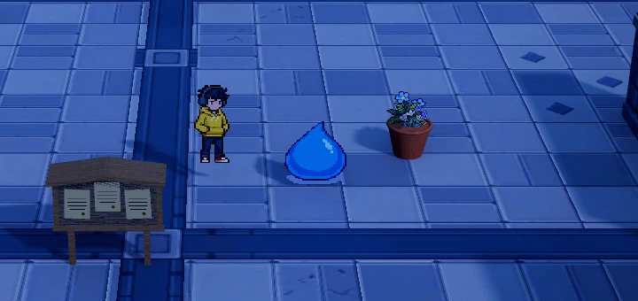

# 人物自带基础剑术

正式入口 `demoWithMeowa/1/scenes/world/world.tscn`，F5 默认运行。普攻和弹射挥剑属于人物基础能力，开局即可使用，独立于 A01 的技能、等级与特效。初始技能三选一仍选择额外技能。

当前正式剑术采用「Meowa 动画短弧」：`data/player/basic_sword.tres` 的 `effect_mode = MEOWA_ARC`，`frames` 绑定已有 `assets/meowa/combat/basic_sword/frames.tres`。以原动画的拖尾与破碎为主，后缘收至人物腰侧附近，向前弯曲展开到攻击外沿；白刃只留少量提示，不绘制人物至刀光的直线。特效自身交代挥砍方向，无需精细手部动作配合。攻击判定、伤害、间隔与范围沿用现有规则；人物挥剑动画与专用命中反馈另行确认。

## 操作和伤害

左键单击出一刀，按住重复普攻，按鼠标的地面方向出剑；右键蓄力期间停止新普攻。松开右键后自动挥剑，直线飞行时只对前方合格目标出手；自动环绕怪群期间，移动沿外围切向进行，每刀朝沿途最早可触及的目标出剑，同一接触时刻优先近处怪物。目标仍须在原有范围内、同高并通过真实墙体检查，不改变弹射路线。左右刀交替，飞行中左键不额外叠加普攻，反弹和模式切换不重置出手时钟。

| 参数 | 普攻 | 弹射挥剑 |
| --- | --- | --- |
| 每刀基础伤害 | 10 | 10 |
| 出手间隔 | 0.55 秒 | 0.30 秒 |
| 地面投影半径 | 1.52 米 | 1.52 米 |
| 扇角 | 120° | 180° |

起手 0.05 秒、实际横扫 0.10 秒、收尾 0.10 秒，共 0.25 秒。初始 20 生命史莱姆两刀击杀；出手次数取决于真实飞行时长、合格目标与出手间隔，环绕续段不重置时钟或额外补刀。一刀对同一怪物只扣血一次，下刀可再次命中。采用连续移动刀锋扫掠，墙面反弹前后分段处理，低物理帧率也不能跨群漏判；瞬移只跟随落点，不扫瞬移路径。

剑伤先结算，存活怪物进入人物本次弹射的拨怪半径后，再请求切线外力和眩晕；剑的范围与拨怪圈独立。若拨怪圈较小，受伤资格保留到同次飞行后续路段，仍每只最多拨一次。本体碰撞和拨怪不额外扣血，也不提供无敌或减伤。拨怪与眩晕规则见[人物弹射](player-ricochet.md)。

## 参数与成长

Godot「参数总览 → 人物」搜索“基础剑术”“普攻”或“弹射挥剑”，定位 `Player.sword_rules` → `data/player/basic_sword.tres`。伤害、两种间隔／范围／扇角、起手／横扫／收尾、素材、高度、斜切角度与声音均可调；每次出手取快照，下一刀使用新参数。

窄弧可调显示方式、素材图集、刀痕厚度和尾迹角度；透明度与自发光复用原参数。Godot 下拉菜单提供「旧帧动画」「程序短弧」「Meowa 动画短弧」；刀锋／尾迹颜色和程序像素尺寸仅作用于程序短弧，Meowa 模式直接使用原帧颜色。资源默认厚度 0.10 米、尾迹 62°，正式数值以当前 `basic_sword.tres` 为准。范围成长时仅按半径倍率的四次方根温和增厚，最多为基础厚度的 1.6 倍；真实外缘仍严格沿用命中半径。选择旧帧动画且素材槽留空可关闭显示，不影响攻击。

「Meowa 拖尾与破碎」提供白刃存在感 `meowa_body_opacity`（默认 0.08，设 0 关闭白刃）、拖尾展开倍率 `meowa_tail_spread`（默认 2.5）、拖尾内端半径比例 `meowa_tail_inner_ratio`（默认 0.3）和独立破碎消散时长 `meowa_tail_seconds`（默认 0.24 秒）。内端比例越小越贴近人物，设为 1 恢复外沿短弧；前端仍保留真实攻击半径。宽度随内收半径收窄，避免铺满成扇形。全部只改显示，不扩大或缩小判定。

基础伤害乘本局共享伤害系数；两种间隔各乘共享间隔系数；范围各乘共享范围系数，扇角保持原值。每次只应用一次，共享增益资格同时检查两种攻击，飞行间隔封底时仍保留能强化普攻的冷却卡。出手间隔最低为完整动作时长，不通过快放素材缩短动作；基础剑术没有技能卡等级，不占 A01 等技能条目。后续流派可订阅 `PlayerSword.strike_started` 与 `hit_landed`，命中事件只在实际扣血后发出。

升级选择冻结动作、刀光、命中结算与弹射时钟；已记录的同刀接触恢复后各结算一次。管理面板占用新攻击输入，已发射运动和自动挥剑继续。清波、失败、撤退、重试与死亡清理旧动作和输入。

## 未采用的打击反馈草案：清脆剑击

本节草案未获采用，不属于当前制作范围，也未接入正式效果；当前优先完成[蓄力阶段视觉](player-ricochet.md#动画与后续特效接口)。以下仅保留讨论内容，后续命中反馈需重新确认。

### 反馈归属与范围

- 专属命中图案属于人物基础剑术，地面普攻与弹射挥剑共用视觉语言，独立于 A01。相同剑伤共用基本命中表现，弹射的动感主要由实际运动、连续命中和镜头跟随体现。
- 怪物负责受击身体反应：根据自身材质选择软体／硬质响应。先以史莱姆和裂瓷壶兽验证，再配置当前其余怪物；通用接口留给后续其它攻击复用。
- 金星继续只表达眩晕，墙面反弹属于碰撞反馈，各自独立触发。A01、雷光、棱晶与镜印保持自己的来源和资源。
- 本轮制作接触点的命中表现，现有停用的厚月牙挥剑光保持停用。人物母版与完整挥剑动画沿用既有确认流程。

### 表现与初始试值

| 项目 | 首版方案 | 初始试值与约束 |
| --- | --- | --- |
| 主命中图案 | 暖白实心打点带短绯红切痕，沿本次剑锋方向收尖消散 | 主体约怪物可见身体宽度的三分之一，以原生像素标尺定稿；单次约 0.12～0.18 秒 |
| 主体制作 | Meowa 原生透明像素短动画，专用图集与材质 | 目标节奏在制作时确定，完整播放所有原生帧，不靠抽帧或快放缩短 |
| 粒子 | 首版不额外建立随机粒子层，少量碎点纳入主动画 | 先确认接触点、怪物身体和镜头三项是否已经足够清楚 |
| 软体受击 | 史莱姆／幼体轻微压缩并回弹，花兽／苔蛙采用较弱软体响应 | 先试 5%～8% 的视觉形变，约 0.10～0.15 秒恢复；脚底锚点与碰撞体稳定，以当前镜头下像素轮廓稳定为验收条件 |
| 硬质受击 | 壶兽、冲锋虫采用短促后摆或沿受力方向的贴图偏移 | 幅度小于软体，禁止压成软体轮廓；仅改显示层，不追加真实击退 |
| 局部顿挫 | 受击反应在打点处短停，再完成回弹 | 先试约 0.03 秒，仅作用于受击姿态的显示时钟；人物飞行、AI、真实碰撞和伤害时钟继续运行 |
| 普通命中镜头 | 一次短促、沿斩击方向的冲击并快速收住 | 以 1280×800 试玩画面约 1～2 像素位移为起点，约 0.08 秒衰减 |
| 群体／击杀镜头 | 同一刀的冲击提高一档，强度封顶 | 先以同刀命中至少 3 只或发生真实击杀为升级条件，约 3～4 像素；同刀逐步升档，不按怪物数叠加震动 |
| 反弹镜头 | 沿墙面碰撞方向一次弹性回弹，随后转入新飞行方向 | 初始约 3～4 像素、0.10 秒收束；与同帧命中请求合成并封顶 |
| 飞行前看 | 沿真实世界飞行方向给画面前方留空间 | 先试焦点前移约 0.4～0.6 米，随实际速度渐入，反弹后约 0.10～0.15 秒转向 |
| 结束回稳 | 前看偏移与剩余镜头冲击迅速回落 | 先试约 0.18～0.25 秒恢复普通跟随；无实际命中时不播放命中图案或冲击 |

普通命中、群体命中和击杀使用相同剑术识别，重点通过怪物反应及镜头强弱建立层次。所有试值都需在正式当前镜头下校准，并可独立开关和调节；首版不增加全局慢动作、自动旋转或反复推拉镜头。

### 一次弹射的节奏

蓄力阶段沿用现有可视进度与瞄准；释放后前看偏移随实际飞行速度展开。真实挥剑命中出现紧凑打点与对应怪物反应；穿过多人时沿用每刀节拍，镜头按该刀的累计命中情况升档。撞墙给一次方向明确的回弹，再平滑看向新的飞行方向。收尾时让镜头归稳、短命中动画自然结束，眩晕金星按自身计时保留。

当前飞行 0.9 秒、飞行剑术间隔 0.30 秒提供约三次出手的基础节奏，但反馈只跟随真实事件，不强制补出三次打点。攻击速度、伤害、范围、弹射轨迹、拨怪与眩晕规则沿用当前玩法。

### 接入约定

- 从基础剑术实际扣血事件生成反馈快照：来源、该刀编号、命中位置、入射／剑锋方向、实际伤害、是否击杀和目标受击类型。同刀目标仍按原规则去重，不因反弹重新编号。
- 怪物显示层处理身体反应，来源专属的命中动画走可复用效果池，镜头统一合成命中与反弹请求。强度采用封顶或升档，同一帧不会无限叠加。
- 致死命中保留世界坐标与方向快照，怪物节点移除后仍可完整播放接触点效果，并沿用原死亡与分裂流程。
- 相机效果叠加在现有跟随上，使用正式场景当前 FOV、距离和俯角；保留 Q/E 控制、边缘约束和当前景深选择。抖动位移不参与鼠标瞄准和人物输入方向计算。
- 升级时战斗反馈计时随战斗冻结；恢复续接。管理面板保持既有世界运行规则。清波、退出与重试清理旧请求及显示变换，避免残留形变、偏移或镜头冲击。
- 程序受击形变只作用于显示层，不修改资产原始像素、身体碰撞、伤害频率或真实控制状态；普通命中不会因视觉顿挫额外打断怪物招式。

### 制作与验收顺序

1. **先做基准样板**：同一路线记录当前效果，包含史莱姆单体两刀、壶兽连续命中和一次墙面折返。
2. **受击与命中动画**：先对比软硬两个样本，确定接触点、切向、原生像素尺度及短停／回弹的完整时序，再覆盖其它当前怪物。
3. **镜头接入**：加入方向前看、按刀汇总的命中冲击、墙面回弹及结束回稳，分别提供开关，保持瞄准与实际轨迹一致。
4. **同路线联调**：固定随机种子、伤害和怪物生命，对比“原版／受击与命中／完整反馈”三组实机。额外验证 6～10 只混合怪物的穿群画面与技能同时命中。
5. **玩法回归**：核对每刀伤害次数、两刀击杀基线、弹射和薄墙碰撞、眩晕时长、升级冻结、死亡分裂及清波；运行既有基础剑术、弹射、眩晕与相机相关回归。

通过标准：同刀打中多人有一次明确的强冲击；能从切痕读出斩击方向、从怪物反应读出软硬；空挥没有命中特效；连续弹射保持流畅，墙面折返和 Q/E 旋转后仍容易辨向；当前镜头下人物、怪物预告与下一段通路保持可读；实际扣血、飞行轨迹和控制规则与基准一致。

## 当前 Meowa 动画短弧

`player_sword_meowa_arc.gdshader` 直接最近邻采样原八帧图集，以逐帧方向信息对齐原红白环带，再用运行时 UV 映射适配短弧宽度与尾长。原 PNG／WebP、SpriteFrames、帧序、原始 RGBA 均不改写，不烘焙或再像素化素材；压窄映射会压缩笔触的显示宽度，观感以当前镜头为准。图集采样限制在当前帧内，避免调美术半径时串入相邻帧。

前半段按真实横扫进度播放原前半帧，材质降低低饱和白刃的显示透明度，让原有色笔触与碎屑在独立的较宽区域展开。源图 RGBA 不改写，显示时白刃与拖尾采用不同透明度，不重新绘制颜色或随机碎点。真实攻击方向、左右反向与原有墙体／水面裁切保持。

真实挥扫结束后，`PlayerSword` 在该路段的实际终点登记余迹快照，固定世界位置，由池化 `GroundSlashEffect` 继续播放原后半破碎帧。视觉时长独立于真实收尾和下一刀，也不随攻速压缩；重叠余迹按真实时间保留并复用节点，粗物理步长只保留本帧结束时仍未消散的余迹。管理输入占用不停止余迹，升级冻结同停；开始蓄力保留已释放余迹，清波／退出／重试和死亡清空。释放后仍实时检查挡墙，Q/E 保留实际世界方向。

## 保留的程序短弧对照

`GroundSlashEffect` 继续复用平地网格、动态挡墙／水面裁切及 `CombatEffectLayer` 的怪物轮廓补画。窄弧使用独立 `player_sword_arc.gdshader`，不采样或修改旧图集：只有外沿短弧着色，人物至刀光之间保持透明，不绘制连接线。短弧两端收尖，亮芯集中在前端，尾部逐渐变暗、变窄。

扫击进度、左右反向与收尾继续使用真实攻击时钟，不使用 Shader TIME。腰部高度与有限镜头倾斜只改变显示高度，不平移地面攻击中心；Q/E 旋转不把刀痕改成屏幕固定贴纸，保留建筑遮挡。人物当前没有专用挥剑帧，当前试玩不代表完整人物动画已完成。

## 保留的厚月牙试作（当前停用）

Meowa 原生透明动画 8 帧，每帧 224×224，完整打包到 4×2 图集，不缩放、不重新像素化。暖白厚刃、绯红内层与末段碎屑消散；最近邻采样，保留全部原生帧。人物仍沿用现有动画，`normal_attack`／`flight_attack` 动作槽可后续替换。

默认地面投影每像素 0.016 米，与人物 `pixel_size × scale` 一致。相较参考图收紧基础范围；斩面中心在脚底上方 0.72 米，朝镜头抬起 8°，叠加左右交替的小幅斜切，避免某些出剑方向变成侧对镜头的一条线，也避免把月牙过度竖起显得太大。增大范围时限制倾斜高度，外缘至少离地 0.08 米。改变高度与倾斜不平移地面投影；刀光网格外缘、扇角和逐步揭示方向共用真实攻击参数。墙体和水面同时限制斩光与伤害。角端由内缘收尖，收尾按动作进度淡出，使用独立透明混合材质保留红白层次。

范围升级时刀光与命中同步扩大；这是玩法强化的尺寸变化。基础素材校准使用 `art_radius_pixels = 95`，普通调范围时无需反向修改该值。平地正反斩光网格复用，动态墙体出现立即改用实时裁切；闲置隐藏，不保留逐帧射线工作。声音复用 `MapEffects/GameAudio` 预算与命中混音。

## 预览与验证

直接运行正式主场景，左键单击／按住普攻，右键蓄力松开发射并观察飞行挥剑；巨量怪潮的数量与技能在 `WavePrototype.population_rules` 中配置。旧的独立史莱姆练习入口已清理，基础剑术仍独立于 A01。

[Meowa 贴身拖尾播放样板](../media/player-sword-preview/meowa-close-20261016.webp) 来自小型 GPU 测试场地，读取正式场景当前相机参数；原尺寸裁切后最近邻整数放大，按一次基础普攻的 0.55 秒周期播放。该样板特意保持人物站姿，用于检查拖尾能否独立交代挥砍方向；正式地图中的受光与场景细节以试玩为准。

`tests/test_player_sword.gd` 覆盖两刀击杀、同刀去重、半径内外边界、薄墙／水面／高度、共享属性、真实左键、冻结与输入、小拨怪圈衔接、低帧率与反弹时钟、原生帧和网格裁切。弹射、闪身、眩晕、参数入口与管理 UI 有独立回归。

`tests/test_sword_thin_arc.gd` 复用完整剑术回归，并验证真实输入启用无图集窄弧、扫击时序、冻结、左右反向、八个镜头方位、厚度成长上限、补画参数、动态薄墙裁切与取消清理。GPU 检查使用小型夹具读取正式镜头配置，不启动完整战斗场景。

`tests/test_sword_meowa_arc.gd` 在上述回归基础上验证原图集绑定、八帧顺序、真实输入、命中与冻结、材质／网格复用、模式切换、空素材安全隐藏、取消和真实薄墙裁切；补画通道同步当前原帧，不重新绘制替代笔触。

`tests/test_sword_residue.gd` 进一步验证扫刃到余迹交接、独立消散不影响冷却或伤害、世界落点、冻结、运行中挡墙变化、快照、清波清理、粗／细步长下的高攻速重叠与节点复用，以及四项关键参数的中文入口。

本轮基础剑术 104 项、弹射 97 项、闪身 28 项、眩晕 40 项、管理 UI 31 项通过，参数总览索引检查无失败。正式 D3D12／Forward+ 镜头为 FOV 28°、距离 15 米、俯角 25.414°；采集确认 2 次普攻、3 次飞行挥剑、3 次先伤后拨、1 次反弹与 1 次击杀。动画图集全部 RGBA 像素与 Meowa 最终原生帧逐一相等。

早期验证时曾发现旧 AutoFan 场景夹具与成长候选池的既有失败，未计入上述通过数字。AutoFan 专用旧测试现已清理，当前剑术与成长分别由各自的回归检查维护。

以下为停用前的试作画面，保留参考：

动图为实机原尺寸局部裁切，保留全部采集帧。完整 1280×800 截图：[普攻](../media/player-sword-preview/normal.png)、[弹射挥剑](../media/player-sword-preview/flight.png)。
