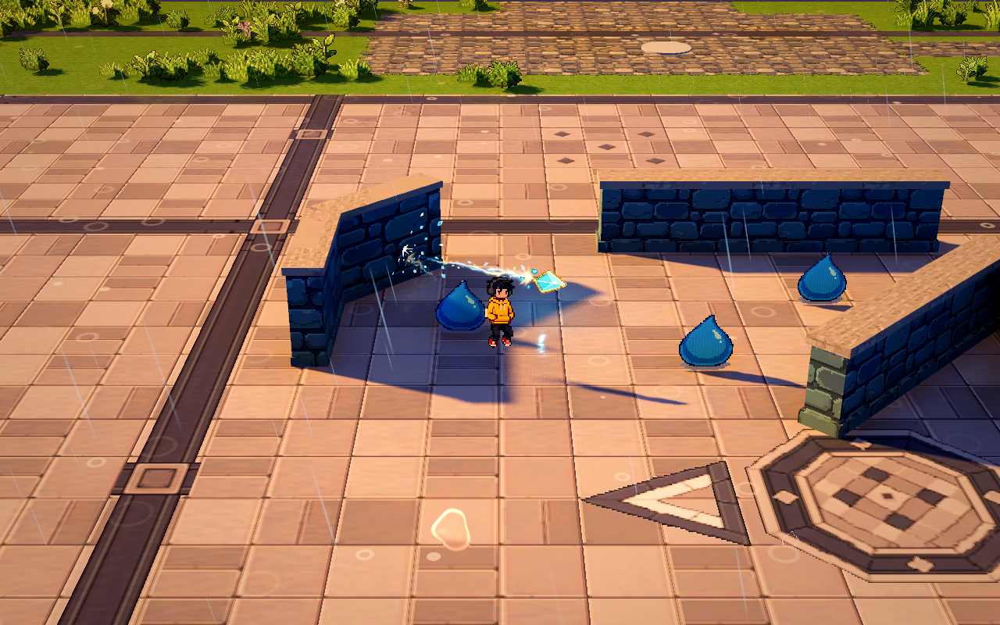
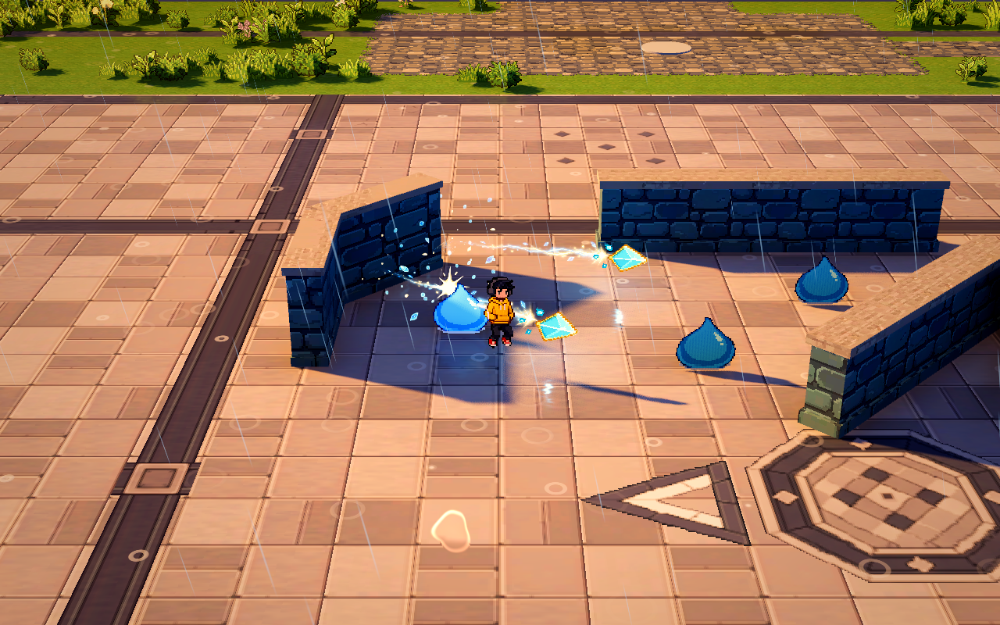
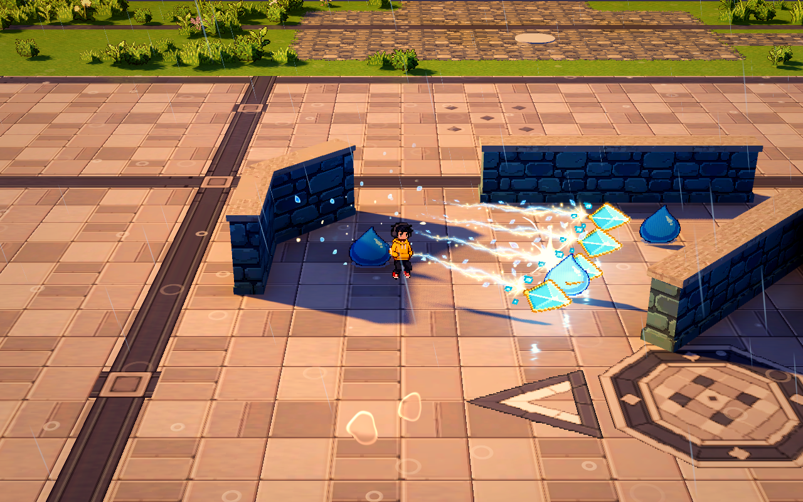

# 棱光弹射

已接入正式波次场景的第一版弹射技能。开始战斗时可选为初始技能，也可在本局成长卡中学习；与扇击和雷光贯穿共同运行，波间保留，重开重新选择。

棱晶贯穿敌人，碰到实体墙面后按接触法线反射。斜墙、墙角、圆柱、桶及其它实体障碍使用当前真实碰撞形状；不会把铁栏之间的空隙补成实心墙。每个弹道段对同一敌人只命中一次，反射后允许回程再次命中。达到反射次数、累计飞行距离或地形边界后消退。水面、未铺地形和超出允许高度的地面终止飞行；地形碰撞不用于反射。

## 成长与数值

八级配置在 `demoWithMeowa/1/data/skills/prism_ricochet.tres`，第一版数值可调。

| 等级 | 齐射数 | 最大反射次数 | 累计飞行距离 |
| --- | --- | --- | --- |
| 1 | 1 | 2 | 10 米 |
| 2 | 1 | 3 | 12 米 |
| 3 | 1 | 4 | 14 米 |
| 4 | 2 | 4 | 15 米 |
| 5 | 2 | 5 | 17 米 |
| 6 | 3 | 6 | 18 米 |
| 7 | 3 | 7 | 20 米 |
| 8 | 4 | 8 | 22 米 |

伤害、速度、出手密度与晶体外观同步成长。通用伤害和冷却增益生效；通用覆盖范围不扩大这类纯弹丸的飞行距离或碰撞半径，成长卡只显示真实支持的收益。发射时锁定数值与世界轨迹，升级影响下一轮发射。闪避保留冷却与已发射弹丸，不沿瞬移路径额外伤害敌人。

## 碰撞与特效接口

`scripts/combat/projectile_collision.gd` 提供 `wall_contact()`、`enemy_contacts()` 和 `ground_limit()`。球形连续扫掠检查本帧完整行程，包含起点重叠，避免高速穿过薄墙；敌人的真实胶囊碰撞按进入顺序返回，不依赖固定返回数量上限。一次物理更新可以包含多次反射，剩余行程继续推进；细小接触偏移与各次反射均计入飞行预算。动态障碍每次实时检查。

`PrismRicochetAutoAttack` 使用现有技能定义、等级应用、升级说明和本局数值接口，提供 `shot_started`、`hit_landed`、`wall_bounced` 事件。攻击组件登记到 `WavePrototype`，升级冻结覆盖弹丸和视觉子树，清波／结束统一清理。碰撞查询不负责伤害，特效不参与结算。

`PrismRicochetEffect` 使用独立 Meowa 棱晶、现有光丝网格与八帧星芒。棱晶已按确认方向改为原生 48×32 像素素材，简化晶面、收紧辉光；独立透明混合材质保留蓝色与金边。显示尺度进一步缩小，一级主体约 0.45 米，八级约 0.72 米。拖尾记录实际折线和限定长度，不跨墙画直线；末端消退与命中动画完成后归还池。所有反馈走公共声音管理器。

## 试玩与实机

实际试玩统一使用正式地图；普通模式通过技能池学习“棱光弹射”，巨量怪潮模式通过 `WavePrototype.population_rules` 配置持有技能与等级。旧独立试玩入口已清理，技能组件与自动回归保留。

实机采用当前场景实际相机：FOV 28°、距离 15 米、俯角 25.414°，景深关闭。

验证入口：`tests/test_prism_ricochet.gd`。覆盖薄墙、旋转墙、圆柱、障碍移动、密集与擦边命中、同段去重、回程再命中、墙后遮挡、反射次数上限、初始与成长选择、伤害／冷却增益、闪避、冻结、清理和资源复用。
