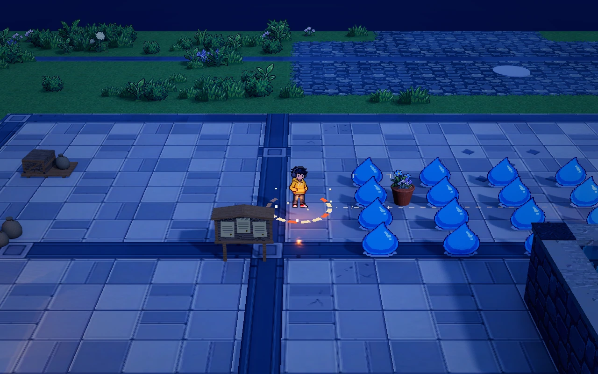

# 奔雷涌潮

独立的本体弹射技能，已接入正式 `world` 的初始技能与升级池。定位为弹射中的周期清群补伤：一片怪物同时放电，短暂错开后有限向外扩散。它不依赖 A01、A02、A03 或基础剑术是否启用，波间保留，重试清空。

## 当前规则

- 仅本体真实弹射路段可以周期触发，普通移动、普攻和 Shift 闪身不触发。高速跨过怪群仍用连续路段寻找首次进入范围的位置。
- 每次放电先锁定有限层数的传播路径，同层目标同时结算。每轮雷潮有独立的目标预留和命中记录，同一轮各传播层合计每怪最多一次；下一轮可以再次命中同一只怪。旧雷潮与新雷潮各自完成，不共享整次弹射命中表。
- 传播只能向距离本次触发点更远的目标延伸，不向内回传；总传播半径默认 3.6 米。首次选路和实际落雷时都检查向外条件、单跳距离及总边界，怪物移动后不能隔空追击。不递归产生新施放。
- 首片仅显示落雷与命中电花，不画人物到怪物的横向传播线；后续层只为真实的怪物传导关系绘制连接。单只怪物不会产生传播线，人物飞行电痕使用较弱的断续残电，与传播主干分开显示。
- 雷伤使用独立基础值，共享伤害倍率只乘一次；范围增益扩大首次切入与后续传导距离，但不扩大总传播边界；冷却／攻速增益缩短寻找新目标的放电间隔，每轮仍独立去重，不加速命中动画或片间节奏。当前蓄力开始时固定本次技能快照，升级影响下次蓄力。
- 冷却跨弹射保留，落地与蓄力期间的普通战斗时间继续计时；取消、主动脱离和重新发射不刷新首发机会。首次近身且就绪时立即释放，空地保持就绪但不积攒多轮。只有真实飞行路段可以产生新施放。
- 每条传播连接检查地形、高差与真实墙体；到期结算时重新检查动态挡墙。怪物死亡后可从已经选定的位置继续传导；墙体阻断的分支及其后继取消。
- 弹射结束或主动取消后，已经发出的雷潮继续收尾。飞行、落地冷却与各轮传播使用同一条战斗时间线，低帧率不会丢掉已满足条件的施放或漏掉到期层。升级冻结雷潮、物理路段队列和所有特效时钟；同片扣血过程中触发升级也保留处理游标。清波、结束、取消学习和重试清理在途雷潮。
- 雷潮不附加新眩晕或无敌。原有基础剑术伤害、切线拨怪和拨怪眩晕独立保留。
- World 的雷伤致死命中复用近身击杀的原帧击飞、翻转、金星、余迹和爆点，每只向独立随机的水平 360° 方向散开，复用怪物轮廓补画，建筑仍遮挡。首次放电保存触发位置的真实水平速度，同片怪物同时死亡、翻飞，后续片按当前默认 70% 力度逐层减弱，先封顶再衰减；近身距离门槛不截断奔雷击飞链。玩家取消、落地、移远或升级冻结后，已经发出的传播仍使用本轮速度快照与原片间节奏，保留成片向外爆开的死亡表现。实际伤害、传播路径、目标预算、死亡、经验、计分和壶兽原地分裂保持原规则，金星仅用于死亡视觉。共用地图人物动作视觉的 `melee_death_enabled`、`melee_death_reference_speed`、`melee_death_storm_retention` 等参数，City 默认保留当前配置；逻辑由 `tests/test_melee_death_feedback.gd` 验证，观感仍须正式地图人工试玩。

人物转向与雷潮保持近身距离配合：单怪和不成群目标在 1.05 米接触，进入奔雷基础 1.25 米切入范围；可持续环绕的怪群才提前捕获，沿实际外沿路线继续检查触发。提前判群不直接施放雷潮、不扩大雷伤范围、不重置放电间隔或每怪去重，真实运动仍须进入技能范围。

## 参数与成长

World 正式基础伤害在 `BattleConfiguration.configuration.storm_damage` 调整，或在编辑器“参数总览 → 战斗与成长”检索“雷潮”；地图绑定会覆盖组件默认值。技能等级配置为 `data/combat/scenes/world/skills/ricochet_storm.tres`；World 视觉使用 `scenes/combat/ricochet_storm_effect_world.tscn`，继承共享的 `scenes/combat/ricochet_storm_effect.tscn`。

| 等级 | 单体雷伤 | 每片最多目标 | 扩散层数（含首层） | 放电间隔 | 切入／传导距离 |
| --- | --- | --- | --- | --- | --- |
| 1 | 20 | 3 | 2 | 0.9 秒 | 1.25／1.5 米 |
| 2 | 24 | 4 | 2 | 0.9 秒 | 1.25／1.5 米 |
| 3 | 28 | 4 | 3 | 0.81 秒 | 1.25／1.5 米 |
| 4 | 32 | 5 | 3 | 0.72 秒 | 1.25／1.5 米 |

表中为正式地图无共享增益的试玩值，`BattleConfiguration.configuration.storm_damage = 20`；通用组件默认 7 保留兼容。片间隔默认 0.085 秒，总传播半径 `max_propagation_radius` 默认 3.6 米，可在同一参数入口调整。每次雷潮最多覆盖 6／8／12／15 只，整次弹射按间隔引发多轮雷潮，同群存活目标也可以在下一轮再次受击，长续航带来更多实际施放机会。技能自身升级不继续拉长切入或单跳距离，保留共享范围成长在总边界内的作用。

正式 World 对齐 40 基础生命史莱姆及 10 伤害剑术：未计成长与暴击时，一级 20 雷伤需两轮有效命中，满级 32 雷伤可配合一剑清理基础史莱姆。没有共享成长时，雷潮本身不会在开局一轮抹掉所有主怪；技能等级和伤害成长继续带来击杀断点变化。目标预算同时约束视觉与伤害，不通过漏播特效维持性能。具体命中率、清群速度与后期压力仍需实际试玩判断。

## 美术与验证

当前 World 暂时关闭 `patch_enabled` 成片电涌层，优先保证怪物与场景可读性；落雷、命中电花、真实传播电弧与飞行电痕继续保留，伤害、目标、传播和声音规则不变。其它地图保留原配置。以下电涌面说明用于保留素材与重新开启时的调节。

复用 Meowa 的 `light_pierce/pixel/` 雷刺、断续电光和完整八帧命中电弧；原始文件、透明度和 A02／A03 场景保持独立。电弧主干由引擎按相同世界像素步距连接，Meowa 尾迹提供细枝、雷刺提供配色与前锋。每层一至两处降雷建立视觉重心，实际同片命中的多个目标叠出横向宽电涌：原生命中帧错位铺设，配合固定像素步距的交错电流和低亮蓝色电气，在当前斜俯视镜头里形成连片雷光。单怪只保留紧凑落雷与命中电花，不铺电涌面。

电涌面默认停留 0.34 秒，连接弧保留 0.28 秒；相邻片仍按原 0.085 秒推进，前片尚未消退时下一片展开。电涌面随镜头朝向更新，位置固定在实际受击点附近，不形成持续伤害区、不增加目标或传播距离。人物真实飞行路径仍只留下短时无伤害电痕。

`ricochet_storm_effect.tscn → 成片电涌` 提供 `patch_enabled`、`patch_duration`、`patch_opacity` 与 `patch_height`，可分别调开关、停留、强度和高度；打开该特效场景后，也可在参数总览搜索“成片电涌”。当前不放大 Meowa 像素，电涌扩大来自原生帧的组合。

声音使用独立 Meowa 核心包：首片在两条紧凑落雷变体间选择，后续层使用较轻的传导音，每层额外降低 3 dB。每片只请求一次公共声音，不逐个受击者叠加电声；首片作为施放反馈，后续传导继续遵守普通命中合并。默认 `Hit Volume Db = -9`，`Propagation Layer Gain Db = -3`，声音开关、两组音源及逐层增益均可独立调整。其它技能的原音源保持不变。

运行像素尺寸为 0.016 米／像素，贴图保持原生尺寸；长连接按固定像素尺寸分段铺设，末段裁切采样，不把短线压缩整张素材。连接与电涌共用网格，弧线、雷刺和电涌各共用一个材质，节点按实际并发复用；命中与电涌均播放完整八帧。电涌与连接消退后停止处理，升级冻结、清波与取消同步清理；声音继续使用公共 `MapEffects/GameAudio` 的预算与混音。

试玩统一运行 `scenes/world/world.tscn`。普通模式通过开局或升级学习“奔雷涌潮”，右键蓄力后释放；巨量怪潮模式通过 `WavePrototype.population_rules` 配置怪物数量与技能等级。旧固定十六只史莱姆的自动重放入口已清理，真实技能与自动回归保留。

检查入口：`tests/test_ricochet_storm.gd`，覆盖实际选择与升级、各级补伤数值、同片多目标、向外传播、单跳及总边界、移动后的再检查、每轮独立去重、同群周期重复、重叠批次隔离、跨弹射冷却、快速取消重发、空场不积攒、粗细时间步长一致、动态挡墙、传导目标死亡、冻结恢复、真实飞行、共享增益和清理复用；另检查单怪不铺电涌、相邻雷片重叠、电涌冻结与节点复用。此前版本的引擎与原生 Forward+ 验证记录不代表本次周期规则已实测。本次仅完成脚本语法与离线调度逻辑检查，未启动 Godot；真实物理、画面和性能回归待试玩。贴图原生像素密度保持不变。

[当前实机静帧](../media/ricochet-storm-preview/patch-cluster.png) · [早期雷潮预览](../media/ricochet-storm-preview/motion.webp)。
