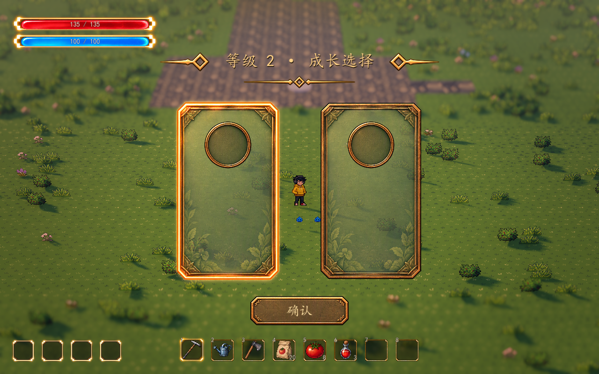

# 本局经验与抽卡成长

2026-10-16。用户已确认：本局等级与经验在新挑战、重试时重置；每次升级立即选择，临时冻结战斗，环境与声音继续运行。经验宝石、经验条与真实成长候选已接入，升级选择复用现有组件。正式六类成长及数值见 [本局共有成长](combat-buffs.md)。

已接到正式地图的 `WavePrototype/RunGrowth`：真实怪物死亡生成经验拾取节点，人物靠近后自动吸取，经验达到阈值就从有效成长池抽 3 张选 1 张。`RunSkillManager` 管理技能学习和升级，`SkillDraft` 汇合它与 `RunBuffs` 的三条弹射、三条通用成长候选，确认后在恢复战斗前应用效果。池子不足 3 张时展示所有有效候选，满级、无收益和禁用条目退出池子。游走收集暂不加入，旧重复增益与专精不再登记到正式池。现有吸取和清波自动收取保持原有配置。World 的经验和成长资源位于 `data/combat/scenes/world/`；项目及组件开关、City 独立配置与兼容入口见[场景配置与启动](../technical/combat-extension-framework.md#场景配置与启动)。

## 当前流程

1. 新局所有技能均未学习。在挑战入口按 F 从 `RunSkills.skill_paths` 登记的技能池抽 3 张，确认一个 1 级技能后才开始刷怪。超过三种时抽其中三种，不足三种时全部展示，顺序随机；新增技能自动参与同一池子。Esc 返回准备状态，再打开保留原抽牌与重抽次数。该选择不消耗经验。
2. 怪物实际死亡只通知一次，按该种怪物的 `Experience Reward` 生成拾取节点；取消生成、异常移除和结算清理不发经验。
3. 人物进入吸取范围后，节点加速靠近人物，抵达收取距离才入账。触发前检查高差，避免从明显不同高度的台地直接吸取；已吸引的节点继续跟随人物。
4. 升级立即打开选择界面，冻结敌人、已登记的人物攻击、敌方攻击、刷怪及受击计时、经验吸取。人物控制沿用 UI 输入占用；天气、环境动画、人物重力和声音继续运行。晚到的伤害回调不能伤害任何一方。
5. 普通升级至多展示三张卡；有相应有效候选时，保留一个技能和一个弹射成长候选，其余从剩余全池随机取得，展示位置打乱、不预选。选择弹射方向后，最多三次确认升级内再展示该方向的有效续级。初始技能与后续升级每局共用 3 次重抽，优先抽未展示的候选；分组与跟进条件下没有实际替换候选时禁用且不扣次数。重抽不推进方向跟进、不授予奖励、不扣升级次数、不改变刷怪随机数。一次拾取连升多级时逐次重新抽牌，中间不恢复战斗，每轮都要明确选中后确认。
6. 默认清波会自动收取剩余经验，完成由此产生的全部升级选择后再休整或结算。这个自动收取是本轮建议的可调基线，可关闭。
7. 失败、撤退或结束清除掉落、未完成选择与弹射方向跟进，释放冻结和界面输入。等级可暂留供本轮结果读取；返回准备状态恢复人物 1 级、0 经验和无技能，重试重新打开初始技能选择。

经验节点现已带三档 Meowa 晶体、漂浮、阴影和细小尾迹，经验条绑定同一份本局状态，收取时有短暂微光。宝石外观依据节点含量切换，合并后同步刷新；阈值不改变经验奖励。清波自动收取继续沿用原规则，未新增拾取声音。布局、分档与视觉参数见[经验宝石与经验条](../ui/experience-visuals.md)。

## 参数

当前玩法请调整 `BattleConfiguration.configuration.experience_rules`；World／City 分别读取 `data/combat/scenes/world/growth/experience_rules.tres`、`data/combat/scenes/city/growth/experience_rules.tres`，均保留 10 点起始、每级增加 5 点、上限 100 级的独立配置。

下表是 `data/growth/experience_rules.tres` 等共享模板的平衡参考，未自动覆盖到独立场景。前三波累计升级选择 3／5／8 次的[完整清波模型](endless-waves.md#成长与割草基线)也只对应该参考曲线；模型包含壶兽幼体，不包含免费初始技能，不能视作两张地图当前的实机结果。

| 参数 | 共享模板参考值 | 含义 |
| --- | ---: | --- |
| Enabled | true | 是否接入本局成长；关闭会清理当前掉落、升级界面与冻结 |
| First Level Experience | 12 | 从 1 级升到 2 级需要的经验 |
| Per Level Increase | 8 | 每级增加的需求，为 12、20、28、36…… |
| Curve Increase | 0 | 二次增量；需求为基础值 + 线性增量 × `(等级 − 1)` + 二次增量 × `(等级 − 1)²` |
| Level Cap | 1000 | 可调的远期等级上限，避免较早停止无尽成长；到达后不继续积累升级经验 |
| Experience Reward | 3 | 配在各 `WaveEnemyDefinition` 上，每只实际击败后的经验；0 不产生掉落 |
| Attraction Radius | 2.0 米 | 开始吸取的水平距离 |
| Collection Radius | 0.3 米 | 宝石抵达人物收取点后入账的距离 |
| Height Tolerance | 1.0 米 | 开始吸取时允许的高差 |
| Attraction Initial Speed | 2.0 米/秒 | 吸取起始速度 |
| Attraction Acceleration | 12 | 吸取加速度，米/秒² |
| Attraction Max Speed | 8.0 米/秒 | 吸取速度上限 |
| Collect Remaining On Clear | true | 清波自动收取剩余经验，并等待升级选择完成 |
| Max Pickups | 256 | 场上逻辑节点上限；满时合并到附近现有节点，保留全部经验 |
| Choice Options | 动态候选 | 正式地图由 RunSkills 提供真实技能及增益卡；未指定动态来源时使用配置数组 |
| Cards Per Draw | 3 | 升级每轮抽取数量，不重复、不补空卡 |
| Rerolls Per Run | 3 | 初始技能和升级共用的本局重抽次数 |
| Draw Seed | 0 | 0 每局随机；非零仅用于复现抽取，独立于敌人生成 |
| Pickup Scene | experience_pickup.tscn | 可替换的逻辑拾取场景，根节点继承 `ExperiencePickup` |

修改经验曲线后，下次入账按新阈值处理；比较平衡时建议重开挑战。卡片宽度、间距、内页透明度、标题和动效仍由子节点 `GrowthChoiceUI` 调节，见 [成长选择 UI](../ui/growth-choice-ui.md)。

## 扩展接口

| 模块 | 责任 |
| --- | --- |
| `ExperienceRules` | 可配置经验曲线与上限 |
| `RunGrowthState` | 等级、当前余量、累计经验与待选次数；独立于装备、训练和永久存档 |
| `ExperiencePickup` | 范围、高差、吸取移动和一次收取；不自行修改经验状态 |
| `RunGrowth` | 死亡掉落、统一推进拾取、升级 UI 与波次生命周期 |
| `GrowthDrawPool` | 独立随机抽取、重复候选排除、技能与弹射分组、三轮方向跟进、重抽换牌 |
| `ExperienceHUD` | 真实等级、经验余量、满级、菜单显示与轻量拾取反馈 |

成长系统监听 `RunGrowth.growth_chosen(level, option_id)` 应用技能或增益。该信号在本次待选次数扣除后、战斗恢复前发出，连续升级逐次应用再重新计算下一轮候选。正式地图已由 RunSkills 和 RunBuffs 接入；`slot_a`、`slot_b` 只保留在独立基础组件的空白测试配置中。

候选可通过 `refresh_candidates(options: Array[GrowthChoiceOption])` 更新。它保留待选次数，重新验证当前候选；有效项必须有非空且唯一的 ID，至少一项可选。配置无效会明确报错并保留经验，不会在没有有效界面的情况下把战斗冻结。

卡片短暂翻开后可用鼠标、数字键或方向键选择，Enter 确认，R 重抽。点击或确认键可提前揭晓，但不会自动选择第一张。全局增益卡只展示本次收益、累计共享属性和适用规则，技能卡保留自己的实际升级数值。文字内页加深，世界仍继续显示与运行。

现有经验 HUD 已订阅 `RunGrowth.state.changed` 读取 `level`、`experience` 和 `required_experience()`，拾取反馈监听 `experience_collected(amount)`；后续组件可以沿用这些接口以及 `pending_choices`。等级本身不偷偷增加属性，属性收益由正式候选定义与效果应用负责。

新增人物攻击组件在准备完成后调用 `WavePrototype.register_combat_node(self)`。组件移出场景会自动解除登记；升级冻结后精确恢复原有 `process_mode`。敌方弹丸、危险区和其节点计时器继续放在 `attack_root` 下，伤害使用已有带波次代号的回调。不要用脱离战斗节点的全局计时器绕过冻结来施放攻击。

实现文件位于 `scripts/growth/`，可复用场景位于 `scenes/growth/`；共享波次场景已接入技能学习、升级和全局增益。等级、经验、重抽次数与本局奖励不写入装备或训练存档。

## 验证

- `test_growth_draw.gd`：覆盖随机组合、禁用与满池、技能／弹射候选、三轮跟进与重抽计数、实际换牌、初始取消保留、共享预算、刷怪随机数隔离、隐藏候选拒绝、连续升级防误领、重试与存档保持。本次更新未启动 Godot，新增引擎回归待运行。

- `test_experience_state.gd`：20 项，阈值、余量、连续升级、上限、重置及距离/高差/跟随收取。
- `test_run_growth.gd`：24 项，死亡后先掉落、一次收取、升级冻结、连续选择、数量上限合并、清波收取开关和结束清理。
- `test_growth_wave_integration.gd`：25 项，实际地图、史莱姆死亡、战斗计时与攻击冻结、双方晚到伤害拒绝、天气继续、清波等待选择、真实重试及结算通知中的即时重试。
- `test_growth_choice_ui.gd`：36 项，包括动态等级标题不截断、鼠标/键盘与重复确认。
- `test_experience_visuals.gd`：30 项，三档外观、合并更新、真实经验条、余量与上限、冻结、菜单显示、布局、重试与状态重新绑定。
- 原生 D3D12 / Forward+ 实机：真实死亡 → 可见宝石吸取 → 经验条更新 → 2 级原有选择 → 确认恢复 → 重试归零，镜头采用当前开发预设的 28 米 / 32° / FOV 28° / 景深 0.065。

波次和扇形攻击测试可关闭成长组件以隔离原行为；成长与波次的共同流程由上述集成测试覆盖。
