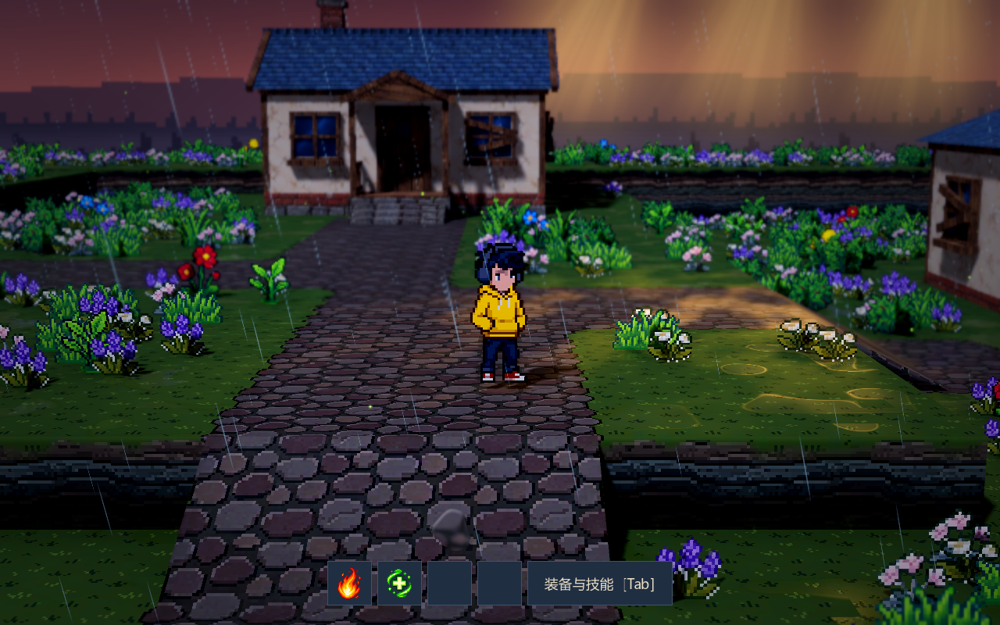
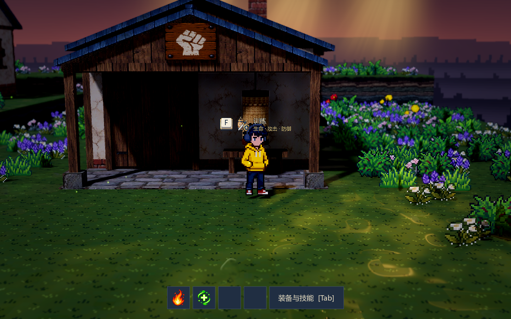
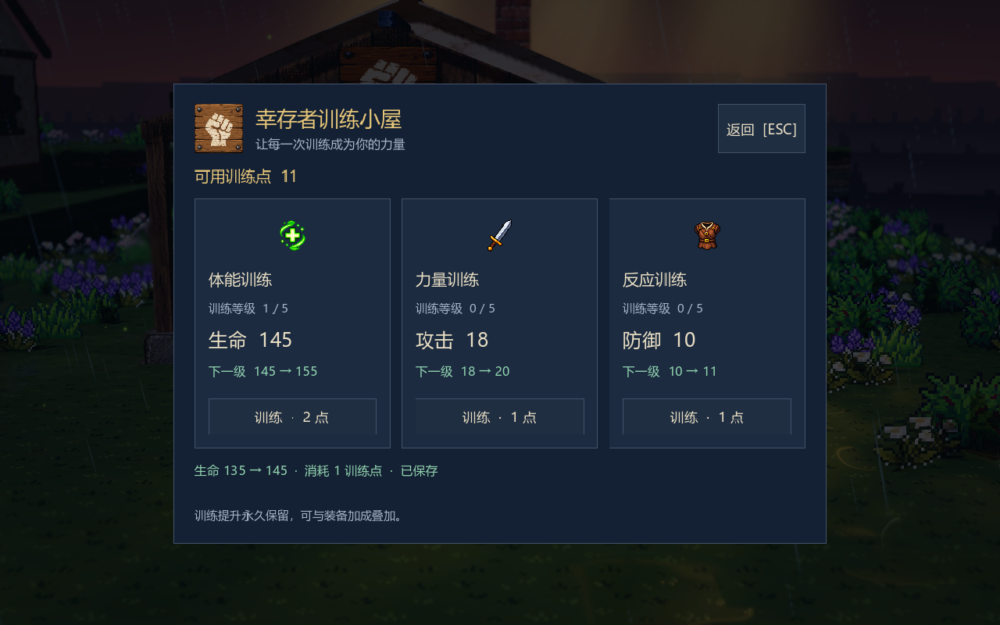
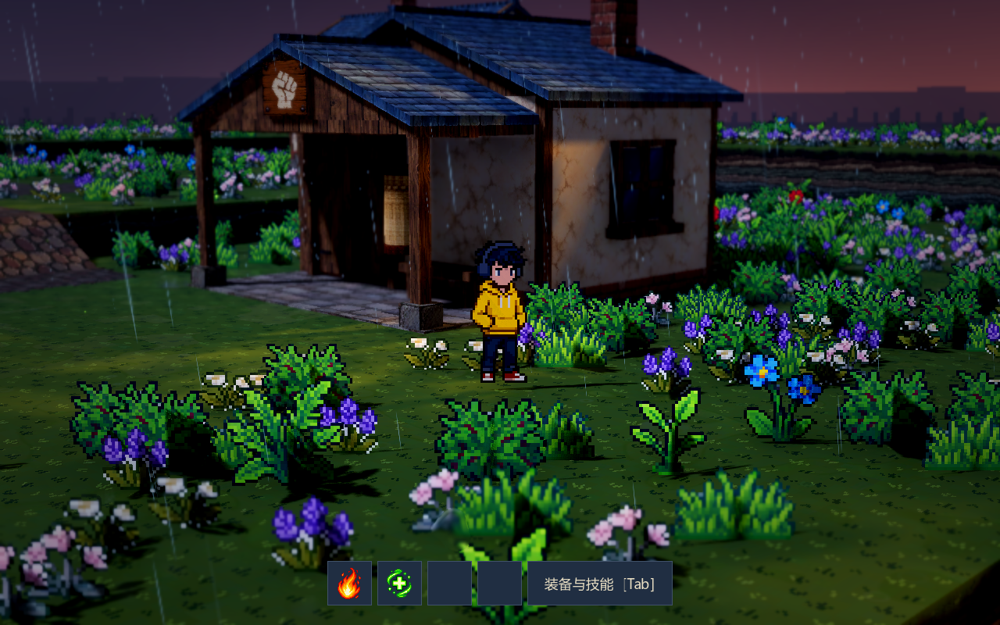
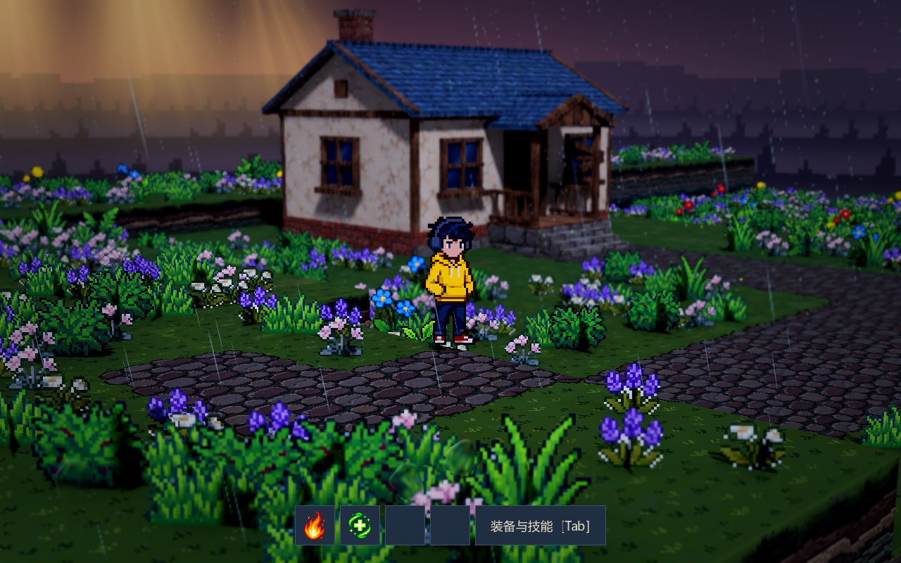
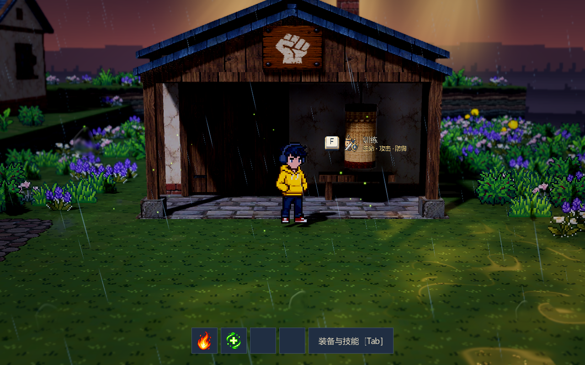

# 幸存者训练小屋

训练小屋已退出正式战斗地图，原型场景、属性与存档保留。本文说明保留组件的使用方式，不作为当前战斗 Demo 的成长入口。

可复用建筑场景为 `scenes/buildings/training_hut.tscn`，没有单独的训练地图。测试时在保留原型或场景副本中放置该组件；历史位置 `(9.6, 0, -4.8)` 已不代表正式地图布局。

## 操作

- WASD / 方向键移动，空格跳跃，Q/E 连续旋转。
- 靠近雨棚下沙袋前的交互点，出现 F 提示后按 F 打开训练面板。
- 选择体能、力量或反应训练，分别提升生命、攻击或防御；面板显示当前属性、下一级属性、等级与消耗。
- ESC 或 F 关闭训练面板，Tab 打开人物装备与技能界面查看角色总属性。

训练界面打开时世界照常运行，天气、环境动画、人物物理与声音持续更新；仅占用人物移动、跳跃和镜头旋转按键，关闭后恢复控制。装备与技能界面采用相同行为。距离过远、隔墙或高差过大时不能使用设施。训练点不足或属性满级时按钮禁用。

靠近设施时的提示使用 Meowa 新生成的透明底像素键帽和训练徽标，图集位于 `assets/meowa/ui/interaction/interaction.png`。按键字母与“训练 / 生命 · 攻击 · 防御”文字由界面动态显示，配合像素描边保持场景中的可读性。

## 可调参数

| 位置 | 参数与含义 | 当前值 |
| --- | --- | --- |
| `LoadoutUI → training_rules` / `data/rpg/training_rules.tres` | 基础生命 / 攻击 / 防御 | 100 / 10 / 5 |
| 同上 | 首次建立训练存档的训练点；不会每次进入重复赠送 | 12 |
| 同上 | 每项属性独立的等级上限 | 5 |
| 同上 | 首级消耗、每级额外消耗；费用 = 首级消耗 + 当前等级 × 每级额外消耗 | 1 / 1 |
| 同上 | 每级生命 / 攻击 / 防御增量 | 10 / 2 / 1 |
| `TrainingHut` | 宽、深、屋檐高度、屋顶高度、雨棚深度；尺寸变化会重建网格及碰撞 | 5.4 / 3.8 / 2.8 / 1.15 / 2 米 |
| `Home` / `TrainingHut → roof_thickness` | 屋面厚度；包含底面与封闭檐口，侧下方观察仍可见 | 0.12 米 |
| `TrainingHut → floor_height` | 门前地坪高于地形的高度；网格与碰撞同步变化，避免共面闪烁 | 0.03 米 |
| `TrainingHut` | 材质重复长度、像素采样和粗糙度 | 2 米 / 开启 / 0.9 |
| `TrainingUI` | 交互键、水平距离、允许高差、界面缩放 | F / 2.2 米 / 1 米 / 1 |
| `TrainingUI → 交互提示美术` | 可替换键帽和训练徽标；图标尺寸、文字字号及提示相对交互点的抬高 | 40px / 18px / 0.7 米 |
| `GroundDressing → excluded_areas` | 建筑与入口的花草留空矩形，采用地形本地 X/Z 坐标 | `Rect2(5.8, -8, 7.6, 14.4)` |

训练规则与建筑外观独立。调整训练规则后重新打开面板查看；初始训练点仅初始化新存档，不覆盖已消耗的点数。当前训练点用于验证成长流程，后续奖励来源与正式经济仍待设计。

角色属性 = 基础属性 + 训练等级 × 每级增量 + 已穿戴装备加成。`Player.get_attributes()` 提供这组实际数值，装备更换预览也使用相同计算。当前没有战斗结算系统；攻击、防御与生命的战斗表现需随后续战斗接入。

## 保存与资源

训练等级和剩余点数与装备、技能共用 `user://equipment_skills.json`。旧版存档没有训练字段时自动初始化，保存后不重复赠点；错误的训练数据会拒绝加载并阻止覆盖存档。保存失败会在训练反馈中显示。

建筑多视图、沙袋布料、皮革、金属与拳头标识来自 Meowa；墙、砖、木梁、瓦顶与玻璃复用上一栋住宅的 Meowa 材质。3D 网格、UV、碰撞及训练交互在 Godot 中制作。材质使用最近邻与 mipmaps，GLB 位于 `assets/meowa/training/training.glb`；Godot 场景包含额外的碰撞与交互标记。

两栋建筑的屋顶使用封闭实体网格，山墙封到包含外挑屋檐的实际坡线。训练小屋的瓦片横排沿屋脊铺贴；屋顶启用各向异性 mipmap 采样，改善斜角下的拉伸与闪烁。门前地坪嵌入地形，顶面高出 3 厘米，碰撞同步调整；人物可正常走上地坪。

## 验证与实际画面

`tests/test_training.gd` 检查三项强化、费用、上限、余额不足、装备叠加、旧存档迁移、保存重读、错误数据、F/ESC/Tab 交互、隔墙/高差限制、墙体碰撞、GLB 往返与开发镜头参数。原有 `tests/test_loadout.gd` 同时验证装备与技能回归。

`tests/test_building_seams.gd` 检查两栋屋顶无开放边、山墙覆盖、瓦片方向、斜角采样、地坪与碰撞对齐，并覆盖窄陡与宽缓屋顶参数。此次修复通过 14 项建筑检查和 52 项训练回归检查；实际运行验证了从原出生点走上抬高后的地坪、按 F 训练和关闭恢复。

所有截图来自 Godot 实际运行，使用透视 FOV 30°、距离 11 米、俯角 10°及当前景深。不同侧面仅调整水平朝向与人物观察位置。

修复后的屋顶与地坪，使用当前开发相机与景深：

