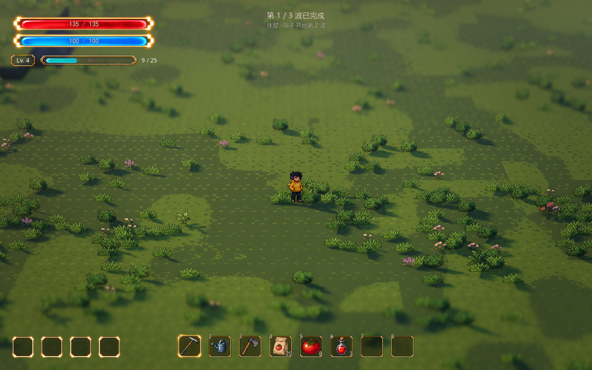
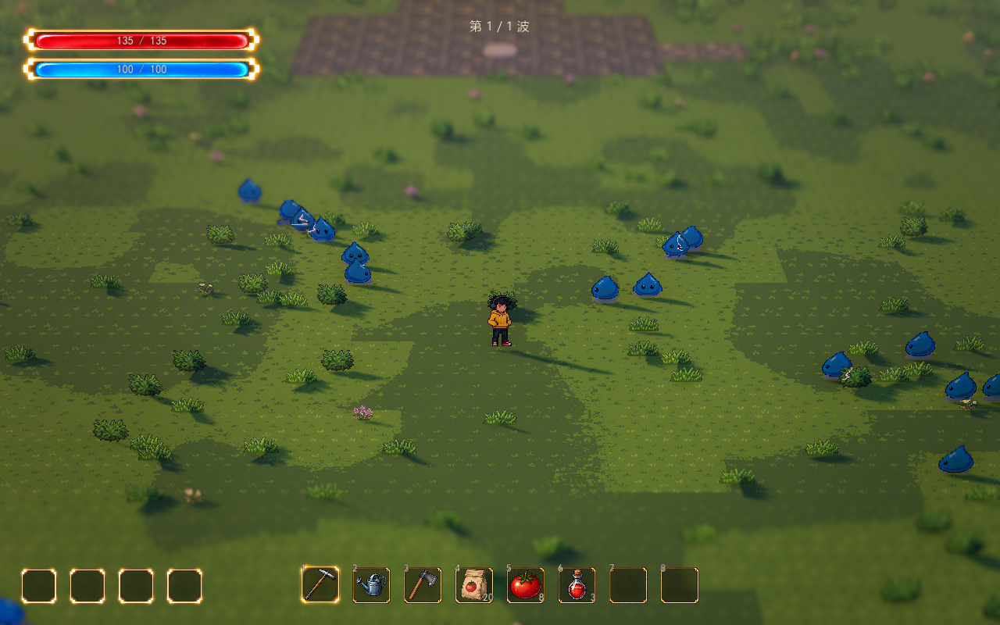

# 怪物刷新与波次基础

统一怪物目录、类型化数值与大规模数量档位见[怪物接入与大规模框架](enemy-framework.md)。原波次和直接引用怪物资源的方式继续兼容。

已接入正式战区，复用怪物目录、经验与升级冻结接口。进场节奏采用平时小股、关键时刻成群涌入，第一波就有小规模怪潮，之后逐渐扩大。

最新已改为[无尽波次](endless-waves.md)：保留前三波开场，第三波后继续生成递增波次，不再自动胜利；每波清完仍休整并按 F 继续。后续数量、刷新间隔及上限可调。

打开 `scenes/world/world.tscn` 后按 F6，在战区入口 `(0, 0, 25.6)` 按 **F** 开始。清波后 F 主动继续；战斗或休整时 ESC 撤退结算，结算后 **T** 重试或 ESC 返回入口。R 用于 [Style 切换](../technical/parameters-and-styles.md)。已打开的界面先处理自己的按键。顶部中央显示透明背景的小字波次提示；原灰盒面板仍隐藏，可在 `WavePrototype.show_ui` 开启状态调试。

## 当前波次配置

正式地图的 `WavePrototype.waves` 引用三份独立资源：

| 资源 | 主体总数 | 小股与怪潮编排 |
| --- | --- | --- |
| `data/waves/wave_01.tres` | 18 | 0.6 秒起逐只进入 6 只史莱姆；8 秒一批 10 只目录混合怪潮；14 秒起错开进入 2 只冲锋虫 |
| `data/waves/wave_02.tres` | 28 | 0.6 秒起逐只进入 6 只史莱姆；8 秒一批 14 只目录混合怪潮；12 秒起 4 冲锋虫，16 秒起 4 花兽 |
| `data/waves/wave_03.tres` | 40 | 0.6 秒起逐只进入 8 只史莱姆；10 秒一批 18 只目录混合怪潮；4 冲锋虫、4 花兽、4 壶兽、2 苔蛙按资源错时穿插 |

开场三波使用 **18／28／40，共 86 只主体，同场最多 24 只**。第一波怪潮已包含史莱姆、卷叶冲锋虫、灯囊花兽、裂瓷壶兽和响铃苔蛙，当前等权重时十只怪潮各出两只。蓝胶幼体不直接刷入怪潮，只由实际生成的壶兽死亡后分裂，数量另计，仍占用同场容量与登记预算。间歇期间已有怪物继续追击，不等于波间安全休整。怪物生命、速度、接触伤害和经验继续由自身资源控制。

表中时间以本波战斗计时为准；满员或无安全点时实际生成顺延，升级选择时计时冻结。因此不会为了赶上固定时刻突破上限或丢弃怪物。有限模式清空 `waves` 后仍支持原递增配置；无尽模式留空则以 `first_wave_enemies` 和 `spawn_interval` 建立一波模板，再按无尽参数续波。

`WaveDefinition` 包含多个 `WaveSpawnEntry`，每组配置怪物资源或目录混编、总数量、每批数量、首次延迟、批间隔、刷新区域标识和预告时间。`batch_size = 1` 保持逐只出场；大于 1 时同批同时到期，创建仍分帧，末批不足时如实生成剩余数量。

`mixed_horde = true` 时，本组忽略 `enemy`／`enemy_id`，从 `enemy_catalog.tres` 自动编排同一批的多种怪物。怪物资源 `horde_weight` 默认 1，新怪登记目录后下一局／重试自动加入，无需修改各波资源；0 排除自动怪潮，仍可被明确编排、召唤或分裂生成。当前幼体为 0，其余五种主怪为 1。

编排先覆盖本批尚未出现的可用类型，再按权重补齐。批次小于种类数时，跨批累计使用量，使后续批次轮到其它类型；同时受同种、分类和容量点限制，不能保证每批都出现所有类型。混编只决定出场成员，具体招式仍由各怪物自身实现。

怪潮到期时先为整批留出容量，空位不足就整批等位；散兵不能反复占走刚释放的空位。第一只出场后，其余成员继续使用同一区域并保留剩余容量。预留同时尊重个体数、同种上限、分类上限与容量点预算；永远不可能容纳的批次在开局前拒绝。完整进场、清波、撤退或重试都释放预留，不增加波次外的补怪。

开始前校验整轮配置、怪物根节点、数量预算、时间与区域标识，建立本局快照。运行中修改波次资源或怪物基础数值，下一轮开始／重试生效，当前队列和本局波数保持稳定。

## 区域与安全刷新

`BattleArea/SpawnCandidates` 六处标记已接入 `WaveSpawnZone`：`WestNorth`、`EastNorth`、`WestSouth`、`EastSouth`、`SouthWest`、`SouthEast`。游戏中不增加可见道具。

开场两侧 `WestNorth`／`EastNorth` 已移近入口：默认相对开战点左右各 6.4 米、向场内前进 6.4 米，刷新区中心距入口约 9.1 米，替代原先约 23.8 米的位置；半径仍为 3.2 米，保留至少 5 米人物安全距离、入口禁刷、墙体与可达性检查。使用这两个入口的后续怪物组同样沿用新位置。`BattleArea → Opening Spawn Offset` 可即时调节左右／前进距离，参数总览可搜索“开场刷新”，只更新刷新点与候选导航，不重建地形或地编。

区域可调位置、`enabled`、`zone_id`、`radius`（默认 3.2 米）和 `weight`。标识留空使用节点名，权重 0 停用。怪物组 `spawn_zone_ids` 留空使用全部启用区域，填写后限定进场方向；区域修改自动刷新导航与候选点。

同批怪潮从允许区域中选择一个入口，围绕它铺开；批量扩大时按身体留空与间距扩大候选范围，保留宽进场面。缓存只保存该批地表候选，区域或导航重建时失效；墙体、人物安全距离、当前占位和可达性每次实时检查。首只尚未出场时允许换另一个合法入口，已经出场后不把剩余成员拆散到地图另一端。

刷新点来自实际可通行地表，必须满足：

- 位于战斗范围内，保留身体边界余量，贴合台地或坡面。
- 避开玩家至少 5 米，并避开北侧入口／休整平台。
- 与已在场和预告中的怪物保留间距，避免重叠。
- 身体留空范围不碰静态墙体，有通往玩家所在地表的有效路线。

未配置区域容器的其他地图使用战斗范围外圈。QE 只改变观察角度，刷新与判定使用世界坐标。

## 调度与完整循环

**主动开始 → 校验并冻结本局配置 → 登记本波刷新任务 → 分批出场与战斗 → 待刷新和场上怪物均清空 → 清理敌方攻击、完成升级选择 → 安全休整 → F 开始下一波。** 无尽模式只在失败、撤退或异常时结算；有限模式保留最终胜利。

队列按到期时间排序，同一时间按登记顺序执行，并为已到期怪潮预留容量。正式数量资源每物理帧最多成功刷新 4 只、检查 8 个到期任务；未接数量资源时回退为 2／4。某区域被堵住时，其他有可用容量的到期散兵仍可刷新。

暂时没有安全点时保留任务，每 0.3 秒重试。达到在场上限（正式前三波 24，后续逐步到 128，包含预告实例）或未腾足整批容量时等待，不丢任务，容量等待不计作位置超时。正式地图位置持续不可用超过 30 秒才明确中断；残怪意外移除、跌落或无路线等情况也提供异常结果和清理，不伪造击杀或清波。

正式每波最多登记 1024 只，包含计划刷新、延迟分裂和召唤；未连接数量资源时回退为 512。已生成后不返还总预算，防止持续追加绕过上限。

清波必须同时满足 **待刷新为空、场上敌人为空**，随后清理敌方弹丸和危险区。`wave_clearing` 允许经验收取和成长选择暂缓休整；完成后只推进一次。战斗冻结期间刷新计时、伤害与怪物活动暂停，天气、世界和声音沿用既有运行规则。

## 挑战中断与残怪保护

当前有三种“挑战中断”：

- 到期刷新任务持续找不到合法位置：正式地图连续 30 秒后中断；满员、怪潮整批等位、种类／角色／成本限额等待不计入位置阻塞。
- 已登记的存活怪物未经正常死亡或取消便退出场景树：立即中断，避免把意外删除计作清波。
- 已激活怪物持续不在有效地面附近、低于地面 1.5 米以上，或无法接入通往玩家的导航：每秒检查，连续 10 秒后中断；恢复可达即清零，升级冻结期间不计时。检测不限于最后一只残怪。

导航起终点位于墙角或缺失半格时，会检查附近最多九个导航点及真实连接碰撞，避免把正常走位、弹射落点和拨怪落点误判为断路；补选仍须地表相接，不能跨墙、水面或断层。真正超时时，输出包含波次、怪物类型、怪物坐标、目标坐标与地面高度的警告。保护不延长时限、不搬移怪物，也不伪造击杀。

导航采用八方向连接，支持斜向追击；对角两侧的通路与斜线身体扫掠均通过后才接入。所有怪物共享按真实路程构建的追击树，避免横竖阶梯路线；各自原有的同伴避让与物理碰撞继续运行。详细规则见[怪物框架](enemy-framework.md)。

血量耗尽、主动撤退与离开战斗区是独立结算原因。

## Godot 调节入口

选中正式地图的 `WavePrototype`：

| 参数 | 默认 | 用途 |
| --- | --- | --- |
| `waves` | 三份资源 | 整轮组成；留空使用递增模式 |
| `endless_mode` | true | 正式地图无限续波，清波休整；关闭可对照有限模式 |
| `population_rules` | horde_128.tres | 正式数量档位；开场后每波 +16 总数、最多 384，同场 24 逐步到 128 |
| `health_growth_rules` | endless_health_growth.tres | 第 4 波起每波 +15% 基础生命，倍率 1～10 |
| `spawn_zone_root` | `BattleArea/SpawnCandidates` | 区域容器，由场地自动连接 |
| `spawn_excluded_areas` | 北侧入口矩形 | 世界 XZ 禁刷区，由场地同步 |
| `spawn_safe_distance` | 5 米 | 与玩家的最小刷新距离 |
| `population_rules.spawn_spacing` | 0.7 米 | 与在场／预告实例的最小间距；原控制器回退值 1.2 米 |
| `spawn_warning` | 0.8 秒 | 全局预告时间 |
| `population_rules.max_active` | 128 | 正式同场容量终值；前三波 24，第 4 波起每波 +8 |
| `population_rules.spawns_per_tick` | 4 | 每物理帧成功刷新预算 |
| `population_rules.checks_per_tick` | 8 | 每物理帧到期任务检查预算 |
| `spawn_retry_interval` | 0.3 秒 | 临时阻塞的重试间隔 |
| `spawn_block_timeout` | 30 秒 | 正式地图持续无可用刷新点的中断时间；组件回退值 10 秒 |
| `population_rules.max_queued_per_wave` | 1024 | 包含分裂／召唤的总登记预算 |
| `spawn_edge_band` | 3.2 米 | 无区域容器时的外圈宽度 |
| `unreachable_timeout` | 10 秒 | 残怪持续不可达的中断时间 |
| `random_seed` | 12102026 | 每轮开始重新初始化，便于复现 |
| `retry_key` | T | 界面隐藏时的重试键；R 留给 Style |

展开各波次的 `entries`：

| 参数 | 用途 |
| --- | --- |
| `mixed_horde` | 自动目录混合怪潮；开启后忽略本组 `enemy`／`enemy_id` |
| `enemy` / `enemy_id` / `count` | 固定组的怪物资源或目录标识，以及组内总数量 |
| `batch_size` | 每批数量；1 为逐只，大于 1 为集中进场 |
| `start_delay` / `interval` | 相对本波开始的首次时间、两批之间的间隔；逐只模式下为单只间隔 |
| `spawn_zone_ids` | 允许的进场区域标识，空列表使用全部启用区域 |
| `warning_seconds` | -1 沿用控制器，0 立即激活，正值覆盖本组预告 |

`WaveEnemyDefinition.horde_weight` 控制自动怪潮权重，0 为不参与；可在“参数总览 → 战斗与成长”搜索“怪潮出场权重”。`spawn_clearance` 默认 0.35 米，表示刷新时身体的留空半径，扩展怪物时与实际碰撞体一起配置；混合批次按最大成员留空选择集中区域。生命、移动、伤害和经验继续由该资源提供。

## 顶部透明文字

组件 `scenes/ui/wave_hud.tscn` 位于 `WavePrototype/WaveHUD`，独立于灰盒 `show_ui`。没有底板、边框或按钮，文字与容器均忽略鼠标输入。

- 靠近入口：准备第 1 / 3 波，下方小字提示 F 开始；在小院内隐藏。
- 战斗：只显示当前波数，例如“第 2 / 3 波”。
- 清波后：显示“第 1 / 3 波已完成”，下方提示“休整 · 按 F 开始第 2 波”，休整没有倒计时。
- 结算：显示成功或结束原因，下方提示 T 重试、ESC 返回。
- 背包等管理界面及升级选择期间隐藏，关闭后自动恢复。

Godot 选中 `WavePrototype/WaveHUD`，或在“参数总览 → UI”搜索“波次”：

| 参数 | 默认 | 用途 |
| --- | --- | --- |
| `enabled` | 开启 | 单独开关波次小字 |
| `top_margin` | 24 | 上缘距离，逻辑像素，始终水平居中 |
| `font_size` | 18 | 主波数文字字号 |
| `hint_font_size` | 14 | 操作提示字号 |
| `text_color` | 暖白，透明度 0.94 | 主文字颜色与透明度 |
| `hint_opacity` | 0.72 | 提示相对于主文字的透明度 |
| `outline_size` | 2 | 细暗描边宽度，保证亮草地上的可读性 |

在 `WavePrototype.waves → entries` 调 `count`、`batch_size`、`interval` 和 `start_delay`；正式同场容量由 `population_rules` 控制，优先于控制器的回退上限。参数总览可搜索“怪潮每批数量”。

## 扩展接口

根节点继承 `WaveEnemy`，通过 `configure_wave` 接收玩家、共用导航、敌方攻击容器及回调；具体移动和招式由怪物自身实现。

分裂或召唤须在母体结束生命周期前同步登记：

```gdscript
request_spawn.call(child_definition, count, delay_seconds, world_position)
```

登记后立即计入待刷新。指定点只在附近最多 3.2 米内找安全位置，不跳到另一端；`Vector3.INF` 使用普通区域。清波、结束与重试后旧回调失效。

`get_run_state()` 提供本局标识、阶段、结果、波数、待刷新数、在场数、预告数、累计生成与击杀、计时、冻结和导航状态。结果区分 `VICTORY`、`DEFEAT`、`RETREAT`、`ERROR`，无需解析提示文本。通知包括 `enemy_spawned`、`enemy_defeated_at`、`wave_clearing`、`wave_cleared`、`phase_changed`、`run_started` 和 `run_ended`。

## 验证

`tests/test_pursuit_endpoints.gd` 覆盖当前地图捕获的墙角起点、缺失半格目标、实际外力拨怪后的落点、动态墙覆盖、升级冻结和真实跌落；`test_pursuit_wall_contact.gd` 与 `test_rooftop_pursuit.gd` 继续验证贴墙脱离、建筑目标，以及共享导航对水面和断层的限制。

`tests/test_wave_hordes.gd` 覆盖目录自动混编、新怪只登记目录即可加入、幼体排除、权重与跨批覆盖、混合批次的同种／分类／容量点预留、参数入口，以及整批进场、空间集中、安全间距、整批等位、散兵积压、分帧预算、动态墙体、末批余量、升级冻结、撤退清理及正式第 1～4、16、25 波的完整生成与清波，包含壶兽分裂幼体。下方旧灰盒验证记录仅说明初始基线。

`tests/test_wave_spawning.gd` 覆盖有限模式下完整生成并清除正式三波 86 只主体及实际分裂幼体，不超过 24 只，验证批次间歇和主动继续；同时覆盖区域、禁刷入口、间距、帧预算、满员等待、阻塞重试、排序、快照、冻结、局部分裂、清场扩展、旧回调、预算以及开始／立即重试的通知重入。

早期基线的刷新 66 项、经验／波次整合 25 项与参数总览回归通过；此前基础循环、混合怪物接口、史莱姆 47 项、扇击 32 项已通过。波次共用导航限制到战区及少量缓冲，当时图 4096 点；完整地形半格网格为 20020 个候选位置，波次史莱姆复用同一张导航。

D3D12 / Forward+ 实机使用正式三波配置，完整生成并击败 **86 只**，每只被真实扇击命中两次，累计 **258 经验、8 次成长选择**；完成两次安全休整、最终胜利与返回。核对波数、休整与结算文字、顶部居中、鼠标穿透及升级期间隐藏。镜头保持 FOV 28°、距离 28 米、俯角 32°、深度景深 0.065。

该回归进程自动移动人物、临时关闭接触伤害并以 2 倍计时加速验证，正式配置没有改动；实际伤害由逻辑回归覆盖。截图恢复／使用当前场景的正式镜头，休整截图以正常计时拍摄。测试不写资源或存档。

另以第三波独立检查密度：人物站在中央，暂时关闭自动攻击与成长；20.5 秒左右场上达到 **24 只，仍有 16 只排队**。这张图因只加载第三波资源，波数显示 1 / 1，用来核对压力峰和容量；正式地图仍为完整三波。





[战斗波数](../media/wave-spawning-preview/rhythm-battle.png) · [最终结算小字](../media/wave-spawning-preview/rhythm-victory.png)。此前 21 只规模的截图保留为历史参考：[原刷新与扇击](../media/wave-spawning-preview/battle.png)。
