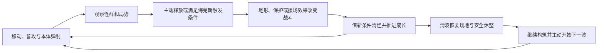

# 趣味海克斯系统提案

版本：0.1，2026年10月13日；2026年10月14日校正主玩法状态。状态：供讨论，尚未接入玩法、界面、美术或存档。

对应 [总体设计](rpg-game-design.md)、[战斗核心](combat-core-design.md)、[波次刷新](gameplay/wave-spawning.md) 和 [本局成长](gameplay/run-growth.md)。本文件独立于既有草案；具体卡片、获取节点、槽数、触发方式与数值均为建议。

## 最新讨论：阵法与核心玩法的边界

用户更喜欢“发现阵眼、连阵、引怪养怪、弹射收割、获得资源扩阵”的思路，随后提出：这是否会让游戏核心变为构建弹射和阵法？目前只表达了对该方向的兴趣，尚未确认将完整循环设为主玩法。

完整循环会把网络规划、敌群蓄养与弹射路线变成主要决策，武器与成长会围绕它们展开；这属于主玩法的变化。若目标仍是给角色构筑和清怪增添趣味，推荐先讨论“阵法型海克斯”：获得后提供一次特殊战斗区域，玩家决定落位、引怪和兑现时机，以自己的攻击配置利用它。长期阵网、扩阵经济和专用弹射不作为这种版本的必需条件。

例如，地陷阵短时聚住普通怪，庇护阵提供区域内真正免伤，英灵阵让上一局的自己支援一侧。它们分别制造聚群、承压与协作机会，仍需玩家用自己的构筑应对敌人。正式触发方式、持续时间、范围和是否采用均待讨论。

最新主玩法已明确为手动普攻、蓄力发射人物本体、借建筑反弹并在弹射期间自动挥剑；新链路尚未接入，当前自动攻击保留为原型。下文的武器组合来自原提案基线，需要结合新玩法重新评估。阵法是否承担核心循环、阵网与收割能量是否跨波保留仍未确定。

## 体验目标与已明确的方向

在角色战斗与走位中，独立获得能够改变地形、场地规则或人物状态的海克斯。玩家期待抽到有趣的规则，并在每波选择合适的位置、时机和攻击搭配，制造几次醒目的战斗转折；具体机制需与已确认的手动普攻和本体弹射方向配合。

用户明确希望：海克斯偏趣味、服务核心战斗；独立于经验升级；同时有即时质变和战斗成长两类。重点例子是世界震动与局部塌陷困怪、短时无敌区域、请神上身或让上一局的自己加入战斗。人物体型与稀有辅助怪物长期培养仍是兴趣方向，具体规则尚未确定。

手动普攻、蓄力与建筑反弹现已属于确认的设计方向，仍须区分设计与实际接入。本文的阵法、海克斯与扩阵规则继续保留为候选，不能由主玩法确认推定这些机制全部采用。

## 两套成长如何分工

| 成长 | 获得方式 | 决策 |
| --- | --- | --- |
| 经验升级 | 保留现有击杀、吸取、升级选择 | 武器等级、伤害、冷却、范围等，形成基础清怪能力 |
| 趣味海克斯 | 挑战开始前和少量关键波次休整中的独立选择 | 改变战场或战斗规则，给当前构筑增加新的用法 |

海克斯不需要另一条通用经验或新货币。成长型海克斯用自身相关的战斗行为推进，例如在塌陷区域内完成击杀；拿到时就有完整基础效果，之后出现新的行为变化。

推荐首个海克斯在挑战开始前获得，避免独特玩法只在后半局出现。后续机会放在关键清波休整；开始前、第3波和第6波可以作为一种节奏例子，尚不确定最终节点。当前包含无尽续波，不能依赖一个尚未确认的固定通关波数。

先建议三格海克斯、最多一张需要主动按钮，可以全选自动或条件触发。选择时暂用三个有效候选；已有主动海克斯后，不再提供会成为闲置按钮的第二张主动卡。满槽时提供已有海克斯的有效强化；满级后停止派发无效选择。替换、刷新和最终容量继续讨论。

即时型与成长型可以出现在同一次选择中，玩家可比较现在的收益和后续潜力，不强制先成长、后即时。

## 玩家操作与行动循环

基础操作以总体设计中的手动普攻、蓄力与本体弹射方向为准，现有移动、跳跃和闪身保留。主动海克斯建议共用一个独立按钮，具体键位与移动端布局待确认；条件和自动海克斯不增加操作键。海克斯操作本身尚未实现。

位置型效果默认用脚下或附近可见敌群，目标区域先给清楚轮廓。短按可以直接释放；可选的按住预览只帮助理解位置，不是另一套蓄力攻击。默认不要求精准拖动瞄准。

主动海克斯先建议每波一次，不用等待恢复，也不把未用次数囤积到后续波次。各条件卡独立限制触发，卡面写清楚条件和本波次数；不是所有卡共享同一套冷却。

## 三张重点海克斯

### H01 大地震：把怪群困成一次清场机会

类型建议：主动、可成长，默认每波一次。

**触发与位置**：按下按钮，选定人物附近可见、可达、适合塌陷的一片怪群所在地。默认选区用清楚轮廓表示，移动位置可以改变可用选区；选定后锁住地点，预警不继续追着怪物移动。没有合法位置时提示暂不可用，不扣次数。

**过程**：短预警出现裂隙，随后地面震动，一小片地面真实下沉，草与地表随之变化。处于其中的普通怪短时失衡并被困在低洼区域，玩家借此聚集输出；坍塌本身不承担主要击杀伤害。

**人物与地形**：避开人物当前站点、伙伴、建筑基础、入口和唯一坡道。坑内保留可以离开的坡面；人物进入后能走出或用已有移动能力离开。精英和首领得到较弱的失衡或缓速响应，不永久锁住主招。

**攻击资格**：坑中怪物仍是正常目标，攻击与特效须能延伸到坑内并表现向下命中。临时塌陷属于这一海克斯的有效攻击地表，不能因原高差过滤而无法受伤；其他建筑和不相接台地继续阻挡攻击。这是需要新落实的地形战斗规则。

**结束**：短时控制结束，地面恢复并把坑内单位平稳带回可达地表。被困敌人继续计入本波存活数量，控制期间不当作普通寻路异常；恢复后重新获得有效路线。清波、失败或撤退也必须先恢复场地，不能把坑写进正式地图或种植存档。

**成长方向**：获得时即可完成一次有效塌陷；区域内的真实武器击杀推进成长。后续突破可增加一次短余震，或让最初的塌陷分为两处错时的小区域，形成行为变化。最终选哪种成长分支待讨论。

**构筑关系**：为扇击、旋转、延时爆破、持续区和连锁制造群聚窗口；范围增益让人物更容易在坑边输出。玩家决定把本波机会用在密集推进，还是留给后续增援。

表现方向：局部地面下沉、短碎屑和坑边轮廓；震屏有独立强度与关闭选项，关闭震屏不改变技能效果。半径、深度、预警、控制与恢复时长均未定。

### H02 绝对庇护：危险时出现一片真正安全的地面

类型建议：条件触发、即时生效，默认每波一次。

**触发**：一次有效受击将使人物跨入危险生命线时，先在脚下展开区域，这一次受击也受到保护，避免先死亡后才出现安全区。触发线待定，30%生命可以作为讨论例子。

**规则**：区域固定在触发地点，人物处于边界内时真正免疫敌方生命伤害，保留正常攻击与移动。怪物仍然可以进入，区域不是挡住全部敌人的墙；走出边界立刻失去这项免伤。首次建议只保护人物，不自动扩展为伙伴和其他友方单位。

**时机与结束**：持续数秒，边界在结束前明显收缩或闪烁，人物可提前撤出、清出通道或闪身离开。范围和时长待定；不能通过继续挨打无限续期。时间结束后恢复正常受伤规则，不附送另一段隐藏无敌。

**位置价值**：脚下开区让人物此前的站位有意义。近身构筑可利用保护窗口清群；远程构筑可借它稳住出口，但不能追着跑动把安全区带遍场地。

**升级方向**：可增加一次结束时的推开效果，或把保护期间接收到的有效敌方攻击存成有上限的一次反击。此类升级需要明确写在卡面，不默认改变原有反震触发规则。

表现方向：边界清楚、内部透明的友方区域，与敌方地面预警有不同形状。给一次触发提示和即将结束的反馈，保留地面、怪物和人物可见性。

### H03 昨日之我：上一局的构筑短时回来协助

类型建议：自动援场、即时生效，默认每波一次。

**触发**：本波敌群形成明显压力，或精英接近时自动援场。密度阈值、距离及两种条件的优先级待定；基础史莱姆波次也能触发，不要求尚未实现的精英。

**上一局的含义**：记录前一次正常结束的挑战构筑，包括成功、失败或主动撤退；异常中断和编辑器强制退出不覆盖记录。重试时，刚失败的挑战可成为上一局。只记录施放所需的武器形态、等级和人物外形等配置，不需要完整录像或上局怪物位置。

**援场行为**：在当前可达位置出现友方回响，保留上一局的攻击形态，重新识别这一局的敌人并协助战斗。它可以在附近跟随和寻找有效输出位置，不机械重演一段已经没有敌人的旧路线。

**强度与资格**：输出按当前挑战折算，保留旧构筑的可辨认形态；折算规则待定。回响不挡人物、不承受伤害、不吸取经验、不触发己方海克斯和新的召唤；有效击杀正常给人物经验。同一时间只保留一个，不能回响再召回响。

**首次出战**：没有上一局记录时，使用明确标注的初始回响，复制本局的有效基础攻击形态；不制造虚构历史，不把卡变成空奖励。

**结束**：短时结束、清波或本局结束时离场，撤掉剩余攻击。持续时间待定；期间遵守当前墙体、高差和攻击路径规则。

**构筑关系**：上一局的近身清群形态可以补这一局的远距玩法，上一局的投射形态也能补当前贴身打法。输出折算避免必须先刷一局极高数值才能使用，但需要保留“我认得那个自己”的感觉。

表现方向：保留人物身份与旧攻击轮廓，用友方色边或半透明材质区分；正式形象、声音与召唤仪式尚未确定。

## 首批十二张候选

这是内容讨论池，不是已经确认的制作数量。效果分类与触发建议可调整。

| 编号 / 暂名 | 触发与类型建议 | 具体趣味 | 前置与组合 |
| --- | --- | --- | --- |
| H01 大地震 | 主动、成长 | 局部地面下沉困怪，成长后出现余震或错时塌陷 | 当前扇击就可发挥；与范围和群体攻击配合 |
| H02 绝对庇护 | 危险受击时、即时 | 固定短时无敌区，人物可以留区反击或提前撤出 | 无武器门槛；与近身构筑配合 |
| H03 昨日之我 | 敌群压力或精英接近时、即时 | 上一局攻击形态短时援场 | 无历史时有初始回响；补充本局输出职责 |
| H04 请神上身 | 主动、即时 | 人物短时巨化，获得明显的重击与覆盖，仍由玩家移动控制 | 无神明身份定案；不默认无敌；与生命、近身路线配合 |
| H05 袖珍奇迹 | 战斗中闪身后有效进攻推进、成长 | 先获得轻巧体型，成长后闪身收尾带来一次奔袭攻击 | 真实受击与碰撞体一起变化；与回旋、投射路线配合 |
| H06 磁力乱流 | 一次有效群体命中后、即时 | 在命中区域产生短时旋涡，把附近怪物与经验向中心聚集 | 只在有效地表传播，不拉过建筑；与坑、爆破和连锁配合 |
| H07 时停片刻 | 危险生命线触发、即时 | 短时停住附近敌人及敌方弹丸，人物仍可移动攻击 | 每波有限触发；不是升级菜单的全战斗冻结 |
| H08 死亡礼花 | 实际击杀时、即时 | 部分怪物死亡产生爆炸，可以有限接力清群 | 每只怪只结算一次，接力有明确终点；有效击杀仍正常给经验 |
| H09 镜面借力 | 获得后自动、即时 | 合格投射物遇真实墙体反弹，改变原本的直线覆盖 | 持有支持该规则的投射攻击时才发；不等于人物变成弹射玩法 |
| H10 伙伴共振 | 使用适配的主动海克斯时、成长 | 伙伴在另一有效位置产生较小的协作效果，成长后改善协作方式 | 需要伙伴及相应海克斯；只复制明确适配的效果，不复制召唤、无敌或时停 |
| H11 守护反击 | 庇护期间承受有效敌方攻击时、成长 | 将被庇护挡住的攻击积成一次有限反击，结束时推开近敌 | 需要H02；不等于实际受伤，不默认触发现有受击反震 |
| H12 跨局合击 | 本体与昨日回响接力有效命中时、成长 | 接力达到条件后产生一次短爆发，让不同构筑协同 | 需要H03；只用真实当前命中，不从旧录像凭空计数 |

H04的附体变身与H03的历史援场分别设计，便于玩家理解。名称是功能暂名，不把“请神”推定成最终神话题材。

体型效果用一个明确的最终状态处理，巨化与袖珍不无限相乘；长期体型成长与短时变身怎样共存，仍需单独讨论。伙伴共振仅在长期伙伴规则确认后进入有效池，本次不授权制作或实现伙伴系统。

## 组合怎样影响核心战斗

**困怪输出**：大地震先形成可读的困怪区，人物用范围扇击或旋转在坑边输出；磁力乱流再把附近目标聚到该处。这改变位置选择与清怪效率，后续新增爆破、持续区也能接入。

**危险反打**：绝对庇护在危险时生成固定安全点，人物借短窗口清理近敌，并规划结束前的离开路线；守护反击让主动保留敌群也有明确输出回报。

**前后两局协同**：昨日之我补充上一局的攻击职责，本局选择不同路线，跨局合击让接力具有价值。一次挑战的体验会影响下一次对这张卡的期待，但不让上局数值成为通关门槛。

这些组合不是必须集齐的套装。每张基础海克斯单独就有完整作用；依附卡只在已拥有对应内容时出现。

## 战斗生命周期与公平性

- 海克斯只在战斗阶段触发，休整和家园不通过等待积攒额外次数或成长。本局成长在波间保留，新挑战与重试重置；已记录的历史构筑按H03规则保留。
- 地震、庇护、回响、变身、旋涡、时停等持续计时属于战斗计时。经验升级冻结时暂停它们的计时、伤害、生成与成长，天气、环境和声音沿用现有分工；关闭选择后继续原来的剩余状态。
- 清波仍需场上敌人和待生成敌人都归零。坑中、时停中敌人不会被提前扣掉；友方回响与伙伴不计为需要击杀的残怪。
- 清波先收尾临时地形和攻击、完成经验引发的成长选择，再进入安全休整。撤退、失败或异常结束取消临时效果并恢复地形，不能晚到伤害或留下隐藏无敌状态。
- 普通自动攻击继续运行，闪身不因海克斯而取消既有攻击；海克斯不默认让闪身路径造成额外伤害。
- 范围、地形、攻击及触发均使用世界位置和有效地表，QE只观察。陷阱许可不扩展成隔墙或隔层伤害；召唤与副效果也检查可达位置。
- 塌陷不累计成无限深坑；重叠临时区域采用明确合并规则，不破坏唯一通路。触发期间留下的异常单位需要恢复处理，不能永久卡波。
- 击杀、成长、经验与历史记录有清楚的来源。回响和协作副效果不能再次召出回响；爆炸接力有上限，每只怪只死亡一次。

## 表现方向与玩家信息

每张卡写明：得到后发生什么、主动/条件/自动触发、每波次数、作用位置、是否成长、当前阶段与下一阶段变化。有限的海克斯状态与经验等级分别显示，不能让玩家误以为升一级就会再获得海克斯。

危险期效果给短而醒目的反馈，场地中间尽量透明，边界与结束提示清楚；不要同时用大地碎屑、大片光幕和回响覆盖人物。地震用地表运动体现趣味，庇护用真实保护窗口体现规则，旧我用熟悉的武器形态体现跨局联系。

正式视觉观察沿用最新实际开发相机、Style、像素材质和景深，不能只在特写中验证。资源、神明形象、区域颜色、声音和UI样式以后与用户确认，美术尽可能用Meowa。

## 讨论和后续验证

先讨论H01/H02/H03能否提供玩家想要的趣味，再确定触发和数值。后续若获授权做灰盒，应检验：默认攻击能伤到坑中怪；地形恢复后所有敌人可达；庇护是真免伤且走出/结束立即失效；昨日之我首次、失败重试与旧版本配置均有有效表现；升级冻结、闪身、清波和结束清理不中断或延长规则。

待定重点：海克斯取得节点和总容量；主动按钮及放置方式；无敌区自动救急还是主动选位更合适；震地、庇护、历史援场的时长与频率；成长触发和分支；旧我输出折算；历史记录的保存策略；长期伙伴如何进入协作。

本提案不改变既有总体/战斗草案，不授权实现十二张卡或重做地图。数值与制作顺序不构成工期、验收或最终内容约束。
