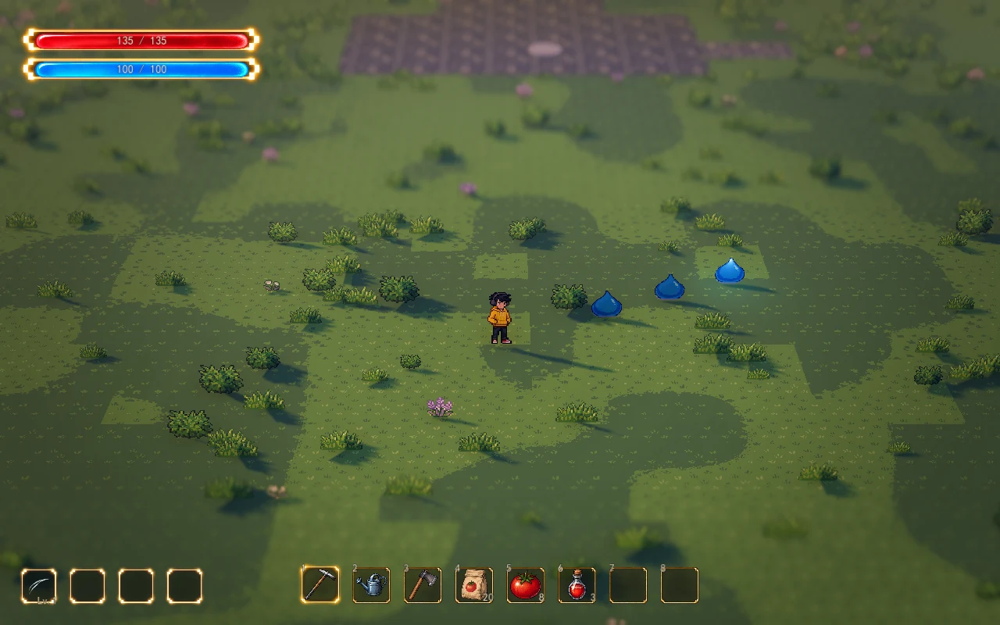

# A02 雷光贯穿视觉预览

用户确认了第二种攻击的青金色贯穿参考，并授权在 Meowa 制作。当前完成独立透明美术、八帧命中动画与 Godot 实机视觉组件；此版用于确认表现，伤害、目标选择、技能等级、成长卡和音效尚未接入。

枪锋沿世界中的固定方向前进，身后保留细窄的青金光丝。三处命中依次出现星芒、弧纹及晶片，拖尾和命中最后消退。一盏无阴影的小光源随枪锋短暂照亮附近草地。`雷光` 是视觉名称，此次没有确定电击或传导状态规则。

## 查看与调整

在 Godot 打开 `scenes/combat/light_pierce_preview.tscn`，按 **F6** 运行。预览每 2.2 秒重放一次，**Q/E** 可旋转镜头。角色与三只展示史莱姆保持原位，实际地图、材质、天气和既有 HUD 来自当前正式地图，预览不写存档。

在编辑器选中预览场景的 **LightPierceEffect** 子节点调整外观；也可打开 `scenes/combat/light_pierce_effect.tscn` 调整可复用组件。预览根节点的 `Replay Interval` 和 `Preview Distance` 分别控制重播间隔及演示飞行距离，当前距离 7.5 米，仅为视觉观察参数。

| 参数 | 当前值 | 含义 |
| --- | --- | --- |
| Flight Speed | 14 米/秒 | 枪锋沿轨迹前进的速度 |
| Flight Height | 0.65 米 | 悬浮于发射地面的高度 |
| Head Width | 2.45 米 | 含透明边缘的枪锋画布宽度 |
| Trail Length | 6 米 | 保留的尾迹长度 |
| Trail Width | 1.25 米 | 含辉光的拖尾宽度，实际光丝较细 |
| Trail Fade Time | 0.28 秒 | 飞行结束后尾迹消退时间 |
| Impact Width | 2.7 米 | 含透明边缘与散开晶片的命中画布宽度 |
| Impact Duration | 0.4 秒 | 完整八帧命中动画的播放时长 |
| Impact Height | 0.4 米 | 星芒相对于命中地面的高度 |
| Effect Opacity | 0.85 | 特效不透明度 |
| Effect Energy | 1.3 | 自发光及辉光贡献 |
| Effect Tint | 白色 | 全套素材的颜色倍率 |
| Ground Light Enabled | 开启 | 随枪锋移动的短时地面映照 |
| Ground Light Energy / Range | 0.3 / 2.4 米 | 映照强度和范围，默认不投影 |

## 接口与素材

`LightPierceEffect.launch(origin, direction, distance)` 播放一次飞行，传入世界坐标中的发射地面位置、方向和距离。`show_hit(ground_position)` 播放一次独立命中，`stop()` 清理当前轨迹、星芒与映照光源；全部播放结束发出 `finished`。这些接口只处理视觉，不产生碰撞或伤害。正式战斗仍使用现有攻击系统。

美术位于 `assets/meowa/combat/light_pierce`，原始素材保存在其 `source/` 目录。静态组件为原尺寸裁切，八帧动画逐帧打包为 RGBA 图集；运行时按每帧 AtlasTexture 区域采样，最近邻过滤，不读取整个图集作为单帧。

枪锋朝向根据世界飞行方向在当前镜头中的投影更新，拖尾沿真实世界轨迹构建朝向镜头的窄带，命中星芒朝向当前镜头。Q/E 旋转不会把轨迹固定在屏幕上。大规模战斗中的特效并发预算留待实际攻击接入时验证。

## 实机验证

Godot 4.7.2 原生 Forward+ / D3D12 运行通过，预览与资源导入无脚本或着色器报错。截图沿用当前正式地图与开发场景的实际镜头：透视 FOV 28°、距离 28 米、俯角 32°、焦点高度 0.9 米、深度景深强度 0.065；窗口 1280×800，逻辑视口 1440×900。正面、90° 和 180° 观察均保留世界轨迹、像素人物和地表可读性。

[正面](light-pierce-preview/front.png) · [侧面](light-pierce-preview/side.png) · [背面](light-pierce-preview/back.png) · [已确认概念图](second-attack-reference/concept-v1.png)
