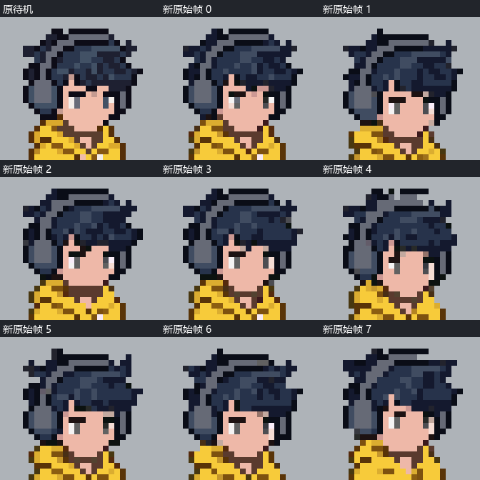
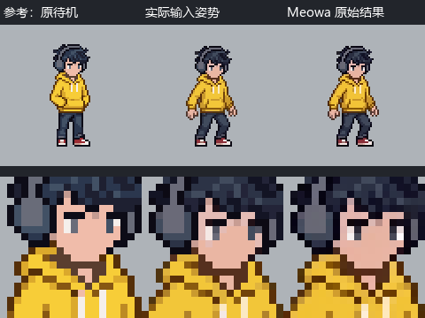
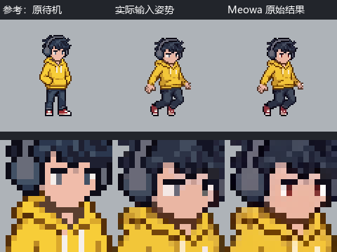

# Meowa 像素角色跳跃动画问题反馈

日期：2026-10-12。对象：Meowa 动画与像素编辑团队。复现场景：Godot HD-2D 项目中的同一名黄衣像素人物，制作侧向、背向的跳跃与下落。

本轮观察到部分动画帧的脸型、眼白、头部朝向或比例变化，筛帧后已有可用的游戏资产。验收应以实际游戏尺寸下的人物辨识度、动作自然度和风格一致性为准，允许不影响观感的轻微变化。局部编辑的像素差异和提示词增强后的文本差异保留为观察证据，不单独作为资产不合格或功能异常的结论。

尝试顺序修正：最先使用初始参考图直接生成动画；后续尝试了准备动作姿势、关键帧动画和局部修帧；最近一轮再次从原侧向待机生成，并通过筛帧接入。下列参数与任务 ID 对应已保存的具体尝试，不据此补推首轮未核实的参数或后续所有步骤的精确先后。

用户最终接受轻微面部变化。新版侧向原始生成 8 帧，选择第 0、2、3、7 帧四张姿势接入；起跳使用 0→2→3，下落使用 3→2，落地使用 7→原待机。当前游戏使用原始生成面部像素，未采用完整头部复制实验；此前局部眼部复制修正版也已替换。

## 实际调用的 Meowa 功能

| 功能与 CLI | 用途 | 本轮关键参数 |
| --- | --- | --- |
| 参考图帧动画：`animate-run` | 直接以参考站姿生成动画；最近一轮再次以原侧向待机生成跳跃 | 最近一轮参数：`animation-model=pixel-engine-v1.1`、`intelligence=advanced`、`output-frames=8`、`animation-type=jump`、`output-format=webp`、`optimize-prompt=true`、`color-count=64`、`remove-bg-method=advanced` |
| 万能编辑：`image-edit-run` | 后续尝试从站姿制作起跳、收腿、下落姿势，以及修正单张动画帧的眼白 | `mode=pixel`、`strict=true`、`generation-model=nano-banana`、`generation-speed=normal`、`resolution=1K`、`remove-bg-method=standard`；眼部修正每次上传待修姿势和原待机两张图 |
| 关键帧动画：`keyframes-run` | 后续尝试将准备的姿势连接成侧向、背向跳跃 | `animation-model=pixel-engine-v1.1`、`total-frames=8`、`optimize-prompt=true`、`color-count=32`、`remove-bg-method=advanced`；帧 0、3、7，帧 3/7 的强度为 1.0 |

两条动画路径均设置透明边距：上 12、下 4、左右 0；输入为 80×80，动画输出为 80×96，运行时裁为 80×80。这里的 1K 是静态编辑的服务档位，不是最终精灵尺寸。

这轮跳跃未调用 `meowa-animation-run`（帧动画 V2）。这里的“advanced”仅指 `animate-run` 实际发送的 CLI 参数 `intelligence=advanced`；尚未核实网站是否提供对应选项或使用何种名称，不应写成已确认的网站“进阶档位”，也不等同于 V2。此前多方向转身属于另一轮任务。

执行时 Meowa CLI 版本为 2026.10.08.2，工具提示可更新至 2026.10.11.3。以下是实际执行版本的观察；未用新版 CLI 复测，也未确认服务端已修复。底层模型、随机种子、费用未返回。

## 问题与证据

### 1 参考图直接生成动画与后续关键帧尝试

最先尝试的是给初始站姿直接生成动画，部分帧出现用户能感知的面部变化。后续关键帧尝试中也观察到眼白增宽、头部转向和比例差异，其中收腿帧一侧眼白形成 2×2 色块。需要判断的是这些变化是否在实际播放时造成明显跳脸、换人感或动作不自然；轻微的像素、颜色和形状变化可以接受。

原侧向待机、关键帧尝试和最近一轮直接生成的动画均保留在证据包。新版逐帧对照如下：面部展示仅做整数位置对齐和最近邻放大，未替换或重画。



新版第 0、2、3、7 帧被选用，其余四帧因转向、面部或身体比例变化更明显而剔除。四张姿势是这一批的人工选择结果，不代表模型总体可用率。

后续准备关键帧姿势时，万能编辑生成的输入已经存在人物外观差异。Agent 虽然做过预览，但没有充分拦截明显的脸型或比例差异，参考验收不足。这属于 Agent 工作流程的问题，应与直接从原始参考图生成动画时出现的变化分别评价，不能全部归因于动画生成。

### 2 万能编辑局部修帧尝试与验收标准

实际提示词，两次相同：

```text
修正第一张人物的眼睛，参照第二张站立图的眼睛，将眼白收回到原来的像素大小和形状，保持相同的瞳孔与朝向。只改眼部，保持第一张的动作、头发、脸型、衣服、像素大小和画布位置。
```

参考顺序是待修的跳跃姿势在前、原待机在后。两次都使用 pixel + strict，返回 80×80 PNG，任务状态 success。完整结果当时未采用，主要依据是眼部之外也发生像素变化；这一验收标准过严，不能据此认定结果不符合游戏资产效果。

| 案例 | 整图发生 RGBA 变化的像素 | 眼部核对窗口外发生变化的像素 |
| --- | ---: | ---: |
| 屈膝帧眼部修正 | 1036 | 884 |
| 收腿帧眼部修正 | 1058 | 902 |

核对窗口为 x=32、y=20、宽16、高10。这里统计 RGB 或 alpha 任一分量不同的像素；包含配色变化，不应解释成全部都是轮廓或几何变形。窗口是宽松的眼部检查范围，不是 API 提交的编辑蒙版。本轮没有传入蒙版，CLI 也未使用区域硬锁定参数。





这些统计说明输出的眼部之外也发生了像素变化，但不等于可见变形，也不能证明万能编辑无法产出可用游戏资产。两张结果没有单独接入游戏验证，当前应将其归为局部修帧尝试，游戏中的可用性尚未充分验证。本轮没有提交蒙版，`strict` 参数名称也不能作为区域硬锁定的保证。若确实需要逐像素限定修改范围，可另行讨论蒙版或锁定能力；本项目默认按实际视觉效果验收。

此前项目端直接复制原待机眼部像素，每张修改 18 个像素；它解决了眼白大小，却没有统一整张脸的轮廓和朝向。完整头部图层复制也做过验证实验，但用户随后允许轻微变化并选择先筛帧，当前上线素材未采用该实验。

### 3 提示词增强简化了面部不变的约束

新版侧向跳跃的实际输入提示词：

```text
The character performs one small jump and returns to the starting stance, maintaining the same three-quarter right-facing view. Only the arms and legs change pose: slight knee bend, knees tuck, legs extend, then land. Keep the head still and preserve the input face throughout: identical open eyes, eye whites, pupils, jaw outline and skin colors, with no expression change. Animate the poses without moving the whole character upward across the canvas.
```

该任务返回的 `final_prompt`，按当时 CLI 输出保留：

```text
The young man in the yellow hoodie and dark pants performs a small vertical jump while keeping his head completely still in a three-quarter right-facing view. His knees bend slightly before tucking inward, then his legs extend downward to land on the ground. Throughout the entire hop, his facial expression remains unchanged and the character sprite does not shift upward across the canvas.
```

增强后仍保留了头部静止和表情不变，却未逐项保留睁眼、眼白、瞳孔、下颌轮廓和肤色一致的要求。这是可核验的文本差异；尚不能证明它是面部漂移的唯一原因。需要 Meowa 结合任务 ID 检查生成和后处理各环节。

建议将身份、锁定区域、朝向与颜色约束作为结构化条件传递，避免只在动作润色文本中表达；展示原始和增强提示词，允许确认关键条件是否保留。

### 4 禁止整块人物上移的要求仍未满足

本项目由 Godot 物理控制真实起跳高度，动画需要提供身体姿态，不再叠加整块人物的飞行。原输入与增强提示词均明确要求人物不在画布内整块上移。

新版原始帧 0 的 alpha 边界为 `(28,23,51,81)`，帧 4 为 `(28,13,51,71)`，上下边界同时上移 10 像素。被采用的帧 3 顶部也较帧 0 上移 8 像素，项目端做了整数对齐。动画位移与游戏物理同时使用，会产生双重起跳或落点变化。

建议提供明确的原地姿势模式与根运动模式，以及角色锚点、脚底基线和位移数据导出。仅通过文字要求锚点固定，在本案例中不够稳定。

### 5 首帧颜色差异观察

在新版原始帧 0，按透明上边距 12 像素对齐输入后，采样结果如下：

| 原图坐标 | 输入 RGBA | 原始输出帧 0 RGBA |
| --- | --- | --- |
| (38,23)，眼白 | (245,239,235,255) | (245,243,243,255) |
| (37,24)，肤色 | (240,188,170,255) | (238,184,168,255) |
| (39,24)，眼部灰色 | (105,108,121,255) | (97,97,97,255) |

这些颜色变化有些很小，不单独判为不合格。即使轮廓接近输入，颜色改变也会计入像素差异；不能把所有差异都归为脸型变形。当前资料不能区分它们来自生成、调色板处理还是其他后处理，实际可用性仍以游戏尺寸和连续播放观感为准。

## 可定位的任务

| 任务 | job_id |
| --- | --- |
| 侧向起跳姿势编辑尝试 | `job_6696a00772bc47d2a201a975a7e6b7a8` |
| 侧向收腿姿势编辑尝试 | `job_4ae1c4a2435a49db82d226389a5084a4` |
| 侧向关键帧跳跃尝试 | `job_224a3893611d44fda1c47017165936a3` |
| 背向关键帧跳跃尝试 | `job_7829e790888148cf8c289c13855f3086` |
| 屈膝帧严格像素编辑 | `job_6032cc4b19b44da1b8176f09bdc5e6cc` |
| 收腿帧严格像素编辑 | `job_c2f03dd77ca14dff9cc2d836e4514a69` |
| 最近一轮侧向参考图帧动画 | `job_ebf7f4423bd3491d87b016d4f2086758` |

关键帧与眼部修正的输入、原始输出和当前筛帧映射放在证据包中。眼部编辑的详细记录见 [HD 2D Meowa 调用记录](https://chatgpt.com/space/page_a1d8b19baf7c8191913c59c3b647e390)，其中是事后补记，精确提交时间和逐次 HTTP 调用记录未保存。未补造内部轮询次数、费用或随机种子。

## 最小复现

证据包中的 `reference.png` 为实际 80×80 透明侧向待机图。解压后在 `meowa-animation-feedback/evidence/` 目录执行，将命令中的 `meowart_api.py` 替换为本地已安装的 CLI 脚本路径。以下公开参数用于复现同类任务；生成具有随机性，不能保证再次得到逐字节相同的图像。此命令仅作为复现说明，本次总结未重新调用生成。

```text
python meowart_api.py animate-run --image-file reference.png --prompt "The character performs one small jump and returns to the starting stance, maintaining the same three-quarter right-facing view. Only the arms and legs change pose: slight knee bend, knees tuck, legs extend, then land. Keep the head still and preserve the input face throughout: identical open eyes, eye whites, pupils, jaw outline and skin colors, with no expression change. Animate the poses without moving the whole character upward across the canvas." --output-frames 8 --output-format webp --animation-type jump --animation-model pixel-engine-v1.1 --intelligence advanced --optimize-prompt --color-count 64 --padding-top 12 --padding-down 4 --padding-left 0 --padding-right 0 --remove-bg-method advanced --output-dir output
```

关键帧路径：以 `pose-takeoff.png`、`pose-rise.png`、`pose-fall.png` 分别作为第 0、3、7 帧；第 3/7 帧强度 1.0，8 帧、pixel-engine-v1.1、颜色数32、提示词增强、advanced 去背景与相同边距。眼部编辑的完整参数与参考顺序见 `strict-00-request.json`、`strict-03-request.json`。

## 建议优先级与复测方式

1. **优先：参考验收和筛帧工作流程。** Agent 在制作关键帧动画前，应核对准备姿势是否仍像同一个人物；明显的脸型、头身比、肩宽、腿长或朝向差异应先处理。动画生成后先逐帧筛选，再连续播放和进入游戏检查，允许不影响效果的小幅变化。
2. **优先：人物辨识度和关键要求稳定。** 减少明显换脸、眼白突增和意外转向；提示词增强应保留用户关键要求，展示增强前后的文本，便于核对。
3. **随后：质量检查和局部编辑预览。** 提供参考图与逐帧对照、异常帧标记和筛帧建议；万能编辑优先评估修正是否改善观感、是否引入明显的新问题。像素差异仅作辅助诊断，区域硬锁定属于有明确需求时的可选能力。
4. **随后：游戏导出。** 区分原地姿势与根运动，导出锚点和位移；支持独立帧 PNG、逐帧时长、动作阶段和保留帧号。调色板或区域内容严格不变仅在用户明确需要时单独验收。

建议复测同时覆盖：从稳定站姿直接生成；多个姿势编辑后接关键帧；只改眼睛的两参考编辑；增强提示词开关对照。统一先检查实际游戏尺寸下的人物辨识度、动作自然度与风格，再用面部轮廓、颜色、锚点和区域外像素差异辅助定位原因。

本项目的默认标准是符合游戏资产效果：人物看起来一致、动作自然、风格统一即可，轻微变化可以接受。只有用户明确要求逐像素不变时，才另设严格锁定验收。上述内容是改进和复测建议，不是已实现的产品能力。

## 项目接入结果与边界

当前 4 张选用姿势的可见像素与 Meowa 原始帧一致，仅裁透明边距和做整数平移；没有重新像素化。跳跃高度、上升/下落切换和短暂落地由 Godot 控制，左右镜像与起落流程已验证。

原始 PNG/WebP 在进入 Godot 前已能观察面部和配色变化，因此这些源素材差异不能全部归因于 Godot 的纹理过滤或灯光。相位拆分、位置对齐和原生游戏预览属于项目端处理，不代表 Meowa 已提供对应的导出能力。

本记录没有提交外部工单，也不代表 Meowa 已确认缺陷或修复。主要结论基于本项目少量案例，具体发生环节与不同版本表现仍需用上述任务和样例复测。

