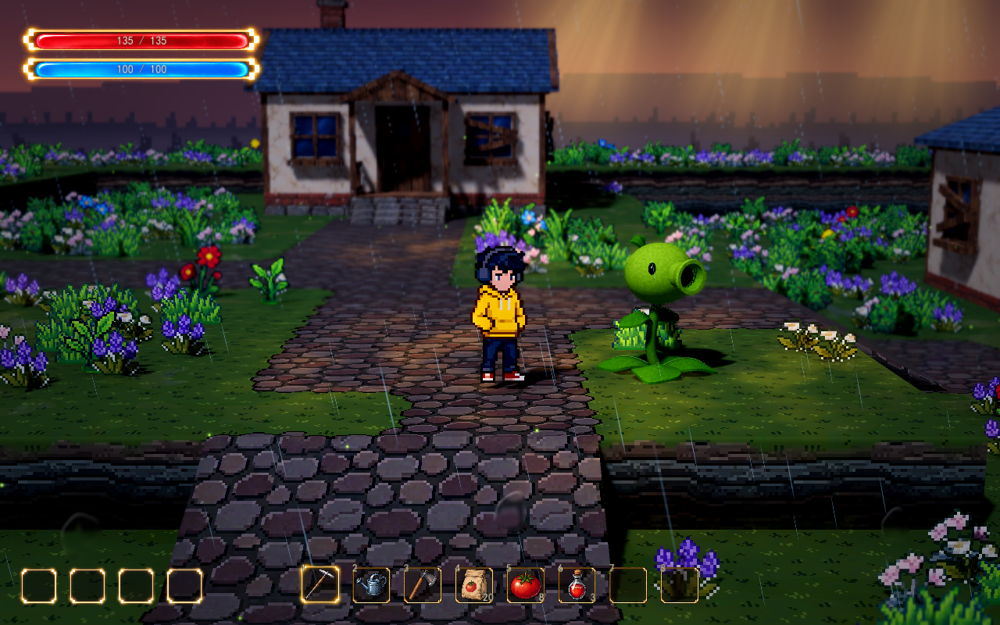
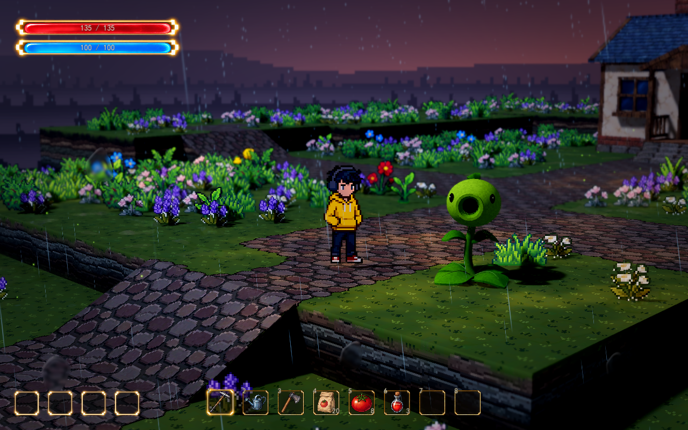

# 3D 豌豆射手视觉原型

2026-10-13：用户授权先制作一株简洁的 3D 豌豆射手，放到正式地图观察实际效果，具体种植与战斗规则继续讨论。两类种植方向见 [游戏设计草案](rpg-game-design.md#种植的两类方向)。

在 Godot 中打开 `res://scenes/world/world.tscn`，按 F6 运行。植物位于出生点右前方的草地，节点名为 `PeashooterPreview`，世界位置为 `(0, 0.8, 4.8)`；Q/E 可以绕人物观察不同侧面。默认启动地图仍由现有地图切换工具控制。

## 当前制作方式

这是由 Godot 代码构建的真实 3D 网格原型，本轮没有调用 Meowa，也没有生成新的二维美术。可复用场景为 `scenes/plants/peashooter.tscn`，构建脚本为 `scripts/plants/peashooter.gd`，材质为 `shaders/plant_surface.gdshader`。

头部为椭球体，喷口有外壁、圆润口沿、内壁和退后的暗色口腔；茎是连续弯曲的管状网格。叶片有弧度和厚度，主叶脉采用立体网格，侧叶脉和稀疏表皮变化由材质表现。模型接收现有地图光照、投影与景深，根部固定，仅有轻微待机摇摆。

用户反馈第一版精细度不足后，已细化茎的曲线、叶片曲面、叶脉、喷口和表面层次。当前仍为视觉原型，体量、配色和美术精细程度供用户审阅，不据此确定正式植物形象或玩法。

本轮没有接入生长、移栽、自动瞄准、攻击、弹丸、伤害、阻挡或库存消耗。植物不写入种植存档。地形高度和地表铺装保留，在植物根部附近仅增加一小块地编避让，避免原有花草穿入模型。

## Godot 可调参数

选中正式地图中的 `PeashooterPreview`，修改以下参数；尺寸与材质会自动重建。

| 参数 | 含义 |
| --- | --- |
| `plant_scale` | 整株体量；默认 1，最高约 1.35 米 |
| `facing_degrees` | 整株水平朝向；默认 30°，0° 朝本地 +Z |
| `head_scale` | 头部与喷口的相对尺寸 |
| `leaf_scale` | 地面叶片的长宽 |
| `head_color` / `leaf_color` / `stem_color` | 头、叶、茎的基础颜色，继续接收地图真实光照 |
| `mottling` | 表面固定色块的明暗变化，0 使用纯色 |
| `pixel_meters` | 色块物理尺度，默认 0.0234375 米，与现有人物、地编一致 |
| `idle_enabled` | 开关轻微待机摇摆 |
| `sway_degrees` / `sway_period` | 摇摆幅度与一周期秒数 |
| 刷新植物并贴地 | 移动摆放后，按所在台地高度重新贴地 |

## 实机预览与验证

截图运行正式地图，保持开发基准：透视 FOV 30°、距离 11 米、俯角 10°、焦点高度 0.75 米，深度景深强度 0.02，16:10。第二张只将水平观察朝向改为 45°。

Godot 4.7.2 的 D3D12 原生渲染验证通过：真实跟随、镜头与景深基准、贴地、网格与喷口结构、现有种植和波次连接，以及预览前后库存和种植状态一致，共 15 项。当前整株为 21 个网格、约 8466 个三角形。
