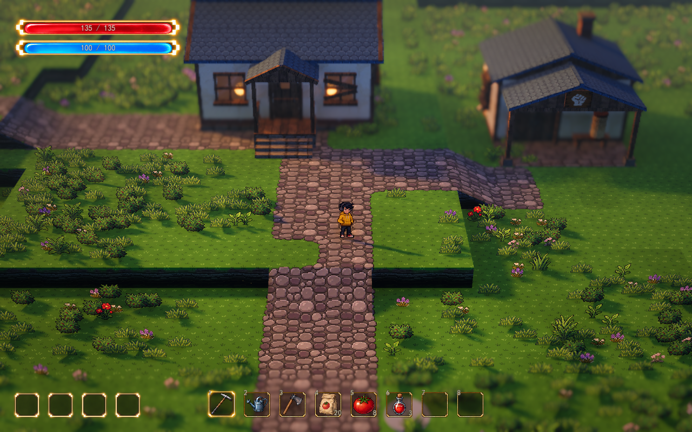

# 出生区像素美术统一样板

更新：2026-10-13。项目：`demoWithMeowa/1`，场景：`scenes/world/world.tscn`。

本轮以现有人物为标尺，重新制作草地、卵石路、墙面和屋瓦，接入当前 Lumina 出生区样板。原素材保留，地形、建筑形体和碰撞继续沿用现状。

## 实际效果与对比

[同镜头原材质](pixel-art-preview/before.png) · [门前原材质](pixel-art-preview/house-before.png) · [门前新材质](pixel-art-preview/house-after.png) · [细雨](pixel-art-preview/rain.png) · [夜晚](pixel-art-preview/night.png)

截图使用正式地图当前启用的 Lumina 镜头：透视 FOV 28°、距离 28 米、俯角 32°、焦点高 0.9 米、深度景深强度 0.065；近/远清晰余量 3/4 米、过渡 2.5/6 米。视口 1280×800，16:10。前后对比只切材质，不改变镜头、光照、天气或物件位置。门前一组通过移动人物和正常跟随形成，镜头参数相同。

## 美术尺度与内容

四张基础纹理均由 Meowa 原生纹理流程生成，尺寸 64×64。草地和道路沿用每格 1.6 米的坐标；建筑的新墙面、屋瓦独立以 1.6 米重复，对应约 40 原图像素/米。人物约 42.7 像素/米。建筑其他材质继续原重复尺度，未改变三维形体。

| 材质 | 本轮变化 | 游戏资源 |
| --- | --- | --- |
| 草地 | 减少密集碎点，保留简单草纹和较安静的底色 | `assets/meowa/pixel_sample/grass.png` |
| 卵石 | 用较明确的石面色块组织形状，减少细碎表面变化 | `assets/meowa/pixel_sample/cobble.png` |
| 道路边缘 | 与新卵石配套的透明四角过渡图集，沿用现有 16 格顺序 | `assets/meowa/pixel_sample/path.png` |
| 墙面 | 收敛大面积裂纹，保留轻微磨损和暖灰底色 | `assets/meowa/pixel_sample/plaster.png` |
| 屋瓦 | 以原生像素组织瓦片色块，蓝灰主色与环境阴影衔接 | `assets/meowa/pixel_sample/roof.png` |

道路图集为 256×256、4×4，每格 64×64。基础图不透明，道路图集带透明背景。最终源图原样接入，没有再次像素化或缩放；最近邻采样与远处 mipmap 用于三维场景中的显示。导入采用无损压缩，避免额外改变细小色差。

首轮统一了主要色块和明暗层次，生成图仍包含相近 RGB 色值。现已追加 [材质色阶统一](pixel-color-ramps.md)：这四类材质的底色各映射到明确的五色色板，源图继续保留。实时受光、冷暖色调与天气由已有 Godot 材质和光照负责。新建筑纹理的凹凸邻域为 1 个原图像素，旧大图继续原 6 像素采样。

花草精灵、木梁、门窗、砖基、侧壁与 UI 保留现有美术，本样板尚未覆盖整套资产。

## 切换与参数

- 检查器 `VisualSample → 统一像素美术 → Pixel Art Enabled`：只切换这一组新旧材质，保留当前 Lumina 镜头、天气、灯光、位置和水平旋转角度。
- 游戏内 R 或检查器 `VisualSample → Style`：只切光影／天气，保留当前镜头、朝向、布局及新旧材质选择，包括原始光影模式。入口见 [参数总览与 Style](parameters-and-styles.md)。
- 正式地图检查器 `VisualSample → 统一像素美术 → Pixel Art Enabled`：持久设置是否启用，默认开启。
- `Pixel Building Texture Meters`：新墙面、屋瓦每次重复覆盖的米数，默认 1.6；越大，世界中的像素块越大。
- `Pixel Roof Contrast`：新屋瓦局部对比，默认 0.65；降低后深缝和亮边更克制，1 表示生成图原对比。围绕原图的线性平均色调整，同时减弱颜色差导致的假凹凸，不修改源图或场景光照。
- 建筑节点的 `Plaster Texture Override / Roof Texture Override`：替换对应材质；清空恢复原图。`Override Relief Sample Pixels` 控制凹凸采样的原图像素距离，原生纹理默认 1。

草地和道路通过地图实例的独立画笔资源覆盖，不写回原画笔文件。保留固定画笔编号和原道路覆盖标记；种植用泥土、地图高度、库存及存档不随切换修改。

## 验证

建筑纹理覆盖、UV 密度、对比参数及几何/碰撞保持通过 130 项检查。正式地图原生 Forward+ / D3D12 实机切换通过 76 项检查，最终屋瓦和 GPU 对比参数更新后另通过 44 项针对性检查。核对实际地形/画笔纹理 RID、草沿绑定、预设/材质开关恢复，以及原素材、地图数据和用户存档的 SHA，均保持正确。

屋瓦仍保留规则重复的瓦片节奏，本轮可继续通过局部对比参数调节；后续材质变体应另作视觉讨论。
