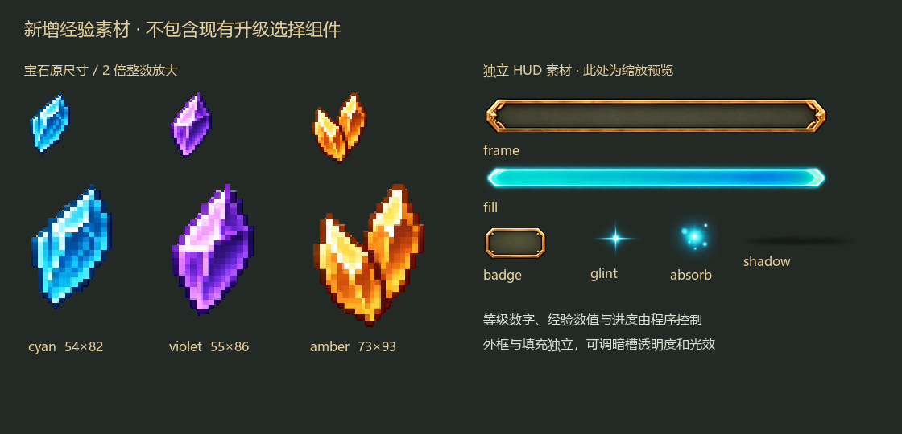

# 经验与升级视觉参考

2026-10-13。用户要求先结合游戏实际画面完善这一部分的参考图，再通过 Meowa 提取 UI；本次范围仅为经验与升级，不含波次提示与结算。

用户随后明确：升级选择直接使用当前已有组件。后续新增提取仅针对经验 HUD、等级标记及拾取反馈；成长卡、图标槽、标题装饰和确认按钮均复用现有实现，升级参考图只用于对照。

这组图是 imagegen 制作的视觉提案，基于正式地图南侧战区的实机截图与已确认成长卡参考。生成的地图细节仅供对照，不替换正式地形、人物或既有 HUD；最终接入仍使用真实场景与独立组件。未设计的技能、成长增益和宝石经验阈值继续留空。

## 参考图

- [战斗中的经验 HUD](gameplay-v2.png)：血蓝条下方的紧凑经验条、独立等级标记、三种候选宝石与轻量拾取反馈。
- [升级选择](level-choice-v2.png)：保留已确认的空白成长卡，展示选中边框、等级、连续选择指示与简洁确认按钮。
- [组件与状态](components-v1.png)：便于后续提取的视觉范围，含宝石、经验条、反馈、空白卡与按钮状态。

## 已准备的新增素材

已按收窄范围完成 Meowa 素材准备。经验 HUD 使用 UI 提取；宝石使用 Meowa 像素通用生成，保持输出原生像素，仅从总图原样裁切出三颗晶体。

[下载新增素材包](experience-assets.zip)。不包含现有成长选择组件，也不包含未设计的技能或增益。

| 独立 PNG | 尺寸 | 用途 |
| --- | --- | --- |
| cyan.png | 54 × 82 | 青蓝单晶体 |
| violet.png | 55 × 86 | 紫色晶体 |
| amber.png | 73 × 93 | 暖金双晶体 |
| frame.png | 1916 × 218 | 薄经验槽外框及暗底 |
| fill.png | 1897 × 168 | 满长度青绿填充，接入时按进度裁切 |
| badge.png | 566 × 303 | 无文字的等级底片 |
| glint.png | 409 × 321 | 端点微光 |
| absorb.png | 320 × 307 | 轻量吸收闪光 |
| shadow.png | 1294 × 141 | 柔和落地阴影 |

宝石位于 `demoWithMeowa/1/assets/meowa/growth`；HUD 位于 `demoWithMeowa/1/assets/meowa/ui/experience`。九件均为独立 RGBA，已检查透明区域、边缘和尺寸；原图没有重新像素化。裁切保留原始低 alpha 像素，未用阈值掩码制造硬边。

素材外部透明；外框和等级底片的内部暗底接近不透明，接入时应独立调低暗底 alpha，保留金属轮廓。可沿用现有 `attribute_hud.gdshader` 的 `background_opacity` 调节，不把整张纹理一起变淡。

布局中的等级、经验数字和两个空白候选仅作排版示例，不固定实际等级、候选数量或数值平衡。青蓝、紫色、暖金宝石现已接入，按节点所含经验量切换外观，不赋予稀有度。

## 后续组件拆分

| 范围 | 美术组件 | 动态部分 |
| --- | --- | --- |
| 经验宝石 | 三种候选晶体、独立落地阴影、尾迹点与吸收闪光 | 依据经验量选外观；阈值可调；漂浮、吸引移动和消失由程序控制 |
| 等级与经验 | 细暖金外框、半透明空槽、青绿填充、等级底片、端点微光 | 等级与经验文字独立；填充按真实余量裁切；拾取时轻微反馈，满级显示 MAX |
| 升级反馈 | 复用现有成长标题，新增经验条微光 | 立即进入既有成长选择，不额外添加参考图中的大标题或队列指示 |
| 成长选择 | 直接复用现有普通／选中卡、独立图标槽、标题装饰和分隔线 | 沿用当前已接入的空白卡与动态等级标题，不按新参考增加提示或重排布局 |
| 确认操作 | 直接复用现有确认按钮 | 保留当前文字、鼠标／键盘与确认行为 |

经验条的低／中／满进度及 MAX 是状态示例，无须分别烘焙整条图片；连续选择指示亦按待选次数生成，不能把示例中的两个点固定写入 UI。

## 提取与接入顺序

1. 确认这组参考的视觉、宝石外形及 HUD 布局。
2. Meowa 仅提取经验 HUD、等级标记和拾取反馈，不提取或改造已有成长选择组件。
3. 宝石按确认的像素尺度制作透明素材，不能把高分辨率参考简单缩小当作最终像素精灵。
4. 检查透明边缘、完整组件、状态对齐及游戏实际尺寸；总图不等同于已拆好的独立组件。
5. 在 Godot 中接入真实经验状态、拾取与升级信号，并暴露尺寸、间距、颜色、透明度及反馈强度。

用户随后授权接入并完成逻辑，现已绑定正式地图的真实经验节点与经验状态；升级选择继续使用 `scenes/ui/growth_choice_ui.tscn` 及其已有组件。当前行为、参数和实机图见[经验宝石与经验条](../../ui/experience-visuals.md)。美术确认规则见项目 [AGENTS.md](../../../AGENTS.md)。

## 输入参考与提示词

背景来自 ；卡片风格来自 [已确认参考](../upgrade-ui-reference/reference-v3.png)，布局同时参考 。生成采用 imagegen 内置工具，完整提示词见 [prompts.md](prompts.md)。
