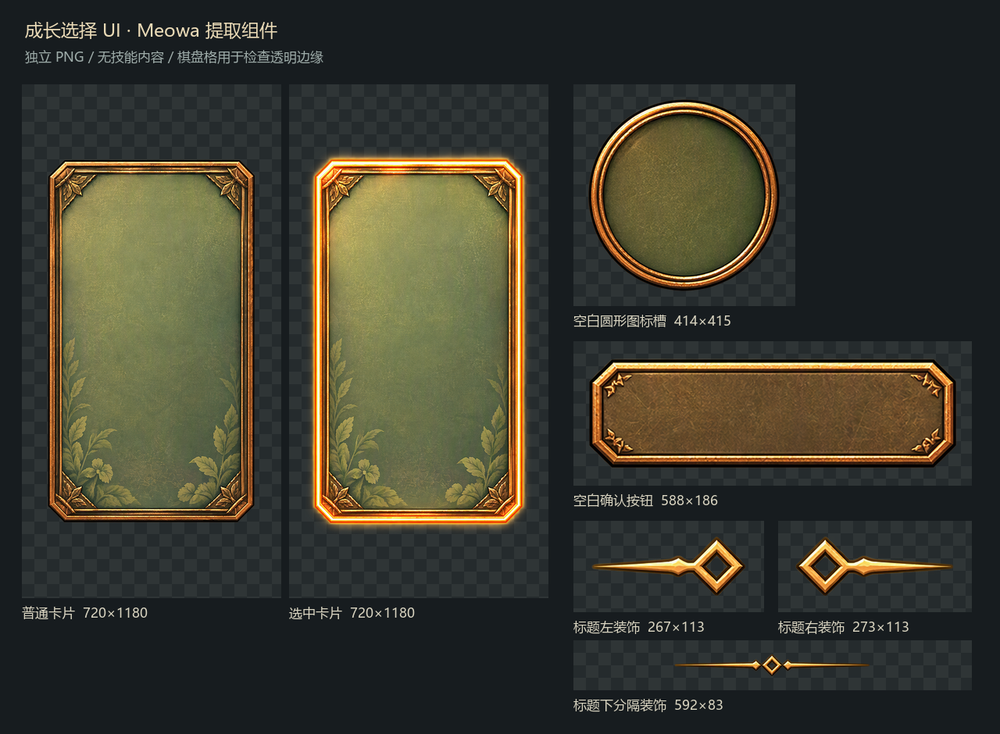

# 成长选择 UI 提取素材

2026-10-13，经用户确认参考图第三版后，通过 Meowa UI 提取制作。已预组装为可复用 Godot 组件及独立实机预览；尚未接入正式地图的成长触发与战斗规则。接口和参数见 [成长选择 UI 预组装](../../ui/growth-choice-ui.md)。

素材目录：`demoWithMeowa/1/assets/meowa/ui/upgrade`。PNG 均为 RGBA，已逐件检查组件外部透明、边缘、空白内容及地图背景移除；裁切保留原始低 alpha 像素，不将柔光强制变成硬边。

| 文件 | 尺寸 | 用途 |
| --- | --- | --- |
| card.png | 720 × 1180 | 普通空白卡片 |
| card-selected.png | 720 × 1180 | 选中空白卡片，含暖色光边 |
| icon-slot.png | 414 × 415 | 可独立移动、缩放的圆形图标槽 |
| button.png | 588 × 186 | 简洁青铜按钮，不含文字 |
| title-left.png | 267 × 113 | 标题左侧装饰 |
| title-right.png | 273 × 113 | 标题右侧装饰 |
| divider.png | 592 × 83 | 标题下方菱形分隔线 |

`source.png` 是 Meowa 返回的 2048 × 1536 透明总图。`components.json` 记录组件尺寸、裁切区域和画布偏移。普通与选中卡片只补透明留白到同一画布，不缩放绘画内容。

圆形槽未烘焙到卡片里；标题、确认按钮文字和后续技能图标由程序独立显示。卡片边框、叶片和绿色底纹目前仍在同一张卡片纹理内，并非每个叶片都单独拆开。素材外部透明，绿色底纹与按钮内底接近不透明；后续接入时如需透出世界，应单独控制内底透明度，避免整张卡片一起变淡。

建议卡片整体等比缩放，保留青铜轨道厚度与植物纹样。九宫格拉伸会拉长下方叶片，当前不预设其切片边距。普通与选中态共用位置、尺寸和锚点，圆形槽独立布局。

[下载完整素材包](upgrade-ui.zip)
