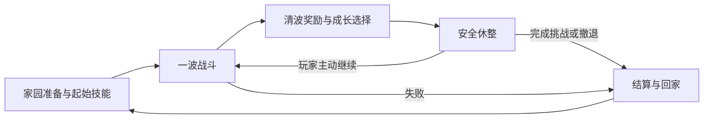

# HD-2D 慢节奏波次生存玩法草案

版本：0.4  
日期：2026年10月12日  
项目：`D:\Project\HD-2DMap\demoWithMeowa\1`

当前方向收束为类《吸血鬼幸存者》的波次割草游戏，结合现有 HD-2D 场景、连续地图和家园。玩家享受清怪与技能组合成长，每波之间有充分休整，整体节奏更舒缓。

**已确认**：采用更简单的波次割草方向，降低持续紧张感，允许玩家在怪物轮次之间休整；技能获得需要有实际玩法链路，当前 Tab 技能页需要据此重新考虑。

**本文推荐**：自动攻击为主、走位为核心，清波获得成长选择，主动开始下一波；长期解锁和本局技能成长分开。以下具体规则均为可讨论方案，尚未实现或逐项定稿。

**当前灰盒范围**：用户随后要求先搭循环，并明确技能实际效果和成长暂不加入。已接入通用基础攻击、波次、清波直接休整与胜负重试；技能页和技能槽先留空。本文中的成长与解锁仍是后续讨论建议，试玩和参数见 [波次循环灰盒](wave-graybox.md)。

## 核心体验与循环

希望玩家能够读懂威胁、利用位置清理成群敌人，随后安静地理解奖励、调整计划，再带着新的能力进入下一波。技能组合逐渐成形，是继续挑战的主要期待；波间休整提供恢复注意力和做选择的时间。

一次“出战”包含多波战斗与休整。本局技能与强化在波次之间保留，直到成功、撤退或失败结算；下一次出战重新构筑。

## 技能真正如何获得

当前原型把目录中的技能直接列出，点击“学习”或双击即可获得，缺少来源、条件与选择代价。新的技能链路建议分为两层：

| 层级 | 怎样获得 | 带来什么 | 保留范围 |
| --- | --- | --- | --- |
| 长期解锁 | 完成明确的阶段挑战或教学目标，结算记录解锁 | 技能进入以后出战的可选池 | 跨出战保留 |
| 本局获得与强化 | 战前选择起始技能；清波后选择新技能或升级 | 实际加入本局组合、改变战斗方式 | 保留到本次出战结束 |

完整链路为：**满足解锁条件 → 加入可选池 → 战前选起始技能／波间选到新技能 → 自动参与战斗 → 后续选择强化 → 结束出战并结算。**

初期提供少量基础可选技能，战前先选一个起始技能，让第一次出战就能体验搭配。后续解锁扩大打法选择，不要求玩家先刷很久才能获得基本输出。

第一版建议每次清波提供一次成长选择，可先尝试三选一。优先包含新技能、已有技能升级及少量通用强化，先不同时叠加经验升级、技能点和学习材料等多套获取规则。

获得技能后自动加入本局组合，避免再次打开 Tab 拖入槽位。容量有限：满槽时优先提供升级，达到上限的选项移出奖励池，并保证存在可用的基础强化。Tab 不能随意添加尚未通过本局选择获得的技能；第一版可先不做技能替换、退款或复杂进化树。

强化需要让玩家看得见打法变化，例如范围扩大、攻击分裂、控制时间改变或覆盖更多目标。火焰清理成群目标、雷电跳跃攻击、冰系延缓逼近可作为职责示例；名称、形态和正式技能表继续讨论。已有四个 HUD 槽位可供原型验证，不固定最终容量。

例如先带基础火焰出战，清波后在“获得雷电、扩大火焰范围、提高生存能力”中选一项。选择雷电后，它直接成为下一波的自动攻击能力；选择火焰强化，则能利用更大的范围聚怪清场。每次选择都来自刚完成的战斗，并为下一波留下明确期待。

## 战斗节奏

主要操作是移动、聚怪、拉开距离和寻找安全位置。普通攻击与多数输出技能自动触发，少量手动救急动作作为后续候选；跳跃先沿用移动功能，其无敌、闪避或伤害作用另行决定。

每波采用有限的敌人批次：适应 → 压力上升 → 短暂清场高潮 → 清理剩余威胁。随着进度增加敌人组合和空间压力，波数、时长与数量通过试玩确定。保持命中与击杀反馈利落，留出预警和思考时间，避免把所有动作一起放慢。

割草感来自组合成形后一次处理多个目标、持续命中和效率提升。怪物轮廓、危险范围与地面路径仍需清晰；技能特效控制覆盖面积和持续时间，让花草、雨景和柔和光影继续可见。

QE 继续用于观察，旋转镜头不应改变攻击范围或让技能无故换目标。台地、建筑和坡道可以影响走位，攻击须尊重墙体与高差；战斗区域应有可通行路线，避免依靠建筑阻隔让敌人永远无法接近。

## 波间休整与结算

清波后停止刷怪、确认没有残余攻击，再进入安全休整。玩家处理奖励、读技能说明、整理背包、接受有限补给，然后主动开始下一波；不强制倒计时，也不要求每波回家买卖。

建议每次清波只提供一份有限恢复，治疗技能也有明确上限或机会成本。休整时站着等待不能无限回满，以保留本次出战中的生存取舍。补给数量和治疗规则仍需试玩。

家园与战斗区域通过连续地图中的行走连接，怪物活动范围要保护家园与休整安全。一次挑战的完成条件可以先用一组波次及阶段目标，首轮无需做无尽模式。

完成挑战、波间主动撤退或失败都会结束本次出战。建议保留已完成波次的收益与已达成的长期解锁，未完成波次不发清波奖励；本局技能等级和临时强化重置。失败代价、奖励额度和重复挑战收益随后再定，先保证规则清晰、失败后仍愿意再试。

## Tab 技能页的新职责

保留已确认的手帐外框、页签位置与小尺寸技能 HUD，美术布局后续围绕新职责讨论。

| 界面 | 主要信息与操作 |
| --- | --- |
| 战前技能准备 | 已解锁的起始选项、技能用途、选择起始配置 |
| Tab 技能页 | 本局技能、等级与强化、实际作用、长期解锁记录和获取条件 |
| 波间成长选择 | 清波获得的候选及其对当前搭配的影响，选择后直接生效 |
| 地图技能 HUD | 当前实际参与战斗的技能与触发状态；自动技能无需伪装成手动快捷键 |

取消把整个目录作为免费学习入口的设计。“长期已解锁”与“本局已获得”应有明确标签，技能详情说明来源与强化效果，避免玩家把图鉴记录误当成本局战斗能力。

现有 UI 打开时世界继续运行，人物移动、跳跃和 QE 输入被占用。建议战斗中限制打开这种大型管理页，完整管理与成长选择放在安全休整或家园；天气、环境动画与声音继续运行。安全来自波次规则，不依赖暂停整个世界。这是待实现的调整方向，当前界面行为尚未修改。

## 现有内容的主次

| 内容 | 在新方向中的位置 |
| --- | --- |
| 连续地图、自己的小院、HD-2D 氛围 | 沿用；家园用于准备与记录，战斗与休整在地图中自然连接 |
| 技能搭配、生命、生存与走位 | 当前核心 |
| 背包和装备 | 保留已有基础，先承担少量准备与收获用途，不同时扩展随机词缀和复杂装备养成 |
| 训练小屋与永久属性 | 已有原型保留；优先考虑教学和起始选项，不做无限属性叠加，以维持局内选择的价值 |
| 魔力条、手动技能、复杂地形战术 | 用途待定，当前已有展示不等于必须建立一套魔力经济 |
| 伙伴、经营、种植与制作 | 保留兴趣，放在核心循环稳定后的候选中 |

世界题材、人物身份、游戏名称和正式布局仍开放，现有现代、赛博、古风与自然测试区域不作为正式世界设定。

## 当前实现与下一步验证

已有移动、跳跃、相机、地形、天气、光影、背包、属性和技能管理基础。史莱姆已具备巡逻、追踪和返回，尚未有完整攻击伤害；技能目录与 HUD 也不代表实际施放已完成。

先验证“一波战斗 → 成长选择 → 安全休整 → 主动开始下一波”的体验，再扩大内容。为此仍需补齐自动输出、受击与死亡、刷怪与清波判断、技能强化生效、失败与结算。这个方向减少了同时推进的系统范围，战斗闭环仍需要制作和试玩。

主要观察：走位是否有价值、清怪是否有反馈、选一次强化能否改变下一波、休整是否值得停留、画面是否保持可读。技能容量、成长上限、敌人组合、补给和长期解锁条件随结果调整。

## 草案使用与参考

玩法方案已有基础波次灰盒用于验证，技能和成长的具体规则仍待讨论。文中的推荐规则和示例不推定全部实现，也不固定内容数量、工期和开发架构；当前接入范围以灰盒说明和用户最新要求为准。

参考：《吸血鬼幸存者》在 [poncle 官方介绍](https://poncle.games/vampire-survivors.html) 中定位为玩法简洁、带有 roguelite 要素的生存游戏。本项目借鉴易上手和逐局成长的思路；安全休整、有限波次和连续家园地图是本项目的设计建议。
