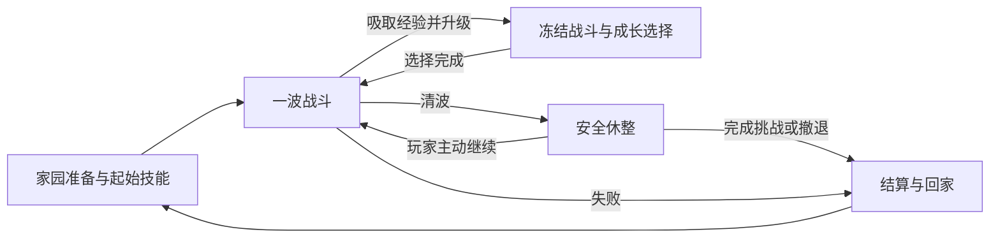

# HD-2D 慢节奏波次生存玩法草案

版本：0.8（战斗核心与成长基础）

日期：2026年10月13日
项目：`D:\Project\HD-2DMap\demoWithMeowa\1`

当前方向收束为类《吸血鬼幸存者》的波次割草游戏，结合现有 HD-2D 场景、连续地图和家园。玩家享受清怪与技能组合成长，每波之间有充分休整，整体节奏更舒缓。

**已确认**：采用 HD-2D 类《吸血鬼幸存者》的波次割草方向，整体节奏更舒缓、波间安全休整，种植暂不纳入。用户最新希望约 7～8 种普通怪加精英首领、约 10 种攻击和丰富增益，并明确这轮只把战斗核心设计好，不再估算工期。

**成长最新确认**：采用怪物掉落经验、靠近吸取和本局等级；升级立即进入选择并临时冻结战斗，环境和声音继续运行。新挑战与重试重置成长。首批本局全局增益已确认伤害每级 +20%、基础攻击间隔减少 10%、范围 +15%，各三级，同类按基础值相加，数值可调；见 [本局战斗增益](combat-buffs.md) 和 [本局经验与升级](run-growth.md)。

**当前提案**：自动攻击为主、走位为核心，波间安全休整与主动继续。核心候选已重新整理为 8 种普通怪、2 种精英变体、1 个首领、10 种攻击、24 种增益；具体职责、槽位、攻击等级与奖励池仍待讨论和试玩，详见 [战斗核心设计](combat-core-design.md)。长期解锁、家园经营等保留为后续方向。

**当前实现范围**：已有攻击、波次、清波休整与胜负重试，并接入本局经验、吸取、连续升级、扇击等级成长及伤害／冷却／范围增益选择。其他攻击和增益继续设计，永久解锁尚未接入。试玩和参数见 [波次循环](wave-graybox.md)、[本局成长](run-growth.md) 与 [战斗增益](combat-buffs.md)。

## 当前核心设计范围

此前两武器、两普通怪的收缩提案已撤回。不做工期估计，继续完善怪物、攻击和增益之间的关系；经验成长、扇击升级与首批三种属性增益已接入，其余候选继续讨论。

| 内容 | 当前候选 | 设计重点 |
| --- | --- | --- |
| 普通怪 | 8 种 | 聚群、快速逼近、慢重、冲撞、投射、裂殖、布场、鼓舞；轮廓、动作和对策有差异 |
| 精英与首领 | 2 种精英变体 + 1 首领 | 精英强化已有威胁，首领组合可读招式与输出窗口；不靠全面状态免疫 |
| 攻击方式 | 10 种 | 扇击、穿透、散射、追踪、回旋、环绕、连锁、延时爆破、持续区、震荡环；各有走位职责 |
| 局内增益 | 24 种 | 16 属性、6 机制、2 互斥体型；明确适用、叠加、上限和真实取舍 |
| 构筑容量 | 暂建议 4 攻击槽 + 6 增益槽 | 少数攻击高等级与多攻击覆盖均能成立；不是一局拿齐所有内容 |
| 成长与休整 | 经验升级立即选择，波间主动继续 | 选择时只冻结战斗；卡片数量、经验曲线与候选内容继续讨论 |

完整的行为、命中、升级、状态规则、奖励过滤与四条打法示例见 [战斗核心：怪物、攻击与增益](combat-core-design.md)。正式生物身份与美术仍需结合世界题材确认；数量目标不等于已有对应素材。

本局攻击的后续获得提案为起始选择和经验升级选择；已有装备、训练、种植不成为获取门槛或挑战战斗参数来源。当前人物、地图、镜头与 HUD 可以复用，具体内容和资产在规则确认后再制作。

## 核心体验与循环

希望玩家能够读懂威胁、利用位置清理成群敌人，随后安静地理解奖励、调整计划，再带着新的能力进入下一波。技能组合逐渐成形，是继续挑战的主要期待；波间休整提供恢复注意力和做选择的时间。

一次“出战”包含多波战斗与休整。本局技能与强化在波次之间保留，直到成功、撤退或失败结算；下一次出战重新构筑。

## 技能获得与后续长期解锁

当前已确认的成长触发是击败怪物、吸取经验并升级，升级选择为后续攻击与增益提供获得接口。起始攻击、具体奖励与过滤规则仍参考 [战斗核心设计](combat-core-design.md) 继续讨论。本节的永久解锁层作为后续候选，不是当前核心的前置任务。

当前原型把目录中的技能直接列出，点击“学习”或双击即可获得，缺少来源、条件与选择代价。新的技能链路建议分为两层：

| 层级 | 怎样获得 | 带来什么 | 保留范围 |
| --- | --- | --- | --- |
| 长期解锁 | 完成明确的阶段挑战或教学目标，结算记录解锁 | 技能进入以后出战的可选池 | 跨出战保留 |
| 本局获得与强化 | 起始技能待定；经验升级选择的候选内容待定 | 后续接入本局组合并改变战斗方式 | 保留到本次出战结束 |

后续完整链路提案为：**满足长期解锁条件 → 加入可选池 → 战前选起始技能／经验升级选到新技能 → 自动参与战斗 → 后续选择强化 → 结束出战并结算。** 当前已落实经验升级、扇击成长与首批属性增益，长期解锁和更多攻击仍为后续方案。

初期提供少量基础可选技能，战前先选一个起始技能，让第一次出战就能体验搭配。后续解锁扩大打法选择，不要求玩家先刷很久才能获得基本输出。

此前按清波固定发放成长的建议已由经验升级链路更新。当前经验选择已接入真实成长；正式卡片数量、其他技能和增益继续讨论，不同时加入技能点或学习材料等另一套获取规则。

获得技能后自动加入本局组合，避免再次打开 Tab 拖入槽位。容量有限：满槽时优先提供升级，达到上限的选项移出奖励池，并保证存在可用的基础强化。Tab 不能随意添加尚未通过本局选择获得的技能；第一版可先不做技能替换、退款或复杂进化树。

强化需要让玩家看得见打法变化，例如范围扩大、攻击分裂、控制时间改变或覆盖更多目标。火焰清理成群目标、雷电跳跃攻击、冰系延缓逼近可作为职责示例；名称、形态和正式技能表继续讨论。已有四个 HUD 槽位可供原型验证，不固定最终容量。

例如先带某种起始攻击出战，经验升级后从新攻击、已有攻击强化或生存能力中选一项。具体攻击与增益待定；选择应用后直接参与后续战斗，不再去管理页重复学习。

## 战斗节奏

主要操作是移动、聚怪、拉开距离和寻找安全位置。普通攻击与多数输出技能自动触发，少量手动救急动作作为后续候选；跳跃先沿用移动功能，其无敌、闪避或伤害作用另行决定。

每波采用有限的敌人批次：适应 → 压力上升 → 短暂清场高潮 → 清理剩余威胁。随着进度增加敌人组合和空间压力，波数、时长与数量通过试玩确定。保持命中与击杀反馈利落，留出预警和思考时间，避免把所有动作一起放慢。

割草感来自组合成形后一次处理多个目标、持续命中和效率提升。怪物轮廓、危险范围与地面路径仍需清晰；技能特效控制覆盖面积和持续时间，让花草、雨景和柔和光影继续可见。

QE 继续用于观察，旋转镜头不应改变攻击范围或让技能无故换目标。台地、建筑和坡道可以影响走位，攻击须尊重墙体与高差；战斗区域应有可通行路线，避免依靠建筑阻隔让敌人永远无法接近。

## 波间休整与结算

清波后停止刷怪、确认没有残余攻击，再进入安全休整。玩家处理奖励、读技能说明、整理背包、接受有限补给，然后主动开始下一波；不强制倒计时，也不要求每波回家买卖。

建议每次清波只提供一份有限恢复，治疗技能也有明确上限或机会成本。休整时站着等待不能无限回满，以保留本次出战中的生存取舍。补给数量和治疗规则仍需试玩。

家园与战斗区域通过连续地图中的行走连接，怪物活动范围要保护家园与休整安全。用户最新确认当前挑战采用[无尽波次](endless-waves.md)，每波清完休整并按 F 继续，波数无限；原有限挑战保留作开发对照。失败或撤退结束本局，其他阶段目标继续讨论。

完成挑战、波间主动撤退或失败都会结束本次出战。建议保留已完成波次的收益与已达成的长期解锁，未完成波次不发清波奖励；本局技能等级和临时强化重置。失败代价、奖励额度和重复挑战收益随后再定，先保证规则清晰、失败后仍愿意再试。

## Tab 技能页的新职责

保留已确认的手帐外框、页签位置与小尺寸技能 HUD，美术布局后续围绕新职责讨论。

| 界面 | 主要信息与操作 |
| --- | --- |
| 战前技能准备 | 已解锁的起始选项、技能用途、选择起始配置 |
| Tab 技能页 | 本局技能、等级与强化、实际作用、长期解锁记录和获取条件 |
| 升级成长选择 | 经验升级获得的候选及其对当前搭配的影响；本轮仅接空白接口 |
| 地图技能 HUD | 当前实际参与战斗的技能与触发状态；自动技能无需伪装成手动快捷键 |

取消把整个目录作为免费学习入口的设计。“长期已解锁”与“本局已获得”应有明确标签，技能详情说明来源与强化效果，避免玩家把图鉴记录误当成本局战斗能力。

现有 UI 打开时世界继续运行，人物移动、跳跃和 QE 输入被占用。大型管理页继续限制在安全休整或家园；经验升级选择可在战斗中立即出现，此时专门冻结战斗节点与刷怪、受击计时，天气、环境动画与声音继续运行。成长卡片已接入扇击升级和首批三种全局增益，其他武器与增益继续讨论。

## 后续候选：种植（当前 Demo 暂不纳入）

2026-10-13 最新范围：用户要求集中完善 HD-2D 波次生存的怪物、攻击与增益，暂不接入种植系统。普通农作物与防御植物均不计入本轮武器、敌人、成长、休整或通关链路。

已有 [种植操作](farming.md)、[提示界面](farming-ui.md) 与 [豌豆射手视觉原型](peashooter.md) 保留供后续讨论；这次设计调整没有移除原型代码或地图节点。此前普通作物采用 2D、防御植物先验证简洁 3D 的方向保留为历史候选，具体外观、生长、收获与植物战斗规则继续待定。

## 现有内容的主次

| 内容 | 在新方向中的位置 |
| --- | --- |
| 连续地图、自己的小院、HD-2D 氛围 | 沿用；家园用于准备与记录，战斗与休整在地图中自然连接 |
| 技能搭配、生命、生存与走位 | 当前核心 |
| 背包和装备 | 保留已有基础，先承担少量准备与收获用途，不同时扩展随机词缀和复杂装备养成 |
| 训练小屋与永久属性 | 已有原型保留；优先考虑教学和起始选项，不做无限属性叠加，以维持局内选择的价值 |
| 魔力条、手动技能、复杂地形战术 | 用途待定，当前已有展示不等于必须建立一套魔力经济 |
| 种植 | 已有原型保留，当前战斗 Demo 暂不纳入；普通作物与防御植物仅为后续候选 |
| 伙伴、经营与制作 | 保留兴趣，放在核心循环稳定后的候选中 |

世界题材、人物身份、游戏名称和正式布局仍开放，现有现代、赛博、古风与自然测试区域不作为正式世界设定。

## 当前实现与下一步验证

已有移动、跳跃、相机、地形、天气、光影、背包、属性和技能管理基础。史莱姆已具备巡逻、追踪和返回，尚未有完整攻击伤害；技能目录与 HUD 也不代表实际施放已完成。

基础波次灰盒已经验证通用自动攻击、真实受击、刷怪清波、安全休整、胜负与重试。当前主要缺口是将史莱姆外观与战斗规则接合、做出差异明确的武器及成长，并补足反馈、整局节奏与可分发运行包；不能把两个已独立存在的原型视为已经集成。

主要观察：走位是否有价值、清怪是否有反馈、选一次强化能否改变下一波、休整是否值得停留、画面是否保持可读。技能容量、成长上限、敌人组合、补给和长期解锁条件随结果调整。

## 草案使用与参考

玩法方案已有基础波次灰盒用于验证，技能和成长的具体规则仍待讨论。文中的推荐规则和示例不推定全部实现，也不固定内容数量、工期和开发架构；当前接入范围以灰盒说明和用户最新要求为准。

参考：《吸血鬼幸存者》在 [poncle 官方介绍](https://poncle.games/vampire-survivors.html) 中定位为玩法简洁、带有 roguelite 要素的生存游戏。本项目借鉴易上手和逐局成长的思路；安全休整、有限波次和连续家园地图是本项目的设计建议。
