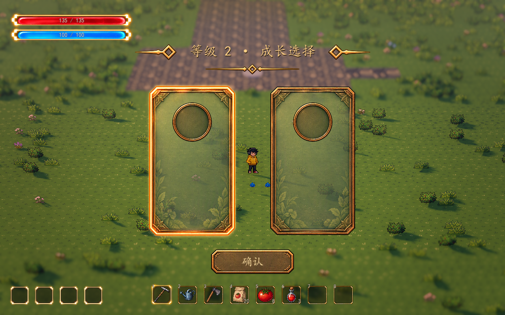

# 本局经验与升级基础框架

2026-10-13。用户已确认：本局等级与经验在新挑战、重试时重置；每次升级立即选择，临时冻结战斗，环境与声音继续运行。经验宝石、经验条与真实成长候选已接入，升级选择复用现有组件。首批伤害、冷却、范围增益的数值和规则见 [本局战斗增益](combat-buffs.md)。

已接到正式地图的 `WavePrototype/RunGrowth`：真实怪物死亡生成经验拾取节点，人物靠近后自动吸取，经验达到阈值就打开已有 Meowa 卡片 UI。正式地图由 `RunSkills` 合并武器升级和 `RunBuffs` 的三种本局属性增益，确认后在恢复战斗前应用效果。候选数量随有效池变化，不据此固定正式选择数量；独立空白预览保留作组件测试。

## 当前流程

1. 在挑战入口按 F 开始；`run_started` 初始化新局的等级、经验和待选次数。
2. 怪物实际死亡只通知一次，按该种怪物的 `Experience Reward` 生成拾取节点；取消生成、异常移除和结算清理不发经验。
3. 人物进入吸取范围后，节点加速靠近人物，抵达收取距离才入账。触发前检查高差，避免从明显不同高度的台地直接吸取；已吸引的节点继续跟随人物。
4. 升级立即打开选择界面，冻结敌人、已登记的人物攻击、敌方攻击、刷怪及受击计时、经验吸取。人物控制沿用 UI 输入占用；天气、环境动画、人物重力和声音继续运行。晚到的伤害回调不能伤害任何一方。
5. 确认后回传选择结果并恢复原来的战斗节点运行模式。一次拾取连升多级时逐次选择，中间不恢复战斗。
6. 默认清波会自动收取剩余经验，完成由此产生的全部升级选择后再休整或结算。这个自动收取是本轮建议的可调基线，可关闭。
7. 失败、撤退或结束清除掉落与未完成选择，释放冻结和界面输入。等级可暂留供本轮结果读取；返回家园、新挑战与重试恢复 1 级和 0 经验。

经验节点现已带三档 Meowa 晶体、漂浮、阴影和细小尾迹，经验条绑定同一份本局状态，收取时有短暂微光。宝石外观依据节点含量切换，合并后同步刷新；阈值不改变经验奖励。清波自动收取继续沿用原规则，未新增拾取声音。布局、分档与视觉参数见[经验宝石与经验条](experience-visuals.md)。

## 参数

以下是可调测试基线，非正式平衡。正式地图选择 `WavePrototype/RunGrowth`，可展开规则资源，也可直接打开 `data/experience_rules.tres`。

| 参数 | 默认值 | 含义 |
| --- | ---: | --- |
| Enabled | true | 是否接入本局成长；关闭会清理当前掉落、升级界面与冻结 |
| First Level Experience | 10 | 从 1 级升到 2 级需要的经验 |
| Per Level Increase | 5 | 每级增加的需求，默认为 10、15、20、25…… |
| Curve Increase | 0 | 二次增量；需求为基础值 + 线性增量 × `(等级 − 1)` + 二次增量 × `(等级 − 1)²` |
| Level Cap | 100 | 可调等级上限，到达后不继续积累升级经验 |
| Experience Reward | 3 | 配在各 `WaveEnemyDefinition` 上，每只实际击败后的经验；0 不产生掉落 |
| Attraction Radius | 2.0 米 | 开始吸取的水平距离 |
| Collection Radius | 0.3 米 | 宝石抵达人物收取点后入账的距离 |
| Height Tolerance | 1.0 米 | 开始吸取时允许的高差 |
| Attraction Initial Speed | 2.0 米/秒 | 吸取起始速度 |
| Attraction Acceleration | 12 | 吸取加速度，米/秒² |
| Attraction Max Speed | 8.0 米/秒 | 吸取速度上限 |
| Collect Remaining On Clear | true | 清波自动收取剩余经验，并等待升级选择完成 |
| Max Pickups | 256 | 场上逻辑节点上限；满时合并到附近现有节点，保留全部经验 |
| Choice Options | 动态候选 | 正式地图由 RunSkills 提供真实技能及增益卡；未指定动态来源时使用配置数组 |
| Pickup Scene | experience_pickup.tscn | 可替换的逻辑拾取场景，根节点继承 `ExperiencePickup` |

修改经验曲线后，下次入账按新阈值处理；比较平衡时建议重开挑战。卡片宽度、间距、内页透明度、标题和动效仍由子节点 `GrowthChoiceUI` 调节，见 [成长选择 UI](growth-choice-ui.md)。

## 扩展接口

| 模块 | 责任 |
| --- | --- |
| `ExperienceRules` | 可配置经验曲线与上限 |
| `RunGrowthState` | 等级、当前余量、累计经验与待选次数；独立于装备、训练和永久存档 |
| `ExperiencePickup` | 范围、高差、吸取移动和一次收取；不自行修改经验状态 |
| `RunGrowth` | 死亡掉落、统一推进拾取、升级 UI 与波次生命周期 |
| `ExperienceHUD` | 真实等级、经验余量、满级、菜单显示与轻量拾取反馈 |

成长系统监听 `RunGrowth.growth_chosen(level, option_id)` 应用技能或增益。该信号在本次待选次数扣除后、战斗恢复前发出，连续升级逐次应用再重新计算下一轮候选。正式地图已由 RunSkills 和 RunBuffs 接入；`slot_a`、`slot_b` 只保留在独立基础组件的空白测试配置中。

候选可通过 `refresh_candidates(options: Array[GrowthChoiceOption])` 更新。它保留待选次数，重新验证当前候选；有效项必须有非空且唯一的 ID，至少一项可选。配置无效会明确报错并保留经验，不会在没有有效界面的情况下把战斗冻结。

现有经验 HUD 已订阅 `RunGrowth.state.changed` 读取 `level`、`experience` 和 `required_experience()`，拾取反馈监听 `experience_collected(amount)`；后续组件可以沿用这些接口以及 `pending_choices`。等级本身不偷偷增加属性，属性收益由正式候选定义与效果应用负责。

新增人物攻击组件在准备完成后调用 `WavePrototype.register_combat_node(self)`。组件移出场景会自动解除登记；升级冻结后精确恢复原有 `process_mode`。敌方弹丸、危险区和其节点计时器继续放在 `attack_root` 下，伤害使用已有带波次代号的回调。不要用脱离战斗节点的全局计时器绕过冻结来施放攻击。

实现文件位于 `scripts/growth/`，可复用场景位于 `scenes/growth/`；共享波次场景已经实例化成长组件。没有将等级、经验或空白选择结果写入装备存档，也未接入具体增益、永久成长、技能点或解锁经济。

## 验证

- `test_experience_state.gd`：20 项，阈值、余量、连续升级、上限、重置及距离/高差/跟随收取。
- `test_run_growth.gd`：24 项，死亡后先掉落、一次收取、升级冻结、连续选择、数量上限合并、清波收取开关和结束清理。
- `test_growth_wave_integration.gd`：25 项，实际地图、史莱姆死亡、战斗计时与攻击冻结、双方晚到伤害拒绝、天气继续、清波等待选择、真实重试及结算通知中的即时重试。
- `test_growth_choice_ui.gd`：36 项，包括动态等级标题不截断、鼠标/键盘与重复确认。
- `test_experience_visuals.gd`：30 项，三档外观、合并更新、真实经验条、余量与上限、冻结、菜单显示、布局、重试与状态重新绑定。
- 原生 D3D12 / Forward+ 实机：真实死亡 → 可见宝石吸取 → 经验条更新 → 2 级原有选择 → 确认恢复 → 重试归零，镜头采用当前开发预设的 28 米 / 32° / FOV 28° / 景深 0.065。

波次和扇形攻击测试可关闭成长组件以隔离原行为；成长与波次的共同流程由上述集成测试覆盖。
