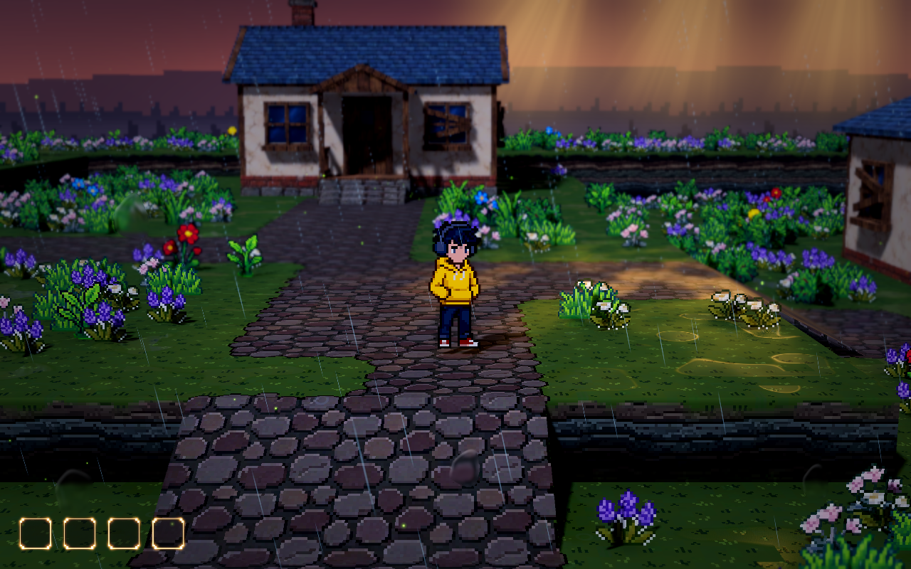

# 左下角空槽技能栏

采用用户确认的空槽参考：小尺寸、左下角、半透明暗底、细暖色光边和角部辉光。没有灰石边框、青苔、装备入口或大底板。技能图标尚未定稿，当前默认不显示；现有学习与装配数据保留，Tab 继续打开管理界面，点击槽位仍能打开对应技能详情。

Meowa 从已确认参考中提取了一个透明组件，各槽位复用同一美术。`assets/meowa/ui/skill_hud/slot.png` 为裁切后的透明 PNG，保留半透明暗底和辉光像素；`source.png` 保留原始提取产物。参考图用于确认视觉方向，实际游戏使用 Meowa 组件。



## 调整参数

在 Godot 打开 `demoWithMeowa/1/scenes/ui/skill_hud.tscn`，选中根节点 `SkillHUD`。该组件由 `scenes/ui/loadout_ui.tscn` 引用；运行时位于 `LoadoutUI/Root/SkillHUD`。参数可在编辑器设置，也可在运行时的远程检查器调整。

| 参数 | 默认值 | 含义 |
| --- | ---: | --- |
| Slot Size | 64 | 单个槽位的逻辑像素尺寸，包含辉光留白；与管理界面的缩放独立 |
| Slot Spacing | 6 | 相邻槽位间距，逻辑像素 |
| Screen Margin | `(24, 24)` | 左下安全距离；X 距左侧，Y 距底部 |
| Glow Strength | 1.0 | 光边与辉光强度；0 关闭，1 为原始素材强度 |
| Background Opacity | 0.65 | 半透明暗底的透明度倍率；0 完全透出地面，1 保留素材原有暗底 |
| Show Skill Icons | false | 当前保持关闭；图标定稿后可启用，读取已装配技能的图标 |
| Slot Texture | slot.png | Meowa 提取组件，可替换为后续同类美术 |

当前四个槽位总宽为 274 个逻辑像素。项目逻辑视口为 1440×900，默认窗口为 1280×800，因此实际显示约 244×57 像素。窄窗口会自动缩小以保留边距。槽位数量仍由 `LoadoutUI.skill_slot_count` 管理，当前为 4；不是本轮定下的最终技能数量。

## 验证

原生 Forward+ 实景检查沿用当前开发相机、跟随和景深参数，验证实际鼠标点击、Tab/ESC 开关、界面打开时隐藏技能栏、关闭后恢复，以及辉光参数调节。

`tests/test_skill_hud.gd` 验证默认空槽、移除装备入口与图标、透明素材、左下边距、参数即时生效、装配状态保留、点击详情，以及窄窗口下 8 槽布局不越界：

```powershell
& 'D:\Project\godot\Godot_v4.7.2\Godot_v4.7.2-stable_win64_console.exe' --headless --path 'D:\Project\HD-2DMap\demoWithMeowa\1' --script res://tests/test_skill_hud.gd
```
