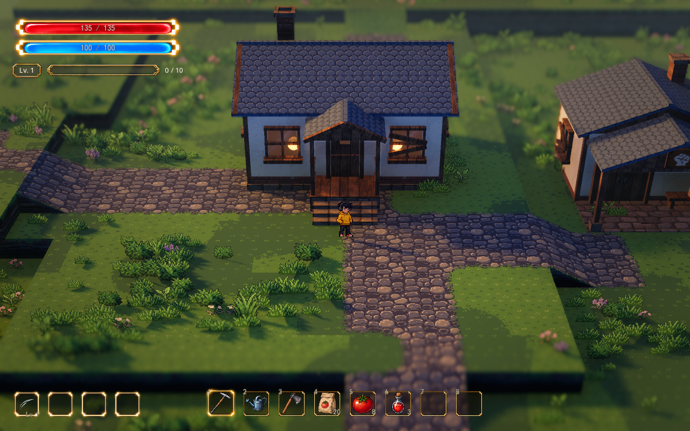

# 边缘衔接、植被层次与独立法线

2026年10月13日 · 正式地图 `demoWithMeowa/1/scenes/world/world.tscn`。

本轮在现有素材上改善衔接和受光。颜色 PNG、色板、道路铺设、地形高度、建筑形状和镜头保持；增加对应的法线数据、路边窄草缘，以及原植被簇内部的大小层次。没有调用 Meowa。

## 实际效果

[同机位调整前](surface-integration-preview/home-before.png) · [台地边缘调整前](surface-integration-preview/edge-before.png) · [台地边缘调整后](surface-integration-preview/edge-after.png) · [战区调整前](surface-integration-preview/battle-before.png) · [战区调整后](surface-integration-preview/battle-after.png)。天气：[细雨](surface-integration-preview/rain-after.png)、[夜晚](surface-integration-preview/night-after.png)。

前后在同一地图进程切换本轮效果，镜头继续使用 FOV 28°、28 米距离、32°俯角、焦点高 0.9 米、深度景深 0.065，画面 1280×800。台地边缘对比使用同一 30°水平朝向；家园和战区对比恢复 0°。环境动画与 NPC 在拍摄间仍会更新。

## 边缘衔接

道路四角过渡图集的透明边界继续决定道路形状。在边界内增加最多 0.125 米的稀疏草缘，沿世界像素固定，原石块和草地颜色继续使用各自色阶。完整道路内部、非草地区域与道路碰撞不变。

台地草沿共享顶面的颜色对比、冷暖调色、五色色阶与世界深浅变化；草沿下方逐渐融入侧壁，接缝受光略向顶面靠拢。草地深浅参数仍由原有独立控制组管理。关闭边缘衔接恢复本轮前的草沿参数、颜色处理和侧边受光。

## 植被层次

已有簇心使用较饱满的草型和尺寸，簇边较低；同簇内增加固定的小幅尺寸变化。区域、落点、数量、随机种子和道路／建筑／坡道排除规则保持，花色分簇与色阶继续沿用上一轮。

缩放作用于实例，保持原素材像素；实例中心高度和风摆根部锚点同步计算，草根仍落在原台地上。地面根部遮蔽半径随实例尺寸变化。战区继续沿用已有较低密度区域配置。

## 法线数据与受光

`assets/surface_normals` 保存 76 张独立法线，覆盖当前草地、卵石、道路过渡图集、墙面、屋瓦、木材、砖石、侧壁、花草，以及人物的待机、跑步、跳跃、闪身素材。法线图和颜色图同尺寸、同透明度，采用 OpenGL Y+；图集每格单独计算，避免相邻格或透明背景制造额外凹凸。

这些数据来自现有颜色纹理的平滑浅高度估计。人物额外利用透明轮廓估计柔和体积，衣物颜色只提供较弱的细节。它是二维素材的受光近似，不能还原真实三维身体或保证每处色斑都对应几何高度。默认幅度较浅，可独立关闭或调整；颜色、色阶与光照风格变化不会重新生成法线。

地表画笔新增 `Normal Texture` 和 `Normal Strength`，可指定与颜色图匹配的法线。留空时读取已准备的对应数据；缺少对应法线则沿用原受光。颜色和法线使用相同的画笔编号、图集选择与透明覆盖规则。法线数组按实际法线尺寸构建，当前自定义地表法线为 64×64，不因其它 1024 像素的颜色画笔而扩大。

人物按当前帧绑定法线，左右翻转同步翻转法线方向；水面代理收到同一帧、同一法线。遮挡轮廓继续独立工作。植物法线在固定世界朝向上补充局部受光，继续使用已有真实灯光、投影、背光、风摆与闪身气流。

## 调节与恢复

| 位置 | 参数与当前值 | 含义 |
| --- | --- | --- |
| VisualSample / 边缘衔接与独立法线 | Edge Blending Enabled：开 | 本轮路边和台地衔接总开关 |
| 同组 | Path Edge Width：0.125 米 | 路边草缘的最大宽度 |
| 同组 | Path Edge Strength：0.4 | 草缘的稀疏覆盖强度 |
| 同组 | Surface Normals Enabled：开 | 地表、侧壁与建筑独立法线 |
| 同组 | Surface Normal Strength：0.8 | 地表与建筑的法线受光起伏 |
| 同组 | Character Normals Enabled：开 | 玩家逐帧法线 |
| 同组 | Character Normal Strength：0.4 | 玩家身体与衣物受光起伏 |
| GroundDressing / 成簇地编 | Layered Growth Strength：0.8 | 簇心与簇边的尺寸、草型差异 |
| 同组 | Scale Variation：0.16 | 同簇内固定的尺寸变化幅度 |
| GroundDressing / 草地光影 | Leaf Normals Enabled：开 | 花草局部法线 |
| 同组 | Leaf Normal Strength：0.55 | 花草局部法线强度 |
| Player / Sprite / 人物逐帧法线 | Normal Texture Override：空 | 可选的对应法线；图集时使用同排列的完整图集 |
| 地表画笔 / 表面 | Normal Texture、Normal Strength | 自定义画笔的对应法线与倍率 |

R／Style 保持以上设置。直接在 GroundDressing 调节植被；需要长期保存为样板默认值时修改 `data/visual/spawn_vegetation_lumina.tres`。关闭 VisualSample 的三个新开关，并将 Layered Growth Strength、Scale Variation 设为 0，关闭 Leaf Normals Enabled，可恢复本轮前的表现。

如更新了颜色素材，运行 `demoWithMeowa/1/tools/build_surface_normals.py` 重新准备法线。脚本需要 Python、NumPy、Pillow；`manifest.json` 保存对应关系、源图哈希、用途与图集布局。原颜色图不会被修改。

## 验证

- 76 张法线通过尺寸、透明度、单位向量、倾斜幅度和源图哈希检查，共 380 项。
- 正式地图原生 GPU 通过 39 项绑定、实例锚点、落点／数量、Style 独立性、恢复、地形与相机检查。
- 人物原生 GPU 通过 36 项检查，覆盖待机、跑步、背向、闪身、图集边界及左右翻转的反射代理；图集与对应单帧 PNG 在整数像素验证视图保持一致。
- 既有 Style 67 项、地表画笔 32 项、区域裁切 6 项与启动视觉 108 项检查通过。启动视觉测试退出时仍有 ObjectDB 清理警告；本轮地图与人物原生渲染验证日志无脚本或着色器错误。

自动验证入口为 `tests/test_surface_details.gd` 与 `tests/test_character_surface_normals.gd`；后者使用原生 GPU。截图额外检查完整四个水平朝向与细雨、夜晚，普通展示保留当前景深。
