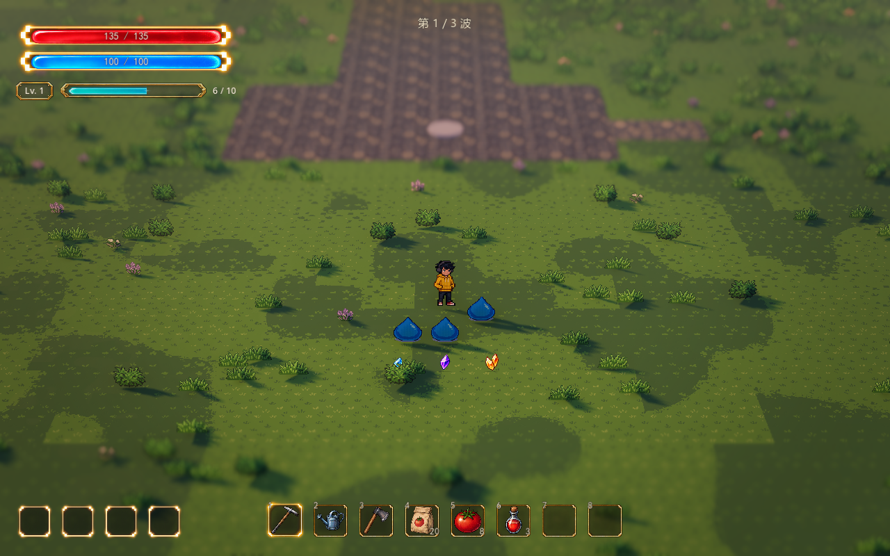
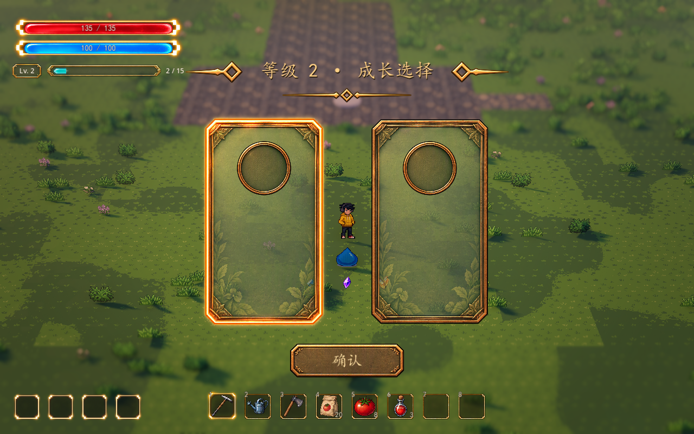

# 经验宝石与经验条接入

2026-10-13。已接入正式地图的现有本局成长框架。升级选择直接复用原有组件，具体技能与成长增益继续留空。本轮使用已准备的 Meowa 资源，没有再次生成美术。

## 当前行为

怪物实际死亡按原 `experience_reward` 掉落经验。宝石默认按单颗节点所含经验分档：小于 10 使用青蓝，10–29 使用紫色，30 及以上使用暖金。阈值只影响外观，不改变掉落经验、等级需求或成长奖励。当前史莱姆默认奖励 3，因此普通掉落主要为青蓝；合并或调整怪物奖励后会使用其它档位。截图中的紫色与暖金由验证脚本生成测试掉落，未改动怪物配置。

宝石轻微漂浮、带落地阴影；进入吸取范围后加速飞向人物，显示五点渐淡短拖尾，收取时闪过小型青蓝微光并轻轻提亮经验条。合并经验会立即刷新外观，场上上限继续保留全部经验值。位置、高差、吸引速度与一次入账沿用原逻辑。

用户随后确认增加参考图中的经验条扫光与宝石发光拖尾：现为五点渐淡尾迹，经验条带周期扫光和呼吸星芒。动态预览与参数见[经验流光](experience-flow.md)。

经验条位于血蓝条下方，显示当前等级和真实经验余量。填充裁切而不压缩图片；连续升级显示当前等级和最终余量，到达可调上限显示 MAX。新挑战、重试及返回家园重置为 1 级与空条，结果阶段暂留本局数值。默认跟随血蓝条的尺寸位置变化和显示状态；管理书页或训练隐藏属性 HUD 时同步隐藏，关闭后恢复。

升级仍立即打开原有空白成长卡，冻结战斗与宝石的漂浮、吸取和尾迹。连续升级逐次确认，中间不恢复战斗；天气、声音和世界原有运行规则保留。短暂的吸收微光是纯视觉反馈，可以自然消退，不产生额外伤害或经验。

## 组件与参数入口

正式地图中选择 `WavePrototype/RunGrowth/ExperienceHUD` 调经验 UI；选择 `WavePrototype/RunGrowth` 调吸取与微光；打开 `scenes/growth/experience_pickup.tscn` 的根节点调宝石纹理、尺寸与分档。正式地图已通过共享 `wave_prototype.tscn` 接入，无须在每张地图手工复制 HUD。

编辑器“参数总览”已索引新的 UI 参数；宝石场景打开后，其分档和漂浮参数归入“战斗与成长”。各档纹理可独立替换，原图像素和透明边缘保持不变。

2026-10-13 调参报错修复：旧的已打开经验条实例可能尚未绑定新增的填充流光材质，刷新时曾在 `experience_hud.gd:164` 调用空对象。现在参数刷新会为无材质、非着色材质或缺少 Shader 的 Fill 自动建立独立流光材质；已有有效材质沿用，不逐帧新建。流光关闭、辉光与透明度设为 0 的值照常保留，经验和等级不受影响。

| 位置 / 参数 | 默认 | 含义 |
| --- | ---: | --- |
| ExperienceHUD / Follow Attributes | true | 自动放在血蓝条下方；关闭后使用独立屏幕位置 |
| Track Width | 240 | 经验槽逻辑宽度，不含等级底片和数值 |
| Badge Width | 64 | 等级底片逻辑宽度 |
| Attribute Gap | 6 | 与血蓝条下缘间隔，逻辑像素 |
| Item Gap | 8 | 底片、经验槽和数值之间的间隔 |
| Screen Margin | (24, 132) | 不跟随属性条时的左上位置 |
| Fill Region | (0.055, 0.2, 0.89, 0.6) | 经验槽内填充区域比例，可微调素材内边距 |
| Background Opacity | 0.5 | 内部暗槽透明度，边框保持独立 |
| Glow Strength | 0.7 | 边框辉光强度 |
| Fill Brightness | 0.9 | 青绿填充亮度 |
| Show Values / Font Size | true / 14 | 是否显示经验分数与字号；等级标记保留 |
| Feedback Duration / Strength | 0.18 秒 / 0.2 | 拾取时经验条的短暂提亮；强度 0 关闭 |
| ExperiencePickup / Medium Threshold | 10 | 紫色宝石外观起始经验 |
| Large Threshold | 30 | 暖金外观起始经验，建议不小于紫色阈值 |
| Gem Height | 0.32 米 | 青蓝宝石高度；紫色／暖金逐档放大 15% |
| Float Height | 0.06 米 | 晶体离地的额外高度 |
| Bob Amplitude / Speed | 0.025 米 / 1 | 漂浮幅度与每秒周期数；幅度 0 关闭 |
| Shadow Width / Opacity | 0.36 米 / 0.6 | 阴影尺寸与透明度倍率；吸引后隐藏 |
| Trail Opacity | 0.7 | 吸引时五点流光的不透明度；0 关闭；长度等新参数见经验流光说明 |
| RunGrowth / Absorb Duration | 0.16 秒 | 收取微光持续时间；0 关闭 |
| Absorb Size / Opacity | 0.24 米 / 0.65 | 收取微光尺寸和不透明度 |

以上数值为可调接入基线，不是正式平衡。经验需求、怪物奖励与吸取范围的原参数见[本局成长](../gameplay/run-growth.md)。UI 不占用新的游戏快捷键。

## 验证

- 新增 `test_experience_visuals.gd`：30 项，真实状态绑定、分档与合并、收取反馈、升级余量、冻结、菜单隐藏、布局调整、满级、重试、重新绑定与大数值显示。
- `test_experience_flow.gd`：22 项，包含缺失流光材质的实时恢复、非 Shader 材质、空 Shader、资源隔离、有效材质复用及 0／false 值保留。
- 经验状态 20 项、成长协调 24 项、成长与真实波次集成 25 项、现有升级 UI 36 项全部通过，共 135 项成长／UI检查。
- 当前波次刷新测试 66 项通过；参数总览完整索引，未重复维护数值。
- 原生 D3D12 / Forward+ 验证真实敌人死亡与入账、三档宝石、原有选择、冻结及重试。截图使用当前开发镜头：28 米、32°、FOV 28°、景深 0.065、16:10。
- 原有成长卡及选择界面的两个脚本和两个场景文件 SHA-256 与接入前一致。

实现为 `scripts/ui/experience_hud.gd`、`scenes/ui/experience_hud.tscn`，以及原有 `ExperiencePickup` / `RunGrowth` 的视觉绑定。玩法仍由同一份 `RunGrowthState` 管理，未把经验写入装备存档。
