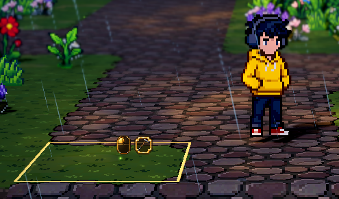

# 种植像素交互提示

正式地图已接入纯图标提示。沿用训练提示的小巧布局：鼠标图示、当前工具的小框，以及播种和浇水角标。默认约 61×32 个逻辑像素，出现在人物身边的目标地块旁。提示不显示文字、不添加底部面板，种子数量继续由现有物品快捷栏显示。

## 图标含义

| 图示 | 含义 |
|---|---|
| 鼠标左键亮起＋锄头／种子／水壶 | 使用当前快捷栏物品执行锄地、播种或浇水 |
| 鼠标右键亮起＋锄头 | 这格已开垦，可以恢复草地；退还种子遵循现有 `refund_seed_on_restore` 配置 |
| 右上嫩芽角标 | 地块已播种，表示存档状态，不表示进入生长阶段 |
| 右下蓝色水滴 | 地块已浇水 |
| 图标变淡＋红叉 | 当前操作不满足条件，点击不会扣除种子 |
| 短暂绿色勾／红叉 | 操作成功／被拒绝，随后淡出 |

超出人物操作距离或不同台地的目标不显示交互图示。打开背包、训练窗口或暂停游戏时隐藏提示。所有图示均不拦截鼠标，操作继续由既有种植系统处理。

## 调整参数

打开 `demoWithMeowa/1/scenes/rpg/farming.tscn`，选择子节点 `FarmingUI`。正式地图复用该组件；也可在正式地图的同名子节点设置实例覆盖。以下参数在运行时调节立即生效。

| 参数 | 默认值 | 调整效果 |
|---|---|---|
| `enabled` | 开 | 提示开关，关闭后仍能进行种植操作 |
| `ui_scale` | 1.0 | 图示整体大小；范围 0.75～1.5 |
| `icon_size` | 32 | 工具框大小；鼠标图示按比例变化 |
| `badge_size` | 12 | 嫩芽、水滴和禁用角标大小 |
| `icon_gap` | 4 | 鼠标图示与工具框之间的间距 |
| `screen_offset` | `(12, -44)` | 相对地块屏幕投影的位置；X 向右，Y 向下 |
| `frame_opacity` | 0.65 | 工具小框暗底透明度；不改变亮边 |
| `feedback_duration` | 0.7 秒 | 成功或失败图示的显示时间 |
| `fade_duration` | 0.10 秒 | 提示和反馈的淡入淡出时间；0 为立即切换 |
| `feedback_lift` | 8 | 反馈淡出过程中向上移动的逻辑像素 |
| `feedback_size` | 18 | 成功或失败图示大小 |

鼠标图示、工具框、状态角标和成功／失败图标均可独立替换；素材位于 `assets/meowa/ui/farming/`，来自 Meowa 生成后拆分的像素组件。当前工具图标直接使用背包目录中的对应物品资源。像素组件采用最近邻采样。

## 接入与验证

`scripts/ui/farming_ui.gd` 负责图示、布局和短反馈，`scenes/ui/farming_ui.tscn` 配置素材。`Farming.get_interaction_state()` 提供实时目标和校验结果，`interaction_feedback` 信号提供操作结果。地块、库存和存档继续由既有 `Farming` 与 `LoadoutState` 管理。

种植模型的 45 项检查通过。正式地图渲染验证覆盖输入事件触发的锄地、播种、浇水、恢复草地、种子数量同步、两种状态角标、成功／拒绝图示、菜单隐藏、远距离隐藏、640×400 小窗口和图标放大。提示控件树没有文字标签，所有控件均不拦截鼠标。截图沿用当前开发相机与景深基准。

[查看完整实景](../media/farming-ui-preview/hoe.png)
