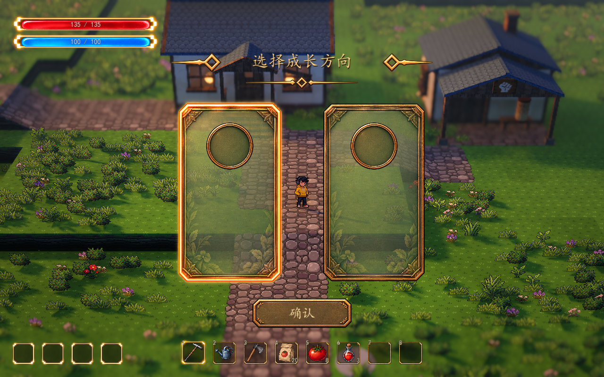
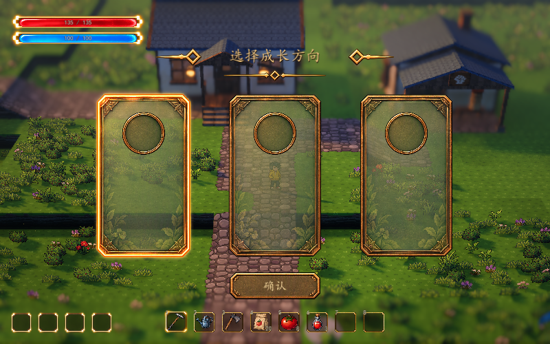

# 成长选择 UI 预组装

基于已确认的参考及 Meowa 素材，提供翻牌、选择、确认和重抽界面。正式玩法的初始技能与升级均为池子抽 3 张选 1 张，抽取与共用重抽预算由成长组件维护；UI 展示调用方提供的本轮卡片。独立双空卡预览保留作组件验证。



## 查看与组件结构

在 Godot 打开 `demoWithMeowa/1/scenes/previews/growth_choice_preview.tscn`，按 F6 运行当前场景。鼠标点击卡片后点击“确认”，也可用方向键切换、Enter 或空格确认、Esc 取消。关闭后重新运行当前场景即可重看，不新增游戏内 F 类调试快捷键。确认结果只输出预览选项 ID，不获得技能或改变人物数值。

预览实例化现有 `scenes/world/world.tscn`，复用世界相机、跟随和景深，不复制地图或改变项目启动场景；背包存档写入在该预览中关闭。此次实机镜头遵循当前 Lumina 开发配置：距离 28 米、俯角 32°、FOV 28°、深度景深强度 0.065。

| 组件 | 路径 | 用途 |
| --- | --- | --- |
| 单张可复用卡片 | `scenes/ui/growth_choice_card.tscn` | 独立边框纹理、圆形槽、图标、标题和描述节点 |
| 整套选择界面 | `scenes/ui/growth_choice_ui.tscn` | 标题装饰、候选卡片、确认按钮与已有 UI 音效 |
| 选项数据 | `scripts/ui/growth_choice_option.gd` | Resource：稳定 ID、标题、描述、图标、是否可选 |
| 独立实机预览 | `scenes/previews/growth_choice_preview.tscn` | 默认展示两个空白卡片，方便调整美术与交互 |

所有标题、按钮文字和选项内容均由控件显示，没有烘焙到图片。预览不包含技能名字、详情、等级或增益数值。卡片按数据动态实例化，新增选项不需要复制整套面板。卡片的边框、底纹和叶片仍来自同一张 Meowa 纹理，内页透明度通过着色器单独调节；圆形图标槽是独立节点。

## 后续接入接口

将 `growth_choice_ui.tscn` 实例化到需要显示选择界面的场景中；组件默认隐藏。用 `Array[GrowthChoiceOption]` 传入本次候选，通过 `choice_confirmed` 接收选中的稳定标识。

```gdscript
var choice := GrowthChoiceOption.new()
choice.id = &"candidate_a"
# title、description、icon 可以暂时留空。
var choices: Array[GrowthChoiceOption] = [choice]

growth_ui.choice_confirmed.connect(_on_choice_confirmed)
growth_ui.present_choices(choices)
```

`_on_choice_confirmed(option_id: StringName)` 由后续成长系统实现，用于验证候选并实际应用效果。UI 只负责展示与回传，不决定获得时机、抽取规则、技能效果、等级或波次推进。连接信号应在初始化时完成一次，不在每次弹出时重复连接。

| 接口 | 行为 |
| --- | --- |
| `present_choices(options) -> bool` | 翻开本轮卡片，不预选奖励；全部禁用、空列表、空 ID、重复 ID 或其它面板占用输入时返回 false |
| `select_option(option_id) -> bool` | 选中已展示且可用的候选 |
| `get_selected_option()` | 返回当前选项资源，关闭后返回 null |
| `confirm_selection()` | 关闭界面、释放输入占用，再发出 `choice_confirmed(option_id)`；重复调用不重复确认 |
| `cancel()` | 允许取消时关闭并发出 `cancelled`，不发出选择结果 |
| `close()` | 调用方直接关闭，不发出确认或取消结果 |
| `selection_changed(option_id)` | 用户切换候选时发出，便于后续预览或联动 |
| `set_draw_status(remaining, available)` | 显示共用剩余重抽次数与可替换状态；不足池或次数耗尽时禁用 |
| `reroll_requested` | 请求调用方替换本轮卡片，UI 自身不消费次数或授予奖励 |
| `reveal_now()` | 提前结束翻牌，仍保持无选中状态 |

候选生成与效果应用留给正式成长系统。同一轮展示期间不要直接修改候选资源；需要刷新候选时再次调用 `present_choices`。不合法的替换请求保留当前待选内容。若调用方要求必须完成选择，将 `allow_cancel` 设为 false；不据此确定正式玩法中的取消规则。

打开时使用项目已有 `gameplay_input_blockers` 占用人物移动、跳跃与镜头按键，不修改全局暂停状态。天气、环境动画、物理、BGM 和雨风声继续运行；其它系统已设置的暂停也保持原状。背包入口补充了输入占用检查，避免 Tab 或程序调用在选择面板后面打开背包。正式地图的 `WavePrototype/RunGrowth` 在经验升级时调用，协调器只冻结战斗；已接入武器等级及伤害、冷却、范围增益，见 [本局成长](../gameplay/run-growth.md) 和 [本局战斗增益](../gameplay/combat-buffs.md)。

## 可调参数

选中 `growth_choice_ui.tscn` 的根节点 `GrowthChoiceUI`。布局与视觉参数可在编辑器或运行时远程检查器调整；打开场景即可预览空白卡片。`Preview Options` 仅供编辑器，运行时通过接口传入真实候选。

| 参数 | 默认值 | 含义 |
| --- | ---: | --- |
| Card Width | 280 | 卡片逻辑宽度，高度按素材比例计算，避免拉长叶片与金属框 |
| Card Gap | 64 | 相邻卡片间距 |
| Screen Margin | `(24, 24)` | 窄窗口适配时预留的最小边距 |
| Center Offset | `(0, 0)` | 整套界面相对屏幕中心的偏移，仍限制在安全区域内 |
| Button Width | 244 | 确认按钮宽度，高度按素材比例计算 |
| Background Opacity | 0.86 | 原美术叠在暗色内页上，减少地面纹理干扰；边框和光边保持 |
| Selection Strength | 1.0 | 普通与选中纹理的混合强度；悬浮时使用较轻的高亮 |
| World Dim Opacity | 0.0 | 整屏暗化程度，默认直接显示游戏世界 |
| Title / Confirm Text | 选择成长方向 / 确认 | 动态标题和按钮文字 |
| Title Font Size | 40 | 界面上方标题字号 |
| Content Font Size | 20 | 后续候选描述字号，卡片标题在此基础上增加 4 |
| Card Text Color | 暖白 | 实际候选标题与描述颜色，配轻阴影提高透明卡面上的可读性 |
| Confirm Font Size | 32 | 确认按钮独立字号 |
| Allow Cancel | true | 是否接受 Esc 取消，由正式调用方决定 |
| Open Duration | 0.18 秒 | 渐显与每张翻开时长，卡片依次错开 0.05 秒；0 立即显示 |
| Hover Duration | 0.12 秒 | 悬浮和选中高亮的过渡时长，0 立即切换 |

`UIAudio` 子节点沿用既有 Meowa UI 音效，可独立调整声音开关、总增益与声音资源。确认音不会改变 BGM 和环境声的播放逻辑。

## 验证

`tests/test_growth_choice_ui.gd`：36 项通过，覆盖动态等级标题不截断、候选校验、可用项选择、真实鼠标输入、键盘切换、重复确认、取消规则、面板输入互斥、世界持续运行、外部暂停保持和组件移除后释放输入。既有 `tests/test_ui_live_world.gd`：31 项通过。该既有测试在 headless 退出时仍有原来的音频资源清理警告；本次新增测试及原生 Forward+ 预览退出正常。

原生 Forward+ 已验证正式初始技能与升级的 1280×800 三卡片，以及 800×500 窄窗口；使用实际主场景相机。鼠标与数字键／方向键选卡，Enter 确认，R 重抽；翻牌阶段点击或确认键只提前揭晓，防止跳跃按键误领奖励。每轮清除选择，连续升级不因重复确认自动领取第一张。


