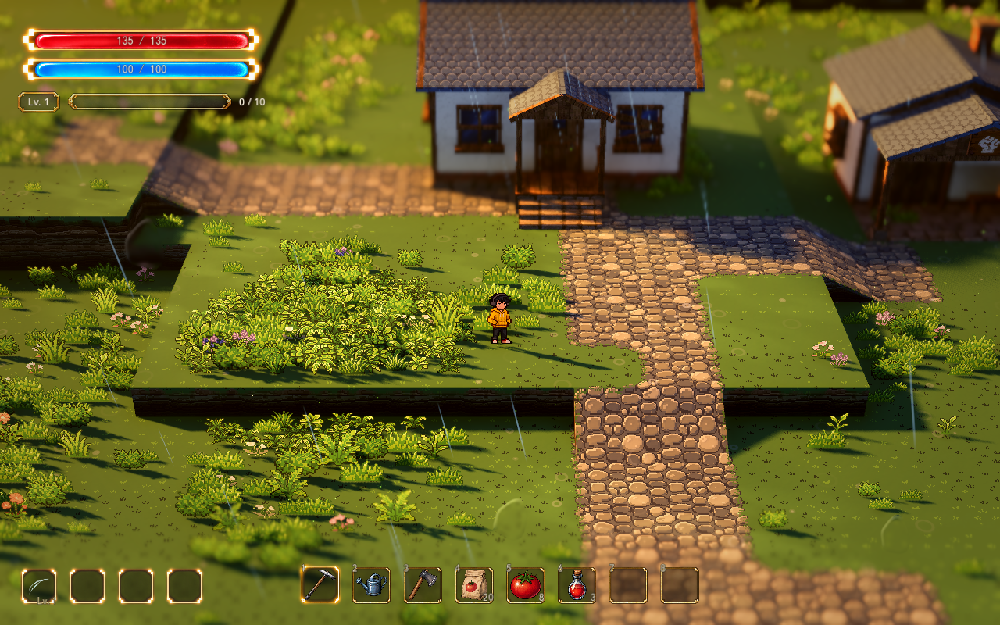
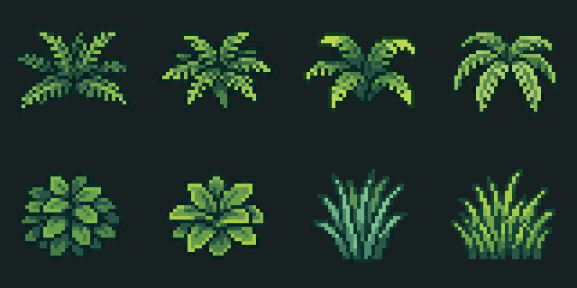
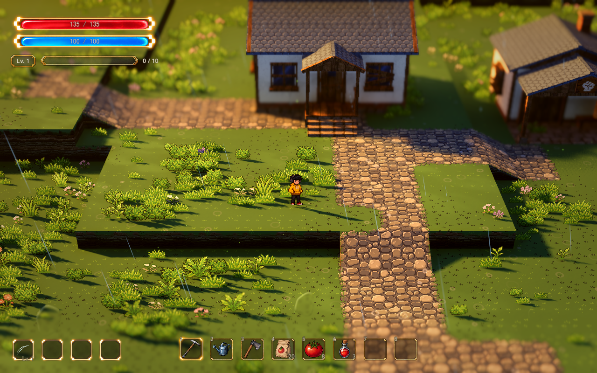
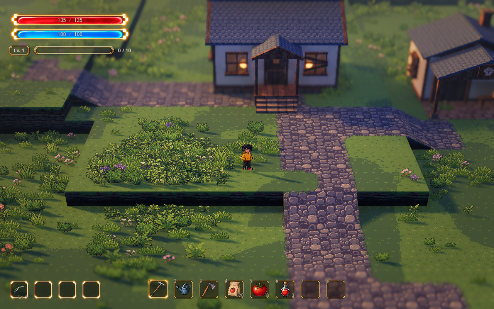
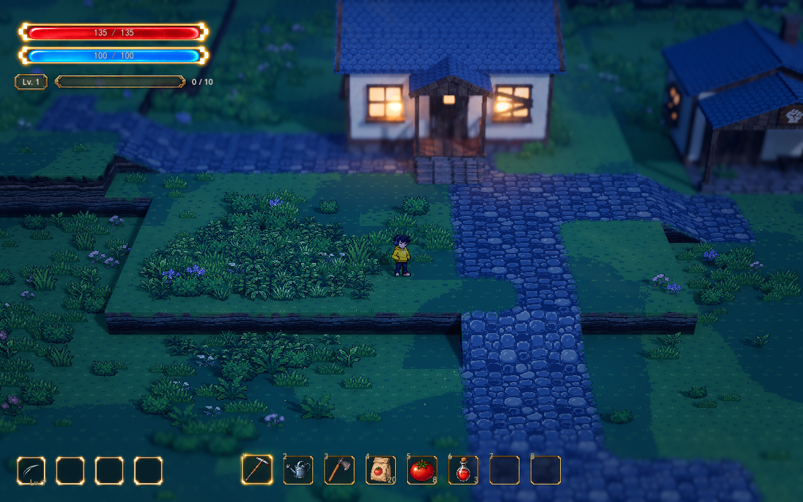

# 小院浓绿林缘样板

用户已确认使用「低蕨草、阔叶植被、长草，少量野花」，先在小院铺一片，审阅后再讨论扩展。当前正式地图的小院左侧接入 8 种新 Meowa 植物，原有草甸作为底层，浓绿叶丛形成连续块面，边缘逐渐降低，保留道路、入口和坡道的通行轮廓。

## 素材与层次

新素材采用用户选择的 Meowa「精致像素简约植物」模板：4 种蕨草、2 种阔叶、2 种长草。文件位于 `demoWithMeowa/1/assets/meowa/dressing/forest/`，按植物单独保存，`assets.json` 记录尺寸、落地锚点、资源 ID 和原图哈希。

模板目录标注 64×64，实际返回的 8 张图均为 **32×32 透明 PNG**。本轮保留实际返回的原生像素，没有放大、补画或重新像素化。基础像素尺度沿用人物的 `0.0234375 米/像素`，显示尺寸再乘草层和区域倍率；可见株高约半米，当前属于低矮地编。最近邻采样、无损导入、关闭 mipmap。

四种蕨草负责横向铺底，阔叶补充饱满块面，长草偏向簇心。边缘优先低草并缩小实例，簇心的长草和阔叶比例提高。少量野花复用既有白、粉、紫矮花，沿用已有同色成簇规则。

样板位于 `GroundDressing/CourtyardForestSample`，中心 `(-9.6, 0.8, 5.6)`，区域包围框约 6.4×6.4 米，实际附加植物在框内椭圆铺设。当前可用空间与 0.34 米最小间距下，生成 **97 丛附加植物**；修改范围、密度、间距、种子或地表绘制会改变数量。植物根部读取真实台地高度，落点和周围 0.4 米优先保留草地，叶片避开道路、坡道和边缘。

## 调节与恢复

打开 `scenes/world/world.tscn`，选择 `GroundDressing/CourtyardForestSample`。它是 `scenes/world/courtyard_foliage.tscn` 的实例，也已进入参数总览的「地图与地编」。

| 参数 | 当前值 | 含义 |
| --- | --- | --- |
| `Enabled` | 开 | 整片样板开关；关闭准确恢复原有花草分布 |
| `Area Size` | 6.4×6.4 米 | 区域包围框；附加植被在内部椭圆铺设 |
| `Extra Density` | 3.2 | 每平方米可铺表面的目标附加数量；受间距与避让限制，0 只关闭新植物 |
| `Extra Scale` | 1 | 新植物世界尺寸倍率，再乘 `GroundDressing` 的草层倍率；不改 PNG |
| `Extra Asset Manifest` | `forest/assets.json` | 本区域使用的附加素材目录 |
| `Extra Asset Ids` | 空 | 空为全八种；填写 `grass_07`～`grass_14` 可选择具体植物 |
| `Categories` | 花 | 原六种素材的类别；新植物由附加密度控制 |
| `Density Multiplier` | 0.3 | 只控制本区域原素材的密度，此处用于少量野花 |
| `Flower Variants` | 白、粉、紫 | 与父节点允许的矮花取交集 |

父节点 `GroundDressing` 的草层尺寸、叶片法线、根部遮蔽、色阶、投影和随机种子继续生效。新增植物共享当前绿色叶片五色色阶，独立法线是由原图推导的近似受光数据，按原图尺寸另存，没有重画颜色素材。每株按自己的透明边界设置落地锚点和风摆网格行。

新植物自动接入 Weather 自然风、闪身气流、EnvironmentDynamics 时段／家园风力，以及种植隐藏遮罩。R 切四种 Style 只改变光影和天气，保留样板分布和独立调节；镜头继续使用正式地图实际配置：28 米、32°、FOV 28°、深度景深 0.065。全地图雨量及地面雨纹沿用当前设置。

## 同机位与旋转检查

前后对照只开关这片样板，使用同一人物位置、镜头与光影。原始光影图保留当前场景开启的细雨。

| 原样板 | 新增林缘 |
| --- | --- |
|  |  |

| 黄金时段 | 夜晚 |
| --- | --- |
|  |  |

[细雨实机](../media/courtyard-foliage-preview/rain-after.png)、[侧向镜头](../media/courtyard-foliage-preview/original-side.png)、[背向镜头](../media/courtyard-foliage-preview/original-back.png)。

## 验证

`tests/test_courtyard_foliage.gd` 检查原有植物的落点／尺寸／变种及相对顺序、固定随机分布、八种资源实际生成、根部贴地、道路避让、簇心与簇边尺寸差、GPU 根部锚点、原生像素与法线绑定、天气与区域动态、四种 Style 保留、地形／镜头／存档保持、种植遮罩、资源筛选、关闭恢复和参数总览。

原生 D3D12 / Forward+ 45 项通过；区域几何 6 项、既有受光 39 项、种植 45 项、Style 83 项与参数总览回归通过。Style 回归用独立副本明确从黄金时段开始，以符合原测试的切换顺序，正式地图继续使用用户当前的 Style 0。实机检查覆盖原始增强、黄金、细雨、夜晚及 90°／180° 朝向，无解析、Shader 或运行错误。素材与测试副本、截图和日志位于 `D:\.codexfile\work\courtyard-forest-sample`。

既有受光测试和末次截图进程退出时出现 6 个 ObjectDB 实例的清理警告；新样板测试退出正常。这项警告单独保留在日志中，尚未在本轮排查。
