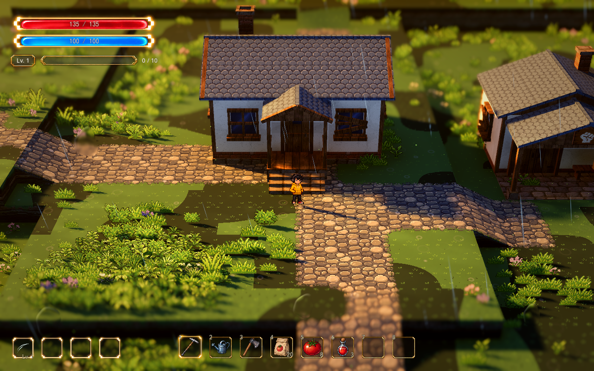

# 雾与后处理细调

2026-10-13，正式地图 `demoWithMeowa/1/scenes/world/world.tscn`。当前默认增强后的原始光影；三种 Lumina Style 分别配置。此次只调既有雾、泛光、分离色调、暗部提亮和暗角，不增加美术或改变镜头、主光及地图布局。

## 观察与原理

雾会把远处颜色混向雾色，体积雾还会在整个观察范围内累积散射。两者过强时，阴影与亮面的距离变小，屋檐和草丛暗面显得偏灰。本次减薄体积雾、后移距离雾起点，让人物附近的明暗保留，远处再逐渐融入空气。原始 Style 以前没有距离雾，现在增加少量远雾，配合减薄后的体积雾维持远处层次。

当前使用 Godot 的深度雾模式。距离雾先对相机距离作起点／终点的 `smoothstep`，再取曲线指数并乘浓度；曲线从 1 改为 1.25，让起雾后的前半段更轻。它影响空气透视，不改变相机远裁切、景深或地形。实现依据见 [Godot Forward+ 源码](https://github.com/godotengine/godot/blob/4.7/servers/rendering/renderer_rd/shaders/forward_clustered/scene_forward_clustered.glsl#L1057)。

后处理原有 Lumina 暗部提亮会额外增加阴影亮度；分离色调也会叠加冷暖偏色。本次降低三种 Lumina 的暗部叠加值和分离色调强度，让材质与真实补光承担更多颜色关系。原始 Style 继续关闭 Lumina 暗部提亮，保留已确认的分离色调。

泛光保留在高亮灯光上，阈值以下参与泛光的强度从 0.04 改为 0，减少普通表面的整体泛白；原始与黄金泛光稍减，夜晚保留原强度。Godot 的 `glow_bloom` 大于 0 时允许低于 HDR 阈值的区域发光，见 [Environment 文档](https://docs.godotengine.org/en/stable/classes/class_environment.html#class-environment-property-glow-bloom)。暗角减轻并移向画面边缘，避免进一步压暗外围路线；景深保持。

此次是克制的细调。四种 Style 的主光、补光、曝光、全局对比和饱和度保持最新配置，不把雾与后处理当作整体重新打光。

## 检查器与恢复

选择 `VisualSample → 雾与后处理样板`：

- `Fog Post Enabled` 默认开启。关闭只恢复本次之前的雾与后处理，原始光影增强、明暗色板及其他独立开关继续生效。
- `Fog Post Presets` 按原始、黄金、细雨、夜晚排列，分别引用 `data/visual/spawn_atmosphere_original.tres`、`spawn_atmosphere_day.tres`、`spawn_atmosphere_rain.tres`、`spawn_atmosphere_night.tres`。
- 长期微调资源中 `Node Values → MapEffects/ArtDirection` 的值，再点击「应用雾与后处理」。R 切 Style 使用各自配置，并保留样板开关。

临时试看直接调 `MapEffects/ArtDirection → 雾 / 后处理 / 整体`。R 或应用 Style 会重设预设控制的值。参数总览可搜索「体积雾密度」「距离雾增长曲线」「泛光 HDR 阈值」「Lumina 暗部提亮」「暗角」。低处雾步进为 0.001，体积雾步进为 0.0001，便于细调。

| 参数 | 原始 | 黄金 | 细雨 | 夜晚 |
| --- | --- | --- | --- | --- |
| 距离雾起点／终点（相机距离，米） | 32／95 | 32／90 | 30／85 | 32／90 |
| 远处距离雾浓度 | 0.12 | 0.24 | 0.32 | 0.24 |
| 低处雾密度 | 0.020 | 0.006 | 0.010 | 0.006 |
| 体积雾密度 | 0.0025 | 0.0009 | 0.0014 | 0.0011 |
| 泛光强度 | 0.14 | 0.18 | 0.20 | 0.22 |
| 泛光 HDR 阈值 | 1.10 | 1.10 | 1.00 | 1.10 |
| 分离色调 | 0.35 | 0.28 | 0.24 | 0.22 |
| 暗角强度 | 0.16 | 0.16 | 0.18 | 0.18 |
| Lumina 暗部叠加 RGB | 不启用 | 0.006／0.010／0.018 | 0.008／0.012／0.020 | 0.009／0.015／0.026 |

四种 Style 的距离雾曲线均为 1.25、低亮度泛光强度均为 0、暗角清晰区半径均为 0.95。雾色、体积雾长度与天空影响沿用各 Style 原配置；灯体、窗光和局部光斑不改。

原始 Style 默认主光仍为 2.85、环境补光 0.85、曝光 1.08；黄金／细雨／夜晚的明暗层次样板主光仍为 1.95／0.70／0.80。历史 Style、原始增强和明暗层次资源没有改写。新增控制关闭时恢复旧曲线、阈值、低亮度泛光、暗角范围和暗部提亮，避免跨 Style 留下前一种设置。

## 同机位实机

D3D12 / Forward+，RTX 3050，原生 1280×800。使用当前正式地图镜头：透视 FOV 28°、距离 28 米、俯角 32°、水平朝向 0°、焦点高度 0.9 米、深度景深 0.065、近／远清晰余量 3／4 米、过渡 2.5／6 米。每组人物和相机 Transform、主光、补光与曝光均相同，仅切本次样板。雨丝、风摆、光点和雨纹自然推进；截图原样保存。

原始光影，小院：

其他 Style 的同机位对照：

| Style | 小院 | 战区 |
| --- | --- | --- |
| 原始 | [调整前](../media/fog-post-preview/home-original-before.png) · [调整后](../media/fog-post-preview/home-original-after.png) | [调整前](../media/fog-post-preview/battle-original-before.png) · [调整后](../media/fog-post-preview/battle-original-after.png) |
| 黄金 | [调整前](../media/fog-post-preview/home-day-before.png) · [调整后](../media/fog-post-preview/home-day-after.png) | [调整前](../media/fog-post-preview/battle-day-before.png) · [调整后](../media/fog-post-preview/battle-day-after.png) |
| 细雨 | [调整前](../media/fog-post-preview/home-rain-before.png) · [调整后](../media/fog-post-preview/home-rain-after.png) | [调整前](../media/fog-post-preview/battle-rain-before.png) · [调整后](../media/fog-post-preview/battle-rain-after.png) |
| 夜晚 | [调整前](../media/fog-post-preview/home-night-before.png) · [调整后](../media/fog-post-preview/home-night-after.png) | [调整前](../media/fog-post-preview/battle-night-before.png) · [调整后](../media/fog-post-preview/battle-night-after.png) |

图中原始光影的大片深色是既有草地深浅变化经过五档色板后的边界。已分别关闭主光投影、植被投影、局部光和草地斑块隔离确认；用户明确本轮只处理雾和后处理，因此保留现有斑块强度 0.19、尺寸 3 米及算法，不把它作为投影故障修复。减薄雾后这些边界会更显眼。

## 验证

- 新增 `test_fog_post_sample.gd`，原生 D3D12 108 项通过：四种 Style 的真实 Environment／屏幕材质绑定、完整关闭恢复、独立光照层、检查器细调、参数索引，以及自定义镜头、景深、地图、碰撞、花草分布、法线、雨纹、雨量、声音、库存和战斗状态保持。
- 原生基础 Style 回归 459 项通过。该测试关闭本次雾／后处理、原始增强及明暗层次，单独验证历史基础行为。
- 原始光影增强原生回归 92 项通过，保留实际主光、阴影轴线与独立配置的恢复。
- Style 切换 83 项、草地启动 108 项、明暗层次 53 项、主光引用 86 项通过；参数总览索引 1,732 项，无失败。
- 四种 Style × 小院／战区 × 前后，共 16 张原生实机截图。八组相机、人物、主光、补光和曝光一致；截图与新增测试日志没有解析、Shader 或运行错误。

草地启动测试在 headless 退出时报告 6 个 ObjectDB 释放警告，其断言通过；本次新增原生测试和截图进程正常退出，无此警告。这轮没有声称验证所有驱动或密集战斗的性能。

副本、隔离脚本、原生截图与日志位于 `D:\.codexfile\work\fog-post-sample-20261013`。所有测试禁用用户存档写入；没有新增 F 类按键、改动美术 PNG、法线算法、地形、游戏规则或音频配置。
