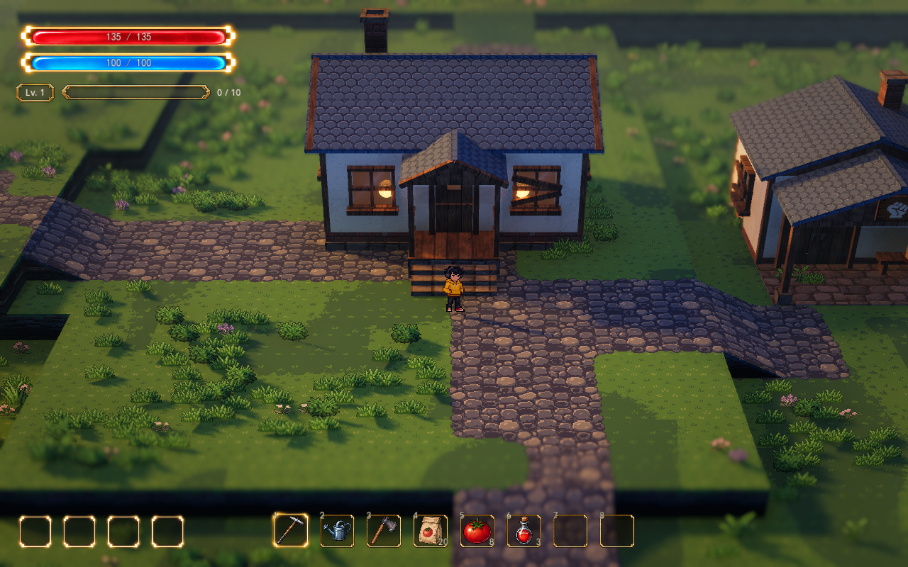

# 草地与花草视觉样板

2026年10月13日 · 正式连续地图 `demoWithMeowa/1/scenes/world/world.tscn`。

草地底纹降低局部色差，花草使用有限色阶和更集中的花色斑块。叶片保留绿色主体、冷暗部和柔和亮部，枯草另用一条色阶；六类花朵保留各自颜色。减少散点与密集亮边，让家园的花草形成观看重点，战区保持清楚的走位空间。

本轮复用现有 Meowa 草花精灵与草地原图，通过材质和铺设参数调整。原图、透明轮廓、像素尺度及落地锚点保留，未生成或重新像素化素材。

随后已在原落点上增加簇心／簇边大小和草型层次，并接入独立花草法线；当前追加参数与最新实机图见[边缘、植被与受光](surface-integration.md)。下方对比图保留上一轮色阶和密度样板记录。

## 实机对比

[同机位调整前](../media/foliage-preview/home-before.png) · [入口调整前](../media/foliage-preview/entry-before.png) · [入口调整后](../media/foliage-preview/entry-after.png) · [战区调整前](../media/foliage-preview/battle-before.png) · [战区调整后](../media/foliage-preview/battle-after.png)。天气：[细雨](../media/foliage-preview/rain-after.png)、[夜晚](../media/foliage-preview/night-after.png)。

前后使用相同人物位置和镜头：28 米、32°俯角、FOV 28°、焦点高 0.9 米、深度景深 0.065、1280×800。建筑、台地、道路、光影与镜头保持；花草分布按新参数重新生成。

## 色阶与细节

草地仍使用原有五色色板，新增选档前的局部对比控制。以原图的平均线性颜色为中心收敛色差，再进行冷暖调整与五色选档；顶面和草沿均采用此规则。凹凸始终从原图中心和相邻像素计算，降低颜色对比不会产生新凸起或抹掉原有受光。

花草色板为 `data/visual/spawn_foliage_palette.tres`。叶片、枯草、白／粉／紫／黄／蓝／红花瓣各有五个候选底色。所有绿色叶片与极暗轮廓共用叶色，花瓣按已有资源所属颜色选档。草精灵使用五色；一株带绿叶的花可同时使用叶色与对应花瓣色，最多十个材质底色。真实灯光、根部遮蔽和后处理继续作用，最终画面颜色不限于这些候选色。

花草的原透明轮廓与原图内部结构保持。局部对比默认 0.76，用于减弱碎亮点和内部暗线；受光法线继续读取原色。风摆、闪身气流、固定投影和种植隐藏遮罩沿用已有连接。

## 成簇与密度

本轮保持已有区域、随机种子、道路／建筑／坡道排除规则和战区密度倍率。斑块扩大到 5.6 米，成簇强度为 1；花更集中于簇心，同一小块区域优先使用一种主花色，仍允许少量其它花色。

整张地图的生成总量从 5607 丛草、823 簇花，变为 3739 丛草、485 簇花，约减少 33% 和 41%。这些是当前区域配置下的总量，不是单张截图中的可见数量；石子仍为 0。

## 调节与恢复

重新运行正式地图，或在检查器点击 **应用草地与花草样板**。`VisualSample → 草地与花草样板` 的 `Vegetation Sample Enabled` 默认开启，关闭会恢复加载时的草花密度、分布、颜色与草底对比；重新开启应用样板资源。R 切 Style 保留这组选择、当前镜头和分布。草地深浅斑块按最新确认的方向独立于样板和光影，在所有 Style 中保留，开关、强度与大小另行调节。

| 位置与参数 | 本轮值 | 含义 |
| --- | ---: | --- |
| VisualSample / Pixel Grass Contrast | 0.70 | 草地选档前的对比，1 为原细节；越低越安静 |
| VisualSample / Grass Variation Enabled / Strength / Size | true／0.16／2.63 米 | 固定草色斑块的独立开关、明暗幅度和尺度；所有 Style 保留 |
| GroundDressing / Grass Density | 2.0 | 每平方米目标草丛数，原值 3.0，继续乘区域倍率 |
| GroundDressing / Flower Density | 0.26 | 每平方米目标花簇数，原值 0.44 |
| GroundDressing / Cluster Size | 5.6 米 | 固定世界斑块尺度，原值 4.8 米 |
| GroundDressing / Cluster Strength | 1.0 | 疏密集中程度，原值 0.85 |
| GroundDressing / Flower Patch Threshold | 0.65 | 花进入簇心的阈值，原值 0.60 |
| GroundDressing / Flower Color Grouping | 0.82 | 同块主花色的倾向，0 恢复随机混色 |
| GroundDressing / Minimum Spacing | 0.34 米 | 落点最小间距，原值 0.28 米 |
| GroundDressing / Color Ramps Enabled | true | 开关花草有限色阶；关闭恢复原颜色，不改变位置 |
| GroundDressing / Color Palette | 八条色阶 | 修改每类的五个颜色，即时更新材质 |
| GroundDressing / Detail Contrast | 0.76 | 花草选档前对比，1 为原对比 |

样板启动参数保存在 `data/visual/spawn_vegetation_lumina.tres`。要保存为每次启动的样板值，编辑该资源的 `GroundDressing` 项并点击应用；临时微调可直接使用 GroundDressing 检查器。改变密度、分簇或间距会重新撒布，修改颜色与对比只更新材质。草、花的尺寸倍率继续为 0.90／0.85。

## 验证

原生 Forward+ / D3D12 正式地图通过 64 项同机位与恢复检查：前后人物与相机 Transform 相同；颜色更改不重建花草；R 的四种 Style 保留密度和色阶；关闭样板恢复相同种子下的原分布，再开启重复生成本轮分布。地形高度、画笔数据、碰撞、建筑与原 PNG 保持；验证关闭存档写入并使用隔离副本，避免与其它正在运行的窗口共用存档。

12 个草花素材通过 49 项 GPU 检查，透明轮廓和法线前后逐像素一致，底色落在对应候选色内。地表另通过 31 项 GPU 检查，草地法线保持，草沿仍使用五色，道路、泥土与其它画笔保持。既有 Style 切换 67 项、闪身环境联动 34 项断言通过；后两项 headless 测试退出时仍有资源清理提示，正式地图 GPU 验证日志无解析、Shader 或运行错误。

统一方向见 [项目视觉设计](visual-design.md)，原材质色板见 [材质色阶](pixel-color-ramps.md)。
