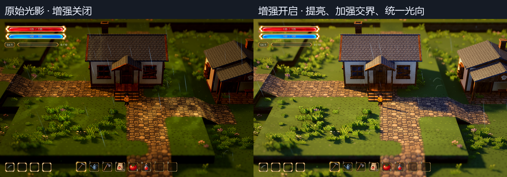

# 原始光影的提亮、明暗交界与光向统一

当前正式地图以方向光和环境光为基础，`MapEffects/AtmosphericLight.enabled` 默认关闭，停用自动地面光斑、远景装饰灯和配套光束；路灯、窗户等有明确来源的局部光保留。该总开关独立于 Style，R 和原始增强开关均不会重新开启它。旧光斑参数仍保留，勾选 AtmosphericLight 的 Enabled 可作对照。下文光斑参数和截图对应停用前的版本。

2026-10-13 · 正式地图 `demoWithMeowa/1/scenes/world/world.tscn`。

用户要求沿用原始光影，改善昏暗，同时让明暗交接有更强的层次与细腻受光；随后指出画面中多处投影方向不一致。本版使用原始光影的暖主光、稀疏光斑和已有法线，增加可见暗面细节并加强真实阴影边界。没有替换材质底色或改动共用植被。

## 实机对照

左为关闭增强，右为开启。截图来自 D3D12 / Forward+ 原生运行，排版只缩小截图，没有后期调色。前后小院、战区的相机 Transform 与镜头参数相同：1280×800、FOV 28°、距离 28 米、俯角 32°、焦点高 0.9 米、深度景深 0.065。天气、雨纹、风摆与光点仍在运行。

[小院增强原尺寸](../media/original-light-refinement-preview/home-after.png) · [小院原始](../media/original-light-refinement-preview/home-before.png) · [战区增强](../media/original-light-refinement-preview/battle-after.png) · [战区原始](../media/original-light-refinement-preview/battle-before.png) · [90°镜头](../media/original-light-refinement-preview/home-orbit-90.png) · [180°镜头](../media/original-light-refinement-preview/home-orbit-180.png) · [270°镜头](../media/original-light-refinement-preview/home-orbit-270.png)。

## 光向不一致的原因与修复

为保留用户实际审阅的原始画面，上一轮保留了原始主光和局部暖光的独立方向。主光射线方向约为 `(0.819, -0.469, 0.331)`，原局部光射线约为 `(-0.321, -0.616, 0.720)`。两者水平投影相差约 92°；同一区域受两套光照影响，会出现交叉的阴影。提高强度与阴影不透明度后，这个矛盾更明显。

增强开启时，`AtmosphericLight.follow_global_direction` 改为 `true`，实际局部聚光灯的轴线跟随主光在世界中的射线方向。保留光斑落点、稀疏布置、投射纹理与活动灯光预算。相机只改变观察方向；Q/E 旋转时，光源不会跟着镜头转，屏幕中的投影方向随观察方向改变。

此轮调光时花草仍使用固定方向的投影卡片。用户随后澄清关注的是旋转时轮廓与显示姿态脱节，正式地图已改为显示贴片姿态投影并保留独立开关，也修正了花草与人物的局部光投影缓存。用户进一步倾向成簇柔和模拟阴影，仍待下一步方案审阅，详见[地编阴影更新](grass-lighting.md)。人物、地形与建筑继续使用原生灯光和阴影。

关闭增强会恢复修复前实际审阅的原始配置，包括两套独立光向，仅作对照。三种 Lumina Style 的参数与切换效果保持。

## 明暗调整

主光增幅高于环境补光增幅，同时提高阴影不透明度，使受光面与背光面更明确。冷色补光让檐下、墙面和草丛暗面保留可见细节。降低全局对比的压黑程度，避免靠压掉暗部细节制造对比；实际光照边界承担主要的明暗分离。阴影柔化稍减，暗角稍减，保留原来的暖主光颜色和方向。

| 参数 | 旧版 → 增强版 | 含义 |
| --- | --- | --- |
| `moon_energy` | 1.65 → 2.85 | 主光更明确，已有法线的亮暗变化更易辨认 |
| `ambient_energy` | 0.60 → 0.85 | 暗面补光，保留材质细节 |
| `ambient_color` | `(0.50, 0.52, 0.60)` → `(0.44, 0.52, 0.68)` | 暗面略偏冷，与原暖主光分离 |
| `moon_shadow_opacity` | 0.72 → 0.94 | 强化遮挡边界；不通过降低补光压黑暗部 |
| `moon_softness` | 1.4° → 1.0° | 边界更明确，仍有柔化 |
| `exposure` | 0.86 → 1.08 | 适度提亮整体 |
| `contrast` | 1.20 → 1.14 | 减少全局压黑，主要靠真实光影形成对比 |
| `saturation` | 1.45 → 1.30 | 控制提亮后的黄绿和橙色饱和度 |
| `split_toning` | 0.25 → 0.35 | 小幅增强暗冷、亮暖关系 |
| `vignette` | 0.30 → 0.20 | 减少画面周边过暗 |
| `volumetric_density` | 0.006 → 0.004 | 减少空气遮蔽，保留原氛围 |
| `surface_energy` | 2.2 → 2.4 | 保留稀疏暖斑的亮点节奏 |
| `follow_global_direction` | 关闭 → 开启 | 原始增强版的局部暖光与主光方向一致 |

暖主光颜色 `(1, 0.71, 0.4)`、方位 −112°／俯照 28°不变。未恢复用户关闭的草地湿亮斑；原雨量、风力、光点、地表湿润与声音保留。地形、道路、植物密度和高低层次、碰撞、独立法线、色板与景深保持。

## 调节与恢复

正式地图现在默认选择 **原始光影**，增强默认开启。停止旧调试实例并重新运行即可查看。R 仍切四种 Style，没有新增 F 类按键。

选择 `VisualSample → 原始光影增强`：

- `Original Light Refinement Enabled`：开／关增强，仅对 Style 0 生效，关闭恢复旧版。也可在参数总览搜索“原始光影增强开关”。
- `Original Light Preset`：`data/visual/spawn_original_refined.tres`。长期数值位于资源的 `node_values`；修改后点击既有“应用视觉与天气”。主光、补光与阴影参数在 `MapEffects/ArtDirection`，光斑强度及跟随方向在 `MapEffects/AtmosphericLight`。

临时试看可直接修改 ArtDirection／AtmosphericLight；切换 Style 或重新应用会读回预设。两个原始基准 `spawn_original.tres`、`spawn_original_render.tres` 原样保留。增强开关、配置资源、嵌套预设均在参数总览“视觉”分类中。

## 验证

- 原生 D3D12 增强回归 92 项通过：开关恢复、五次反复切换、三种 Lumina 不受影响、真实主光和光斑轴线、四个镜头朝向、天气／法线／色板／植物保持、对象不重建与旧配置文件不写入。
- 光向检查先复现一次失败，开启跟随方向后通过；实机记录两套射线由不同改为相同。
- 启动回归 108 项、基础 Style 446 项、明暗层次样板 53 项、实际光照绑定 86 项通过。
- 小院／战区前后及三个转镜朝向完成原生截图；没有写入用户存档。

工作脚本、候选画面、完整日志与原生对照位于 `D:\.codexfile\work\original-light-refine`。本轮未调用 Meowa。

## 原始光影中的草地深色斑块

2026-10-13 的相邻色档试作已取消。用户审阅后认为深色斑块效果难看，要求先取消；运行代码、检查器说明及专用测试已撤回，当前恢复试作前的颜色倍率和五色色阶选档。

现有原始增强光影、黄金／细雨／夜晚预设、镜头、色板、草地深浅开关与正式地图 0.19／3 米设置均保持。原始草底调色仍可能使深浅变化落入同一档，因此大块斑块不明显；本次取消不继续调整其他方案。

[已否决试作的前后对照](../media/original-grass-variation-preview/comparison.png)与[其他三种 Style 核对](../media/original-grass-variation-preview/other-styles.png)仅作历史记录，不代表当前正式地图。试作脚本、日志及撤下的测试保存在 `D:\.codexfile\work\original-grass-patches`，没有调用 Meowa。
