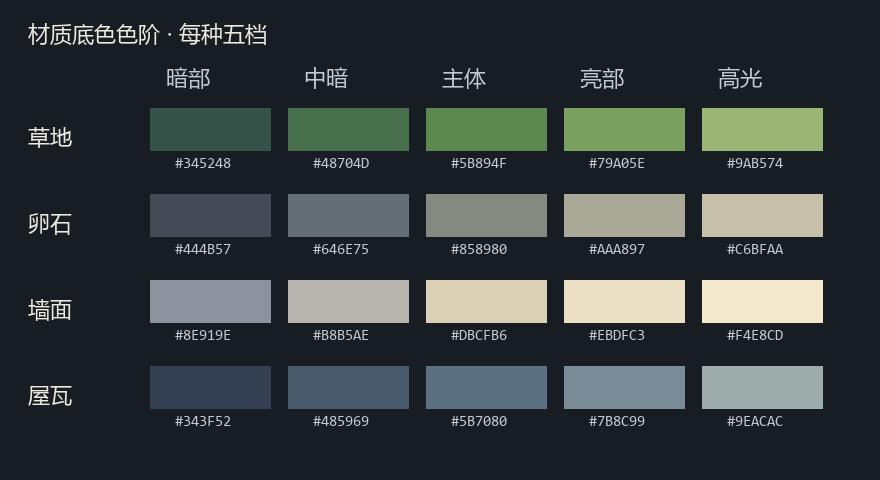
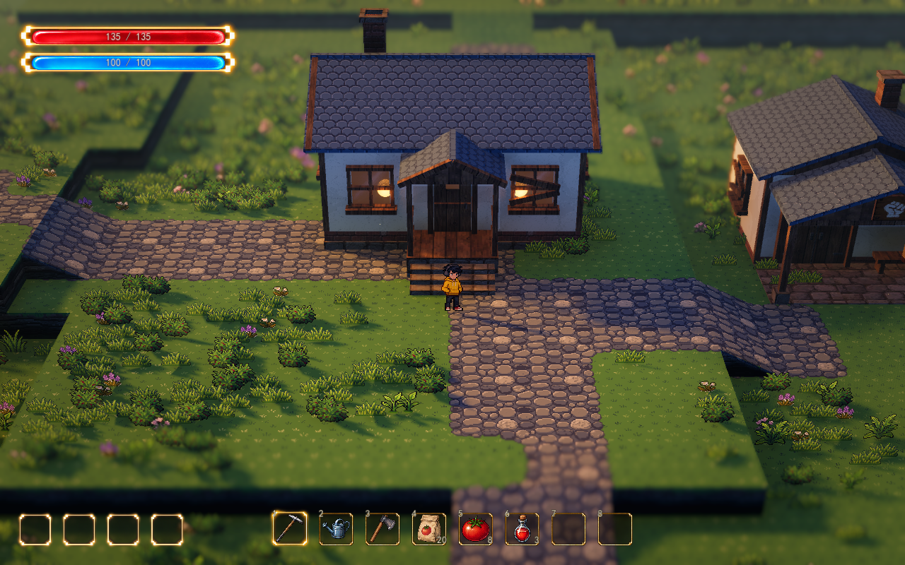

# 材质色阶统一

更新：2026-10-13。正式地图：`demoWithMeowa/1/scenes/world/world.tscn`。

草地、卵石路、墙面和屋瓦已新增有限调色板映射：每种材质五个候选底色，共二十个颜色。它们延续各自材质主色，并统一冷暗、主体色和暖亮的组织关系。人物沿用现有美术作为标尺。

## 实机对比

[同机位关闭色阶](../media/pixel-color-preview/house-before.png) · [出生点](../media/pixel-color-preview/spawn-after.png) · [战区入口](../media/pixel-color-preview/battle-after.png) · [战区原色](../media/pixel-color-preview/battle-before.png) · [细雨](../media/pixel-color-preview/rain-after.png) · [夜晚](../media/pixel-color-preview/night-after.png)

前后图只改变色阶开关，保留相同场景、角色位置、镜头、光照和天气。沿用当前 Lumina 透视镜头：FOV 28°、距离 28 米、俯角 32°、焦点高 0.9 米、深度景深 0.065，近/远清晰余量 3/4 米、过渡 2.5/6 米；1280×800、16:10。

## 实现与适用范围

色板保存在 `data/visual/spawn_pixel_palette.tres`，每条色阶按暗到亮排列。资源生成 5×4、无 mipmap 的查找纹理；材质在源颜色和同一材质的五个候选色之间比较线性 RGB 距离，直接选出一个颜色，不在各档之间插值。

屋瓦先沿用既有 0.65 局部对比，再映射色阶，避免将已压低的瓦缝重新拉成强黑边。地表的固定草色斑块参与选档，冷暖材质变化也在最终选档之前完成。凹凸与表面粗糙度继续使用原纹理的梯度，色阶边界不会成为额外的假凸起。

材质底色限制在各自五色内；实际一张材质可以只用其中两至四档。真实灯光、阴影、湿润、草根遮蔽、雨水、雾、景深和后处理继续正常作用，因此最终游戏截图会包含更多颜色。

同一地形表面可同时包含草地和道路，它们分别使用不同色板；道路透明区域露出草地色阶。地形草沿沿用草地色板，其他泥土、自定义地表、侧壁主体、花草精灵、木梁、门窗及 UI 保持原有美术。源 PNG、像素坐标、地形数据、台地与建筑位置保持。

## 调节入口

在正式地图选择 `VisualSample → 统一材质色阶`：

| 参数 | 含义 |
| --- | --- |
| `Color Ramps Enabled` | 开关有限色阶，默认开启；关闭回到上一版连续材质颜色 |
| `Color Palette` | 点击展开色板资源，编辑草地、卵石、墙面、屋瓦各自五档颜色，索引 0 为暗部、4 为高光 |
| `统一像素美术 → Pixel Roof Contrast` | 控制屋瓦映射前的局部对比，默认 0.65；影响瓦缝和亮边落在哪一档 |
| `统一像素美术 → Pixel Art Enabled` | 整组新旧素材切换，关闭时也停用这组色阶 |
| `Style` | 原始光影 / Lumina 黄金、细雨、夜间；只切光影和天气，保留像素材质与色阶选择 |

改色与色阶开关只更新地形材质参数、两栋建筑的墙面和屋瓦材质，不重建地形、建筑网格或碰撞，不改变当前镜头。每条色阶须保留五个颜色，资源更改会即时更新。调节通过检查器进行，不占用键盘快捷键。

## 卵石暗点调节

新 Meowa 卵石原图已有深石缝和石面暗点，最近五色选档会进一步明确这些小色差。同机位分别关闭 SSAO、SSIL、草根遮蔽和太阳阴影，重复暗痕仍在；将凹凸强度设为 0 只稍减受光颗粒。暗痕的主要来源是原图与色阶选档。

`VisualSample → 统一像素美术 → Pixel Stone Detail Strength` 控制选档前的局部暗点整理：默认 0.65，1 保留此前细节，降低时弱化孤立小暗点。3×3 原像素邻域识别连续暗线和局部暗点，采样留在同一图集瓦片内，遇透明路边保留原色。连续深缝、大暗面和五色色板保持，凹凸仍读取原图中心与邻居，不随提亮改变。

这项调节只用于新卵石路与既有卵石单块画笔，不改 PNG，不改变其它地表。关闭像素材质时恢复到 1；关闭色阶仍可独立使用。当前 Style 只切光影和天气，像素材质、色阶和此参数独立保留。实际改善较轻微，见 [整理前](../media/visual-design-preview/stone-before.png)、[整理后](../media/visual-design-preview/stone-after.png) 与 [项目视觉设计](visual-design.md)。

局部暗点处理通过 43 项原生 Forward+ / D3D12 检查：道路与卵石画笔在强度 1、0.65、0 时法线逐像素一致，底色仍落在五色集合内；其它地表、透明轮廓、切片边界和连续深缝保持。正式地图同机位对比与恢复检查通过，四种 Style 保留此参数，材质开关正确恢复；网格、碰撞对象、原图、地形与用户存档保持。

## 色阶映射验证

色阶首次接入时，原生 Forward+ / D3D12 正式地图通过 458 项检查，日志无解析、Shader 或运行错误。同机位前后保持相机与玩家 Transform，建筑 Mesh、Body、Collider 和地形对象身份不变；原图、地形文件与用户存档 SHA 保持。检查了色板更改即时更新 GPU 纹理绑定、关闭恢复、当时的原始预设以及细雨和夜晚。Style 此后已按最新要求改为只切光影和天气，具体行为以当前参数说明为准。

共享映射函数另通过 17 项 GPU 检查，50,152 个不透明像素均落在对应候选色集合内，透明覆盖不变。实际完整材质的隔离底色检查通过 8 项：墙面使用 3 档、屋瓦 4 档、草地 4 档；道路按草地/卵石所属层逐像素核对，各层分别不超过五色。建筑材质独立刷新通过 60 项对象身份和恢复检查。
