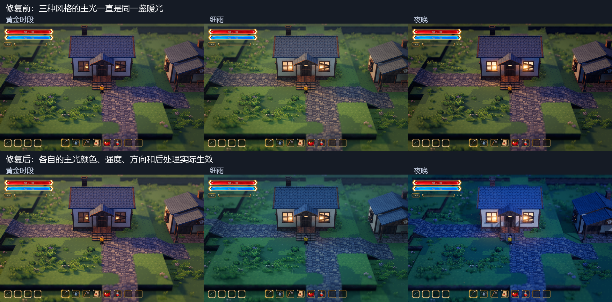

# 四种 Style 的主光与后处理修复

2026-10-13 · 正式地图 `demoWithMeowa/1/scenes/world/world.tscn`。

后续更新：用户进一步要求在原始光影上提亮、加强明暗交界，并指出局部投影交叉。当前默认开启独立的[原始光影增强](original-light-refinement.md)，其中局部暖光跟随主光；关闭该增强后，仍恢复本文记录的原始实际光影。下文保留本次修复的对照与参数记录。

用户反馈三种 Lumina 风格趋同，光照色调变差。核对实际灯光节点后确认：公共效果场景的 `GameAudio` 节点标题插在 `ArtDirection` 的属性段中间，主光、后处理及水面反射引用被保存到了声音节点下。旧场景中的引用位置正确，后续场景修改产生了回归。

切换 Style 时，控制器上的预设值、环境光与天气会更新，但实际主光一直保持正式地图保存的暖色：强度 1.65、颜色 `(1, 0.71, 0.4)`、方位 −112°、俯照 28°。黄金、细雨和夜晚因此共用同一盏暖主光；后处理中的分离调色也没有随控制器更新。这是连接错误，不是独立法线或植被层次需要撤回。

## 同机位实际渲染

上排为修复前，下排为修复后，左至右为黄金、细雨、夜晚。截图来自原生 D3D12 / Forward+，1280×800；对照仅缩小排版，没有后期调色。小院和战区共八组前后图的相机 Transform 与镜头参数一致：FOV 28°、距离 28 米、俯角 32°、焦点高 0.9 米、深度景深 0.065。天气、风摆和光点继续运行，动态粒子不要求逐像素相同。

[原始光影实际画面](../media/style-light-repair-preview/original.png) · [细雨原尺寸](../media/style-light-repair-preview/home-2-repaired.png) · [夜晚原尺寸](../media/style-light-repair-preview/home-3-repaired.png) · [战区细雨](../media/style-light-repair-preview/battle-rain.png) · [战区夜晚](../media/style-light-repair-preview/battle-night.png)。

## 修复与对照基准

将 `GameAudio` 的节点标题移到完整的 `ArtDirection` 属性段之后，恢复三条引用；声音节点保留。现在预设的颜色、强度、方向、阴影与后处理参数实际应用到渲染节点。

用户喜欢的“原始光影”以修复前实际看到的画面为对照。其六项主光参数单独保存在 `data/visual/spawn_original_render.tres`，只在 Style 0 叠加，局部暖光继续沿用之前的独立方向 −24°／38°。原始配置 `spawn_original.tres` 原样保留，其余旧调色、雾和天气仍从该文件读取；没有将用户认可的暖光突然换成历史记录中的冷光。

默认开启明暗层次样板时，实际主光为：

| Style | 颜色 RGB | 强度 | 方位／俯照 |
| --- | --- | --- | --- |
| 原始光影 | `(1, 0.71, 0.4)` | 1.65 | −112°／28° |
| 黄金时段 | `(1, 0.71, 0.4)` | 1.95 | −112°／28° |
| 细雨 | `(0.72, 0.8, 0.92)` | 0.70 | −112°／28° |
| 夜晚 | `(0.58, 0.68, 0.94)` | 0.80 | 40°／38° |

三种 Lumina 风格的局部点缀继续跟随实际主光方向。此轮没有重新调色，也没有改变三种 Lumina 预设的数值；先恢复预设本来应有的效果。这不代表观赏性与空间层次已经达到最终目标。接下来的审阅应使用修复后的画面，避免继续针对失效的灯光连接调参数。

独立法线、边缘衔接、材质与花草色板、草地斑块、植被分布和高低层次继续共用。R 切 Style 保留这些配置、镜头、地形和碰撞。修改脚本与场景后，停止旧调试实例并重新运行，再按 R 比较。

## 验证

- 新增 `tests/test_style_light_bindings.gd`：修复前 76 项中 20 项失败，直接复现实际灯光及后处理未切换。修复后扩展检查局部光方向，原生渲染 86 项全部通过。
- 基础 Style 回归 446 项、明暗层次样板 53 项全部通过，覆盖重复切换、天气联动、独立参数保持、地形与植物对象不重建、训练与种植状态保持。
- 实机小院／战区八组同机位对照完成；原始光影的实际主光、阴影、补光、调色和雾参数前后相同。

复现脚本、完整截图和日志位于 `D:\.codexfile\work\lighting-aesthetic`。此轮没有生成新美术、修改相机或写入用户存档。
