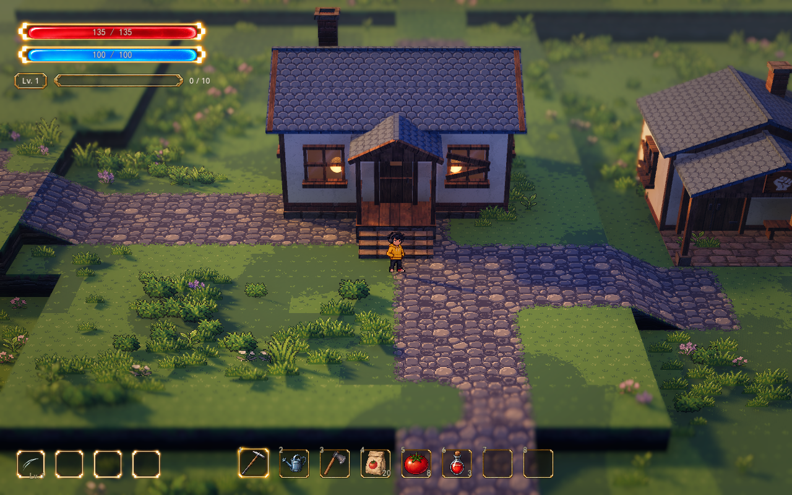

# 草地与光照的明暗层次样板

2026-10-13 · 正式连续地图 `demoWithMeowa/1/scenes/world/world.tscn`。

同日修正：发现后续场景修改造成主光／后处理引用失效，先前截图不能证明三种预设的主光都已正确应用。连接现已修复，实际对照与原始光影保留方式见[四种 Style 的主光与后处理修复](style-light-repair.md)。下文的参数和早期截图保留为迭代记录。

用户确认先完善草地与花草色阶、主光与冷色补光。首版保留草地的三个中间色，拉开深色和亮端，叶片与枯草略加强冷暗、暖亮关系；花瓣、卵石、墙面和屋瓦的原色板继续保留。光照使用略强的主光和按表面朝向变化的半球补光。当前为可继续微调的样板。

## 同机位实机

[小院调整前](../media/value-lighting-preview/home-before.png) · [战区调整前](../media/value-lighting-preview/battle-before.png) · [战区调整后](../media/value-lighting-preview/battle-after.png) · [细雨](../media/value-lighting-preview/rain.png) · [夜晚](../media/value-lighting-preview/night.png)。

前后只切换明暗样板，人物与相机 Transform 相同。使用当前正式镜头：距离 28 米、俯角 32°、FOV 28°、焦点高 0.9 米、深度景深 0.065、1280×800、16:10。天气保持各自 Style；风摆、光点与雨滴继续自然运行。夜晚图保留从细雨切换后的短暂镜头水迹。

## 表现原理与范围

大面积草底继续使用原来的中间绿色与 0.70 局部对比，草地独立深浅参数保留当前场景的 0.19／3 米。草地色阶暗端从 `#345348` 调为 `#253D38`，亮端从 `#9AB574` 调为 `#B5CE78`；中间三档不变，避免把整块草地拉成大面积的亮暗跳变。叶片与枯草五档另行调整，花瓣各自色板不变。

半球补光使用现有天空的照明立方体：上半球为天空色，下半球为低亮度地面反弹色。真实网格和精灵的受光法线决定获得的照明，顶面、侧面和背光面有不同的颜色与强度。可见天空继续使用原来的天幕、剪影和星光，照明分支只在 `AT_CUBEMAP_PASS` 生效。

使用 Godot 原生天空环境照明，不新增真实灯光、贴花或草点，不通过自发光补亮草地。原始光影保持原来的均匀环境色；黄金、细雨和夜晚分别使用半球配置。泛光、曝光、最终对比、雾、局部光斑、法线与边缘衔接保持既有控制。

此次复用现有 Meowa 原图和既有地图，不生成新美术。地形、道路手绘、碰撞、建筑、植被种子／密度／位置／尺度和人物动画保持。战区外围的大块构图与新的遮挡物属于后续讨论范围。

## 开关与持久调节

正式地图选择 `VisualSample → 明暗层次样板`：

| 项目 | 用法 |
| --- | --- |
| `Value Sample Enabled` | 默认开启；关闭恢复本轮之前的草地／花草色板和三种光照基线，保留镜头、布局与独立参数 |
| `Value Sample Profile` | `data/visual/spawn_value_sample.tres`，引用原版／样板色板与三种光照资源，没有复制颜色到另一套控件 |
| 应用明暗层次样板 | 修改配置后重新应用，也可恢复配置指定的色板 |

样板材质底色位于 `spawn_value_palette.tres`，花草底色位于 `spawn_value_foliage.tres`；原版 `spawn_pixel_palette.tres`、`spawn_foliage_palette.tres` 保留。实际启用的色板仍可从既有 `VisualSample / Color Palette` 与 `GroundDressing / Color Palette` 调节。R 切 Style 保留独立选中的色板；明确切换样板开关或点击应用时，按样板配置选回对应资源。

光照长期参数位于 `spawn_value_day.tres`、`spawn_value_rain.tres`、`spawn_value_night.tres` 的 `MapEffects/ArtDirection` 字典中。样板开启时，这些五项叠加在原 Style 上；其它值仍来自原预设。修改后点击应用。原样板的光照资源继续保留用于关闭时的对照。

临时试看可直接在 `MapEffects/ArtDirection` 调节：

| 参数 | 黄金／细雨／夜晚 | 含义 |
| --- | --- | --- |
| `Moon Energy` | 1.95／0.70／0.80 | 主光强度；黄金原版为 1.65 |
| `Ambient Energy` | 0.70／0.85／1.15 | 当前补光强度；半球与均匀补光的数值不能直接视作相同亮度 |
| `Hemisphere Fill Enabled` | 开／开／开 | 半球天空照明；关闭改用原环境颜色 |
| `Hemisphere Sky Color` | 蓝紫／灰蓝／月夜蓝 | 更多作用于朝上的表面 |
| `Hemisphere Ground Color` | 低亮灰紫／灰蓝／深蓝 | 地面反弹，更多参与侧面与朝下表面的补光 |

R 切 Style 会重新应用相应光照配置，临时的 ArtDirection 修改因此会重设。关键开关、补光颜色和嵌套资源均已加入参数总览；新资源保持在“视觉”分类中。现有像素材质、色阶和植被样板开关保持各自作用，关闭植被样板仍恢复原花草颜色与分布。

## 验证

- 新增 `test_value_lighting_sample.gd`：53 项，四种 Style、样板开关／原版恢复、独立色板、植被恢复、参数索引，以及镜头、地形绘制、植物分布、法线、湿亮斑和对象身份保持。音频停止后正常退出。
- Style 切换 83 项、草地启动／刷新 108 项通过；参数总览索引 1,642 项，无索引失败。
- 原生 D3D12 / Forward+ 原样板回归 461 项通过，包含地形 GPU 绑定、种植、训练和真实台阶通行。该测试关闭附加的明暗层，单独验证基础 Style。
- 原生渲染完成三种 Style 的小院／战区前后 12 张对照，以及实际波次启动画面，日志无解析、着色器或运行错误。前后相机与人物 Transform 一致，受保护的场景、地形、画笔、旧色板、原 PNG 和法线准备脚本的 SHA 保持；用户存档未写入。

验证副本、脚本、完整截图和日志位于 `D:\.codexfile\work\lumina-value-sample-20261013`。本轮没有修改正在推进的法线算法或环境动态规则。
