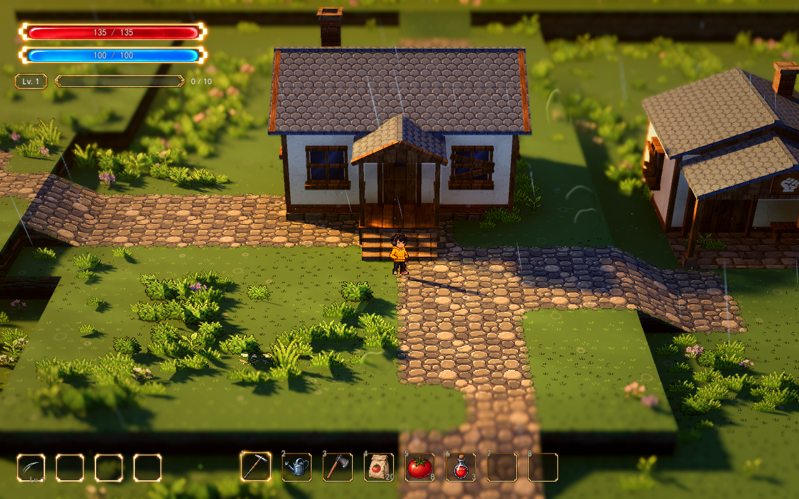
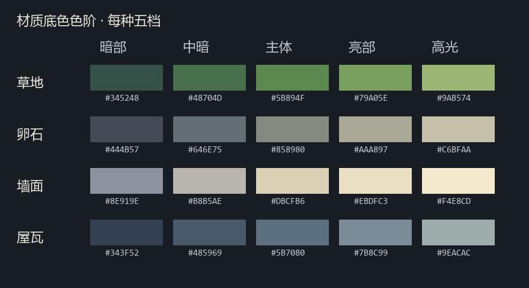
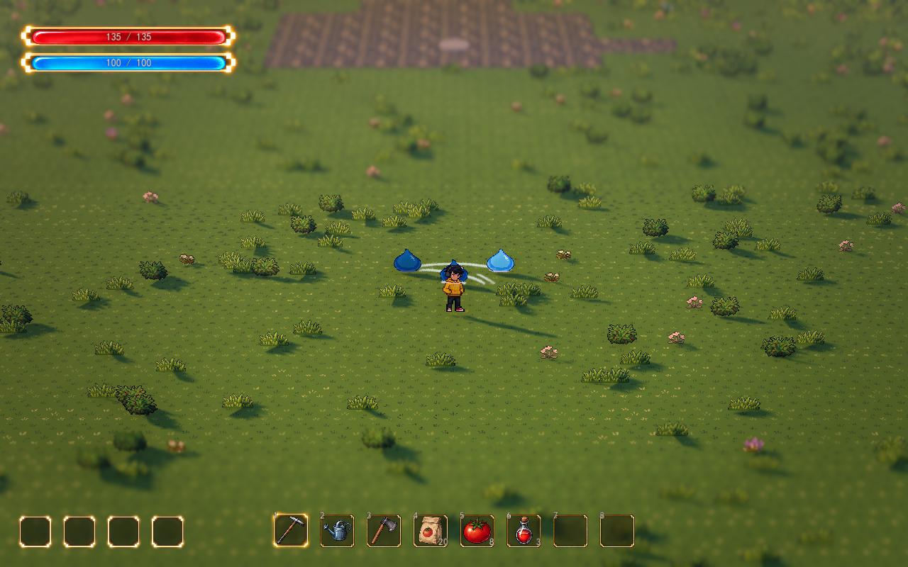

# HD-2D 项目视觉设计

2026年10月13日 · 基于正式连续地图的当前实现，供美术制作、场景搭建和视觉调节使用。

游戏采用节奏较舒缓的波次生存玩法：玩家在连续地图中从自己的小院走入战斗区，战斗时观察敌群并走位，清波后安全休整，再主动继续。视觉需要同时支持小院的观赏性和战场的信息清晰度。人物、敌人、攻击与危险提示应始终容易辨认，环境的细节、光影和动态为它们提供空间与氛围。

Lumina 提供统一像素尺度、带色相变化的色阶、冷暖照明、微缩景观镜头和成簇地编的参考。本项目沿用现有人物、地形尺度及连续地图，最终题材、人物身份和世界名称继续开放；现有自然区域和建筑不据此成为已定稿的世界设定。

## 当前画面与内容

正式工作场景是 `demoWithMeowa/1/scenes/world/world.tscn`。小院、连接道路和南侧战区共用同一地形、天气和视觉预设，玩家直接步行进入，没有切图。四境场景继续作为视觉测试和原相机基准，正式地图单独打开运行。

最新已接入[草地与光照明暗层次样板](value-lighting-sample.md)：保留草底中间色，拓宽草地与叶片的冷暗／暖亮色阶，黄金主光略增强，三种 Lumina Style 使用按表面朝向变化的天空／地面半球补光。开关可恢复本轮之前的色板与光照，保留镜头、布局和独立草地斑块；这是可继续调节的第一版。

同日已修复公共场景中主光、后处理与反射引用被误放到声音节点的问题。三种 Style 的主光现正确切换；“原始光影”保留用户修复前实际看到的暖主光与局部光斑，历史参数文件保留。实际对照与验证见[Style 光影修复](style-light-repair.md)。

用户随后要求以原始光影改善昏暗并强化明暗交界。正式地图当前默认原始增强版，保留原暖主光颜色与方向，增加主光及冷色暗面补光、强化阴影边界，并统一局部暖光与主光的投影方向。开关关闭恢复旧版，三种 Lumina 不变。实际对照与参数见[原始光影增强](original-light-refinement.md)。

随后已完成[雾与后处理细调](fog-post-sample.md)：四种 Style 减薄近处体积雾、后移距离雾起点，收敛低亮度泛光、Lumina 暗部提亮与分离色调，减轻并放宽暗角。独立开关可恢复此前效果，最新主光、补光、镜头与草地斑块保持；用户明确这轮不处理草地斑块边界。

非战斗区域新增[小院浓绿林缘样板](courtyard-foliage.md)：用户已确认的低蕨、阔叶、长草与少量野花组合，使用八种新 Meowa 原生像素植物。在小院左侧先形成一片连续绿丛，簇心饱满、边缘降低，原有草甸作为底层。当前只铺这片样板，保留道路与战区留白；进一步扩展先审阅实际效果。

| 部分 | 当前实现 | 继续完善的范围 |
| --- | --- | --- |
| 小院与建筑 | 已有住房、训练屋、台地和坡道；暖色窗光与局部补光 | 门前空间、地表与植被的主次，建筑材质之间的衔接 |
| 南侧战区 | 约 32×32 米开阔中心、外围绕行带、两处低台地及镜头地形缓冲 | 地表安静程度、外围景观层次与各朝向的可见性 |
| 像素材质 | 草地、卵石路、墙面和屋瓦使用各自五色色板；现有花草已接入叶片与花瓣色阶及成簇密度 | 木梁、门窗、砖基、侧壁主体与 UI 尚未全部统一 |
| 人物与怪物 | 人物与蓝色史莱姆支持动态受光和遮挡轮廓；闪身保留既有效果 | 多敌人重叠时的辨认，受击和死亡反馈 |
| 自动攻击 | A01 扇击已有独立 Meowa 八帧斩光、群体命中和轻微击退 | 与其他攻击区分的视觉规则，命中反馈与音效 |
| 经验与选择 | 已接入掉落、吸取、升级和空白成长卡；经验宝石与经验条已另行接入 | 卡片没有正式内容，确认不产生实际强化；继续检查奖励反馈与环境的主次 |
| 界面 | 血量与魔力条、空技能槽、物品栏和手帐管理页；挑战灰盒界面默认隐藏 | 围绕实际战斗能力与成长信息整理主次 |

史莱姆已经参与实际波次战斗，具有追击、接触伤害、短促受击提亮和击退，死亡时直接移除。正式地图使用三组波次资源，按两侧和南侧候选位置错时生成，当前数量为 5／7／9。具体数值是试玩基线。8 种普通怪、精英与首领、10 种攻击及丰富增益仍是[战斗核心设计](../combat-core-design.md)中的讨论提案，不能把数量目标视为已制作资产。

经验基础已接入实际战斗：怪物死亡掉落经验，人物靠近吸取，达到阈值立即打开成长选择，清波默认收取剩余经验并等待选择完成。经验宝石和等级经验条已在独立的界面工作中接入；具体强化仍待定，规则与接口见[本局经验与升级](../gameplay/run-growth.md)。

种植、训练、装备和豌豆射手等已有原型保留；种植不计入当前战斗 Demo 的核心内容，也不成为本轮视觉扩展的前提。

正式地图东北角先接入约 6.4×4.8 米的缺角水面，水面低于战区 0.32 米，岸上保留原高度与手绘铺装。`WorldDetails/WaterGarden/ShoreLamp` 复用现有双头暖路灯；水面沿用预览的水波、波光、断续岸边泡沫、人物倒影与真实灯光，使用单一水位的既有平面反射。人物走路沿既有水域阻挡形状碰撞，弹射直接在水域边界反弹，不增加石沿模型；耗速、预览、声音与火花沿用原入口。`Homestead.water_boundary_reflection_enabled` 仅在正式地图开启，其他场景默认仍遇水终止，断层与弹丸规则保持。池内排除刷怪，桥、落水口与岸边地表过渡后续细化；旧预览的瀑布与水花保留。

## 像素尺度与细节密度

以现有人物为尺度标尺。人物约为 42.7 原图像素/米，新草地、卵石路以及覆盖建筑的墙面、屋瓦约为 40 原图像素/米。基础纹理 64×64 覆盖 1.6 米，道路图集每个切片同样为 64×64。地形继续使用 1.6 米格与 0.8 米层高；这些尺度与现有行走、台地、铺装及存档共同工作。

这里的像素密度指原图像素在世界中的大小。素材尺寸大并不代表细节合适，最近邻过滤也无法把不同大小的笔触自动变成统一画法。Meowa 输出原样保留，通过正确的 UV 尺度、图集区域和显示参数接入，不再次缩放或重新像素化生成图。

| 对象 | 细节重点 | 画面控制 |
| --- | --- | --- |
| 人物与怪物 | 轮廓、姿态、识别色和必要的内部结构 | 大色块清楚，减少无助于辨认的碎点；不同方向与动作保持比例 |
| 战斗区地表 | 通行面与区域变化 | 底色连续、局部变化稀疏，避免石缝和草点形成密集高对比纹样 |
| 建筑 | 墙体、屋顶、门窗和檐口的结构 | 大墙面相对安静，细节集中在结构转折和交互附近 |
| 花草与外围 | 成簇形状、风摆和空间层次 | 留出空隙，密度向边缘变化，不铺成均匀花毯 |

同一套画法允许不同对象拥有不同细节密度。地表承担大面积背景，人物和敌人的少量识别色块应比背景纹样更容易被注意到。战区中心保持留白，家园门前和外围可有更丰富的局部细节。

## 色阶与材质凹凸

草地、卵石、墙面、屋瓦各有五个候选底色，保存在 `data/visual/spawn_pixel_palette.tres`。材质按线性 RGB 距离选择最近颜色，不在两档之间插值。组织关系为冷暗部、阴影、主体色、较暖受光色和少量高光；各材质保留自身主色。

五色限制作用于材质底色。真实灯光、阴影、湿润、雾、景深和后处理继续生效，所以最终截图含有更多颜色。人物保持现有美术作为参考，不参与整屏颜色量化。花草已追加叶片、枯草和六类花瓣各自五档的色阶，原图与透明轮廓保持；草底降低局部对比、花色按簇集中，参数和实机对比见 [草地与花草样板](foliage-visual-sample.md)。木梁、门窗、侧壁主体和 UI 继续独立推进。

卵石表面的深色点、短线和石缝首先来自新的 Meowa 原图。像素美术样板替换纹理后，这些形状就已经存在；后续最近色阶映射会把一部分相近暗色归到同一档，让暗点和边缘更明确。当前没有单独铺一层黑色污渍来生成这些石纹。进一步优化应分别比较原图纹样、色板暗部和实时阴影，避免把正常阴影与纹理噪点混在一起调节。

卵石已增加局部暗点调节：在五色选档前，比较原像素的 3×3 邻域，只对周围较亮、缺少连续暗色邻居的小暗点作轻微提亮。深石缝、大块暗面和透明路边保留，原图不变。检查器 `VisualSample → 统一像素美术 → Pixel Stone Detail Strength` 默认 0.65，1 恢复此前细节，越低抑制越强。整体改变较小，主要清理石面碎点，石缝轮廓仍可见。

[同机位保留原细节](../media/visual-design-preview/stone-before.png) · [轻微整理后](../media/visual-design-preview/stone-after.png)。前后只改变卵石细节参数，保留相同人物位置、镜头、景深、色板、光照、环境遮蔽和全局对比。

现已接入与现有颜色图对应的独立法线，覆盖地表、建筑、侧壁、花草与玩家各动作；未准备法线的材质继续沿用原图梯度。数据从平滑浅高度估计推导，玩家补充透明轮廓体积，原 PNG、网格和碰撞保持。颜色深浅只能近似高度，深色石纹不一定是凹槽；法线强度因此保持轻微，并可指定自己的对应法线图。

道路增加窄草缘，台地草沿共享顶面的色阶、冷暖和深浅变化；植被在原落点上补充簇心、簇边及大小层次。参数、恢复与同机位实机对比见[边缘、植被与受光](surface-integration.md)。

## 冷暖光与天气

当前 `VisualSample` 提供黄金时段、细雨、夜晚和原始预设。黄金时段用暖色主光、冷色环境补光和柔和阴影形成层次；窗光和稀疏局部亮斑作为点缀。低雾与远雾帮助拉开距离，材质中的轻微冷暖变化和后处理继续共同作用。

家园可以用窗光、门前受光和局部植被形成观看重点。战区主要靠全局光维持连续氛围，局部亮斑保持稀疏，避免在敌群下方形成过多强光热点。动态天气仍需保留人物与怪物的识别色，雨天湿润不把地表照成塑料，夜间也要能读出脚下路线。

材质底色与光照分别调节。先确认色阶和纹样，再观察暖主光、冷补光、局部光与阴影；不用整体增饱和或增亮来掩盖某一种材质的问题。粒子、窗光和 bloom 的亮度、面积及持续时间应受控制，不能压过人物、敌人或危险提示。雾和景深也不能把近处攻击边界抹掉。

当前三种天气预设已可对比。连续昼夜变化、完整天气美术以及更多环境特效仍需结合实际玩法决定，不因 Lumina 有对应系统就全部接入。

## 镜头与连续地图构图

正式地图样板采用透视 FOV 28°、距离 28 米、俯角 32°、焦点高 0.9 米；深度景深强度 0.065，近远清晰余量 3／4 米、过渡 2.5／6 米，画面为 16:10。Q/E 可以连续旋转任意圈数，因此地图需要经得起完整一圈观察。

原始镜头 FOV 30°、距离 11 米、俯角 10°及原景深参数保存在 `data/visual/spawn_original.tres`，四境测试与共享效果继续保留原基准。正式地图当前镜头在 `MapEffects/Camera3D` 调节。按最新确认的规则，检查器 `VisualSample → Style` 与游戏内 R 只切光影和天气，保留镜头、水平朝向、布局和花草分布；选择“原始光影”也不自动恢复旧镜头或旧纹理。像素材质和色阶使用独立开关，比较材质时保持其它条件一致。

家园通过建筑、台地、门前空地与花草簇形成远近层次，通行连接和训练交互点保持可见。建筑与树冠的遮挡范围要按真实镜头检查，轮廓效果用于补救偶发遮挡；持续需要依赖轮廓辨认人物或敌人的位置，应调整构图。

战区保留横穿中心和沿外围绕行的路线，高低层次放在侧缘，坡道可正常步行。高建筑、树冠与大型道具的摆放先讨论，在各个镜头朝向检查敌人、预警和通行面。当前外围地形缓冲保障视野内有地表，后续景观应补远近关系和轮廓变化，不能靠堆满前景来隐藏边缘。

普通加载保留手绘地表。重建战区地形会重新生成战区铺装，因此布局调整与地表细修需要分清顺序，不能用一次视觉整理覆盖已保存的画笔结果。

## 战斗与 UI 的视觉主次

战斗中优先看清人物位置、敌人接近方向、攻击覆盖及危险范围。A01 已采用独立武器特效，人物不需要随每种武器切换攻击动画。后续不同攻击应通过轮廓、方向、节奏和运动轨迹区分，颜色作为辅助；多种效果重叠时仍能看到敌人和脚下地面。

当前受击提亮和击退提供最基本的命中反馈，死亡与经验的视觉表达尚有缺口。新死亡效果、经验外形、拾取反馈和成长图标需要先确认表现，再制作素材。现有空白卡是接口验证，不能把它当作已经完成的武器获得或增益展示。

HUD 保留已确认的细暖色边框与半透明暗底。血量提供实时生存信息，魔力用途继续待定；技能槽应反映实际参与战斗的能力，物品栏保留已有用途。新增经验或成长信息时，应先明确它需要让玩家判断什么，再决定位置和样式。边框辉光、卡面装饰和界面动效不能持续比核心战斗信息更抢眼。

成长选择占用人物操作并冻结战斗对象，天气、环境动画、BGM 与雨风声继续运行。其它管理界面沿用世界运行与输入占用规则；挑战灰盒面板的默认隐藏设置不等于正式战斗信息方案已完成。

## 下一轮改进与美术确认

卵石已完成轻微暗点整理，草底与现有花草也已接入色阶、细节对比和成簇密度样板。下一轮按实际反馈微调这些参数，再整理屋瓦边缘、建筑局部对比及花草与台地边缘的衔接。继续做同机位比较，保留原样恢复入口，让战区中心安静、家园与外围更有层次。

随后集中讨论战斗反馈：当前史莱姆和 A01 是实际样板，用它们确定命中、死亡、经验及升级选择的信息表达，再扩展其他怪物与攻击。新的反馈资产与图标先确认，不能从提案中的攻击和怪物数量推定已批准整套美术。

树木、地标、正式灯具、大型道具、建筑改造、人物重绘及 UI 重绘继续先沟通。植被、木材、侧壁和 UI 的全套统一也需要按对象逐步比较，不一次改变所有颜色与细节。当前阶段不固定新资源数量、制作期限或性能预算。

## 实机检查规则

- 同机位比较单一效果，保持人物位置、投影、视野、距离、俯角、水平朝向、跟随、景深、光照、天气与宽高比一致；等待跟随和景深生效后再截图。
- 分别查看黄金时段、细雨与夜晚，检查干湿表面、暖光和冷阴影，保留角色与路线的识别度。
- 走过小院、道路、战区中心、外围与坡道，Q/E 转过完整一圈；查看遮挡、地形边缘、贴图尺度和台地衔接。
- 在真实多敌人追击与扫击中检查轮廓、命中节奏和地面可见性；需要看到威胁时，环境不能只在静态截图中成立。
- 保留 Meowa 原图像素和透明区域，按真实图集帧采样；不通过重采样或二次像素化强行统一素材。
- 调节入口使用 Godot 检查器，保留关键参数及原设置；不新增 F1–F12 开发快捷键。
- 材质修改不改变地形高度、网格、碰撞、固定画笔编号或用户存档；布局修改单独审阅和验证通行。

## 参考与调节入口

Lumina 的[视觉设计](D:/Project/godot/games/benchmark/lumina/docs/design/VISUAL_DESIGN.md)和[关卡设计指南](D:/Project/godot/games/benchmark/lumina/docs/design/LEVEL_DESIGN_GUIDE.md)提供像素尺度、色阶、镜头、照明与可见性的依据。本项目保留约 40 像素/米、1.6 米格、0.8 米层高与连续旋转镜头；Lumina 的 16 像素密度、村庄题材和受限旋转范围不作为本项目改造目标。

具体实现与参数见[地图效果](map-effects.md)、[像素美术样板](pixel-art-sample.md)、[材质色阶](pixel-color-ramps.md)、[南侧战区](../gameplay/battle-area-plan.md)、[波次循环](../gameplay/wave-graybox.md)、[A01 扇击](../gameplay/fan-auto-attack.md)、[本局经验与升级](../gameplay/run-growth.md)和[成长选择 UI](../ui/growth-choice-ui.md)。视觉调节以正式地图当前节点和资源为准；玩法候选继续见[总体设计](../rpg-game-design.md)与[战斗核心](../combat-core-design.md)。
