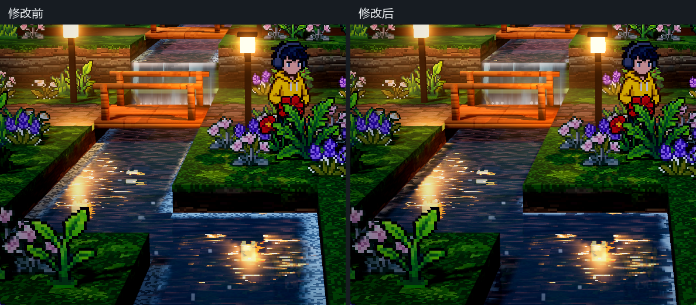
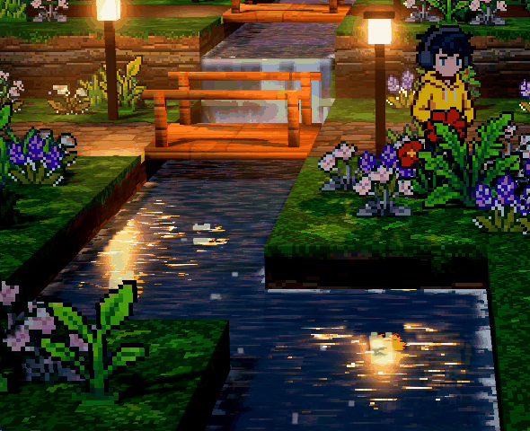

# 泡沫与水花统一

2026-10-10，项目 `demoWithMeowa/1`。本次针对用户提出的水花颗粒与岸边泡沫不搭配进行调整。

岸边原来的连续白边与每秒五次随机换色改为有间隙的灰白泡沫片，沿水流缓慢移动。瀑布底部使用同一套世界坐标泡沫纹理，减少河面白沫与水帘脚部叠加的亮白覆盖。水花改为阶梯边缘的小水滴，固定种子控制数量、大小和起跳节奏，按短抛物线飞起并淡出；相机转动时保持可见。岸边、瀑布泡沫和水滴共用颜色与尺寸倍率，白沫和水滴接受场景照明，不再自身发光。

## 预览

截图冻结材质时间为 0.75 秒，使用正式相机的 10°俯角，暂时关闭天气和景深，隐藏其它场景粒子。动图为实际运行采集的 48 帧，水面与瀑布正常动画，其它材质时间固定；预览过程不保存场景设置。

## 参数

`ArtDirection` → **泡沫与水花**，每项有检查器说明，并可逐项恢复默认值。

| 参数 | 默认值 | 含义 |
| --- | ---: | --- |
| water_foam_color | (0.78, 0.85, 0.85) | 岸边、瀑布白沫与水滴共用的基色，受实际灯光影响 |
| water_foam_scale | 1.0 | 泡沫像素和水滴尺寸的共同倍率 |
| water_foam_density | 0.55 | 泡沫片覆盖程度，越低空隙越多 |
| water_foam_motion | 0.08 | 沿水流移动速度，米/秒；0 静止 |
| water_bank_foam_width | 0.14 | 岸边泡沫带的宽度，米 |
| water_foam_strength | 0.8 | 水面泡沫强度；0 关闭水面泡沫 |
| water_splash_size | 0.055 | 水滴基础宽度，米；每滴另有少量固定变化 |
| water_splash_density | 0.6 | 可见水滴比例；0 关闭，1 显示全部 |

已有 **瀑布** 分组中的 `waterfall_splash_strength` 继续控制水花高度和可见度，`waterfall_foam_strength` / `waterfall_foam_length` 继续控制落水白沫强度与延伸距离。推荐先调共同尺度和颜色，再独立调泡沫覆盖和水滴数量。

## 验证

- Godot 4.7.2 Forward+ / D3D12 实际渲染，脚本与 shader 编译正常。
- 两处人物位置，冻结材质时间、仅隐藏人物镜像代理后测量倒影区域。倒影对比度分别为修改前的 **106.23% / 105.37%**，有效像素由 2714 / 4628 变为 2999 / 5079；两张水位反射视图正常。基准为本次修改前的河面 shader，使用同一场景和灯光。
- 864 个水面采样点的真实灯光、高光与阴影回归通过；平均高光增量 0.13943，灯光增量 0.21703，阴影减光 0.01040；R 键反射开关正常。
- 水滴数量设为 0 / 1 的实际画面对照，在落水点找到 14 个显著变化像素（每通道差值阈值 12/255），确认水滴实际显示且能关闭。测试相位与视角中，桥栏遮挡了一部分水滴。
- 48 帧水面与瀑布动画采集完成，材质差异空白检查通过。没有更改镜像采样、波纹高光或反射强度参数；泡沫覆盖减少后，局部水面的倒影与高光更容易看见。

没有增加美术图片或流体模拟。人物倒影验证覆盖上述两个机位，低端设备性能尚未测量。其它工作中的地图、灯光、天气和相机修改保留。

中间脚本、修改前备份、原始图片与验证数据：`D:/.codexfile/work/water-foam/`。
