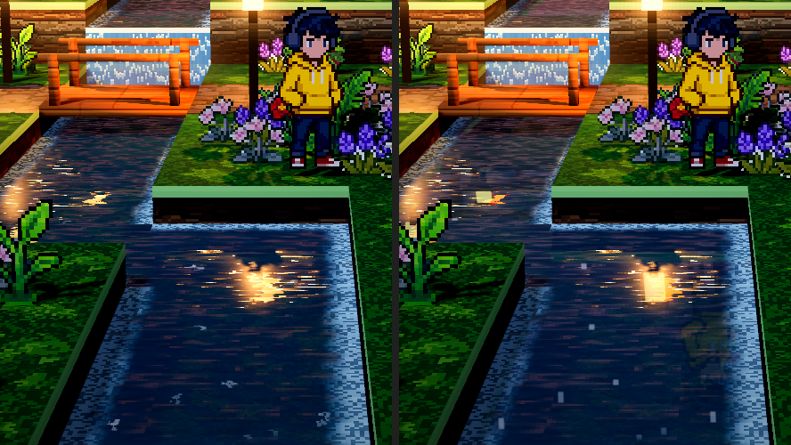
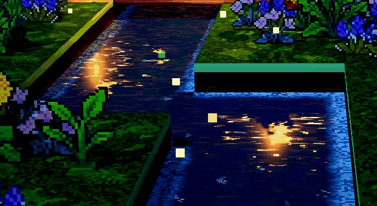

# Godot 水面灯光效果

2026-10-10，当前项目 `demoWithMeowa/1`，对照用户提供的 three.js benchmark 水面截图。

## 实现

沿用已有两水位平面反射、流水纹理和岸线泡沫，在水面材质中补充随细密水纹变化的横向碎光。用户反馈第一版缺少波光粼粼质感后，完成第二版；随后修正第二版削弱人物倒影的问题。

- 平面反射沿用 `benchmark/threejs/src/water.js` 的亮度抑制和 Fresnel 混合：压低暗处雾色，保留 HDR 灯头和光晕。波纹对倒影的扰动略增强。
- 第二版提高贴图驱动的倒影扰动至 benchmark 使用的量级，叠加随水流移动、横向拉长的细密波面法线；取消第一版稀疏随机遮罩，降低平滑宽亮斑占比，让反光分散到许多小波面上。直接高光继续使用 GGX，并读取 Godot 的真实灯光颜色、能量、衰减和阴影。
- 流动相位改为 benchmark 的双相 0.6 周期速度，保留半周期错相和交叉混合；`flow` 的长度继续控制流速，方向控制流向。水体底色压暗，让碎光与水体形成更清晰的对比。
- 纹理采样沿用 benchmark 的像素边缘抗锯齿方法，近处保持像素轮廓，远处使用连续 UV 的导数选择 mip，保留原有两相流动。
- 保留现有岸线、接触和瀑布落点泡沫，并在泡沫处减弱清水高光。

## 人物倒影与波光同时保留

第二版把强烈的细密波面扰动施加到整张反射纹理，同时沿用 benchmark 的低亮度反射抑制；人物的普通反射因此被打散、压暗。最终版对此做了以下修正：

- 普通场景辐射使用轻微、连续的倒影扰动，不再按亮度压暗人物和其他普通物体。
- HDR 超出 1.0 的高亮部分继续使用细密强扰动，从基础采样中扣除后重新加入，避免灯光能量叠加两次。
- 场景倒影的 Fresnel 使用平均水面朝向，避免细小波面法线使整个角色倒影突然变淡；混合下限校准为 0.22，以保留原有角色可见度。
- 第二版的细密法线、直接灯光 GGX 碎光和阴影计算保持不变。未调整灯位、相机、人物贴图或灯光强度。

用两个固定河岸位置对比增强波光前的原材质、第二版和最终版；冻结水纹、光晕、瀑布和人物动画，只隐藏人物反射面片生成对照。最终版的人物倒影图像差分对比度为原材质的约 100.5% / 104.0%，第二版对应约 48.4% / 37.3%。该数值验证两个机位的人物可见度，不代表所有位置的通用比例。直接高光、阴影和 R 键验证也通过。

临时脚本、截图和结果位于 `D:/.codexfile/work/water-reflection-balance/`。

同机位局部对比，左为第二版，右为最终版：

这是参考效果的 Godot 适配。两引擎的灯光衰减、泛光、曝光不同，未声称逐像素一致。地图、灯位、相机、整体光照和美术资源未因本次修改而调整。

## 调节

主场景 `ArtDirection` 节点的“水面”分组：

| 参数 | 默认值 | 作用 |
| --- | --- | --- |
| `water_highlight_strength` | 1.0 | 直接灯光高光强度；0 关闭直接高光，保留平面倒影 |
| `water_highlight_roughness` | 0.22 | 宽高光粗糙度；提高后反光更宽、更柔和 |
| `water_glint_strength` | 0.8 | 波纹碎光强度；0 保留宽高光 |
| `water_wave_strength` | 0.08 | 原有水纹法线和倒影扰动 |

原有反射质量、反射强度和 R 键倒影开关继续有效。编辑器材质预览可看直接高光，平面倒影须运行场景。

当前正式相机俯角为 10°。第二版最终预览使用原相机俯角和 11 m 距离，人物位于东侧河岸 `(24.5, 2.5)`，关闭景深和天气干扰；主场景相机、天气和灯位没有修改。金色亮斑出现的位置取决于灯位和视角。

## 验证与产物

实际使用 Godot 4.7.2 / D3D12 / Forward+ 渲染；主场景、两水位倒影和近景截图均完成，无 shader 编译或运行错误。隔离验证冻结水纹，关闭泛光和平面倒影，使用临时真实暖灯检查高光开关、灯能量、阴影遮挡、ArtDirection 参数和 R 键开关。临时灯与遮挡物只存在于验证进程。

第二版还实际运行了 three.js benchmark，检查了其渲染截图与编译后的 water fragment shader。发现第一版 Godot 的倒影 UV 扰动量过小、细光只存在于稀疏遮罩之内；本次分别修正。两者使用的水纹贴图 SHA-256 相同，没有新增或替换美术资产。

第二版隔离验证通过：864 个水面采样点，关闭直接高光后的平均亮度下降约 0.125，关闭测试灯后下降约 0.222，阴影遮挡后下降约 0.011。这些数值用于检查功能响应，不是与参考图的相似度评分。检查器参数和 R 键两次切换通过。连续捕获 24 帧，确认碎光随水纹变化。

临时脚本、编译后 shader、验证 JSON 和渲染帧位于 `D:/.codexfile/work/water-lighting/`。没有测量第二版材质的性能开销。

第二版波光演示（人物倒影修正前，最终对比见上）：

[上一版同机位](water-lighting-preview/shimmer-current-before.png) · [第二版同机位](water-lighting-preview/shimmer-current-camera.png)。两张对比固定水面 shader 的时间为 0.75 秒；其他动态元素不是逐像素冻结。

实现入口：`demoWithMeowa/1/shaders/water.gdshader`、`demoWithMeowa/1/scripts/art_direction.gd`。

Shader 坐标及真实灯光衰减依据：[Godot spatial shader 文档](https://docs.godotengine.org/en/stable/tutorials/shaders/shader_reference/spatial_shader.html)。
