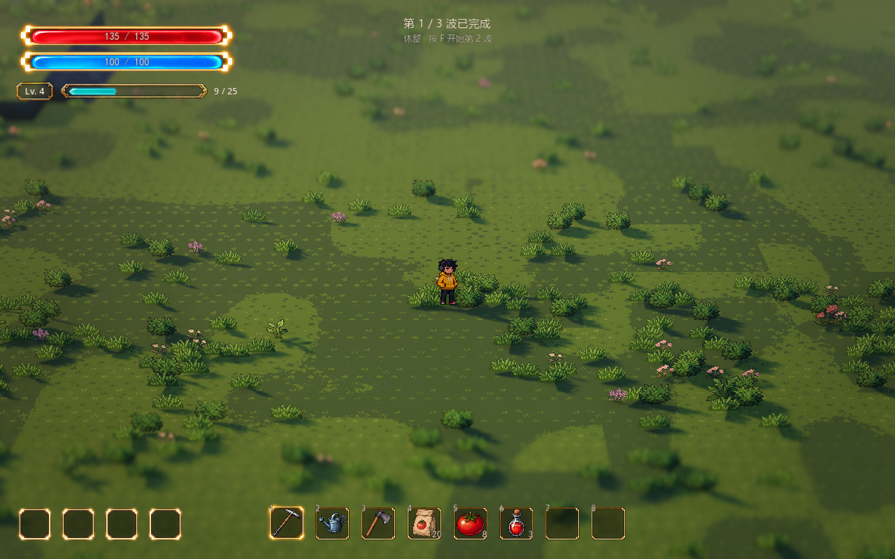
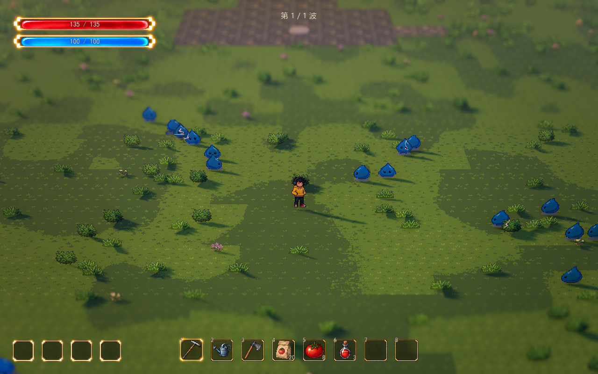

# 怪物刷新与波次基础

2026-10-13。已接入正式地图南侧战场，复用当前史莱姆、A01 扇击、经验与升级冻结接口。这里说明刷新和波次机制。

最新已改为[无尽波次](endless-waves.md)：保留前三波开场，第三波后继续生成递增波次，不再自动胜利；每波清完仍休整并按 F 继续。后续数量、刷新间隔及上限可调。

打开 `scenes/world/world.tscn` 后按 F6，沿南侧道路到卵石入口 `(0, 0, 25.6)`，按 **F** 开始。清波后 F 主动继续；战斗或休整时 ESC 撤退结算，结算后 **T** 重试或 ESC 返回小院。R 已用于 [Style 切换](parameters-and-styles.md)。已打开的界面先处理自己的按键。顶部中央已开启透明背景的小字波次提示；原灰盒面板仍隐藏，可在 `WavePrototype.show_ui` 开启状态调试。

## 当前波次配置

正式地图的 `WavePrototype.waves` 引用三份独立资源：

| 资源 | 总数 | 分批进场：数量 / 首次时间 / 组内间隔 |
| --- | --- | --- |
| `data/waves/wave_01.tres` | 18 | 北侧 6 / 0.6 秒 / 0.7 秒；两侧 8 / 8 秒 / 0.45 秒；南侧 4 / 16 秒 / 0.65 秒 |
| `data/waves/wave_02.tres` | 28 | 西侧 8 / 0.6 秒 / 0.55 秒；东侧 12 / 9 秒 / 0.35 秒；南侧 8 / 18 秒 / 0.45 秒 |
| `data/waves/wave_03.tres` | 40 | 北侧 10 / 0.6 秒 / 0.5 秒；两侧 18 / 10 秒 / 0.3 秒；南侧 12 / 21 秒 / 0.4 秒 |

开场三波使用 **18／28／40，共 86 只，同场最多 24 只**，后续继续无尽波次。每波采用少量试探、密集推进、后续增援，中间预留约 4–6 秒的刷怪间歇；间歇期间已有怪物继续追击，不等于波间安全休整。生命、速度、接触伤害和经验规则保持原配置。

表中时间以本波战斗计时为准；满员或无安全点时实际生成顺延，升级选择时计时冻结。因此不会为了赶上固定时刻突破上限或丢弃怪物。有限模式清空 `waves` 后仍支持原递增配置；无尽模式留空则以 `first_wave_enemies` 和 `spawn_interval` 建立一波模板，再按无尽参数续波。

`WaveDefinition` 包含多个 `WaveSpawnEntry`，每组配置怪物资源、数量、首次延迟、间隔、刷新区域标识和预告时间。不同怪物资源可混合编排。

开始前校验整轮配置、怪物根节点、数量预算、时间与区域标识，建立本局快照。运行中修改波次资源或怪物基础数值，下一轮开始／重试生效，当前队列和本局波数保持稳定。

## 区域与安全刷新

`BattleArea/SpawnCandidates` 六处标记已接入 `WaveSpawnZone`：`WestNorth`、`EastNorth`、`WestSouth`、`EastSouth`、`SouthWest`、`SouthEast`。游戏中不增加可见道具。

区域可调位置、`enabled`、`zone_id`、`radius`（默认 3.2 米）和 `weight`。标识留空使用节点名，权重 0 停用。怪物组 `spawn_zone_ids` 留空使用全部启用区域，填写后限定进场方向；区域修改自动刷新导航与候选点。

刷新点来自实际可通行地表，必须满足：

- 位于战斗范围内，保留身体边界余量，贴合台地或坡面。
- 避开玩家至少 5 米，并避开北侧入口／休整平台。
- 与已在场和预告中的怪物保留间距，避免重叠。
- 身体留空范围不碰静态墙体，有通往玩家所在地表的有效路线。

未配置区域容器的其他地图使用战斗范围外圈。QE 只改变观察角度，刷新与判定使用世界坐标。

## 调度与完整循环

**主动开始 → 校验并冻结本局配置 → 登记本波刷新任务 → 分批出场与战斗 → 待刷新和场上怪物均清空 → 清理敌方攻击、完成升级选择 → 安全休整 → F 开始下一波。** 无尽模式只在失败、撤退或异常时结算；有限模式保留最终胜利。

队列按到期时间排序，同一时间按登记顺序执行。每帧最多成功刷新 2 只、检查 4 个到期任务；某区域被堵住时，其他到期组仍可刷新。

暂时没有安全点时保留任务，每 0.3 秒重试。达到在场上限（正式地图 24，包含预告实例）时等待空位，不丢任务，满员等待不计作位置超时。位置持续不可用超过 10 秒才明确中断；残怪意外移除、跌落或无路线等情况也提供异常结果和清理，不伪造击杀或清波。

每波最多登记 512 只，包含计划刷新、延迟分裂和召唤；已生成后不返还总预算，防止持续追加绕过上限。

清波必须同时满足 **待刷新为空、场上敌人为空**，随后清理敌方弹丸和危险区。`wave_clearing` 允许经验收取和成长选择暂缓休整；完成后只推进一次。战斗冻结期间刷新计时、伤害与怪物活动暂停，天气、世界和声音沿用既有运行规则。

## Godot 调节入口

选中正式地图的 `WavePrototype`：

| 参数 | 默认 | 用途 |
| --- | --- | --- |
| `waves` | 三份资源 | 整轮组成；留空使用递增模式 |
| `endless_mode` | true | 正式地图无限续波，清波休整；关闭可对照有限模式 |
| `endless_enemies_per_wave` | 8 | 开场之后每波增加的总数 |
| `endless_max_enemies` | 160 | 后续每波总数上限，不限制波数 |
| `endless_interval_reduction` | 0.03 | 每波组内间隔减幅，最多累计 50% |
| `endless_min_spawn_interval` | 0.18 秒 | 后续组内间隔下限 |
| `spawn_zone_root` | `BattleArea/SpawnCandidates` | 区域容器，由场地自动连接 |
| `spawn_excluded_areas` | 北侧入口矩形 | 世界 XZ 禁刷区，由场地同步 |
| `spawn_safe_distance` | 5 米 | 与玩家的最小刷新距离 |
| `spawn_spacing` | 1.2 米 | 与在场／预告实例的最小间距 |
| `spawn_warning` | 0.8 秒 | 全局预告时间 |
| `max_active_enemies` | 24 | 正式地图同时在场上限；共享脚本回退值 30 |
| `max_spawns_per_tick` | 2 | 每帧成功刷新预算 |
| `max_spawn_checks_per_tick` | 4 | 每帧到期任务检查预算 |
| `spawn_retry_interval` | 0.3 秒 | 临时阻塞的重试间隔 |
| `spawn_block_timeout` | 10 秒 | 持续无可用刷新点的中断时间 |
| `max_spawns_per_wave` | 512 | 包含分裂／召唤的总登记预算 |
| `spawn_edge_band` | 3.2 米 | 无区域容器时的外圈宽度 |
| `unreachable_timeout` | 10 秒 | 残怪持续不可达的中断时间 |
| `random_seed` | 12102026 | 每轮开始重新初始化，便于复现 |
| `retry_key` | T | 界面隐藏时的重试键；R 留给 Style |

展开各波次的 `entries`：

| 参数 | 用途 |
| --- | --- |
| `enemy` / `count` | 场景与基础数值资源，以及组内数量 |
| `start_delay` / `interval` | 相对本波开始的首次刷新时间和后续间隔 |
| `spawn_zone_ids` | 允许的进场区域标识，空列表使用全部启用区域 |
| `warning_seconds` | -1 沿用控制器，0 立即激活，正值覆盖本组预告 |

`WaveEnemyDefinition.spawn_clearance` 默认 0.35 米，表示刷新时身体的留空半径，扩展怪物时与实际碰撞体一起配置。生命、移动、伤害和经验继续由该资源提供。

## 顶部透明文字

组件 `scenes/ui/wave_hud.tscn` 位于 `WavePrototype/WaveHUD`，独立于灰盒 `show_ui`。没有底板、边框或按钮，文字与容器均忽略鼠标输入。

- 靠近入口：准备第 1 / 3 波，下方小字提示 F 开始；在小院内隐藏。
- 战斗：只显示当前波数，例如“第 2 / 3 波”。
- 清波后：显示“第 1 / 3 波已完成”，下方提示“休整 · 按 F 开始第 2 波”，休整没有倒计时。
- 结算：显示成功或结束原因，下方提示 T 重试、ESC 返回。
- 背包等管理界面及升级选择期间隐藏，关闭后自动恢复。

Godot 选中 `WavePrototype/WaveHUD`，或在“参数总览 → UI”搜索“波次”：

| 参数 | 默认 | 用途 |
| --- | --- | --- |
| `enabled` | 开启 | 单独开关波次小字 |
| `top_margin` | 24 | 上缘距离，逻辑像素，始终水平居中 |
| `font_size` | 18 | 主波数文字字号 |
| `hint_font_size` | 14 | 操作提示字号 |
| `text_color` | 暖白，透明度 0.94 | 主文字颜色与透明度 |
| `hint_opacity` | 0.72 | 提示相对于主文字的透明度 |
| `outline_size` | 2 | 细暗描边宽度，保证亮草地上的可读性 |

数量在 `WavePrototype.waves → entries → count` 修改；密集程度调 `interval`，批次间歇调 `start_delay`，同场上限调 `max_active_enemies`。这些均直接使用现有参数，没有第二套配置。

## 扩展接口

根节点继承 `WaveEnemy`，通过 `configure_wave` 接收玩家、共用导航、敌方攻击容器及回调；具体移动和招式由怪物自身实现。

分裂或召唤须在母体结束生命周期前同步登记：

```gdscript
request_spawn.call(child_definition, count, delay_seconds, world_position)
```

登记后立即计入待刷新。指定点只在附近最多 3.2 米内找安全位置，不跳到另一端；`Vector3.INF` 使用普通区域。清波、结束与重试后旧回调失效。

`get_run_state()` 提供本局标识、阶段、结果、波数、待刷新数、在场数、预告数、累计生成与击杀、计时、冻结和导航状态。结果区分 `VICTORY`、`DEFEAT`、`RETREAT`、`ERROR`，无需解析提示文本。通知包括 `enemy_spawned`、`enemy_defeated_at`、`wave_clearing`、`wave_cleared`、`phase_changed`、`run_started` 和 `run_ended`。

## 验证

`tests/test_wave_spawning.gd` 已扩展为 66 项检查：完整生成并清除正式三波 86 只，达到但不超过 24 只，验证批次间歇和主动继续；同时覆盖区域、禁刷入口、间距、帧预算、满员等待、阻塞重试、排序、快照、冻结、局部分裂、清场扩展、旧回调、预算以及开始／立即重试的通知重入。

本次刷新 66 项、经验／波次整合 25 项与参数总览回归通过；此前基础循环、混合怪物接口、史莱姆 47 项、扇击 32 项已通过。波次共用导航限制到战区及少量缓冲，当前图 4096 点；完整地形半格网格为 20020 个候选位置，波次史莱姆复用同一张导航。

D3D12 / Forward+ 实机使用正式三波配置，完整生成并击败 **86 只**，每只被真实扇击命中两次，累计 **258 经验、8 次成长选择**；完成两次安全休整、最终胜利与返回。核对波数、休整与结算文字、顶部居中、鼠标穿透及升级期间隐藏。镜头保持 FOV 28°、距离 28 米、俯角 32°、深度景深 0.065。

该回归进程自动移动人物、临时关闭接触伤害并以 2 倍计时加速验证，正式配置没有改动；实际伤害由逻辑回归覆盖。截图恢复／使用当前场景的正式镜头，休整截图以正常计时拍摄。测试不写资源或存档。

另以第三波独立检查密度：人物站在中央，暂时关闭自动攻击与成长；20.5 秒左右场上达到 **24 只，仍有 16 只排队**。这张图因只加载第三波资源，波数显示 1 / 1，用来核对压力峰和容量；正式地图仍为完整三波。





[战斗波数](wave-spawning-preview/rhythm-battle.png) · [最终结算小字](wave-spawning-preview/rhythm-victory.png)。此前 21 只规模的截图保留为历史参考：[原刷新与扇击](wave-spawning-preview/battle.png)。
