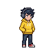
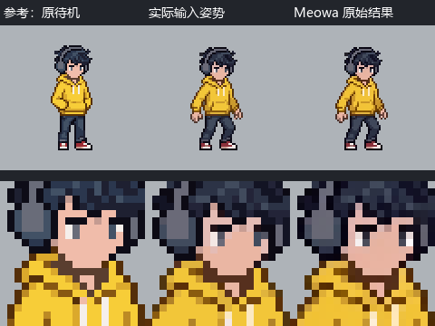
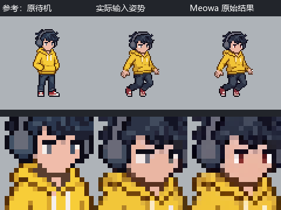

# 跳跃眼部严格像素编辑输入与结果

补记北京时间：2026-10-12T12:34:12.756121+08:00。这是对已发生的两次 Meowa CLI 编辑任务的补记。本次没有新发起生成。两次返回成功，原始结果均未采用。

当时暂停调用记录，精确提交时间与逐次 HTTP 记录未保存。保留可核验的实际执行脚本、完整 CLI 参数、提示词、输入文件、下载的原始结果、原始输出清单与 CLI 标准输出转录。不补造内部轮询和下载次数。

当前游戏使用从原待机复制眼部像素的局部修正版，并非这两张 Meowa 返回图。脸部轮廓、朝向与配色的连续性仍有用户反馈的问题；统一眼部不代表整张脸已经一致。

## 共用参考与实际提示词

第一张参考为待修姿势；第二张为原待机。



```text
修正第一张人物的眼睛，参照第二张站立图的眼睛，将眼白收回到原来的像素大小和形状，保持相同的瞳孔与朝向。只改眼部，保持第一张的动作、头发、脸型、衣服、像素大小和画布位置。
```

未单独发送负向提示词。

## CALL001 屈膝帧

任务 ID：job_6032cc4b19b44da1b8176f09bdc5e6cc。返回成功，未采用。下载文件保存北京时间：2026-10-12T12:24:11.756743+08:00。

[完整输入参数](CALL001-严格像素编辑-request.json) · [原始结果与标准输出转录](CALL001-严格像素编辑-result.json) · [采用状态](CALL001-严格像素编辑-status.json)



[输入原图](inputs/air_00.png) · [未经修改的返回 PNG](results/CALL001.png) · [原始输出清单](results/CALL001-final_outputs.json)

整图变化 1036 个像素，宽松眼部核对窗口外变化 884 个像素。

完整返回图仍改变眼部以外的配色或像素；收腿帧瞳孔颜色与眼白仍未匹配原待机。

```json
{
  "id": "CALL001",
  "task": "9-修正跳跃眼部",
  "recordType": "retrospective_backfill",
  "recordedBeijingTime": "2026-10-12T12:34:12.756121+08:00",
  "originalCallDate": "2026-10-12",
  "originalSubmissionTime": null,
  "timeNote": "精确提交时间未保存；补记时间不冒充调用时间。",
  "tool": "Meowa CLI / image-edit-run",
  "runner": "C:/Users/PC/.codex/skills/game-assets/meowart_api.py",
  "python": "C:/Users/PC/AppData/Local/Programs/Python/Python314/python.exe",
  "workingDirectory": "D:/Project/HD-2DMap",
  "arguments": [
    "image-edit-run",
    "--reference-image",
    "D:\\.codexfile\\work\\player-jump-eyes\\originals\\air_00.png",
    "--reference-image",
    "D:\\.codexfile\\work\\player-jump-eyes\\originals\\idle_00.png",
    "--prompt",
    "修正第一张人物的眼睛，参照第二张站立图的眼睛，将眼白收回到原来的像素大小和形状，保持相同的瞳孔与朝向。只改眼部，保持第一张的动作、头发、脸型、衣服、像素大小和画布位置。",
    "--mode",
    "pixel",
    "--strict",
    "--generation-model",
    "nano-banana",
    "--generation-speed",
    "normal",
    "--resolution",
    "1K",
    "--remove-bg-method",
    "standard",
    "--output-dir",
    "D:\\.codexfile\\work\\player-jump-eyes\\edit-00"
  ],
  "prompt": "修正第一张人物的眼睛，参照第二张站立图的眼睛，将眼白收回到原来的像素大小和形状，保持相同的瞳孔与朝向。只改眼部，保持第一张的动作、头发、脸型、衣服、像素大小和画布位置。",
  "negativePrompt": null,
  "negativePromptNote": "未单独发送负向提示词。",
  "parameters": {
    "mode": "pixel",
    "strict": true,
    "generation_model": "nano-banana",
    "generation_speed": "normal",
    "resolution": "1K",
    "remove_bg_method": "standard"
  },
  "references": [
    {
      "order": 1,
      "actualSentPath": "D:\\.codexfile\\work\\player-jump-eyes\\originals\\air_00.png",
      "archivedPath": "D:\\Project\\HD-2DMap\\meowa-call-logs\\9-修正跳跃眼部\\inputs\\air_00.png",
      "sha256": "e2af5e22e003e6d44a42dfc0f2d4078a9b0b6df7c87b954a6d1810f54ba120ec",
      "canvas": [
        80,
        80
      ]
    },
    {
      "order": 2,
      "actualSentPath": "D:\\.codexfile\\work\\player-jump-eyes\\originals\\idle_00.png",
      "archivedPath": "D:\\Project\\HD-2DMap\\meowa-call-logs\\9-修正跳跃眼部\\inputs\\idle_00.png",
      "sha256": "6eb1aea9ced7f576fc498df731efc9196c84dce59fdc159bc8d13bc65de2eaa5",
      "canvas": [
        80,
        80
      ]
    }
  ],
  "evidence": "保留的执行脚本与输入备份；这是实际 CLI 参数，不能视作 HTTP 原始请求。",
  "rawHttpRequest": null,
  "rawHttpRequestNote": "当时未保存提交、轮询、下载的逐次 HTTP 请求或精确次数，无法补造。",
  "relatedJob": "job_6032cc4b19b44da1b8176f09bdc5e6cc",
  "credentials": "本地环境认证；不记录密钥。"
}
```

## CALL002 收腿帧

任务 ID：job_c2f03dd77ca14dff9cc2d836e4514a69。返回成功，未采用。下载文件保存北京时间：2026-10-12T12:24:15.288130+08:00。

[完整输入参数](CALL002-严格像素编辑-request.json) · [原始结果与标准输出转录](CALL002-严格像素编辑-result.json) · [采用状态](CALL002-严格像素编辑-status.json)



[输入原图](inputs/air_03.png) · [未经修改的返回 PNG](results/CALL002.png) · [原始输出清单](results/CALL002-final_outputs.json)

整图变化 1058 个像素，宽松眼部核对窗口外变化 902 个像素。

完整返回图仍改变眼部以外的配色或像素；收腿帧瞳孔颜色与眼白仍未匹配原待机。

```json
{
  "id": "CALL002",
  "task": "9-修正跳跃眼部",
  "recordType": "retrospective_backfill",
  "recordedBeijingTime": "2026-10-12T12:34:12.756121+08:00",
  "originalCallDate": "2026-10-12",
  "originalSubmissionTime": null,
  "timeNote": "精确提交时间未保存；补记时间不冒充调用时间。",
  "tool": "Meowa CLI / image-edit-run",
  "runner": "C:/Users/PC/.codex/skills/game-assets/meowart_api.py",
  "python": "C:/Users/PC/AppData/Local/Programs/Python/Python314/python.exe",
  "workingDirectory": "D:/Project/HD-2DMap",
  "arguments": [
    "image-edit-run",
    "--reference-image",
    "D:\\.codexfile\\work\\player-jump-eyes\\originals\\air_03.png",
    "--reference-image",
    "D:\\.codexfile\\work\\player-jump-eyes\\originals\\idle_00.png",
    "--prompt",
    "修正第一张人物的眼睛，参照第二张站立图的眼睛，将眼白收回到原来的像素大小和形状，保持相同的瞳孔与朝向。只改眼部，保持第一张的动作、头发、脸型、衣服、像素大小和画布位置。",
    "--mode",
    "pixel",
    "--strict",
    "--generation-model",
    "nano-banana",
    "--generation-speed",
    "normal",
    "--resolution",
    "1K",
    "--remove-bg-method",
    "standard",
    "--output-dir",
    "D:\\.codexfile\\work\\player-jump-eyes\\edit-03"
  ],
  "prompt": "修正第一张人物的眼睛，参照第二张站立图的眼睛，将眼白收回到原来的像素大小和形状，保持相同的瞳孔与朝向。只改眼部，保持第一张的动作、头发、脸型、衣服、像素大小和画布位置。",
  "negativePrompt": null,
  "negativePromptNote": "未单独发送负向提示词。",
  "parameters": {
    "mode": "pixel",
    "strict": true,
    "generation_model": "nano-banana",
    "generation_speed": "normal",
    "resolution": "1K",
    "remove_bg_method": "standard"
  },
  "references": [
    {
      "order": 1,
      "actualSentPath": "D:\\.codexfile\\work\\player-jump-eyes\\originals\\air_03.png",
      "archivedPath": "D:\\Project\\HD-2DMap\\meowa-call-logs\\9-修正跳跃眼部\\inputs\\air_03.png",
      "sha256": "711c929bed07eba1caa672ef673aa752b4050ca173e35dbc3fd9aab757ae5f96",
      "canvas": [
        80,
        80
      ]
    },
    {
      "order": 2,
      "actualSentPath": "D:\\.codexfile\\work\\player-jump-eyes\\originals\\idle_00.png",
      "archivedPath": "D:\\Project\\HD-2DMap\\meowa-call-logs\\9-修正跳跃眼部\\inputs\\idle_00.png",
      "sha256": "6eb1aea9ced7f576fc498df731efc9196c84dce59fdc159bc8d13bc65de2eaa5",
      "canvas": [
        80,
        80
      ]
    }
  ],
  "evidence": "保留的执行脚本与输入备份；这是实际 CLI 参数，不能视作 HTTP 原始请求。",
  "rawHttpRequest": null,
  "rawHttpRequestNote": "当时未保存提交、轮询、下载的逐次 HTTP 请求或精确次数，无法补造。",
  "relatedJob": "job_c2f03dd77ca14dff9cc2d836e4514a69",
  "credentials": "本地环境认证；不记录密钥。"
}
```
