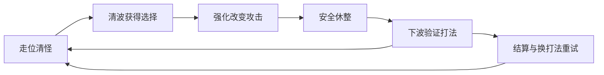

# 3C 2

- 项目：HD-2DMap
- 来源：`D:\Project\HD-2DMap`
- 会话 ID：`01a12f8e-4d8d-7891-8937-0daf9ea30f82`
- 原始存档：`\\?\C:\Users\PC\.codex\sessions\2026\10\12\rollout-2026-10-12T18-00-17-01a12f8e-4d8d-7891-8937-0daf9ea30f82.jsonl`
- 补录时间：2026-10-22T14:43:19+08:00
- 显示时区：Asia/Shanghai（UTC+08:00）；数据文件另保留 UTC 原始时间。
- 以下仅来自实际用户消息和最终回复，回合号在本会话内递增。
- 历史回复保留原文以便核查；设备和所用 Skill 未独立登记，不作推断。
- 文件字段仅补录已完成的结构化补丁事件，不推断工具脚本间接写入的文件。
- 图片与其它附件保留占位及可恢复路径，未复制二进制内容，未逐张补写图片说明。

### 回合 1 | 2026-10-12 18:01:37

- **回合 ID**：`01a12f8f-82e4-7af2-8886-60c7161e852d`
- **状态**：已完成
- **设备**：未知（历史未登记）
- **项目**：HD-2DMap
- **来源**：`D:\Project\HD-2DMap` | 时区=Asia/Shanghai
- **用户 1**（2026-10-12 18:01:37）：
  > 阅读Agents.md，有什么不懂就问我，我想要为当前闪身的动作加上一些对地编植物的影响，就比如他们被我闪身的动作所影响产生相应的摆动行为
  >
- **用户 2**（2026-10-12 18:02:42）：
  > <send_user_message_question_reply>
  > [{"questionItemId":"[\"request_user_input_async\",\"call_cec66d2a3d504a20a09c0676dd693f0d\",0]","question":"你希望闪身怎样带动花草？AGENTS.md 要求先确认动画表现，因此先确认这一点；我会继续检查现有代码和验证方式。","answer":"沿闪身路径顺势压弯，再轻轻回弹（推荐）"}]
  > </send_user_message_question_reply>
  >
- **用户 3**（2026-10-12 18:03:03）：
  > 甚至他也可以影响现在场景中局部的雨水
  >
- **用户 4**（2026-10-12 18:03:22）：
  > <send_user_message_question_reply>
  > [{"questionItemId":"[\"request_user_input_async\",\"call_2bd888698f7c4c17ae4502b8e6adba47\",0]","question":"你说的“局部雨水”，更希望看到哪种反应？","answer":"空中雨滴被闪身气流短暂带偏，随后恢复（推荐）"}]
  > </send_user_message_question_reply>
  >
- **回复（历史原文）**：

你希望闪身怎样带动花草？AGENTS.md 要求先确认动画表现，因此先确认这一点；我会继续检查现有代码和验证方式。
- 沿闪身路径顺势压弯，再轻轻回弹（推荐）
- 只在起点和落点向四周推开
- 沿途顺势压弯，落点再向四周推开

你说的“局部雨水”，更希望看到哪种反应？
- 空中雨滴被闪身气流短暂带偏，随后恢复（推荐）
- 地面的水迹或水面泛起涟漪
- 雨滴带偏，地面雨水也泛起涟漪

已接入正式地图和视觉预览：

- 闪身沿途的草、花顺势压弯，再轻轻回弹，根部固定。
- 附近空中雨滴短暂带偏，随后恢复。

重新运行场景后按 **Shift** 体验。在 **Weather → 闪身影响花草 / 闪身影响雨滴** 中可调范围、强度、恢复时间和开关。[参数说明](D:/Project/HD-2DMap/docs/player-dodge.md:56)

闪身 28 项、环境反馈 32 项检查通过，并完成真实 GPU 画面对比；沿用现有相机与景深。

- **文件（已完成补丁，可能不含脚本间接写入）**：
  - `D:\Project\HD-2DMap\demoWithMeowa\1\shaders\rain_streak.gdshader`：{"type": "update", "move_path": null}
  - `D:\Project\HD-2DMap\demoWithMeowa\1\scripts\world\homestead_flora.gd`：{"type": "update", "move_path": null}
  - `D:\Project\HD-2DMap\demoWithMeowa\1\shaders\blink_airflow.gdshaderinc`：{"type": "add"}
  - `D:\Project\HD-2DMap\demoWithMeowa\1\shaders\vegetation_wind.gdshader`：{"type": "update", "move_path": null}
  - `D:\Project\HD-2DMap\demoWithMeowa\1\scripts\player.gd`：{"type": "update", "move_path": null}
  - `D:\Project\HD-2DMap\demoWithMeowa\1\scripts\ground_dressing.gd`：{"type": "update", "move_path": null}
  - `D:\Project\HD-2DMap\demoWithMeowa\1\scripts\player_blink.gd`：{"type": "update", "move_path": null}
  - `D:\Project\HD-2DMap\demoWithMeowa\1\scripts\weather.gd`：{"type": "update", "move_path": null}
  - `D:\Project\HD-2DMap\demoWithMeowa\1\scenes\four_realms.tscn`：{"type": "update", "move_path": null}
  - `D:\Project\HD-2DMap\demoWithMeowa\1\scripts\map_effects.gd`：{"type": "update", "move_path": null}
  - `D:\Project\HD-2DMap\demoWithMeowa\1\tests\test_player_blink.gd`：{"type": "update", "move_path": null}
  - `D:\Project\HD-2DMap\demoWithMeowa\1\tests\test_blink_environment.gd`：{"type": "add"}
  - `D:\Project\HD-2DMap\demoWithMeowa\1\tests\test_player_blink.gd`：{"type": "update", "move_path": null}
  - `D:\Project\HD-2DMap\demoWithMeowa\1\tests\test_blink_environment.gd`：{"type": "update", "move_path": null}
  - `D:\.codexfile\work\blink-vegetation-20261012\render_blink.gd`：{"type": "add"}
  - `D:\Project\HD-2DMap\demoWithMeowa\1\scripts\weather.gd`：{"type": "update", "move_path": null}
  - `D:\Project\HD-2DMap\docs\player-dodge.md`：{"type": "update", "move_path": null}
- **Skill**：未知（历史未独立登记）
- **环境**：AI=Codex | 模型=gpt-6.1-sol

---

### 回合 2 | 2026-10-12 18:19:30

- **回合 ID**：`01a12f9f-e631-72e3-893c-0e4be2ea3e88`
- **状态**：已完成
- **设备**：未知（历史未登记）
- **项目**：HD-2DMap
- **来源**：`D:\Project\HD-2DMap` | 时区=Asia/Shanghai
- **用户**（2026-10-12 18:19:30）：
  > 我没看到地编花草又被影响啊
  >
- **回复（历史原文）**：

上一版的摆幅被贴图透明留白削弱了，矮草和花确实很难看出反应。已修正，现在压弯更明显、响应更快，并保留了你设置的强度和恢复时间。

**请停止当前运行，再重新运行地图**，在花草附近按 Shift。下面是修复后的实机动图：


- **文件（已完成补丁，可能不含脚本间接写入）**：
  - `D:\Project\HD-2DMap\demoWithMeowa\1\scripts\ground_dressing.gd`：{"type": "update", "move_path": null}
  - `D:\Project\HD-2DMap\demoWithMeowa\1\shaders\vegetation_wind.gdshader`：{"type": "update", "move_path": null}
  - `D:\Project\HD-2DMap\demoWithMeowa\1\tests\test_blink_environment.gd`：{"type": "update", "move_path": null}
  - `D:\Project\HD-2DMap\demoWithMeowa\1\scripts\world\homestead_flora.gd`：{"type": "update", "move_path": null}
  - `D:\.codexfile\work\blink-vegetation-visible-20261012\render_compare.gd`：{"type": "add"}
  - `D:\Project\HD-2DMap\docs\player-dodge.md`：{"type": "update", "move_path": null}
  - `D:\.codexfile\work\blink-vegetation-visible-20261012\encode_preview.py`：{"type": "add"}
  - `D:\.codexfile\work\blink-vegetation-visible-20261012\encode_preview.py`：{"type": "update", "move_path": null}
- **Skill**：未知（历史未独立登记）
- **环境**：AI=Codex | 模型=gpt-6.1-sol

---

### 回合 3 | 2026-10-12 19:00:52

- **回合 ID**：`01a12fc5-c5f9-71a3-91c0-5b8d0803c614`
- **状态**：已完成
- **设备**：未知（历史未登记）
- **项目**：HD-2DMap
- **来源**：`D:\Project\HD-2DMap` | 时区=Asia/Shanghai
- **用户**（2026-10-12 19:00:52）：
  > 游戏设计文档已经更新，接下来我们将讨论具体的战斗数值系统等等
  >
- **回复（历史原文）**：

已读[新版设计文档](D:/Project/HD-2DMap/docs/rpg-game-design.md)。接下来围绕**节奏舒缓的波次割草、波间休整和技能构筑**讨论；自动攻击、成长三选一等仍是待确认方案。

建议按这个顺序逐步确定：

1. **战斗手感**：小怪多久被击杀，人物能承受几次失误，闪身有什么战斗作用。
2. **基础数值**：生命、伤害、攻击间隔、范围和防御计算。
3. **技能成长**：强化怎样改变打法，如何避免某个选项始终最优。
4. **波次与补给**：敌人组合、难度增长、恢复和失败收益。

先从普通史莱姆开始：你希望开局 **1～2 次命中就能击杀**，还是需要 **3～5 次命中**？我倾向前者，让战斗压力更多来自怪群和走位，符合目前的割草方向。

- **文件**：未找到独立的已完成补丁记录，未推断其它改动
- **Skill**：未知（历史未独立登记）
- **环境**：AI=Codex | 模型=gpt-6.1-sol

---

### 回合 4 | 2026-10-12 19:03:22

- **回合 ID**：`01a12fc8-0f53-7a72-903f-b72a7caf671f`
- **状态**：已完成
- **设备**：未知（历史未登记）
- **项目**：HD-2DMap
- **来源**：`D:\Project\HD-2DMap` | 时区=Asia/Shanghai
- **用户**（2026-10-12 19:03:22）：
  > 普通史莱姆先按1到2次命中就能击杀来设计，接着讨论人物和怪物的生命、攻击、防御以及伤害计算公式，先把方案聊清楚。我们也要设计许多流派，让玩家能够把我们的这一整套系统能够全部串起来
  >
- **回复（历史原文）**：

我建议采用**统一基础属性、统一伤害结算，再通过技能、装备和局内强化形成不同流派**。这样后续增加技能时，都能接入同一套规则。下面是一版讨论草案，具体数值仍可调整。

人物和怪物都使用生命、攻击、防御，但三者各有职责：

- **生命**决定能承受多少伤害，也可以成为治疗、护盾及部分特殊技能的计算来源。
- **攻击**决定普通攻击和多数输出技能的基础威力。
- **防御**降低承受的伤害，也可以通过特定强化参与反击、护盾等构筑。

先以一套基础出战配置为基准：

| 对象 | 生命 | 攻击 | 防御 | 设计目标 |
|---|---:|---:|---:|---|
| 人物 | 100 | 20 | 10 | 有一定失误空间，仍需要走位 |
| 普通史莱姆 | 15～30 | 18 | 0 | 基础攻击命中 1～2 次击杀 |
| 带防御的敌人数值例 | 60 | 22 | 25 | 让破甲与集中输出有价值 |
| 精英数值例 | 120 | 26 | 20 | 给技能组合留下发挥空间 |

这里的人物数值指**完成战前准备后的基准配置**。确认方案后，基础属性、训练与装备加成需要一起校准。

伤害公式建议这样计算：

```text
技能原始伤害 = 攻击 × 技能倍率 + 固定伤害

有效防御 = max(0, 目标防御 × (1 − 破甲比例) − 本次穿透)

最终伤害 = 技能原始伤害
         × (1 + 本次适用的增伤合计)
         × 暴击倍率
         × 100 ÷ (100 + 有效防御)
```

普通命中的暴击倍率为 **1**，暴击时暂按 **1.5**。通用增伤、元素增伤和对应技能增伤，对本次攻击适用的部分先相加；暴击单独结算。

防御使用这条曲线，效果比较容易理解：

| 防御 | 减伤比例 |
|---:|---:|
| 0 | 0% |
| 10 | 约 9.1% |
| 50 | 约 33.3% |
| 100 | 50% |

例如人物攻击 20，基础攻击倍率为 1，打无防御史莱姆造成 20 点伤害：15 生命一击，30 生命两击。史莱姆攻击 18，打防御 10 的人物造成约 **16.4** 点伤害；满血人物在没有恢复的情况下，第 **7** 次这样的命中死亡。

群怪战斗还需要短暂的受击保护，避免多只怪物同一瞬间叠加伤害；具体时长随后结合攻击方式讨论。

我建议第一版让物理与元素伤害共用防御。火、冰、雷的特色主要由攻击方式和状态效果体现。破甲作用于目标，让其他技能也能受益；穿透只影响本次攻击。持续伤害则看完整持续时间内的伤害与清怪速度，**“史莱姆 1～2 次命中”以基础攻击为参照，不要求每个灼烧跳伤或分裂小弹丸都有同样威力。**

流派可以围绕下面这些机制展开，名称只是讨论标签：

| 流派方向 | 主要投入 | 组合怎样成形 |
|---|---|---|
| 速射暴击 | 攻击频率、暴击率、暴击伤害 | 高频攻击配合暴击触发效果 |
| 范围爆破 | 范围、伤害、击杀效果 | 聚怪清场，击杀继续产生范围攻击 |
| 持续伤害 | 持续时间、叠层、传播 | 施加灼烧或中毒，再走位等待伤害生效 |
| 冰控协同 | 减速、冻结、对受控目标增伤 | 控制敌人，为其他输出技能创造条件 |
| 雷电连锁 | 弹跳次数、目标数量、触发频率 | 利用密集怪群扩大攻击覆盖 |
| 防御反击 | 防御、生命、护盾 | 承受有效命中后反击，防御参与反击威力 |
| 召唤协同 | 召唤数量、随从强化、辅助效果 | 随从承担输出，人物负责走位和支援 |
| 魔力循环 | 魔力上限、恢复、消耗收益 | 消耗魔力爆发，再通过特定条件补充 |

魔力循环是一个候选方向；自动攻击是否耗蓝，需要另行确认。

**每个流派都应改变优先属性、技能选择和走位方式，也允许混合搭配。**例如：

- 冰系减速让敌人在火焰区域内停留更久，再用灼烧传播扩大覆盖。
- 高防御增强反击，反击击杀后获得少量护盾，形成攻防循环。
- 高频攻击提供更多触发机会，再搭配雷电连锁扩大清怪范围。

这类触发需要限制频率和相互触发的关系，避免一条连锁无限循环。治疗、吸血和护盾也要一起评估，否则高防御配合持续恢复可能让生存压力消失。

把整套系统串起来，我建议形成这样的关系：

**家园准备 → 装备、补给与起始技能 → 波内战斗 → 波间强化流派 → 结算获得资源与解锁 → 回到家园调整下一次出战。**

训练提供有上限的基础成长；装备帮助选择出战倾向；局内技能与强化让流派逐渐成形。背包承载装备、材料与有限补给，后续种植、制作可以提供不同补给，伙伴也可以围绕控制、召唤、恢复等机制加入组合。这些都是系统衔接建议，继续按讨论结果取舍。

这一轮我最想先确认的是：**你希望高生命、高防御也能通过特定技能转化为输出，形成完整的防御反击流吗？**我倾向允许，这样生命和防御也能参与玩家的流派选择。

- **文件**：未找到独立的已完成补丁记录，未推断其它改动
- **Skill**：未知（历史未独立登记）
- **环境**：AI=Codex | 模型=gpt-6.1-sol

---

### 回合 5 | 2026-10-13 11:45:31

- **回合 ID**：`01a1335d-88ce-7cb2-a453-3e004951768c`
- **状态**：已完成
- **设备**：未知（历史未登记）
- **项目**：HD-2DMap
- **来源**：`D:\Project\HD-2DMap` | 时区=Asia/Shanghai
- **用户**（2026-10-13 11:45:31）：
  > 看一下最新的游戏设计文档，我们要探讨一下吸血鬼幸存者如何在我们的HD-2D中构建一整套的多巴胺循环
  >
- **回复（历史原文）**：

已读[最新版 0.6 设计文档](D:/Project/HD-2DMap/docs/rpg-game-design.md)。现在的讨论基准是两人一周的 Demo：两种武器、五波、四次成长选择，经验拾取和永久解锁暂不纳入。

**我认为核心是让玩家反复经历：“我清掉了威胁 → 我做了选择 → 我的打法明显变强 → 我想看看它下一波能做到什么。”** 你说的“多巴胺循环”，我们可以具体落实为这种期待、兑现和再次期待。

《吸血鬼幸存者》的官方介绍强调选择带来的战力滚雪球，以及每局金币用于后续成长。[Steam 官方介绍](https://store.steampowered.com/app/1794680/Vampire_Survivors/) 我的设计拆解是：它把即时击杀、不断成长、组合成形和下一局目标接在一起。我们的 HD-2D 可以把这套关系做得更有空间感，也更舒缓。



**首先，每次有效操作都要有回报。**

| 玩家做了什么 | 应当感受到的回报 | 在我们游戏中的落点 |
|---|---|---|
| 命中敌人 | “攻击确实打中了” | 清楚的命中反馈，生命变化与死亡衔接一致 |
| 把怪物聚成一群或一列 | “我的走位有用” | 范围攻击清掉一群，穿透弹贯穿一列 |
| 闪身脱离围堵 | “我化解了危险” | 威胁落空、位置改变，花草与雨丝响应补充动作感 |
| 清空一波 | “我完成了一件事” | 战斗声退去、安全得到确认，然后获得成长选择 |
| 完成强化 | “我想马上试一下” | 下一波很快出现适合展示这次强化的机会 |

这里尤其重要的是**走位带来的成就感**。近身武器可以让玩家聚怪后找准接近、退出的时机；穿透武器可以让玩家利用路线，把敌人排成一列。自动攻击也能让玩家明确感觉到“这一串击杀是我创造的”。

**其次，成长必须通过战斗表现兑现。**

两种武器、各三级，也能做出值得期待的变化。例如讨论中的升级可以让：

- 近身攻击逐渐覆盖更多目标，攻击节奏更容易形成连续清场。
- 远程攻击贯穿更长的怪列，连续射击带来更明显的扫荡过程。
- 获得第二把武器后，原来的近身或远距弱点得到补充。

选择界面应该帮助玩家预想这个变化，比如“更容易清理围过来的敌人”“能贯穿更多目标”。下一波开头再给一段发挥窗口，让玩家亲自确认选择有效，然后逐渐增加压力。

**如果升级后立即把敌人血量同步抬高，玩家可能很难感受到成长。** 难度还可以通过敌人数量、进场方向和冲撞行为增加，保留普通史莱姆容易击杀的割草体验。

**当前文档最大的待验证点，是成长反馈的间隔。**

每波计划战斗 60～90 秒，加上休整，而成长只发生在波后。我的判断是：如果波内始终是同样的追怪、攻击、等待，四次选择可能不足以撑起整局期待感。

按当前 Demo 范围，我建议先这样安排：

| 波次 | 这一波承担的期待与兑现 |
|---|---|
| 第一波 | 尽快读懂攻击，尽快得到第一次成长；可以比后续波短 |
| 第二波 | 明显展示第一次强化的收益，让玩家开始偏向一种打法 |
| 第三波 | 冲撞威胁带来新问题，促使玩家重新考虑位置与升级选择 |
| 第四波 | 给成形的组合一次清理成群敌人的发挥机会 |
| 第五波 | 精英战检验组合，胜负结算让玩家产生下一局的调整想法 |

波内也应有变化：适应、聚群压力、集中清场、收拾残局。这样即使暂时没有经验升级，玩家仍能不断完成小目标。

**HD-2D 的价值，是让战斗和休整都值得停留。**

台地、坡道和建筑可以帮助玩家读懂路线、组织怪群，但必须保证敌人能接近，攻击遮挡规则一致。成长后的攻击覆盖更大，也需要继续看得清敌人预警和地面路径。

清波后，原有风雨、花草和背景音乐重新成为注意力的主体。玩家有时间看懂奖励、观察环境，再主动继续。这种从压力到安静的变化，可以成为我们这一版很鲜明的体验。

**最后，让“再来一局”有具体理由。**

这一周 Demo 可以先靠不同选择路线产生重玩动力：专精近身、专精穿透，或兼顾两把武器与生存升级。结算要让玩家知道组合做到了什么、在哪里遇到困难，形成“下次早点拿另一把武器”这样的想法。

完整版本再考虑内容解锁，让长期成长提供新打法、新组合和新挑战。此前讨论的更多流派，可以从这里逐步扩展；当前 Demo 先验证玩家是否愿意主动换一条路线重玩。

我们先确定最关键的一点：**你更希望波内也有持续收集、频繁成长，还是保留清波后集中选择、下一波充分体验变化的节奏？** 按当前一周预算，我倾向先验证后者，并把第一次奖励提前、每次强化的变化做明显。

- **文件**：未找到独立的已完成补丁记录，未推断其它改动
- **Skill**：未知（历史未独立登记）
- **环境**：AI=Codex | 模型=gpt-6.1-sol

---

### 回合 6 | 2026-10-13 11:54:41

- **回合 ID**：`01a13365-f273-7c02-812d-b97b62c82151`
- **状态**：已完成
- **设备**：未知（历史未登记）
- **项目**：HD-2DMap
- **来源**：`D:\Project\HD-2DMap` | 时区=Asia/Shanghai
- **用户**（2026-10-13 11:54:41）：
  > 设计还在更新，方向大概就是这样，但是我想知道我们HD-2D如何去实现我们自己的吸血鬼幸存者游戏，这部分我觉得是我们要考虑的，而且我们的视觉也在不断更新
  >
- **回复（历史原文）**：

我建议把我们的游戏定位为：**在真实三维地形中，用像素角色自动战斗，靠走位与闪身组织怪群，通过波次成长逐渐形成打法的 HD-2D 生存游戏。**

视觉可以继续更新。我们现在需要建立的是一套能适应这些变化的空间规则、战斗表现和验证方法。

**HD-2D 的特点，要实际参与玩家的判断。**

| 现有特点 | 可以带来的玩法 | 需要解决的问题 |
|---|---|---|
| 台地、坡道与建筑 | 引导怪群、利用路线、寻找脱身方向 | 通路必须畅通，高差和墙体怎样阻挡攻击要清楚 |
| 有纵深的镜头 | 让怪群逼近和穿透攻击更有空间感 | 前后敌人容易重叠，需要看清威胁与落脚位置 |
| 三维场景中的像素角色 | 保留像素动画，同时参与真实碰撞与遮挡 | 图像大小、脚底位置、碰撞范围需要对应 |
| 光影、花草和天气 | 强化移动、攻击与环境之间的联系 | 战斗预警在日景、夜景和雨景下都要可辨认 |
| 连续地图与小院 | 让准备、出战、休整自然连接 | 战斗范围与安全区域需要明确 |

我看了今天保存的视觉试验图、恢复后的画面和灰盒战斗截图。**当前最值得优先验证的是镜头中的战斗可读性。** 近景、低俯角下，敌人会与前后花草重叠；同屏怪群增加后，玩家能否判断距离、围堵方向和冲撞预警，还需要实景测试。

先沿用目前确认的相机基准，把文档里建议的 20～30 个敌人作为测试目标。如果可读性不足，再一起讨论敌群分布、场地留白和战斗观察尺度。

**两种基础攻击，可以先围绕空间做出区别。**

近身周期范围攻击，让玩家判断什么时候聚怪、靠近、清场，再及时退出。远程穿透攻击，让玩家通过移动，把敌人引成一列，创造一次贯穿多个目标的机会。

这样，自动攻击的效率会受到玩家走位影响。后续流派也可以沿着这些行为扩展：更擅长处理围堵、更擅长清理长队、更擅长控制路线，或更擅长抓住脱身后的输出窗口。

一次候选体验可以是：玩家沿台地外缘移动，把追来的史莱姆引成一列，用穿透攻击清理；另一侧敌人靠近后，范围攻击处理近身压力，闪身穿过空隙重新组织位置。花草和雨丝响应动作，一波结束后，原有环境声与场景氛围重新成为注意力的主体。

**实现上，已有原型需要先接合起来。**

目前史莱姆负责外观、动画与巡逻追踪；波次灰盒敌人负责战斗伤害。灰盒基础攻击到了触发时机就直接对目标扣血，尚未形成真实的范围攻击或穿透弹过程。

接下来的合理顺序是：

1. **把史莱姆表现与波次战斗接合。** 同一只敌人完整经历出现、接近、受击、死亡和清波统计。
2. **做出两种攻击的实际命中过程。** 范围攻击判断世界中的覆盖区域；穿透弹沿世界方向运动，处理敌人、墙体与高差。QE 旋转保持观察作用。
3. **在现有实景中测试怪群。** 同时检查镜头、遮挡、花草、预警、命中反馈和性能。
4. **再接成长选择。** 升级之后，玩家能直接看到覆盖范围、贯穿数量或攻击节奏的变化。

这几步完成后，我们才能判断“在我们的画面里清怪是否好玩”，也才能更有依据地扩展流派。

**视觉持续更新时，战斗应保留几条稳定标准：**

- 攻击范围以世界距离为准，换素材后仍能正确表达命中区域。
- 人物脚底、敌人位置与危险范围对得上。
- 关键威胁在不同光照和天气下都能看清。
- 强化改变的战斗能力，有对应的视觉表现。
- 场景效果与密集战斗一起验证。

我建议下一轮先把**战斗镜头、场地空间和两种基础攻击**放在一起聊清楚。这个组合最能决定我们的 HD-2D 生存游戏实际玩起来是什么感觉，也能为之后不断更新的视觉提供明确的检验标准。

- **文件**：未找到独立的已完成补丁记录，未推断其它改动
- **Skill**：未知（历史未独立登记）
- **环境**：AI=Codex | 模型=gpt-6.1-sol

---

### 回合 7 | 2026-10-13 12:07:44

- **回合 ID**：`01a13371-e3b9-72e0-a83a-4e995d788d85`
- **状态**：已完成
- **设备**：未知（历史未登记）
- **项目**：HD-2DMap
- **来源**：`D:\Project\HD-2DMap` | 时区=Asia/Shanghai
- **用户 1**（2026-10-13 12:07:44）：
  > 那我们先做一下游戏的核心内容，先搭建吸血鬼幸存者的核心波次逻辑，怪物先采用当前的史莱姆，留好后续可替换接口，我们后面会加入新的怪物，同时他的攻击逻辑可能也和史莱姆不一致
  >
- **用户 2**（2026-10-13 12:11:58）：
  > 你可以参考一下我们的战斗设计文档
  >
- **回复（历史原文）**：

已参考战斗设计文档，把现有史莱姆接入核心波次循环。

- 默认三波 **5／7／9 只**，史莱姆两次基础命中击杀。
- 清波后安全休整，按 **F** 主动继续。
- 波次生成与怪物行为已分开，后续怪物可使用独立的冲锋、远程等攻击逻辑。
- 已预留延迟分裂、召唤登记，以及敌方弹丸和危险区清理接口。

实机完整击杀了 21 只史莱姆，波次测试及原史莱姆 47 项检查均通过。

运行正式地图，靠近南侧圆台按 **F** 开始。数值仍是测试基线，参数与扩展方式见[波次说明](D:/Project/HD-2DMap/docs/wave-graybox.md)，可查看[实机外观](D:/Project/HD-2DMap/docs/wave-core-preview/slime.png)。

- **文件（已完成补丁，可能不含脚本间接写入）**：
  - `D:\Project\HD-2DMap\demoWithMeowa\1\scripts\combat\wave_definition.gd`：{"type": "add"}
  - `D:\Project\HD-2DMap\demoWithMeowa\1\scripts\combat\wave_enemy.gd`：{"type": "update", "move_path": null}
  - `D:\Project\HD-2DMap\demoWithMeowa\1\scripts\combat\wave_enemy_definition.gd`：{"type": "add"}
  - `D:\Project\HD-2DMap\demoWithMeowa\1\scripts\enemies\slime.gd`：{"type": "update", "move_path": null}
  - `D:\Project\HD-2DMap\demoWithMeowa\1\data\wave_slime.tres`：{"type": "add"}
  - `D:\Project\HD-2DMap\demoWithMeowa\1\scripts\combat\wave_spawn_entry.gd`：{"type": "add"}
  - `D:\Project\HD-2DMap\demoWithMeowa\1\scripts\enemies\terrain_path.gd`：{"type": "update", "move_path": null}
  - `D:\Project\HD-2DMap\demoWithMeowa\1\scenes\world\world.tscn`：{"type": "update", "move_path": null}
  - `D:\Project\HD-2DMap\demoWithMeowa\1\scripts\combat\wave_prototype.gd`：{"type": "update", "move_path": null}
  - `D:\Project\HD-2DMap\demoWithMeowa\1\tests\test_wave_core.gd`：{"type": "add"}
  - `D:\Project\HD-2DMap\demoWithMeowa\1\tests\fixtures\wave_probe_enemy.gd`：{"type": "add"}
  - `D:\Project\HD-2DMap\demoWithMeowa\1\tests\test_wave_prototype.gd`：{"type": "update", "move_path": null}
  - `D:\Project\HD-2DMap\demoWithMeowa\1\scenes\shared\wave_prototype.tscn`：{"type": "update", "move_path": null}
  - `D:\Project\HD-2DMap\demoWithMeowa\1\scripts\combat\wave_prototype.gd`：{"type": "update", "move_path": null}
  - `D:\Project\HD-2DMap\demoWithMeowa\1\scripts\combat\wave_prototype.gd`：{"type": "update", "move_path": null}
  - `D:\Project\HD-2DMap\demoWithMeowa\1\scripts\enemies\slime.gd`：{"type": "update", "move_path": null}
  - `D:\Project\HD-2DMap\demoWithMeowa\1\tests\test_wave_core.gd`：{"type": "update", "move_path": null}
  - `D:\.codexfile\work\wave-core-slime-20261013\runtime_preview.gd`：{"type": "add"}
  - `D:\.codexfile\work\wave-core-slime-20261013\runtime_preview.gd`：{"type": "update", "move_path": null}
  - `D:\.codexfile\work\wave-core-slime-20261013\runtime_preview.gd`：{"type": "update", "move_path": null}
  - `D:\Project\HD-2DMap\docs\first-slime.md`：{"type": "update", "move_path": null}
  - `D:\Project\HD-2DMap\demoWithMeowa\1\scripts\combat\wave_prototype.gd`：{"type": "update", "move_path": null}
  - `D:\Project\HD-2DMap\docs\wave-graybox.md`：{"type": "update", "move_path": null}
  - `D:\Project\HD-2DMap\AGENTS.md`：{"type": "update", "move_path": null}
  - `D:\.codexfile\work\wave-core-slime-20261013\sprite_preview.gd`：{"type": "add"}
  - `D:\Project\HD-2DMap\docs\wave-graybox.md`：{"type": "update", "move_path": null}
  - `D:\Project\HD-2DMap\demoWithMeowa\1\scripts\combat\wave_prototype.gd`：{"type": "update", "move_path": null}
- **Skill**：未知（历史未独立登记）
- **环境**：AI=Codex | 模型=gpt-6.1-sol

---

### 回合 8 | 2026-10-13 12:30:58

- **回合 ID**：`01a13387-27c3-77a2-97a4-16db70c40ce8`
- **状态**：已完成
- **设备**：未知（历史未登记）
- **项目**：HD-2DMap
- **来源**：`D:\Project\HD-2DMap` | 时区=Asia/Shanghai
- **用户**（2026-10-13 12:30:58）：
  > 接下来我们先讨论人物的自动攻击，参考战斗设计文档，把第一种攻击的表现、伤害和后续流派的衔接聊清楚，再开始实现。而且我们现在正在搭建具体的战斗场景
  >
- **回复（历史原文）**：

按文档的 A01「近身扇击」展开，第一种攻击你更希望怎样表现？这会决定人物动作与武器素材；伤害和流派关系可以先按同一套扇区规则讨论。
- 人物持短刃横扫，有清晰出手动作（推荐）
- 人物释放近身扇形能量，没有实体武器
- 自动短刃围在身边，朝敌人方向挥出

我建议从文档的 **A01「近身扇击」** 开始：自动选方向，玩家通过走位，把几只怪带进同一扇区，一次扫中。它能建立近身清群的手感，也能给后续搭配留下空间。下面都是讨论起点。

表现上，我偏向**人物持短刃横扫，带一道短促的弧形斩光**：

- 有约 0.1 秒的出手动作，随后弧线扫过前方，扫到怪物时才结算伤害。
- 斩光用清楚的亮边和半透明扫痕，命中配短声音、怪物变亮和轻微击退；击杀反馈更明显。
- 人物可以边走边打。每次出手锁定方向，这一击结束前保持稳定，QE 只改变观察角度。
- 建议闪身打断当前扫击，但不返还冷却，让脱离危险与继续输出之间有取舍。

伤害先围绕已经采用的“普通史莱姆一到两次命中击杀”来定：

| 项目 | 建议初始值 | 体验目标 |
|---|---:|---|
| 单次伤害 | 10 | 对 20 生命史莱姆两击击杀 |
| 攻击间隔 | 0.8 秒 | 保持利落，留出走位窗口 |
| 扇长 | 2.4 米 | 接近敌群才能发挥 |
| 扇角 | 100° | 能扫中聚群，仍需处理侧后方 |
| 基础击退 | 约 0.25 米 | 有命中力量感，适度争取空间 |

**扇区内每只怪都承受完整伤害，每段对同一只怪只命中一次。**例如聚来三只史莱姆，第一击各扣 10，第二击三只一起倒下，这就是第一种攻击应提供的清群反馈。没有有效目标时保持就绪，敌人进入范围后出手。

初期伤害入口可以明确为：

`扇击基础伤害 ×（1＋本局伤害增益）`

后续暴击、易伤和敌人减伤经过共同结算，各应用一次。范围扩大增加覆盖；燃烧等附加伤害另行计算。伤害成长要看击杀次数：10 提到 12，史莱姆仍需两击，因此早期升级还应带来明显的覆盖变化。

升级顺着文档的方向走：**二级扇长增加 → 三级扇角展开 → 四级两段错时斩击**。两段各有动作、命中和声音；第二段仍须实际扫中目标。

流派衔接可以先抓住三条：

| 打法 | 扇击承担的作用 | 后续搭配 |
|---|---|---|
| 近身清群 | 主动靠近，扫开群体 | 环绕护卫、震荡环；范围、攻速、击退、强壮体型 |
| 控制消耗 | 一次给多只怪施加状态 | 缓速、燃烧或导电，再配持续区或连锁 |
| 机动拉扯 | 绕群边缘出手，换位后再次聚怪 | 回旋返程；移速、闪身冷却、轻巧体型 |

它的弱处应保留：**身后包围和远程目标需要额外应对**。这样环绕、追踪等攻击才有实际搭配价值。

战斗场景正在搭建，攻击尺寸应结合更新后的正式镜头判断。建议在开阔中心、稀疏植被处和坡道边缘分别观察：是否看清扫向、覆盖是否与命中一致，以及墙体和不相接台地能否正确阻断伤害。先把这些体验与武器表现定下来，再制作动作和接入实现。

- **文件**：未找到独立的已完成补丁记录，未推断其它改动
- **Skill**：未知（历史未独立登记）
- **环境**：AI=Codex | 模型=gpt-6.1-sol

---

### 回合 9 | 2026-10-13 13:01:22

- **回合 ID**：`01a133a3-0018-7461-a227-d30e279999f2`
- **状态**：已完成
- **设备**：未知（历史未登记）
- **项目**：HD-2DMap
- **来源**：`D:\Project\HD-2DMap` | 时区=Asia/Shanghai
- **用户**（2026-10-13 13:01:22）：
  > <send_user_message_question_reply>
  > [{"questionItemId":"[\"request_user_input_async\",\"call_c79978337b1f4ad4813a3c4cc07836c2\",0]","question":"按文档的 A01「近身扇击」展开，第一种攻击你更希望怎样表现？这会决定人物动作与武器素材；伤害和流派关系可以先按同一套扇区规则讨论。","answer":"你要知道我们后面会有多种多样的武器和流派，不可能为人物单独设计相应的动画，大概率是只有武器的动画或者特效"}]
  > </send_user_message_question_reply>
  >
- **回复（历史原文）**：

对，我们应该按**武器与特效独立攻击**来设计。刚才方案中的人物专属出手动作撤掉，人物继续沿用移动、跳跃和闪身动画。

这样需要分清三层：

- **攻击方式**：扇击、穿透、回旋、环绕等，决定如何命中。
- **武器**：承载自己的外观、动画、攻击节奏和特色。
- **流派**：武器与范围、攻速、状态、移动等增益组合形成的打法。

人物朝向继续由移动决定，每件武器独立选目标、锁定方向和播放效果。多个攻击可以同时运行，不会争抢人物动作。

因此 A01 可以调整为：**人物附近出现一道短促的弧形斩击，朝最近目标扫过前方扇区，命中后消散。**如果采用实体武器，就由武器自身完成挥动；也可以先用斩击特效完整表达。平时保持人物周围清爽，攻击时看清来源、方向和覆盖范围。

伤害方案仍可沿用 **10 伤害、0.8 秒间隔、2.4 米扇长、100°扇角**作为讨论起点。范围内多只史莱姆同时受伤，两次命中击杀；后续成长通过扇长、扇角和错时双段体现。

这里还有个关键：**不同武器要能改变打法。**例如宽扇慢扫适合聚群，窄扇快扫适合边走边清，双段扇击适合持续近身输出。这样既能共享攻击规则，也能做出武器差异，再与环绕、回旋、控制状态等接成流派。

- **文件**：未找到独立的已完成补丁记录，未推断其它改动
- **Skill**：未知（历史未独立登记）
- **环境**：AI=Codex | 模型=gpt-6.1-sol

---

### 回合 10 | 2026-10-13 13:03:20

- **回合 ID**：`01a133a4-cb10-7260-8d6f-443cdcd711ab`
- **状态**：已完成
- **设备**：未知（历史未登记）
- **项目**：HD-2DMap
- **来源**：`D:\Project\HD-2DMap` | 时区=Asia/Shanghai
- **用户**（2026-10-13 13:03:20）：
  > 那我们先做第一种扇形自动攻击看看，用独立的斩击特效表现，人物沿用现有动画，接到现在的新战斗场景里，伤害、范围和攻击间隔都留参数给我调整。
  > 这种武器攻击动画可以让meowa来提供
  >
- **回复（历史原文）**：

已接入新战场，使用 **Meowa 八帧独立斩击特效**，人物沿用现有动画。

在 Godot 选中 **WavePrototype → FanAutoAttack** 调整：

- 伤害：默认 **10**
- 范围：默认 **2.4 米／100°**
- 攻击间隔：默认 **0.8 秒**
- 另有扫击时长、击退、亮度和透明度参数

支持群体命中、单击去重、遮挡与高差判断。**32 项检查和实机清波验证通过。**

运行正式地图，到新战场入口按 **F** 开始。[参数说明与动态预览](D:/Project/HD-2DMap/docs/fan-auto-attack.md)。

攻击音效暂未加入，Meowa 生成未成功。

- **文件（已完成补丁，可能不含脚本间接写入）**：
  - `D:\Project\HD-2DMap\demoWithMeowa\1\scenes\combat\fan_auto_attack.tscn`：{"type": "add"}
  - `D:\Project\HD-2DMap\demoWithMeowa\1\scripts\combat\wave_prototype.gd`：{"type": "update", "move_path": null}
  - `D:\Project\HD-2DMap\demoWithMeowa\1\scenes\shared\wave_prototype.tscn`：{"type": "update", "move_path": null}
  - `D:\Project\HD-2DMap\demoWithMeowa\1\scripts\combat\wave_enemy.gd`：{"type": "update", "move_path": null}
  - `D:\Project\HD-2DMap\demoWithMeowa\1\scripts\combat\fan_auto_attack.gd`：{"type": "add"}
  - `D:\Project\HD-2DMap\demoWithMeowa\1\scripts\enemies\slime.gd`：{"type": "update", "move_path": null}
  - `D:\Project\HD-2DMap\demoWithMeowa\1\shaders\fan_slash.gdshader`：{"type": "add"}
  - `D:\Project\HD-2DMap\demoWithMeowa\1\scenes\world\world.tscn`：{"type": "update", "move_path": null}
  - `D:\Project\HD-2DMap\demoWithMeowa\1\tests\test_wave_prototype.gd`：{"type": "update", "move_path": null}
  - `D:\Project\HD-2DMap\demoWithMeowa\1\tests\test_wave_core.gd`：{"type": "update", "move_path": null}
  - `D:\Project\HD-2DMap\demoWithMeowa\1\tests\test_fan_auto_attack.gd`：{"type": "add"}
  - `D:\Project\HD-2DMap\demoWithMeowa\1\shaders\fan_slash.gdshader`：{"type": "update", "move_path": null}
  - `D:\Project\HD-2DMap\demoWithMeowa\1\tests\test_fan_auto_attack.gd`：{"type": "update", "move_path": null}
  - `D:\.codexfile\work\fan-slash-20261013\prepare_asset.py`：{"type": "add"}
  - `D:\Project\HD-2DMap\demoWithMeowa\1\scenes\combat\fan_auto_attack.tscn`：{"type": "update", "move_path": null}
  - `D:\Project\HD-2DMap\demoWithMeowa\1\scripts\combat\fan_auto_attack.gd`：{"type": "update", "move_path": null}
  - `D:\Project\HD-2DMap\demoWithMeowa\1\scripts\combat\fan_auto_attack.gd`：{"type": "update", "move_path": null}
  - `D:\.codexfile\work\fan-slash-20261013\prepare_asset.py`：{"type": "update", "move_path": null}
  - `D:\.codexfile\work\fan-slash-20261013\runtime_visual.gd`：{"type": "add"}
  - `D:\Project\HD-2DMap\demoWithMeowa\1\assets\meowa\combat\fan_slash\README.md`：{"type": "add"}
  - `D:\Project\HD-2DMap\docs\fan-auto-attack.md`：{"type": "add"}
  - `D:\Project\HD-2DMap\demoWithMeowa\1\scripts\combat\fan_auto_attack.gd`：{"type": "update", "move_path": null}
  - `D:\Project\HD-2DMap\demoWithMeowa\1\tests\test_fan_auto_attack.gd`：{"type": "update", "move_path": null}
  - `D:\.codexfile\work\fan-slash-20261013\runtime_visual.gd`：{"type": "update", "move_path": null}
  - `D:\Project\HD-2DMap\demoWithMeowa\1\scripts\combat\fan_auto_attack.gd`：{"type": "update", "move_path": null}
  - `D:\.codexfile\work\fan-slash-20261013\inspect_preview.py`：{"type": "add"}
  - `D:\Project\HD-2DMap\docs\README.md`：{"type": "update", "move_path": null}
  - `D:\Project\HD-2DMap\docs\fan-auto-attack.md`：{"type": "update", "move_path": null}
  - `D:\Project\HD-2DMap\docs\wave-graybox.md`：{"type": "update", "move_path": null}
  - `D:\Project\HD-2DMap\AGENTS.md`：{"type": "update", "move_path": null}
  - `D:\.codexfile\work\fan-slash-20261013\prepare_preview.py`：{"type": "add"}
  - `D:\Project\HD-2DMap\docs\wave-graybox.md`：{"type": "update", "move_path": null}
- **Skill**：未知（历史未独立登记）
- **环境**：AI=Codex | 模型=gpt-6.1-sol

---

### 回合 11 | 2026-10-13 13:41:25

- **回合 ID**：`01a133c7-a78f-7010-b97c-dad178b0af5a`
- **状态**：已完成
- **设备**：未知（历史未登记）
- **项目**：HD-2DMap
- **来源**：`D:\Project\HD-2DMap` | 时区=Asia/Shanghai
- **用户 1**（2026-10-13 13:41:25）：
  > 规整一下现在所有的参数，现在很多比较杂，然后这个切换场景style需要优化一下，现在只能在场外修改，我想要在游戏内按R键切换，同时这个不同style的切换我们也可以详细讨论，有什么不懂就问我
  >
  >
- **用户 2**（2026-10-13 13:44:01）：
  > <send_user_message_question_reply>
  > [{"questionItemId":"[\"request_user_input_async\",\"call_e829e575cb674547816dba23cee1a712\",0]","question":"参数整理主要希望在哪里使用？我建议先在 Godot 编辑器提供统一的参数导航，把视觉、人物、战斗、地图、UI 和声音按用途归类，保留各组件的详细调节。","answer":"Godot 编辑器统一入口（推荐）"},{"questionItemId":"[\"request_user_input_async\",\"call_e829e575cb674547816dba23cee1a712\",1]","question":"R 键切换目前的原始画面、黄金时段、细雨和夜晚时，你希望相机如何处理？现有 Style 会连镜头、材质和部分布局一起重设。","answer":"保留当前镜头和布局，只切视觉与天气（推荐）"}]
  > </send_user_message_question_reply>
  >
- **回复（历史原文）**：

参数整理主要希望在哪里使用？我建议先在 Godot 编辑器提供统一的参数导航，把视觉、人物、战斗、地图、UI 和声音按用途归类，保留各组件的详细调节。
- Godot 编辑器统一入口（推荐）
- 还需要游戏内参数调节面板

R 键切换目前的原始画面、黄金时段、细雨和夜晚时，你希望相机如何处理？现有 Style 会连镜头、材质和部分布局一起重设。
- 保留当前镜头和布局，只切视觉与天气（推荐）
- 完整切换原始／Lumina，包括各自镜头

已完成：

- Godot 新增 **「参数总览」**，按七类整理，支持常用筛选、中文搜索和检查器定位。
- 游戏内 **R** 循环：黄金时段 → 细雨 → 夜晚 → 原始光影。
- 切换保留镜头、朝向、布局和战斗进度；像素材质与色阶独立调节。
- 结算重试改为 **T**，避免按键冲突。

实机切换及场景、战斗回归通过。[参数与操作说明](/D:/Project/HD-2DMap/docs/parameters-and-styles.md)

后续建议将「美术风格、昼夜、天气」分开组合。切换表现你更希望保持现在的即时对比，还是让光色、雾和天气平滑过渡？

- **文件（已完成补丁，可能不含脚本间接写入）**：
  - `D:\Project\HD-2DMap\demoWithMeowa\1\addons\parameter_hub\plugin.cfg`：{"type": "add"}
  - `D:\Project\HD-2DMap\demoWithMeowa\1\addons\parameter_hub\plugin.gd`：{"type": "add"}
  - `D:\Project\HD-2DMap\demoWithMeowa\1\addons\parameter_hub\catalog.gd`：{"type": "add"}
  - `D:\Project\HD-2DMap\demoWithMeowa\1\project.godot`：{"type": "update", "move_path": null}
  - `D:\Project\HD-2DMap\demoWithMeowa\1\tests\test_wave_spawning.gd`：{"type": "update", "move_path": null}
  - `D:\Project\HD-2DMap\demoWithMeowa\1\scripts\world\spawn_visual_sample.gd`：{"type": "update", "move_path": null}
  - `D:\Project\HD-2DMap\demoWithMeowa\1\scripts\follow_camera.gd`：{"type": "update", "move_path": null}
  - `D:\Project\HD-2DMap\demoWithMeowa\1\scripts\player.gd`：{"type": "update", "move_path": null}
  - `D:\Project\HD-2DMap\demoWithMeowa\1\scripts\combat\wave_prototype.gd`：{"type": "update", "move_path": null}
  - `D:\Project\HD-2DMap\demoWithMeowa\1\scripts\buildings\spawn_home.gd`：{"type": "update", "move_path": null}
  - `D:\Project\HD-2DMap\demoWithMeowa\1\scripts\world\spawn_visual_sample.gd`：{"type": "update", "move_path": null}
  - `D:\Project\HD-2DMap\demoWithMeowa\1\scripts\growth\run_growth.gd`：{"type": "update", "move_path": null}
  - `D:\Project\HD-2DMap\demoWithMeowa\1\scripts\growth\experience_rules.gd`：{"type": "update", "move_path": null}
  - `D:\Project\HD-2DMap\demoWithMeowa\1\scripts\terrain\terrain.gd`：{"type": "update", "move_path": null}
  - `D:\Project\HD-2DMap\demoWithMeowa\1\scripts\combat\wave_enemy_definition.gd`：{"type": "update", "move_path": null}
  - `D:\Project\HD-2DMap\demoWithMeowa\1\scripts\rpg\farming.gd`：{"type": "update", "move_path": null}
  - `D:\Project\HD-2DMap\demoWithMeowa\1\scripts\world\spawn_world.gd`：{"type": "update", "move_path": null}
  - `D:\Project\HD-2DMap\demoWithMeowa\1\scripts\ui\loadout_ui.gd`：{"type": "update", "move_path": null}
  - `D:\Project\HD-2DMap\demoWithMeowa\1\tests\test_spawn_visual_sample.gd`：{"type": "update", "move_path": null}
  - `D:\Project\HD-2DMap\demoWithMeowa\1\tests\test_parameter_catalog.gd`：{"type": "add"}
  - `D:\Project\HD-2DMap\demoWithMeowa\1\tests\test_style_switching.gd`：{"type": "add"}
  - `D:\Project\HD-2DMap\demoWithMeowa\1\scripts\ui\training_ui.gd`：{"type": "update", "move_path": null}
  - `D:\Project\HD-2DMap\demoWithMeowa\1\scripts\ui\attribute_hud.gd`：{"type": "update", "move_path": null}
  - `D:\Project\HD-2DMap\demoWithMeowa\1\tests\test_style_switching.gd`：{"type": "update", "move_path": null}
  - `D:\Project\HD-2DMap\demoWithMeowa\1\tests\test_parameter_catalog.gd`：{"type": "update", "move_path": null}
  - `D:\Project\HD-2DMap\demoWithMeowa\1\addons\parameter_hub\catalog.gd`：{"type": "update", "move_path": null}
  - `D:\Project\HD-2DMap\demoWithMeowa\1\addons\parameter_hub\plugin.gd`：{"type": "update", "move_path": null}
  - `D:\Project\HD-2DMap\demoWithMeowa\1\tests\test_spawn_visual_sample.gd`：{"type": "update", "move_path": null}
  - `D:\Project\HD-2DMap\demoWithMeowa\1\addons\parameter_hub\catalog.gd`：{"type": "update", "move_path": null}
  - `D:\Project\HD-2DMap\demoWithMeowa\1\addons\parameter_hub\plugin.gd`：{"type": "update", "move_path": null}
  - `D:\Project\HD-2DMap\demoWithMeowa\1\tests\test_parameter_catalog.gd`：{"type": "update", "move_path": null}
  - `D:\.codexfile\work\parameter-style-20261013\check_editor.gd`：{"type": "add"}
  - `D:\.codexfile\work\parameter-style-20261013\preview_styles.gd`：{"type": "add"}
  - `D:\Project\HD-2DMap\demoWithMeowa\1\addons\parameter_hub\catalog.gd`：{"type": "update", "move_path": null}
  - `D:\.codexfile\work\parameter-style-20261013\check_editor.gd`：{"type": "update", "move_path": null}
  - `D:\Project\HD-2DMap\demoWithMeowa\1\scenes\world\README.md`：{"type": "update", "move_path": null}
  - `D:\Project\HD-2DMap\docs\README.md`：{"type": "update", "move_path": null}
  - `D:\Project\HD-2DMap\docs\pixel-art-sample.md`：{"type": "update", "move_path": null}
  - `D:\Project\HD-2DMap\demoWithMeowa\1\addons\parameter_hub\README.md`：{"type": "add"}
  - `D:\Project\HD-2DMap\docs\wave-graybox.md`：{"type": "update", "move_path": null}
  - `D:\Project\HD-2DMap\docs\map-effects.md`：{"type": "update", "move_path": null}
  - `D:\Project\HD-2DMap\docs\parameters-and-styles.md`：{"type": "add"}
  - `D:\.codexfile\work\parameter-style-20261013\check_editor.gd`：{"type": "update", "move_path": null}
  - `D:\Project\HD-2DMap\demoWithMeowa\1\tests\test_parameter_catalog.gd`：{"type": "update", "move_path": null}
  - `D:\Project\HD-2DMap\demoWithMeowa\1\tests\test_style_switching.gd`：{"type": "update", "move_path": null}
  - `D:\.codexfile\work\parameter-style-20261013\check_editor.gd`：{"type": "update", "move_path": null}
  - `D:\Project\HD-2DMap\demoWithMeowa\1\scripts\world\spawn_visual_preset.gd`：{"type": "update", "move_path": null}
  - `D:\Project\HD-2DMap\docs\wave-graybox.md`：{"type": "update", "move_path": null}
  - `D:\Project\HD-2DMap\docs\wave-spawning.md`：{"type": "update", "move_path": null}
  - `D:\Project\HD-2DMap\docs\parameters-and-styles.md`：{"type": "update", "move_path": null}
  - `D:\Project\HD-2DMap\AGENTS.md`：{"type": "update", "move_path": null}
  - `D:\Project\HD-2DMap\demoWithMeowa\1\addons\parameter_hub\plugin.gd`：{"type": "update", "move_path": null}
  - `D:\Project\HD-2DMap\docs\parameters-and-styles.md`：{"type": "update", "move_path": null}
- **Skill**：未知（历史未独立登记）
- **环境**：AI=Codex | 模型=gpt-6.1-sol

---

### 回合 12 | 2026-10-13 14:12:06

- **回合 ID**：`01a133e3-c21c-78f0-85e4-bcede5ae4e5f`
- **状态**：已完成
- **设备**：未知（历史未登记）
- **项目**：HD-2DMap
- **来源**：`D:\Project\HD-2DMap` | 时区=Asia/Shanghai
- **用户**（2026-10-13 14:12:06）：
  > 草地的这种深浅变化目前是怎么形成的，简要叙述
  >
- **回复（历史原文）**：

目前草地的深浅是几层效果叠加的：

- **贴图底纹**：草地素材本身带有细小明暗差异。
- **固定色块**：着色器按地图位置生成不规则深浅斑块，位置固定，不随人物或镜头移动。
- **五色色阶**：把底色归入几档绿色，让深浅分区更明确。
- **光照与遮蔽**：主光、局部暖光、建筑阴影和草根压暗增加层次；下雨后还会变湿、变暗。

你看到的大块深浅分布，主要来自**固定色块与真实光照**。

- **文件**：未找到独立的已完成补丁记录，未推断其它改动
- **Skill**：未知（历史未独立登记）
- **环境**：AI=Codex | 模型=gpt-6.1-sol

---

### 回合 13 | 2026-10-13 14:17:44

- **回合 ID**：`01a133e8-e997-79d1-a1ec-783599347bc0`
- **状态**：已完成
- **设备**：未知（历史未登记）
- **项目**：HD-2DMap
- **来源**：`D:\Project\HD-2DMap` | 时区=Asia/Shanghai
- **用户 1**（2026-10-13 14:17:44）：
  > 但是这个只会在我第一次按R切换之后才会出现啊
  >
- **用户 2**（2026-10-13 14:26:50）：
  > 那为什么我自己风格的光影下没有这个呢？
  >
- **用户 3**（2026-10-13 14:28:10）：
  > <send_user_message_question_reply>
  > [{"questionItemId":"[\"request_user_input_async\",\"call_722d29acd09e459eb8af06238dbd0298\",0]","question":"草地深浅变化在不同 Style 下，你希望怎样保留？","answer":"所有 Style 都保留，独立调节强度和斑块大小（推荐）"}]
  > </send_user_message_question_reply>
  >
- **用户 4**（2026-10-13 14:29:20）：
  > 这个斑块是谢斯在着色器里的？怎么控制的？算法么？
  >
- **回复（历史原文）**：

草地深浅变化在不同 Style 下，你希望怎样保留？
- 所有 Style 都保留，独立调节强度和斑块大小（推荐）
- 仅 Lumina 保留，原始光影使用原草地

是的，**算法写在着色器里，控制参数现在放在 Godot 检查器中**：

世界坐标 → 平滑噪声 → 明暗倍率 → 草地色阶。同一位置得到相同结果，所以斑块固定。

在 **VisualSample → 草地深浅变化** 调节：

- **开关**：是否叠加斑块。
- **强度**：越大深浅差异越明显，默认 0.16。
- **大小**：越大斑块越大，默认约 2.63 米。

已修复首次加载，并让原始光影也保留这层变化；实机验证通过。

- **文件（已完成补丁，可能不含脚本间接写入）**：
  - `D:\.codexfile\work\grass-startup-20261013\probe.gd`：{"type": "add"}
  - `D:\Project\HD-2DMap\demoWithMeowa\1\tests\test_visual_startup.gd`：{"type": "add"}
  - `D:\Project\HD-2DMap\demoWithMeowa\1\tests\test_visual_startup.gd`：{"type": "update", "move_path": null}
  - `D:\Project\HD-2DMap\demoWithMeowa\1\scripts\world\spawn_visual_sample.gd`：{"type": "update", "move_path": null}
  - `D:\Project\HD-2DMap\demoWithMeowa\1\tests\test_visual_startup.gd`：{"type": "update", "move_path": null}
  - `D:\Project\HD-2DMap\demoWithMeowa\1\shaders\terrain.gdshader`：{"type": "update", "move_path": null}
  - `D:\Project\HD-2DMap\demoWithMeowa\1\scripts\world\spawn_visual_sample.gd`：{"type": "update", "move_path": null}
  - `D:\Project\HD-2DMap\demoWithMeowa\1\addons\parameter_hub\catalog.gd`：{"type": "update", "move_path": null}
  - `D:\Project\HD-2DMap\demoWithMeowa\1\tests\test_visual_startup.gd`：{"type": "update", "move_path": null}
  - `D:\.codexfile\work\grass-startup-20261013\check_original_variation.gd`：{"type": "add"}
  - `D:\Project\HD-2DMap\docs\parameters-and-styles.md`：{"type": "update", "move_path": null}
  - `D:\Project\HD-2DMap\AGENTS.md`：{"type": "update", "move_path": null}
  - `D:\Project\HD-2DMap\demoWithMeowa\1\shaders\terrain.gdshader`：{"type": "update", "move_path": null}
- **Skill**：未知（历史未独立登记）
- **环境**：AI=Codex | 模型=gpt-6.1-sol

---

### 回合 14 | 2026-10-13 14:41:27

- **回合 ID**：`01a133fe-9eac-79c3-9a10-a94cf9b4a81f`
- **状态**：已完成
- **设备**：未知（历史未登记）
- **项目**：HD-2DMap
- **来源**：`D:\Project\HD-2DMap` | 时区=Asia/Shanghai
- **用户**（2026-10-13 14:41:27）：
  > 那这个斑块问什么不直接在引擎中渲染出来呢，方便我调整
  >
- **回复（历史原文）**：

可以直接在 Godot 的 **3D 编辑视窗**中显示，我已补齐实时预览和热刷新。

选中 **VisualSample → 草地深浅变化**，调整强度和大小即可看到变化，不需要运行游戏或按 R。若旧场景没刷新，点击同组的 **“刷新草地斑块预览”**。

已验证编辑器画面会更新，并保留你当前的光照。

- **文件（已完成补丁，可能不含脚本间接写入）**：
  - `D:\.codexfile\work\grass-editor-preview-20261013\check_editor_preview.gd`：{"type": "add"}
  - `D:\Project\HD-2DMap\demoWithMeowa\1\scripts\world\spawn_visual_sample.gd`：{"type": "update", "move_path": null}
  - `D:\.codexfile\work\grass-editor-preview-20261013\check_editor_preview.gd`：{"type": "update", "move_path": null}
  - `D:\Project\HD-2DMap\docs\parameters-and-styles.md`：{"type": "update", "move_path": null}
  - `D:\Project\HD-2DMap\AGENTS.md`：{"type": "update", "move_path": null}
- **Skill**：未知（历史未独立登记）
- **环境**：AI=Codex | 模型=gpt-6.1-sol

---

### 回合 15 | 2026-10-13 15:07:39

- **回合 ID**：`01a13416-9a85-71b3-bfb1-ed7b123337ae`
- **状态**：已完成
- **设备**：未知（历史未登记）
- **项目**：HD-2DMap
- **来源**：`D:\Project\HD-2DMap` | 时区=Asia/Shanghai
- **用户 1**（2026-10-13 15:07:39）：
  > 准备为战斗系统增添一些特殊的增益，比如攻击冷却，伤害系数，攻击范围等，有什么不懂的就问我，这个是要作为我们升级时的选项的
  >
- **用户 2**（2026-10-13 15:11:19）：
  > <send_user_message_question_reply>
  > [{"questionItemId":"[\"request_user_input_async\",\"call_ee8b19975603400a8ba4e736ac995c16\",0]","question":"这三个增益是否先做成“本局全局属性”，让当前扇击以及后续支持对应属性的武器共同受益？伤害统一乘系数；冷却只缩短攻击间隔；范围先增加扇击半径，特效同步变大，扇角保持不变。","answer":"本局全局属性，兼容后续武器（推荐）"},{"questionItemId":"[\"request_user_input_async\",\"call_ee8b19975603400a8ba4e736ac995c16\",1]","question":"第一版数值是否先用：伤害每级 +20%、攻击间隔每级减少基础值的 10%、攻击范围每级 +15%，每种最多 3 级？同类增益按基础值累加，卡片显示升级前后实际数值；新挑战与重试清空。这些数值和等级上限都会留在 Godot 中调整。","answer":"按这组数值先做可调版本（推荐）"}]
  > </send_user_message_question_reply>
  >
- **回复（历史原文）**：

这三个增益是否先做成“本局全局属性”，让当前扇击以及后续支持对应属性的武器共同受益？伤害统一乘系数；冷却只缩短攻击间隔；范围先增加扇击半径，特效同步变大，扇角保持不变。
- 本局全局属性，兼容后续武器（推荐）
- 只强化当前扇击，后续按武器分别升级

第一版数值是否先用：伤害每级 +20%、攻击间隔每级减少基础值的 10%、攻击范围每级 +15%，每种最多 3 级？同类增益按基础值累加，卡片显示升级前后实际数值；新挑战与重试清空。这些数值和等级上限都会留在 Godot 中调整。
- 按这组数值先做可调版本（推荐）
- 先只讨论规则，暂不接入实际效果

已接入升级选项，每种默认最多 3 级：

- 伤害：每级 +20%
- 攻击间隔：每级减少基础值的 10%
- 攻击范围：每级 +15%，斩击特效同步扩大

同类按基础值累加，波次间保留，重试清空；卡片显示实际变化，满级或无收益的选项自动移除。

Godot 中选中 `WavePrototype/RunBuffs → Definitions` 可调整比例、等级和上限，参数总览也能搜索。63 项实机检查通过。

[参数与规则说明](/D:/Project/HD-2DMap/docs/combat-buffs.md)

- **文件（已完成补丁，可能不含脚本间接写入）**：
  - `D:\Project\HD-2DMap\demoWithMeowa\1\scripts\combat\run_combat_modifiers.gd`：{"type": "add"}
  - `D:\Project\HD-2DMap\demoWithMeowa\1\data\growth\damage.tres`：{"type": "add"}
  - `D:\Project\HD-2DMap\demoWithMeowa\1\data\growth\cooldown.tres`：{"type": "add"}
  - `D:\Project\HD-2DMap\demoWithMeowa\1\data\growth\range.tres`：{"type": "add"}
  - `D:\Project\HD-2DMap\demoWithMeowa\1\scripts\growth\growth_buff_definition.gd`：{"type": "add"}
  - `D:\Project\HD-2DMap\demoWithMeowa\1\scripts\combat\wave_prototype.gd`：{"type": "update", "move_path": null}
  - `D:\Project\HD-2DMap\demoWithMeowa\1\scripts\growth\run_skills.gd`：{"type": "update", "move_path": null}
  - `D:\Project\HD-2DMap\demoWithMeowa\1\scenes\shared\wave_prototype.tscn`：{"type": "update", "move_path": null}
  - `D:\Project\HD-2DMap\demoWithMeowa\1\scripts\growth\run_buffs.gd`：{"type": "add"}
  - `D:\Project\HD-2DMap\demoWithMeowa\1\scripts\combat\fan_auto_attack.gd`：{"type": "update", "move_path": null}
  - `D:\Project\HD-2DMap\demoWithMeowa\1\scenes\shared\wave_prototype.tscn`：{"type": "update", "move_path": null}
  - `D:\Project\HD-2DMap\demoWithMeowa\1\addons\parameter_hub\catalog.gd`：{"type": "update", "move_path": null}
  - `D:\Project\HD-2DMap\demoWithMeowa\1\tests\test_combat_buffs.gd`：{"type": "add"}
  - `D:\Project\HD-2DMap\demoWithMeowa\1\tests\test_combat_buffs.gd`：{"type": "update", "move_path": null}
  - `D:\Project\HD-2DMap\demoWithMeowa\1\tests\test_combat_buffs.gd`：{"type": "update", "move_path": null}
  - `D:\Project\HD-2DMap\demoWithMeowa\1\data\growth\cooldown.tres`：{"type": "update", "move_path": null}
  - `D:\Project\HD-2DMap\demoWithMeowa\1\data\growth\range.tres`：{"type": "update", "move_path": null}
  - `D:\Project\HD-2DMap\demoWithMeowa\1\scripts\ui\growth_choice_ui.gd`：{"type": "update", "move_path": null}
  - `D:\Project\HD-2DMap\demoWithMeowa\1\scripts\growth\run_buffs.gd`：{"type": "update", "move_path": null}
  - `D:\Project\HD-2DMap\demoWithMeowa\1\scripts\ui\growth_choice_card.gd`：{"type": "update", "move_path": null}
  - `D:\Project\HD-2DMap\demoWithMeowa\1\tests\test_parameter_catalog.gd`：{"type": "update", "move_path": null}
  - `D:\Project\HD-2DMap\demoWithMeowa\1\addons\parameter_hub\catalog.gd`：{"type": "update", "move_path": null}
  - `D:\Project\HD-2DMap\demoWithMeowa\1\tests\test_combat_buffs.gd`：{"type": "update", "move_path": null}
  - `D:\Project\HD-2DMap\AGENTS.md`：{"type": "update", "move_path": null}
  - `D:\Project\HD-2DMap\docs\README.md`：{"type": "update", "move_path": null}
  - `D:\Project\HD-2DMap\docs\growth-choice-ui.md`：{"type": "update", "move_path": null}
  - `D:\Project\HD-2DMap\docs\combat-buffs.md`：{"type": "add"}
  - `D:\Project\HD-2DMap\docs\combat-core-design.md`：{"type": "update", "move_path": null}
  - `D:\Project\HD-2DMap\demoWithMeowa\1\scripts\growth\run_buffs.gd`：{"type": "update", "move_path": null}
  - `D:\Project\HD-2DMap\demoWithMeowa\1\tests\test_combat_buffs.gd`：{"type": "update", "move_path": null}
  - `D:\Project\HD-2DMap\docs\run-growth.md`：{"type": "update", "move_path": null}
  - `D:\Project\HD-2DMap\AGENTS.md`：{"type": "update", "move_path": null}
  - `D:\Project\HD-2DMap\docs\rpg-game-design.md`：{"type": "update", "move_path": null}
  - `D:\Project\HD-2DMap\docs\combat-core-design.md`：{"type": "update", "move_path": null}
  - `D:\Project\HD-2DMap\AGENTS.md`：{"type": "update", "move_path": null}
  - `D:\Project\HD-2DMap\demoWithMeowa\1\scripts\growth\run_growth.gd`：{"type": "update", "move_path": null}
  - `D:\Project\HD-2DMap\docs\combat-buffs.md`：{"type": "update", "move_path": null}
  - `D:\Project\HD-2DMap\demoWithMeowa\1\tests\test_combat_buffs.gd`：{"type": "update", "move_path": null}
  - `D:\Project\HD-2DMap\docs\combat-buffs.md`：{"type": "update", "move_path": null}
  - `D:\Project\HD-2DMap\docs\rpg-game-design.md`：{"type": "update", "move_path": null}
  - `D:\Project\HD-2DMap\docs\growth-choice-ui.md`：{"type": "update", "move_path": null}
  - `D:\Project\HD-2DMap\AGENTS.md`：{"type": "update", "move_path": null}
- **Skill**：未知（历史未独立登记）
- **环境**：AI=Codex | 模型=gpt-6.1-sol

---

### 回合 16 | 2026-10-13 15:32:32

- **回合 ID**：`01a1342d-63f8-7453-9336-e4449beb1165`
- **状态**：已完成
- **设备**：未知（历史未登记）
- **项目**：HD-2DMap
- **来源**：`D:\Project\HD-2DMap` | 时区=Asia/Shanghai
- **用户 1**（2026-10-13 15:32:32）：
  > 将当前的刷怪逻辑调整成无尽模式
  >
- **用户 2**（2026-10-13 15:33:21）：
  > <send_user_message_question_reply>
  > [{"questionItemId":"[\"request_user_input_async\",\"call_92a133398e4d4e84a82112086fd496b0\",0]","question":"无尽模式的波间节奏，是否继续保留现有休整？","answer":"清波后休整，按 F 继续，波数无限（推荐）"}]
  > </send_user_message_question_reply>
  >
- **回复（历史原文）**：

无尽模式的波间节奏，是否继续保留现有休整？
- 清波后休整，按 F 继续，波数无限（推荐）
- 清波后自动接下一波，持续刷怪

已改为无尽波次，清波后休整，按 **F** 继续。

前三波仍为 18／28／40 只，之后每波增加 8 只，暂设每波上限 160 只，同场最多 24 只；波数无限，升级与增益跨波保留。

在 Godot 的 `WavePrototype → 无尽波次` 可调整数量和刷新节奏。连续七波实机验证、失败与重试检查均通过。

[参数与规则说明](/D:/Project/HD-2DMap/docs/endless-waves.md)

- **文件（已完成补丁，可能不含脚本间接写入）**：
  - `D:\Project\HD-2DMap\demoWithMeowa\1\scripts\combat\wave_prototype.gd`：{"type": "update", "move_path": null}
  - `D:\Project\HD-2DMap\demoWithMeowa\1\tests\test_wave_core.gd`：{"type": "update", "move_path": null}
  - `D:\Project\HD-2DMap\demoWithMeowa\1\tests\test_wave_prototype.gd`：{"type": "update", "move_path": null}
  - `D:\Project\HD-2DMap\demoWithMeowa\1\scripts\ui\wave_hud.gd`：{"type": "update", "move_path": null}
  - `D:\Project\HD-2DMap\demoWithMeowa\1\scenes\world\world.tscn`：{"type": "update", "move_path": null}
  - `D:\Project\HD-2DMap\demoWithMeowa\1\tests\test_wave_spawning.gd`：{"type": "update", "move_path": null}
  - `D:\Project\HD-2DMap\demoWithMeowa\1\tests\test_parameter_catalog.gd`：{"type": "update", "move_path": null}
  - `D:\Project\HD-2DMap\demoWithMeowa\1\tests\test_endless_waves.gd`：{"type": "add"}
  - `D:\Project\HD-2DMap\demoWithMeowa\1\addons\parameter_hub\catalog.gd`：{"type": "update", "move_path": null}
  - `D:\Project\HD-2DMap\demoWithMeowa\1\tests\test_endless_waves.gd`：{"type": "update", "move_path": null}
  - `D:\Project\HD-2DMap\demoWithMeowa\1\tests\test_endless_waves.gd`：{"type": "update", "move_path": null}
  - `D:\Project\HD-2DMap\demoWithMeowa\1\tests\test_endless_waves.gd`：{"type": "update", "move_path": null}
  - `D:\Project\HD-2DMap\docs\README.md`：{"type": "update", "move_path": null}
  - `D:\Project\HD-2DMap\docs\wave-spawning.md`：{"type": "update", "move_path": null}
  - `D:\Project\HD-2DMap\docs\endless-waves.md`：{"type": "add"}
  - `D:\Project\HD-2DMap\demoWithMeowa\1\scripts\combat\wave_prototype.gd`：{"type": "update", "move_path": null}
  - `D:\Project\HD-2DMap\docs\rpg-game-design.md`：{"type": "update", "move_path": null}
  - `D:\Project\HD-2DMap\demoWithMeowa\1\scripts\combat\wave_prototype_ui.gd`：{"type": "update", "move_path": null}
  - `D:\Project\HD-2DMap\demoWithMeowa\1\scenes\world\README.md`：{"type": "update", "move_path": null}
  - `D:\Project\HD-2DMap\docs\wave-graybox.md`：{"type": "update", "move_path": null}
  - `D:\Project\HD-2DMap\demoWithMeowa\1\tests\test_endless_waves.gd`：{"type": "update", "move_path": null}
  - `D:\Project\HD-2DMap\docs\wave-spawning.md`：{"type": "update", "move_path": null}
  - `D:\Project\HD-2DMap\docs\endless-waves.md`：{"type": "update", "move_path": null}
- **Skill**：未知（历史未独立登记）
- **环境**：AI=Codex | 模型=gpt-6.1-sol

---

### 回合 17 | 2026-10-14 13:20:41

- **回合 ID**：`01a138db-05bc-7743-a1d3-f1c22729992d`
- **状态**：已完成
- **设备**：未知（历史未登记）
- **项目**：HD-2DMap
- **来源**：`D:\Project\HD-2DMap` | 时区=Asia/Shanghai
- **用户 1**（2026-10-14 13:20:41）：
  > 为什么我当前world世界没有下方的输出栏呢，但是four_realms就有
  >
- **用户 2**（2026-10-14 13:21:37）：
  > <send_user_message_question_reply>
  > [{"questionItemId":"[\"request_user_input_async\",\"call_93c84e32e0fe4ddd9154960a1135045e\",0]","question":"你说的“下方输出栏”，是 Godot 编辑器底部的「输出」日志面板，还是游戏画面里的底部信息栏？","answer":"Godot 编辑器的「输出」面板"}]
  > </send_user_message_question_reply>
  >
- **用户 3**（2026-10-14 13:40:23）：
  > 找到复现路径了，我正常打开不点全屏或者拉伸尺寸的时候是正常的，只要我全屏或者拉伸尺寸，那个调试器输出栏目就不见了
  >
- **回复（历史原文）**：

你说的“下方输出栏”，是 Godot 编辑器底部的「输出」日志面板，还是游戏画面里的底部信息栏？
- Godot 编辑器的「输出」面板
- 游戏画面里的底部信息栏

已确认：`world` 在窗口最大化或调整尺寸后，底部输出／调试面板会消失。具体原因还未定位，尚未修改代码。

你按 Esc 停止了电脑操作，我已停止本轮排查。

- **文件**：未找到独立的已完成补丁记录，未推断其它改动
- **Skill**：未知（历史未独立登记）
- **环境**：AI=Codex | 模型=gpt-6.1-sol

---

### 回合 18 | 2026-10-14 13:46:30

- **回合 ID**：`01a138f2-aaa2-72f2-ba00-e5ceaaa61eeb`
- **状态**：已完成
- **设备**：未知（历史未登记）
- **项目**：HD-2DMap
- **来源**：`D:\Project\HD-2DMap` | 时区=Asia/Shanghai
- **用户**（2026-10-14 13:46:30）：
  > 继续排查并修复 world 在全屏或拉伸窗口后，底部输出和调试器面板消失的问题，先检查代码和编辑器配置，现在不动尺寸也会消失了
  >
- **回复（历史原文）**：

已修复。原因是「地图切换」插件的换行文字撑大了编辑器布局，把底部面板挤出窗口；场景更新也会触发，因此不调整尺寸也可能消失。

已改为内部滚动，并在当前编辑器重新加载。[修改位置](/D:/Project/HD-2DMap/demoWithMeowa/1/addons/map_switcher/plugin.gd:47)。已验证最大化、恢复窗口和场景切换，输出与调试器均正常显示。

- **文件（已完成补丁，可能不含脚本间接写入）**：
  - `D:\Project\HD-2DMap\demoWithMeowa\1\addons\parameter_hub\plugin.gd`：{"type": "update", "move_path": null}
  - `D:\Project\HD-2DMap\demoWithMeowa\1\addons\map_switcher\plugin.gd`：{"type": "update", "move_path": null}
  - `D:\Project\HD-2DMap\demoWithMeowa\1\addons\parameter_hub\plugin.gd`：{"type": "update", "move_path": null}
  - `D:\Project\HD-2DMap\demoWithMeowa\1\project.godot`：{"type": "update", "move_path": null}
- **Skill**：未知（历史未独立登记）
- **环境**：AI=Codex | 模型=gpt-6.1-sol

---

### 回合 19 | 2026-10-14 15:50:41

- **回合 ID**：`01a13964-5d10-75f3-ac50-3de6dd26cfec`
- **状态**：已完成
- **设备**：未知（历史未登记）
- **项目**：HD-2DMap
- **来源**：`D:\Project\HD-2DMap` | 时区=Asia/Shanghai
- **用户**（2026-10-14 15:50:41）：
  > 现在人物站在当前建筑上怪物会停止不动，需要修复一下，检查一下寻路逻辑
  >
- **回复（历史原文）**：

已修复。原来人物站上建筑后，地面落点被建筑碰撞挡住，寻路返回空路线，怪物便停止移动。

现在怪物会追到附近可达位置，人物落地后继续追击；刷怪与残怪检查同步修正，高差和墙体遮挡规则保留。

Godot 实际场景 **40 项测试通过**，重新运行当前场景即可。

- **文件（已完成补丁，可能不含脚本间接写入）**：
  - `D:\Project\HD-2DMap\demoWithMeowa\1\tests\test_rooftop_pursuit.gd`：{"type": "add"}
  - `D:\Project\HD-2DMap\demoWithMeowa\1\scripts\enemies\terrain_path.gd`：{"type": "update", "move_path": null}
  - `D:\Project\HD-2DMap\demoWithMeowa\1\scripts\enemies\slime.gd`：{"type": "update", "move_path": null}
  - `D:\Project\HD-2DMap\demoWithMeowa\1\scripts\combat\wave_prototype.gd`：{"type": "update", "move_path": null}
  - `D:\Project\HD-2DMap\demoWithMeowa\1\tests\test_rooftop_pursuit.gd`：{"type": "update", "move_path": null}
  - `D:\Project\HD-2DMap\demoWithMeowa\1\tests\test_rooftop_pursuit.gd`：{"type": "update", "move_path": null}
  - `D:\Project\HD-2DMap\demoWithMeowa\1\tests\test_rooftop_pursuit.gd`：{"type": "update", "move_path": null}
  - `D:\Project\HD-2DMap\demoWithMeowa\1\tests\test_rooftop_pursuit.gd`：{"type": "update", "move_path": null}
  - `D:\Project\HD-2DMap\demoWithMeowa\1\tests\test_enemy_attack_budget.gd`：{"type": "update", "move_path": null}
  - `D:\Project\HD-2DMap\demoWithMeowa\1\tests\test_rooftop_pursuit.gd`：{"type": "update", "move_path": null}
  - `D:\Project\HD-2DMap\demoWithMeowa\1\tests\test_enemy_attack_budget.gd`：{"type": "update", "move_path": null}
  - `D:\Project\HD-2DMap\demoWithMeowa\1\scripts\enemies\terrain_path.gd`：{"type": "update", "move_path": null}
  - `D:\Project\HD-2DMap\demoWithMeowa\1\scripts\enemies\slime.gd`：{"type": "update", "move_path": null}
  - `D:\Project\HD-2DMap\demoWithMeowa\1\scripts\enemies\terrain_path.gd`：{"type": "update", "move_path": null}
  - `D:\Project\HD-2DMap\demoWithMeowa\1\tests\test_rooftop_pursuit.gd`：{"type": "update", "move_path": null}
- **Skill**：未知（历史未独立登记）
- **环境**：AI=Codex | 模型=gpt-6.1-sol

---

### 回合 20 | 2026-10-14 16:15:10

- **回合 ID**：`01a1397a-c92d-73f3-9e2d-1b25c568c6a0`
- **状态**：已完成
- **设备**：未知（历史未登记）
- **项目**：HD-2DMap
- **来源**：`D:\Project\HD-2DMap` | 时区=Asia/Shanghai
- **用户**（2026-10-14 16:15:10）：
  > 准备制作新的攻击方式和特效，这个攻击特效要偏向弹道那种，准备完善弹射的玩法，给我几个参考图让我筛选一下
  >
- **回复（历史原文）**：

四张 GPT 参考图已完成，每张都展示**弹体、拖尾、撞墙、命中**四部分。

| 方案 | 视觉特点 |
|---|---|
| [① 棱晶弹](D:/Project/HD-2DMap/docs/references/ricochet-projectiles/01-crystal.png) | 尖锐晶体、断续残影，反弹方向清晰 |
| [② 炽核弹](D:/Project/HD-2DMap/docs/references/ricochet-projectiles/02-ember.png) | 紧凑火球、撞墙火花，冲击感更强 |
| [③ 星刃弹](D:/Project/HD-2DMap/docs/references/ricochet-projectiles/03-star.png) | 旋转星刃、紫色残影，强调切割感 |
| [④ 符环弹](D:/Project/HD-2DMap/docs/references/ricochet-projectiles/04-rune.png) | 玉色符环、几何波纹，偏法术质感 |

我建议先考虑 **①**，弹体朝向和反弹轨迹最容易读懂。也可以组合不同方案的弹体与撞墙反馈。

- **文件**：未找到独立的已完成补丁记录，未推断其它改动
- **Skill**：未知（历史未独立登记）
- **环境**：AI=Codex | 模型=gpt-6.1-sol

---

### 回合 21 | 2026-10-14 16:29:42

- **回合 ID**：`01a13988-1786-71c0-afd5-51e8f520400b`
- **状态**：已完成
- **设备**：未知（历史未登记）
- **项目**：HD-2DMap
- **来源**：`D:\Project\HD-2DMap` | 时区=Asia/Shanghai
- **用户**（2026-10-14 16:29:42）：
  > 你这几个技能没有什么创意点，我当前技能好像已经涵盖挺多了，我需要的是机制和视觉上的创意
  >
- **回复（历史原文）**：

这次重做了四张**机制参考图**，分别从地形、时间、闪身和敌群互动切入：

| 方案 | 机制与视觉 | 玩家能做的事 |
|---|---|---|
| [① 贴墙甩弹](D:/Project/HD-2DMap/docs/references/ricochet-mechanisms/01-wall-crawler.png) | 弹体撞墙变成贴墙游走的光蛇，到墙角重新甩出 | 把怪引到墙角出口，利用墙的形状组织火力 |
| [② 弹道回声](D:/Project/HD-2DMap/docs/references/ricochet-mechanisms/02-trajectory-echo.png) | 墙面记住旧弹道，再次击中印记时，幽灵弹沿旧路线重放 | 提前铺设路线，再引怪进入交叉火力 |
| [③ 闪身蓄弹](D:/Project/HD-2DMap/docs/references/ricochet-mechanisms/03-dash-bank.png) | 压缩弹体暂存墙上，闪身时从多处墙面释放 | 先积蓄火力，再选择闪身位置发动围攻 |
| [④ 反射镜印](D:/Project/HD-2DMap/docs/references/ricochet-mechanisms/04-mirror-mark.png) | 怪物携带小镜面，成为随它移动的弹射面 | 通过引怪改变弹道，把前排变成攻击后排的跳板 |

我最推荐 **①**：墙的长度、转角和开口都会改变攻击过程，能发挥我们 HD-2D 建筑的作用。之后可以把 **②或③作为成长分支**，让同一把武器形成不同玩法。

- **文件**：未找到独立的已完成补丁记录，未推断其它改动
- **Skill**：未知（历史未独立登记）
- **环境**：AI=Codex | 模型=gpt-6.1-sol

---

### 回合 22 | 2026-10-14 16:42:00

- **回合 ID**：`01a13993-57f3-7670-9a33-bcca2080b588`
- **状态**：已完成
- **设备**：未知（历史未登记）
- **项目**：HD-2DMap
- **来源**：`D:\Project\HD-2DMap` | 时区=Asia/Shanghai
- **用户**（2026-10-14 16:42:00）：
  > 那你这个反射镜印的怪物该怎么被击败呢？
  >
- **回复（历史原文）**：

带镜印的怪物仍然正常掉血。关键规则应是：**先对它结算伤害，再让弹丸反射出去。**

- **首次命中**：造成伤害、附上镜印，并立即产生一次反射。
- **后续命中**：继续扣血，镜面改变弹丸的出射方向；其他武器照常伤害它。
- **致死命中**：完成最后一次反射，随后镜片随怪物破碎消失。

普通史莱姆仍按 **1–2 次命中击杀**，所以第一发就要有弹射收益。存活更久的精英则能成为持续移动的反射点。

同一弹丸对同一怪物只结算一次伤害，反射次数也有限，避免原地反复命中。

- **文件**：未找到独立的已完成补丁记录，未推断其它改动
- **Skill**：未知（历史未独立登记）
- **环境**：AI=Codex | 模型=gpt-6.1-sol

---

### 回合 23 | 2026-10-14 16:44:50

- **回合 ID**：`01a13995-f2d2-7a50-9c65-65e7ab59ea5f`
- **状态**：已完成
- **设备**：未知（历史未登记）
- **项目**：HD-2DMap
- **来源**：`D:\Project\HD-2DMap` | 时区=Asia/Shanghai
- **用户**（2026-10-14 16:44:50）：
  > 可以把它加入但是你要想好动画和特效的形式，要符合我们的像素密度
  >
- **回复（历史原文）**：

已加入「反射镜印」，可在初始抽卡或升级时学习，并接入四级成长。

- **表现**：独立镜梭、贴印显现、反射闪光、死亡碎裂；Meowa 素材按人物实际像素密度显示，升级不放大像素颗粒。
- **机制**：先伤害再反射，致死命中也能反射；同枚弹丸对同一怪物只伤害一次。
- **调节**：Godot「参数总览 → 战斗与成长 → MirrorMarkAutoAttack」。

41 项专项检查通过，现有攻击与抽卡回归通过。[打开试玩场景](/D:/Project/HD-2DMap/demoWithMeowa/1/scenes/previews/mirror_mark_preview.tscn)。


- **文件（已完成补丁，可能不含脚本间接写入）**：
  - `D:\Project\HD-2DMap\demoWithMeowa\1\shaders\combat\mirror_pixels.gdshader`：{"type": "add"}
  - `D:\Project\HD-2DMap\demoWithMeowa\1\scripts\combat\mirror_projectile_effect.gd`：{"type": "add"}
  - `D:\Project\HD-2DMap\demoWithMeowa\1\scripts\combat\mirror_mark_auto_attack.gd`：{"type": "add"}
  - `D:\Project\HD-2DMap\demoWithMeowa\1\scripts\combat\mirror_mark_effect.gd`：{"type": "add"}
  - `D:\Project\HD-2DMap\demoWithMeowa\1\scenes\combat\mirror_projectile_effect.tscn`：{"type": "add"}
  - `D:\Project\HD-2DMap\demoWithMeowa\1\data\skills\mirror_mark.tres`：{"type": "add"}
  - `D:\Project\HD-2DMap\demoWithMeowa\1\scenes\combat\mirror_mark_auto_attack.tscn`：{"type": "add"}
  - `D:\Project\HD-2DMap\demoWithMeowa\1\scenes\combat\wave_prototype.tscn`：{"type": "update", "move_path": null}
  - `D:\Project\HD-2DMap\demoWithMeowa\1\scenes\combat\mirror_mark_effect.tscn`：{"type": "add"}
  - `D:\Project\HD-2DMap\demoWithMeowa\1\scripts\combat\mirror_mark_auto_attack.gd`：{"type": "update", "move_path": null}
  - `D:\Project\HD-2DMap\demoWithMeowa\1\tests\test_mirror_mark.gd`：{"type": "add"}
  - `D:\Project\HD-2DMap\demoWithMeowa\1\tests\test_mirror_mark.gd`：{"type": "update", "move_path": null}
  - `D:\Project\HD-2DMap\demoWithMeowa\1\addons\parameter_hub\catalog.gd`：{"type": "update", "move_path": null}
  - `D:\Project\HD-2DMap\demoWithMeowa\1\tests\test_mirror_mark.gd`：{"type": "update", "move_path": null}
  - `D:\Project\HD-2DMap\demoWithMeowa\1\scripts\combat\mirror_mark_effect.gd`：{"type": "update", "move_path": null}
  - `D:\Project\HD-2DMap\demoWithMeowa\1\scripts\combat\mirror_mark_auto_attack.gd`：{"type": "update", "move_path": null}
  - `D:\Project\HD-2DMap\demoWithMeowa\1\data\skills\mirror_mark.tres`：{"type": "update", "move_path": null}
  - `D:\Project\HD-2DMap\demoWithMeowa\1\scripts\combat\mirror_projectile_effect.gd`：{"type": "update", "move_path": null}
  - `D:\Project\HD-2DMap\demoWithMeowa\1\scenes\previews\mirror_mark_preview.tscn`：{"type": "add"}
  - `D:\Project\HD-2DMap\demoWithMeowa\1\scripts\previews\mirror_mark_preview.gd`：{"type": "add"}
  - `D:\Project\HD-2DMap\demoWithMeowa\1\tests\test_mirror_mark.gd`：{"type": "update", "move_path": null}
  - `D:\Project\HD-2DMap\demoWithMeowa\1\tests\test_prism_ricochet.gd`：{"type": "update", "move_path": null}
  - `D:\Project\HD-2DMap\demoWithMeowa\1\scripts\combat\mirror_projectile_effect.gd`：{"type": "update", "move_path": null}
  - `D:\Project\HD-2DMap\docs\gameplay\mirror-mark.md`：{"type": "add"}
  - `D:\Project\HD-2DMap\demoWithMeowa\1\tests\test_parameter_catalog.gd`：{"type": "update", "move_path": null}
  - `D:\Project\HD-2DMap\AGENTS.md`：{"type": "update", "move_path": null}
  - `D:\Project\HD-2DMap\demoWithMeowa\1\scripts\combat\mirror_mark_auto_attack.gd`：{"type": "update", "move_path": null}
- **Skill**：未知（历史未独立登记）
- **环境**：AI=Codex | 模型=gpt-6.1-sol

---

### 回合 24 | 2026-10-14 17:20:17

- **回合 ID**：`01a139b6-6656-77c1-921e-ee74fdb81df8`
- **状态**：已完成
- **设备**：未知（历史未登记）
- **项目**：HD-2DMap
- **来源**：`D:\Project\HD-2DMap` | 时区=Asia/Shanghai
- **用户**（2026-10-14 17:20:17）：
  > 这是追踪的？
  >
- **回复（历史原文）**：

**目前带有辅助选敌，但不会在飞行途中持续追踪。**

出手时瞄准最近怪物；首次击中尚未贴印的怪物时，会朝附近另一只怪物设置镜面角度，让弹丸反射过去。所以第一轮看起来像自动接力弹射。

镜印形成后，**朝向固定，只随怪物移动**，后续弹丸按入射角反射。因此当前还不是完全由固定镜面角度决定的弹射。

- **文件**：未找到独立的已完成补丁记录，未推断其它改动
- **Skill**：未知（历史未独立登记）
- **环境**：AI=Codex | 模型=gpt-6.1-sol

---

### 回合 25 | 2026-10-14 17:22:16

- **回合 ID**：`01a139b8-3588-7891-8c98-f7dd1a2df0b3`
- **状态**：已完成
- **设备**：未知（历史未登记）
- **项目**：HD-2DMap
- **来源**：`D:\Project\HD-2DMap` | 时区=Asia/Shanghai
- **用户**（2026-10-14 17:22:16）：
  > 镜片碎裂时很突兀，和原先的大小尺寸不一致
  >
- **回复（历史原文）**：

已修复。碎片现在继承原镜片的**尺寸、位置和倾斜**，首帧完整重合，再小幅散开淡出，像素大小保持一致。

碎裂检查和战斗回归均通过，已按实际镜头逐帧验证。


- **文件（已完成补丁，可能不含脚本间接写入）**：
  - `D:\Project\HD-2DMap\demoWithMeowa\1\tests\test_mirror_fracture.gd`：{"type": "add"}
  - `D:\Project\HD-2DMap\demoWithMeowa\1\tests\test_mirror_fracture.gd`：{"type": "update", "move_path": null}
  - `D:\Project\HD-2DMap\demoWithMeowa\1\scripts\combat\mirror_mark_effect.gd`：{"type": "update", "move_path": null}
  - `D:\Project\HD-2DMap\demoWithMeowa\1\shaders\combat\mirror_pixels.gdshader`：{"type": "update", "move_path": null}
  - `D:\Project\HD-2DMap\demoWithMeowa\1\tests\test_mirror_fracture.gd`：{"type": "update", "move_path": null}
  - `D:\Project\HD-2DMap\demoWithMeowa\1\scripts\combat\mirror_mark_effect.gd`：{"type": "update", "move_path": null}
  - `D:\Project\HD-2DMap\demoWithMeowa\1\tests\test_mirror_fracture.gd`：{"type": "update", "move_path": null}
  - `D:\Project\HD-2DMap\demoWithMeowa\1\tests\test_mirror_fracture.gd`：{"type": "update", "move_path": null}
  - `D:\Project\HD-2DMap\docs\gameplay\mirror-mark.md`：{"type": "update", "move_path": null}
- **Skill**：未知（历史未独立登记）
- **环境**：AI=Codex | 模型=gpt-6.1-sol

---

### 回合 26 | 2026-10-14 17:48:20

- **回合 ID**：`01a139d0-15b4-7f72-94cc-faafe1383de5`
- **状态**：已完成
- **设备**：未知（历史未登记）
- **项目**：HD-2DMap
- **来源**：`D:\Project\HD-2DMap` | 时区=Asia/Shanghai
- **用户**（2026-10-14 17:48:20）：
  > 我们开始设计更多的怪物，还是你先想给我一些参考图，然后我们来讨论，游戏已经预留了你接入怪物的接口可以查看一下
  >
- **回复（历史原文）**：

[怪物接口](/D:/Project/HD-2DMap/docs/gameplay/enemy-framework.md)已核对：独立移动、攻击、分裂登记和统一清理都有接入位置。这轮先给四种外形与动作参考：

| 怪物 | 主要行为 | 玩家应对 |
|---|---|---|
| [卷叶冲锋虫](/D:/Project/HD-2DMap/docs/references/enemy-concepts/01-leaf-charger.png) | 卷叶蓄力，锁定方向直冲，撞墙后停顿 | 横向躲避，诱导撞墙后反击 |
| [灯囊花兽](/D:/Project/HD-2DMap/docs/references/enemy-concepts/02-lantern-spitter.png) | 灯囊亮起后吐籽，近身时后退 | 借墙挡弹，逼近压制 |
| [裂瓷壶兽](/D:/Project/HD-2DMap/docs/references/enemy-concepts/03-cracked-pot-brood.png) | 死亡后预告，分出两只弱幼体 | 聚群清理，留意死亡后的空间 |
| [响铃苔蛙](/D:/Project/HD-2DMap/docs/references/enemy-concepts/04-bell-moss-frog.png) | 鼓囊脉冲让附近普通怪加速 | 优先击杀，中断鼓舞 |

我倾向先展开**冲锋虫和花兽**，分别增加横向躲避和借墙走位的价值。你更喜欢哪几个外形？

- **文件**：未找到独立的已完成补丁记录，未推断其它改动
- **Skill**：未知（历史未独立登记）
- **环境**：AI=Codex | 模型=gpt-6.1-sol

---

### 回合 27 | 2026-10-14 18:02:16

- **回合 ID**：`01a139dc-d728-7202-954a-7c35346a0aa9`
- **状态**：已完成
- **设备**：未知（历史未登记）
- **项目**：HD-2DMap
- **来源**：`D:\Project\HD-2DMap` | 时区=Asia/Shanghai
- **用户**（2026-10-14 18:02:16）：
  > 这四个我都挺喜欢的，你可以尝试制作一下然后接入我们的波次框架中
  >
- **回复（历史原文）**：

四种怪物已制作并接入波次，包含 Meowa 像素动作、特效和音效：

- **卷叶冲锋虫**：蓄力锁线冲撞，碰墙停止。
- **灯囊花兽**：直线吐籽，近身退让。
- **裂瓷壶兽**：死亡分裂两只弱幼体，不再递归分裂。
- **响铃苔蛙**：短暂加速附近普通怪，取最强增益，不叠乘。

第一波加入冲锋虫，第二波加入花兽，第三波四种齐上；无尽波继续混合出场。你刚调整的数值已保留，参数可从 **“参数总览 → 战斗与成长”** 修改，新挑战或重试生效。

新怪物 **106 项检查通过**，波次与无尽成长回归通过。也可直接运行[四怪物预览场景](/D:/Project/HD-2DMap/demoWithMeowa/1/scenes/previews/enemy_quartet_preview.tscn)。


- **文件（已完成补丁，可能不含脚本间接写入）**：
  - `D:\Project\HD-2DMap\demoWithMeowa\1\scripts\enemies\slime.gd`：{"type": "update", "move_path": null}
  - `D:\Project\HD-2DMap\demoWithMeowa\1\scripts\combat\wave_enemy.gd`：{"type": "update", "move_path": null}
  - `D:\Project\HD-2DMap\demoWithMeowa\1\scripts\enemies\creature_enemy.gd`：{"type": "add"}
  - `D:\Project\HD-2DMap\demoWithMeowa\1\scripts\combat\pot_brood_definition.gd`：{"type": "add"}
  - `D:\Project\HD-2DMap\demoWithMeowa\1\scripts\combat\lantern_spitter_definition.gd`：{"type": "add"}
  - `D:\Project\HD-2DMap\demoWithMeowa\1\scripts\enemies\creature_enemy.gd`：{"type": "update", "move_path": null}
  - `D:\Project\HD-2DMap\demoWithMeowa\1\scripts\combat\leaf_charger_definition.gd`：{"type": "add"}
  - `D:\Project\HD-2DMap\demoWithMeowa\1\scripts\combat\bell_frog_definition.gd`：{"type": "add"}
  - `D:\Project\HD-2DMap\demoWithMeowa\1\scripts\combat\wave_prototype.gd`：{"type": "update", "move_path": null}
  - `D:\Project\HD-2DMap\demoWithMeowa\1\shaders\combat\enemy_telegraph.gdshader`：{"type": "add"}
  - `D:\Project\HD-2DMap\demoWithMeowa\1\scripts\enemies\enemy_telegraph.gd`：{"type": "add"}
  - `D:\.codexfile\work\enemy-quartet-20261014\run_animation_batch.py`：{"type": "add"}
  - `D:\Project\HD-2DMap\demoWithMeowa\1\scripts\enemies\leaf_charger.gd`：{"type": "add"}
  - `D:\Project\HD-2DMap\demoWithMeowa\1\scripts\enemies\pot_brood.gd`：{"type": "add"}
  - `D:\Project\HD-2DMap\demoWithMeowa\1\scripts\enemies\lantern_spitter.gd`：{"type": "add"}
  - `D:\Project\HD-2DMap\demoWithMeowa\1\scripts\enemies\bell_frog.gd`：{"type": "add"}
  - `D:\Project\HD-2DMap\demoWithMeowa\1\scripts\enemies\creature_enemy.gd`：{"type": "update", "move_path": null}
  - `D:\Project\HD-2DMap\demoWithMeowa\1\scripts\enemies\enemy_death_effect.gd`：{"type": "add"}
  - `D:\Project\HD-2DMap\demoWithMeowa\1\scripts\enemies\mini_slime.gd`：{"type": "add"}
  - `D:\Project\HD-2DMap\demoWithMeowa\1\shaders\combat\enemy_remains.gdshader`：{"type": "add"}
  - `D:\Project\HD-2DMap\demoWithMeowa\1\scripts\enemies\enemy_seed_projectile.gd`：{"type": "add"}
  - `D:\Project\HD-2DMap\demoWithMeowa\1\scripts\enemies\enemy_feedback_pool.gd`：{"type": "add"}
  - `D:\Project\HD-2DMap\demoWithMeowa\1\scripts\combat\wave_enemy.gd`：{"type": "update", "move_path": null}
  - `D:\.codexfile\work\enemy-quartet-20261014\assemble_assets.py`：{"type": "add"}
  - `D:\.codexfile\work\enemy-quartet-20261014\create_enemy_resources.py`：{"type": "add"}
  - `D:\Project\HD-2DMap\demoWithMeowa\1\data\enemies\enemy_catalog.tres`：{"type": "update", "move_path": null}
  - `D:\Project\HD-2DMap\demoWithMeowa\1\data\waves\wave_01.tres`：{"type": "update", "move_path": null}
  - `D:\Project\HD-2DMap\demoWithMeowa\1\scripts\enemies\enemy_seed_projectile.gd`：{"type": "update", "move_path": null}
  - `D:\Project\HD-2DMap\demoWithMeowa\1\data\waves\wave_02.tres`：{"type": "update", "move_path": null}
  - `D:\Project\HD-2DMap\demoWithMeowa\1\addons\parameter_hub\catalog.gd`：{"type": "update", "move_path": null}
  - `D:\Project\HD-2DMap\demoWithMeowa\1\data\waves\wave_01.tres`：{"type": "update", "move_path": null}
  - `D:\Project\HD-2DMap\demoWithMeowa\1\data\waves\wave_03.tres`：{"type": "update", "move_path": null}
  - `D:\Project\HD-2DMap\demoWithMeowa\1\tests\test_enemy_quartet.gd`：{"type": "add"}
  - `D:\Project\HD-2DMap\demoWithMeowa\1\tests\test_enemy_quartet.gd`：{"type": "update", "move_path": null}
  - `D:\.codexfile\work\enemy-quartet-20261014\assemble_assets.py`：{"type": "update", "move_path": null}
  - `D:\Project\HD-2DMap\demoWithMeowa\1\tests\test_enemy_quartet.gd`：{"type": "update", "move_path": null}
  - `D:\Project\HD-2DMap\demoWithMeowa\1\scripts\enemies\enemy_feedback_pool.gd`：{"type": "update", "move_path": null}
  - `D:\Project\HD-2DMap\demoWithMeowa\1\scripts\combat\pot_brood_definition.gd`：{"type": "update", "move_path": null}
  - `D:\Project\HD-2DMap\demoWithMeowa\1\scripts\previews\enemy_quartet_preview.gd`：{"type": "add"}
  - `D:\Project\HD-2DMap\demoWithMeowa\1\scripts\enemies\bell_frog.gd`：{"type": "update", "move_path": null}
  - `D:\Project\HD-2DMap\demoWithMeowa\1\scripts\combat\wave_enemy_catalog.gd`：{"type": "update", "move_path": null}
  - `D:\Project\HD-2DMap\demoWithMeowa\1\scripts\combat\wave_enemy_definition.gd`：{"type": "update", "move_path": null}
  - `D:\Project\HD-2DMap\demoWithMeowa\1\scripts\enemies\enemy_telegraph.gd`：{"type": "update", "move_path": null}
  - `D:\Project\HD-2DMap\demoWithMeowa\1\tests\test_enemy_quartet.gd`：{"type": "update", "move_path": null}
  - `D:\Project\HD-2DMap\demoWithMeowa\1\scenes\previews\enemy_quartet_preview.tscn`：{"type": "add"}
  - `D:\Project\HD-2DMap\demoWithMeowa\1\scripts\previews\enemy_quartet_preview.gd`：{"type": "update", "move_path": null}
  - `D:\Project\HD-2DMap\demoWithMeowa\1\tests\test_enemy_quartet.gd`：{"type": "update", "move_path": null}
  - `D:\Project\HD-2DMap\demoWithMeowa\1\scripts\previews\enemy_quartet_preview.gd`：{"type": "update", "move_path": null}
  - `D:\Project\HD-2DMap\demoWithMeowa\1\tests\test_enemy_quartet.gd`：{"type": "update", "move_path": null}
  - `D:\Project\HD-2DMap\demoWithMeowa\1\scripts\enemies\bell_frog.gd`：{"type": "update", "move_path": null}
  - `D:\Project\HD-2DMap\demoWithMeowa\1\scripts\combat\wave_enemy.gd`：{"type": "update", "move_path": null}
  - `D:\Project\HD-2DMap\demoWithMeowa\1\addons\parameter_hub\catalog.gd`：{"type": "update", "move_path": null}
  - `D:\Project\HD-2DMap\docs\gameplay\enemy-framework.md`：{"type": "update", "move_path": null}
  - `D:\Project\HD-2DMap\AGENTS.md`：{"type": "update", "move_path": null}
  - `D:\Project\HD-2DMap\demoWithMeowa\1\scripts\combat\projectile_collision.gd`：{"type": "update", "move_path": null}
  - `D:\Project\HD-2DMap\demoWithMeowa\1\tests\test_enemy_quartet.gd`：{"type": "update", "move_path": null}
  - `D:\Project\HD-2DMap\demoWithMeowa\1\scenes\enemies\mini_slime.tscn`：{"type": "update", "move_path": null}
  - `D:\Project\HD-2DMap\demoWithMeowa\1\scripts\combat\wave_melee_enemy_definition.gd`：{"type": "update", "move_path": null}
  - `D:\Project\HD-2DMap\demoWithMeowa\1\scripts\combat\pot_brood_definition.gd`：{"type": "update", "move_path": null}
  - `D:\Project\HD-2DMap\demoWithMeowa\1\tests\test_enemy_quartet.gd`：{"type": "update", "move_path": null}
  - `D:\Project\HD-2DMap\demoWithMeowa\1\tests\test_enemy_quartet.gd`：{"type": "update", "move_path": null}
  - `D:\Project\HD-2DMap\demoWithMeowa\1\tests\test_enemy_quartet.gd`：{"type": "update", "move_path": null}
  - `D:\Project\HD-2DMap\docs\gameplay\enemy-framework.md`：{"type": "update", "move_path": null}
- **Skill**：未知（历史未独立登记）
- **环境**：AI=Codex | 模型=gpt-6.1-sol

---

### 回合 28 | 2026-10-14 19:21:57

- **回合 ID**：`01a13a25-cb49-74a1-8da2-c81f1a3f89bf`
- **状态**：已完成
- **设备**：未知（历史未登记）
- **项目**：HD-2DMap
- **来源**：`D:\Project\HD-2DMap` | 时区=Asia/Shanghai
- **用户**（2026-10-14 19:21:57）：
  > 将所有内容提交至github，如果仓库有更新就先拉取解决一下冲突然后再push
  >
- **回复（历史原文）**：

全部项目变更已提交并推送至 GitHub `main`：

[cae5fdd · 查看提交](https://github.com/Baiiduu/HD-2D/commit/cae5fdd83b5815791ff60de175d8f2e044df61ef)

共 2,376 个文件变更。远端无新增更新、无冲突；本地与远端一致，工作区干净。凭据和缓存未提交。

- **文件**：未找到独立的已完成补丁记录，未推断其它改动
- **Skill**：未知（历史未独立登记）
- **环境**：AI=Codex | 模型=gpt-6.1-sol

---

### 回合 29 | 2026-10-15 10:26:02

- **回合 ID**：`01a13d61-8110-76b1-a353-7c1b4ceb5934`
- **状态**：已完成
- **设备**：未知（历史未登记）
- **项目**：HD-2DMap
- **来源**：`D:\Project\HD-2DMap` | 时区=Asia/Shanghai
- **用户 1**（2026-10-15 10:26:02）：
  > 对齐一下最新进度，我准备将人物弹射的机制先完善，具体的美术资源框架你可以先预留好，预留人物的普通攻击动画，蓄力动画，弹射过程中的攻击动画等，现在准备做人物弹射的框架，比如切入怪群，会把怪物沿着圆的切线的形式将他们推出去
  >
- **用户 2**（2026-10-15 10:27:43）：
  > <send_user_message_question_reply>
  > [{"questionItemId":"[\"request_user_input_async\",\"call_bfbf6b06c4474d57a44403dd251edfce\",0]","question":"你说的沿圆的切线推开怪物，更接近哪种效果？","answer":"围绕人物按同一个旋转方向拨开，形成旋开怪群的效果"},{"questionItemId":"[\"request_user_input_async\",\"call_bfbf6b06c4474d57a44403dd251edfce\",1]","question":"电脑端是否先采用：左键普通攻击接口、按住右键蓄力并瞄准，松开右键弹射？现有移动、跳跃和 Shift 闪身继续保留。","answer":"采用这套按键（推荐）"},{"questionItemId":"[\"request_user_input_async\",\"call_bfbf6b06c4474d57a44403dd251edfce\",2]","question":"这一轮是否先完成弹射移动、撞墙反弹、切线推怪和动作接口；弹射本身暂不新增伤害、无敌或减伤，攻击伤害继续由现有技能结算？这些伤害与保护规则在最新文档中仍未定。","answer":"先完成这版可运行框架，暂不新增伤害或保护（推荐）"}]
  > </send_user_message_question_reply>
  >
- **回复（历史原文）**：

你说的沿圆的切线推开怪物，更接近哪种效果？
- 按人物切入方向向左右两侧分流，形成穿入怪群的通路（推荐）
- 围绕人物按同一个旋转方向拨开，形成旋开怪群的效果

电脑端是否先采用：左键普通攻击接口、按住右键蓄力并瞄准，松开右键弹射？现有移动、跳跃和 Shift 闪身继续保留。
- 采用这套按键（推荐）
- 左键蓄力弹射，普通攻击另定按键

这一轮是否先完成弹射移动、撞墙反弹、切线推怪和动作接口；弹射本身暂不新增伤害、无敌或减伤，攻击伤害继续由现有技能结算？这些伤害与保护规则在最新文档中仍未定。
- 先完成这版可运行框架，暂不新增伤害或保护（推荐）
- 这轮也要确定并接入弹射伤害与受击保护

已接入当前 **world**，打开正式场景按 F6 即可试玩。

- **右键按住蓄力、鼠标瞄准、松开发射**，撞墙自动反弹。
- 切入怪群时，怪物沿同一旋向的切线平滑拨开。
- **左键预留普攻接口**；普攻、蓄力、飞行、飞行攻击、收尾五类动画槽已准备好。
- 本体暂不新增伤害、无敌或减伤。

在 **参数总览 → 人物** 调整速度、时长、反弹次数和拨怪力度，详见[框架说明](D:/Project/HD-2DMap/docs/gameplay/player-ricochet.md)。

专项 97 项、闪身回归 28 项通过；旧台阶测试仍需迁移已移除的住宅夹具。


- **文件（已完成补丁，可能不含脚本间接写入）**：
  - `D:\Project\HD-2DMap\demoWithMeowa\1\data\player\body_ricochet.tres`：{"type": "add"}
  - `D:\Project\HD-2DMap\demoWithMeowa\1\data\player\action_visuals.tres`：{"type": "add"}
  - `D:\Project\HD-2DMap\demoWithMeowa\1\scripts\player\player_action_visuals.gd`：{"type": "add"}
  - `D:\Project\HD-2DMap\demoWithMeowa\1\scripts\player\player_ricochet_rules.gd`：{"type": "add"}
  - `D:\Project\HD-2DMap\demoWithMeowa\1\scripts\player\player_action_animator.gd`：{"type": "add"}
  - `D:\Project\HD-2DMap\demoWithMeowa\1\scripts\player\player_ricochet.gd`：{"type": "add"}
  - `D:\Project\HD-2DMap\demoWithMeowa\1\scenes\world\world.tscn`：{"type": "update", "move_path": null}
  - `D:\Project\HD-2DMap\demoWithMeowa\1\scripts\enemies\enemy_telegraph.gd`：{"type": "update", "move_path": null}
  - `D:\Project\HD-2DMap\demoWithMeowa\1\scripts\enemies\slime.gd`：{"type": "update", "move_path": null}
  - `D:\Project\HD-2DMap\demoWithMeowa\1\project.godot`：{"type": "update", "move_path": null}
  - `D:\Project\HD-2DMap\demoWithMeowa\1\scripts\player\player.gd`：{"type": "update", "move_path": null}
  - `D:\Project\HD-2DMap\demoWithMeowa\1\scripts\combat\wave_enemy.gd`：{"type": "update", "move_path": null}
  - `D:\Project\HD-2DMap\demoWithMeowa\1\scenes\world\world.tscn`：{"type": "update", "move_path": null}
  - `D:\Project\HD-2DMap\demoWithMeowa\1\addons\parameter_hub\catalog.gd`：{"type": "update", "move_path": null}
  - `D:\Project\HD-2DMap\demoWithMeowa\1\tests\fixtures\ricochet_session.gd`：{"type": "add"}
  - `D:\Project\HD-2DMap\demoWithMeowa\1\tests\test_player_ricochet.gd`：{"type": "add"}
  - `D:\Project\HD-2DMap\demoWithMeowa\1\tests\test_player_ricochet.gd`：{"type": "update", "move_path": null}
  - `D:\Project\HD-2DMap\demoWithMeowa\1\tests\test_player_ricochet.gd`：{"type": "update", "move_path": null}
  - `D:\Project\HD-2DMap\demoWithMeowa\1\scripts\player\player_ricochet.gd`：{"type": "update", "move_path": null}
  - `D:\Project\HD-2DMap\demoWithMeowa\1\tests\test_player_ricochet.gd`：{"type": "update", "move_path": null}
  - `D:\Project\HD-2DMap\demoWithMeowa\1\tests\test_player_ricochet.gd`：{"type": "update", "move_path": null}
  - `D:\Project\HD-2DMap\demoWithMeowa\1\tests\test_player_ricochet.gd`：{"type": "update", "move_path": null}
  - `D:\Project\HD-2DMap\demoWithMeowa\1\scenes\previews\player_ricochet_preview.tscn`：{"type": "add"}
  - `D:\Project\HD-2DMap\demoWithMeowa\1\scripts\previews\player_ricochet_preview.gd`：{"type": "add"}
  - `D:\Project\HD-2DMap\demoWithMeowa\1\README.md`：{"type": "update", "move_path": null}
  - `D:\Project\HD-2DMap\docs\gameplay\player-ricochet.md`：{"type": "add"}
  - `D:\Project\HD-2DMap\docs\README.md`：{"type": "update", "move_path": null}
  - `D:\Project\HD-2DMap\docs\technical\parameters-and-styles.md`：{"type": "update", "move_path": null}
  - `D:\Project\HD-2DMap\docs\combat-core-design.md`：{"type": "update", "move_path": null}
  - `D:\Project\HD-2DMap\docs\rpg-game-design.md`：{"type": "update", "move_path": null}
  - `D:\Project\HD-2DMap\AGENTS.md`：{"type": "update", "move_path": null}
  - `D:\Project\HD-2DMap\demoWithMeowa\1\addons\map_switcher\plugin.gd`：{"type": "update", "move_path": null}
  - `D:\Project\HD-2DMap\demoWithMeowa\1\tests\test_player_ricochet.gd`：{"type": "update", "move_path": null}
  - `D:\Project\HD-2DMap\docs\gameplay\player-ricochet.md`：{"type": "update", "move_path": null}
  - `D:\Project\HD-2DMap\demoWithMeowa\1\project.godot`：{"type": "update", "move_path": null}
  - `D:\Project\HD-2DMap\demoWithMeowa\1\scripts\player\player_blink.gd`：{"type": "update", "move_path": null}
  - `D:\Project\HD-2DMap\demoWithMeowa\1\tests\test_player_ricochet.gd`：{"type": "update", "move_path": null}
  - `D:\Project\HD-2DMap\demoWithMeowa\1\scripts\player\player.gd`：{"type": "update", "move_path": null}
  - `D:\Project\HD-2DMap\demoWithMeowa\1\scripts\player\player_ricochet.gd`：{"type": "update", "move_path": null}
  - `D:\Project\HD-2DMap\demoWithMeowa\1\tests\test_player_ricochet.gd`：{"type": "update", "move_path": null}
  - `D:\Project\HD-2DMap\docs\gameplay\player-ricochet.md`：{"type": "update", "move_path": null}
- **Skill**：未知（历史未独立登记）
- **环境**：AI=Codex | 模型=gpt-6.1-sol

---

### 回合 30 | 2026-10-15 11:02:44

- **回合 ID**：`01a13d83-17b9-75c0-8c81-ccc638d1fd41`
- **状态**：已完成
- **设备**：未知（历史未登记）
- **项目**：HD-2DMap
- **来源**：`D:\Project\HD-2DMap` | 时区=Asia/Shanghai
- **用户**（2026-10-15 11:02:44）：
  > 接下来我们讨论一下弹射过程中的自动挥剑攻击，伤害怎么结算，和普通攻击、后续流派怎么衔接，先把机制聊清楚
  >
- **回复（历史原文）**：

我建议：**普通攻击和弹射挥剑，是同一把主武器在两种状态下的出手方式，共享伤害与成长。** 玩家通过普攻处理眼前目标，通过弹射路线扩大覆盖、折返追击。以下先作为讨论方案，暂不改代码。

| 内容 | 普通攻击 | 弹射挥剑 |
|---|---|---|
| 出手 | 左键主动挥剑 | 进入攻击范围且出手就绪时自动挥剑 |
| 方向 | 朝瞄准方向 | 顺着飞行方向，左右交替横斩 |
| 覆盖 | 前方扇区 | 前方及两侧，初期建议约 180° |
| 作用 | 精确补刀、处理落单目标 | 穿群清理、借反弹再次切入 |

飞行攻击保留侧后方空隙，墙面反弹便有了“转身再砍一遍”的价值。周身旋转可以作为后续流派成长。

**伤害先沿用“一刀一次”的直观规则。**

- 刀锋实际扫到怪物才结算；同一刀对同一只怪最多命中一次。
- 下一刀可以再次命中，反弹折返也可以，因此能处理较厚的目标。
- 普攻与飞行挥剑共用出手计时；飞行中点击左键、撞墙都不会凭空追加一刀。
- 高速移动时检查刀锋实际扫过的区域，保证穿群时不漏怪，也不能隔墙砍怪。

伤害共用一条公式：

`每剑伤害＝剑术基础伤害 × 招式系数 ×（1＋适用伤害增幅）× 暴击倍率 × 防御结算倍率`

第一版建议**普攻与飞行每剑的招式系数都先取 100%**。飞行的收益主要来自连续出手和路线覆盖，先观察手感。普通史莱姆仍以 **1～2 剑击杀**为基准；例如 20 血、每剑 10 伤，就是两剑。这里是比例示例，正式数值再调。

已有全局伤害、冷却、范围增益同时作用于两种挥剑，各应用一次。攻击冷却影响挥剑节奏；蓄力时间、人物速度和弹射冷却分别控制。暴击与防御以后接入统一结算。

**斩击与切线拨怪，需要形成先后关系。**

你当前拨怪半径已调到 **3 米**，如果剑更短，怪物可能先被拨出攻击范围。我倾向于让第一次有效斩击**先造成伤害，再触发切线拨开**，拨怪的触发范围与刀锋衔接；推出多远另行调节。同次弹射仍只拨动每只怪一次，后续折返挥剑可以继续造成伤害。

这样就有“切入砍中 → 怪群旋开 → 借墙折返收割”的过程。

后续流派可以改变这段过程，而不只增加数字：

| 流派方向 | 机制衔接 | 玩家怎样利用 |
|---|---|---|
| 连斩剑势 | 普攻和飞行命中共同积累剑势，达到条件后下一剑变为交错双斩 | 普攻铺垫，弹射接上强化刀 |
| 反弹重斩 | 撞墙储存一次强化，下一次挥剑变为更宽的重斩；强化不无限叠加 | 选择墙面和折返角度 |
| 剑气追击 | 有效挥剑积累剑气，满后下一剑放出贯穿攻击，可与雷光贯穿形成分支 | 用近身战斗换取远程清线 |
| 风痕收割 | 被切线拨动的怪物留下短暂风痕，后续挥剑命中时消耗，产生额外斩击 | 第一遍整理怪群，折返兑现伤害 |

连锁、碎刃等派生攻击需要限定触发次数，默认不能继续触发同类派生效果；普通攻击与飞行攻击则都能参与剑势和状态积累。

现有 **A01 扇击很适合承接为这套基础剑术的成长**，雷光、棱晶、镜印先保留独立技能，再逐步增加联动。

这里最值得先确定的是：**你是否希望“普攻＋弹射挥剑”作为角色自带的基础主武器，把现有 A01 纳入它的成长？** 如果采用，开局就具备基础战斗能力，三选一负责选择强化方向或辅助技能；这会调整目前“先选技能才获得攻击”的开局规则。

- **文件**：未找到独立的已完成补丁记录，未推断其它改动
- **Skill**：未知（历史未独立登记）
- **环境**：AI=Codex | 模型=gpt-6.1-sol

---

### 回合 31 | 2026-10-15 11:10:01

- **回合 ID**：`01a13d89-c643-77c3-b5c6-cfe78366b2f4`
- **状态**：已完成
- **设备**：未知（历史未登记）
- **项目**：HD-2DMap
- **来源**：`D:\Project\HD-2DMap` | 时区=Asia/Shanghai
- **用户**（2026-10-15 11:10:01）：
  > 可以，普攻和弹射挥剑作为人物自带的基础攻击，不纳入A01。接着把挥剑的频率、范围和具体表现聊清楚，先不要实现。
  >
- **回复（历史原文）**：

确认：**普攻和弹射挥剑属于人物自带的基础攻击，A01 继续作为独立技能。**

我建议基础挥剑先强调每一刀的清晰感，后续再通过成长发展成密集剑舞。下面这些是待讨论的试玩值。

| 项目 | 普通攻击 | 弹射挥剑 |
|---|---|---|
| 出手间隔 | **0.55 秒**，约每秒 1.8 刀 | **0.30 秒**，约每秒 3.3 刀 |
| 攻击半径 | **1.6 米** | **1.6 米** |
| 扇区角度 | 前方 **120°** | 前方及两侧 **180°** |
| 方向 | 每刀起手时锁定鼠标方向 | 沿飞行方向，左右交替横斩 |
| 触发 | 建议单击一刀、按住连续攻击 | 有敌人进入剑锋范围且出手就绪时自动攻击 |

这里的半径从人物地面中心计算，**不是剑模型本身长 1.6 米**。同一次挥剑可以扫中多只怪物，特效与实际判定范围一致。

**频率上，先让弹射形成一段短促连斩。**

按当前约 0.9 秒的飞行时长，如果开始就接触怪群，大约挥出三刀；较晚接敌则更少。空地上不持续空挥，进入怪群后及时出手。

普攻和飞行挥剑共用出手节奏，切换状态、点击左键或撞墙都不额外赠送一刀。蓄力期间收剑，松手后转入飞行攻击；飞行中的攻击完全自动，玩家专注路线。

**表现上，建议采用双剑左右交替横斩。**

每刀完整动作先按约 **0.25 秒**考虑：

- **起手约 0.05 秒**：一侧剑刃收向身侧，人物做简短的肩部转动。
- **斩击约 0.10 秒**：剑锋扫过前方，出现一道薄而明确的弧形刀光，实际扫到时结算命中。
- **收尾约 0.10 秒**：刀光从前端向后消散，人物衔接下一侧出手。

普攻的收尾后有明显空隙；飞行攻击的下一刀紧接上一刀收尾。**人物的弹射移动始终连续，刀与刀之间的节奏只体现在挥剑动作上。**

刀光建议用暖白剑锋配少量人物主题色，前缘清楚、尾部短，保留现有人物的像素密度。人物使用通用出手姿态，武器、刀光和命中效果独立，方便后续更换资源。

命中反馈集中在怪物身上：短暂受击变亮、少量碎光和一声清脆反馈；随后衔接切线拨怪。反弹时给墙面一个紧凑的接触闪光，下一刀顺着新的飞行方向挥出，反弹本身不重播整段攻击。

**范围与拨怪还需要配合。** 你当前的拨怪半径是 3 米，直接提前拨动可能让怪物离开这套 1.6 米剑锋。我仍倾向于“先斩中，再拨开”，把拨怪触发与剑锋命中衔接起来，推出距离单独调整。

我更推荐初期采用这种**能清楚数出三刀的交替横斩**。你希望飞行挥剑保持这种清晰分刀，还是更偏向几刀连成一段、刀光相互衔接的连续剑舞？

- **文件**：未找到独立的已完成补丁记录，未推断其它改动
- **Skill**：未知（历史未独立登记）
- **环境**：AI=Codex | 模型=gpt-6.1-sol

---

### 回合 32 | 2026-10-15 11:13:35

- **回合 ID**：`01a13d8d-09fc-7710-a287-e607a8873906`
- **状态**：已完成
- **设备**：未知（历史未登记）
- **项目**：HD-2DMap
- **来源**：`D:\Project\HD-2DMap` | 时区=Asia/Shanghai
- **用户**（2026-10-15 11:13:35）：
  > 那就先这样
  >
- **回复（历史原文）**：

好，先按这版作为可调试玩基线，**暂不实现**：

- 普攻与弹射挥剑为人物自带攻击，独立于 A01。
- 普攻 **0.55 秒／刀、120°**；弹射 **0.30 秒／刀、180°**，半径均为 **1.6 米**。
- 飞行采用清晰分刀的双剑交替横斩，人物移动保持连续。
- 先斩中再切线拨怪；切换状态与撞墙不额外赠送攻击。

- **文件**：未找到独立的已完成补丁记录，未推断其它改动
- **Skill**：未知（历史未独立登记）
- **环境**：AI=Codex | 模型=gpt-6.1-sol

---

### 回合 33 | 2026-10-15 11:14:19

- **回合 ID**：`01a13d8d-b3d6-72a0-aa6a-d922dc82f0ef`
- **状态**：已完成
- **设备**：未知（历史未登记）
- **项目**：HD-2DMap
- **来源**：`D:\Project\HD-2DMap` | 时区=Asia/Shanghai
- **用户 1**（2026-10-15 11:14:19）：
  > 按刚才确认的方案开始实现人物自带的普攻和弹射挥剑，独立于A01，接到当前world里，伤害、频率和范围留参数调整，斩击特效用Meowa制作，注意与人物的像素密度一致。
  >
- **用户 2**（2026-10-15 11:38:19）：
  > 你这个剑光有点丑吧，不如
  >
  > [图片]
- **附件说明**：[{"type": "local_image", "path": "C:\\Users\\PC\\AppData\\Local\\Temp\\codex-clipboard-0ba29798-ae18-439b-a311-b3f335d5d132.png"}]
- **图片说明**：本次历史补录未重新查看附件，未补造画面说明。
- **用户 3**（2026-10-15 11:39:30）：
  > 而且我们要考虑他在我们实际中的视觉表现，你可以先给我参考图
  >
- **回复（历史原文）**：

这张是放进当前场景的**合成参考**：

- **左：普攻**，厚月牙集中在人物前方。
- **右：弹射挥剑**，横斩展开到两侧，红色尾迹体现运动方向。

沿用你选的暖白锋面、绯红层次和碎屑。重点看剑光相对人物的大小，以及命中时能否看清怪物。人物出手姿势为示意。

- **文件（已完成补丁，可能不含脚本间接写入）**：
  - `D:\Project\HD-2DMap\demoWithMeowa\1\scripts\player\player_sword_rules.gd`：{"type": "add"}
  - `D:\Project\HD-2DMap\demoWithMeowa\1\scripts\combat\ground_slash_effect.gd`：{"type": "add"}
  - `D:\Project\HD-2DMap\demoWithMeowa\1\scripts\player\player_sword.gd`：{"type": "add"}
  - `D:\Project\HD-2DMap\demoWithMeowa\1\scripts\player\player_ricochet.gd`：{"type": "update", "move_path": null}
  - `D:\Project\HD-2DMap\demoWithMeowa\1\scripts\player\player.gd`：{"type": "update", "move_path": null}
  - `D:\Project\HD-2DMap\demoWithMeowa\1\scenes\world\world.tscn`：{"type": "update", "move_path": null}
  - `D:\Project\HD-2DMap\demoWithMeowa\1\data\player\basic_sword.tres`：{"type": "add"}
  - `D:\Project\HD-2DMap\demoWithMeowa\1\addons\parameter_hub\catalog.gd`：{"type": "update", "move_path": null}
  - `D:\Project\HD-2DMap\demoWithMeowa\1\scripts\combat\ground_slash_effect.gd`：{"type": "update", "move_path": null}
  - `D:\Project\HD-2DMap\demoWithMeowa\1\scripts\player\player_sword.gd`：{"type": "update", "move_path": null}
  - `D:\Project\HD-2DMap\demoWithMeowa\1\addons\parameter_hub\catalog.gd`：{"type": "update", "move_path": null}
  - `D:\Project\HD-2DMap\demoWithMeowa\1\tests\test_player_sword.gd`：{"type": "add"}
  - `D:\Project\HD-2DMap\demoWithMeowa\1\scripts\player\player_sword.gd`：{"type": "update", "move_path": null}
  - `D:\Project\HD-2DMap\demoWithMeowa\1\tests\test_player_sword.gd`：{"type": "update", "move_path": null}
  - `D:\Project\HD-2DMap\demoWithMeowa\1\scripts\combat\ground_slash_effect.gd`：{"type": "update", "move_path": null}
  - `D:\Project\HD-2DMap\demoWithMeowa\1\scripts\player\player_sword.gd`：{"type": "update", "move_path": null}
  - `D:\Project\HD-2DMap\demoWithMeowa\1\tests\test_player_sword.gd`：{"type": "update", "move_path": null}
  - `D:\.codexfile\work\player-sword-20261015\package_sword.py`：{"type": "add"}
  - `D:\Project\HD-2DMap\demoWithMeowa\1\data\player\basic_sword.tres`：{"type": "update", "move_path": null}
  - `D:\Project\HD-2DMap\demoWithMeowa\1\scenes\previews\player_sword_preview.tscn`：{"type": "add"}
  - `D:\Project\HD-2DMap\demoWithMeowa\1\addons\map_switcher\plugin.gd`：{"type": "update", "move_path": null}
  - `D:\Project\HD-2DMap\demoWithMeowa\1\scripts\previews\player_sword_preview.gd`：{"type": "add"}
  - `D:\Project\HD-2DMap\demoWithMeowa\1\tests\test_player_sword.gd`：{"type": "update", "move_path": null}
  - `D:\Project\HD-2DMap\demoWithMeowa\1\scripts\player\player_sword.gd`：{"type": "update", "move_path": null}
  - `D:\Project\HD-2DMap\demoWithMeowa\1\scripts\player\player_ricochet.gd`：{"type": "update", "move_path": null}
- **Skill**：未知（历史未独立登记）
- **环境**：AI=Codex | 模型=gpt-6.1-sol

---

### 回合 34 | 2026-10-15 11:42:50

- **回合 ID**：`01a13da7-d0fd-7441-99b4-ddb9889f8465`
- **状态**：已完成
- **设备**：未知（历史未登记）
- **项目**：HD-2DMap
- **来源**：`D:\Project\HD-2DMap` | 时区=Asia/Shanghai
- **用户 1**（2026-10-15 11:42:50）：
  > 这版有一点点偏大，就按这个厚月牙的表现用Meowa制作普攻和弹射挥剑特效，继续接到当前world里，注意与人物的像素密度一致，刀光范围也要和实际命中对应。
  >
- **用户 2**（2026-10-15 11:51:27）：
  > 为甚恶魔他这样放置感觉很怪呀，我们怎么放置才能有较好的效果呢？
  >
- **用户 3**（2026-10-15 11:52:26）：
  > <send_user_message_question_reply>
  > [{"questionItemId":"[\"request_user_input_async\",\"call_8f9b38c2e60640ff87615b3474bcf75b\",0]","question":"这版摆位我建议改成腰部斜切。你更希望刀光怎样围绕人物展开？","answer":"腰部斜切：贴近身体起势，斜扫身前，兼顾厚月牙与空间感（推荐）"}]
  > </send_user_message_question_reply>
  >
- **回复（历史原文）**：

这版摆位我建议改成腰部斜切。你更希望刀光怎样围绕人物展开？
- 腰部斜切：贴近身体起势，斜扫身前，兼顾厚月牙与空间感（推荐）
- 直立月牙：更朝向镜头展开，轮廓醒目，偏夸张剑气
- 水平横扫：保留绕腰横斩，抬到腰部并收紧视觉间距

已按你选的**腰部斜切**接回 world：刀光抬到腰部，轻微朝向镜头，左右交替；基础半径收紧到 **1.52 米**，地面投影与实际命中、墙体遮挡同步。

人物沿用现有动画。伤害、频率、范围、高度和倾角可在「参数总览 → 人物 → 基础剑术」调整。

剑术专项 **104 项通过**；旧 A01／增益测试的既有失败已注明。

下面是当前镜头的实机局部动图：


- **文件（已完成补丁，可能不含脚本间接写入）**：
  - `D:\Project\HD-2DMap\demoWithMeowa\1\shaders\combat\player_sword.gdshader`：{"type": "add"}
  - `D:\Project\HD-2DMap\demoWithMeowa\1\scripts\player\player_sword_rules.gd`：{"type": "update", "move_path": null}
  - `D:\Project\HD-2DMap\demoWithMeowa\1\tests\test_player_sword.gd`：{"type": "update", "move_path": null}
  - `D:\Project\HD-2DMap\demoWithMeowa\1\scripts\combat\ground_slash_effect.gd`：{"type": "update", "move_path": null}
  - `D:\Project\HD-2DMap\demoWithMeowa\1\tests\test_player_sword.gd`：{"type": "update", "move_path": null}
  - `D:\Project\HD-2DMap\demoWithMeowa\1\scripts\previews\player_sword_preview.gd`：{"type": "update", "move_path": null}
  - `D:\Project\HD-2DMap\demoWithMeowa\1\scripts\combat\ground_slash_effect.gd`：{"type": "update", "move_path": null}
  - `D:\Project\HD-2DMap\demoWithMeowa\1\shaders\combat\player_sword.gdshader`：{"type": "update", "move_path": null}
  - `D:\Project\HD-2DMap\demoWithMeowa\1\scripts\player\player_sword_rules.gd`：{"type": "update", "move_path": null}
  - `D:\Project\HD-2DMap\demoWithMeowa\1\scripts\combat\ground_slash_effect.gd`：{"type": "update", "move_path": null}
  - `D:\Project\HD-2DMap\demoWithMeowa\1\addons\parameter_hub\catalog.gd`：{"type": "update", "move_path": null}
  - `D:\Project\HD-2DMap\demoWithMeowa\1\scripts\player\player_sword_rules.gd`：{"type": "update", "move_path": null}
  - `D:\Project\HD-2DMap\AGENTS.md`：{"type": "update", "move_path": null}
  - `D:\Project\HD-2DMap\demoWithMeowa\1\scripts\player\player.gd`：{"type": "update", "move_path": null}
  - `D:\Project\HD-2DMap\docs\gameplay\player-sword.md`：{"type": "add"}
  - `D:\Project\HD-2DMap\demoWithMeowa\1\assets\meowa\combat\basic_sword\README.md`：{"type": "add"}
  - `D:\Project\HD-2DMap\docs\gameplay\player-ricochet.md`：{"type": "update", "move_path": null}
  - `D:\Project\HD-2DMap\demoWithMeowa\1\addons\parameter_hub\README.md`：{"type": "update", "move_path": null}
  - `D:\Project\HD-2DMap\docs\combat-core-design.md`：{"type": "update", "move_path": null}
  - `D:\Project\HD-2DMap\docs\rpg-game-design.md`：{"type": "update", "move_path": null}
  - `D:\Project\HD-2DMap\docs\technical\parameters-and-styles.md`：{"type": "update", "move_path": null}
  - `D:\Project\HD-2DMap\docs\README.md`：{"type": "update", "move_path": null}
  - `D:\Project\HD-2DMap\demoWithMeowa\1\README.md`：{"type": "update", "move_path": null}
  - `D:\Project\HD-2DMap\demoWithMeowa\1\shaders\combat\player_sword.gdshader`：{"type": "update", "move_path": null}
  - `D:\Project\HD-2DMap\demoWithMeowa\1\scripts\combat\ground_slash_effect.gd`：{"type": "update", "move_path": null}
  - `D:\Project\HD-2DMap\demoWithMeowa\1\scripts\player\player_sword_rules.gd`：{"type": "update", "move_path": null}
  - `D:\Project\HD-2DMap\docs\gameplay\player-sword.md`：{"type": "update", "move_path": null}
  - `D:\Project\HD-2DMap\demoWithMeowa\1\scripts\combat\ground_slash_effect.gd`：{"type": "update", "move_path": null}
  - `D:\Project\HD-2DMap\demoWithMeowa\1\tests\test_player_sword.gd`：{"type": "update", "move_path": null}
  - `D:\Project\HD-2DMap\docs\gameplay\player-sword.md`：{"type": "update", "move_path": null}
  - `D:\Project\HD-2DMap\demoWithMeowa\1\scripts\player\player_sword_rules.gd`：{"type": "update", "move_path": null}
  - `D:\Project\HD-2DMap\demoWithMeowa\1\scripts\combat\ground_slash_effect.gd`：{"type": "update", "move_path": null}
  - `D:\Project\HD-2DMap\demoWithMeowa\1\shaders\combat\player_sword.gdshader`：{"type": "update", "move_path": null}
  - `D:\Project\HD-2DMap\demoWithMeowa\1\addons\parameter_hub\catalog.gd`：{"type": "update", "move_path": null}
  - `D:\Project\HD-2DMap\demoWithMeowa\1\data\player\basic_sword.tres`：{"type": "update", "move_path": null}
  - `D:\Project\HD-2DMap\demoWithMeowa\1\scripts\player\player_sword.gd`：{"type": "update", "move_path": null}
  - `D:\Project\HD-2DMap\demoWithMeowa\1\scripts\combat\ground_slash_effect.gd`：{"type": "update", "move_path": null}
  - `D:\Project\HD-2DMap\demoWithMeowa\1\scripts\combat\ground_slash_effect.gd`：{"type": "update", "move_path": null}
  - `D:\Project\HD-2DMap\demoWithMeowa\1\tests\test_player_sword.gd`：{"type": "update", "move_path": null}
  - `D:\Project\HD-2DMap\demoWithMeowa\1\tests\test_player_sword.gd`：{"type": "update", "move_path": null}
  - `D:\Project\HD-2DMap\demoWithMeowa\1\scripts\combat\wave_prototype.gd`：{"type": "update", "move_path": null}
  - `D:\Project\HD-2DMap\demoWithMeowa\1\scripts\player\player_sword.gd`：{"type": "update", "move_path": null}
  - `D:\Project\HD-2DMap\demoWithMeowa\1\tests\test_player_sword.gd`：{"type": "update", "move_path": null}
  - `D:\Project\HD-2DMap\AGENTS.md`：{"type": "update", "move_path": null}
  - `D:\Project\HD-2DMap\docs\gameplay\player-sword.md`：{"type": "update", "move_path": null}
  - `D:\Project\HD-2DMap\docs\gameplay\player-sword.md`：{"type": "update", "move_path": null}
- **Skill**：未知（历史未独立登记）
- **环境**：AI=Codex | 模型=gpt-6.1-sol

---

### 回合 35 | 2026-10-15 12:08:16

- **回合 ID**：`01a13dbf-19ac-7a02-b4ec-e1887755d5ff`
- **状态**：已完成
- **设备**：未知（历史未登记）
- **项目**：HD-2DMap
- **来源**：`D:\Project\HD-2DMap` | 时区=Asia/Shanghai
- **用户**（2026-10-15 12:08:16）：
  > 感觉这版本太奇怪了，我们到底需要什么资源？一个动画还是就是一张照片即可？
  > 还是说**一张剑气贴图**（透明 PNG），**一个命中闪光贴图就可以了，你个动画在我们这里显得还光污染**
  >
- **回复（历史原文）**：

**两张透明 PNG 就够了，而且更适合现在的画面。** 前一版我把白色月牙铺得太满，逐帧形变也做重了，抢走了人物和怪物的视觉重点。

| 资源 | 用途 | 游戏内怎样动 |
|---|---|---|
| **剑气贴图** | 尖细两端、适当厚度的月牙，少量暖红边 | 围绕人物短促扫过，再淡出，约 0.1 秒 |
| **命中闪光贴图** | 很小的十字或星形亮点 | 在实际命中位置闪一下，约 0.05 秒 |

**贴图负责形状，代码负责动画。** 普攻和弹射挥剑可以共用一张剑气图，只改变扫过角度、方向和出手节奏；显示范围与命中判定同步。

我建议先做得更克制：**一张剑气 PNG＋现有怪物受击闪白**。先把出剑的轨迹、位置和大小做好，再判断是否需要补那张命中闪光。大面积白光、长时间残留和大量碎屑都收掉。

- **文件**：未找到独立的已完成补丁记录，未推断其它改动
- **Skill**：未知（历史未独立登记）
- **环境**：AI=Codex | 模型=gpt-6.1-sol

---

### 回合 36 | 2026-10-15 12:09:56

- **回合 ID**：`01a13dc0-9ece-7f71-82a7-75d2b5d29d5d`
- **状态**：已完成
- **设备**：未知（历史未登记）
- **项目**：HD-2DMap
- **来源**：`D:\Project\HD-2DMap` | 时区=Asia/Shanghai
- **用户**（2026-10-15 12:09:56）：
  > 你先升参考图我看一下
  >
- **回复（历史原文）**：

左侧是**单张剑气＋怪物受击闪白**，右侧额外加了**小命中闪光**。

这是场景合成参考，主要看刀光贴近腰部、收尖，以及更克制的亮度和覆盖面积。

- **文件**：未找到独立的已完成补丁记录，未推断其它改动
- **Skill**：未知（历史未独立登记）
- **环境**：AI=Codex | 模型=gpt-6.1-sol

---

### 回合 37 | 2026-10-15 12:13:28

- **回合 ID**：`01a13dc3-da2f-7071-8b30-3f7ac4bb4af1`
- **状态**：已完成
- **设备**：未知（历史未登记）
- **项目**：HD-2DMap
- **来源**：`D:\Project\HD-2DMap` | 时区=Asia/Shanghai
- **用户**（2026-10-15 12:13:28）：
  > 感觉这个剑气表现形式不是很好，我们后面可能人物要换，是人物拿剑，倒是攻击的效果动画就是和人物一起的，我们可能就只需要命中的效果，我们应该换个思路，你指导我一下，我们都有哪些方案呢？
  >
- **回复（历史原文）**：

可以换这个思路：**人物挥剑负责表现“怎么攻击”，命中特效负责表现“打中了”。** 先确定人物动作，再配少量反馈，会比继续调整独立月牙稳定得多。

我们主要有三种制作方案：

| 方案 | 需要的资源 | 优点与代价 |
|---|---|---|
| **① 人物和剑一起画进动画** | 带剑的人物普攻、蓄力、弹射挥剑动画 | 动作、握持和遮挡最自然；更换手中武器时，可能需要重做部分帧 |
| **② 人物动作与武器分层** | 共用人物挥砍动画、独立武器贴图、逐帧握持位置 | 方便换武器，同类武器共用动作；需要处理手部对齐和武器前后遮挡 |
| **③ 关键姿势＋程序挥剑** | 少量人物姿势、独立剑贴图 | 适合先验证手感；动作更容易机械，像素武器旋转时也可能出现边缘跳动 |

**结合我们当前项目，基础剑固定的话，我建议先选①。** 普攻和弹射挥剑本来就是人物自带能力，可以只为它们制作一套完整动作。后续雷光、弹射弹丸、镜印等技能，继续用独立特效表现，仍然能支持很多流派，无需每个技能都配人物动画。

如果以后要让玩家在手里实际换剑、斧、枪、法杖，再考虑②，并按“挥砍、突刺、施法”等动作家族共用素材。

命中反馈可以先保持很简单：

- **普通命中**：小闪光、怪物短暂闪白、清楚的受击音效。
- **暴击或重击**：更明显的命中形状、受击动作和声音。
- **元素流派**：在目标身上补火星、电弧、冰裂等反馈。

伤害应落在**刀锋真正扫过目标的动作阶段**，范围和剑的运动对应。普攻看得到起手与收势；弹射时则保持飞行姿态，完成紧凑挥砍。

下一步最值得做的是：**先制作“新人物拿剑的一次侧面普攻”样板，暂时只配小命中闪光。** 把姿势、剑长、扫击轨迹和节奏确认好，再扩展方向、蓄力与弹射挥剑。

- **文件**：未找到独立的已完成补丁记录，未推断其它改动
- **Skill**：未知（历史未独立登记）
- **环境**：AI=Codex | 模型=gpt-6.1-sol

---

### 回合 38 | 2026-10-15 12:16:03

- **回合 ID**：`01a13dc6-391f-74e2-99b9-de6d45de0bc6`
- **状态**：已完成
- **设备**：未知（历史未登记）
- **项目**：HD-2DMap
- **来源**：`D:\Project\HD-2DMap` | 时区=Asia/Shanghai
- **用户**（2026-10-15 12:16:03）：
  > 那就先不制作了，先不加入当前的这个剑光特效了，先把他取消
  >
- **回复（历史原文）**：

已取消当前普攻和弹射挥剑的剑光显示，保留攻击判定、伤害和可调参数。旧素材留存，暂不制作新特效。

已确认 world 使用停用配置，104 项攻击检查通过。

- **文件（已完成补丁，可能不含脚本间接写入）**：
  - `D:\Project\HD-2DMap\demoWithMeowa\1\scripts\player\player_sword.gd`：{"type": "update", "move_path": null}
  - `D:\Project\HD-2DMap\demoWithMeowa\1\tests\test_player_sword.gd`：{"type": "update", "move_path": null}
  - `D:\Project\HD-2DMap\docs\gameplay\player-sword.md`：{"type": "update", "move_path": null}
  - `D:\Project\HD-2DMap\demoWithMeowa\1\assets\meowa\combat\basic_sword\README.md`：{"type": "update", "move_path": null}
  - `D:\Project\HD-2DMap\docs\rpg-game-design.md`：{"type": "update", "move_path": null}
  - `D:\Project\HD-2DMap\demoWithMeowa\1\data\player\basic_sword.tres`：{"type": "update", "move_path": null}
  - `D:\Project\HD-2DMap\docs\README.md`：{"type": "update", "move_path": null}
  - `D:\Project\HD-2DMap\demoWithMeowa\1\addons\map_switcher\plugin.gd`：{"type": "update", "move_path": null}
  - `D:\Project\HD-2DMap\AGENTS.md`：{"type": "update", "move_path": null}
- **Skill**：未知（历史未独立登记）
- **环境**：AI=Codex | 模型=gpt-6.1-sol

---

### 回合 39 | 2026-10-15 12:19:04

- **回合 ID**：`01a13dc8-fb7e-7860-b12c-4ab55080f0cb`
- **状态**：已完成
- **设备**：未知（历史未登记）
- **项目**：HD-2DMap
- **来源**：`D:\Project\HD-2DMap` | 时区=Asia/Shanghai
- **用户**（2026-10-15 12:19:04）：
  > 接下来我们主要探讨的是怎么让人物在弹射的过程中丰富画面的细节，让游戏看起来更好玩，你结合当前实际的弹射实机演示，为我们开拓几个思路
  >
- **回复（历史原文）**：

我重新采集了**关闭剑光后的当前 world 演示**。现在最明显的是：人物在蓄力、飞行、撞墙和收尾时，姿态几乎相同；怪物被拨开和头顶星星已经有辨识度，但几个阶段之间缺少衔接。


我觉得可以沿着下面五个方向展开，它们可以组合。

1. **让弹射有“蓄住再释放”的感觉**

   蓄力时压低重心、剑收在身侧，衣摆逐渐绷紧；发射瞬间蹬地，飞行时身体前倾，收尾时站稳、衣摆慢半拍停下。  
   这会让同样的位移产生明确的起伏。新人物的动作可以围绕这条过程设计，满蓄力再配一次短促提示。

2. **让怪群表现出受力——这是我们最有特色的部分**

   当前切线拨怪值得继续强化：怪物受拨瞬间先侧倾或变形，再沿切线滑开，最后回正并进入眩晕。史莱姆可以软一些，壶兽则显得沉重。  
   玩家穿过后，现场短暂留下被拨开的空间，再逐渐被怪物填回来。**这条“冲开怪群的通道”本身就能成为画面的看点。**

3. **让撞墙成为一个有节拍的动作**

   当前反弹已经成立，但视觉上主要是方向突然改变。可以在真实接触点补一小撮石屑、人物短暂收身转向，以及一声干脆的撞击音。连续反弹时，声音轻微递进。  
   玩家就能感觉到“借了一次力”，也更容易看懂自己为什么转向。

4. **让场景回应人物经过**

   这很适合我们已有的草木、湿石板和雨景：

   - 湿石板：脚后带出低矮、短暂的小水花。
   - 草地：草叶顺势压弯，随后回弹。
   - 雨中：身侧雨滴短暂带偏，经过后恢复。
   - 收尾：留下很短的擦痕或几粒尘点。

   闪身已经有草木和雨滴扰动，可以参考那套表现，把响应接到弹射的连续轨迹上。这样会更明显地感觉到人物在这个世界里运动。

5. **让一次穿群有轻重变化**

   普通命中用小触点、怪物闪白和声音；实际拨中时突出受力动作；击杀时再给更明确的破碎或消散。眩晕星星继续承担状态提示。  
   一次弹射就会出现“碰到—拨开—击杀”的变化，而不是所有命中都闪同样强的光。

**我最推荐先验证“怪群受力＋撞墙节拍＋地表与草雨回应”这组。** 它们能利用现有场景和机制形成自己的特点；之后让新人物动作把蓄力、穿群、借墙和收势串起来。

- **文件**：未找到独立的已完成补丁记录，未推断其它改动
- **Skill**：未知（历史未独立登记）
- **环境**：AI=Codex | 模型=gpt-6.1-sol

---

### 回合 40 | 2026-10-15 12:23:30

- **回合 ID**：`01a13dcd-0b68-7af0-a743-848254d57b0b`
- **状态**：已完成
- **设备**：未知（历史未登记）
- **项目**：HD-2DMap
- **来源**：`D:\Project\HD-2DMap` | 时区=Asia/Shanghai
- **用户**（2026-10-15 12:23:30）：
  > 人物美术资源我们暂时不做，接下来我觉得更多的是让场景和游戏活起来
  >
- **回复（历史原文）**：

那我们就围绕**“场景会自然变化，也会回应战斗”**来推进，这些都能沿用现在的人物验证。

当前 world 已经有风、雨、湿地面和植被摆动，也有花盆、水盆、木箱、桶、围栏等道具。下一步可以把它们之间的联系做出来：

| 方向 | 具体表现 |
|---|---|
| **环境自己有变化** | 阵风经过时，草木先后摆动，少量落叶顺风滚过；水盆偶尔出现细小波纹，花车和盆栽的叶片轻摆 |
| **经过会留下回应** | 弹射掠过草边，附近草叶顺势压弯再回弹；湿石板带起少量水花；局部雨滴被气流带偏后恢复 |
| **障碍物有材质感** | 撞木箱时木件轻颤、发出闷响；铁栏短暂震动并带金属余音；石墙接触点落下少量灰屑 |
| **战斗留下短暂痕迹** | 怪物被拨开时带出小段擦痕或水迹，碎叶和尘点稍后消退，让玩家看得出刚才发生过什么 |
| **波次带动场景节奏** | 怪潮从真实入口进场前，先有对应的脚步与草丛动静；清波后，风雨和环境声重新变得突出 |

这里尤其值得加强的是：**怪物也能影响环境。** 冲锋虫经过时拨动草叶，壶兽受推时留下更重的擦动反馈，场景就会像一个大家共同活动的空间。

我建议第一轮先用现有的**石板路、草边、花盆和一组障碍物**做一小段完整样板：

> 沿石板弹射，带起一点水花 → 掠过花盆，花叶晃动 → 撞上木箱，木件颤动并发声 → 折回草边，草叶依次倒伏、回弹。

先把这段互动做得清楚、自然。桶滚动、木箱破坏、碎片改变通路等会影响玩法的内容，可以作为后续一层再讨论。

- **文件**：未找到独立的已完成补丁记录，未推断其它改动
- **Skill**：未知（历史未独立登记）
- **环境**：AI=Codex | 模型=gpt-6.1-sol

---

### 回合 41 | 2026-10-15 12:28:39

- **回合 ID**：`01a13dd1-c39a-7793-8f77-d5b6ccdec8f8`
- **状态**：已完成
- **设备**：未知（历史未登记）
- **项目**：HD-2DMap
- **来源**：`D:\Project\HD-2DMap` | 时区=Asia/Shanghai
- **用户**（2026-10-15 12:28:39）：
  > 你这个都太细了，我需要的是宏观上，特效上的爽感，比如人物学习了某个技能，于是他在弹射的过程中就可能会产生相应的效果等等
  >
- **回复（历史原文）**：

明白，刚才我把重点放得太细了。**你要的是：学到某个技能后，弹射本身获得新的表现和作用，玩家能明显感觉自己形成了一种流派。**

可以从这几种方向展开，下面都是待讨论的方案：

| 方向 | 弹射时发生什么 | 主要爽点 |
|---|---|---|
| **雷电连锁** | 穿过怪群时，在实际命中的怪物之间串起电弧，沿途逐个点亮、连锁打击 | 一次切入带动整片怪群 |
| **棱晶分裂** | 每次撞墙反弹，向两侧迸出一组棱晶；人物继续飞行，晶体在场内弹射 | 人物越会借墙，场上弹幕越丰富 |
| **镜面布阵** | 反弹处留下短暂镜面，后续弹丸经过镜面时折射或分裂 | 一次弹射逐渐搭出自己的攻击网络 |
| **余烬爆燃** | 飞行路径留下分段火痕，收尾时从起点到终点依次爆燃 | 先穿过去，再看到整条路线连续爆发 |
| **风暴旋开** | 弹射带出旋转风场，强化现有切线拨怪；被拨开的怪群之间再射出风刃 | 看见怪群被整体卷动、切开 |
| **蓄势冲击** | 每次反弹积蓄冲击能量，结束时向最后的运动方向释放一次重型冲击 | 前面不断积累，最后集中释放 |

这里有三种很不一样的体验：

- **穿群连锁**：进入怪群，效果从一个目标传到另一个目标。
- **反弹爆发**：撞墙成为技能触发点，每次折返都带来一次明显变化。
- **轨迹留场**：人物已经离开，刚才经过的路线还在继续攻击。

**结合当前框架，我最看好“棱晶分裂”和“余烬爆燃”。** 前者能直接突出我们已有的墙面反弹，后者能让玩家开始考虑“这一趟弹射应该划过哪里”。它们都能在暂不制作人物美术的情况下，形成清楚的视觉体验。

画面上则让一个效果承担主要轮廓，其他技能在命中、反弹或收尾时短暂爆发。这样技能越学越丰富，也能看清自己这一趟弹射到底做了什么。

- **文件**：未找到独立的已完成补丁记录，未推断其它改动
- **Skill**：未知（历史未独立登记）
- **环境**：AI=Codex | 模型=gpt-6.1-sol

---

### 回合 42 | 2026-10-15 12:30:55

- **回合 ID**：`01a13dd3-d618-7cf3-8065-4783b5c29c07`
- **状态**：已完成
- **设备**：未知（历史未登记）
- **项目**：HD-2DMap
- **来源**：`D:\Project\HD-2DMap` | 时区=Asia/Shanghai
- **用户**（2026-10-15 12:30:55）：
  > 我觉得穿群连锁不错，你能详细构思一下么
  >
- **回复（历史原文）**：

我建议把它构思成：**弹射负责切入怪群，被击中的怪物成为导体，攻击再向身体够不到的地方扩散。** 首版用雷电表达最直观，具体元素和名称可以以后再定。

玩家获得它之后，应该明显感觉到：**这一趟弹射，能带动周围一整片敌人。**

**一趟弹射的体验可以这样展开。**

蓄力时，人物身侧出现少量跳动的电火花，提示技能已经就绪。进入怪群，挥剑击中第一只史莱姆，它身上亮起一个接触点，电弧随即跳向旁边两只怪物。

人物继续向前，身后的电弧完成传播；下一次挥剑命中，又在前方启动另一波。于是画面形成“前面切入、身侧扩散、身后收尾”的连续变化。

当前飞行约 0.9 秒、挥剑间隔 0.3 秒，有合适目标时可以形成约三波传导。**爽感来自几波攻击随着人物推进依次展开。**

**第一版的触发规则，我建议保持清楚。**

- **每次弹射挥剑的第一次有效命中，启动一条雷链。** 同一刀砍中多只怪，也只启动一条。
- 第一只怪物承担原本的剑伤，并作为传导起点；雷链跳向附近其他目标，造成独立雷伤。
- 每一跳寻找附近、无遮挡、尚未被这条链命中的敌人；距离不够就结束。
- 同一条链对同一只怪物最多伤害一次；下一刀产生的新链可以再次命中它。
- 第一只怪物被剑直接击杀，仍然能从死亡位置传导出去。这样伤害提高后，触发体验依然稳定。
- 雷链伤害不会再次启动雷链。第一版也先不附带额外眩晕，近身拨怪继续使用现有规则。

这会保留明确的走位价值：**切入一团敌人的边缘就能启动传播；穿过几团敌人的连接处，可以先后带动不同怪群。** 玩家需要判断从哪里进入、借哪面墙折返。

**表现上，让“传播过程”成为主角。**

电弧连接怪物的实际位置，每跳到一个目标，那里才短暂亮一下。主干有清楚的像素折线，末端带少量分叉，完成后迅速消退。声音也跟着逐跳递进，击杀时给一个更利落的收束音。

人物轮廓、怪物和通路始终保持清楚。当前人物素材就可以验证这套效果，独立剑光继续停用。

可以先用下面这组数值观察节奏，全部作为可调试玩值：

| 参数 | 建议起点 |
|---|---:|
| 每次触发 | 起点之外，再传导 2 只敌人 |
| 相邻目标最大距离 | 2 米 |
| 每个传导目标受到的雷伤 | 8 |
| 两跳之间的时间 | 约 0.04～0.06 秒 |
| 触发频率 | 跟随有效弹射挥剑，不另设一套冷却 |

基础史莱姆目前 20 生命。这样的雷链能先削弱周围目标，连续几波传导后开始成片击杀，也给后续伤害成长留出明显变化。

**成长要逐渐改变传播形态。**

| 成长方向 | 玩法变化 | 画面变化 |
|---|---|---|
| **扩散** | 更多跳数、更远距离，后期允许一次分叉 | 从短链成长为跨越怪群的树状电弧 |
| **击杀接力** | 雷链击杀目标时，在总上限内奖励一次继续传播 | 弱怪成为接力点，清理一片后继续向外推进 |
| **反弹强化** | 撞墙后，下一次有效触发获得强化，例如产生第二条分支 | 折返重新切入怪群时，出现一次明显爆发 |

它与现有成长也能串起来：

- **伤害增益**提高独立雷伤，只计算一次。
- **范围增益**扩大相邻目标之间的传导距离。
- **攻击频率增益**通过弹射挥剑增加触发机会，雷链不再重复享受一次冷却缩短。
- **飞行时长与反弹能力**帮助玩家接触更多怪群，找到下一次有效触发的位置。

我建议把它作为独立的**弹射连锁技能**进入学习池，现有 A02 雷光贯穿继续保留直线投射的职责。先验证“每刀一次、连续两跳”的基础版本，观察玩家能否清楚感受到：**学会技能之后，同样一次弹射，影响的战场范围明显变大了。**

- **文件**：未找到独立的已完成补丁记录，未推断其它改动
- **Skill**：未知（历史未独立登记）
- **环境**：AI=Codex | 模型=gpt-6.1-sol

---

### 回合 43 | 2026-10-15 13:06:19

- **回合 ID**：`01a13df4-3f54-7563-a4c0-d8ba5394f091`
- **状态**：已完成
- **设备**：未知（历史未登记）
- **项目**：HD-2DMap
- **来源**：`D:\Project\HD-2DMap` | 时区=Asia/Shanghai
- **用户**（2026-10-15 13:06:19）：
  > 你可以具体规划一下怎么让他融入我们的弹射体系
  >
- **回复（历史原文）**：

我建议把它定位为**第一个“由弹射触发的可学习技能”**。它附着在现有弹射过程中，让玩家通过切入点和反弹路线决定连锁覆盖哪里。下面是具体接入草案，暂不开始实现。

1. **进入现有技能学习体系**

   暂名“穿群雷链”，与 A01、雷光贯穿、棱光弹射等一起进入初始选择和升级候选池，学习后出现在技能栏。

   人物始终拥有基础普攻和弹射挥剑；学习雷链后，飞行挥剑才获得传导能力。现有 A02 雷光贯穿继续承担自动直线攻击的职责，两者可以同时装备。

   首张卡可以直接说明：

   > 每刀弹射挥剑首次命中敌人时，从目标向附近另外 2 只敌人传导雷电，每个传导目标受到 8 点伤害。

   这些数字先作为可调试玩值。

2. **让它接在“真实命中”上**

   一次触发采用这个顺序：

   **挥剑造成伤害 → 确认本刀的雷链起点与短链目标 → 存活怪物接受原有拨怪 → 电弧逐跳抵达并结算雷伤。**

   这样有几个明确边界：

   - 同一刀命中多只怪，只产生一条链。
   - 起点承担原本剑伤，其他节点各承担一次独立雷伤。
   - 起点被直接击杀，仍能从受击位置发出雷链。
   - 雷链自身的伤害不再次触发雷链。
   - 普通左键、空挥、闪身路径和单纯撞墙都不额外启动它。

   当前命中通知需要补充**本次弹射编号、挥剑编号和受击位置**，用于去重及承接致死命中；雷链逻辑由独立技能组件处理。

3. **专门处理它与拨怪、反弹的关系**

   当前拨怪速度较快，敌人会迅速散开。因此我建议：**触发时先确定这一轮有限的传导目标，电弧随后追随这些节点完成短促传播。** 已确认的链不会因为普通推离而突然消失，墙体仍实时阻断。

   雷链第一版只提供伤害，近身拨怪和眩晕继续沿用现有规则。这样近处是人物切开怪群，远处是电弧继续扩散。

   撞墙反弹保留现有攻击时钟。玩家折返回怪群后，下一刀有效命中才能再次启动连锁；后续再加入“反弹后的下一条链获得强化”的专精。

4. **让三类成长各有职责**

   | 成长来源 | 对雷链的作用 |
   |---|---|
   | **雷链技能升级** | 增加传导目标，后期改变形态，例如一次分叉 |
   | **共享伤害** | 提升独立雷伤，系数只计算一次 |
   | **共享攻击频率** | 通过弹射挥剑增加触发机会，雷链不重复缩短一次冷却 |
   | **共享范围** | 扩大相邻传导节点之间的距离 |
   | **飞行时长与周转** | 增加一趟或连续几趟弹射中的有效触发机会 |
   | **反弹次数与保速** | 帮助玩家折返、重新切入另一团敌人 |

   技能等级负责让传播形态发生明显变化，共有属性继续提供数值成长。后续“击杀接力”“反弹强化”可以成为机制专精，首版先把基础短链做好。

5. **接入现有战斗生命周期**

   雷链参数随对应挥剑取快照。升级影响下一刀，已经启动的链按原数值完成。

   弹射结束后，已发出的短链允许完成；升级选择冻结传播和伤害计时，恢复后续接；清波、失败、撤退和重试清理残留。本局技能与等级按现有规则波间保留、重试清空。

   寻敌、墙体检查、战斗冻结和声音预算都复用已有框架。未学习或没有待传播链条时，停止相关查询。

6. **分两步验证接入效果**

   **第一步验证机制**：实际学习后生效，每刀一次、另外两跳、真实伤害、致死起点、拨怪衔接和墙体阻挡。

   **第二步验证爽感**：接入细电弧、节点命中反馈和逐跳声音，用当前镜头测试“一团密集怪、两团相邻怪、隔墙敌人、反弹后重新切入”四种情况。人物素材和已停用的剑光继续保持当前状态。

最终希望形成的玩法是：**玩家瞄准的是一个切入点，却能通过这次弹射发动几波群体攻击；成长后，开始主动寻找能够把几团敌人串起来的路线。**

- **文件**：未找到独立的已完成补丁记录，未推断其它改动
- **Skill**：未知（历史未独立登记）
- **环境**：AI=Codex | 模型=gpt-6.1-sol

---

### 回合 44 | 2026-10-15 13:14:41

- **回合 ID**：`01a13dfb-e7ec-7503-b885-40ad6bd3db42`
- **状态**：已完成
- **设备**：未知（历史未登记）
- **项目**：HD-2DMap
- **来源**：`D:\Project\HD-2DMap` | 时区=Asia/Shanghai
- **用户**（2026-10-15 13:14:41）：
  > 感觉重点就是后续的视觉效果，如何形成这种串连起来的感觉，你打算使用怎样的美术资源，给我个参考图吧
  >
- **回复（历史原文）**：

这张参考的核心是 **“亮点接力”**：第一只受击 → 电弧接到第二只 → 第二只亮起，再传向第三只；前一段随即暗下去，让玩家看清传导顺序。

美术资源准备两类就够：

- **细电弧透明贴图**：由引擎沿怪物之间的折线铺设，适应不同距离和方向。
- **小型命中电花**：短帧动画，贴着受击怪物出现，强调“传到了”。

图里的**渐隐残电复用电弧淡出**即可。串连感主要靠逐只点亮的时序，避免所有连线同时常亮。

正式资源再用 Meowa 按现有人物的像素密度制作，这张先用于确认视觉方向。

- **文件**：未找到独立的已完成补丁记录，未推断其它改动
- **Skill**：未知（历史未独立登记）
- **环境**：AI=Codex | 模型=gpt-6.1-sol

---

### 回合 45 | 2026-10-15 13:22:59

- **回合 ID**：`01a13e03-8031-7720-8731-14f911d73cf7`
- **状态**：已完成
- **设备**：未知（历史未登记）
- **项目**：HD-2DMap
- **来源**：`D:\Project\HD-2DMap` | 时区=Asia/Shanghai
- **用户**（2026-10-15 13:22:59）：
  > 我希望他不是一个一个传，而是一片一片传，你可以先看我们当前有哪些meowa的特效你查看一下，我觉得A02 A03可能可以用上这个特效
  >
- **回复（历史原文）**：

明白，你希望的是 **“一片怪同时亮起，再扩散到旁边一片”**，让怪群成片爆发。

我查看了现有资源和实际引用，**A02、A03 确实都可以利用这个方向**。上图是现有素材对照。

| 技能 | 现有 Meowa 素材 | 适合怎样形成成片效果 |
|---|---|---|
| **A02 雷光贯穿** | 细雷刺、断续电光尾迹、八帧命中电弧 | 一簇怪同时出现电弧，几条分叉雷光向外围展开，带动下一簇放电 |
| **A03 棱光弹射** | 小棱晶、光丝拖尾、带晶屑的碰撞星芒 | 接触位置爆开一簇晶光，多道短光丝向外折射，在相邻怪群中再次开花 |

其中，**A03 目前已经复用了早期 Meowa 的光丝和碰撞星芒**；A02 则使用后来单独制作的小尺寸像素雷电，两套资源是独立的。

我建议视觉节奏改成：

1. **人物切入怪群**：接触附近的几只怪同一拍亮起，形成第一片爆发。
2. **从这一片向外展开**：几条清楚的主连接同时伸向邻近怪簇。
3. **下一片同步爆发**：前一片进入残电或晶屑消散，画面里的亮区向外推进。

**串连感来自“亮区成片移动”**。每片内部同时发生，片与片之间留很短的间隔。

后续可以把它作为两种技能的升级联动：**A02 偏片状放电，A03 偏簇状折射**，人物弹射提供主动切入和触发机会。现有素材足够先验证这个节奏；A03 的旧星芒画布较大，密集使用前需要按实机尺度检查，统一它与棱晶的像素观感。

- **文件**：未找到独立的已完成补丁记录，未推断其它改动
- **Skill**：未知（历史未独立登记）
- **环境**：AI=Codex | 模型=gpt-6.1-sol

---

### 回合 46 | 2026-10-15 13:27:00

- **回合 ID**：`01a13e07-2e40-7651-b5c0-0717ed8509e8`
- **状态**：已完成
- **设备**：未知（历史未登记）
- **项目**：HD-2DMap
- **来源**：`D:\Project\HD-2DMap` | 时区=Asia/Shanghai
- **用户**（2026-10-15 13:27:00）：
  > 好的继续，这个准备作为一个独立的技能接入，让弹射带上雷电的铺天盖地的气势
  >
- **回复（历史原文）**：

已接入当前 world，独立技能暂名 **「奔雷涌潮」**。

- 开局或升级时学习，右键蓄力弹射即可触发。
- 同片怪物同时受雷击，再向外围成片分叉扩散，配合降雷和飞行电痕。
- 共四级成长，伤害、频率、范围、扩散层数和特效亮度均可调整。


可打开[独立预览场景](/D:/Project/HD-2DMap/demoWithMeowa/1/scenes/previews/ricochet_storm_preview.tscn)，按 F6 查看。

新增 **54 项检查通过**，普攻与增益回归通过。部分旧攻击、瞄准测试仍有独立于本技能的失败，已隔离记录。

- **文件（已完成补丁，可能不含脚本间接写入）**：
  - `D:\Project\HD-2DMap\demoWithMeowa\1\scripts\combat\ricochet_storm.gd`：{"type": "add"}
  - `D:\Project\HD-2DMap\demoWithMeowa\1\scripts\combat\ricochet_storm_effect.gd`：{"type": "add"}
  - `D:\Project\HD-2DMap\demoWithMeowa\1\shaders\combat\ricochet_storm.gdshader`：{"type": "add"}
  - `D:\Project\HD-2DMap\demoWithMeowa\1\scenes\combat\wave_prototype.tscn`：{"type": "update", "move_path": null}
  - `D:\Project\HD-2DMap\demoWithMeowa\1\scripts\combat\ricochet_storm.gd`：{"type": "update", "move_path": null}
  - `D:\Project\HD-2DMap\demoWithMeowa\1\scenes\combat\ricochet_storm.tscn`：{"type": "add"}
  - `D:\Project\HD-2DMap\demoWithMeowa\1\scenes\combat\ricochet_storm_effect.tscn`：{"type": "add"}
  - `D:\Project\HD-2DMap\demoWithMeowa\1\data\skills\ricochet_storm.tres`：{"type": "add"}
  - `D:\Project\HD-2DMap\demoWithMeowa\1\tests\test_mirror_mark.gd`：{"type": "update", "move_path": null}
  - `D:\Project\HD-2DMap\demoWithMeowa\1\addons\parameter_hub\catalog.gd`：{"type": "update", "move_path": null}
  - `D:\Project\HD-2DMap\demoWithMeowa\1\tests\test_ricochet_storm.gd`：{"type": "add"}
  - `D:\Project\HD-2DMap\demoWithMeowa\1\tests\test_ricochet_storm.gd`：{"type": "update", "move_path": null}
  - `D:\Project\HD-2DMap\demoWithMeowa\1\scripts\combat\ricochet_storm.gd`：{"type": "update", "move_path": null}
  - `D:\Project\HD-2DMap\demoWithMeowa\1\scripts\previews\ricochet_storm_preview.gd`：{"type": "add"}
  - `D:\Project\HD-2DMap\demoWithMeowa\1\scenes\previews\ricochet_storm_preview.tscn`：{"type": "add"}
  - `D:\Project\HD-2DMap\AGENTS.md`：{"type": "update", "move_path": null}
  - `D:\Project\HD-2DMap\demoWithMeowa\1\scripts\combat\ricochet_storm.gd`：{"type": "update", "move_path": null}
  - `D:\Project\HD-2DMap\docs\gameplay\ricochet-storm.md`：{"type": "add"}
  - `D:\Project\HD-2DMap\docs\README.md`：{"type": "update", "move_path": null}
  - `D:\Project\HD-2DMap\demoWithMeowa\1\scripts\combat\ricochet_storm_effect.gd`：{"type": "update", "move_path": null}
  - `D:\Project\HD-2DMap\demoWithMeowa\1\shaders\combat\ricochet_storm.gdshader`：{"type": "update", "move_path": null}
  - `D:\Project\HD-2DMap\docs\gameplay\ricochet-storm.md`：{"type": "update", "move_path": null}
  - `D:\Project\HD-2DMap\demoWithMeowa\1\scripts\combat\ricochet_storm.gd`：{"type": "update", "move_path": null}
  - `D:\Project\HD-2DMap\demoWithMeowa\1\tests\test_ricochet_storm.gd`：{"type": "update", "move_path": null}
  - `D:\Project\HD-2DMap\demoWithMeowa\1\scripts\previews\ricochet_storm_preview.gd`：{"type": "update", "move_path": null}
  - `D:\Project\HD-2DMap\demoWithMeowa\1\shaders\combat\ricochet_storm.gdshader`：{"type": "update", "move_path": null}
  - `D:\Project\HD-2DMap\demoWithMeowa\1\tests\test_ricochet_storm.gd`：{"type": "update", "move_path": null}
  - `D:\Project\HD-2DMap\demoWithMeowa\1\tests\test_ricochet_storm.gd`：{"type": "update", "move_path": null}
  - `D:\Project\HD-2DMap\demoWithMeowa\1\addons\parameter_hub\catalog.gd`：{"type": "update", "move_path": null}
  - `D:\Project\HD-2DMap\demoWithMeowa\1\tests\test_ricochet_storm.gd`：{"type": "update", "move_path": null}
  - `D:\Project\HD-2DMap\docs\gameplay\ricochet-storm.md`：{"type": "update", "move_path": null}
  - `D:\Project\HD-2DMap\demoWithMeowa\1\scripts\previews\ricochet_storm_preview.gd`：{"type": "update", "move_path": null}
  - `D:\Project\HD-2DMap\demoWithMeowa\1\scripts\previews\ricochet_storm_preview.gd`：{"type": "update", "move_path": null}
- **Skill**：未知（历史未独立登记）
- **环境**：AI=Codex | 模型=gpt-6.1-sol

---

### 回合 47 | 2026-10-15 14:01:04

- **回合 ID**：`01a13e26-5ffc-7452-bf84-17ac50a87a09`
- **状态**：已完成
- **设备**：未知（历史未登记）
- **项目**：HD-2DMap
- **来源**：`D:\Project\HD-2DMap` | 时区=Asia/Shanghai
- **用户**（2026-10-15 14:01:04）：
  > 这里的特效都是复用的么？说明一下资产组成
  >
- **回复（历史原文）**：

**美术图片和音效都复用了已有 Meowa 资源；电弧主干、成片扩散和播放编排是新写的程序。** 这轮没有新生成素材。

| 资产 | 来源与尺寸 | 当前用途 |
|---|---|---|
| 雷刺 `head.png` | A02，48×16 | 电弧前锋，以及主干的配色 |
| 断续电光 `trail.png` | A02，128×16 | 电弧细枝、残电和弹射电痕 |
| 命中电弧动画 | A02，每帧 64×48，共八帧 | 同一片怪物身上的命中电花 |
| 技能图标 `impact.png` | A02，64×48 | “奔雷涌潮”的技能图标 |
| 两种命中音效 | 现有 Meowa 战斗声音 | 每片雷击的声音反馈，走公共混音预算 |

程序部分负责：

- **连续主电弧**：按人物的像素尺度绘制折线，连接实际目标。
- **空中降雷**：复用同套电弧，从怪物上方落下。
- **成片传播**：控制同片齐亮、下一片爆发、上一片消退。

目前主要复用了 **A02 的小尺寸像素资源**。A03 的旧光丝和晶屑星芒没有加入这版；声音也仍是命中声，尚未制作专用雷鸣。

- **文件**：未找到独立的已完成补丁记录，未推断其它改动
- **Skill**：未知（历史未独立登记）
- **环境**：AI=Codex | 模型=gpt-6.1-sol

---

### 回合 48 | 2026-10-15 14:04:18

- **回合 ID**：`01a13e29-5396-7dd2-9dae-81bd136bb0af`
- **状态**：已完成
- **设备**：未知（历史未登记）
- **项目**：HD-2DMap
- **来源**：`D:\Project\HD-2DMap` | 时区=Asia/Shanghai
- **用户**（2026-10-15 14:04:18）：
  > 一只怪的时候怎么也有传播的电弧呢？
  >
- **回复（历史原文）**：

是我之前把**首击放电线和传播线混用了**：只有一只怪，也会画“人物→怪物”的连线，造成正在传播的错觉。

已修正：

- **单怪**：只显示落雷和命中电花。
- **真实传导**：才画怪物之间的连接线。
- **飞行电痕**：改为较弱的断续残电，与传播线区分。

实机确认单怪传播线为 **0 条**，63 项检查通过，伤害规则保持原样。

- **文件（已完成补丁，可能不含脚本间接写入）**：
  - `D:\Project\HD-2DMap\demoWithMeowa\1\scripts\combat\ricochet_storm_effect.gd`：{"type": "update", "move_path": null}
  - `D:\Project\HD-2DMap\demoWithMeowa\1\shaders\combat\ricochet_storm.gdshader`：{"type": "update", "move_path": null}
  - `D:\Project\HD-2DMap\docs\gameplay\ricochet-storm.md`：{"type": "update", "move_path": null}
  - `D:\Project\HD-2DMap\demoWithMeowa\1\scripts\combat\ricochet_storm.gd`：{"type": "update", "move_path": null}
  - `D:\Project\HD-2DMap\demoWithMeowa\1\tests\test_ricochet_storm.gd`：{"type": "update", "move_path": null}
- **Skill**：未知（历史未独立登记）
- **环境**：AI=Codex | 模型=gpt-6.1-sol

---

### 回合 49 | 2026-10-15 14:49:50

- **回合 ID**：`01a13e53-04a6-7ca1-bfff-7b107461abd5`
- **状态**：已完成
- **设备**：未知（历史未登记）
- **项目**：HD-2DMap
- **来源**：`D:\Project\HD-2DMap` | 时区=Asia/Shanghai
- **用户 1**（2026-10-15 14:49:50）：
  > 查看当前波次配置，我所有的怪物都要有怪物潮，怪物潮内也不需要全都是同一种怪物，从第一波开始就可以有，有什么不懂就问我
  >
- **用户 2**（2026-10-15 14:50:51）：
  > <send_user_message_question_reply>
  > [{"questionItemId":"[\"request_user_input_async\",\"call_f8343c37549743ec8d3ab35b632f5f75\",0]","question":"当前目录还有“壶兽分裂幼体”。这次是否也让它直接刷进怪潮？五种主怪会从第一波起参与混合怪潮。","answer":"幼体仍只由壶兽分裂产生（推荐）"}]
  > </send_user_message_question_reply>
  >
- **用户 3**（2026-10-15 14:51:05）：
  > 后续的新怪也应该自动加入怪潮
  >
- **回复（历史原文）**：

当前目录还有“壶兽分裂幼体”。这次是否也让它直接刷进怪潮？五种主怪会从第一波起参与混合怪潮。
- 幼体仍只由壶兽分裂产生（推荐）
- 幼体也直接加入混合怪潮

已接好自动混合怪潮：

- 第一波起，五种主怪就能同批出现。
- 后续新怪加入[怪物目录](/D:/Project/HD-2DMap/demoWithMeowa/1/data/enemies/enemy_catalog.tres)后，下一局／重试自动参与，无需逐波配置。
- Godot 参数总览可调“怪潮出场权重”，设为 0 即排除；幼体仍只由壶兽分裂产生。

前三波主体数量保持 18／28／40，保留安全刷新、容量限制和清波休整。混编、刷怪与无尽续波回归均通过。

- **文件（已完成补丁，可能不含脚本间接写入）**：
  - `D:\Project\HD-2DMap\demoWithMeowa\1\data\waves\wave_01.tres`：{"type": "update", "move_path": null}
  - `D:\Project\HD-2DMap\demoWithMeowa\1\data\waves\wave_03.tres`：{"type": "update", "move_path": null}
  - `D:\Project\HD-2DMap\demoWithMeowa\1\data\waves\wave_02.tres`：{"type": "update", "move_path": null}
  - `D:\Project\HD-2DMap\demoWithMeowa\1\data\enemies\mini_slime.tres`：{"type": "update", "move_path": null}
  - `D:\Project\HD-2DMap\demoWithMeowa\1\scripts\combat\wave_spawn_entry.gd`：{"type": "update", "move_path": null}
  - `D:\Project\HD-2DMap\demoWithMeowa\1\scripts\combat\wave_enemy_definition.gd`：{"type": "update", "move_path": null}
  - `D:\Project\HD-2DMap\demoWithMeowa\1\scripts\combat\wave_horde_planner.gd`：{"type": "add"}
  - `D:\Project\HD-2DMap\demoWithMeowa\1\scripts\combat\wave_prototype.gd`：{"type": "update", "move_path": null}
  - `D:\Project\HD-2DMap\demoWithMeowa\1\addons\parameter_hub\catalog.gd`：{"type": "update", "move_path": null}
  - `D:\Project\HD-2DMap\demoWithMeowa\1\scripts\combat\wave_enemy_definition.gd`：{"type": "update", "move_path": null}
  - `D:\Project\HD-2DMap\demoWithMeowa\1\addons\parameter_hub\catalog.gd`：{"type": "update", "move_path": null}
  - `D:\Project\HD-2DMap\demoWithMeowa\1\data\waves\population\horde_512.tres`：{"type": "update", "move_path": null}
  - `D:\Project\HD-2DMap\demoWithMeowa\1\tests\test_wave_hordes.gd`：{"type": "update", "move_path": null}
  - `D:\Project\HD-2DMap\demoWithMeowa\1\tests\test_enemy_quartet.gd`：{"type": "update", "move_path": null}
  - `D:\Project\HD-2DMap\demoWithMeowa\1\data\waves\wave_02.tres`：{"type": "update", "move_path": null}
  - `D:\Project\HD-2DMap\demoWithMeowa\1\data\waves\wave_01.tres`：{"type": "update", "move_path": null}
  - `D:\Project\HD-2DMap\demoWithMeowa\1\data\waves\wave_03.tres`：{"type": "update", "move_path": null}
  - `D:\Project\HD-2DMap\demoWithMeowa\1\tests\test_wave_spawning.gd`：{"type": "update", "move_path": null}
  - `D:\Project\HD-2DMap\demoWithMeowa\1\tests\test_wave_spawning.gd`：{"type": "update", "move_path": null}
  - `D:\Project\HD-2DMap\demoWithMeowa\1\tests\test_endless_waves.gd`：{"type": "update", "move_path": null}
  - `D:\Project\HD-2DMap\demoWithMeowa\1\tests\test_wave_hordes.gd`：{"type": "update", "move_path": null}
  - `D:\Project\HD-2DMap\demoWithMeowa\1\tests\test_wave_spawning.gd`：{"type": "update", "move_path": null}
  - `D:\Project\HD-2DMap\demoWithMeowa\1\tests\test_endless_waves.gd`：{"type": "update", "move_path": null}
  - `D:\Project\HD-2DMap\demoWithMeowa\1\tests\test_endless_waves.gd`：{"type": "update", "move_path": null}
  - `D:\Project\HD-2DMap\demoWithMeowa\1\tests\test_wave_spawning.gd`：{"type": "update", "move_path": null}
  - `D:\Project\HD-2DMap\demoWithMeowa\1\tests\test_endless_waves.gd`：{"type": "update", "move_path": null}
  - `D:\Project\HD-2DMap\docs\gameplay\wave-spawning.md`：{"type": "update", "move_path": null}
  - `D:\Project\HD-2DMap\docs\gameplay\endless-waves.md`：{"type": "update", "move_path": null}
  - `D:\Project\HD-2DMap\docs\gameplay\enemy-framework.md`：{"type": "update", "move_path": null}
  - `D:\Project\HD-2DMap\demoWithMeowa\1\addons\parameter_hub\README.md`：{"type": "update", "move_path": null}
  - `D:\Project\HD-2DMap\AGENTS.md`：{"type": "update", "move_path": null}
  - `D:\Project\HD-2DMap\docs\gameplay\wave-spawning.md`：{"type": "update", "move_path": null}
  - `D:\Project\HD-2DMap\docs\gameplay\enemy-framework.md`：{"type": "update", "move_path": null}
- **Skill**：未知（历史未独立登记）
- **环境**：AI=Codex | 模型=gpt-6.1-sol

---

### 回合 50 | 2026-10-15 15:09:39

- **回合 ID**：`01a13e65-29a7-7ea2-b14f-b0e7de438a6b`
- **状态**：已完成
- **设备**：未知（历史未登记）
- **项目**：HD-2DMap
- **来源**：`D:\Project\HD-2DMap` | 时区=Asia/Shanghai
- **用户 1**（2026-10-15 15:09:39）：
  > 奔雷的特效感觉没之前看起来华丽了，你可以稍微休整一下，现在不是那种一片一片的感觉了
  >
- **用户 2**（2026-10-15 15:11:48）：
  > 现在有点看不到大面积的雷潮，当前感觉只是雷线
  >
- **用户 3**（2026-10-15 15:12:06）：
  > 应该在这个视角看上去是那种成片的雷光
  >
- **回复（历史原文）**：

已接到当前 world：雷光在受击怪群周围成片展开，前后雷片重叠向外推进。强度、停留时间可调，伤害与传播规则保持原样。105 项检查通过。


[查看实机动图](/D:/Project/HD-2DMap/docs/media/ricochet-storm-preview/patch-motion.webp)

- **文件（已完成补丁，可能不含脚本间接写入）**：
  - `D:\Project\HD-2DMap\demoWithMeowa\1\scripts\combat\ricochet_storm.gd`：{"type": "update", "move_path": null}
  - `D:\Project\HD-2DMap\demoWithMeowa\1\shaders\combat\ricochet_storm_patch.gdshader`：{"type": "add"}
  - `D:\Project\HD-2DMap\demoWithMeowa\1\scripts\combat\ricochet_storm_effect.gd`：{"type": "update", "move_path": null}
  - `D:\Project\HD-2DMap\demoWithMeowa\1\tests\test_ricochet_storm.gd`：{"type": "update", "move_path": null}
  - `D:\Project\HD-2DMap\demoWithMeowa\1\addons\parameter_hub\catalog.gd`：{"type": "update", "move_path": null}
  - `D:\Project\HD-2DMap\demoWithMeowa\1\scripts\combat\ricochet_storm_effect.gd`：{"type": "update", "move_path": null}
  - `D:\Project\HD-2DMap\demoWithMeowa\1\shaders\combat\ricochet_storm_patch.gdshader`：{"type": "update", "move_path": null}
  - `D:\Project\HD-2DMap\demoWithMeowa\1\scripts\combat\ricochet_storm.gd`：{"type": "update", "move_path": null}
  - `D:\Project\HD-2DMap\demoWithMeowa\1\scripts\combat\ricochet_storm_effect.gd`：{"type": "update", "move_path": null}
  - `D:\Project\HD-2DMap\demoWithMeowa\1\tests\test_ricochet_storm.gd`：{"type": "update", "move_path": null}
  - `D:\Project\HD-2DMap\AGENTS.md`：{"type": "update", "move_path": null}
  - `D:\Project\HD-2DMap\demoWithMeowa\1\tests\test_ricochet_storm.gd`：{"type": "update", "move_path": null}
  - `D:\Project\HD-2DMap\docs\gameplay\ricochet-storm.md`：{"type": "update", "move_path": null}
  - `D:\Project\HD-2DMap\demoWithMeowa\1\shaders\combat\ricochet_storm_patch.gdshader`：{"type": "update", "move_path": null}
  - `D:\Project\HD-2DMap\demoWithMeowa\1\shaders\combat\ricochet_storm_patch.gdshader`：{"type": "update", "move_path": null}
  - `D:\.codexfile\work\ricochet-storm-patch-visual-20261015\capture_sheet.gd`：{"type": "add"}
  - `D:\.codexfile\work\ricochet-storm-patch-visual-20261015\pack_preview.py`：{"type": "add"}
  - `D:\Project\HD-2DMap\docs\gameplay\ricochet-storm.md`：{"type": "update", "move_path": null}
  - `D:\.codexfile\work\ricochet-storm-patch-visual-20261015\pack_preview.py`：{"type": "update", "move_path": null}
- **Skill**：未知（历史未独立登记）
- **环境**：AI=Codex | 模型=gpt-6.1-sol

---

### 回合 51 | 2026-10-15 15:47:56

- **回合 ID**：`01a13e88-3540-7593-b990-6c98c1fe675e`
- **状态**：已完成
- **设备**：未知（历史未登记）
- **项目**：HD-2DMap
- **来源**：`D:\Project\HD-2DMap` | 时区=Asia/Shanghai
- **用户**（2026-10-15 15:47:56）：
  > 还需要优化怪物寻路逻辑，现在他们好像只有上下左右，导致他们行为轨迹很重叠，应该也要支持斜向移动
  >
- **回复（历史原文）**：

已改为共用八方向寻路，当前 world 的史莱姆和其它使用共用追击的怪物都支持斜向移动了。

- 按实际路程选路，减少横竖阶梯式转折。
- 斜走不加速，保留同伴避让。
- 检查斜线及两侧通路，避免穿墙角、薄墙、水面和断层。

117 项新增检查通过，屋顶追击、贴墙脱离和怪群回归也通过。

- **文件（已完成补丁，可能不含脚本间接写入）**：
  - `D:\Project\HD-2DMap\demoWithMeowa\1\tests\test_diagonal_navigation.gd`：{"type": "add"}
  - `D:\Project\HD-2DMap\demoWithMeowa\1\scripts\enemies\terrain_path.gd`：{"type": "update", "move_path": null}
  - `D:\Project\HD-2DMap\demoWithMeowa\1\tests\test_enemy_framework.gd`：{"type": "update", "move_path": null}
  - `D:\.codexfile\work\enemy-diagonal-paths-20261015\bench_shared.gd`：{"type": "add"}
  - `D:\.codexfile\work\enemy-diagonal-paths-20261015\bench_compare.gd`：{"type": "add"}
  - `D:\.codexfile\work\enemy-diagonal-paths-20261015\bench_compare.gd`：{"type": "update", "move_path": null}
  - `D:\Project\HD-2DMap\AGENTS.md`：{"type": "update", "move_path": null}
  - `D:\Project\HD-2DMap\docs\gameplay\enemy-framework.md`：{"type": "update", "move_path": null}
  - `D:\Project\HD-2DMap\docs\gameplay\wave-spawning.md`：{"type": "update", "move_path": null}
  - `D:\Project\HD-2DMap\demoWithMeowa\1\scripts\enemies\terrain_path.gd`：{"type": "update", "move_path": null}
- **Skill**：未知（历史未独立登记）
- **环境**：AI=Codex | 模型=gpt-6.1-sol

---

### 回合 52 | 2026-10-15 16:01:46

- **回合 ID**：`01a13e94-de93-71c2-be89-147495a6ff95`
- **状态**：已完成
- **设备**：未知（历史未登记）
- **项目**：HD-2DMap
- **来源**：`D:\Project\HD-2DMap` | 时区=Asia/Shanghai
- **用户**（2026-10-15 16:01:46）：
  > 再优化一下怪物的追击路线，让他们能更自然地从不同方向围过来，不要都挤在同一条线上，但也要保留密集怪潮的感觉。
  >
- **回复（历史原文）**：

已接入当前 world：

- 空地按各自方位靠近，绕障时跳过多余格点。
- 后排拥堵时稳定向侧边让行，减少同线排队。
- 近身后减弱侧移，保留密集层次，避免持续绕圈。

Godot 参数总览可调「追击路线前视距离」「追击侧向让行强度」。追击、密度、绕障及近身回归均通过。


- **文件（已完成补丁，可能不含脚本间接写入）**：
  - `D:\Project\HD-2DMap\demoWithMeowa\1\scripts\combat\wave_melee_enemy_definition.gd`：{"type": "update", "move_path": null}
  - `D:\Project\HD-2DMap\demoWithMeowa\1\scripts\enemies\creature_enemy.gd`：{"type": "update", "move_path": null}
  - `D:\Project\HD-2DMap\demoWithMeowa\1\scripts\enemies\terrain_path.gd`：{"type": "update", "move_path": null}
  - `D:\Project\HD-2DMap\demoWithMeowa\1\addons\parameter_hub\catalog.gd`：{"type": "update", "move_path": null}
  - `D:\Project\HD-2DMap\demoWithMeowa\1\scripts\enemies\slime.gd`：{"type": "update", "move_path": null}
  - `D:\Project\HD-2DMap\demoWithMeowa\1\tests\test_natural_pursuit.gd`：{"type": "add"}
  - `D:\Project\HD-2DMap\demoWithMeowa\1\scripts\enemies\terrain_path.gd`：{"type": "update", "move_path": null}
  - `D:\Project\HD-2DMap\demoWithMeowa\1\tests\test_natural_pursuit.gd`：{"type": "update", "move_path": null}
  - `D:\Project\HD-2DMap\demoWithMeowa\1\tests\test_natural_pursuit.gd`：{"type": "update", "move_path": null}
  - `D:\Project\HD-2DMap\demoWithMeowa\1\tests\test_natural_pursuit.gd`：{"type": "update", "move_path": null}
  - `D:\.codexfile\work\enemy-natural-pursuit-20261015\capture_world.gd`：{"type": "add"}
  - `D:\Project\HD-2DMap\AGENTS.md`：{"type": "update", "move_path": null}
  - `D:\Project\HD-2DMap\docs\gameplay\enemy-framework.md`：{"type": "update", "move_path": null}
- **Skill**：未知（历史未独立登记）
- **环境**：AI=Codex | 模型=gpt-6.1-sol

---

### 回合 53 | 2026-10-15 17:54:21

- **回合 ID**：`01a13efb-f1d6-7801-bf6e-1616dbcc75d2`
- **状态**：已完成
- **设备**：未知（历史未登记）
- **项目**：HD-2DMap
- **来源**：`D:\Project\HD-2DMap` | 时区=Asia/Shanghai
- **用户 1**（2026-10-15 17:54:21）：
  > f之前的弹射还要稍微修正一下，不是把怪物弹飞，是让人物绕着怪群弹，你懂我意思么，我们准备实现一下，有什么疑问及时问我
  >
- **用户 2**（2026-10-15 17:56:30）：
  > <send_user_message_question_reply>
  > [{"questionItemId":"[\"request_user_input_async\",\"call_262df2c47e914dad80c8e0b0e362c7ff\",0]","question":"你说的“人物绕着怪群弹”，更接近哪种运动？我先按“切入后沿怪群边缘划弧，再脱离”来理解。","answer":"沿怪群边缘划弧，再脱离（推荐）"},{"questionItemId":"[\"request_user_input_async\",\"call_262df2c47e914dad80c8e0b0e362c7ff\",1]","question":"人物弹射时，原来的切线推怪是否先关闭？","answer":"关闭推怪，保留弹射挥剑与奔雷（推荐）"}]
  > </send_user_message_question_reply>
  >
- **回复（历史原文）**：

你说的“人物绕着怪群弹”，更接近哪种运动？我先按“切入后沿怪群边缘划弧，再脱离”来理解。
- 沿怪群边缘划弧，再脱离（推荐）
- 撞到怪物就反弹，穿梭于怪物之间
- 围着选中的怪群持续绕圈

人物弹射时，原来的切线推怪是否先关闭？
- 关闭推怪，保留弹射挥剑与奔雷（推荐）
- 保留轻微让位，不再把怪物推远

已接入当前 world：

- 人物接触怪群后，沿外沿划弧，再向侧外方脱离。
- 关闭旧推怪及附带眩晕，保留弹射挥剑和奔雷。
- 绕行角度、路程、接触距离和过渡长度可在「参数总览 → 人物」调整。

相关回归已通过。下面固定怪群，便于看清人物轨迹，使用当前实际镜头：


- **文件（已完成补丁，可能不含脚本间接写入）**：
  - `D:\Project\HD-2DMap\demoWithMeowa\1\scripts\player\player_crowd_deflection.gd`：{"type": "update", "move_path": null}
  - `D:\Project\HD-2DMap\demoWithMeowa\1\scripts\player\player_ricochet.gd`：{"type": "update", "move_path": null}
  - `D:\Project\HD-2DMap\demoWithMeowa\1\data\player\body_ricochet.tres`：{"type": "update", "move_path": null}
  - `D:\Project\HD-2DMap\demoWithMeowa\1\addons\parameter_hub\catalog.gd`：{"type": "update", "move_path": null}
  - `D:\Project\HD-2DMap\demoWithMeowa\1\scripts\player\player_ricochet_rules.gd`：{"type": "update", "move_path": null}
  - `D:\Project\HD-2DMap\demoWithMeowa\1\scripts\player\player_crowd_deflection.gd`：{"type": "update", "move_path": null}
  - `D:\Project\HD-2DMap\demoWithMeowa\1\scripts\combat\body_path_prediction.gd`：{"type": "update", "move_path": null}
  - `D:\Project\HD-2DMap\demoWithMeowa\1\tests\test_player_crowd_arc.gd`：{"type": "add"}
  - `D:\Project\HD-2DMap\demoWithMeowa\1\addons\parameter_hub\catalog.gd`：{"type": "update", "move_path": null}
  - `D:\Project\HD-2DMap\demoWithMeowa\1\scripts\growth\run_buffs.gd`：{"type": "update", "move_path": null}
  - `D:\Project\HD-2DMap\demoWithMeowa\1\tests\test_player_crowd_arc.gd`：{"type": "delete"}
  - `D:\Project\HD-2DMap\demoWithMeowa\1\tests\test_crowd_deflection.gd`：{"type": "update", "move_path": null}
  - `D:\.codexfile\work\player-crowd-arc-20261015\capture_world.gd`：{"type": "add"}
  - `D:\Project\HD-2DMap\demoWithMeowa\1\tests\test_ricochet_growth.gd`：{"type": "update", "move_path": null}
  - `D:\Project\HD-2DMap\demoWithMeowa\1\tests\test_crowd_deflection.gd`：{"type": "update", "move_path": null}
  - `D:\Project\HD-2DMap\demoWithMeowa\1\tests\test_crowd_deflection.gd`：{"type": "update", "move_path": null}
  - `D:\.codexfile\work\player-crowd-arc-20261015\capture_world.gd`：{"type": "update", "move_path": null}
  - `D:\Project\HD-2DMap\docs\gameplay\player-ricochet.md`：{"type": "update", "move_path": null}
  - `D:\Project\HD-2DMap\AGENTS.md`：{"type": "update", "move_path": null}
  - `D:\Project\HD-2DMap\demoWithMeowa\1\tests\test_ricochet_growth.gd`：{"type": "update", "move_path": null}
  - `D:\.codexfile\work\player-crowd-arc-20261015\capture_world.gd`：{"type": "update", "move_path": null}
  - `D:\Project\HD-2DMap\demoWithMeowa\1\scripts\player\player_ricochet_rules.gd`：{"type": "update", "move_path": null}
  - `D:\.codexfile\work\player-crowd-arc-20261015\capture_world.gd`：{"type": "update", "move_path": null}
  - `D:\Project\HD-2DMap\demoWithMeowa\1\scripts\player\player_ricochet_rules.gd`：{"type": "update", "move_path": null}
  - `D:\Project\HD-2DMap\demoWithMeowa\1\tests\test_crowd_deflection.gd`：{"type": "update", "move_path": null}
  - `D:\Project\HD-2DMap\demoWithMeowa\1\scripts\player\player_crowd_deflection.gd`：{"type": "update", "move_path": null}
  - `D:\Project\HD-2DMap\demoWithMeowa\1\scripts\player\player_ricochet_rules.gd`：{"type": "update", "move_path": null}
  - `D:\Project\HD-2DMap\demoWithMeowa\1\addons\parameter_hub\catalog.gd`：{"type": "update", "move_path": null}
  - `D:\Project\HD-2DMap\docs\gameplay\player-ricochet.md`：{"type": "update", "move_path": null}
  - `D:\Project\HD-2DMap\docs\gameplay\player-ricochet.md`：{"type": "update", "move_path": null}
  - `D:\Project\HD-2DMap\demoWithMeowa\1\tests\test_crowd_deflection.gd`：{"type": "update", "move_path": null}
  - `D:\.codexfile\work\player-crowd-arc-20261015\pack_preview.py`：{"type": "add"}
- **Skill**：未知（历史未独立登记）
- **环境**：AI=Codex | 模型=gpt-6.1-sol

---

### 回合 54 | 2026-10-15 18:17:16

- **回合 ID**：`01a13f10-ecd2-77e2-a9d9-32f77ed66549`
- **状态**：已完成
- **设备**：未知（历史未登记）
- **项目**：HD-2DMap
- **来源**：`D:\Project\HD-2DMap` | 时区=Asia/Shanghai
- **用户**（2026-10-15 18:17:16）：
  > 但你现在这种有点反逻辑，这种直直地冲上去后人物已经往后弹了，却又硬生生地贴了上去
  >
- **回复（历史原文）**：

已修正。之前入弧规划会把人物拉向接触点后方，造成“先后退、再贴回去”。

现在从真实接触点顺着来向转弯；已经弹开时，就继续脱离，不再强行拉回。91 项相关检查通过。

下面固定怪群，展示新版入弧：


- **文件（已完成补丁，可能不含脚本间接写入）**：
  - `D:\Project\HD-2DMap\demoWithMeowa\1\tests\test_crowd_deflection.gd`：{"type": "update", "move_path": null}
  - `D:\Project\HD-2DMap\demoWithMeowa\1\scripts\player\player_crowd_deflection.gd`：{"type": "update", "move_path": null}
  - `D:\Project\HD-2DMap\demoWithMeowa\1\tests\test_crowd_deflection.gd`：{"type": "update", "move_path": null}
  - `D:\Project\HD-2DMap\demoWithMeowa\1\tests\test_crowd_deflection.gd`：{"type": "update", "move_path": null}
  - `D:\Project\HD-2DMap\demoWithMeowa\1\tests\test_crowd_deflection.gd`：{"type": "update", "move_path": null}
  - `D:\Project\HD-2DMap\demoWithMeowa\1\scripts\player\player_crowd_deflection.gd`：{"type": "update", "move_path": null}
  - `D:\Project\HD-2DMap\AGENTS.md`：{"type": "update", "move_path": null}
  - `D:\Project\HD-2DMap\docs\gameplay\player-ricochet.md`：{"type": "update", "move_path": null}
- **Skill**：未知（历史未独立登记）
- **环境**：AI=Codex | 模型=gpt-6.1-sol

---

### 回合 55 | 2026-10-15 18:26:45

- **回合 ID**：`01a13f19-9aa1-7b61-9da7-e230c9b08156`
- **状态**：已完成
- **设备**：未知（历史未登记）
- **项目**：HD-2DMap
- **来源**：`D:\Project\HD-2DMap` | 时区=Asia/Shanghai
- **用户 1**（2026-10-15 18:26:45）：
  > 用正常追击的怪潮再测一下，不要只固定怪群，看看人物能不能顺势绕过去并脱离，看看实际的效果
  >
- **用户 2**（2026-10-15 18:35:13）：
  > 你可以适当的调整相关的参数来找到一个恰到好处的初始状态
  >
- **回复（历史原文）**：

已保存为当前 world 的初始配置：

- 起步／满蓄初速：**5／10.5 米每秒**，满蓄自然飞行仍约 **2.4 秒**。
- 贴群最多 **2.4 米／100°**，更偏向外侧脱离。

用 **64 只混合怪、正常 AI** 连续测试三次，均成功拉开，未复现倒退吸回；沿用现有零伤害／免伤模拟。相关回归通过。

重新运行 world 即可体验，参数总览中仍可调整。


- **文件（已完成补丁，可能不含脚本间接写入）**：
  - `D:\.codexfile\work\player-live-crowd-20261015\capture_live.gd`：{"type": "add"}
  - `D:\.codexfile\work\player-live-crowd-20261015\capture_live.gd`：{"type": "update", "move_path": null}
  - `D:\.codexfile\work\player-live-crowd-20261015\encode.py`：{"type": "add"}
  - `D:\.codexfile\work\player-live-crowd-20261015\capture_early.gd`：{"type": "update", "move_path": null}
  - `D:\.codexfile\work\player-live-crowd-20261015\prepare_comparison.py`：{"type": "add"}
  - `D:\Project\HD-2DMap\demoWithMeowa\1\data\player\body_ricochet.tres`：{"type": "update", "move_path": null}
  - `D:\Project\HD-2DMap\demoWithMeowa\1\data\player\body_ricochet.tres`：{"type": "update", "move_path": null}
  - `D:\Project\HD-2DMap\demoWithMeowa\1\tests\test_ricochet_speed.gd`：{"type": "update", "move_path": null}
  - `D:\Project\HD-2DMap\demoWithMeowa\1\tests\test_ricochet_speed.gd`：{"type": "update", "move_path": null}
  - `D:\Project\HD-2DMap\demoWithMeowa\1\scripts\player\player_ricochet.gd`：{"type": "update", "move_path": null}
  - `D:\Project\HD-2DMap\demoWithMeowa\1\tests\test_ricochet_speed.gd`：{"type": "update", "move_path": null}
  - `D:\Project\HD-2DMap\demoWithMeowa\1\scripts\combat\body_path_prediction.gd`：{"type": "update", "move_path": null}
  - `D:\.codexfile\work\player-live-crowd-20261015\encode.py`：{"type": "update", "move_path": null}
  - `D:\Project\HD-2DMap\AGENTS.md`：{"type": "update", "move_path": null}
  - `D:\Project\HD-2DMap\docs\gameplay\player-ricochet.md`：{"type": "update", "move_path": null}
- **Skill**：未知（历史未独立登记）
- **环境**：AI=Codex | 模型=gpt-6.1-sol

---

### 回合 56 | 2026-10-15 18:50:34

- **回合 ID**：`01a13f2f-6a17-7380-ac42-1785b079cbbe`
- **状态**：已中断
- **设备**：未知（历史未登记）
- **项目**：HD-2DMap
- **来源**：`D:\Project\HD-2DMap` | 时区=Asia/Shanghai
- **用户**（2026-10-15 18:50:34）：
  > 什么叫贴群最多 **2.4 米／100°**  ，是如果我要旋转100°，怪群区域起码有2.4
  >
- **回复（历史原文）**：

（存档中未找到本回合的最终回复；可能中断或未结束。）

- **文件**：未找到独立的已完成补丁记录，未推断其它改动
- **Skill**：未知（历史未独立登记）
- **环境**：AI=Codex | 模型=gpt-6.1-sol

---

### 回合 57 | 2026-10-15 18:52:18

- **回合 ID**：`01a13f2f-c322-7223-ac81-d0e4318cc66e`
- **状态**：已完成
- **设备**：未知（历史未登记）
- **项目**：HD-2DMap
- **来源**：`D:\Project\HD-2DMap` | 时区=Asia/Shanghai
- **用户**（2026-10-15 18:52:18）：
  > 什么叫贴群最多 **2.4 米／100°**  ，是如果我要旋转100°，怪群区域起码有2.4m么？当前这个怪物区域和人物弹射轨迹的算法简单介绍一下
  >
- **回复（历史原文）**：

不是，**2.4 米不是怪群大小的门槛**。我之前把两个参数并排写，容易误解。它们表示：**绕行最多 100°，同时用约 2.4 米限制弧线长度，取先到的上限。**

用圆形轨迹举例：

- 绕行半径 **1 米**，转 100° 需要约 **1.75 米**，可以绕满。
- 绕行半径 **2 米**，走 2.4 米只能转约 **69°**，随后就脱离。

所以，怪群越大，同样距离内通常转得越少。

当前算法分为四步：

1. **识别局部怪群**  
   从接触到的怪物开始，把附近相连的怪物逐个纳入。同类、异类都可以组成一团；相邻连接距离默认 1.5 米，离首次接触怪超过 12 米的排除，隔墙的也不连接。

2. **估算怪群轮廓**  
   根据这些怪物的位置，计算中心、主要排列方向，再生成一个包含身体尺寸和留白的椭圆。长条怪群得到长椭圆，集中怪群更接近圆。**目前是近似椭圆，没有逐个描出怪群凹凸的真实边界。**

3. **生成绕行轨迹**  
   人物接近怪物后，借用这个椭圆的曲率，从**真实接触点**平滑转入弧线。斜着撞入时顺着来向绕，正面撞入时采用固定旋向。轨迹在接触时确定，不会持续追着怪群中心移动。

4. **顺势脱离**  
   达到距离或角度上限后，沿“切线＋向外”的方向离开，剩余速度继续推动人物。撞墙则按真实碰撞反弹；脱离前，同群不会反复把人物吸回来。

严格说，代码用的是 **`2.4 ÷ 椭圆长半轴`** 来保守限制绕行角度，所以 2.4 米不是精确的总路程；入弧、出弧还有短过渡。**100° 也是椭圆上的绕行角度，不保证人物朝向恰好改变 100°。**

对应代码：[怪群轮廓计算](D:/Project/HD-2DMap/demoWithMeowa/1/scripts/combat/enemy_push_wave.gd:36)、[人物绕行轨迹](D:/Project/HD-2DMap/demoWithMeowa/1/scripts/player/player_crowd_deflection.gd:79)。

- **文件**：未找到独立的已完成补丁记录，未推断其它改动
- **Skill**：未知（历史未独立登记）
- **环境**：AI=Codex | 模型=gpt-6.1-sol

---

### 回合 58 | 2026-10-15 18:55:02

- **回合 ID**：`01a13f33-80f0-7c01-be04-7646b300ce1e`
- **状态**：已完成
- **设备**：未知（历史未登记）
- **项目**：HD-2DMap
- **来源**：`D:\Project\HD-2DMap` | 时区=Asia/Shanghai
- **用户**（2026-10-15 18:55:02）：
  > 会很吃算力CPU，GPU么，现在在压测，不要启动游戏
  >
- **回复（历史原文）**：

**这套绕群算法主要增加 CPU 开销，对 GPU 的直接影响很小。** 我不会启动游戏，避免干扰当前压测。

- **怪群识别是主要开销**：查找相连怪物、检查隔墙、计算椭圆。密集大怪群首次被接触时，可能出现 CPU 耗时峰值；当前会在一次弹射内缓存并复用轮廓，脱离前也不会重复触发同群。
- **轨迹计算比较轻**：生成几十个路径点，再沿路径移动，没有复杂的全局寻路。不过真实碰撞检查仍由 CPU 执行。
- **GPU 主要负责画面**：人物残影、雷潮、透明特效、阴影等会增加渲染负担；计算这条弧线本身基本不消耗 GPU。

因此，**不能仅凭算法判断它已经造成明显卡顿**。这次压测值得分别观察“首次接触大怪群”和“蓄力预览刷新”的 CPU 耗时，区分怪群计算、物理碰撞与特效渲染各自占了多少。

- **文件**：未找到独立的已完成补丁记录，未推断其它改动
- **Skill**：未知（历史未独立登记）
- **环境**：AI=Codex | 模型=gpt-6.1-sol

---

### 回合 59 | 2026-10-15 18:56:07

- **回合 ID**：`01a13f34-7e79-7c22-960a-74614fa9b50a`
- **状态**：已完成
- **设备**：未知（历史未登记）
- **项目**：HD-2DMap
- **来源**：`D:\Project\HD-2DMap` | 时区=Asia/Shanghai
- **用户**（2026-10-15 18:56:07）：
  > 优化一下这部分的算法，感觉他会挺占用CPU的
  >
- **回复（历史原文）**：

已优化当前绕群逻辑：

- 提前排除已处理的同群怪物，减少位置读取和距离计算。
- 复用候选数组，无新目标时跳过排序准备。
- 椭圆计算的体型读取由每怪 **3 次降到 1 次**。

绕行参数、碰撞精度和预览频率保持原规则。

**436 项离线检查及静态语法检查通过。** 未启动游戏；Godot 运行回归和实际 CPU／FPS 收益尚待验证。

- **文件（已完成补丁，可能不含脚本间接写入）**：
  - `D:\Project\HD-2DMap\demoWithMeowa\1\scripts\player\player_crowd_deflection.gd`：{"type": "update", "move_path": null}
  - `D:\Project\HD-2DMap\demoWithMeowa\1\scripts\combat\enemy_push_wave.gd`：{"type": "update", "move_path": null}
  - `D:\Project\HD-2DMap\demoWithMeowa\1\scripts\combat\wave_enemy_spatial_index.gd`：{"type": "update", "move_path": null}
  - `D:\.codexfile\work\crowd-query-optimization-20261015\build_regression.py`：{"type": "add"}
  - `D:\.codexfile\work\crowd-query-optimization-20261015\verify_offline.py`：{"type": "add"}
  - `D:\.codexfile\work\crowd-query-optimization-20261015\verify_offline.py`：{"type": "update", "move_path": null}
  - `D:\.codexfile\work\crowd-query-optimization-20261015\verify_offline.py`：{"type": "update", "move_path": null}
  - `D:\Project\HD-2DMap\docs\gameplay\player-ricochet.md`：{"type": "update", "move_path": null}
- **Skill**：未知（历史未独立登记）
- **环境**：AI=Codex | 模型=gpt-6.1-sol

---

### 回合 60 | 2026-10-16 11:16:24

- **回合 ID**：`01a142b5-f430-72e1-8d96-94d3c5fc9b82`
- **状态**：已完成
- **设备**：未知（历史未登记）
- **项目**：HD-2DMap
- **来源**：`D:\Project\HD-2DMap` | 时区=Asia/Shanghai
- **用户**（2026-10-16 11:16:24）：
  > 我把bounce speed cost调成了0按理来说人物应该能无限弹射啊，怎么还是会停下，帮我找找相关参数
  >
- **回复（历史原文）**：

找到了：**你当前的 `flight_deceleration = 10.5`，仍在每秒持续减速。** `bounce_speed_cost = 0` 只取消碰撞时额外扣除的固定速度。

当前相关基础参数是：

| 参数 | 当前值 | 作用 |
|---|---:|---|
| `flight_deceleration` 飞行每秒耗速 | **10.5** | 飞行期间持续减速 |
| `bounce_speed_cost` 每次碰撞固定耗速 | **0** | 每次碰撞额外扣多少速度 |
| `bounce_speed_retention` 反弹速度保留比例 | **0.9** | 撞墙／镜面后保留 90% 速度 |
| `crowd_speed_retention` 接群速度保留 | **1.0** | 接触怪群后保留全部速度 |
| `minimum_bounce_speed` 人物续弹最低速度 | **2.0** | 速度降至这里就结束弹射 |

你现在满蓄初速是 **18 米／秒**，没有成长修正、完全不碰撞时，也会在约 **`(18−2)÷10.5 ≈ 1.52 秒`** 后停下。

在 **Godot「参数总览 → 人物」** 搜索上述中文名称即可调整，对应资源：[body_ricochet.tres](D:/Project/HD-2DMap/demoWithMeowa/1/data/player/body_ricochet.tres:11)。

**当前代码还不支持真正的零衰减无限弹射**：`flight_deceleration` 必须大于 0，直接设为 0 会被校验拒绝。要支持无限续航，需要补充零衰减的匀速逻辑，并将两种保速比例设为 1、碰撞固定耗速设为 0。

- **文件**：未找到独立的已完成补丁记录，未推断其它改动
- **Skill**：未知（历史未独立登记）
- **环境**：AI=Codex | 模型=gpt-6.1-sol

---

### 回合 61 | 2026-10-16 11:19:59

- **回合 ID**：`01a142b9-4082-7f73-ac65-fa140ca1613e`
- **状态**：已完成
- **设备**：未知（历史未登记）
- **项目**：HD-2DMap
- **来源**：`D:\Project\HD-2DMap` | 时区=Asia/Shanghai
- **用户**（2026-10-16 11:19:59）：
  > 地图边缘草地那个空气墙我也需要能够支持碰撞
  >
- **回复（历史原文）**：

已给草地边缘补上四面的实体空气墙，人物弹射和可反弹弹丸会沿用现有碰撞、反弹耗速及预览逻辑。

墙体不可见，节点与形状复用，不增加逐帧查询；水面和断层仍保持停止规则。

**未启动游戏。** 静态语法和离线几何检查通过，实机碰撞回归尚未执行。

- **文件（已完成补丁，可能不含脚本间接写入）**：
  - `D:\Project\HD-2DMap\demoWithMeowa\1\scripts\world\map_effects.gd`：{"type": "update", "move_path": null}
  - `D:\Project\HD-2DMap\demoWithMeowa\1\tests\test_map_boundary_collision.gd`：{"type": "add"}
  - `D:\Project\HD-2DMap\demoWithMeowa\1\tests\test_map_boundary_collision.gd`：{"type": "update", "move_path": null}
  - `D:\.codexfile\work\map-boundary-collision-20261016\verify_boundary.py`：{"type": "add"}
  - `D:\Project\HD-2DMap\AGENTS.md`：{"type": "update", "move_path": null}
  - `D:\Project\HD-2DMap\docs\gameplay\player-ricochet.md`：{"type": "update", "move_path": null}
- **Skill**：未知（历史未独立登记）
- **环境**：AI=Codex | 模型=gpt-6.1-sol

---

### 回合 62 | 2026-10-16 11:56:50

- **回合 ID**：`01a142da-fc48-7461-85bd-77bfbd33e349`
- **状态**：已完成
- **设备**：未知（历史未登记）
- **项目**：HD-2DMap
- **来源**：`D:\Project\HD-2DMap` | 时区=Asia/Shanghai
- **用户**（2026-10-16 11:56:50）：
  > 手感优化，目前人物移动会取消弹射，但是人物一般是先移动再弹射，需要处理一下人物移动过程中蓄力弹射的状态，比如移动弹射后还按着移动键需要重新按下才会取消
  >
- **回复（历史原文）**：

已改好：

- 按住 W 移动、蓄力再发射：继续按住 W 不会取消弹射。
- 松开再按 W，或新按其他方向键：立即取消并恢复行走。
- 只松键、旋转镜头或按键自动重复，都不会取消。

静态语法和离线输入检查通过。未启动游戏，实机手感尚待验证。

- **文件（已完成补丁，可能不含脚本间接写入）**：
  - `D:\Project\HD-2DMap\demoWithMeowa\1\scripts\player\player_ricochet.gd`：{"type": "update", "move_path": null}
  - `D:\Project\HD-2DMap\demoWithMeowa\1\scripts\player\player.gd`：{"type": "update", "move_path": null}
  - `D:\Project\HD-2DMap\demoWithMeowa\1\tests\test_ricochet_speed.gd`：{"type": "update", "move_path": null}
  - `D:\Project\HD-2DMap\demoWithMeowa\1\scripts\player\player.gd`：{"type": "update", "move_path": null}
  - `D:\.codexfile\work\ricochet-movement-intent-20261016\verify_input.py`：{"type": "add"}
  - `D:\Project\HD-2DMap\AGENTS.md`：{"type": "update", "move_path": null}
  - `D:\Project\HD-2DMap\docs\gameplay\player-ricochet.md`：{"type": "update", "move_path": null}
- **Skill**：未知（历史未独立登记）
- **环境**：AI=Codex | 模型=gpt-6.1-sol

---

### 回合 63 | 2026-10-16 12:06:08

- **回合 ID**：`01a142e3-82a1-7d50-b0f7-7e4c1ad278ef`
- **状态**：已完成
- **设备**：未知（历史未登记）
- **项目**：HD-2DMap
- **来源**：`D:\Project\HD-2DMap` | 时区=Asia/Shanghai
- **用户**（2026-10-16 12:06:08）：
  > 我还要能够修改伤害数字大小
  >
- **回复（历史原文）**：

已经有可调参数。在 Godot 右侧 **「参数总览 → 战斗与成长」** 搜索 **「伤害数字字号」**，双击结果即可修改。

当前主要使用：

- [普通伤害字号](D:/Project/HD-2DMap/demoWithMeowa/1/data/combat/damage_numbers/normal.tres:9)：**40**，用于普攻、弹射挥剑等。
- [雷电伤害字号](D:/Project/HD-2DMap/demoWithMeowa/1/data/combat/damage_numbers/lightning.tres:10)：**40**，用于雷电技能。

想缩小可以先试 **32 或 24**。另有「数字起跳放大倍率」，控制数字刚出现时的放大程度。保存后下次运行生效，本次未启动游戏。

- **文件**：未找到独立的已完成补丁记录，未推断其它改动
- **Skill**：未知（历史未独立登记）
- **环境**：AI=Codex | 模型=gpt-6.1-sol

---

### 回合 64 | 2026-10-16 16:29:04

- **回合 ID**：`01a143d4-3abe-7732-9bd2-252e519dd511`
- **状态**：已完成
- **设备**：未知（历史未登记）
- **项目**：HD-2DMap
- **来源**：`D:\Project\HD-2DMap` | 时区=Asia/Shanghai
- **用户**（2026-10-16 16:29:04）：
  > 我现在需要让夜晚的场景也能下雨
  >
- **回复（历史原文）**：

已改好：**按 R 切到夜晚后，默认会下雨，并保留夜晚光照。**

夜晚手动切换「晴雨模式」，也不会再跳到白天的细雨风格。雨量仍可在「参数总览 → 视觉」中调整。

静态语法和离线逻辑检查通过；未启动游戏，雨夜实机画面尚未验证。

- **文件（已完成补丁，可能不含脚本间接写入）**：
  - `D:\Project\HD-2DMap\demoWithMeowa\1\data\visual\spawn_lumina_night.tres`：{"type": "update", "move_path": null}
  - `D:\Project\HD-2DMap\demoWithMeowa\1\scripts\world\spawn_visual_sample.gd`：{"type": "update", "move_path": null}
  - `D:\.codexfile\work\night-rain-20261016\verify_night_rain.py`：{"type": "add"}
  - `D:\Project\HD-2DMap\AGENTS.md`：{"type": "update", "move_path": null}
  - `D:\Project\HD-2DMap\docs\technical\parameters-and-styles.md`：{"type": "update", "move_path": null}
- **Skill**：未知（历史未独立登记）
- **环境**：AI=Codex | 模型=gpt-6.1-sol

---

### 回合 65 | 2026-10-16 16:33:15

- **回合 ID**：`01a143d8-0f7c-7662-8812-b4426c964087`
- **状态**：已中断
- **设备**：未知（历史未登记）
- **项目**：HD-2DMap
- **来源**：`D:\Project\HD-2DMap` | 时区=Asia/Shanghai
- **用户**（2026-10-16 16:33:15）：
  > 我还想加入一个弹射工程中的音效，但是我不太好描述我想要什么风格的
  >
- **回复（历史原文）**：

（存档中未找到本回合的最终回复；可能中断或未结束。）

- **文件**：未找到独立的已完成补丁记录，未推断其它改动
- **Skill**：未知（历史未独立登记）
- **环境**：AI=Codex | 模型=gpt-6.1-sol

---

### 回合 66 | 2026-10-16 16:33:23

- **回合 ID**：`01a143d8-2c06-7d33-ba5a-8822b04fa4b2`
- **状态**：已完成
- **设备**：未知（历史未登记）
- **项目**：HD-2DMap
- **来源**：`D:\Project\HD-2DMap` | 时区=Asia/Shanghai
- **用户**（2026-10-16 16:33:23）：
  > 我还想加入一个弹射过程中的音效，但是我不太好描述我想要什么风格的
  >
- **回复（历史原文）**：

我用 **Meowa** 做了三种短试听，不用描述专业术语，先听哪种更接近你的想象。

**A｜轻盈风切**：突出快速掠过空气的感觉。


**B｜动能气流**：更厚、更有身体带着惯性冲出去的感觉。


**C｜魔力掠行**：气流中带一点轻微的能量感。


你更接近哪一种？也可以说“喜欢 B，但希望轻一点”。选定后再做随速度、转弯变化的表现，目前尚未接入 world。

- **文件（已完成补丁，可能不含脚本间接写入）**：
  - `D:\.codexfile\work\ricochet-flight-audio-20261016\check_previews.py`：{"type": "add"}
  - `D:\.codexfile\work\ricochet-flight-audio-20261016\check_previews.py`：{"type": "update", "move_path": null}
- **Skill**：未知（历史未独立登记）
- **环境**：AI=Codex | 模型=gpt-6.1-sol

---

### 回合 67 | 2026-10-16 16:38:32

- **回合 ID**：`01a143dc-e392-7590-975f-f8961ce5de99`
- **状态**：已完成
- **设备**：未知（历史未登记）
- **项目**：HD-2DMap
- **来源**：`D:\Project\HD-2DMap` | 时区=Asia/Shanghai
- **用户**（2026-10-16 16:38:32）：
  > 先用B这个动能气流试一下，接到当前world里，音量随弹射速度变化，停止弹射时淡出，音量参数留给我调整。
  >
- **回复（历史原文）**：

已把 **B 动能气流**接入当前 world：音量随实际弹射速度平滑变化，停止后默认 **0.22 秒淡出**，反弹和绕群持续沿用同一循环。

在 **参数总览 → 声音** 搜索“气流”，可调整音量、低速衰减、参考速度、平滑及淡出时间。游戏内“声音调试”也新增了 **S41 弹射动能气流**。

离线语法、逻辑与音频资源检查通过；未启动游戏，实机混音还需试玩确认。

- **文件（已完成补丁，可能不含脚本间接写入）**：
  - `D:\Project\HD-2DMap\demoWithMeowa\1\data\audio\core_sound_bank.tres`：{"type": "update", "move_path": null}
  - `D:\Project\HD-2DMap\demoWithMeowa\1\scripts\audio\core_sound_bank.gd`：{"type": "update", "move_path": null}
  - `D:\Project\HD-2DMap\demoWithMeowa\1\scripts\audio\core_feedback_audio.gd`：{"type": "update", "move_path": null}
  - `D:\Project\HD-2DMap\demoWithMeowa\1\scripts\audio\game_audio.gd`：{"type": "update", "move_path": null}
  - `D:\Project\HD-2DMap\demoWithMeowa\1\scripts\ui\audio_mix_ui.gd`：{"type": "update", "move_path": null}
  - `D:\Project\HD-2DMap\demoWithMeowa\1\addons\parameter_hub\catalog.gd`：{"type": "update", "move_path": null}
  - `D:\Project\HD-2DMap\demoWithMeowa\1\scripts\audio\core_feedback_audio.gd`：{"type": "update", "move_path": null}
  - `D:\.codexfile\work\ricochet-flight-integration-20261016\prepare_flight_loop.py`：{"type": "add"}
  - `D:\Project\HD-2DMap\demoWithMeowa\1\scripts\audio\core_sound_bank.gd`：{"type": "update", "move_path": null}
  - `D:\Project\HD-2DMap\demoWithMeowa\1\tests\test_audio_mix.gd`：{"type": "update", "move_path": null}
  - `D:\Project\HD-2DMap\demoWithMeowa\1\tests\test_game_audio.gd`：{"type": "update", "move_path": null}
  - `D:\Project\HD-2DMap\demoWithMeowa\1\tests\test_core_feedback_audio.gd`：{"type": "update", "move_path": null}
  - `D:\Project\HD-2DMap\AGENTS.md`：{"type": "update", "move_path": null}
  - `D:\Project\HD-2DMap\docs\audio\movement-audio.md`：{"type": "update", "move_path": null}
  - `D:\.codexfile\work\ricochet-flight-integration-20261016\check_flight_audio_offline.py`：{"type": "add"}
  - `D:\Project\HD-2DMap\docs\audio\movement-audio.md`：{"type": "update", "move_path": null}
- **Skill**：未知（历史未独立登记）
- **环境**：AI=Codex | 模型=gpt-6.1-sol

---

### 回合 68 | 2026-10-16 17:43:00

- **回合 ID**：`01a14417-ea3b-76c1-b051-d89ef89202ef`
- **状态**：已完成
- **设备**：未知（历史未登记）
- **项目**：HD-2DMap
- **来源**：`D:\Project\HD-2DMap` | 时区=Asia/Shanghai
- **用户**（2026-10-16 17:43:00）：
  > 了解一下人物当前受伤逻辑，目前弹射进怪堆就会掉血，我考虑优化一下这部分逻辑
  >
- **回复（历史原文）**：

查过了，**目前的受伤规则确实会惩罚主动切入怪群，与现在鼓励弹射、贴群环绕的玩法存在冲突。**

当前逻辑是：

- **普通接触立即扣血。** 以史莱姆为例，人物与怪物中心水平距离小于 **0.85 米**、高差小于 **0.8 米**且无遮挡，就能造成 **8 点伤害**。没有攻击前摇，也不要求碰撞体真正撞上。[接触判定](D:/Project/HD-2DMap/demoWithMeowa/1/scripts/enemies/slime.gd:451)
- **所有敌人共享 0.7 秒受击保护。** 接触、冲锋和种子弹都使用这个间隔，因此不会被十只怪瞬间叠十次伤害，但保护结束后，附近怪物可以再次扣血。[受伤入口](D:/Project/HD-2DMap/demoWithMeowa/1/scripts/combat/wave_prototype.gd:953)
- **弹射、自动环绕没有专属免伤或减伤。** 正式地图也关闭了旧拨怪及眩晕，怪物会继续追击和攻击。
- **当前直接扣除传入伤害，尚未接入人物防御属性减伤。** [生命结算](D:/Project/HD-2DMap/demoWithMeowa/1/scripts/player/player.gd:165)

我更建议先明确一种规则：**飞行和自动环绕期间免疫普通接触伤害，但冲锋、弹丸及以后有预警的范围攻击仍能命中。** 这样玩家可以放心切群，同时仍需关注特殊怪。走路、蓄力照常受伤；弹射结束后可留约 **0.25 秒接触保护**，给玩家调整位置。

你更倾向保护覆盖**整个弹射与环绕过程**，还是**只在高速阶段生效**？我倾向先试前者，规则更清楚，也不会在自动减速时突然开始掉血。这轮尚未修改代码。

- **文件**：未找到独立的已完成补丁记录，未推断其它改动
- **Skill**：未知（历史未独立登记）
- **环境**：AI=Codex | 模型=gpt-6.1-sol

---

### 回合 69 | 2026-10-19 10:53:20

- **回合 ID**：`01a15213-ec5e-7e32-b950-a321606af444`
- **状态**：已完成
- **设备**：未知（历史未登记）
- **项目**：HD-2DMap
- **来源**：`D:\Project\HD-2DMap` | 时区=Asia/Shanghai
- **用户**（2026-10-19 10:53:20）：
  > 阅读3C 1会话的最新内容，本会话也将服务于视觉表现力，3C camera character control部分
  >
- **回复（历史原文）**：

已读完 **“3C 1”** 的最新讨论，本会话同步聚焦 **3C 与战斗视觉表现**：

- **Camera**：构图、飞行前视、反弹惯性、轻震、收势回稳，以及波次起止的镜头节奏。
- **Character**：人物辨识度、朝向与关键姿势、Meowa 拖尾和破碎、残影、受击与死亡反馈。
- **Control**：蓄力释放、反弹转向、自动环绕、主动脱离和移动接管。

共同打磨完整的 **蓄力 → 发射 → 反弹 → 切群／环绕 → 收势**。目标是 PC Demo；《How Many Dudes?》主要参考怪群规模和群体打击反馈。

后续每轮集中调整一个主要变量，核心规则采用 TDD 和无界面回归，视觉与手感交由人工试玩验收。此前讨论的“弹射免普通接触伤害”仍是候选方案，尚未确认或实现。

- **文件**：未找到独立的已完成补丁记录，未推断其它改动
- **Skill**：未知（历史未独立登记）
- **环境**：AI=Codex | 模型=gpt-6.1-sol

---

### 回合 70 | 2026-10-19 10:59:24

- **回合 ID**：`01a15219-7c89-7601-b412-044c12c9e52c`
- **状态**：已完成
- **设备**：未知（历史未登记）
- **项目**：HD-2DMap
- **来源**：`D:\Project\HD-2DMap` | 时区=Asia/Shanghai
- **用户**（2026-10-19 10:59:24）：
  > 我们先讨论怎么让人物的蓄力更凸显出来人物在蓄力
  >
- **回复（历史原文）**：

我建议让蓄力呈现为：**人物把一股力量压在身体里，松手时才弹出去。** 重点放在人物身上，脚下圆环作为辅助。

看了当前配置：已有圆弧、聚拢光点和满蓄短闪，但**蓄力动作槽还是空的**，人物继续使用站立／行走动画。所以更容易看成“脚下在读条”，身体没有明显的蓄势感。

可以从这三层加强：

**1. 人物有明确的“收住”姿态。**

重心略沉，身体朝发射反方向蓄住，双剑收近身体。以后人物定稿时，先做一个辨识度强的蓄力关键姿势，就能建立效果，不必一开始制作复杂动画。

但我们允许边走边蓄力：移动时要保留步态，不能锁着蹲姿滑行。这部分需要分别考虑站立蓄力和移动蓄力。

**2. 气流围着身体收紧。**

让短小的气流从肩侧、腰后向身体汇聚，越接近满蓄越密、越紧。前后有遮挡关系，像力量附着在人物周围。主要效果控制在人物附近，保留衣服、头部和武器的轮廓。

| 阶段 | 想让玩家看到的感觉 |
|---|---|
| 按下右键 | 人物立刻收势，开始用力 |
| 蓄力增长 | 气流向内汇聚，力量逐渐压紧 |
| 满蓄保持 | 短促亮一下，进入稳定的“绷住”状态 |
| 松手发射 | 聚拢的气流向后散开，衔接现有残影与动能气流声 |

**3. 声音表达张力，镜头保持稳定。**

蓄力声逐渐收紧，满蓄给一次干脆提示；松手后衔接现有起射滞后和飞行前视，让蓄势与发射形成明显的力度变化。

按我们的人物本体弹射玩法，我更倾向 **身体蓄劲、气流辅助** 的方向。你希望更接近这种“压紧弹簧”的力量感，还是人物周围不断汇聚能量的“魔力充能感”？

- **文件**：未找到独立的已完成补丁记录，未推断其它改动
- **Skill**：未知（历史未独立登记）
- **环境**：AI=Codex | 模型=gpt-6.1-sol

---

### 回合 71 | 2026-10-19 11:04:34

- **回合 ID**：`01a1521e-37be-7f23-acba-f2a9e2ba4d1f`
- **状态**：已完成
- **设备**：未知（历史未登记）
- **项目**：HD-2DMap
- **来源**：`D:\Project\HD-2DMap` | 时区=Asia/Shanghai
- **用户**（2026-10-19 11:04:34）：
  > 我们的游戏一定要动起来，这个我觉得大概是核心之一，你现在忽略了摄像机的运动效果比如画面聚焦人物，营造人物蓄力时的感觉
  >
- **回复（历史原文）**：

对，刚才我把蓄力镜头处理得太保守了。**蓄力应该从按下右键开始就带动画面，让玩家感觉整个画面正在为这次弹射蓄势。**

我建议把它设计成完整的 **“收紧 → 绷住 → 释放 → 追上人物”**：

| 阶段 | 镜头怎样动 | 想形成的感觉 |
|---|---|---|
| 按下右键 | 镜头快速、轻微地推近人物 | 立刻进入蓄势状态 |
| 蓄力增长 | 随蓄力程度继续收紧取景，构图向瞄准方向稍微展开 | 人物越来越突出，前方成为即将冲出的空间 |
| 满蓄保持 | 维持收紧的取景，继续跟随人物走位与瞄准 | 力量已经压满，等待释放 |
| 松手发射 | 人物立即冲出，镜头短暂滞后，随后拉开视野并衔接飞行前视 | 从压紧到突然释放，有明显速度反差 |
| 取消蓄力 | 从当前取景平滑回到正常跟随 | 力量自然卸掉，操作保持连贯 |

**尤其重要的是：边走边蓄力时，这套运镜也要成立。** 镜头围绕移动中的人物收紧，瞄准变化带来柔和的构图移动，持续传达“我正在移动着准备发射”。

初步可以讨论 **约 5%～8% 的推近幅度**，按下后先给一个迅速可见的起势，再随真实蓄力进度推进。短蓄也能感到响应，成长后蓄力变快，镜头仍能跟上；具体强度由实机人工试玩确定。

人物姿态、贴身汇聚气流和逐渐收紧的声音，都围绕这段运镜配合。这样玩家感受到的是**整段画面在蓄力，并在松手时一起释放**。

- **文件**：未找到独立的已完成补丁记录，未推断其它改动
- **Skill**：未知（历史未独立登记）
- **环境**：AI=Codex | 模型=gpt-6.1-sol

---

### 回合 72 | 2026-10-19 11:07:32

- **回合 ID**：`01a15220-eea4-7403-b656-77678c8075d6`
- **状态**：已完成
- **设备**：未知（历史未登记）
- **项目**：HD-2DMap
- **来源**：`D:\Project\HD-2DMap` | 时区=Asia/Shanghai
- **用户**（2026-10-19 11:07:32）：
  > 那就先把这套蓄力运镜接到当前world里试一下，蓄力时推近聚焦人物，松手后拉开并衔接飞行前视，注意边走边蓄力和取消时的过渡，相关参数留给我调整，实机我来试玩。
  >
- **回复（历史原文）**：

已接入当前 **world**：

- 蓄力随进度推近、聚焦人物，边走边蓄力也会持续跟随。
- 松手从当前取景拉开，接续已有飞行前视。
- 取消、快速重新蓄力均保留连续过渡。

在 **参数总览 → 视觉** 搜索“蓄力”，或打开 [World 镜头配置](D:/Project/HD-2DMap/demoWithMeowa/1/data/combat/scenes/world/player/ricochet_camera.tres:8)。

初始值：最大推近 **7%**，推近平滑 **0.10 秒**，发射拉开 **0.18 秒**，取消回位 **0.20 秒**。

64 项镜头检查及配置、参数回归通过。未启动渲染窗口，实机强度与舒适度留给你试玩。

- **文件（已完成补丁，可能不含脚本间接写入）**：
  - `D:\Project\HD-2DMap\demoWithMeowa\1\tests\test_ricochet_camera.gd`：{"type": "update", "move_path": null}
  - `D:\Project\HD-2DMap\demoWithMeowa\1\tests\test_ricochet_camera.gd`：{"type": "update", "move_path": null}
  - `D:\Project\HD-2DMap\demoWithMeowa\1\scripts\camera\ricochet_camera_feedback.gd`：{"type": "update", "move_path": null}
  - `D:\Project\HD-2DMap\demoWithMeowa\1\scenes\world\world.tscn`：{"type": "update", "move_path": null}
  - `D:\Project\HD-2DMap\demoWithMeowa\1\addons\parameter_hub\catalog.gd`：{"type": "update", "move_path": null}
  - `D:\Project\HD-2DMap\demoWithMeowa\1\scripts\camera\follow_camera.gd`：{"type": "update", "move_path": null}
  - `D:\Project\HD-2DMap\demoWithMeowa\1\tests\test_ricochet_camera.gd`：{"type": "update", "move_path": null}
  - `D:\Project\HD-2DMap\demoWithMeowa\1\data\combat\scenes\world\player\ricochet_camera.tres`：{"type": "update", "move_path": null}
  - `D:\Project\HD-2DMap\demoWithMeowa\1\scripts\camera\ricochet_camera_settings.gd`：{"type": "update", "move_path": null}
  - `D:\Project\HD-2DMap\demoWithMeowa\1\scripts\camera\follow_camera.gd`：{"type": "update", "move_path": null}
  - `D:\Project\HD-2DMap\demoWithMeowa\1\tests\test_ricochet_camera.gd`：{"type": "update", "move_path": null}
  - `D:\Project\HD-2DMap\docs\gameplay\player-ricochet.md`：{"type": "update", "move_path": null}
  - `D:\Project\HD-2DMap\AGENTS.md`：{"type": "update", "move_path": null}
- **Skill**：未知（历史未独立登记）
- **环境**：AI=Codex | 模型=gpt-6.1-sol

---

### 回合 73 | 2026-10-19 11:16:34

- **回合 ID**：`01a15229-3470-7a50-a67b-34eaa1fc8572`
- **状态**：已完成
- **设备**：未知（历史未登记）
- **项目**：HD-2DMap
- **来源**：`D:\Project\HD-2DMap` | 时区=Asia/Shanghai
- **用户 1**（2026-10-19 11:16:34）：
  > 蓄力时镜头推近的感觉还不够明显，可以再加强一点，但是我感觉只是拉近有点单一，可能蓄力满的时候摄像机还要有额外的反馈？
  >
- **用户 2**（2026-10-19 11:17:44）：
  > <send_user_message_question_reply>
  > [{"questionItemId":"[\"request_user_input_async\",\"call_6622eab55cd94c589c2087479d47e872\",0]","question":"满蓄时的额外镜头反馈，你更想先试哪种？我建议单次定向轻震，只在刚蓄满时触发，不影响人物移动和输入。","answer":"单次定向轻震，随后稳定（推荐）"}]
  > </send_user_message_question_reply>
  >
- **回复（历史原文）**：

满蓄时的额外镜头反馈，你更想先试哪种？我建议单次定向轻震，只在刚蓄满时触发，不影响人物移动和输入。
- 单次定向轻震，随后稳定（推荐）
- 再压近一下，然后回到蓄力构图
- 满蓄后持续轻微震动

已按你选的方向更新到 **world**：

- 最大推近 **7% → 12%**，起手更明显，平滑时间缩短到 **0.08 秒**。
- 刚满蓄时沿瞄准方向轻震一次，默认强度上限 **4 像素、持续 0.16 秒**；继续按住后保持稳定。
- 松手、取消及快速重按会接住未结束的反馈，平滑衔接。

在 **参数总览 → 视觉** 搜索“蓄力”或“满蓄”即可调整，也可打开 [World 镜头配置](D:/Project/HD-2DMap/demoWithMeowa/1/data/combat/scenes/world/player/ricochet_camera.tres:9)。

110 项无界面逻辑检查通过，实机强度与舒适度待你试玩。

- **文件（已完成补丁，可能不含脚本间接写入）**：
  - `D:\Project\HD-2DMap\demoWithMeowa\1\tests\test_ricochet_camera.gd`：{"type": "update", "move_path": null}
  - `D:\Project\HD-2DMap\demoWithMeowa\1\tests\test_ricochet_camera.gd`：{"type": "update", "move_path": null}
  - `D:\Project\HD-2DMap\demoWithMeowa\1\addons\parameter_hub\catalog.gd`：{"type": "update", "move_path": null}
  - `D:\Project\HD-2DMap\demoWithMeowa\1\data\combat\scenes\world\player\ricochet_camera.tres`：{"type": "update", "move_path": null}
  - `D:\Project\HD-2DMap\demoWithMeowa\1\scripts\camera\ricochet_camera_settings.gd`：{"type": "update", "move_path": null}
  - `D:\Project\HD-2DMap\demoWithMeowa\1\scripts\camera\ricochet_camera_feedback.gd`：{"type": "update", "move_path": null}
  - `D:\Project\HD-2DMap\docs\gameplay\player-ricochet.md`：{"type": "update", "move_path": null}
  - `D:\Project\HD-2DMap\demoWithMeowa\1\scripts\camera\ricochet_camera_feedback.gd`：{"type": "update", "move_path": null}
  - `D:\Project\HD-2DMap\demoWithMeowa\1\tests\test_ricochet_camera.gd`：{"type": "update", "move_path": null}
  - `D:\Project\HD-2DMap\AGENTS.md`：{"type": "update", "move_path": null}
- **Skill**：未知（历史未独立登记）
- **环境**：AI=Codex | 模型=gpt-6.1-sol

---

### 回合 74 | 2026-10-19 11:22:27

- **回合 ID**：`01a1522e-94f6-7ae0-9a39-e5ad48f3bbd8`
- **状态**：已完成
- **设备**：未知（历史未登记）
- **项目**：HD-2DMap
- **来源**：`D:\Project\HD-2DMap` | 时区=Asia/Shanghai
- **用户**（2026-10-19 11:22:27）：
  > 感觉这个蓄力的过程还是不够有充足的反馈，我需要更丰富的反馈，让玩家能充分感知到
  >
- **回复（历史原文）**：

已接到当前 **world**，让反馈随蓄力持续增强：

- **蓄力中**：暖色圆弧逐渐收紧、变亮，光点加速向人物汇聚。
- **声音**：循环声逐渐增强、升调，配合已有镜头推近。
- **蓄满时**：短闪、提示音与定向轻震配合，长按后保持稳定；刚满就松手也有提示。

Godot「参数总览 → 人物／声音」搜索“蓄力”即可调整。

无界面逻辑检查已通过，实际画面和听感待你试玩。

- **文件（已完成补丁，可能不含脚本间接写入）**：
  - `D:\Project\HD-2DMap\demoWithMeowa\1\tests\test_charge_feedback_layers.gd`：{"type": "add"}
  - `D:\Project\HD-2DMap\demoWithMeowa\1\scripts\player\player_charge_effect.gd`：{"type": "update", "move_path": null}
  - `D:\Project\HD-2DMap\demoWithMeowa\1\scripts\audio\core_feedback_audio.gd`：{"type": "update", "move_path": null}
  - `D:\Project\HD-2DMap\demoWithMeowa\1\scripts\ui\audio_mix_ui.gd`：{"type": "update", "move_path": null}
  - `D:\Project\HD-2DMap\demoWithMeowa\1\data\combat\scenes\world\player\action_visuals.tres`：{"type": "update", "move_path": null}
  - `D:\Project\HD-2DMap\demoWithMeowa\1\scripts\audio\game_audio.gd`：{"type": "update", "move_path": null}
  - `D:\Project\HD-2DMap\demoWithMeowa\1\scripts\player\player_action_visuals.gd`：{"type": "update", "move_path": null}
  - `D:\Project\HD-2DMap\demoWithMeowa\1\scenes\world\world.tscn`：{"type": "update", "move_path": null}
  - `D:\Project\HD-2DMap\demoWithMeowa\1\tests\test_core_feedback_audio.gd`：{"type": "update", "move_path": null}
  - `D:\Project\HD-2DMap\demoWithMeowa\1\addons\parameter_hub\catalog.gd`：{"type": "update", "move_path": null}
  - `D:\Project\HD-2DMap\demoWithMeowa\1\tests\test_game_audio.gd`：{"type": "update", "move_path": null}
  - `D:\Project\HD-2DMap\demoWithMeowa\1\tests\test_charge_feedback_layers.gd`：{"type": "update", "move_path": null}
  - `D:\Project\HD-2DMap\demoWithMeowa\1\tests\test_core_feedback_audio.gd`：{"type": "update", "move_path": null}
  - `D:\Project\HD-2DMap\docs\gameplay\player-ricochet.md`：{"type": "update", "move_path": null}
  - `D:\Project\HD-2DMap\docs\audio\movement-audio.md`：{"type": "update", "move_path": null}
  - `D:\Project\HD-2DMap\demoWithMeowa\1\addons\parameter_hub\catalog.gd`：{"type": "update", "move_path": null}
  - `D:\Project\HD-2DMap\AGENTS.md`：{"type": "update", "move_path": null}
  - `D:\Project\HD-2DMap\demoWithMeowa\1\scripts\ui\audio_mix_ui.gd`：{"type": "update", "move_path": null}
  - `D:\Project\HD-2DMap\demoWithMeowa\1\tests\test_charge_feedback_layers.gd`：{"type": "update", "move_path": null}
  - `D:\Project\HD-2DMap\demoWithMeowa\1\tests\test_parameter_catalog.gd`：{"type": "update", "move_path": null}
  - `D:\Project\HD-2DMap\demoWithMeowa\1\tests\test_parameter_catalog.gd`：{"type": "update", "move_path": null}
  - `D:\Project\HD-2DMap\demoWithMeowa\1\tests\test_audio_mix.gd`：{"type": "update", "move_path": null}
  - `D:\Project\HD-2DMap\demoWithMeowa\1\scripts\audio\core_feedback_audio.gd`：{"type": "update", "move_path": null}
  - `D:\Project\HD-2DMap\demoWithMeowa\1\tests\test_charge_feedback_layers.gd`：{"type": "update", "move_path": null}
  - `D:\Project\HD-2DMap\demoWithMeowa\1\tests\test_charge_feedback_layers.gd`：{"type": "update", "move_path": null}
  - `D:\Project\HD-2DMap\demoWithMeowa\1\tools\run_tests.ps1`：{"type": "update", "move_path": null}
  - `D:\Project\HD-2DMap\demoWithMeowa\1\tests\test_charge_feedback_layers.gd`：{"type": "update", "move_path": null}
- **Skill**：未知（历史未独立登记）
- **环境**：AI=Codex | 模型=gpt-6.1-sol

---

### 回合 75 | 2026-10-19 11:34:22

- **回合 ID**：`01a15239-80cb-7ca3-9381-3826c691c211`
- **状态**：已完成
- **设备**：未知（历史未登记）
- **项目**：HD-2DMap
- **来源**：`D:\Project\HD-2DMap` | 时区=Asia/Shanghai
- **用户**（2026-10-19 11:34:22）：
  > 感觉镜头还差很多，现在你就是简单的移动，我需要复杂一点的摄像机规划
  >
- **回复（历史原文）**：

看了现有代码，目前主要是**缩短距离、平移焦点、叠一次轻震**。镜头的观察角度和构图关系基本固定，所以容易感觉成“相机跟着挪了一下”。

我建议把一次弹射设计成完整的镜头动作：**收住画面 → 压低聚势 → 满蓄绷住 → 发射释放 → 顺势追随**。

| 阶段 | 镜头怎么动 | 玩家感受到什么 |
|---|---|---|
| 起手，蓄力前 20% | 接住走路时的镜头惯性，快速但柔和地向人物收拢 | 明确进入蓄力状态 |
| 聚势，20%～85% | 沿略带弧度的路径推近，同时降低少量俯角；人物稍偏向瞄准方向的后侧，为前方留空间 | 场景透视发生变化，力量向人物集中 |
| 临近满蓄 | 推进逐渐刹住，构图趋于稳定 | 感觉力量已经绷紧 |
| 刚满蓄 | 距离短促再收一点，随后回弹至满蓄取景，与已有定向轻震、闪光和声音形成一个重音 | 清楚知道“可以释放了” |
| 松手发射 | 镜头短暂留在起射位置，让人物先冲出去，再快速拉开并追上 | 人物冲破画面的爆发感 |
| 飞行与环绕 | 根据实际速度、转弯趋势调整前方留白；绕群时平滑转移关注区域 | 看得清下一段运动，又能感到速度和弧线 |
| 取消或收势 | 继承当前镜头速度，柔和回到日常构图 | 连续操作时衔接自然 |

**第一版建议重点做“推近＋降低俯角＋方向构图”的组合。** 可以先试推近约 12%～16%、俯角降低约 3°～4°；水平朝向继续交给 Q/E。这些是试玩起点，需要看当前建筑遮挡和怪潮可读性再定。

另外有两个实现要点：

- 当前满蓄约 **0.5 秒**，阶段应跟随真实蓄力比例，快速点按也要从当前镜头状态直接进入发射。
- 现在鼠标通过相机射线计算瞄准方向。新增角度和构图运动时，要补偿镜头自身造成的瞄准漂移，让玩家手不动时方向仍然稳定。

这样镜头会同时交代**力量积累、发射方向和速度变化**，整次动作才有完整的起伏。

- **文件**：未找到独立的已完成补丁记录，未推断其它改动
- **Skill**：未知（历史未独立登记）
- **环境**：AI=Codex | 模型=gpt-6.1-sol

---

### 回合 76 | 2026-10-19 11:38:07

- **回合 ID**：`01a1523c-f089-7221-99fe-b545e370ec09`
- **状态**：已完成
- **设备**：未知（历史未登记）
- **项目**：HD-2DMap
- **来源**：`D:\Project\HD-2DMap` | 时区=Asia/Shanghai
- **用户**（2026-10-19 11:38:07）：
  > 还是聚焦蓄力前，蓄力中，满蓄力的镜头运动规划
  >
- **回复（历史原文）**：

那就把这三个阶段设计成：**平时看战场，蓄力时注意力被人物吸住，满蓄时画面绷紧并定住。**

我建议采用一套**弧线推进、逐渐压低、满蓄顿住**的运镜：

| 阶段 | 镜头规划 | 画面感受 |
|---|---|---|
| **蓄力前** | 保留当前较开阔的战斗构图，跟随稍有余量；人物走动时，镜头柔和追随 | 画面放松，为蓄力留出变化空间 |
| **蓄力起手** | 按下后的约 0.08 秒，快速收住跟随余量，同时推进一小段；人物重新成为明确的视觉中心 | 像摄影机突然注意到人物正在发力 |
| **蓄力中段** | 镜头沿向内、向下的小弧线靠近，逐渐降低俯角，始终看向人物腰胸；前景与背景产生不同幅度的位移 | 能看到场景透视在变化，力量向人物聚集 |
| **接近满蓄** | 推进明显减速，侧向位移逐渐收住，人物在画面中的位置越来越稳定 | 镜头也像被拉紧的弓弦，等待临界点 |
| **刚满蓄** | 给一次短促的距离挤压与回弹，配合已有定向轻震，随后稳定在满蓄构图 | 明确、干脆地告诉玩家“蓄满了” |
| **保持满蓄** | 保持距离与观察角度，边走边稳定跟随人物 | 力量被保持住，玩家可以安心瞄准 |

其中最值得做的是**蓄力中段的空间变化**：镜头走弧线，观察角度逐渐压低，同时让人物稳定留在画面中央附近。建筑、地面与人物之间的透视关系会随之变化，聚焦感会更立体。

第一版可先试：

- 满蓄距离由 **25 米收至约 21.5～22 米**。
- 俯角由 **30.6°逐渐降至约 27°**。
- 少量侧向位移在中段最明显，临近满蓄时收住。
- 运动采用**起手快、中段持续推进、末段明显刹住**的节奏。

当前满蓄只有约 **0.5 秒**，这些变化需要组成一个连贯动作；短蓄则只走到对应位置。松开、取消或重新蓄力都从镜头当前状态接续，瞄准也要补偿镜头运动造成的漂移。

- **文件**：未找到独立的已完成补丁记录，未推断其它改动
- **Skill**：未知（历史未独立登记）
- **环境**：AI=Codex | 模型=gpt-6.1-sol

---

### 回合 77 | 2026-10-19 11:40:50

- **回合 ID**：`01a1523f-6be4-7431-bfad-1c56a416d99f`
- **状态**：已完成
- **设备**：未知（历史未登记）
- **项目**：HD-2DMap
- **来源**：`D:\Project\HD-2DMap` | 时区=Asia/Shanghai
- **用户**（2026-10-19 11:40:50）：
  > 除了镜头的运动要想有更好的效果，还要加入慢帧么？还有没有其他方面的内容，有哪些更多的手段能提高这部分的视觉表现呢？
  >
- **回复（历史原文）**：

**可以考虑短暂慢动作，但我建议把它放在“刚满蓄”的瞬间，作为可选的重音。** 蓄力本身只有约 0.5 秒，更值得加强的是画面、环境与声音共同向人物聚拢的过程。

这里要区分三种手段：

| 手段 | 表现 | 我对当前蓄力的建议 |
|---|---|---|
| **慢动作** | 世界运动短暂放慢，画面仍流畅 | 可试满蓄瞬间以约 0.75 倍速度持续 80～120 毫秒，每次蓄力一次 |
| **顿帧** | 动作极短暂停，产生撞击般的顿挫 | 更适合后续重击命中；蓄力时容易显得操作卡住 |
| **视觉上的停顿** | 镜头、聚拢光点在临界点短暂收住，人物与怪物继续运动 | 我更建议首先尝试，能保留当前战斗节奏 |

真实慢动作会影响怪物、弹丸和战斗计时，属于玩法节奏调整。Godot 的时间缩放会影响使用 `delta` 的模拟与计时，声音播放速度则需要独立处理。[Godot 官方说明](https://docs.godotengine.org/en/stable/classes/class_engine.html#class-engine-property-time-scale)

除了镜头，我认为下面这些手段更适合我们的 HD-2D：

| 手段 | 在当前场景中的具体表现 |
|---|---|
| **光影聚焦** | 蓄力越深，画面外围轻微压暗，人物附近保持清晰；暖光逐渐集中，并在湿地面留下少量反光。让注意力自然落到人物身上 |
| **环境被力量牵动** | 人物附近的草叶、雨丝和微粒逐渐向内偏转，形成一小片可见的聚拢气流。玩家能感觉到周围空间也在参与蓄力 |
| **特效形成空间层次** | 地面圆弧负责收紧范围，空中光点负责向人物汇聚；满蓄时，两层同时完成一次收束，力量有明确的聚集位置 |
| **人物轮廓强调** | 接近满蓄时，用短暂、克制的暖色轮廓光突出身体。密集怪潮中，也能辨认正在蓄力的人物 |
| **声音让出空间** | 蓄力过程中，雨声和 BGM 轻微退后，蓄力声音逐渐靠前；满蓄点集中给一次有分量的声音，随后保持稳定 |
| **清晰度与颜色分离** | 人物附近保留清晰像素和暖色，外围略降饱和度。景深、径向模糊可以作为低强度对照，需观察怪物与预警的可读性 |

我最想先做的是**“人物蓄力，周围环境也被吸住”**这一层。它能把现有雨水、草木、湿地面和人物串起来，比单独增加光点数量更有场景感。

三阶段可以这样配合：

- **蓄力前**：正常光影、正常风雨，画面保持舒展。
- **蓄力中**：镜头逐渐靠近压低，外围稍暗，雨丝与光点向人物聚拢，声音逐渐集中。
- **刚满蓄**：所有变化同时完成一次收束——镜头顿住、轮廓短亮、光点汇入、声音落下；随后退到清晰稳定的满蓄状态。

第一版我建议先组合**运镜、明暗聚焦、环境聚拢和声音层次**，再把短慢动作作为独立开关对照试玩。这样能判断慢动作究竟增加了张力，还是拖慢了反复蓄力的节奏。

- **文件**：未找到独立的已完成补丁记录，未推断其它改动
- **Skill**：未知（历史未独立登记）
- **环境**：AI=Codex | 模型=gpt-6.1-sol

---

### 回合 78 | 2026-10-19 11:49:05

- **回合 ID**：`01a15246-f9a9-7f22-ab61-9790e4a3bac2`
- **状态**：已完成
- **设备**：未知（历史未登记）
- **项目**：HD-2DMap
- **来源**：`D:\Project\HD-2DMap` | 时区=Asia/Shanghai
- **用户**（2026-10-19 11:49:05）：
  > 那你尝试一下
  >
- **回复（历史原文）**：

已接到当前 **world**，F5 可试玩：

- **运镜**：起手收紧，中段推近、压低视角并轻微划弧，满蓄挤压一次后稳定。
- **场景**：外围轻微压暗，附近草木、雨丝向人物聚拢。
- **声音**：音乐和风雨稍退后，突出蓄力声与满蓄提示。

参数总览搜索“蓄力”即可调整。**真实慢动作默认关闭**，可在 `MapEffects/ChargePresentation` 开启，对照体验 **0.75 倍速、0.1 秒**。

无界面检查已通过；未启动渲染窗口，实际观感和手感待你试玩。

- **文件（已完成补丁，可能不含脚本间接写入）**：
  - `D:\Project\HD-2DMap\demoWithMeowa\1\tests\test_charge_staging.gd`：{"type": "add"}
  - `D:\Project\HD-2DMap\demoWithMeowa\1\scripts\audio\game_audio.gd`：{"type": "update", "move_path": null}
  - `D:\Project\HD-2DMap\demoWithMeowa\1\scripts\camera\ricochet_camera_feedback.gd`：{"type": "update", "move_path": null}
  - `D:\Project\HD-2DMap\demoWithMeowa\1\scripts\camera\ricochet_camera_settings.gd`：{"type": "update", "move_path": null}
  - `D:\Project\HD-2DMap\demoWithMeowa\1\scripts\camera\follow_camera.gd`：{"type": "update", "move_path": null}
  - `D:\Project\HD-2DMap\demoWithMeowa\1\scripts\player\player_ricochet.gd`：{"type": "update", "move_path": null}
  - `D:\Project\HD-2DMap\demoWithMeowa\1\scripts\audio\game_audio.gd`：{"type": "update", "move_path": null}
  - `D:\Project\HD-2DMap\demoWithMeowa\1\scripts\player\charge_presentation.gd`：{"type": "add"}
  - `D:\Project\HD-2DMap\demoWithMeowa\1\scripts\world\weather.gd`：{"type": "update", "move_path": null}
  - `D:\Project\HD-2DMap\demoWithMeowa\1\shaders\includes\charge_airflow.gdshaderinc`：{"type": "add"}
  - `D:\Project\HD-2DMap\demoWithMeowa\1\scripts\player\player_charge_effect.gd`：{"type": "update", "move_path": null}
  - `D:\Project\HD-2DMap\demoWithMeowa\1\shaders\environment\vegetation_wind.gdshader`：{"type": "update", "move_path": null}
  - `D:\Project\HD-2DMap\demoWithMeowa\1\scripts\player\player_action_visuals.gd`：{"type": "update", "move_path": null}
  - `D:\Project\HD-2DMap\demoWithMeowa\1\shaders\post\post_process.gdshader`：{"type": "update", "move_path": null}
  - `D:\Project\HD-2DMap\demoWithMeowa\1\data\combat\scenes\world\player\ricochet_camera.tres`：{"type": "update", "move_path": null}
  - `D:\Project\HD-2DMap\demoWithMeowa\1\shaders\environment\rain_streak.gdshader`：{"type": "update", "move_path": null}
  - `D:\Project\HD-2DMap\demoWithMeowa\1\scenes\world\world.tscn`：{"type": "update", "move_path": null}
  - `D:\Project\HD-2DMap\demoWithMeowa\1\scripts\camera\ricochet_camera_feedback.gd`：{"type": "update", "move_path": null}
  - `D:\Project\HD-2DMap\demoWithMeowa\1\scripts\player\charge_presentation.gd`：{"type": "update", "move_path": null}
  - `D:\Project\HD-2DMap\demoWithMeowa\1\scripts\camera\ricochet_camera_feedback.gd`：{"type": "update", "move_path": null}
  - `D:\Project\HD-2DMap\demoWithMeowa\1\scripts\camera\follow_camera.gd`：{"type": "update", "move_path": null}
  - `D:\Project\HD-2DMap\demoWithMeowa\1\tests\test_charge_staging.gd`：{"type": "update", "move_path": null}
  - `D:\Project\HD-2DMap\demoWithMeowa\1\scripts\player\charge_presentation.gd`：{"type": "update", "move_path": null}
  - `D:\Project\HD-2DMap\demoWithMeowa\1\tools\run_tests.ps1`：{"type": "update", "move_path": null}
  - `D:\Project\HD-2DMap\demoWithMeowa\1\tests\test_parameter_catalog.gd`：{"type": "update", "move_path": null}
  - `D:\Project\HD-2DMap\demoWithMeowa\1\addons\parameter_hub\catalog.gd`：{"type": "update", "move_path": null}
  - `D:\Project\HD-2DMap\demoWithMeowa\1\scripts\camera\ricochet_camera_feedback.gd`：{"type": "update", "move_path": null}
  - `D:\Project\HD-2DMap\demoWithMeowa\1\tests\test_charge_staging.gd`：{"type": "update", "move_path": null}
  - `D:\Project\HD-2DMap\docs\gameplay\player-ricochet.md`：{"type": "update", "move_path": null}
  - `D:\Project\HD-2DMap\docs\audio\movement-audio.md`：{"type": "update", "move_path": null}
  - `D:\Project\HD-2DMap\demoWithMeowa\1\tests\test_blink_environment.gd`：{"type": "update", "move_path": null}
  - `D:\Project\HD-2DMap\demoWithMeowa\1\tests\test_audio_mix.gd`：{"type": "update", "move_path": null}
  - `D:\Project\HD-2DMap\AGENTS.md`：{"type": "update", "move_path": null}
- **Skill**：未知（历史未独立登记）
- **环境**：AI=Codex | 模型=gpt-6.1-sol

---

### 回合 79 | 2026-10-19 12:04:21

- **回合 ID**：`01a15254-f1b5-76a3-9b7f-2d75f839407d`
- **状态**：已完成
- **设备**：未知（历史未登记）
- **项目**：HD-2DMap
- **来源**：`D:\Project\HD-2DMap` | 时区=Asia/Shanghai
- **用户 1**（2026-10-19 12:04:21）：
  > 从满蓄到发射间的过度还需要你好好处理一下，然后满蓄的时候我想让画面出现类似轻度景深效果的画面，不一定是景深，是往人物弹射方向上的一个画面的着重表达的效果，有什么没懂的就问我
  >
- **用户 2**（2026-10-19 12:06:07）：
  > <send_user_message_question_reply>
  > [{"questionItemId":"[\"request_user_input_async\",\"call_51859eba3b7d4485aabf6933663cdd90\",0]","question":"满蓄时的方向强调，我建议让“人物和前方一段出射路线”保持清晰，路线两侧与身后轻微柔化；效果随瞄准方向转动，松手后自然退去。你希望先试哪种？","answer":"人物与前方路线清晰，两侧和身后轻微柔化（推荐）"}]
  > </send_user_message_question_reply>
  >
- **回复（历史原文）**：

满蓄时的方向强调，我建议让“人物和前方一段出射路线”保持清晰，路线两侧与身后轻微柔化；效果随瞄准方向转动，松手后自然退去。你希望先试哪种？
- 人物与前方路线清晰，两侧和身后轻微柔化（推荐）
- 只用明暗与颜色强调前方路线，保留全画面像素清晰
- 前方清晰，四周出现朝出射方向收束的轻微拉伸感

已接到当前 **world**：

- **满蓄 → 发射**：继承当前镜头位置、角度和运动速度，距离先舒展、俯角稍后恢复，再接上飞行前视。
- **满蓄方向强调**：人物和前方通道保持清晰，两侧与身后轻微柔化，随瞄准转动；松手后约 **0.26 秒**自然退去。

参数总览「视觉」搜索“满蓄”或“发射”即可调整。

无界面回归已通过；未启动游戏，实际过渡和柔化强度待你试玩。

- **文件（已完成补丁，可能不含脚本间接写入）**：
  - `D:\Project\HD-2DMap\demoWithMeowa\1\tests\test_charge_release.gd`：{"type": "add"}
  - `D:\Project\HD-2DMap\demoWithMeowa\1\scripts\camera\ricochet_camera_feedback.gd`：{"type": "update", "move_path": null}
  - `D:\Project\HD-2DMap\demoWithMeowa\1\scripts\camera\ricochet_camera_settings.gd`：{"type": "update", "move_path": null}
  - `D:\Project\HD-2DMap\demoWithMeowa\1\data\combat\scenes\world\player\ricochet_camera.tres`：{"type": "update", "move_path": null}
  - `D:\Project\HD-2DMap\demoWithMeowa\1\scripts\camera\follow_camera.gd`：{"type": "update", "move_path": null}
  - `D:\Project\HD-2DMap\demoWithMeowa\1\scripts\player\charge_presentation.gd`：{"type": "update", "move_path": null}
  - `D:\Project\HD-2DMap\demoWithMeowa\1\scripts\camera\ricochet_camera_feedback.gd`：{"type": "update", "move_path": null}
  - `D:\Project\HD-2DMap\demoWithMeowa\1\shaders\post\post_process.gdshader`：{"type": "update", "move_path": null}
  - `D:\Project\HD-2DMap\demoWithMeowa\1\scenes\world\world.tscn`：{"type": "update", "move_path": null}
  - `D:\Project\HD-2DMap\demoWithMeowa\1\scripts\camera\ricochet_camera_feedback.gd`：{"type": "update", "move_path": null}
  - `D:\Project\HD-2DMap\demoWithMeowa\1\tests\test_charge_release.gd`：{"type": "update", "move_path": null}
  - `D:\Project\HD-2DMap\demoWithMeowa\1\tests\test_charge_release.gd`：{"type": "update", "move_path": null}
  - `D:\Project\HD-2DMap\demoWithMeowa\1\shaders\post\post_process.gdshader`：{"type": "update", "move_path": null}
  - `D:\Project\HD-2DMap\demoWithMeowa\1\scripts\player\charge_presentation.gd`：{"type": "update", "move_path": null}
  - `D:\Project\HD-2DMap\demoWithMeowa\1\tests\test_parameter_catalog.gd`：{"type": "update", "move_path": null}
  - `D:\Project\HD-2DMap\demoWithMeowa\1\tools\run_tests.ps1`：{"type": "update", "move_path": null}
  - `D:\Project\HD-2DMap\demoWithMeowa\1\addons\parameter_hub\catalog.gd`：{"type": "update", "move_path": null}
  - `D:\Project\HD-2DMap\docs\gameplay\player-ricochet.md`：{"type": "update", "move_path": null}
  - `D:\Project\HD-2DMap\demoWithMeowa\1\tests\test_parameter_catalog.gd`：{"type": "update", "move_path": null}
  - `D:\Project\HD-2DMap\demoWithMeowa\1\tests\test_parameter_catalog.gd`：{"type": "update", "move_path": null}
- **Skill**：未知（历史未独立登记）
- **环境**：AI=Codex | 模型=gpt-6.1-sol

---

### 回合 80 | 2026-10-19 12:17:23

- **回合 ID**：`01a15260-e03b-72c3-bac3-f9e1fc896657`
- **状态**：已完成
- **设备**：未知（历史未登记）
- **项目**：HD-2DMap
- **来源**：`D:\Project\HD-2DMap` | 时区=Asia/Shanghai
- **用户**（2026-10-19 12:17:23）：
  > 你这个柔化太夸张了，你自己看一下视觉效果，有什么问题就问我，很不满意，我想要的就是轻微的感觉
  >
- **回复（历史原文）**：

我看了实机，上一版确实糊得太重，已明显收轻：

- 柔化占比 **65% → 12%**，半径 **1.25 → 0.40 像素**。
- 外围压暗 **20% → 6%**。
- 扩大人物周围清晰区，方向通道边缘更柔和。

修改后的 world 已回看，地砖、窗框和树冠的像素细节都保住了。相关回归通过，参数仍在「参数总览 → 视觉 → 蓄力」调整。

- **文件（已完成补丁，可能不含脚本间接写入）**：
  - `D:\Project\HD-2DMap\demoWithMeowa\1\shaders\post\post_process.gdshader`：{"type": "update", "move_path": null}
  - `D:\Project\HD-2DMap\demoWithMeowa\1\scripts\player\charge_presentation.gd`：{"type": "update", "move_path": null}
  - `D:\Project\HD-2DMap\AGENTS.md`：{"type": "update", "move_path": null}
  - `D:\Project\HD-2DMap\docs\gameplay\player-ricochet.md`：{"type": "update", "move_path": null}
- **Skill**：未知（历史未独立登记）
- **环境**：AI=Codex | 模型=gpt-6.1-sol

---

### 回合 81 | 2026-10-19 12:27:27

- **回合 ID**：`01a1526a-1741-7282-b598-6fdf4d258e3f`
- **状态**：已完成
- **设备**：未知（历史未登记）
- **项目**：HD-2DMap
- **来源**：`D:\Project\HD-2DMap` | 时区=Asia/Shanghai
- **用户 1**（2026-10-19 12:27:27）：
  > 接下来再优化一下满蓄到发射瞬间的衔接，让镜头拉开、柔化退去和发射音效配合起来，有明显的释放感
  > 满蓄方向的效果感觉还差一点，有什么问题就问我
  >
- **用户 2**（2026-10-19 12:30:05）：
  > <send_user_message_question_reply>
  > [{"questionItemId":"[\"request_user_input_async\",\"call_e94913fec0b94f98a9d38b9203cef2a9\",0]","question":"满蓄时的方向感，你更希望加强哪一种？柔化仍保持刚才确认的轻微程度。","answer":"需要更好的视觉效果"}]
  > </send_user_message_question_reply>
  >
- **回复（历史原文）**：

满蓄时的方向感，你更希望加强哪一种？柔化仍保持刚才确认的轻微程度。
- 前方多留空间＋清晰通道轻微提亮（推荐）
- 只加强前方构图，不提亮
- 只突出前方通道，保持当前构图

已接到当前 world，释放过程现在分成三个节奏：

- **满蓄**：前方留出空间，通道轻微提亮，保持像素清晰。
- **松手瞬间**：发射声先落下，柔化约 **0.1 秒退净**，镜头快速展开前段。
- **随后收稳**：镜头柔和拉开，飞行气流渐入，音乐和雨声稍后恢复。

参数总览搜索「发射」「满蓄前方」即可调整。

已查看满蓄实机画面，相关回归通过；动态释放感和实际听感仍待你试玩确认。

- **文件（已完成补丁，可能不含脚本间接写入）**：
  - `D:\Project\HD-2DMap\demoWithMeowa\1\tests\test_charge_release.gd`：{"type": "update", "move_path": null}
  - `D:\Project\HD-2DMap\demoWithMeowa\1\data\combat\scenes\world\player\ricochet_camera.tres`：{"type": "update", "move_path": null}
  - `D:\Project\HD-2DMap\demoWithMeowa\1\scripts\camera\ricochet_camera_feedback.gd`：{"type": "update", "move_path": null}
  - `D:\Project\HD-2DMap\demoWithMeowa\1\scripts\camera\ricochet_camera_settings.gd`：{"type": "update", "move_path": null}
  - `D:\Project\HD-2DMap\demoWithMeowa\1\scripts\player\charge_presentation.gd`：{"type": "update", "move_path": null}
  - `D:\Project\HD-2DMap\demoWithMeowa\1\scenes\world\world.tscn`：{"type": "update", "move_path": null}
  - `D:\Project\HD-2DMap\demoWithMeowa\1\shaders\post\post_process.gdshader`：{"type": "update", "move_path": null}
  - `D:\Project\HD-2DMap\demoWithMeowa\1\scripts\audio\core_feedback_audio.gd`：{"type": "update", "move_path": null}
  - `D:\Project\HD-2DMap\demoWithMeowa\1\tests\test_charge_release.gd`：{"type": "update", "move_path": null}
  - `D:\Project\HD-2DMap\demoWithMeowa\1\scenes\world\world.tscn`：{"type": "update", "move_path": null}
  - `D:\Project\HD-2DMap\demoWithMeowa\1\tests\test_parameter_catalog.gd`：{"type": "update", "move_path": null}
  - `D:\Project\HD-2DMap\demoWithMeowa\1\addons\parameter_hub\catalog.gd`：{"type": "update", "move_path": null}
  - `D:\Project\HD-2DMap\demoWithMeowa\1\scripts\player\charge_presentation.gd`：{"type": "update", "move_path": null}
  - `D:\Project\HD-2DMap\demoWithMeowa\1\tests\test_charge_release.gd`：{"type": "update", "move_path": null}
  - `D:\Project\HD-2DMap\docs\gameplay\player-ricochet.md`：{"type": "update", "move_path": null}
  - `D:\Project\HD-2DMap\demoWithMeowa\1\scripts\ui\audio_mix_ui.gd`：{"type": "update", "move_path": null}
  - `D:\Project\HD-2DMap\demoWithMeowa\1\tests\test_audio_mix.gd`：{"type": "update", "move_path": null}
  - `D:\Project\HD-2DMap\demoWithMeowa\1\tests\test_charge_release.gd`：{"type": "update", "move_path": null}
  - `D:\Project\HD-2DMap\demoWithMeowa\1\scripts\camera\follow_camera.gd`：{"type": "update", "move_path": null}
  - `D:\Project\HD-2DMap\demoWithMeowa\1\tests\test_ricochet_impact_feedback.gd`：{"type": "update", "move_path": null}
- **Skill**：未知（历史未独立登记）
- **环境**：AI=Codex | 模型=gpt-6.1-sol

---

### 回合 82 | 2026-10-19 12:40:25

- **回合 ID**：`01a15275-f7e9-72a0-8c13-3539c0d93103`
- **状态**：已完成
- **设备**：未知（历史未登记）
- **项目**：HD-2DMap
- **来源**：`D:\Project\HD-2DMap` | 时区=Asia/Shanghai
- **用户**（2026-10-19 12:40:25）：
  > 我觉得滑行过程中不用恢复到静止时的配置，感觉可以随着速度调整那种感觉，有什么不懂就问我
  >
- **回复（历史原文）**：

已接到当前 world，滑行期间持续保持随速度变化的飞行镜头：

- **高速**：拉得更开、视角稍低、前视更远。
- **减速与反弹后**：平滑收近，避免突然缩放。
- **停止或主动取消后**：再恢复日常构图。

初始值为参考速度 **12 米／秒**、最多额外拉远 **7%**、压低 **2°**。在「参数总览 → 视觉」搜索“滑行”可调整。

相关无界面回归通过，实际速度感待你试玩。

- **文件（已完成补丁，可能不含脚本间接写入）**：
  - `D:\Project\HD-2DMap\demoWithMeowa\1\tests\test_ricochet_speed_camera.gd`：{"type": "add"}
  - `D:\Project\HD-2DMap\demoWithMeowa\1\data\combat\scenes\world\player\ricochet_camera.tres`：{"type": "update", "move_path": null}
  - `D:\Project\HD-2DMap\demoWithMeowa\1\scripts\camera\ricochet_camera_settings.gd`：{"type": "update", "move_path": null}
  - `D:\Project\HD-2DMap\demoWithMeowa\1\scripts\camera\ricochet_camera_feedback.gd`：{"type": "update", "move_path": null}
  - `D:\Project\HD-2DMap\demoWithMeowa\1\tests\test_ricochet_speed_camera.gd`：{"type": "update", "move_path": null}
  - `D:\Project\HD-2DMap\demoWithMeowa\1\addons\parameter_hub\catalog.gd`：{"type": "update", "move_path": null}
  - `D:\Project\HD-2DMap\demoWithMeowa\1\tests\test_parameter_catalog.gd`：{"type": "update", "move_path": null}
  - `D:\Project\HD-2DMap\demoWithMeowa\1\addons\parameter_hub\catalog.gd`：{"type": "update", "move_path": null}
  - `D:\Project\HD-2DMap\demoWithMeowa\1\tests\test_ricochet_speed_camera.gd`：{"type": "update", "move_path": null}
  - `D:\Project\HD-2DMap\demoWithMeowa\1\scripts\camera\ricochet_camera_feedback.gd`：{"type": "update", "move_path": null}
  - `D:\Project\HD-2DMap\demoWithMeowa\1\tests\test_ricochet_speed_camera.gd`：{"type": "update", "move_path": null}
  - `D:\Project\HD-2DMap\docs\gameplay\player-ricochet.md`：{"type": "update", "move_path": null}
  - `D:\Project\HD-2DMap\demoWithMeowa\1\scripts\camera\ricochet_camera_feedback.gd`：{"type": "update", "move_path": null}
- **Skill**：未知（历史未独立登记）
- **环境**：AI=Codex | 模型=gpt-6.1-sol

---

### 回合 83 | 2026-10-19 12:53:32

- **回合 ID**：`01a15281-f9d0-7b10-af1e-45b6ab975ae7`
- **状态**：已完成
- **设备**：未知（历史未登记）
- **项目**：HD-2DMap
- **来源**：`D:\Project\HD-2DMap` | 时区=Asia/Shanghai
- **用户**（2026-10-19 12:53:32）：
  > 我指的是高速延续满蓄的视觉效果，减速再慢慢过渡到原先的状态，有什么不懂就问我，你可以查看一下具体的效果，我们要的是玩家在这个弹射过程中的视觉效果和爽感
  >
- **回复（历史原文）**：

已调整并接入当前 world：

- **高速延续满蓄视觉**：保持推近、低视角、前方清晰和外围轻柔化。
- **减速逐渐舒展**：随实际余速恢复原画面，反弹和环绕时方向效果同步转向。
- 发射音效与飞行气流继续衔接。

已查看实机画面，柔化保持轻微。参数总览 → 视觉搜索「高速」，可调保留强度，当前为 **90%**。

269 项回归及参数入口检查通过，具体爽感仍待你试玩确认。

- **文件（已完成补丁，可能不含脚本间接写入）**：
  - `D:\Project\HD-2DMap\demoWithMeowa\1\tests\test_ricochet_speed_camera.gd`：{"type": "update", "move_path": null}
  - `D:\Project\HD-2DMap\demoWithMeowa\1\scripts\player\charge_presentation.gd`：{"type": "update", "move_path": null}
  - `D:\Project\HD-2DMap\demoWithMeowa\1\scripts\camera\ricochet_camera_settings.gd`：{"type": "update", "move_path": null}
  - `D:\Project\HD-2DMap\demoWithMeowa\1\scripts\camera\follow_camera.gd`：{"type": "update", "move_path": null}
  - `D:\Project\HD-2DMap\demoWithMeowa\1\data\combat\scenes\world\player\ricochet_camera.tres`：{"type": "update", "move_path": null}
  - `D:\Project\HD-2DMap\demoWithMeowa\1\scripts\camera\ricochet_camera_feedback.gd`：{"type": "update", "move_path": null}
  - `D:\Project\HD-2DMap\demoWithMeowa\1\tests\test_parameter_catalog.gd`：{"type": "update", "move_path": null}
  - `D:\Project\HD-2DMap\demoWithMeowa\1\addons\parameter_hub\catalog.gd`：{"type": "update", "move_path": null}
  - `D:\.codexfile\work\flight-charge-focus-20261019\review.gd`：{"type": "add"}
  - `D:\Project\HD-2DMap\docs\gameplay\player-ricochet.md`：{"type": "update", "move_path": null}
- **Skill**：未知（历史未独立登记）
- **环境**：AI=Codex | 模型=gpt-6.1-sol

---

### 回合 84 | 2026-10-19 14:10:51

- **回合 ID**：`01a152c8-c1ca-7922-b268-75b162a9b5b8`
- **状态**：已完成
- **设备**：未知（历史未登记）
- **项目**：HD-2DMap
- **来源**：`D:\Project\HD-2DMap` | 时区=Asia/Shanghai
- **用户**（2026-10-19 14:10:51）：
  > 当前碰撞墙体后的震感是你加的么？
  >
- **回复（历史原文）**：

**这轮没有新增或加强撞墙震感，本次修改前就已存在。**

当前 World 开着「碰撞弧形运镜」：撞墙后镜头短暂偏移、轻微旋转、侧倾并拉开，约 **0.32 秒**内回稳，你感受到的主要来自这套反馈。

在「参数总览 → 视觉」搜索 **碰撞**，可以独立关闭或调弱。

- **文件**：未找到独立的已完成补丁记录，未推断其它改动
- **Skill**：未知（历史未独立登记）
- **环境**：AI=Codex | 模型=gpt-6.1-sol

---

### 回合 85 | 2026-10-19 14:13:00

- **回合 ID**：`01a152ca-b99d-7923-a0b4-a2d7140fd7da`
- **状态**：已完成
- **设备**：未知（历史未登记）
- **项目**：HD-2DMap
- **来源**：`D:\Project\HD-2DMap` | 时区=Asia/Shanghai
- **用户**（2026-10-19 14:13:00）：
  > 先把奔雷糊成一片的特效关掉，现在看不太清
  >
- **回复（历史原文）**：

已关闭当前 World 中奔雷**大面积糊成一片的电涌层**，保留落雷、命中电花和传播电弧，伤害与传播规则不变。

配置检查通过，重新运行游戏即可生效，清晰度待你试玩确认。

- **文件（已完成补丁，可能不含脚本间接写入）**：
  - `D:\Project\HD-2DMap\demoWithMeowa\1\scenes\world\world.tscn`：{"type": "update", "move_path": null}
  - `D:\Project\HD-2DMap\demoWithMeowa\1\scenes\combat\ricochet_storm_effect_world.tscn`：{"type": "add"}
  - `D:\Project\HD-2DMap\docs\gameplay\ricochet-storm.md`：{"type": "update", "move_path": null}
  - `D:\Project\HD-2DMap\demoWithMeowa\1\scenes\world\world.tscn`：{"type": "update", "move_path": null}
  - `D:\.codexfile\work\disable-storm-patch-20261019\verify.gd`：{"type": "add"}
  - `D:\.codexfile\work\disable-storm-patch-20261019\verify.gd`：{"type": "update", "move_path": null}
- **Skill**：未知（历史未独立登记）
- **环境**：AI=Codex | 模型=gpt-6.1-sol

---

### 回合 86 | 2026-10-19 14:16:01

- **回合 ID**：`01a152cd-7f83-7882-a09f-cd32b74c7560`
- **状态**：已完成
- **设备**：未知（历史未登记）
- **项目**：HD-2DMap
- **来源**：`D:\Project\HD-2DMap` | 时区=Asia/Shanghai
- **用户**（2026-10-19 14:16:01）：
  > 主菜单界面和开始游戏后的界面的bgm音量差距有点大，能不能统一一下
  >
- **回复（历史原文）**：

已统一：

- 主菜单和进入游戏后的准备阶段共用 BGM 音量配置。
- 探索曲与战斗曲按实际响度对齐，保留原有淡入淡出。
- 两处「设置 → 音乐」继续共用同一个调节。

97 项无界面检查通过。重新运行后生效，实际听感待你确认。

- **文件（已完成补丁，可能不含脚本间接写入）**：
  - `D:\Project\HD-2DMap\demoWithMeowa\1\tests\test_main_menu.gd`：{"type": "update", "move_path": null}
  - `D:\Project\HD-2DMap\demoWithMeowa\1\tests\test_world_main_menu.gd`：{"type": "update", "move_path": null}
  - `D:\Project\HD-2DMap\demoWithMeowa\1\tests\test_bgm.gd`：{"type": "update", "move_path": null}
  - `D:\Project\HD-2DMap\demoWithMeowa\1\scripts\ui\main_menu.gd`：{"type": "update", "move_path": null}
  - `D:\Project\HD-2DMap\demoWithMeowa\1\data\audio\music\exploration.tres`：{"type": "update", "move_path": null}
  - `D:\Project\HD-2DMap\docs\ui\main-menu.md`：{"type": "update", "move_path": null}
- **Skill**：未知（历史未独立登记）
- **环境**：AI=Codex | 模型=gpt-6.1-sol

---

### 回合 87 | 2026-10-19 14:48:03

- **回合 ID**：`01a152ea-d159-7d33-8cb4-a4ccd87d4f51`
- **状态**：已完成
- **设备**：未知（历史未登记）
- **项目**：HD-2DMap
- **来源**：`D:\Project\HD-2DMap` | 时区=Asia/Shanghai
- **用户 1**（2026-10-19 14:48:03）：
  > 现在排查一下性能问题
  >
- **用户 2**（2026-10-19 14:48:42）：
  > <send_user_message_question_reply>
  > [{"questionItemId":"[\"request_user_input_async\",\"call_c1d99447dfa64c70ad8bc29942c6d1d0\",0]","question":"你现在掉帧或卡顿最明显的是哪种情况？如果方便，也告诉我大约有多少只怪、当前 FPS，以及是在编辑器内嵌运行还是独立窗口。","answer":"弹射、环绕或大量命中时"}]
  > </send_user_message_question_reply>
  >
- **回复（历史原文）**：

你现在掉帧或卡顿最明显的是哪种情况？如果方便，也告诉我大约有多少只怪、当前 FPS，以及是在编辑器内嵌运行还是独立窗口。
- 弹射、环绕或大量命中时
- 怪潮追击时持续掉帧
- 空场、主菜单或入场时

找到一处明确开销：**密集击杀时，死亡表现的节点和材质数量增长较快。**

- World 战斗中测到 **16 个死亡演出并发**，反馈池达到 **176 个子节点**。
- 同规模隔离测试：首次创建约 **5.6 ms**，池复用后约 **1.2 ms**，涉及约 **200 份材质**。

建议优先处理对象池预热、材质共享，以及残影／火花的批量绘制，保留现有效果。

本轮仅做无界面排查，**GPU 耗时和完整 128 怪 FPS 尚未验证**。详细证据已写入[性能记录](/D:/Project/HD-2DMap/docs/gameplay/attack-performance.md:212)。

- **文件（已完成补丁，可能不含脚本间接写入）**：
  - `D:\.codexfile\work\performance-audit-20261019\death_inventory.gd`：{"type": "add"}
  - `D:\.codexfile\work\performance-audit-20261019\combat_inventory.gd`：{"type": "add"}
  - `D:\.codexfile\work\performance-audit-20261019\combat_inventory.gd`：{"type": "update", "move_path": null}
  - `D:\.codexfile\work\performance-audit-20261019\combat_inventory.gd`：{"type": "update", "move_path": null}
  - `D:\.codexfile\work\performance-audit-20261019\combat_inventory.gd`：{"type": "update", "move_path": null}
  - `D:\.codexfile\work\performance-audit-20261019\combat_inventory.gd`：{"type": "update", "move_path": null}
  - `D:\.codexfile\work\performance-audit-20261019\combat_inventory.gd`：{"type": "update", "move_path": null}
- **Skill**：未知（历史未独立登记）
- **环境**：AI=Codex | 模型=gpt-6.1-sol

---

### 回合 88 | 2026-10-19 15:00:31

- **回合 ID**：`01a152f6-3c5f-7c83-983b-cb15a18d7502`
- **状态**：已完成
- **设备**：未知（历史未登记）
- **项目**：HD-2DMap
- **来源**：`D:\Project\HD-2DMap` | 时区=Asia/Shanghai
- **用户**（2026-10-19 15:00:31）：
  > 那我们能做怎样的优化呢，你这个没必要写入性能记录吧
  >
- **回复（历史原文）**：

对，刚才追加的那节已撤掉，零散排查留在聊天和临时目录即可。

可以保持现在的视觉效果，按这个顺序优化：

1. **提前准备对象池**  
   在主菜单准备阶段分帧预热约 16～24 份常用死亡、命中特效，避免第一次群杀时集中创建。主要改善瞬间卡顿。

2. **共享材质**  
   按怪物图集和特效类型共享材质，各实例分别传颜色、透明度和动画进度，减少重复创建与设置。

3. **跨怪物合批绘制**  
   将多只怪的火花、烟尘和残影汇入统一批次，减少小对象和绘制提交，同时保留各自的位置、动画和建筑遮挡。

4. **合并重复计算**  
   相机朝向、公共视觉参数每帧统一读取；墙体检测先批量排除空区域，再做必要的精确查询。

**建议先做预热和材质共享，再推进合批。** 前两项针对已经测到的创建开销；合批能改善多少持续掉帧，需要再做 CPU／GPU 对照。

- **文件**：未找到独立的已完成补丁记录，未推断其它改动
- **Skill**：未知（历史未独立登记）
- **环境**：AI=Codex | 模型=gpt-6.1-sol

---

### 回合 89 | 2026-10-19 15:06:14

- **回合 ID**：`01a152fb-7712-73f0-bbb5-4bbc9d4119f9`
- **状态**：已完成
- **设备**：未知（历史未登记）
- **项目**：HD-2DMap
- **来源**：`D:\Project\HD-2DMap` | 时区=Asia/Shanghai
- **用户**（2026-10-19 15:06:14）：
  > 那就先做对象池预热和材质共享，保持现在的特效表现和战斗逻辑
  >
- **回复（历史原文）**：

（存档中未找到本回合的最终回复；可能中断或未结束。）

- **文件（已完成补丁，可能不含脚本间接写入）**：
  - `D:\Project\HD-2DMap\demoWithMeowa\1\tests\test_enemy_feedback_pool.gd`：{"type": "add"}
  - `D:\Project\HD-2DMap\demoWithMeowa\1\scripts\enemies\enemy_remains_materials.gd`：{"type": "add"}
  - `D:\Project\HD-2DMap\demoWithMeowa\1\shaders\combat\enemy_remains.gdshader`：{"type": "update", "move_path": null}
  - `D:\Project\HD-2DMap\demoWithMeowa\1\scripts\enemies\enemy_death_effect.gd`：{"type": "update", "move_path": null}
  - `D:\Project\HD-2DMap\demoWithMeowa\1\scripts\enemies\enemy_feedback_pool.gd`：{"type": "update", "move_path": null}
  - `D:\Project\HD-2DMap\demoWithMeowa\1\scripts\enemies\enemy_melee_contact.gd`：{"type": "update", "move_path": null}
  - `D:\Project\HD-2DMap\demoWithMeowa\1\scripts\player\player_action_visuals.gd`：{"type": "update", "move_path": null}
  - `D:\Project\HD-2DMap\demoWithMeowa\1\scripts\world\world_main_menu.gd`：{"type": "update", "move_path": null}
  - `D:\Project\HD-2DMap\demoWithMeowa\1\tests\test_world_main_menu.gd`：{"type": "update", "move_path": null}
  - `D:\Project\HD-2DMap\demoWithMeowa\1\data\combat\scenes\world\player\action_visuals.tres`：{"type": "update", "move_path": null}
  - `D:\Project\HD-2DMap\demoWithMeowa\1\scripts\combat\wave_prototype.gd`：{"type": "update", "move_path": null}
  - `D:\Project\HD-2DMap\demoWithMeowa\1\scripts\combat\wave_prototype.gd`：{"type": "update", "move_path": null}
  - `D:\Project\HD-2DMap\demoWithMeowa\1\scripts\enemies\enemy_remains_materials.gd`：{"type": "update", "move_path": null}
  - `D:\Project\HD-2DMap\demoWithMeowa\1\scripts\enemies\enemy_death_effect.gd`：{"type": "update", "move_path": null}
  - `D:\Project\HD-2DMap\demoWithMeowa\1\tests\test_world_main_menu.gd`：{"type": "update", "move_path": null}
  - `D:\Project\HD-2DMap\demoWithMeowa\1\tests\test_enemy_feedback_pool.gd`：{"type": "update", "move_path": null}
  - `D:\Project\HD-2DMap\demoWithMeowa\1\tests\test_world_main_menu.gd`：{"type": "update", "move_path": null}
  - `D:\Project\HD-2DMap\demoWithMeowa\1\scripts\combat\wave_prototype.gd`：{"type": "update", "move_path": null}
- **Skill**：未知（历史未独立登记）
- **环境**：AI=Codex | 模型=gpt-6.1-sol

---

### 回合 90 | 2026-10-19 15:23:30

- **回合 ID**：`01a1530b-4606-77d3-b074-597491cb4cfe`
- **状态**：已完成
- **设备**：未知（历史未登记）
- **项目**：HD-2DMap
- **来源**：`D:\Project\HD-2DMap` | 时区=Asia/Shanghai
- **用户**（2026-10-19 15:23:30）：
  > 失败是什么意思
  >
- **回复（历史原文）**：

指两项旧的自动测试没有达到预期：

- **眩晕测试**：测试没能成功开始挑战，后续眩晕检查也随之失败。
- **怪物分裂测试**：壶兽死亡后，没有观察到预期的幼体出场，连带清波、续波检查未通过。

用修改前的代码对照，也出现了相同失败。**根因尚未查清，暂时不能确定是测试过时，还是已有玩法问题。**

本次对象池预热、材质共享，以及相关的冻结、开战和清波交接检查已通过。我之前应该把这两部分说明得更清楚。

- **文件**：未找到独立的已完成补丁记录，未推断其它改动
- **Skill**：未知（历史未独立登记）
- **环境**：AI=Codex | 模型=gpt-6.1-sol

---

### 回合 91 | 2026-10-19 15:38:04

- **回合 ID**：`01a15318-9d66-73b0-a633-2be04b459910`
- **状态**：已完成
- **设备**：未知（历史未登记）
- **项目**：HD-2DMap
- **来源**：`D:\Project\HD-2DMap` | 时区=Asia/Shanghai
- **用户**（2026-10-19 15:38:04）：
  > 检查我们人物当前的一些行为，我准备为他添加一下简单的蓄力动画，滑行动画，反弹动画，你先为我规划一下吧，这个动画要求不是很严格，我只是接入进来看看效果
  >
- **回复（历史原文）**：

看了当前代码和人物素材，建议先做一版**“蓄力收紧 → 低伏滑行 → 碰撞压缩再弹开”**的小动画，先验证人物有没有动能感。

当前已经预留蓄力、滑行、飞行攻击和收尾动画槽，但 World 还没填入素材。滑行时主要沿用待机画面，加上程序控制的前倾；反弹已有倾斜转向、火花和音效，缺少人物自身的动作。

第一版可以这样安排：

| 动作 | 简单表现 | 播放方式 |
|---|---|---|
| **蓄力：4 个关键帧** | 膝盖微弯、重心降低、肩膀收紧，身体逐渐准备向前冲 | 跟随真实蓄力进度，满蓄保持最后姿势；短蓄可以直接发射 |
| **滑行：2～4 帧循环** | 身体前倾，腿部收住，衣摆和身体有少量起伏 | 高速时姿势更紧，减速时逐渐舒展，避免像在空中跑步 |
| **反弹：3 个关键帧** | 碰撞时短暂缩身，随后转向、伸展开，接回滑行 | 建议约 0.12 秒，只由真实反弹触发；连续碰墙时接续最新方向 |

接入时有几个细节要处理：

- **边走边蓄力**：先保留现有跑步，附加轻微前倾；停下来再显示蓄力姿势，蓄力进度继续，避免双脚定住却在地上滑。
- **绕怪群**：持续使用滑行动画，沿真实运动方向转身；绕行转弯不反复播放碰墙动作。
- **弹射挥剑**：当前会请求独立的攻击动画槽。这个槽暂时没有素材时，需要回退到滑行动画，否则出剑时可能突然跳回待机。
- **停止或取消**：直接衔接走路、待机，视觉上稍作归位，不增加操作等待。

美术先沿用当前**黄外套人物**，保持原生像素、人物高度和脚底锚点。做侧面、正面、背面三套，左右侧面镜像；手部保持通用姿势，方便后续换人物和武器。

我建议先用 Meowa 做**侧向蓄力和滑行姿势母版**，确认缩到当前游戏画面里能看清，再补反弹和其他朝向。第一轮重点是身体轮廓与重心变化，现有镜头、残影和碰撞特效负责放大动势。

- **文件**：未找到独立的已完成补丁记录，未推断其它改动
- **Skill**：未知（历史未独立登记）
- **环境**：AI=Codex | 模型=gpt-6.1-sol

---

### 回合 92 | 2026-10-19 16:01:45

- **回合 ID**：`01a1532e-4b5e-7f22-aacc-f5f4a95f7d45`
- **状态**：已完成
- **设备**：未知（历史未登记）
- **项目**：HD-2DMap
- **来源**：`D:\Project\HD-2DMap` | 时区=Asia/Shanghai
- **用户**（2026-10-19 16:01:45）：
  > D:\Project\HD-2DMap\demoWithMeowa\1\assets\finalart
  > 这个是人物的美术素材，你先带我看一下里面都有什么
  >
- **回复（历史原文）**：

这里已经有**两种人物形态**：白发校服少女，以及金色战斗服、红披风、持长刃武器的战斗形态。

先看动作抽帧总览，每组展示开头、中段和末尾：


| 目录／文件 | 内容 | 帧数 |
|---|---|---:|
| `idle_jk` | 校服形态待机，小幅身体与手部动作 | 12 |
| `run_jk` | 校服形态跑步 | 8 |
| `transform` | 校服少女聚光、变身，再展开战斗姿势 | 20 |
| `idle` | 战斗形态持刃待机，披风轻摆 | 8 |
| `walk` | 战斗形态持武器行走 | 8 |
| `attack1` | 战斗形态挥刃，包含明显的月牙刀光 | 12 |
| `ricochet/corrected_17` | 修正版旋身挥刃动作，有较明显的刀光 | 17 |
| `ricochet/loop_15` | 另一版循环旋身动作，包含正、侧、背面的转身过程 | 15 |
| `Roll.gif`、`roll.png` | 翻转挥刃动画及对应的横排图集 | 18 |
| `character_switch_post_transform_meowa_n1` | 额外一套举刃、收身、回到持刃姿势的动作包；含分帧、图集、GIF、WebP 和 ZIP | 8 |

这是现有的翻转挥刃动图：


接入前有几个值得注意的地方：

- **多数单帧为 96×96，攻击为 144×128**，需要按人物本身和脚底对齐，保持像素密度。
- **攻击和部分弹射动作已经自带刀光**，接入时要协调现有斩击特效，避免叠得太亮。
- 弹射动作中的转身帧属于动画过程，**尚不是每个动作都配齐正面、侧面、背面的方向套组**。
- 暂未看到独立的蓄力、平稳滑行和撞墙反弹动画。现有弹射素材可以先挑选合适姿势试用。
- 目前未查到这些素材被正式场景引用；这轮只做了查看与预览整理。

- **文件**：未找到独立的已完成补丁记录，未推断其它改动
- **Skill**：未知（历史未独立登记）
- **环境**：AI=Codex | 模型=gpt-6.1-sol

---

### 回合 93 | 2026-10-19 16:10:09

- **回合 ID**：`01a15335-fb77-7293-9662-dfcd0d562a6c`
- **状态**：已完成
- **设备**：未知（历史未登记）
- **项目**：HD-2DMap
- **来源**：`D:\Project\HD-2DMap` | 时区=Asia/Shanghai
- **用户**（2026-10-19 16:10:09）：
  > 那先用这套战斗形态替换当前world的人物，接上现有的待机、行走、普攻和弹射动画，蓄力和反弹先留好接口，保持当前战斗逻辑，注意像素密度和脚底对齐，我先看看效果。
  >
- **回复（历史原文）**：

已接到当前 **World，F5 可以试玩**：

- 待机、行走：各 8 帧。
- 普攻：12 帧，跟随实际出剑时长和攻速成长。
- 弹射：15 帧循环，自动挥剑时保持连续播放。
- 蓄力、反弹：保留空动画槽和触发接口。

保持原生像素密度，已校正脚底位置；碰撞、伤害、冷却和弹射路线未改。当前方向表现采用现有视角与左右镜像。

10 项相关回归通过，启动复查通过。原有「闪避开关」测试仍有同样的既有失败。未启动游戏窗口，画面与手感待你试玩验收。

- **文件（已完成补丁，可能不含脚本间接写入）**：
  - `D:\Project\HD-2DMap\demoWithMeowa\1\tests\test_world_character_animations.gd`：{"type": "add"}
  - `D:\Project\HD-2DMap\demoWithMeowa\1\tests\test_world_character_animations.gd`：{"type": "update", "move_path": null}
  - `D:\Project\HD-2DMap\demoWithMeowa\1\scenes\world\world.tscn`：{"type": "update", "move_path": null}
  - `D:\Project\HD-2DMap\demoWithMeowa\1\scripts\player\player_action_visuals.gd`：{"type": "update", "move_path": null}
  - `D:\Project\HD-2DMap\demoWithMeowa\1\scripts\player\player_blink.gd`：{"type": "update", "move_path": null}
  - `D:\Project\HD-2DMap\demoWithMeowa\1\scripts\player\player_action_animator.gd`：{"type": "update", "move_path": null}
  - `D:\Project\HD-2DMap\demoWithMeowa\1\scripts\player\player.gd`：{"type": "update", "move_path": null}
  - `D:\Project\HD-2DMap\demoWithMeowa\1\scripts\player\player_sword.gd`：{"type": "update", "move_path": null}
  - `D:\Project\HD-2DMap\demoWithMeowa\1\tests\test_world_character_animations.gd`：{"type": "update", "move_path": null}
  - `D:\Project\HD-2DMap\demoWithMeowa\1\tests\test_world_character_animations.gd`：{"type": "update", "move_path": null}
  - `D:\Project\HD-2DMap\demoWithMeowa\1\tests\test_player_sword.gd`：{"type": "update", "move_path": null}
  - `D:\Project\HD-2DMap\demoWithMeowa\1\tests\test_world_character_animations.gd`：{"type": "update", "move_path": null}
  - `D:\Project\HD-2DMap\demoWithMeowa\1\project.godot`：{"type": "update", "move_path": null}
- **Skill**：未知（历史未独立登记）
- **环境**：AI=Codex | 模型=gpt-6.1-sol

---

### 回合 94 | 2026-10-19 16:26:40

- **回合 ID**：`01a15345-1cf9-7e30-8374-d30c44025d24`
- **状态**：已完成
- **设备**：未知（历史未登记）
- **项目**：HD-2DMap
- **来源**：`D:\Project\HD-2DMap` | 时区=Asia/Shanghai
- **用户 1**（2026-10-19 16:26:40）：
  > 蓄力可以加上类似荒野大镖客的慢镜头加剪影么？
  >
- **用户 2**（2026-10-19 16:27:53）：
  > <send_user_message_question_reply>
  > [{"questionItemId":"[\"request_user_input_async\",\"call_bc61a3936f5d46bca39ecb99e00be3d6\",0]","question":"这版“慢镜头＋剪影”你更想先试哪种画面？我建议蓄力后半段短暂慢放，人物保留原色，周围怪物变成带暖色细边的深色剪影，背景轻度压暗；松手恢复，长按满蓄不持续慢放。","answer":"人物保留原色，周围怪物剪影（推荐）"}]
  > </send_user_message_question_reply>
  >
- **回复（历史原文）**：

这版“慢镜头＋剪影”你更想先试哪种画面？我建议蓄力后半段短暂慢放，人物保留原色，周围怪物变成带暖色细边的深色剪影，背景轻度压暗；松手恢复，长按满蓄不持续慢放。
- 人物保留原色，周围怪物剪影（推荐）
- 人物也变成剪影，整体更强烈的红褐高反差画面

已接到当前 World，F5 可以试玩：

- 蓄力到 **55%** 后，触发一次约 **0.24 秒、最低 65% 速度**的短慢放。
- 人物保持原色，附近 **6 米**内怪物渐入暖边剪影，背景轻度压暗、降饱和。
- 满蓄长按恢复正常世界速度；松手立即发射，剪影约 **0.1 秒**淡出。

蓄力时长、伤害和出剑规则保留。参数在「参数总览 → 视觉 → 蓄力短慢放与怪物剪影」。

相关无界面回归通过，实际画面与释放感待你试玩确认。

- **文件（已完成补丁，可能不含脚本间接写入）**：
  - `D:\Project\HD-2DMap\demoWithMeowa\1\tests\test_charge_drama.gd`：{"type": "add"}
  - `D:\Project\HD-2DMap\demoWithMeowa\1\scripts\player\charge_presentation.gd`：{"type": "update", "move_path": null}
  - `D:\Project\HD-2DMap\demoWithMeowa\1\scripts\player\player_ricochet.gd`：{"type": "update", "move_path": null}
  - `D:\Project\HD-2DMap\demoWithMeowa\1\shaders\character\character_lighting.gdshader`：{"type": "update", "move_path": null}
  - `D:\Project\HD-2DMap\demoWithMeowa\1\scripts\rendering\character_lighting.gd`：{"type": "update", "move_path": null}
  - `D:\Project\HD-2DMap\demoWithMeowa\1\scripts\player\charge_presentation.gd`：{"type": "update", "move_path": null}
  - `D:\Project\HD-2DMap\demoWithMeowa\1\scenes\world\world.tscn`：{"type": "update", "move_path": null}
  - `D:\Project\HD-2DMap\demoWithMeowa\1\tests\test_charge_drama.gd`：{"type": "update", "move_path": null}
  - `D:\Project\HD-2DMap\demoWithMeowa\1\tests\test_charge_drama.gd`：{"type": "update", "move_path": null}
  - `D:\Project\HD-2DMap\demoWithMeowa\1\scripts\player\player_ricochet.gd`：{"type": "update", "move_path": null}
  - `D:\Project\HD-2DMap\demoWithMeowa\1\tests\test_charge_drama.gd`：{"type": "update", "move_path": null}
  - `D:\Project\HD-2DMap\demoWithMeowa\1\scripts\rendering\character_lighting.gd`：{"type": "update", "move_path": null}
  - `D:\Project\HD-2DMap\demoWithMeowa\1\scripts\player\charge_presentation.gd`：{"type": "update", "move_path": null}
  - `D:\Project\HD-2DMap\demoWithMeowa\1\scripts\player\ricochet_time_scale.gd`：{"type": "update", "move_path": null}
  - `D:\Project\HD-2DMap\demoWithMeowa\1\scenes\world\world.tscn`：{"type": "update", "move_path": null}
  - `D:\Project\HD-2DMap\demoWithMeowa\1\tests\test_charge_drama.gd`：{"type": "update", "move_path": null}
- **Skill**：未知（历史未独立登记）
- **环境**：AI=Codex | 模型=gpt-6.1-sol

---

### 回合 95 | 2026-10-19 16:40:14

- **回合 ID**：`01a15351-86e7-7201-acea-4a4421cac5fd`
- **状态**：已完成
- **设备**：未知（历史未登记）
- **项目**：HD-2DMap
- **来源**：`D:\Project\HD-2DMap` | 时区=Asia/Shanghai
- **用户**（2026-10-19 16:40:14）：
  > 怪物不必剪影，蓄力后慢放一直保持直到人物弹射出去
  >
- **回复（历史原文）**：

已调整到当前 World：

- 蓄力时怪物保持原色。
- 蓄力达到 **55%** 后平滑进入 **0.65 倍慢放**，满蓄长按持续保持，发射瞬间恢复。
- 取消、冻结或退出时正常恢复时间。

参数在 `MapEffects/ChargePresentation → 蓄力持续慢放` 调整。

10 项相关无界面测试通过，实际观感留给你 F5 试玩。

- **文件（已完成补丁，可能不含脚本间接写入）**：
  - `D:\Project\HD-2DMap\demoWithMeowa\1\tests\test_charge_drama.gd`：{"type": "update", "move_path": null}
  - `D:\Project\HD-2DMap\demoWithMeowa\1\scripts\player\charge_presentation.gd`：{"type": "update", "move_path": null}
  - `D:\Project\HD-2DMap\demoWithMeowa\1\scripts\rendering\character_lighting.gd`：{"type": "update", "move_path": null}
  - `D:\Project\HD-2DMap\demoWithMeowa\1\addons\parameter_hub\catalog.gd`：{"type": "update", "move_path": null}
  - `D:\Project\HD-2DMap\demoWithMeowa\1\shaders\character\character_lighting.gdshader`：{"type": "update", "move_path": null}
- **Skill**：未知（历史未独立登记）
- **环境**：AI=Codex | 模型=gpt-6.1-sol

---

### 回合 96 | 2026-10-19 17:00:18

- **回合 ID**：`01a15363-e62c-74f2-88b7-36fe58fc0caf`
- **状态**：已完成
- **设备**：未知（历史未登记）
- **项目**：HD-2DMap
- **来源**：`D:\Project\HD-2DMap` | 时区=Asia/Shanghai
- **用户**（2026-10-19 17:00:18）：
  > 我感觉现在人物碰撞障碍物后的反弹震的有些幅度大，可以换成一些适合的曲线震动，然后你再想象怎么让这部分效果更好一下
  >
- **回复（历史原文）**：

已接到当前 World：**短促轻压 → 小幅反向回弹 → 快速稳定**，整段约 **0.24 秒**。

- 大幅收小位移、转角和拉远，取消画面侧倾。
- 正撞明显些，擦墙更轻；连续反弹平滑衔接，不叠大震幅。
- 参数总览「视觉」搜索「碰撞」，可调整曲线、幅度和时长。

爽感更适合集中在碰点闪光、残影转向和回弹声的同步，镜头只做轻反馈。

镜头相关回归通过，实际手感待你试玩；另有一条 World 启动测试的剑光模式断言与当前配置不一致。

- **文件（已完成补丁，可能不含脚本间接写入）**：
  - `D:\Project\HD-2DMap\demoWithMeowa\1\tests\test_ricochet_impact_curve.gd`：{"type": "add"}
  - `D:\Project\HD-2DMap\demoWithMeowa\1\data\combat\scenes\world\player\ricochet_camera.tres`：{"type": "update", "move_path": null}
  - `D:\Project\HD-2DMap\demoWithMeowa\1\scripts\camera\ricochet_impact_shot.gd`：{"type": "update", "move_path": null}
  - `D:\Project\HD-2DMap\demoWithMeowa\1\addons\parameter_hub\catalog.gd`：{"type": "update", "move_path": null}
  - `D:\Project\HD-2DMap\demoWithMeowa\1\tests\test_ricochet_camera.gd`：{"type": "update", "move_path": null}
  - `D:\Project\HD-2DMap\demoWithMeowa\1\scripts\camera\ricochet_camera_settings.gd`：{"type": "update", "move_path": null}
  - `D:\Project\HD-2DMap\demoWithMeowa\1\tests\test_ricochet_impact_feedback.gd`：{"type": "update", "move_path": null}
  - `D:\Project\HD-2DMap\demoWithMeowa\1\scripts\camera\ricochet_impact_shot.gd`：{"type": "update", "move_path": null}
  - `D:\Project\HD-2DMap\demoWithMeowa\1\tests\test_ricochet_impact_feedback.gd`：{"type": "update", "move_path": null}
  - `D:\Project\HD-2DMap\demoWithMeowa\1\scripts\camera\ricochet_camera_feedback.gd`：{"type": "update", "move_path": null}
- **Skill**：未知（历史未独立登记）
- **环境**：AI=Codex | 模型=gpt-6.1-sol

---

### 回合 97 | 2026-10-19 17:21:25

- **回合 ID**：`01a15377-3ca3-7382-8380-41b948447afc`
- **状态**：已完成
- **设备**：未知（历史未登记）
- **项目**：HD-2DMap
- **来源**：`D:\Project\HD-2DMap` | 时区=Asia/Shanghai
- **用户**（2026-10-19 17:21:25）：
  > 现在碰撞又几乎感受不到了，原先版本的震动要更好一些，所以我希望你能中和一下
  >
- **回复（历史原文）**：

已调成折中版，接到当前 World：

- 位移从 **0.8% → 2.4%**，恢复撞击感。
- 偏航从 **0.35° → 1.5°**，加入轻微侧倾和拉远。
- 整段 **0.28 秒**，主冲击稍延长，保留小回弹与快速收尾。

5 项相关无界面测试通过，具体力度留给你试玩确认。

- **文件（已完成补丁，可能不含脚本间接写入）**：
  - `D:\Project\HD-2DMap\demoWithMeowa\1\tests\test_ricochet_impact_curve.gd`：{"type": "update", "move_path": null}
  - `D:\Project\HD-2DMap\demoWithMeowa\1\data\combat\scenes\world\player\ricochet_camera.tres`：{"type": "update", "move_path": null}
- **Skill**：未知（历史未独立登记）
- **环境**：AI=Codex | 模型=gpt-6.1-sol

---

### 回合 98 | 2026-10-19 17:24:42

- **回合 ID**：`01a1537a-3d06-72c3-835d-63b2226d1d53`
- **状态**：已完成
- **设备**：未知（历史未登记）
- **项目**：HD-2DMap
- **来源**：`D:\Project\HD-2DMap` | 时区=Asia/Shanghai
- **用户**（2026-10-19 17:24:42）：
  > 有没有更好的方案来呈现我们这种反弹时的力量感呢？
  >
- **回复（历史原文）**：

有。我更推荐 **“短促撞击＋有重量的转向跟随”**，让玩家同时感到“撞上了”和“弹出去了”。

从当前代码看，撞击位移、偏航和拉远共用一段曲线。我判断，这容易让反馈变成整幅画面一起摆动，调轻后又缺少明确的撞击点。

可以这样重新编排：

| 环节 | 表现 | 作用 |
|---|---|---|
| **碰上的瞬间** | 约 20～40 毫秒的小幅定向震动，碰点闪光与撞击声同时落下 | 给出清楚、干脆的一下冲击 |
| **身体弹出去** | 镜头短暂保留入射惯性，再用约 100～180 毫秒平滑带向出射方向 | 表现重量和方向改变 |
| **反弹后的痕迹** | 旧残影在碰点收断，新残影沿出射方向展开，气流向墙外散开 | 让玩家看清力量如何转向 |

这里还有两个值得优化的点：

- **震动按屏幕方向计算。** 目前沿世界碰撞法向移动镜头，遇到不同朝向的墙，投影出来的幅度会不同。可以让撞击脉冲在屏幕上保持稳定的小幅度，力度仍由真实正撞速度决定。
- **人物先接住惯性，再转向。** 当前已有倾斜组件，可以强化这个短暂的受力过程；后续再给预留的反弹动画槽补两三张关键姿势，身体感会更明确。

我建议下一版优先尝试这套组合：**短震负责撞击，平滑跟随负责弹出，残影负责交代转折。** 现有火花、气流和声音大部分都能复用。

- **文件**：未找到独立的已完成补丁记录，未推断其它改动
- **Skill**：未知（历史未独立登记）
- **环境**：AI=Codex | 模型=gpt-6.1-sol

---

### 回合 99 | 2026-10-19 17:28:05

- **回合 ID**：`01a1537d-553d-7220-86b3-3e6bcc6c0057`
- **状态**：已完成
- **设备**：未知（历史未登记）
- **项目**：HD-2DMap
- **来源**：`D:\Project\HD-2DMap` | 时区=Asia/Shanghai
- **用户**（2026-10-19 17:28:05）：
  > 做摄像机运动方面吧可以加入一些粒子效果
  >
- **回复（历史原文）**：

已接到当前 World：

- **镜头**：碰撞瞬间约 55 毫秒短冲击，随后平滑跟向出射方向，转角和拉远在后段展开。
- **粒子**：复用 Meowa 白金碎屑，默认最多 8 颗，从真实碰点向墙外散开。
- 连续反弹限制叠加，冻结时同步暂停。

参数总览「视觉」搜索“撞击”，「人物」搜索“反弹粒子”即可调整。

10 项相关无界面测试通过，实际力量感留给你 F5 试玩。

- **文件（已完成补丁，可能不含脚本间接写入）**：
  - `D:\Project\HD-2DMap\demoWithMeowa\1\tests\test_ricochet_impact_curve.gd`：{"type": "update", "move_path": null}
  - `D:\Project\HD-2DMap\demoWithMeowa\1\tests\test_ricochet_impact_feedback.gd`：{"type": "update", "move_path": null}
  - `D:\Project\HD-2DMap\demoWithMeowa\1\scripts\camera\ricochet_impact_shot.gd`：{"type": "update", "move_path": null}
  - `D:\Project\HD-2DMap\demoWithMeowa\1\data\combat\scenes\world\player\ricochet_camera.tres`：{"type": "update", "move_path": null}
  - `D:\Project\HD-2DMap\demoWithMeowa\1\scripts\camera\ricochet_camera_feedback.gd`：{"type": "update", "move_path": null}
  - `D:\Project\HD-2DMap\demoWithMeowa\1\scripts\player\player_action_visuals.gd`：{"type": "update", "move_path": null}
  - `D:\Project\HD-2DMap\demoWithMeowa\1\scripts\camera\ricochet_camera_settings.gd`：{"type": "update", "move_path": null}
  - `D:\Project\HD-2DMap\demoWithMeowa\1\data\combat\scenes\world\player\action_visuals.tres`：{"type": "update", "move_path": null}
  - `D:\Project\HD-2DMap\demoWithMeowa\1\scripts\enemies\hit_debris.gd`：{"type": "update", "move_path": null}
  - `D:\Project\HD-2DMap\demoWithMeowa\1\scripts\player\player_bounce_effect.gd`：{"type": "update", "move_path": null}
  - `D:\Project\HD-2DMap\demoWithMeowa\1\tests\test_ricochet_impact_curve.gd`：{"type": "update", "move_path": null}
  - `D:\Project\HD-2DMap\demoWithMeowa\1\addons\parameter_hub\catalog.gd`：{"type": "update", "move_path": null}
  - `D:\Project\HD-2DMap\demoWithMeowa\1\tests\test_ricochet_camera.gd`：{"type": "update", "move_path": null}
  - `D:\Project\HD-2DMap\demoWithMeowa\1\tests\test_ricochet_impact_feedback.gd`：{"type": "update", "move_path": null}
  - `D:\Project\HD-2DMap\demoWithMeowa\1\tests\test_ricochet_impact_feedback.gd`：{"type": "update", "move_path": null}
  - `D:\Project\HD-2DMap\demoWithMeowa\1\addons\parameter_hub\catalog.gd`：{"type": "update", "move_path": null}
  - `D:\Project\HD-2DMap\demoWithMeowa\1\scripts\camera\ricochet_camera_settings.gd`：{"type": "update", "move_path": null}
  - `D:\Project\HD-2DMap\demoWithMeowa\1\scripts\enemies\hit_debris.gd`：{"type": "update", "move_path": null}
  - `D:\Project\HD-2DMap\demoWithMeowa\1\tests\test_ricochet_impact_curve.gd`：{"type": "update", "move_path": null}
- **Skill**：未知（历史未独立登记）
- **环境**：AI=Codex | 模型=gpt-6.1-sol

---

### 回合 100 | 2026-10-19 17:47:14

- **回合 ID**：`01a1538e-df8e-7733-b257-9e65385ee52f`
- **状态**：已完成
- **设备**：未知（历史未登记）
- **项目**：HD-2DMap
- **来源**：`D:\Project\HD-2DMap` | 时区=Asia/Shanghai
- **用户**（2026-10-19 17:47:14）：
  > 现在最后一击的特效我看好像经验条还显示在页面上？这个要去掉吧
  >
- **回复（历史原文）**：

已修复：**最后一击特写期间经验条完全隐藏**，特写结束或中断后恢复原状态，经验获取和升级结算正常保留。

4 项相关无界面测试通过，画面效果待你试玩确认。

- **文件（已完成补丁，可能不含脚本间接写入）**：
  - `D:\Project\HD-2DMap\demoWithMeowa\1\tests\test_wave_finish_shot.gd`：{"type": "update", "move_path": null}
  - `D:\Project\HD-2DMap\demoWithMeowa\1\scripts\camera\wave_finish_shot.gd`：{"type": "update", "move_path": null}
  - `D:\Project\HD-2DMap\demoWithMeowa\1\tests\test_experience_visuals.gd`：{"type": "update", "move_path": null}
- **Skill**：未知（历史未独立登记）
- **环境**：AI=Codex | 模型=gpt-6.1-sol

---

### 回合 101 | 2026-10-19 18:15:42

- **回合 ID**：`01a153a8-efa5-7940-a326-ea89c8441ea0`
- **状态**：已完成
- **设备**：未知（历史未登记）
- **项目**：HD-2DMap
- **来源**：`D:\Project\HD-2DMap` | 时区=Asia/Shanghai
- **用户 1**（2026-10-19 18:15:42）：
  > 给任务单独加上光影效果等
  >
- **用户 2**（2026-10-19 18:16:31）：
  > <send_user_message_question_reply>
  > [{"questionItemId":"[\"request_user_input_async\",\"call_e59460a1c23d456b849562b0849540bc\",0]","question":"这里的“任务”是指“人物”吗？如果是，你更想先加强哪种效果？","answer":"人物常态补光与细轮廓光，增强立体感和辨识度（推荐）"}]
  > </send_user_message_question_reply>
  >
- **回复（历史原文）**：

这里的“任务”是指“人物”吗？如果是，你更想先加强哪种效果？
- 人物常态补光与细轮廓光，增强立体感和辨识度（推荐）
- 人物蓄力、弹射和反弹时产生动态光影
- 确实指任务目标或图标，需要给它们加光效

已接入当前 World：**柔和暖色补光＋冷色单侧细轮廓**，通过人物材质增强立体感，保留原像素、场景阴影，水中倒影同步。

可在 **参数总览 → 人物**，或 `Player/Sprite → 人物独立补光` 调整颜色、方向和强度。初始补光 **0.18**、亮边 **0.12**。

相关 7 项无界面测试通过，并修复两处 World 加载类型报错。未启动游戏，实际观感待你试玩确认。

- **文件（已完成补丁，可能不含脚本间接写入）**：
  - `D:\Project\HD-2DMap\demoWithMeowa\1\tests\test_player_fill_lighting.gd`：{"type": "add"}
  - `D:\Project\HD-2DMap\demoWithMeowa\1\shaders\character\character_lighting.gdshader`：{"type": "update", "move_path": null}
  - `D:\Project\HD-2DMap\demoWithMeowa\1\tools\run_tests.ps1`：{"type": "update", "move_path": null}
  - `D:\Project\HD-2DMap\demoWithMeowa\1\scripts\rendering\character_lighting.gd`：{"type": "update", "move_path": null}
  - `D:\Project\HD-2DMap\demoWithMeowa\1\addons\parameter_hub\catalog.gd`：{"type": "update", "move_path": null}
  - `D:\Project\HD-2DMap\demoWithMeowa\1\scenes\world\world.tscn`：{"type": "update", "move_path": null}
  - `D:\Project\HD-2DMap\demoWithMeowa\1\tests\test_player_fill_lighting.gd`：{"type": "update", "move_path": null}
  - `D:\Project\HD-2DMap\demoWithMeowa\1\tests\test_player_fill_lighting.gd`：{"type": "update", "move_path": null}
  - `D:\Project\HD-2DMap\demoWithMeowa\1\tests\test_player_fill_lighting.gd`：{"type": "update", "move_path": null}
  - `D:\Project\HD-2DMap\demoWithMeowa\1\scripts\rendering\building_occlusion.gd`：{"type": "update", "move_path": null}
  - `D:\Project\HD-2DMap\demoWithMeowa\1\tools\run_tests.ps1`：{"type": "update", "move_path": null}
- **Skill**：未知（历史未独立登记）
- **环境**：AI=Codex | 模型=gpt-6.1-sol

---

### 回合 102 | 2026-10-19 18:25:10

- **回合 ID**：`01a153b1-977f-7f32-9a57-b4d2975a64e6`
- **状态**：已完成
- **设备**：未知（历史未登记）
- **项目**：HD-2DMap
- **来源**：`D:\Project\HD-2DMap` | 时区=Asia/Shanghai
- **用户**（2026-10-19 18:25:10）：
  > 不是补光，是让他接受场景中的光照阴影效果
  >
- **回复（历史原文）**：

上一版理解偏了，已经纠正：

- 撤掉常亮补光与固定亮边，人物明暗沿用**场景光源、距离衰减和真实阴影遮挡**。
- 补齐现有人物 **43 帧对应法线**，增强随光源变化的体积感，原贴图和动画保持。

6 项无界面回归通过。重新 F5 后可在路灯旁、建筑阴影中对照，实际光影表现待你试玩验收。

- **文件（已完成补丁，可能不含脚本间接写入）**：
  - `D:\Project\HD-2DMap\demoWithMeowa\1\tools\run_tests.ps1`：{"type": "update", "move_path": null}
  - `D:\Project\HD-2DMap\demoWithMeowa\1\tests\test_player_fill_lighting.gd`：{"type": "delete"}
  - `D:\Project\HD-2DMap\demoWithMeowa\1\tests\test_player_scene_lighting.gd`：{"type": "add"}
  - `D:\Project\HD-2DMap\demoWithMeowa\1\scenes\world\world.tscn`：{"type": "update", "move_path": null}
  - `D:\Project\HD-2DMap\demoWithMeowa\1\addons\parameter_hub\catalog.gd`：{"type": "update", "move_path": null}
  - `D:\Project\HD-2DMap\demoWithMeowa\1\shaders\character\character_lighting.gdshader`：{"type": "update", "move_path": null}
  - `D:\Project\HD-2DMap\demoWithMeowa\1\scripts\rendering\character_lighting.gd`：{"type": "update", "move_path": null}
  - `D:\Project\HD-2DMap\demoWithMeowa\1\tools\build_surface_normals.py`：{"type": "update", "move_path": null}
  - `D:\Project\HD-2DMap\docs\visuals\character-lighting.md`：{"type": "update", "move_path": null}
  - `D:\Project\HD-2DMap\demoWithMeowa\1\tests\test_player_scene_lighting.gd`：{"type": "update", "move_path": null}
- **Skill**：未知（历史未独立登记）
- **环境**：AI=Codex | 模型=gpt-6.1-sol

---

### 回合 103 | 2026-10-19 18:35:52

- **回合 ID**：`01a153bb-6634-7502-b6ba-fb9c5c44333d`
- **状态**：已完成
- **设备**：未知（历史未登记）
- **项目**：HD-2DMap
- **来源**：`D:\Project\HD-2DMap` | 时区=Asia/Shanghai
- **用户 1**（2026-10-19 18:35:52）：
  > 我想给人物单独开路灯等电光要的光照效果和SSAO  SSIL SSR
  >
- **用户 2**（2026-10-19 18:36:28）：
  > <send_user_message_question_reply>
  > [{"questionItemId":"[\"request_user_input_async\",\"call_ce0e4c9b0d324d459a9f80a9b8ab93d4\",0]","question":"你说的“人物单独开”是否指：人物接收现有路灯等光源，同时受 SSAO／SSIL 影响，并能倒映在湿地面上？SSR 主要作用于反射表面，这一点会影响接法。","answer":"是，人物受光，并倒映在湿地面上（推荐）"}]
  > </send_user_message_question_reply>
  >
- **用户 3**（2026-10-19 18:40:33）：
  > <send_user_message_question_reply>
  > [{"questionItemId":"[\"request_user_input_async\",\"call_a051a4d596d64edf8020abb75bd46a3d\",0]","question":"本机画质配置目前关闭了 SSAO、SSIL、SSR；Godot 原生三项效果按整个视口计算，无法只给人物开启。你希望怎样处理？","answer":"保留三项关闭，这次只增强人物接收路灯光照"}]
  > </send_user_message_question_reply>
  >
- **回复（历史原文）**：

你说的“人物单独开”是否指：人物接收现有路灯等光源，同时受 SSAO／SSIL 影响，并能倒映在湿地面上？SSR 主要作用于反射表面，这一点会影响接法。
- 是，人物受光，并倒映在湿地面上（推荐）
- 还希望人物衣服、金属部位也有反光

本机画质配置目前关闭了 SSAO、SSIL、SSR；Godot 原生三项效果按整个视口计算，无法只给人物开启。你希望怎样处理？
- 在当前 World 开启三项效果，人物与场景共用（推荐）
- 保留三项关闭，这次只增强人物接收路灯光照

已完成，**SSAO、SSIL、SSR 保持关闭**。

人物独立的路灯／点光响应设为 **1.25 倍**，保留真实范围、衰减和阴影。调整入口：**参数总览 → 人物 → 人物路灯／点光响应强度**。

6 项无界面回归通过，实际观感待你重新 F5 试玩。

- **文件（已完成补丁，可能不含脚本间接写入）**：
  - `D:\Project\HD-2DMap\demoWithMeowa\1\tests\test_player_scene_lighting.gd`：{"type": "update", "move_path": null}
  - `D:\Project\HD-2DMap\demoWithMeowa\1\addons\parameter_hub\catalog.gd`：{"type": "update", "move_path": null}
  - `D:\Project\HD-2DMap\docs\visuals\character-lighting.md`：{"type": "update", "move_path": null}
  - `D:\Project\HD-2DMap\demoWithMeowa\1\shaders\character\character_lighting.gdshader`：{"type": "update", "move_path": null}
  - `D:\Project\HD-2DMap\demoWithMeowa\1\scripts\rendering\character_lighting.gd`：{"type": "update", "move_path": null}
  - `D:\Project\HD-2DMap\demoWithMeowa\1\scenes\world\world.tscn`：{"type": "update", "move_path": null}
  - `D:\Project\HD-2DMap\docs\visuals\character-lighting.md`：{"type": "update", "move_path": null}
- **Skill**：未知（历史未独立登记）
- **环境**：AI=Codex | 模型=gpt-6.1-sol

---

### 回合 104 | 2026-10-19 18:40:54

- **回合 ID**：`01a153c0-025d-7021-aead-40882f0cd55c`
- **状态**：已完成
- **设备**：未知（历史未登记）
- **项目**：HD-2DMap
- **来源**：`D:\Project\HD-2DMap` | 时区=Asia/Shanghai
- **用户**（2026-10-19 18:40:54）：
  > 人物弹射过程中边缘为什么会变成金色啊？
  >
- **回复（历史原文）**：

查到了，是当前开启的 **“人物速度轮廓”特效**：弹射越快，人物后缘的金色流动亮边越明显，减速后淡出。它使用自发光，与刚调整的路灯受光独立。

在 **参数总览 → 人物 → 人物速度轮廓开关** 可以关闭，也能调整颜色、亮度和宽度。目前没有改动。

- **文件**：未找到独立的已完成补丁记录，未推断其它改动
- **Skill**：未知（历史未独立登记）
- **环境**：AI=Codex | 模型=gpt-6.1-sol

---

### 回合 105 | 2026-10-19 18:45:39

- **回合 ID**：`01a153c4-5985-71f2-a52b-6917a19af967`
- **状态**：已完成
- **设备**：未知（历史未登记）
- **项目**：HD-2DMap
- **来源**：`D:\Project\HD-2DMap` | 时区=Asia/Shanghai
- **用户**（2026-10-19 18:45:39）：
  > 下雨天做成独立的游戏内开关
  >
- **回复（历史原文）**：

已加入 **设置 → 画质 → 天气与装饰 → 下雨**。

晴雨与光影独立，按 R 不再改变天气。选择自动保存，关闭降雨会保留已调雨量，并沿用雨声淡出和地面退湿。

7 项相关无界面测试通过，实机表现待你试玩。

- **文件（已完成补丁，可能不含脚本间接写入）**：
  - `D:\Project\HD-2DMap\demoWithMeowa\1\tests\test_rain_toggle.gd`：{"type": "add"}
  - `D:\Project\HD-2DMap\demoWithMeowa\1\tools\run_tests.ps1`：{"type": "update", "move_path": null}
  - `D:\Project\HD-2DMap\demoWithMeowa\1\scenes\world\world.tscn`：{"type": "update", "move_path": null}
  - `D:\Project\HD-2DMap\demoWithMeowa\1\scripts\ui\graphics_settings_page.gd`：{"type": "update", "move_path": null}
  - `D:\Project\HD-2DMap\demoWithMeowa\1\addons\parameter_hub\catalog.gd`：{"type": "update", "move_path": null}
  - `D:\Project\HD-2DMap\AGENTS.md`：{"type": "update", "move_path": null}
  - `D:\Project\HD-2DMap\demoWithMeowa\1\tests\test_style_switching.gd`：{"type": "update", "move_path": null}
  - `D:\Project\HD-2DMap\demoWithMeowa\1\tests\test_style_switching.gd`：{"type": "update", "move_path": null}
  - `D:\Project\HD-2DMap\demoWithMeowa\1\tests\test_style_light_bindings.gd`：{"type": "update", "move_path": null}
  - `D:\Project\HD-2DMap\demoWithMeowa\1\tests\test_style_switching.gd`：{"type": "update", "move_path": null}
  - `D:\Project\HD-2DMap\demoWithMeowa\1\scenes\world\README.md`：{"type": "update", "move_path": null}
  - `D:\Project\HD-2DMap\demoWithMeowa\1\scripts\world\spawn_visual_sample.gd`：{"type": "update", "move_path": null}
  - `D:\Project\HD-2DMap\docs\technical\parameters-and-styles.md`：{"type": "update", "move_path": null}
- **Skill**：未知（历史未独立登记）
- **环境**：AI=Codex | 模型=gpt-6.1-sol

---

### 回合 106 | 2026-10-19 18:54:59

- **回合 ID**：`01a153cc-e379-7102-8c88-b15ccf3b0976`
- **状态**：已完成
- **设备**：未知（历史未登记）
- **项目**：HD-2DMap
- **来源**：`D:\Project\HD-2DMap` | 时区=Asia/Shanghai
- **用户**（2026-10-19 18:54:59）：
  > 这个作为独立按键来控制开关，然后可以在我们的设置里面加上控制按键的一系列控制
  >
- **回复（历史原文）**：

已接好：

- **G** 开关下雨，**P** 打开／关闭设置。
- 主菜单和游戏内新增 **设置 → 按键**，支持 17 项操作改键、冲突提示、恢复默认，重启后保留。
- **Esc** 先取消改键，再返回界面。

相关无界面回归通过，界面排布和实机手感待你试玩。

- **文件（已完成补丁，可能不含脚本间接写入）**：
  - `D:\Project\HD-2DMap\demoWithMeowa\1\tools\run_tests.ps1`：{"type": "update", "move_path": null}
  - `D:\Project\HD-2DMap\demoWithMeowa\1\tests\test_control_bindings.gd`：{"type": "add"}
  - `D:\Project\HD-2DMap\demoWithMeowa\1\scripts\input\game_controls.gd`：{"type": "add"}
  - `D:\Project\HD-2DMap\demoWithMeowa\1\project.godot`：{"type": "update", "move_path": null}
  - `D:\Project\HD-2DMap\demoWithMeowa\1\scripts\input\control_bindings.gd`：{"type": "add"}
  - `D:\Project\HD-2DMap\demoWithMeowa\1\tools\run_tests.ps1`：{"type": "update", "move_path": null}
  - `D:\Project\HD-2DMap\demoWithMeowa\1\tests\test_controls_settings.gd`：{"type": "add"}
  - `D:\Project\HD-2DMap\demoWithMeowa\1\scripts\player\player.gd`：{"type": "update", "move_path": null}
  - `D:\Project\HD-2DMap\demoWithMeowa\1\scripts\ui\controls_settings_page.gd`：{"type": "add"}
  - `D:\Project\HD-2DMap\demoWithMeowa\1\scripts\ui\game_settings_ui.gd`：{"type": "update", "move_path": null}
  - `D:\Project\HD-2DMap\demoWithMeowa\1\project.godot`：{"type": "update", "move_path": null}
  - `D:\Project\HD-2DMap\demoWithMeowa\1\scripts\input\game_controls.gd`：{"type": "update", "move_path": null}
  - `D:\Project\HD-2DMap\demoWithMeowa\1\scripts\camera\follow_camera.gd`：{"type": "update", "move_path": null}
  - `D:\Project\HD-2DMap\demoWithMeowa\1\scripts\ui\game_settings_ui.gd`：{"type": "update", "move_path": null}
  - `D:\Project\HD-2DMap\demoWithMeowa\1\scripts\player\player.gd`：{"type": "update", "move_path": null}
  - `D:\Project\HD-2DMap\demoWithMeowa\1\scripts\ui\controls_settings_page.gd`：{"type": "update", "move_path": null}
  - `D:\Project\HD-2DMap\demoWithMeowa\1\scripts\ui\controls_settings_page.gd`：{"type": "update", "move_path": null}
  - `D:\Project\HD-2DMap\demoWithMeowa\1\scripts\ui\main_menu.gd`：{"type": "update", "move_path": null}
  - `D:\Project\HD-2DMap\demoWithMeowa\1\tests\test_controls_settings.gd`：{"type": "update", "move_path": null}
  - `D:\Project\HD-2DMap\demoWithMeowa\1\scripts\ui\loadout_ui.gd`：{"type": "update", "move_path": null}
  - `D:\Project\HD-2DMap\demoWithMeowa\1\scripts\player\player.gd`：{"type": "update", "move_path": null}
  - `D:\Project\HD-2DMap\demoWithMeowa\1\scripts\ui\game_settings_ui.gd`：{"type": "update", "move_path": null}
  - `D:\Project\HD-2DMap\demoWithMeowa\1\scripts\input\game_controls.gd`：{"type": "update", "move_path": null}
  - `D:\Project\HD-2DMap\demoWithMeowa\1\tests\test_controls_settings.gd`：{"type": "update", "move_path": null}
  - `D:\Project\HD-2DMap\demoWithMeowa\1\scripts\ui\game_settings_ui.gd`：{"type": "update", "move_path": null}
  - `D:\Project\HD-2DMap\demoWithMeowa\1\scripts\input\control_bindings.gd`：{"type": "update", "move_path": null}
  - `D:\Project\HD-2DMap\demoWithMeowa\1\scripts\camera\follow_camera.gd`：{"type": "update", "move_path": null}
  - `D:\Project\HD-2DMap\demoWithMeowa\1\tests\test_controls_settings.gd`：{"type": "update", "move_path": null}
  - `D:\Project\HD-2DMap\demoWithMeowa\1\tests\test_control_bindings.gd`：{"type": "update", "move_path": null}
  - `D:\Project\HD-2DMap\demoWithMeowa\1\scripts\player\player_blink.gd`：{"type": "update", "move_path": null}
  - `D:\Project\HD-2DMap\demoWithMeowa\1\scripts\ui\main_menu.gd`：{"type": "update", "move_path": null}
  - `D:\Project\HD-2DMap\demoWithMeowa\1\scripts\ui\camera_settings_page.gd`：{"type": "update", "move_path": null}
  - `D:\Project\HD-2DMap\demoWithMeowa\1\scripts\input\game_controls.gd`：{"type": "update", "move_path": null}
  - `D:\Project\HD-2DMap\demoWithMeowa\1\scripts\player\player.gd`：{"type": "update", "move_path": null}
  - `D:\Project\HD-2DMap\demoWithMeowa\1\tests\test_main_menu.gd`：{"type": "update", "move_path": null}
  - `D:\Project\HD-2DMap\demoWithMeowa\1\scripts\ui\camera_settings_page.gd`：{"type": "update", "move_path": null}
  - `D:\Project\HD-2DMap\demoWithMeowa\1\scripts\ui\controls_settings_page.gd`：{"type": "update", "move_path": null}
  - `D:\Project\HD-2DMap\AGENTS.md`：{"type": "update", "move_path": null}
  - `D:\Project\HD-2DMap\docs\technical\parameters-and-styles.md`：{"type": "update", "move_path": null}
  - `D:\Project\HD-2DMap\demoWithMeowa\1\scenes\world\README.md`：{"type": "update", "move_path": null}
- **Skill**：未知（历史未独立登记）
- **环境**：AI=Codex | 模型=gpt-6.1-sol

---

### 回合 107 | 2026-10-19 19:15:02

- **回合 ID**：`01a153df-3eee-72b1-833d-a8d7d9fa46fe`
- **状态**：已完成
- **设备**：未知（历史未登记）
- **项目**：HD-2DMap
- **来源**：`D:\Project\HD-2DMap` | 时区=Asia/Shanghai
- **用户**（2026-10-19 19:15:02）：
  > 所有内容提交一下github
  >
- **回复（历史原文）**：

已将全部改动提交并推送到 GitHub 的 `main` 分支，共涉及 900 个文件。

提交：[ed2352c](https://github.com/Baiiduu/HD-2D/commit/ed2352cbfdb99e014d1353b33377d57a8f78500f)

远端无冲突，本地与 GitHub 已同步，工作区干净。

- **文件**：未找到独立的已完成补丁记录，未推断其它改动
- **Skill**：未知（历史未独立登记）
- **环境**：AI=Codex | 模型=gpt-6.1-sol

---

### 回合 108 | 2026-10-20 10:26:54

- **回合 ID**：`01a15722-14ee-7942-8135-501c02cdaaaa`
- **状态**：已完成
- **设备**：未知（历史未登记）
- **项目**：HD-2DMap
- **来源**：`D:\Project\HD-2DMap` | 时区=Asia/Shanghai
- **用户**（2026-10-20 10:26:54）：
  > 接下来准备完善排行榜的功能
  > irm https://workbench-cli.oss-cn-hangzhou.aliyuncs.com/install.ps1 | iex
  > 我的服务器是ECS实例，你可以先安装一下Workbench CLI
  >
- **回复（历史原文）**：

已安装 **Workbench CLI v1.0.4**，SHA-256 校验和运行验证均通过，已加入用户 PATH。

安装位置：`D:\.codexfile\tools\workbench\workbench.exe`

新终端可执行 `workbench version`。下一步配置阿里云身份认证，再连接 ECS，部署排行榜后端。

- **文件**：未找到独立的已完成补丁记录，未推断其它改动
- **Skill**：未知（历史未独立登记）
- **环境**：AI=Codex | 模型=gpt-6.1-sol

---

### 回合 109 | 2026-10-20 10:27:37

- **回合 ID**：`01a15722-bff1-7613-ab44-3364bd82462c`
- **状态**：已完成
- **设备**：未知（历史未登记）
- **项目**：HD-2DMap
- **来源**：`D:\Project\HD-2DMap` | 时区=Asia/Shanghai
- **用户**（2026-10-20 10:27:37）：
  > [https://skills.aliyun.com/skills/alibabacloud-workbench-cli?spm=5176.ecscore_server-lite.rcModal.workbenchCliSkill.77bc4df59X81Q5](https://skills.aliyun.com/skills/alibabacloud-workbench-cli?spm=5176.ecscore_server-lite.rcModal.workbenchCliSkill.77bc4df59X81Q5)
  > 这个是他的使用skill
  >
- **回复（历史原文）**：

已阅读并安装[官方 Workbench Skill](https://github.com/aliyun/alibabacloud-aiops-skills/tree/master/skills/developertools/solutions/alibabacloud-workbench-cli)，下一轮会自动可用。

当前尚未配置认证，请在本机 PowerShell 执行，认证信息直接在终端填写：

```powershell
& 'D:\.codexfile\tools\workbench\workbench.exe' config
```

完成后告诉我 **ECS 实例 ID 和地域**，我就能检查服务器环境，为排行榜部署做准备。

- **文件**：未找到独立的已完成补丁记录，未推断其它改动
- **Skill**：未知（历史未独立登记）
- **环境**：AI=Codex | 模型=gpt-6.1-sol

---

### 回合 110 | 2026-10-20 10:30:24

- **回合 ID**：`01a15725-4c15-77e0-a594-7073ecf77f22`
- **状态**：已完成
- **设备**：未知（历史未登记）
- **项目**：HD-2DMap
- **来源**：`D:\Project\HD-2DMap` | 时区=Asia/Shanghai
- **用户 1**（2026-10-20 10:30:24）：
  > 你执行一下，架构设计的好一点，方便后续可能更换实例，**iZ2zead9i0abayxa044s4gZ**  这个是实例名称，47.95.170.204这个是公网IP
  >
- **用户 2**（2026-10-20 10:31:42）：
  > <send_user_message_question_reply>
  > [{"questionItemId":"[\"request_user_input_async\",\"call_c30cf2fcc37b4f868262d9bc394179e4\",0]","question":"已打开 Workbench 认证终端，请在该窗口完成配置（密钥直接填在终端）。完成后回复“已配置”；如果知道 ECS 的地域和 i- 开头的实例 ID，也请一并提供。目前只有实例名称和公网 IP，Workbench 尚不能认证连接。","answer":"我不知道我的密钥是多少啊"}]
  > </send_user_message_question_reply>
  >
- **回复（历史原文）**：

已打开 Workbench 认证终端，请在该窗口完成配置（密钥直接填在终端）。完成后回复“已配置”；如果知道 ECS 的地域和 i- 开头的实例 ID，也请一并提供。目前只有实例名称和公网 IP，Workbench 尚不能认证连接。

这个密钥是 **阿里云 API 的 AccessKey**，不是 ECS 登录密码。如果以前没创建过，需要新建；Secret 只在创建时显示一次。[官方说明](https://help.aliyun.com/zh/ram/user-guide/create-an-accesskey-pair)

建议建一个专供部署使用的 RAM 用户：

1. 打开 [RAM 控制台](https://ram.console.aliyun.com/)，进入「用户 → 创建用户」，例如命名 `hd2d-deploy`。
2. 在「权限策略 → 创建权限策略 → 脚本编辑」中，粘贴我准备好的[Workbench 官方权限策略](D:/.codexfile/work/leaderboard-deploy-20261020/workbench-ram-policy.json)，再将它授权给这个用户。
3. 进入该用户的「认证管理／凭据 → AccessKey」，创建并保存 **AccessKey ID、AccessKey Secret**。
4. 回到已打开的 Workbench 终端，认证模式选 **AK**，填入这两项。密钥直接填终端即可。

排行榜后端现有 **36 项测试已通过**。后续部署会将服务版本、数据库数据和实例连接配置分开，迁移时通过备份恢复及切换入口完成，避免把当前 IP 写死在游戏或业务代码里。

- **文件**：未找到独立的已完成补丁记录，未推断其它改动
- **Skill**：未知（历史未独立登记）
- **环境**：AI=Codex | 模型=gpt-6.1-sol

---

### 回合 111 | 2026-10-20 10:37:15

- **回合 ID**：`01a1572b-908a-78d2-a114-9ac85e8c9780`
- **状态**：已完成
- **设备**：未知（历史未登记）
- **项目**：HD-2DMap
- **来源**：`D:\Project\HD-2DMap` | 时区=Asia/Shanghai
- **用户**（2026-10-20 10:37:15）：
  > 重新开一下认证终端
  >
- **回复（历史原文）**：

认证终端已重新打开。选择 **AK** 模式，填入 AccessKey ID 和 Secret；完成后告诉我“已配置”即可。

- **文件**：未找到独立的已完成补丁记录，未推断其它改动
- **Skill**：未知（历史未独立登记）
- **环境**：AI=Codex | 模型=gpt-6.1-sol

---

### 回合 112 | 2026-10-20 10:38:46

- **回合 ID**：`01a1572c-f5e0-7520-9c6d-56aa6e56844d`
- **状态**：已完成
- **设备**：未知（历史未登记）
- **项目**：HD-2DMap
- **来源**：`D:\Project\HD-2DMap` | 时区=Asia/Shanghai
- **用户**（2026-10-20 10:38:46）：
  >
  > AccessKey ID
  > **[已脱敏：ALIBABA_ACCESS_KEY_ID]**
  >
  >
  > AccessKey Secret
  > **[已脱敏：ACCESS_KEY_SECRET]**
  >
  > 你配置一下吧，复制多一个回车
  >
- **回复（历史原文）**：

已配置成功，并验证能查询到你的 ECS：

- 地域：北京 `cn-beijing`
- 实例 ID：`i-2zead9i0abayxa044s4g`
- 公网 IP：`47.95.170.204`

目前远程连接提示 **云助手未运行**。请到 ECS 控制台「云助手」，选择北京地域，检查并恢复该实例的 Agent；状态正常后，我继续检查环境和部署。[官方处理步骤](https://help.aliyun.com/zh/ecs/user-guide/install-the-cloud-assistant-agent)

密钥已出现在聊天记录中，建议后续轮换，并仅在本机填写。

- **文件**：未找到独立的已完成补丁记录，未推断其它改动
- **Skill**：未知（历史未独立登记）
- **环境**：AI=Codex | 模型=gpt-6.1-sol

---

### 回合 113 | 2026-10-20 10:41:41

- **回合 ID**：`01a1572f-9f55-7383-b3d4-866e218aa029`
- **状态**：已完成
- **设备**：未知（历史未登记）
- **项目**：HD-2DMap
- **来源**：`D:\Project\HD-2DMap` | 时区=Asia/Shanghai
- **用户**（2026-10-20 10:41:41）：
  > 我必须安装云助手么？
  >
- **回复（历史原文）**：

**不必须安装。** 刚才失败的是依赖云助手的“免密连接”，还有两种方式：

- **Workbench 用服务器密码或 SSH 私钥登录**。[官方说明](https://help.aliyun.com/zh/ecs/user-guide/use-workbench-cli-to-manage-ecs-instances)
- **直接 SSH 连接公网 IP**，无需 Workbench 和云助手，但需要 SSH 端口可达。

排行榜服务也不会依赖云助手，后续更换实例不受影响。刚配置的 AccessKey 是阿里云 API 凭证，和服务器登录密码不同。

你平时怎么登录这台服务器——**密码还是 SSH 私钥，用户名是什么？** 密码和私钥留在本机填写即可。

- **文件**：未找到独立的已完成补丁记录，未推断其它改动
- **Skill**：未知（历史未独立登记）
- **环境**：AI=Codex | 模型=gpt-6.1-sol

---

### 回合 114 | 2026-10-20 10:43:29

- **回合 ID**：`01a15731-45fe-79d0-8036-43fcdcbbe228`
- **状态**：已完成
- **设备**：未知（历史未登记）
- **项目**：HD-2DMap
- **来源**：`D:\Project\HD-2DMap` | 时区=Asia/Shanghai
- **用户**（2026-10-20 10:43:29）：
  > 安装云助手会占据我云服务器的多少cpu 和内存呢？毕竟我是2c 2G的轻量服务器
  >
- **回复（历史原文）**：

**对你这台 2 核 2GB，云助手本身的常驻开销通常很小。** 阿里云给出的 Linux 参考值是：

| 资源 | 官方参考占用 |
|---|---|
| CPU | 平均使用率不到 **1%** |
| 物理内存 | 约 **20MB**，相当于 2GB 的 **1% 左右** |
| 磁盘、网络 | 平稳运行时很少，主要是心跳、脚本保存和更新 |

来源：[阿里云云助手资源占用说明](https://help.aliyun.com/zh/ecs/user-guide/overview-10)。

这些是参考值，不是峰值保证；通过它执行安装、备份等任务时，任务自身还会额外占资源。

**我倾向于可以安装。** 对排行榜服务而言，更需要控制 PostgreSQL、API 进程和数据库连接数的内存。安装后再测一下实际常驻占用，就能确认你这台机器上的真实影响。

- **文件**：未找到独立的已完成补丁记录，未推断其它改动
- **Skill**：未知（历史未独立登记）
- **环境**：AI=Codex | 模型=gpt-6.1-sol

---

### 回合 115 | 2026-10-20 10:45:21

- **回合 ID**：`01a15732-fabd-7312-bf81-59c2510b8a65`
- **状态**：已完成
- **设备**：未知（历史未登记）
- **项目**：HD-2DMap
- **来源**：`D:\Project\HD-2DMap` | 时区=Asia/Shanghai
- **用户**（2026-10-20 10:45:21）：
  > 启动好了，你连接一下
  >
- **回复（历史原文）**：

**云助手已启动，但远程会话还没连通。** 我确认到：

- 云助手心跳正常，版本 `2.2.4.1097`。
- Workbench 和云助手命令均返回 `ClientNetworkBlocked`，属于命令链路的网络异常。[官方说明](https://help.aliyun.com/zh/ecs/user-guide/check-execution-results-and-troubleshoot-common-issues)
- 公网 **22 端口可达，SSH 服务有正常响应**。

可以先通过 SSH 登录，再检查云助手网络。你的服务器登录用户名是什么，使用**密码还是 SSH 私钥**？密码可在本机终端输入，无需发到聊天里。

- **文件（已完成补丁，可能不含脚本间接写入）**：
  - `D:\.codexfile\work\leaderboard-deploy-20261020\check_cloud_assistant.py`：{"type": "add"}
  - `D:\.codexfile\work\leaderboard-deploy-20261020\run_diagnostics.py`：{"type": "add"}
  - `D:\.codexfile\work\leaderboard-deploy-20261020\run_diagnostics.py`：{"type": "update", "move_path": null}
  - `D:\.codexfile\work\leaderboard-deploy-20261020\run_diagnostics.py`：{"type": "update", "move_path": null}
  - `D:\.codexfile\work\leaderboard-deploy-20261020\run_diagnostics.py`：{"type": "update", "move_path": null}
- **Skill**：未知（历史未独立登记）
- **环境**：AI=Codex | 模型=gpt-6.1-sol

---

### 回合 116 | 2026-10-20 10:52:57

- **回合 ID**：`01a15739-f0e7-7073-a929-6f5e941ba840`
- **状态**：已完成
- **设备**：未知（历史未登记）
- **项目**：HD-2DMap
- **来源**：`D:\Project\HD-2DMap` | 时区=Asia/Shanghai
- **用户**（2026-10-20 10:52:57）：
  > 通过VNC进入是正常的
  > 公网IP47.95.170.204
  > 172.23.79.137 私网IP 你可以尝试通过ssh登录，用户名root
  >
- **回复（历史原文）**：

SSH 服务可达，但目前只接受**公钥认证**，本机没有对应私钥。我已生成一把项目专用密钥，私钥保存在本机。

请在服务器 **VNC 的 root 终端**粘贴下面整段命令，追加这把公钥：

```bash
hd2d_deploy_key='no-agent-forwarding,no-X11-forwarding ssh-ed25519 AAAAC3NzaC1lZDI1NTE5AAAAIKIxN5m+R6tIMTaKEdCD7TA5L55cX3KaTMmDgO20KCRW hd2d-deploy-20261020'
install -d -m 700 /root/.ssh
touch /root/.ssh/authorized_keys
chmod 600 /root/.ssh/authorized_keys
grep -qxF "$hd2d_deploy_key" /root/.ssh/authorized_keys || printf '\n%s\n' "$hd2d_deploy_key" >> /root/.ssh/authorized_keys
unset hd2d_deploy_key
```

这会保留现有公钥。执行完成后告诉我，我马上重新连接。

- **文件**：未找到独立的已完成补丁记录，未推断其它改动
- **Skill**：未知（历史未独立登记）
- **环境**：AI=Codex | 模型=gpt-6.1-sol

---

### 回合 117 | 2026-10-20 10:56:00

- **回合 ID**：`01a1573c-bbef-7242-9537-481974d35975`
- **状态**：已完成
- **设备**：未知（历史未登记）
- **项目**：HD-2DMap
- **来源**：`D:\Project\HD-2DMap` | 时区=Asia/Shanghai
- **用户**（2026-10-20 10:56:00）：
  > 完成了
  >
- **回复（历史原文）**：

**SSH 已成功连接，root 权限正常。**

实测环境：

- Ubuntu 22.04，Python 3.10，尚未安装 PostgreSQL。
- 当前可用内存约 **783MiB**；云助手进程约 **19MiB**。
- 已有 MySQL、Node、Nginx 等服务，**8080 端口已被占用**。

排行榜部署会使用独立目录、服务账号和端口，将数据库连接、密钥与实例地址放在外部配置中，方便后续迁移。当前已完成连接和环境检查，尚未安装排行榜服务。

- **文件**：未找到独立的已完成补丁记录，未推断其它改动
- **Skill**：未知（历史未独立登记）
- **环境**：AI=Codex | 模型=gpt-6.1-sol

---

### 回合 118 | 2026-10-20 10:58:18

- **回合 ID**：`01a1573e-d5b7-7cc1-9376-72d71fef91fc`
- **状态**：已完成
- **设备**：未知（历史未登记）
- **项目**：HD-2DMap
- **来源**：`D:\Project\HD-2DMap` | 时区=Asia/Shanghai
- **用户 1**（2026-10-20 10:58:18）：
  > 你可以把当前的一个洛克王国自启动的服务取消掉，他还使用了一个域名xiuman.org
  > 然后准备完善他的排行榜部署内容
  >
- **用户 2**（2026-10-20 11:00:04）：
  > <send_user_message_question_reply>
  > [{"questionItemId":"[\"request_user_input_async\",\"call_5f118178be8f430d9f8c5d6f262b4b6b\",0]","question":"取消洛克王国服务自启动后，是否也立即停止它当前的进程？停止后旧网站会暂时不可用，但会保留代码和数据。Workbench Skill 明确要求停止服务前确认目标和影响（C:/Users/PC/.codex/skills/alibabacloud-workbench-cli/SKILL.md，第 5 节：“service stop/restart … MUST confirm with the user”）。","answer":"取消自启并停止旧应用"},{"questionItemId":"[\"request_user_input_async\",\"call_5f118178be8f430d9f8c5d6f262b4b6b\",1]","question":"xiuman.org 后续要怎样用于排行榜？服务器部署和数据库准备可以先独立完成。","answer":"先不用使用域名吧，我们就打通游戏内的排行榜和他连接的功能"}]
  > </send_user_message_question_reply>
  >
- **用户 3**（2026-10-20 11:02:53）：
  > <send_user_message_question_reply>
  > [{"questionItemId":"[\"request_user_input_async\",\"call_19adb0530564476baf13a03d445af546\",0]","question":"游戏接入第一版是否先做「匿名试玩榜」：设备保存独立身份，结算页手动提交本局成绩，可查看个人最好成绩和排行榜；正式平台登录与反作弊后续再接，界面明确标注试玩成绩？","answer":"先接匿名试玩榜（推荐）"}]
  > </send_user_message_question_reply>
  >
- **回复（历史原文）**：

取消洛克王国服务自启动后，是否也立即停止它当前的进程？停止后旧网站会暂时不可用，但会保留代码和数据。Workbench Skill 明确要求停止服务前确认目标和影响（C:/Users/PC/.codex/skills/alibabacloud-workbench-cli/SKILL.md，第 5 节：“service stop/restart … MUST confirm with the user”）。
- 取消自启并停止旧应用
- 仅取消自启，当前继续运行

xiuman.org 后续要怎样用于排行榜？服务器部署和数据库准备可以先独立完成。
- api.xiuman.org 用于排行榜，主域名保留
- xiuman.org 主域名改为排行榜
- 暂不接域名，先通过本机隧道验证

游戏接入第一版是否先做「匿名试玩榜」：设备保存独立身份，结算页手动提交本局成绩，可查看个人最好成绩和排行榜；正式平台登录与反作弊后续再接，界面明确标注试玩成绩？
- 先接匿名试玩榜（推荐）
- 先只接排行榜查询，暂不提交成绩

已完成：

- 洛克王国应用已停止并取消自启动，代码、数据保留，`xiuman.org` 未改动。
- 排行榜已部署并开机启动，World 已通过 HTTPS 接通。
- 支持匿名身份、手动提交、个人最好成绩、分页排行和失败重试。
- 配置与数据库独立保存，备份恢复已验证，方便迁移实例。

现在可在 **设置 → 排行榜** 查看，挑战结束后也有提交入口。这版是匿名试玩榜，尚未做正式反作弊审核；界面排布和操作体验待你试玩。

[部署与迁移说明](D:/Project/HD-2DMap/docs/technical/leaderboard-api.md:173)

另外，检查旧服务时，我将含有 Cloudflare 隧道令牌的启动信息带进了工具输出，建议轮换该令牌。

- **文件（已完成补丁，可能不含脚本间接写入）**：
  - `D:\.codexfile\work\leaderboard-deploy-20261020\inspect_old.py`：{"type": "add"}
  - `D:\Project\HD-2DMap\services\leaderboard\deploy\bootstrap-ubuntu.sh`：{"type": "add"}
  - `D:\Project\HD-2DMap\services\leaderboard\tests\test_demo_api.py`：{"type": "add"}
  - `D:\Project\HD-2DMap\services\leaderboard\leaderboard\app.py`：{"type": "update", "move_path": null}
  - `D:\Project\HD-2DMap\services\leaderboard\leaderboard\models.py`：{"type": "update", "move_path": null}
  - `D:\Project\HD-2DMap\services\leaderboard\leaderboard\schemas.py`：{"type": "update", "move_path": null}
  - `D:\Project\HD-2DMap\services\leaderboard\leaderboard\config.py`：{"type": "update", "move_path": null}
  - `D:\Project\HD-2DMap\services\leaderboard\leaderboard\app.py`：{"type": "update", "move_path": null}
  - `D:\Project\HD-2DMap\demoWithMeowa\1\tests\test_leaderboard_state.gd`：{"type": "add"}
  - `D:\.codexfile\work\leaderboard-deploy-20261020\repair_package_sources.py`：{"type": "add"}
  - `D:\Project\HD-2DMap\demoWithMeowa\1\scripts\network\leaderboard_state.gd`：{"type": "add"}
  - `D:\Project\HD-2DMap\demoWithMeowa\1\scripts\network\leaderboard_client.gd`：{"type": "add"}
  - `D:\Project\HD-2DMap\demoWithMeowa\1\scripts\network\leaderboard_state.gd`：{"type": "update", "move_path": null}
  - `D:\Project\HD-2DMap\demoWithMeowa\1\scripts\network\leaderboard_configuration.gd`：{"type": "add"}
  - `D:\Project\HD-2DMap\services\leaderboard\leaderboard\config.py`：{"type": "update", "move_path": null}
  - `D:\Project\HD-2DMap\demoWithMeowa\1\scripts\ui\leaderboard_page.gd`：{"type": "add"}
  - `D:\Project\HD-2DMap\demoWithMeowa\1\project.godot`：{"type": "update", "move_path": null}
  - `D:\Project\HD-2DMap\services\leaderboard\leaderboard\database.py`：{"type": "update", "move_path": null}
  - `D:\Project\HD-2DMap\demoWithMeowa\1\scripts\ui\main_menu.gd`：{"type": "update", "move_path": null}
  - `D:\Project\HD-2DMap\demoWithMeowa\1\scripts\ui\game_settings_ui.gd`：{"type": "update", "move_path": null}
  - `D:\Project\HD-2DMap\demoWithMeowa\1\scripts\combat\run_score.gd`：{"type": "update", "move_path": null}
  - `D:\Project\HD-2DMap\services\leaderboard\deploy\hd2d-leaderboard.service`：{"type": "add"}
  - `D:\Project\HD-2DMap\services\leaderboard\deploy\nginx-leaderboard.conf`：{"type": "add"}
  - `D:\Project\HD-2DMap\services\leaderboard\deploy\backup.sh`：{"type": "add"}
  - `D:\Project\HD-2DMap\demoWithMeowa\1\scenes\world\world.tscn`：{"type": "update", "move_path": null}
  - `D:\Project\HD-2DMap\services\leaderboard\tests\test_package.py`：{"type": "add"}
  - `D:\Project\HD-2DMap\services\leaderboard\deploy\package.py`：{"type": "add"}
  - `D:\Project\HD-2DMap\services\leaderboard\deploy\initialize.py`：{"type": "add"}
  - `D:\Project\HD-2DMap\demoWithMeowa\1\scripts\ui\wave_hud.gd`：{"type": "update", "move_path": null}
  - `D:\Project\HD-2DMap\services\leaderboard\deploy\stage-release.sh`：{"type": "add"}
  - `D:\Project\HD-2DMap\demoWithMeowa\1\tests\test_leaderboard_ui.gd`：{"type": "add"}
  - `D:\.codexfile\work\leaderboard-deploy-20261020\fix_pg_configuration.py`：{"type": "add"}
  - `D:\Project\HD-2DMap\services\leaderboard\deploy\bootstrap-ubuntu.sh`：{"type": "update", "move_path": null}
  - `D:\Project\HD-2DMap\demoWithMeowa\1\tests\test_leaderboard_live.gd`：{"type": "add"}
  - `D:\Project\HD-2DMap\demoWithMeowa\1\tools\run_tests.ps1`：{"type": "update", "move_path": null}
  - `D:\Project\HD-2DMap\demoWithMeowa\1\tests\test_leaderboard_state.gd`：{"type": "update", "move_path": null}
  - `D:\Project\HD-2DMap\services\leaderboard\tests\test_demo_api.py`：{"type": "update", "move_path": null}
  - `D:\Project\HD-2DMap\demoWithMeowa\1\scripts\ui\wave_hud.gd`：{"type": "update", "move_path": null}
  - `D:\Project\HD-2DMap\services\leaderboard\.env.example`：{"type": "update", "move_path": null}
  - `D:\Project\HD-2DMap\services\leaderboard\requirements-linux.lock`：{"type": "add"}
  - `D:\Project\HD-2DMap\services\leaderboard\deploy\stage-release.sh`：{"type": "update", "move_path": null}
  - `D:\Project\HD-2DMap\services\leaderboard\tests\test_package.py`：{"type": "update", "move_path": null}
  - `D:\.codexfile\work\leaderboard-deploy-20261020\prepare_verification.py`：{"type": "add"}
  - `D:\Project\HD-2DMap\services\leaderboard\deploy\package.py`：{"type": "update", "move_path": null}
  - `D:\.codexfile\work\leaderboard-deploy-20261020\verify_server.py`：{"type": "add"}
  - `D:\Project\HD-2DMap\demoWithMeowa\1\scripts\network\leaderboard_client.gd`：{"type": "update", "move_path": null}
  - `D:\Project\HD-2DMap\demoWithMeowa\1\scripts\ui\leaderboard_page.gd`：{"type": "update", "move_path": null}
  - `D:\Project\HD-2DMap\services\leaderboard\deploy\bootstrap-ubuntu.sh`：{"type": "update", "move_path": null}
  - `D:\.codexfile\work\leaderboard-deploy-20261020\verify_restore.py`：{"type": "add"}
  - `D:\Project\HD-2DMap\services\leaderboard\README.md`：{"type": "update", "move_path": null}
  - `D:\Project\HD-2DMap\docs\technical\leaderboard-api.md`：{"type": "update", "move_path": null}
  - `D:\Project\HD-2DMap\docs\technical\leaderboard-api.md`：{"type": "update", "move_path": null}
  - `D:\Project\HD-2DMap\AGENTS.md`：{"type": "update", "move_path": null}
  - `D:\Project\HD-2DMap\demoWithMeowa\1\scripts\ui\leaderboard_page.gd`：{"type": "update", "move_path": null}
  - `D:\Project\HD-2DMap\demoWithMeowa\1\scripts\network\leaderboard_client.gd`：{"type": "update", "move_path": null}
  - `D:\Project\HD-2DMap\demoWithMeowa\1\tests\test_leaderboard_ui.gd`：{"type": "update", "move_path": null}
  - `D:\.codexfile\work\leaderboard-deploy-20261020\cleanup_and_backup.py`：{"type": "add"}
  - `D:\.codexfile\work\leaderboard-deploy-20261020\check_public_tls.py`：{"type": "add"}
  - `D:\Project\HD-2DMap\services\leaderboard\.gitattributes`：{"type": "add"}
  - `D:\Project\HD-2DMap\docs\technical\leaderboard-api.md`：{"type": "update", "move_path": null}
- **Skill**：未知（历史未独立登记）
- **环境**：AI=Codex | 模型=gpt-6.1-sol

---

### 回合 119 | 2026-10-20 11:24:52

- **回合 ID**：`01a15757-2a6d-7ed3-89ae-84f91e98162a`
- **状态**：已完成
- **设备**：未知（历史未登记）
- **项目**：HD-2DMap
- **来源**：`D:\Project\HD-2DMap` | 时区=Asia/Shanghai
- **用户**（2026-10-20 11:24:52）：
  > 把排行榜从设置里独立出来，在主菜单加一个排行榜入口，结算应该自动提交成绩不应该弹出什么手动提交主菜单的排行榜
  > 玩家在游戏中按ESc应该能打开设置，但注意别和按键设置里面Esc取消冲突了，游戏内的排行榜可以保留，但不需要保存提交成绩的按钮
  >
- **回复（历史原文）**：

已完成：

- 主菜单新增独立「排行榜」入口，设置中移除排行榜。
- 游戏内保留独立入口，取消手动提交按钮。
- 有效结算自动上传，不弹出排行榜；断网保存并自动重试。
- 游戏中 Esc 打开／关闭设置；改键时优先取消捕获，不误触关闭、撤退或重试。

13 组无界面回归通过，界面布局和操作感受待你在 World 中试玩验收。

- **文件（已完成补丁，可能不含脚本间接写入）**：
  - `D:\Project\HD-2DMap\demoWithMeowa\1\tests\test_controls_settings.gd`：{"type": "update", "move_path": null}
  - `D:\Project\HD-2DMap\demoWithMeowa\1\tests\test_main_menu.gd`：{"type": "update", "move_path": null}
  - `D:\Project\HD-2DMap\demoWithMeowa\1\tests\test_leaderboard_auto_submit.gd`：{"type": "add"}
  - `D:\Project\HD-2DMap\demoWithMeowa\1\scripts\network\leaderboard_client.gd`：{"type": "update", "move_path": null}
  - `D:\Project\HD-2DMap\demoWithMeowa\1\scripts\network\leaderboard_state.gd`：{"type": "update", "move_path": null}
  - `D:\Project\HD-2DMap\demoWithMeowa\1\scripts\ui\leaderboard_window.gd`：{"type": "add"}
  - `D:\Project\HD-2DMap\demoWithMeowa\1\scripts\network\leaderboard_client.gd`：{"type": "update", "move_path": null}
  - `D:\Project\HD-2DMap\demoWithMeowa\1\scripts\ui\leaderboard_page.gd`：{"type": "update", "move_path": null}
  - `D:\Project\HD-2DMap\demoWithMeowa\1\scripts\ui\wave_hud.gd`：{"type": "update", "move_path": null}
  - `D:\Project\HD-2DMap\demoWithMeowa\1\scripts\ui\game_settings_ui.gd`：{"type": "update", "move_path": null}
  - `D:\Project\HD-2DMap\demoWithMeowa\1\scripts\ui\controls_settings_page.gd`：{"type": "update", "move_path": null}
  - `D:\Project\HD-2DMap\demoWithMeowa\1\scripts\ui\main_menu.gd`：{"type": "update", "move_path": null}
  - `D:\Project\HD-2DMap\demoWithMeowa\1\scripts\ui\game_settings_ui.gd`：{"type": "update", "move_path": null}
  - `D:\Project\HD-2DMap\demoWithMeowa\1\tests\test_main_menu.gd`：{"type": "update", "move_path": null}
  - `D:\Project\HD-2DMap\demoWithMeowa\1\tests\test_leaderboard_state.gd`：{"type": "update", "move_path": null}
  - `D:\Project\HD-2DMap\demoWithMeowa\1\scripts\ui\game_settings_ui.gd`：{"type": "update", "move_path": null}
  - `D:\Project\HD-2DMap\demoWithMeowa\1\tests\test_leaderboard_ui.gd`：{"type": "update", "move_path": null}
  - `D:\Project\HD-2DMap\demoWithMeowa\1\tools\run_tests.ps1`：{"type": "update", "move_path": null}
  - `D:\Project\HD-2DMap\demoWithMeowa\1\tests\test_leaderboard_live.gd`：{"type": "update", "move_path": null}
  - `D:\Project\HD-2DMap\demoWithMeowa\1\scripts\ui\game_settings_ui.gd`：{"type": "update", "move_path": null}
  - `D:\Project\HD-2DMap\demoWithMeowa\1\scripts\combat\wave_prototype.gd`：{"type": "update", "move_path": null}
  - `D:\Project\HD-2DMap\demoWithMeowa\1\scripts\ui\leaderboard_window.gd`：{"type": "update", "move_path": null}
  - `D:\Project\HD-2DMap\demoWithMeowa\1\tests\test_leaderboard_auto_submit.gd`：{"type": "update", "move_path": null}
  - `D:\Project\HD-2DMap\demoWithMeowa\1\tests\test_leaderboard_ui.gd`：{"type": "update", "move_path": null}
  - `D:\Project\HD-2DMap\AGENTS.md`：{"type": "update", "move_path": null}
  - `D:\Project\HD-2DMap\demoWithMeowa\1\scripts\ui\game_settings_ui.gd`：{"type": "update", "move_path": null}
  - `D:\Project\HD-2DMap\docs\technical\leaderboard-api.md`：{"type": "update", "move_path": null}
  - `D:\Project\HD-2DMap\demoWithMeowa\1\tests\test_settings_scroll.gd`：{"type": "update", "move_path": null}
  - `D:\Project\HD-2DMap\demoWithMeowa\1\tests\test_main_menu.gd`：{"type": "update", "move_path": null}
- **Skill**：未知（历史未独立登记）
- **环境**：AI=Codex | 模型=gpt-6.1-sol

---

### 回合 120 | 2026-10-20 11:38:38

- **回合 ID**：`01a15763-c482-7d23-8575-dd9d1c9e9049`
- **状态**：已完成
- **设备**：未知（历史未登记）
- **项目**：HD-2DMap
- **来源**：`D:\Project\HD-2DMap` | 时区=Asia/Shanghai
- **用户**（2026-10-20 11:38:38）：
  > 游戏开始后排行白还是放在设置里面，不是让你单拿出来
  >
- **回复（历史原文）**：

已改好：

- **主菜单**：保留独立排行榜入口。
- **游戏内**：通过 **Esc → 设置 → 排行榜** 查看，已撤掉独立按钮。
- 结算继续自动提交，无手动提交按钮。

6 组无界面回归通过，界面观感待试玩确认。

- **文件（已完成补丁，可能不含脚本间接写入）**：
  - `D:\Project\HD-2DMap\demoWithMeowa\1\tests\test_leaderboard_ui.gd`：{"type": "update", "move_path": null}
  - `D:\Project\HD-2DMap\demoWithMeowa\1\scripts\ui\game_settings_ui.gd`：{"type": "update", "move_path": null}
  - `D:\Project\HD-2DMap\demoWithMeowa\1\scripts\ui\leaderboard_window.gd`：{"type": "update", "move_path": null}
- **Skill**：未知（历史未独立登记）
- **环境**：AI=Codex | 模型=gpt-6.1-sol

---

### 回合 121 | 2026-10-20 12:00:44

- **回合 ID**：`01a15777-fe2c-7383-8b78-d22b3d39b4a8`
- **状态**：已完成
- **设备**：未知（历史未登记）
- **项目**：HD-2DMap
- **来源**：`D:\Project\HD-2DMap` | 时区=Asia/Shanghai
- **用户**（2026-10-20 12:00:44）：
  > 细化一下我们的计分机制，现在有点太草率了，同时也要主意好架构方便后面迭代，比如最后的击杀倍率加成，同时击杀也有倍率等等，你可以创意的发挥想一下各种有效果能够带来额外体验的加分机制
  >
- **回复（历史原文）**：

我建议把计分做成**“越打越热、精彩操作有奖励、结算再兑现”**的循环，让玩家能感受到自己这一局打得越来越漂亮。

我看了当前实现：普通怪 10 分、特殊怪 20 分、清波 100 分，同次弹射最多额外奖励 20 分。它能累计成绩，但还没有体现弹射路线、清群效率和构筑成形后的区别。下面是建议方案，数值先作为讨论起点。

**一、战斗中的击杀倍率：持续清怪，越打越热**

普攻、弹射挥剑、奔雷及后续技能共用连杀进度，避免限定某种武器才能拿高分。

| 连续有效击杀 | 后续击杀倍率 |
|---|---:|
| 起始 | ×1.00 |
| 5 只 | ×1.25 |
| 12 只 | ×1.50 |
| 25 只 | ×2.00 |
| 50 只 | ×2.50 |

建议采用比较宽容的维持规则：

- 约 4 秒没有击杀才开始降档，之后逐档下降。
- 受伤降低一档，已经获得的分数保留。
- 更换弹射、落地和普通走路不清空连杀。
- 升级冻结、清波休整不消耗维持时间。
- 分裂幼体仍给基础分，但不推进倍率，避免分裂怪成为刷倍率工具。

这里可以有很直接的反馈：**倍率数字升档、计分提示逐渐有力、升档时一个短促音效**。不需要每次击杀都加镜头震动。

**二、招式奖励：让玩家记住“刚才那一下”**

这部分最值得体现我们的弹射特色。我建议以下几种：

| 奖励 | 如何触发 | 初步奖励 | 带来的体验 |
|---|---|---|---|
| **借墙收割** | 真实反弹后短时间内击杀新目标 | 接下来最多 3 次击杀额外 +20% | 墙体成为规划高分路线的机会 |
| **一片倒下** | 同一刀或同片技能攻击击杀 5／10／20 只 | 固定奖励 +25／50／100 | 成片清群得到明显重音 |
| **连破两阵** | 同次弹射在两个有明显间隔的位置，各完成一定数量击杀 | +60；第三处再奖励 +60，每次弹射封顶 | 鼓励从一团怪顺势切入下一团 |
| **破阵斩首** | 击杀正在鼓舞或准备危险招式的特殊怪 | 固定奖励，例如 +30 | 处理威胁也有价值，不只是追着数量最多的怪打 |

其中，“连破两阵”不能仅靠环绕同一团怪反复触发。实现时可以根据**真实移动距离和新击杀的位置**识别，不必每帧重新分析整场怪群。

招式奖励分成两类：

- **击杀附加比例**：例如借墙后的 +20%。
- **固定奖励**：例如“一片倒下 +100”。

固定奖励不再重复吃连杀倍率，避免所有东西层层相乘。每类还应有独立封顶和去重规则。

视觉上，击杀数字仍以清楚为主；只有达成招式时，得分附近短暂出现一次：

> **连破两阵　+60**

这会比不断弹出各种小奖励更有记忆点。

**三、最终结算倍率：让一整局有兑现感**

你提到的“最后击杀倍率加成”，可以独立作为**整局击杀规模奖励**：

| 本局有效击杀 | 结算加成 |
|---|---:|
| 100 | +5% |
| 300 | +10% |
| 600 | +20% |
| 1000 | +30% |

只取达到的最高档，不把各档相加。再加一项清波奖励：**每完成 5 波，结算加成 +5%，最多 +20%。**

最终这两项合计最多 +50%。这样既鼓励坚持，又能控制分数增长。

计算关系可以明确为：

```text
击杀分 = 怪物基础分 × 连杀倍率 ×（1 + 本次招式加成）

战斗累计分 = 击杀分之和 + 固定招式奖励 + 清波分

最终得分 = 战斗累计分 ×（1 + 击杀规模加成 + 清波加成）
```

例如战斗累计 **10,000 分**，完成 **600 次有效击杀、10 波**：

```text
10,000 ×（1 + 20% + 10%）= 13,000 分
```

结算时依次展示基础成绩、两项加成、最终得分，能有一次清楚的“收获”。死亡结算也兑现已经赢得的加成，不再额外扣分。最终分算完后统一自动提交。

**四、架构上，让以后增加规则不牵动整个战斗系统**

现有 `RunScore`、`RunScoreState` 和规则资源已经有一个可用的基础，建议沿着它扩展：

| 部分 | 职责 |
|---|---|
| **战斗事件接入** | 接收真实击杀、反弹、受伤、清波；补充攻击编号、弹射编号和发生位置等快照 |
| **计分规则资源** | 配置基础分、倍率档位、招式条件、叠加方式和奖励上限 |
| **计分状态与计算** | 管理连杀、去重、奖励次数和最终结算，能够独立测试 |
| **得分明细** | 分别记录基础击杀分、连杀增量、招式分、清波分和结算加成，供 HUD、结算和排行榜读取 |

以后添加“反弹后雷潮击杀奖励”，应当是登记一条规则，复用已有事件，不需要在奔雷、剑术和排行榜中分别写一遍。

还要提前明确三点：

- **同一刀、同片攻击使用统一倍率快照**，避免怪物死亡回调顺序影响得分。
- **计分只读取战斗事实**，粒子数量、死亡击飞和动画播放不能决定奖励。
- 新公式使用独立计分版本及对应榜单，旧成绩保留，避免不同公式直接混排。

**我建议第一版先做：连杀倍率、借墙收割、一片倒下、最终结算加成。**这四项就能形成完整体验；“连破两阵”和“破阵斩首”作为下一层扩展，把路线选择和处理怪物的优先级也变成得分玩法。

- **文件**：未找到独立的已完成补丁记录，未推断其它改动
- **Skill**：未知（历史未独立登记）
- **环境**：AI=Codex | 模型=gpt-6.1-sol

---

### 回合 122 | 2026-10-20 12:05:32

- **回合 ID**：`01a1577c-6650-7172-b38b-0ab431010101`
- **状态**：已完成
- **设备**：未知（历史未登记）
- **项目**：HD-2DMap
- **来源**：`D:\Project\HD-2DMap` | 时区=Asia/Shanghai
- **用户**（2026-10-20 12:05:32）：
  > 这些机制都可以有，最终结算倍率不需要，我说的这个倍率就是游戏过程中内置的，不需要单独最后计算，像你说的每帧分析的机制就不需要，不能给我们带来额外过重的的CPU开销
  >
- **回复（历史原文）**：

可以，方案改成**局内即时计分：每次奖励立即入账，结算只展示和提交已经获得的总分。**

总击杀、清波达到门槛后的倍率，也在游戏中立即解锁，**只影响之后获得的分数，之前的分数不回算**。玩家能在战斗中看到倍率成长，而不是最后才发现多了一笔分。

各机制按下面的方式保留：

| 机制 | 触发与计算方式 | 开销控制 |
|---|---|---|
| 连杀倍率 | 有效击杀推进档位；中断或受伤降档 | 击杀、受伤事件更新；衰减用低频定时处理 |
| 借墙收割 | 真实反弹开启短暂奖励窗口，之后若干次击杀加分 | 反弹时记录时间与次数，击杀时判断 |
| 一片倒下 | 同一刀、同片攻击达到击杀门槛，奖励一次 | 按攻击编号累计，不搜索附近怪物 |
| 接力收割 | 同次弹射在相隔一定距离的位置，完成两段有效收割 | 只比较击杀事件已有的位置，不识别怪群 |
| 破阵斩首 | 击杀正在鼓舞、蓄势等指定状态的怪物 | 致死事件读取该怪物自身状态 |
| 局内倍率成长 | 总有效击杀、清波数达到门槛，提升后续得分倍率 | 仅在击杀或清波时检查门槛 |

“连破两阵”因此调整为**接力收割**：它奖励一次弹射连续清理不同位置的能力，不再要求系统判断是不是两团相连的怪物。

架构上继续分清三件事：

- **规则资源**：配置门槛、倍率、奖励窗口、叠加方式和上限，方便编辑器调整。
- **计分状态**：维护计数、当前倍率和去重标记，负责即时入账。
- **显示与上传**：读取计分结果，不参与计算；倍率不会改变实际伤害。

倍率还要按类别明确作用范围：**连杀和借墙加成作用于击杀分，固定招式奖励不重复吃连杀倍率**，避免出现难以解释的层层放大。

性能边界也定下来：**不新增逐帧怪物遍历、怪群分析、邻居查询或寻路检测。**新增判断集中在已有战斗事件中，使用计数、编号和少量距离比较；实际 CPU 增量再通过压测验证。

- **文件**：未找到独立的已完成补丁记录，未推断其它改动
- **Skill**：未知（历史未独立登记）
- **环境**：AI=Codex | 模型=gpt-6.1-sol

---

### 回合 123 | 2026-10-20 12:09:12

- **回合 ID**：`01a1577f-c0dc-7122-a2fa-f9f890b9fc89`
- **状态**：已完成
- **设备**：未知（历史未登记）
- **项目**：HD-2DMap
- **来源**：`D:\Project\HD-2DMap` | 时区=Asia/Shanghai
- **用户**（2026-10-20 12:09:12）：
  > 连杀倍率不需要受伤减档，特殊机制不用加，我们就简单一点，要不然玩家不知道自己为什么加分这么多，可以保留连杀，一片倒下等
  >
- **回复（历史原文）**：

那就收敛成**基础分＋连杀倍率＋成片击杀奖励**，让玩家能一眼看懂分数来源。

- **基础分**：击杀怪物、完成波次获得固定分数。
- **连杀倍率**：持续击杀逐步升档，受伤不降档，落地或重新弹射也不清空；仅长时间没有击杀时衰减，升级与休整暂停计时。
- **一片倒下**：同一刀或同片技能攻击击杀多只怪，获得一次固定奖励。只取最高档，不再乘连杀倍率。

借墙、接力收割、破阵斩首，以及额外的总击杀／波数倍率先去掉。

计分关系保持简单：

```text
总分 = 各次击杀分 × 当时连杀倍率
     + 成片击杀奖励
     + 清波分
```

画面上平时显示 **「连杀 18 · ×1.5」**；成片击杀时单独提示 **「一片倒下 +50」**。所有分数即时入账，结算直接汇总。

架构也只保留规则资源、计分状态和显示三部分；成片击杀按攻击编号计数，不分析怪群、不增加逐帧扫描。

- **文件**：未找到独立的已完成补丁记录，未推断其它改动
- **Skill**：未知（历史未独立登记）
- **环境**：AI=Codex | 模型=gpt-6.1-sol

---

### 回合 124 | 2026-10-20 12:10:20

- **回合 ID**：`01a15780-c8b0-7a70-aa51-ed3faf9073fd`
- **状态**：已完成
- **设备**：未知（历史未登记）
- **项目**：HD-2DMap
- **来源**：`D:\Project\HD-2DMap` | 时区=Asia/Shanghai
- **用户**（2026-10-20 12:10:20）：
  > 开始吧，画面上先暂时不用显示什么一片倒下，连杀
  >
- **回复（历史原文）**：

已接入当前 World，画面只显示原有总分和加分数字。

- 连杀 **5／15／30**：倍率 **×1.25／×1.5／×2**，受伤不降档。
- 同刀／同片击杀 **5／10／20**：额外 **25／50／100 分**，不叠乘倍率。
- 分数即时入账，无最终结算倍率；无新增逐帧扫描。

参数在「参数总览 → 战斗与成长 → RunScore → 规则资源」调整。

15 组无界面回归通过，实机计分节奏与性能仍待试玩确认。

- **文件（已完成补丁，可能不含脚本间接写入）**：
  - `D:\Project\HD-2DMap\demoWithMeowa\1\tests\test_run_score_combo.gd`：{"type": "add"}
  - `D:\Project\HD-2DMap\demoWithMeowa\1\scripts\combat\score_attack_batch.gd`：{"type": "add"}
  - `D:\Project\HD-2DMap\demoWithMeowa\1\scripts\combat\run_score_state.gd`：{"type": "update", "move_path": null}
  - `D:\Project\HD-2DMap\demoWithMeowa\1\scripts\combat\run_score_rules.gd`：{"type": "update", "move_path": null}
  - `D:\Project\HD-2DMap\demoWithMeowa\1\scripts\combat\run_score.gd`：{"type": "update", "move_path": null}
  - `D:\Project\HD-2DMap\demoWithMeowa\1\tools\run_tests.ps1`：{"type": "update", "move_path": null}
  - `D:\Project\HD-2DMap\demoWithMeowa\1\scripts\network\leaderboard_state.gd`：{"type": "update", "move_path": null}
  - `D:\Project\HD-2DMap\demoWithMeowa\1\scripts\combat\ricochet_storm.gd`：{"type": "update", "move_path": null}
  - `D:\Project\HD-2DMap\demoWithMeowa\1\scripts\combat\combat_damage_event.gd`：{"type": "update", "move_path": null}
  - `D:\Project\HD-2DMap\demoWithMeowa\1\scripts\ui\score_hud.gd`：{"type": "update", "move_path": null}
  - `D:\Project\HD-2DMap\demoWithMeowa\1\scripts\player\player_sword.gd`：{"type": "update", "move_path": null}
  - `D:\Project\HD-2DMap\demoWithMeowa\1\tests\test_leaderboard_ui.gd`：{"type": "update", "move_path": null}
  - `D:\Project\HD-2DMap\demoWithMeowa\1\tests\test_score_settings.gd`：{"type": "update", "move_path": null}
  - `D:\Project\HD-2DMap\demoWithMeowa\1\tests\test_run_score_combo.gd`：{"type": "update", "move_path": null}
  - `D:\Project\HD-2DMap\demoWithMeowa\1\scripts\combat\run_score_state.gd`：{"type": "update", "move_path": null}
  - `D:\Project\HD-2DMap\demoWithMeowa\1\scripts\combat\score_attack_batch.gd`：{"type": "update", "move_path": null}
  - `D:\Project\HD-2DMap\demoWithMeowa\1\tests\test_ricochet_storm.gd`：{"type": "update", "move_path": null}
  - `D:\Project\HD-2DMap\demoWithMeowa\1\tests\test_run_score_clock.gd`：{"type": "add"}
  - `D:\Project\HD-2DMap\demoWithMeowa\1\tests\test_player_sword.gd`：{"type": "update", "move_path": null}
  - `D:\Project\HD-2DMap\demoWithMeowa\1\tools\run_tests.ps1`：{"type": "update", "move_path": null}
  - `D:\Project\HD-2DMap\demoWithMeowa\1\tests\test_return_to_menu.gd`：{"type": "update", "move_path": null}
  - `D:\Project\HD-2DMap\demoWithMeowa\1\tests\test_player_sword.gd`：{"type": "update", "move_path": null}
  - `D:\Project\HD-2DMap\demoWithMeowa\1\tests\test_player_sword.gd`：{"type": "update", "move_path": null}
  - `D:\Project\HD-2DMap\demoWithMeowa\1\tests\test_player_sword.gd`：{"type": "update", "move_path": null}
  - `D:\Project\HD-2DMap\demoWithMeowa\1\tests\test_parameter_catalog.gd`：{"type": "update", "move_path": null}
  - `D:\Project\HD-2DMap\docs\technical\leaderboard-api.md`：{"type": "update", "move_path": null}
  - `D:\Project\HD-2DMap\AGENTS.md`：{"type": "update", "move_path": null}
  - `D:\Project\HD-2DMap\demoWithMeowa\1\addons\parameter_hub\catalog.gd`：{"type": "update", "move_path": null}
  - `D:\Project\HD-2DMap\demoWithMeowa\1\tests\test_parameter_catalog.gd`：{"type": "update", "move_path": null}
  - `D:\Project\HD-2DMap\demoWithMeowa\1\scripts\ui\score_hud.gd`：{"type": "update", "move_path": null}
  - `D:\Project\HD-2DMap\demoWithMeowa\1\tests\test_leaderboard_state.gd`：{"type": "update", "move_path": null}
  - `D:\Project\HD-2DMap\demoWithMeowa\1\tests\test_leaderboard_state.gd`：{"type": "update", "move_path": null}
- **Skill**：未知（历史未独立登记）
- **环境**：AI=Codex | 模型=gpt-6.1-sol

---

### 回合 125 | 2026-10-20 12:29:07

- **回合 ID**：`01a15791-fc78-78b1-b34f-121109e4e0ef`
- **状态**：已完成
- **设备**：未知（历史未登记）
- **项目**：HD-2DMap
- **来源**：`D:\Project\HD-2DMap` | 时区=Asia/Shanghai
- **用户**（2026-10-20 12:29:07）：
  > 将人物装备栏隐藏掉
  > 人物处于场上所有建筑物包括花坛等物品后面时都要把遮挡的东西透视化
  >
- **回复（历史原文）**：

已接到当前 World：

- 底部装备与物品快捷栏默认隐藏，背包仍可正常打开。
- 房屋、花坛、树冠、箱桶、长椅、路灯、围栏等遮住人物时，会平滑变为半透明，离开后恢复。
- 透明度、检测间隔和恢复速度可在「参数总览 → 视觉 → BuildingOcclusion」调整。

8 组无界面回归全部通过，实际透明效果待你试玩确认。

- **文件（已完成补丁，可能不含脚本间接写入）**：
  - `D:\Project\HD-2DMap\demoWithMeowa\1\tests\test_building_occlusion.gd`：{"type": "update", "move_path": null}
  - `D:\Project\HD-2DMap\demoWithMeowa\1\scenes\world\world.tscn`：{"type": "update", "move_path": null}
  - `D:\Project\HD-2DMap\demoWithMeowa\1\scripts\rendering\static_geometry_batch.gd`：{"type": "update", "move_path": null}
  - `D:\Project\HD-2DMap\demoWithMeowa\1\scripts\rendering\building_occlusion.gd`：{"type": "update", "move_path": null}
  - `D:\Project\HD-2DMap\demoWithMeowa\1\addons\parameter_hub\catalog.gd`：{"type": "update", "move_path": null}
  - `D:\Project\HD-2DMap\demoWithMeowa\1\tests\test_static_geometry_batch.gd`：{"type": "update", "move_path": null}
  - `D:\Project\HD-2DMap\demoWithMeowa\1\tests\test_building_occlusion.gd`：{"type": "update", "move_path": null}
  - `D:\Project\HD-2DMap\demoWithMeowa\1\tests\test_static_geometry_batch.gd`：{"type": "update", "move_path": null}
  - `D:\Project\HD-2DMap\demoWithMeowa\1\tests\test_building_occlusion.gd`：{"type": "update", "move_path": null}
  - `D:\Project\HD-2DMap\demoWithMeowa\1\scripts\rendering\building_occlusion.gd`：{"type": "update", "move_path": null}
  - `D:\Project\HD-2DMap\demoWithMeowa\1\tests\test_static_geometry_batch.gd`：{"type": "update", "move_path": null}
  - `D:\Project\HD-2DMap\demoWithMeowa\1\tools\run_tests.ps1`：{"type": "update", "move_path": null}
  - `D:\Project\HD-2DMap\demoWithMeowa\1\tests\test_parameter_catalog.gd`：{"type": "update", "move_path": null}
  - `D:\Project\HD-2DMap\AGENTS.md`：{"type": "update", "move_path": null}
- **Skill**：未知（历史未独立登记）
- **环境**：AI=Codex | 模型=gpt-6.1-sol

---

### 回合 126 | 2026-10-20 13:59:04

- **回合 ID**：`01a157e4-56b1-7243-be1f-19948f498bb7`
- **状态**：已完成
- **设备**：未知（历史未登记）
- **项目**：HD-2DMap
- **来源**：`D:\Project\HD-2DMap` | 时区=Asia/Shanghai
- **用户**（2026-10-20 13:59:04）：
  > 你规划一下人物弹墙的动作动画，我打算给人物做一下弹墙的动画，首尾帧告诉我一下，然后我们准备做一下
  >
- **回复（历史原文）**：

建议做成 **“收身受力 → 蹬墙展开 → 接回滑行”**，先做侧向 **6 帧、约 0.2 秒**，突出一次干脆的借力。

以“撞到右侧墙，向左弹开”为例：

| 帧 | 人物动作 |
|---|---|
| **第 1 帧：首帧** | **已经触墙的受力姿势。** 靠墙一腿屈膝，腰腹收紧、肩背压低，双剑收近身体，头和胸口开始转向出射方向。轮廓明显收紧。 |
| 第 2 帧 | 收缩达到最大，形成最清楚的“蓄住力量”姿势，停留很短。 |
| **第 3 帧：发力关键帧** | 靠墙腿迅速伸展，髋部带动身体弹出，双剑开始展开。这里的姿势变化最大。 |
| 第 4–5 帧 | 蹬墙腿收回，身体顺着出射方向展开，披风晚一拍甩过去。 |
| **第 6 帧：尾帧** | **回到现有滑行姿态。** 身体高度、双剑位置、披风轮廓尽量对齐当前滑行动画第 1 帧，继续飞行，不回站立。 |

首帧的重点是**紧、低、收**；尾帧是**舒展、稳定、能继续滑行**。中间那一下蹬伸负责交代力量。

结合当前实现，制作时要注意：

- **触墙后马上出射。** 当前真实运动会立即反弹，因此压缩只占最初很短的一段，动画不能安排长时间贴墙。
- 沿用当前 **96×96 透明画布、人物大小和脚底锚点**；动作在画布内完成，整体位移交给游戏控制。
- 墙体、火花和气流继续独立显示，人物素材重点做好腿、腰、双剑和披风。
- 接入时让尾帧接回指定的滑行相位，并协调自动挥剑和已有惯性倾斜，避免突然跳姿势。

我建议先确定 **首帧的收身姿势、第 3 帧的蹬伸姿势、尾帧的滑行姿势**，再用 Meowa 补齐中间帧。先验证侧向，左右镜像复用，之后补正面和背面。

- **文件**：未找到独立的已完成补丁记录，未推断其它改动
- **Skill**：未知（历史未独立登记）
- **环境**：AI=Codex | 模型=gpt-6.1-sol

---

### 回合 127 | 2026-10-20 14:02:38

- **回合 ID**：`01a157e7-9852-7b23-b5cf-ce2430aa2ae3`
- **状态**：已完成
- **设备**：未知（历史未登记）
- **项目**：HD-2DMap
- **来源**：`D:\Project\HD-2DMap` | 时区=Asia/Shanghai
- **用户**（2026-10-20 14:02:38）：
  > 那先用Meowa做一下侧向弹墙的首帧、蹬墙发力帧和尾帧给我看看，保持当前人物的尺寸和像素密度，确认姿势后再做完整动画。
  >
- **回复（历史原文）**：

Meowa 三张关键帧已做好，均为 **96×96 透明 PNG**。下图按 4 倍最近邻放大，依次是 **触墙收身 → 蹬墙发力 → 接回滑行**。


原图：[首帧](D:/Project/HD-2DMap/deliverables/player-wall-bounce-keyposes-20261020/01-contact.png) · [发力帧](D:/Project/HD-2DMap/deliverables/player-wall-bounce-keyposes-20261020/02-push.png) · [尾帧](D:/Project/HD-2DMap/deliverables/player-wall-bounce-keyposes-20261020/03-glide.png)

姿势确认后，再补完整动画。

- **文件**：未找到独立的已完成补丁记录，未推断其它改动
- **Skill**：未知（历史未独立登记）
- **环境**：AI=Codex | 模型=gpt-6.1-sol

---

### 回合 128 | 2026-10-20 14:06:54

- **回合 ID**：`01a157eb-814b-7403-8129-b3b5e6f8f2f5`
- **状态**：已完成
- **设备**：未知（历史未登记）
- **项目**：HD-2DMap
- **来源**：`D:\Project\HD-2DMap` | 时区=Asia/Shanghai
- **用户**（2026-10-20 14:06:54）：
  > 这三个姿势可以，先用Meowa补成完整的侧向弹墙动画给我看看，保持96×96和当前人物的像素密度，注意尾帧与现有滑行动画的衔接。
  >
- **回复（历史原文）**：

已补成 **10 帧、约 0.26 秒**的侧向弹墙动画，素材保持 **96×96 透明画布**。

下图为 4 倍放大预览，弹墙后接着播放现有滑行动画，方便看尾部衔接：


[慢放预览](D:/Project/HD-2DMap/deliverables/player-wall-bounce-animation-20261020/preview-slow.gif) · [逐帧查看](D:/Project/HD-2DMap/deliverables/player-wall-bounce-animation-20261020/frames-preview.png) · [96×96 原动画](D:/Project/HD-2DMap/deliverables/player-wall-bounce-animation-20261020/side-wall-bounce.webp)

- **文件（已完成补丁，可能不含脚本间接写入）**：
  - `D:\.codexfile\work\player-wall-bounce-animation-20261020\package_preview.py`：{"type": "add"}
  - `D:\.codexfile\work\player-wall-bounce-animation-20261020\package_preview.py`：{"type": "update", "move_path": null}
- **Skill**：未知（历史未独立登记）
- **环境**：AI=Codex | 模型=gpt-6.1-sol

---

### 回合 129 | 2026-10-20 14:15:43

- **回合 ID**：`01a157f3-9332-7973-a646-54e56b53659b`
- **状态**：已完成
- **设备**：未知（历史未登记）
- **项目**：HD-2DMap
- **来源**：`D:\Project\HD-2DMap` | 时区=Asia/Shanghai
- **用户 1**（2026-10-20 14:15:43）：
  > 最后一帧人物都碎了啊？把第十帧去掉然后接入吧
  >
- **用户 2**（2026-10-20 14:20:01）：
  > 只需要弹到建筑上的时候使用这个反弹动画，在怪物绕行弹射过程中有碰撞也不需要
  >
- **回复（历史原文）**：

已接入当前 World：

- 移除第 10 帧，使用前 **9 帧，96×96，约 0.23 秒**。
- 仅侧向撞上建筑或实体道具时播放；怪群碰撞、绕行不触发，进入绕行也会清除残留动作。
- 挥剑伤害和攻击计时保持原样。

8 组无界面回归通过，实机观感待你试玩确认。

- **文件（已完成补丁，可能不含脚本间接写入）**：
  - `D:\Project\HD-2DMap\demoWithMeowa\1\tests\test_world_character_animations.gd`：{"type": "update", "move_path": null}
  - `D:\Project\HD-2DMap\demoWithMeowa\1\scripts\player\player_action_animator.gd`：{"type": "update", "move_path": null}
  - `D:\Project\HD-2DMap\demoWithMeowa\1\data\combat\scenes\world\player\action_visuals.tres`：{"type": "update", "move_path": null}
  - `D:\Project\HD-2DMap\demoWithMeowa\1\tests\test_world_character_animations.gd`：{"type": "update", "move_path": null}
  - `D:\Project\HD-2DMap\demoWithMeowa\1\scripts\player\player_action_animator.gd`：{"type": "update", "move_path": null}
  - `D:\Project\HD-2DMap\docs\gameplay\player-ricochet.md`：{"type": "update", "move_path": null}
  - `D:\Project\HD-2DMap\AGENTS.md`：{"type": "update", "move_path": null}
  - `D:\Project\HD-2DMap\demoWithMeowa\1\tests\test_world_character_animations.gd`：{"type": "update", "move_path": null}
  - `D:\Project\HD-2DMap\demoWithMeowa\1\tests\test_player_bounce_effect.gd`：{"type": "update", "move_path": null}
  - `D:\Project\HD-2DMap\demoWithMeowa\1\scripts\player\player_action_animator.gd`：{"type": "update", "move_path": null}
  - `D:\Project\HD-2DMap\demoWithMeowa\1\scripts\player\player.gd`：{"type": "update", "move_path": null}
  - `D:\Project\HD-2DMap\demoWithMeowa\1\tests\test_world_character_animations.gd`：{"type": "update", "move_path": null}
  - `D:\Project\HD-2DMap\demoWithMeowa\1\scripts\player\player_action_visuals.gd`：{"type": "update", "move_path": null}
  - `D:\Project\HD-2DMap\docs\gameplay\player-ricochet.md`：{"type": "update", "move_path": null}
  - `D:\Project\HD-2DMap\AGENTS.md`：{"type": "update", "move_path": null}
- **Skill**：未知（历史未独立登记）
- **环境**：AI=Codex | 模型=gpt-6.1-sol

---

### 回合 130 | 2026-10-20 14:28:31

- **回合 ID**：`01a157ff-4ce7-7313-b343-475473d26101`
- **状态**：已完成
- **设备**：未知（历史未登记）
- **项目**：HD-2DMap
- **来源**：`D:\Project\HD-2DMap` | 时区=Asia/Shanghai
- **用户**（2026-10-20 14:28:31）：
  > 你这个正面和背面的弹射动画指的是什么，一个是向上运动反弹的动画，一个是向下运动反弹的动画？我觉得不用吧，都用这一套侧向动画
  >
- **回复（历史原文）**：

对，按当前镜头看，背面大致对应向上，正面对应向下。

已改为**各个方向撞建筑都复用这套 9 帧动画**，只按出射方向调整左右镜像；怪群碰撞和绕行仍不触发。

5 组无界面回归通过，实机观感待你试玩确认。

- **文件（已完成补丁，可能不含脚本间接写入）**：
  - `D:\Project\HD-2DMap\demoWithMeowa\1\tests\test_world_character_animations.gd`：{"type": "update", "move_path": null}
  - `D:\Project\HD-2DMap\demoWithMeowa\1\scripts\player\player_action_animator.gd`：{"type": "update", "move_path": null}
  - `D:\Project\HD-2DMap\docs\gameplay\player-ricochet.md`：{"type": "update", "move_path": null}
  - `D:\Project\HD-2DMap\AGENTS.md`：{"type": "update", "move_path": null}
- **Skill**：未知（历史未独立登记）
- **环境**：AI=Codex | 模型=gpt-6.1-sol

---

### 回合 131 | 2026-10-20 14:37:57

- **回合 ID**：`01a15807-edb3-7eb1-8bf2-7c749281df6a`
- **状态**：已完成
- **设备**：未知（历史未登记）
- **项目**：HD-2DMap
- **来源**：`D:\Project\HD-2DMap` | 时区=Asia/Shanghai
- **用户**（2026-10-20 14:37:57）：
  > 碰撞的那一刻我需要一个能看到角色在弹墙的这个动画，需要慢帧而不是停顿来显示效果，你觉得呢，有什么不懂就问我
  >
- **回复（历史原文）**：

我赞成。**让玩家看清“接墙、屈身、蹬开”的动作，比定住一帧更适合我们的弹射。**这里保持正常渲染帧率，让动作连续慢放。

当前九帧动画只有 **0.23 秒**，高速下容易一闪而过。建议这样处理：

- **碰墙瞬间**：立即进入接墙姿势，时间迅速降至约 **0.5 倍速**，人物仍在运动。
- **蹬墙发力**：短暂维持慢动作，突出身体伸展和披风甩动。
- **离墙滑行**：随动画后半段平滑恢复原速，形成“压住力量，再释放”的节奏。整段强调先控制在 **0.25～0.35 秒真实时间**。

关键是**人物离墙运动、动画和周围战斗一起慢下来**。只放慢动画，人物已经飞远才开始蹬腿，会显得脱节；镜头和输入则保持响应。

仍然只用于建筑、实体道具反弹，连续碰墙限制重复触发，避免长时间陷在慢动作里。先用现有镜头与火花配合，把动作本身看清楚。

- **文件**：未找到独立的已完成补丁记录，未推断其它改动
- **Skill**：未知（历史未独立登记）
- **环境**：AI=Codex | 模型=gpt-6.1-sol

---

### 回合 132 | 2026-10-20 14:40:55

- **回合 ID**：`01a1580a-a662-7d10-9901-fb46ceae719a`
- **状态**：已完成
- **设备**：未知（历史未登记）
- **项目**：HD-2DMap
- **来源**：`D:\Project\HD-2DMap` | 时区=Asia/Shanghai
- **用户**（2026-10-20 14:40:55）：
  > 那就按这个方案接到当前world里试一下，碰墙时用短暂慢动作把蹬墙动画表现清楚，离墙后平滑恢复，只在建筑和实体道具反弹时触发，
  >
- **回复（历史原文）**：

已接到当前 **World**：

- 碰墙后 **0.02 秒进入半速 → 保持 0.10 秒 → 0.16 秒平滑恢复**。
- 人物位移、蹬墙动画和周围战斗同步慢放，镜头与输入保持响应，期间命中不会追加定格。
- 仅建筑与实体道具反弹触发，连续触发间隔至少 **0.40 秒**。

在 **参数总览 → 视觉** 搜索“蹬墙”即可调整。

**17 项无界面测试通过**，实际观感留给你在 World 试玩确认。

- **文件（已完成补丁，可能不含脚本间接写入）**：
  - `D:\Project\HD-2DMap\demoWithMeowa\1\tests\test_wall_bounce_slow.gd`：{"type": "add"}
  - `D:\Project\HD-2DMap\demoWithMeowa\1\scripts\player\player_action_animator.gd`：{"type": "update", "move_path": null}
  - `D:\Project\HD-2DMap\demoWithMeowa\1\scenes\world\world.tscn`：{"type": "update", "move_path": null}
  - `D:\Project\HD-2DMap\demoWithMeowa\1\scripts\player\charge_presentation.gd`：{"type": "update", "move_path": null}
  - `D:\Project\HD-2DMap\demoWithMeowa\1\scripts\world\hit_impact_presentation.gd`：{"type": "update", "move_path": null}
  - `D:\Project\HD-2DMap\demoWithMeowa\1\addons\parameter_hub\catalog.gd`：{"type": "update", "move_path": null}
  - `D:\Project\HD-2DMap\demoWithMeowa\1\tools\run_tests.ps1`：{"type": "update", "move_path": null}
  - `D:\Project\HD-2DMap\demoWithMeowa\1\tests\test_wall_bounce_slow.gd`：{"type": "update", "move_path": null}
  - `D:\Project\HD-2DMap\demoWithMeowa\1\scripts\player\charge_presentation.gd`：{"type": "update", "move_path": null}
  - `D:\Project\HD-2DMap\docs\gameplay\player-ricochet.md`：{"type": "update", "move_path": null}
  - `D:\Project\HD-2DMap\demoWithMeowa\1\tests\test_wall_bounce_slow.gd`：{"type": "update", "move_path": null}
- **Skill**：未知（历史未独立登记）
- **环境**：AI=Codex | 模型=gpt-6.1-sol

---

### 回合 133 | 2026-10-20 14:54:06

- **回合 ID**：`01a15816-b920-7ff1-baa8-df379da117f7`
- **状态**：已完成
- **设备**：未知（历史未登记）
- **项目**：HD-2DMap
- **来源**：`D:\Project\HD-2DMap` | 时区=Asia/Shanghai
- **用户 1**（2026-10-20 14:54:06）：
  > 人物攻击我想加入一个前摇，现在人物边攻击边走路，手感不太对，会导致特效和挥剑分离
  >
- **用户 2**（2026-10-20 14:55:20）：
  > <send_user_message_question_reply>
  > [{"questionItemId":"[\"request_user_input_async\",\"call_18dff430f61f410baf0013e836fe7ce7\",0]","question":"普攻的移动限制你更想先试哪种？我建议前摇先调至约 0.10 秒，起手和扫刃时站定，收刀时恢复行走；Shift 闪身与右键蓄力可打断。弹射挥剑继续随人物移动。","answer":"前摇与扫刃站定，收刀可走（推荐）"}]
  > </send_user_message_question_reply>
  >
- **回复（历史原文）**：

普攻的移动限制你更想先试哪种？我建议前摇先调至约 0.10 秒，起手和扫刃时站定，收刀时恢复行走；Shift 闪身与右键蓄力可打断。弹射挥剑继续随人物移动。
- 前摇与扫刃站定，收刀可走（推荐）
- 整个普攻动作结束后才能走
- 前摇减速，扫刃时站定

已接到当前 **World**：

- 普攻前摇 **0.10 秒**，结束后才出刀光并开始伤害判定。
- 前摇与扫刃期间站定，收刀时持续按方向键即可行走。
- Shift 闪身、右键蓄力可打断普攻，保留剩余冷却；弹射挥剑继续移动攻击。

在 **参数总览 → 人物** 搜索“普攻前摇”可调整。

相关 **15 项无界面测试通过**，实际手感待你试玩确认。

- **文件（已完成补丁，可能不含脚本间接写入）**：
  - `D:\Project\HD-2DMap\demoWithMeowa\1\tests\test_normal_sword_windup.gd`：{"type": "add"}
  - `D:\Project\HD-2DMap\demoWithMeowa\1\scripts\player\player_action_animator.gd`：{"type": "update", "move_path": null}
  - `D:\Project\HD-2DMap\demoWithMeowa\1\scripts\player\player.gd`：{"type": "update", "move_path": null}
  - `D:\Project\HD-2DMap\demoWithMeowa\1\addons\parameter_hub\catalog.gd`：{"type": "update", "move_path": null}
  - `D:\Project\HD-2DMap\demoWithMeowa\1\data\combat\scenes\world\player\basic_sword.tres`：{"type": "update", "move_path": null}
  - `D:\Project\HD-2DMap\demoWithMeowa\1\scripts\player\player_sword_rules.gd`：{"type": "update", "move_path": null}
  - `D:\Project\HD-2DMap\demoWithMeowa\1\scripts\player\player_sword.gd`：{"type": "update", "move_path": null}
  - `D:\Project\HD-2DMap\demoWithMeowa\1\tests\test_normal_sword_windup.gd`：{"type": "update", "move_path": null}
  - `D:\Project\HD-2DMap\demoWithMeowa\1\tests\test_normal_sword_windup.gd`：{"type": "update", "move_path": null}
  - `D:\Project\HD-2DMap\demoWithMeowa\1\tests\test_normal_sword_windup.gd`：{"type": "update", "move_path": null}
  - `D:\Project\HD-2DMap\demoWithMeowa\1\scripts\player\player_sword.gd`：{"type": "update", "move_path": null}
  - `D:\Project\HD-2DMap\demoWithMeowa\1\tools\run_tests.ps1`：{"type": "update", "move_path": null}
  - `D:\Project\HD-2DMap\docs\gameplay\player-sword.md`：{"type": "update", "move_path": null}
  - `D:\Project\HD-2DMap\demoWithMeowa\1\tests\test_sword_ribbon.gd`：{"type": "update", "move_path": null}
  - `D:\Project\HD-2DMap\demoWithMeowa\1\tests\test_sword_flow.gd`：{"type": "update", "move_path": null}
  - `D:\Project\HD-2DMap\demoWithMeowa\1\tests\test_sword_stretch.gd`：{"type": "update", "move_path": null}
  - `D:\Project\HD-2DMap\demoWithMeowa\1\tests\test_sword_query_reuse.gd`：{"type": "update", "move_path": null}
- **Skill**：未知（历史未独立登记）
- **环境**：AI=Codex | 模型=gpt-6.1-sol

---

### 回合 134 | 2026-10-20 15:06:08

- **回合 ID**：`01a15821-bbd9-7eb0-81b7-8a82f86f1610`
- **状态**：已完成
- **设备**：未知（历史未登记）
- **项目**：HD-2DMap
- **来源**：`D:\Project\HD-2DMap` | 时区=Asia/Shanghai
- **用户 1**（2026-10-20 15:06:08）：
  > 当前这个剑光和人物攻击动画配合的还不是很好，看起来区域怪怪的，你能不能想几个或者找找好的方案，有什么问题就问我
  >
- **用户 2**（2026-10-20 15:06:52）：
  > <send_user_message_question_reply>
  > [{"questionItemId":"[\"request_user_input_async\",\"call_9b0b5bd4423c4228bc9305def8667212\",0]","question":"你说的“区域怪”，最明显是哪种情况？我会结合现有素材给出几种方案。","answer":"普攻时刀光和手中剑的轨迹对不上"}]
  > </send_user_message_question_reply>
  >
- **回复（历史原文）**：

你说的“区域怪”，最明显是哪种情况？我会结合现有素材给出几种方案。
- 普攻时刀光和手中剑的轨迹对不上
- 弹射时整圈剑光与人物动作不协调
- 两种都有，想统一重做表现思路

可以。看过现有素材和代码后，**当前需要让刀光服从人物的剑路**。

人物播放固定的 12 帧动作，刀光则沿独立的三维扇区扫动，还会交替反向。两者虽然同时播放，却没有逐帧对应，所以会出现“剑已经收回，刀光还在另一侧”的感觉。

有四种可选方向：

| 方案 | 具体表现 | 取舍 |
|---|---|---|
| **① 刀刃随动短拖尾** | 标记每帧的剑根、剑尖，只在快速挥动时留下细短像素拖尾，收剑立即退去 | 最贴合现有人物，画面干净；较大的攻击范围需要另作表达 |
| **② 与动作配套的刀光帧** | 按现有挥剑姿势，让 Meowa 制作独立透明刀光层，与人物逐帧对齐 | 美术控制最好；换动作时需要重新适配 |
| **③ 近身剑痕＋外放剑气** | 身边的小剑痕严格跟剑，外侧剑气在出刀瞬间释放，明确表现额外攻击距离 | 适合范围成长和后续流派，视觉会更偏能量攻击 |
| **④ 主要表现命中** | 人物负责挥剑，击中怪物时才出现短斩痕、闪光和碎屑 | 最清楚、最克制，但空挥和范围边界不够明显 |

**我更推荐先用①匹配好一刀，再决定是否加③的范围表现。** 当前这段动作本身已经有明显的剑刃运动，短拖尾更容易让玩家相信“这是手里的剑挥出来的”。

还有一个素材限制：目前只有一套攻击动作。要让不同朝向都精准对上，后续仍需要补充少量方向动作；单独旋转刀光无法完全解决。

参考可以看：

- [《Hyper Light Drifter》官方页面与预告](https://www.heartmachine.com/hyper-light-drifter)：作为像素近战动作与特效尺度的参考。
- [Cyanilux 的斩击示例](https://www.cyanilux.com/tutorials/sword-slash-shader-breakdown/)：作者将剑的运动和刀光参数放在同一段动画编排里，这个配合方式值得借鉴。

这轮尚未修改正式表现。

- **文件**：未找到独立的已完成补丁记录，未推断其它改动
- **Skill**：未知（历史未独立登记）
- **环境**：AI=Codex | 模型=gpt-6.1-sol

---

### 回合 135 | 2026-10-20 15:20:31

- **回合 ID**：`01a1582e-e8d9-7dd1-af07-6b0e0f09cd2f`
- **状态**：已完成
- **设备**：未知（历史未登记）
- **项目**：HD-2DMap
- **来源**：`D:\Project\HD-2DMap` | 时区=Asia/Shanghai
- **用户**（2026-10-20 15:20:31）：
  > 我们不会冲头制作，而且1也不太适用
  >
- **回复（历史原文）**：

明白，**继续复用现有人物动画和刀光资源，也不做逐帧剑尖追踪。**

我更倾向于把现有刀光调整为 **“挥剑时，人物身前出现一次短促斩击”**：

- **摆位在身前**：内侧靠近持剑区域，主要笔触向攻击方向展开，减少围着身体铺开的感觉。
- **方向配合现有动作**：先固定为这套动画适合的斜切方向，随人物左右镜像，去掉与动作不符的机械交替。
- **抓住发力瞬间**：用现有动画确定出刀段，让刀光快速展开；人物收剑时，亮刃已经退去，只留少量消散。
- **外缘仍对应真实攻击范围**，保持命中可读性。

已有笔触、颜色、噪声和破碎效果都能继续用，主要调整承载形状、摆位和时序。这样表达的是“挥剑带出的斩击”，不需要刀光紧贴每一帧剑刃，也更适合我们当前素材。

- **文件**：未找到独立的已完成补丁记录，未推断其它改动
- **Skill**：未知（历史未独立登记）
- **环境**：AI=Codex | 模型=gpt-6.1-sol

---

### 回合 136 | 2026-10-20 15:21:49

- **回合 ID**：`01a15830-1747-76d3-af47-307a387dbf0a`
- **状态**：已完成
- **设备**：未知（历史未登记）
- **项目**：HD-2DMap
- **来源**：`D:\Project\HD-2DMap` | 时区=Asia/Shanghai
- **用户**（2026-10-20 15:21:49）：
  > 你要改什么？
  >
- **回复（历史原文）**：

准备改的是**普攻刀光与现有动作的配合**：

1. **出光时机**：对准人物真正挥剑的阶段，收剑时亮刃退去。
2. **扫动方向**：让刀光与人物挥剑同向，修正机械左右交替造成的反向感。
3. **摆位和厚度**：起点贴近人物腰前持剑区域，收小贴身光面，外缘仍对应实际攻击范围。

继续使用现有人物动画、刀光素材和着色器。伤害数值、攻击距离、扇角以及弹射剑光保持当前配置。

**目前还没改代码，这是拟调整的范围。**

- **文件**：未找到独立的已完成补丁记录，未推断其它改动
- **Skill**：未知（历史未独立登记）
- **环境**：AI=Codex | 模型=gpt-6.1-sol

---

### 回合 137 | 2026-10-20 15:26:22

- **回合 ID**：`01a15834-425b-7623-9962-1686f675e255`
- **状态**：已完成
- **设备**：未知（历史未登记）
- **项目**：HD-2DMap
- **来源**：`D:\Project\HD-2DMap` | 时区=Asia/Shanghai
- **用户**（2026-10-20 15:26:22）：
  > 那就先按这三个方向调整一下普攻刀光，接到当前world里
  >
- **回复（历史原文）**：

（存档中未找到本回合的最终回复；可能中断或未结束。）

- **文件（已完成补丁，可能不含脚本间接写入）**：
  - `D:\Project\HD-2DMap\demoWithMeowa\1\tests\test_normal_slash_alignment.gd`：{"type": "add"}
  - `D:\Project\HD-2DMap\demoWithMeowa\1\tests\test_normal_slash_alignment.gd`：{"type": "update", "move_path": null}
  - `D:\Project\HD-2DMap\demoWithMeowa\1\tests\test_normal_slash_alignment.gd`：{"type": "update", "move_path": null}
  - `D:\Project\HD-2DMap\demoWithMeowa\1\scripts\combat\sword_ribbon_visual.gd`：{"type": "update", "move_path": null}
  - `D:\Project\HD-2DMap\demoWithMeowa\1\data\combat\scenes\world\player\basic_sword.tres`：{"type": "update", "move_path": null}
  - `D:\Project\HD-2DMap\demoWithMeowa\1\scripts\player\player_sword_rules.gd`：{"type": "update", "move_path": null}
  - `D:\Project\HD-2DMap\demoWithMeowa\1\scripts\player\player_sword.gd`：{"type": "update", "move_path": null}
  - `D:\Project\HD-2DMap\demoWithMeowa\1\scripts\player\player_action_animator.gd`：{"type": "update", "move_path": null}
  - `D:\Project\HD-2DMap\demoWithMeowa\1\shaders\combat\player_sword_flow_slash.gdshader`：{"type": "update", "move_path": null}
  - `D:\Project\HD-2DMap\demoWithMeowa\1\data\visual\sword_slash_world.tres`：{"type": "update", "move_path": null}
  - `D:\Project\HD-2DMap\demoWithMeowa\1\scripts\combat\ground_slash_effect.gd`：{"type": "update", "move_path": null}
- **Skill**：未知（历史未独立登记）
- **环境**：AI=Codex | 模型=gpt-6.1-sol

---

### 回合 138 | 2026-10-20 15:48:36

- **回合 ID**：`01a15848-9f7c-7502-83b0-05bc78d45538`
- **状态**：已完成
- **设备**：未知（历史未登记）
- **项目**：HD-2DMap
- **来源**：`D:\Project\HD-2DMap` | 时区=Asia/Shanghai
- **用户 1**（2026-10-20 15:48:36）：
  > 开场动画中，我想让他也能渗一些我们的建筑的灯光效果，同时轮廓边缘虚化
  >
- **用户 2**（2026-10-20 15:50:22）：
  > <send_user_message_question_reply>
  > [{"questionItemId":"[\"request_user_input_async\",\"call_c597d015a31544259401fa1a05327d20\",0]","question":"这里的“轮廓边缘虚化”，你更想先试哪种？建筑灯光我先按“暖窗、路灯等真实灯光适度透过开场雾气”理解。","answer":"建筑边缘融入雾中，中心仍清楚（推荐）"}]
  > </send_user_message_question_reply>
  >
- **回复（历史原文）**：

这里的“轮廓边缘虚化”，你更想先试哪种？建筑灯光我先按“暖窗、路灯等真实灯光适度透过开场雾气”理解。
- 建筑边缘融入雾中，中心仍清楚（推荐）
- 开场画面四周轻微柔化，中央清楚
- 两种都要，但强度轻微

已接到当前 World 开场：

- 建筑灯窗适度透雾，云片轻微带出已有灯光的颜色。
- 建筑边缘窄幅融入雾中，中央保留细节。
- 结束或跳过时恢复原材质和光影。

在「参数总览 → 视觉 → WorldEntry → 建筑透雾与轮廓」可调强度、边缘宽度。

5 项相关无界面检查通过，实际观感待你试玩。另发现原路线会擦入新育苗馆，以及旧雾效测试引用已移除节点，这两项尚未处理。

- **文件（已完成补丁，可能不含脚本间接写入）**：
  - `D:\Project\HD-2DMap\demoWithMeowa\1\tests\test_entry_mist_lighting.gd`：{"type": "add"}
  - `D:\Project\HD-2DMap\demoWithMeowa\1\data\visual\world_entry.tres`：{"type": "update", "move_path": null}
  - `D:\Project\HD-2DMap\demoWithMeowa\1\shaders\effects\world_entry_volume.gdshader`：{"type": "update", "move_path": null}
  - `D:\Project\HD-2DMap\demoWithMeowa\1\scripts\world\world_entry.gd`：{"type": "update", "move_path": null}
  - `D:\Project\HD-2DMap\demoWithMeowa\1\scripts\world\world_entry_settings.gd`：{"type": "update", "move_path": null}
  - `D:\Project\HD-2DMap\demoWithMeowa\1\shaders\effects\world_entry_building.gdshader`：{"type": "add"}
  - `D:\Project\HD-2DMap\demoWithMeowa\1\shaders\effects\world_entry_wisp.gdshader`：{"type": "update", "move_path": null}
  - `D:\Project\HD-2DMap\demoWithMeowa\1\addons\parameter_hub\catalog.gd`：{"type": "update", "move_path": null}
  - `D:\Project\HD-2DMap\demoWithMeowa\1\tests\test_entry_mist_lighting.gd`：{"type": "update", "move_path": null}
  - `D:\Project\HD-2DMap\demoWithMeowa\1\shaders\effects\world_entry_wisp.gdshader`：{"type": "update", "move_path": null}
  - `D:\Project\HD-2DMap\demoWithMeowa\1\tools\run_tests.ps1`：{"type": "update", "move_path": null}
  - `D:\Project\HD-2DMap\demoWithMeowa\1\tests\test_entry_mist_lighting.gd`：{"type": "update", "move_path": null}
  - `D:\Project\HD-2DMap\demoWithMeowa\1\addons\parameter_hub\catalog.gd`：{"type": "update", "move_path": null}
  - `D:\Project\HD-2DMap\demoWithMeowa\1\tests\test_entry_mist_lighting.gd`：{"type": "update", "move_path": null}
  - `D:\Project\HD-2DMap\AGENTS.md`：{"type": "update", "move_path": null}
  - `D:\Project\HD-2DMap\docs\ui\main-menu.md`：{"type": "update", "move_path": null}
  - `D:\Project\HD-2DMap\demoWithMeowa\1\tests\test_entry_mist_lighting.gd`：{"type": "update", "move_path": null}
- **Skill**：未知（历史未独立登记）
- **环境**：AI=Codex | 模型=gpt-6.1-sol

---

### 回合 139 | 2026-10-20 16:04:28

- **回合 ID**：`01a15857-25cc-7511-9aa9-3cfd56444910`
- **状态**：已完成
- **设备**：未知（历史未登记）
- **项目**：HD-2DMap
- **来源**：`D:\Project\HD-2DMap` | 时区=Asia/Shanghai
- **用户**（2026-10-20 16:04:28）：
  > 边缘应该是虚化，就是在雾中看物体轮廓的模糊效果而不是添加轮廓描边
  >
- **回复（历史原文）**：

已修正为**雾中轮廓的轻微高斯模糊**，移除了边缘加重雾色的处理。建筑中央保留细节，灯光继续透雾，雾散时逐渐恢复清晰。

参数总览中可调「轮廓模糊半径」「轮廓虚化强度」，当前为 2.5px／0.4。

4 项无界面检查通过，实际观感待你试玩确认。

- **文件（已完成补丁，可能不含脚本间接写入）**：
  - `D:\Project\HD-2DMap\demoWithMeowa\1\tests\test_entry_mist_lighting.gd`：{"type": "update", "move_path": null}
  - `D:\Project\HD-2DMap\demoWithMeowa\1\shaders\effects\world_entry_wisp.gdshader`：{"type": "update", "move_path": null}
  - `D:\Project\HD-2DMap\demoWithMeowa\1\scripts\world\world_entry_settings.gd`：{"type": "update", "move_path": null}
  - `D:\Project\HD-2DMap\demoWithMeowa\1\addons\parameter_hub\catalog.gd`：{"type": "update", "move_path": null}
  - `D:\Project\HD-2DMap\demoWithMeowa\1\scripts\world\world_entry.gd`：{"type": "update", "move_path": null}
  - `D:\Project\HD-2DMap\demoWithMeowa\1\shaders\effects\world_entry_soft_focus.gdshader`：{"type": "add"}
  - `D:\Project\HD-2DMap\demoWithMeowa\1\scripts\world\world_entry.gd`：{"type": "update", "move_path": null}
  - `D:\Project\HD-2DMap\AGENTS.md`：{"type": "update", "move_path": null}
  - `D:\Project\HD-2DMap\demoWithMeowa\1\tests\test_entry_mist_lighting.gd`：{"type": "update", "move_path": null}
  - `D:\Project\HD-2DMap\docs\ui\main-menu.md`：{"type": "update", "move_path": null}
- **Skill**：未知（历史未独立登记）
- **环境**：AI=Codex | 模型=gpt-6.1-sol

---

### 回合 140 | 2026-10-20 16:12:24

- **回合 ID**：`01a1585e-6811-72f1-9fbc-34954af52df8`
- **状态**：已完成
- **设备**：未知（历史未登记）
- **项目**：HD-2DMap
- **来源**：`D:\Project\HD-2DMap` | 时区=Asia/Shanghai
- **用户**（2026-10-20 16:12:24）：
  > 怪物死亡后四射而出时，我不希望地图的空气墙把他卡住
  >
- **回复（历史原文）**：

已修复：怪物死亡后的抛飞和滑出会越过地图空气墙，不再卡在边缘。建筑和实体道具仍能挡住残骸，人物与弹丸的边界碰撞保持原样。

5 项无界面回归通过，实际观感待你试玩确认。

- **文件（已完成补丁，可能不含脚本间接写入）**：
  - `D:\Project\HD-2DMap\demoWithMeowa\1\tests\test_melee_death_feedback.gd`：{"type": "update", "move_path": null}
  - `D:\Project\HD-2DMap\demoWithMeowa\1\tests\test_map_boundary_collision.gd`：{"type": "update", "move_path": null}
  - `D:\Project\HD-2DMap\demoWithMeowa\1\scripts\enemies\enemy_death_effect.gd`：{"type": "update", "move_path": null}
  - `D:\Project\HD-2DMap\demoWithMeowa\1\scripts\world\map_effects.gd`：{"type": "update", "move_path": null}
- **Skill**：未知（历史未独立登记）
- **环境**：AI=Codex | 模型=gpt-6.1-sol

---

### 回合 141 | 2026-10-20 16:17:37

- **回合 ID**：`01a15863-2f9c-7683-8551-358a5a2bc8ed`
- **状态**：已完成
- **设备**：未知（历史未登记）
- **项目**：HD-2DMap
- **来源**：`D:\Project\HD-2DMap` | 时区=Asia/Shanghai
- **用户 1**（2026-10-20 16:17:37）：
  > 我的一些建筑有独立发光控制，我想的是模拟这个发光在雾中的表现，你可以做么？
  >
- **用户 2**（2026-10-20 16:31:44）：
  > 同时还要减少雾的纸片感，要有层次一点，这个你可以自己独立检查
  >
- **回复（历史原文）**：

已接到当前 World 入场，并实机检查了穿行和散雾阶段。

- **减少纸片感**：降低大云片覆盖，加入曲面起伏与前后错位。
- **增强层次**：体积云团错开布置，各自使用不同噪声和流速，保留向外翻卷退散。
- **建筑发光透雾**：跟随原有发光开关、颜色和强度，关闭发光时相应散射也关闭。

参数在「参数总览 → 视觉 → WorldEntry」，对应[入场资源](D:/Project/HD-2DMap/demoWithMeowa/1/data/visual/world_entry.tres)。

相关 6 组无界面检查通过，最终浓淡与节奏仍待你试玩验收。

- **文件（已完成补丁，可能不含脚本间接写入）**：
  - `D:\Project\HD-2DMap\demoWithMeowa\1\tests\test_building_emission_fog.gd`：{"type": "add"}
  - `D:\Project\HD-2DMap\demoWithMeowa\1\scripts\world\world_entry.gd`：{"type": "update", "move_path": null}
  - `D:\Project\HD-2DMap\demoWithMeowa\1\scripts\world\world_entry_emission_fog.gd`：{"type": "add"}
  - `D:\Project\HD-2DMap\demoWithMeowa\1\data\visual\world_entry.tres`：{"type": "update", "move_path": null}
  - `D:\Project\HD-2DMap\demoWithMeowa\1\scripts\world\world_entry_settings.gd`：{"type": "update", "move_path": null}
  - `D:\Project\HD-2DMap\demoWithMeowa\1\scripts\world\world_entry_emission_fog.gd`：{"type": "update", "move_path": null}
  - `D:\Project\HD-2DMap\demoWithMeowa\1\scripts\world\world_entry_emission_fog.gd`：{"type": "update", "move_path": null}
  - `D:\Project\HD-2DMap\demoWithMeowa\1\scripts\world\world_entry_emission_fog.gd`：{"type": "update", "move_path": null}
  - `D:\Project\HD-2DMap\demoWithMeowa\1\tests\test_building_emission_fog.gd`：{"type": "update", "move_path": null}
  - `D:\Project\HD-2DMap\demoWithMeowa\1\tests\test_building_emission_fog.gd`：{"type": "update", "move_path": null}
  - `D:\Project\HD-2DMap\demoWithMeowa\1\addons\parameter_hub\catalog.gd`：{"type": "update", "move_path": null}
  - `D:\Project\HD-2DMap\demoWithMeowa\1\scripts\world\world_entry_settings.gd`：{"type": "update", "move_path": null}
  - `D:\Project\HD-2DMap\demoWithMeowa\1\data\visual\world_entry.tres`：{"type": "update", "move_path": null}
  - `D:\Project\HD-2DMap\demoWithMeowa\1\scripts\world\world_entry.gd`：{"type": "update", "move_path": null}
  - `D:\Project\HD-2DMap\demoWithMeowa\1\shaders\effects\world_entry_wisp.gdshader`：{"type": "update", "move_path": null}
  - `D:\Project\HD-2DMap\demoWithMeowa\1\data\visual\world_entry.tres`：{"type": "update", "move_path": null}
  - `D:\Project\HD-2DMap\demoWithMeowa\1\shaders\effects\world_entry_volume.gdshader`：{"type": "update", "move_path": null}
  - `D:\Project\HD-2DMap\demoWithMeowa\1\addons\parameter_hub\catalog.gd`：{"type": "update", "move_path": null}
  - `D:\Project\HD-2DMap\demoWithMeowa\1\tests\test_entry_mist_lighting.gd`：{"type": "update", "move_path": null}
  - `D:\Project\HD-2DMap\demoWithMeowa\1\shaders\effects\world_entry_volume.gdshader`：{"type": "update", "move_path": null}
  - `D:\Project\HD-2DMap\demoWithMeowa\1\scripts\world\world_entry.gd`：{"type": "update", "move_path": null}
  - `D:\Project\HD-2DMap\docs\ui\main-menu.md`：{"type": "update", "move_path": null}
  - `D:\Project\HD-2DMap\demoWithMeowa\1\scripts\world\world_entry.gd`：{"type": "update", "move_path": null}
- **Skill**：未知（历史未独立登记）
- **环境**：AI=Codex | 模型=gpt-6.1-sol

---

### 回合 142 | 2026-10-20 16:52:41

- **回合 ID**：`01a15883-4807-71d1-bb03-bc41bc137aeb`
- **状态**：已完成
- **设备**：未知（历史未登记）
- **项目**：HD-2DMap
- **来源**：`D:\Project\HD-2DMap` | 时区=Asia/Shanghai
- **用户**（2026-10-20 16:52:41）：
  > 但是现在建筑太清晰了啊，只是让光透雾，建筑本身我还是只希望他在浓雾下
  >
- **回复（历史原文）**：

刚才把雾调薄过头了，已修正：

- 加厚体积雾，建筑本体主要留下若隐若现的暗轮廓。
- 保留窗灯、招牌的透雾散射。
- 保留云团分层、翻卷与视差。

已实机检查浓雾遮蔽效果，相关 3 组自动检查通过。

- **文件（已完成补丁，可能不含脚本间接写入）**：
  - `D:\Project\HD-2DMap\demoWithMeowa\1\scripts\world\world_entry_settings.gd`：{"type": "update", "move_path": null}
  - `D:\Project\HD-2DMap\demoWithMeowa\1\data\visual\world_entry.tres`：{"type": "update", "move_path": null}
- **Skill**：未知（历史未独立登记）
- **环境**：AI=Codex | 模型=gpt-6.1-sol

---

### 回合 143 | 2026-10-20 17:11:02

- **回合 ID**：`01a15894-14e8-70e0-ab20-16f5749b314b`
- **状态**：已完成
- **设备**：未知（历史未登记）
- **项目**：HD-2DMap
- **来源**：`D:\Project\HD-2DMap` | 时区=Asia/Shanghai
- **用户**（2026-10-20 17:11:02）：
  > 当前游戏内的ui点击可用的响应音效么？
  >
- **回复（历史原文）**：

有，已经有一套 **Meowa UI 音效**：选择、确认、取消、打开／关闭界面、翻页、拖拽和操作失败等。

目前**主菜单、背包、升级选卡已接入**；游戏内设置页签、部分开关和排行榜按钮还没统一接点击音，所以有些操作听不到反馈。

可以直接复用现有素材补齐，音量统一受「设置 → 声音 → UI」控制。

- **文件**：未找到独立的已完成补丁记录，未推断其它改动
- **Skill**：未知（历史未独立登记）
- **环境**：AI=Codex | 模型=gpt-6.1-sol

---

### 回合 144 | 2026-10-20 17:14:00

- **回合 ID**：`01a15896-ccbb-7f00-b767-5cf969c6aaaf`
- **状态**：已完成
- **设备**：未知（历史未登记）
- **项目**：HD-2DMap
- **来源**：`D:\Project\HD-2DMap` | 时区=Asia/Shanghai
- **用户**（2026-10-20 17:14:00）：
  > 为UI设置一个总体的架构，方便分配音效，同时给设置页配上ui音效，人物背包暂时不对玩家开放，对应按键设置也隐藏
  >
- **回复（历史原文）**：

已完成：

- **统一 UI 音效架构**：按操作类型分配声音，支持全局配置、单控件覆盖和连续操作限频。
- **设置页音效**：开合、切页、按钮、开关、调值及改键结果已接入，共用「界面音效」音量。
- **World 背包关闭**：屏蔽管理页、快捷栏展开和物品快捷键，两处按键设置隐藏对应项；保留角色数据与战斗成长。

配置方式见 [UI 音效说明](D:/Project/HD-2DMap/docs/audio/ui-audio.md)。

14 组相关回归检查通过，实际听感待试玩验收。

- **文件（已完成补丁，可能不含脚本间接写入）**：
  - `D:\Project\HD-2DMap\demoWithMeowa\1\tests\test_ui_feedback.gd`：{"type": "add"}
  - `D:\Project\HD-2DMap\demoWithMeowa\1\tests\test_ui_feedback.gd`：{"type": "update", "move_path": null}
  - `D:\Project\HD-2DMap\demoWithMeowa\1\scripts\audio\ui_sound_bank.gd`：{"type": "update", "move_path": null}
  - `D:\Project\HD-2DMap\demoWithMeowa\1\scripts\audio\ui_audio.gd`：{"type": "update", "move_path": null}
  - `D:\Project\HD-2DMap\demoWithMeowa\1\scripts\audio\ui_audio_bindings.gd`：{"type": "add"}
  - `D:\Project\HD-2DMap\demoWithMeowa\1\scripts\ui\loadout_ui.gd`：{"type": "update", "move_path": null}
  - `D:\Project\HD-2DMap\demoWithMeowa\1\scripts\ui\game_settings_ui.gd`：{"type": "update", "move_path": null}
  - `D:\Project\HD-2DMap\demoWithMeowa\1\scripts\ui\skill_hud.gd`：{"type": "update", "move_path": null}
  - `D:\Project\HD-2DMap\demoWithMeowa\1\scenes\world\world.tscn`：{"type": "update", "move_path": null}
  - `D:\Project\HD-2DMap\demoWithMeowa\1\scripts\ui\main_menu.gd`：{"type": "update", "move_path": null}
  - `D:\Project\HD-2DMap\demoWithMeowa\1\scripts\input\game_controls.gd`：{"type": "update", "move_path": null}
  - `D:\Project\HD-2DMap\demoWithMeowa\1\scripts\ui\controls_settings_page.gd`：{"type": "update", "move_path": null}
  - `D:\Project\HD-2DMap\demoWithMeowa\1\scripts\audio\ui_audio_bindings.gd`：{"type": "update", "move_path": null}
  - `D:\Project\HD-2DMap\demoWithMeowa\1\scripts\ui\item_quickbar.gd`：{"type": "update", "move_path": null}
  - `D:\Project\HD-2DMap\demoWithMeowa\1\scripts\ui\loadout_ui.gd`：{"type": "update", "move_path": null}
  - `D:\Project\HD-2DMap\demoWithMeowa\1\scripts\audio\ui_audio_bindings.gd`：{"type": "update", "move_path": null}
  - `D:\Project\HD-2DMap\demoWithMeowa\1\scripts\audio\ui_audio_bindings.gd`：{"type": "update", "move_path": null}
  - `D:\Project\HD-2DMap\demoWithMeowa\1\tests\test_ui_feedback.gd`：{"type": "update", "move_path": null}
  - `D:\Project\HD-2DMap\docs\audio\ui-audio.md`：{"type": "update", "move_path": null}
  - `D:\Project\HD-2DMap\demoWithMeowa\1\addons\parameter_hub\catalog.gd`：{"type": "update", "move_path": null}
  - `D:\Project\HD-2DMap\docs\ui\inventory-ui.md`：{"type": "update", "move_path": null}
  - `D:\Project\HD-2DMap\docs\ui\equipment-skills-ui.md`：{"type": "update", "move_path": null}
  - `D:\Project\HD-2DMap\demoWithMeowa\1\tools\run_tests.ps1`：{"type": "update", "move_path": null}
  - `D:\Project\HD-2DMap\demoWithMeowa\1\tests\test_main_menu.gd`：{"type": "update", "move_path": null}
  - `D:\Project\HD-2DMap\demoWithMeowa\1\tests\test_run_skills.gd`：{"type": "update", "move_path": null}
  - `D:\Project\HD-2DMap\demoWithMeowa\1\tests\test_skill_hud.gd`：{"type": "update", "move_path": null}
  - `D:\Project\HD-2DMap\demoWithMeowa\1\tests\test_ui_feedback.gd`：{"type": "update", "move_path": null}
  - `D:\Project\HD-2DMap\demoWithMeowa\1\tests\test_run_skills.gd`：{"type": "update", "move_path": null}
- **Skill**：未知（历史未独立登记）
- **环境**：AI=Codex | 模型=gpt-6.1-sol

---

### 回合 145 | 2026-10-20 17:44:07

- **回合 ID**：`01a158b2-5e8e-7d93-9ef5-b8315e53aa6f`
- **状态**：已完成
- **设备**：未知（历史未登记）
- **项目**：HD-2DMap
- **来源**：`D:\Project\HD-2DMap` | 时区=Asia/Shanghai
- **用户 1**（2026-10-20 17:44:07）：
  > 查看一下当前开局加载游戏的层面有什么可以优化的，需要优化加载时间
  >
- **用户 2**（2026-10-20 17:44:58）：
  > <send_user_message_question_reply>
  > [{"questionItemId":"[\"request_user_input_async\",\"call_7eaa7018c27341ddb4fae0ccce93a7ff\",0]","question":"你感觉开局等待最长的是哪一段？我会同时测完整加载链路，这个反馈有助于优先处理你实际遇到的等待。","answer":"主菜单已出现，但“开始”还在准备"}]
  > </send_user_message_question_reply>
  >
- **回复（历史原文）**：

你感觉开局等待最长的是哪一段？我会同时测完整加载链路，这个反馈有助于优先处理你实际遇到的等待。
- 启动后，主菜单出现之前
- 主菜单已出现，但“开始”还在准备
- 点击开始后，进入地图之前

已针对“主菜单出现后，开始仍在准备”做了优化：

- 调整预热调度，减少跨帧等待。
- 相同布局的人物帧共用缓存，减少重复创建和渲染读取。
- 保留完整预热与开始前的就绪检查。

60 FPS 限速的无界面对照中，这段等待从约 **0.71–0.75 秒降至 0.50–0.52 秒**，缩短约三成。9 组相关回归通过。

尚未自动启动渲染窗口；实机显卡首次绘制耗时，还需你 F5 试玩确认。

- **文件（已完成补丁，可能不含脚本间接写入）**：
  - `D:\.codexfile\work\startup-loading-20261020\profile_startup.gd`：{"type": "add"}
  - `D:\.codexfile\work\startup-loading-20261020\profile_startup.gd`：{"type": "update", "move_path": null}
  - `D:\Project\HD-2DMap\demoWithMeowa\1\tests\test_body_layout_reuse.gd`：{"type": "add"}
  - `D:\Project\HD-2DMap\demoWithMeowa\1\scripts\world\combat_feedback_warmup.gd`：{"type": "update", "move_path": null}
  - `D:\Project\HD-2DMap\demoWithMeowa\1\tests\test_body_layout_reuse.gd`：{"type": "update", "move_path": null}
  - `D:\Project\HD-2DMap\demoWithMeowa\1\tools\run_tests.ps1`：{"type": "update", "move_path": null}
  - `D:\Project\HD-2DMap\demoWithMeowa\1\scripts\rendering\sprite_body_layout.gd`：{"type": "update", "move_path": null}
  - `D:\Project\HD-2DMap\demoWithMeowa\1\tests\test_body_layout_reuse.gd`：{"type": "update", "move_path": null}
  - `D:\.codexfile\work\startup-loading-20261020\profile_startup.gd`：{"type": "update", "move_path": null}
  - `D:\Project\HD-2DMap\docs\technical\startup-performance.md`：{"type": "update", "move_path": null}
  - `D:\Project\HD-2DMap\demoWithMeowa\1\tests\test_body_layout_reuse.gd`：{"type": "update", "move_path": null}
  - `D:\.codexfile\work\startup-loading-20261020\ensure_uid.gd`：{"type": "add"}
- **Skill**：未知（历史未独立登记）
- **环境**：AI=Codex | 模型=gpt-6.1-sol

---

### 回合 146 | 2026-10-20 17:57:50

- **回合 ID**：`01a158be-ecbb-7ca2-873d-3c0173f9f9e5`
- **状态**：已完成
- **设备**：未知（历史未登记）
- **项目**：HD-2DMap
- **来源**：`D:\Project\HD-2DMap` | 时区=Asia/Shanghai
- **用户**（2026-10-20 17:57:50）：
  > 查看gpu侧有没有可优化的空间
  >
- **回复（历史原文）**：

有，**优先优化开局渲染流程，比继续降低画质更合适**。

| 优先级 | 当前发现 | 优化方向 |
|---|---|---|
| 高 | 本机画质覆盖要等两帧才应用，场景默认却开启了 SSAO、SSIL、SSR 等效果 | 提前应用最终画质，减少不需要的渲染准备 |
| 高 | 主菜单就绪后，后台地图和全屏后处理仍保持开启 | 完成必要预热后暂停被遮住的绘制，开始前恢复；主要降低菜单驻留开销 |
| 中 | 入场包含 **16 个体积雾节点、24 张透明云片**，还叠加轮廓模糊 | 优先减少无贡献区域的重复采样，保留浓雾、层次和透光表现 |

正式导出包还可启用 **Shader Baker**，减少首次启动的着色器编译工作；它不直接加速编辑器 F5，也不能替代显卡管线预热。[Godot 官方说明](https://docs.godotengine.org/en/stable/tutorials/performance/pipeline_compilations.html#shader-baker)

本机多数重后处理已经关闭，雨滴分格和雾噪声图集也已接入。这轮完成了代码与无界面数据排查，**尚无真实 GPU 计时，不能给出提速百分比**。建议先处理前两项。

- **文件（已完成补丁，可能不含脚本间接写入）**：
  - `D:\.codexfile\work\gpu-audit-20261020\inspect_world.gd`：{"type": "add"}
  - `D:\.codexfile\work\gpu-audit-20261020\inspect_world.gd`：{"type": "update", "move_path": null}
- **Skill**：未知（历史未独立登记）
- **环境**：AI=Codex | 模型=gpt-6.1-sol

---

### 回合 147 | 2026-10-20 18:03:50

- **回合 ID**：`01a158c4-6d82-7c83-a04d-ed2a7c2c23fc`
- **状态**：已完成
- **设备**：未知（历史未登记）
- **项目**：HD-2DMap
- **来源**：`D:\Project\HD-2DMap` | 时区=Asia/Shanghai
- **用户**（2026-10-20 18:03:50）：
  > 这个有优化的必要么？能带来多少收益
  >
- **回复（历史原文）**：

**有优化空间，但现在还不能证明值得优先做，更不能承诺能省几秒。** 我上一条把前两项都列为高优先级，判断偏积极了。

- **画质提前应用**：可能减少首次准备的重复工作，收益尚未测量。
- **菜单后台停止绘制**：主要降低菜单里的 GPU 占用和功耗；如果等“开始可点”后才停，基本不会缩短这段等待。
- **入场云雾优化**：可能改善预热和演出帧率，但目前没有证据说明它是主要瓶颈。

之前约三成的改善来自**无界面准备流程**，不能套用到 GPU。

我的建议是：**先做一次实机分阶段计时，再决定是否修改。** 如果只省几十毫秒，可以暂缓；如果能稳定省下几百毫秒，或消除明显卡顿，就值得推进。当前不值得凭推测大改云雾表现。

- **文件**：未找到独立的已完成补丁记录，未推断其它改动
- **Skill**：未知（历史未独立登记）
- **环境**：AI=Codex | 模型=gpt-6.1-sol

---

### 回合 148 | 2026-10-20 18:04:53

- **回合 ID**：`01a158c5-615b-7c82-98f2-fb99bfae7a78`
- **状态**：已完成
- **设备**：未知（历史未登记）
- **项目**：HD-2DMap
- **来源**：`D:\Project\HD-2DMap` | 时区=Asia/Shanghai
- **用户**（2026-10-20 18:04:53）：
  > 那你优化一下吧
  >
- **回复（历史原文）**：

已接入优化：

- 画质应用前不再等待两帧，本机配置更早生效。
- 菜单就绪后暂停后台 3D、地图后处理及反射／极光绘制，开始前恢复。
- 修改画质或拉伸窗口时，自动恢复绘制并重新等待就绪，保留完整预热。

**11 组无界面回归通过。** 主要减少菜单驻留时的无效绘制；具体 GPU 耗时和加载时间收益尚未实测，入场衔接待你 F5 试玩验收。

- **文件（已完成补丁，可能不含脚本间接写入）**：
  - `D:\Project\HD-2DMap\demoWithMeowa\1\tests\test_menu_render_budget.gd`：{"type": "add"}
  - `D:\Project\HD-2DMap\demoWithMeowa\1\scripts\rendering\planar_water_reflection.gd`：{"type": "update", "move_path": null}
  - `D:\Project\HD-2DMap\demoWithMeowa\1\scripts\ui\graphics_settings_page.gd`：{"type": "update", "move_path": null}
  - `D:\Project\HD-2DMap\demoWithMeowa\1\scripts\world\aurora_sky.gd`：{"type": "update", "move_path": null}
  - `D:\Project\HD-2DMap\demoWithMeowa\1\scripts\world\world_main_menu.gd`：{"type": "update", "move_path": null}
  - `D:\Project\HD-2DMap\demoWithMeowa\1\tests\test_menu_render_budget.gd`：{"type": "update", "move_path": null}
  - `D:\Project\HD-2DMap\demoWithMeowa\1\scripts\world\world_main_menu.gd`：{"type": "update", "move_path": null}
  - `D:\Project\HD-2DMap\demoWithMeowa\1\tools\run_tests.ps1`：{"type": "update", "move_path": null}
  - `D:\Project\HD-2DMap\demoWithMeowa\1\tests\test_menu_render_budget.gd`：{"type": "update", "move_path": null}
  - `D:\Project\HD-2DMap\demoWithMeowa\1\scripts\world\world_main_menu.gd`：{"type": "update", "move_path": null}
  - `D:\Project\HD-2DMap\docs\ui\main-menu.md`：{"type": "update", "move_path": null}
  - `D:\Project\HD-2DMap\docs\technical\startup-performance.md`：{"type": "update", "move_path": null}
  - `D:\.codexfile\work\gpu-startup-20261020\ensure_uid.gd`：{"type": "add"}
- **Skill**：未知（历史未独立登记）
- **环境**：AI=Codex | 模型=gpt-6.1-sol

---

### 回合 149 | 2026-10-20 18:23:03

- **回合 ID**：`01a158d6-0320-72a3-a222-8c49d6158830`
- **状态**：已完成
- **设备**：未知（历史未登记）
- **项目**：HD-2DMap
- **来源**：`D:\Project\HD-2DMap` | 时区=Asia/Shanghai
- **用户 1**（2026-10-20 18:23:03）：
  > 你可以实机体验游戏无尽模式，重点看什么时候帧率会暴降，我们要优化这部分
  >
- **用户 2**（2026-10-20 18:54:45）：
  > 我感觉有一个很简单的策略，就是当怪物过多的时候，可以降低追击或者你说的物理回调的频率啊？你判断一下我这个合不合理
  >
- **回复（历史原文）**：

合理，值得作为下一步重点。建议降低**追击决策频率**，让实际移动和碰撞保持连贯。

可以先试：

- 怪少保持现状；怪多时，普通追击方向与拥挤避让改为 **30Hz**，远处怪物再考虑 **10–15Hz**。
- 移动、墙体碰撞、近身留白、冲锋和伤害计时继续保持 **60Hz**。
- 怪物分组错开计算，避免集中在同一帧更新。

当前寻路重算已经有间隔，主要应减少每个物理步重复的方向与避让计算。直接跳过整个怪物物理回调，会一起影响移动、招式和计时，建议先拆开。

这次实测的 CPU 瓶颈支持这个方向，但收益需要对照测试，不能按频率下降比例推算。频率策略目前尚未改动；已保留障碍预览复用修复，16 组相关回归通过，另有怪物综合测试的 5 项原有失败已确认修改前同样存在。

- **文件（已完成补丁，可能不含脚本间接写入）**：
  - `D:\.codexfile\work\endless-playtest-20261020\playtest.gd`：{"type": "add"}
  - `D:\.codexfile\work\endless-playtest-20261020\playtest.gd`：{"type": "update", "move_path": null}
  - `D:\.codexfile\work\endless-playtest-20261020\action.gd`：{"type": "add"}
  - `D:\.codexfile\work\endless-playtest-20261020\probe.gd`：{"type": "add"}
  - `D:\.codexfile\work\endless-playtest-20261020\shadow_probe.gd`：{"type": "add"}
  - `D:\.codexfile\work\endless-playtest-20261020\shadow_probe.gd`：{"type": "update", "move_path": null}
  - `D:\.codexfile\work\endless-playtest-20261020\api_probe.gd`：{"type": "add"}
  - `D:\.codexfile\work\endless-playtest-20261020\probe.gd`：{"type": "update", "move_path": null}
  - `D:\.codexfile\work\endless-playtest-20261020\pressure.gd`：{"type": "add"}
  - `D:\.codexfile\work\endless-playtest-20261020\profile.gd`：{"type": "add"}
  - `D:\.codexfile\work\endless-playtest-20261020\controlled.gd`：{"type": "add"}
  - `D:\.codexfile\work\endless-playtest-20261020\controlled.gd`：{"type": "update", "move_path": null}
  - `D:\.codexfile\work\endless-playtest-20261020\controlled.gd`：{"type": "update", "move_path": null}
  - `D:\Project\HD-2DMap\demoWithMeowa\1\tests\test_preview_query_deduplication.gd`：{"type": "update", "move_path": null}
  - `D:\Project\HD-2DMap\demoWithMeowa\1\tests\test_scene_configuration_contract.gd`：{"type": "update", "move_path": null}
  - `D:\Project\HD-2DMap\demoWithMeowa\1\data\combat\scenes\world\configuration.tres`：{"type": "update", "move_path": null}
  - `D:\Project\HD-2DMap\demoWithMeowa\1\scripts\combat\preview_obstacle_batch.gd`：{"type": "update", "move_path": null}
  - `D:\Project\HD-2DMap\demoWithMeowa\1\tests\test_preview_query_deduplication.gd`：{"type": "update", "move_path": null}
  - `D:\Project\HD-2DMap\demoWithMeowa\1\data\combat\scenes\world\configuration.tres`：{"type": "update", "move_path": null}
  - `D:\Project\HD-2DMap\demoWithMeowa\1\tests\test_scene_configuration_contract.gd`：{"type": "update", "move_path": null}
  - `D:\.codexfile\work\endless-playtest-20261020\quartet-before.gd`：{"type": "add"}
  - `D:\.codexfile\work\endless-playtest-20261020\paired-charge.gd`：{"type": "update", "move_path": null}
- **Skill**：未知（历史未独立登记）
- **环境**：AI=Codex | 模型=gpt-6.1-sol

---

### 回合 150 | 2026-10-20 18:59:44

- **回合 ID**：`01a158f7-99b7-77b3-a546-d9ddf27a40ef`
- **状态**：已完成
- **设备**：未知（历史未登记）
- **项目**：HD-2DMap
- **来源**：`D:\Project\HD-2DMap` | 时区=Asia/Shanghai
- **用户**（2026-10-20 18:59:44）：
  > 那就先按这个策略做，怪多时普通追击和避让降到30Hz，移动、碰撞和攻击判定保持60Hz，分组错开更新，先不用压测
  >
- **回复（历史原文）**：

已接入当前 World：

- 默认同场 **80 只起**，普通追击与避让降为 **30Hz**，两组错帧更新。
- 移动、碰撞、攻击判定保持 **60Hz**，特殊招式照常推进。
- 「参数总览 → 战斗与成长 → 普通追击降频启用数量」可调整门槛，**0 为关闭**。

新增 38 项检查通过，剑术、奔雷和出怪回归通过。仍有两项修改前已有的问题：幼体停靠用例失败、测试退出泄漏告警。

本轮未启动游戏或压测，实际帧率收益待验证。

- **文件（已完成补丁，可能不含脚本间接写入）**：
  - `D:\Project\HD-2DMap\demoWithMeowa\1\tests\test_pursuit_cadence.gd`：{"type": "add"}
  - `D:\Project\HD-2DMap\demoWithMeowa\1\tests\test_pursuit_cadence.gd`：{"type": "update", "move_path": null}
  - `D:\Project\HD-2DMap\demoWithMeowa\1\scripts\combat\crowd_batch_planner.gd`：{"type": "update", "move_path": null}
  - `D:\Project\HD-2DMap\demoWithMeowa\1\scripts\combat\scene_combat_configuration.gd`：{"type": "update", "move_path": null}
  - `D:\Project\HD-2DMap\demoWithMeowa\1\data\combat\scenes\world\configuration.tres`：{"type": "update", "move_path": null}
  - `D:\Project\HD-2DMap\demoWithMeowa\1\scripts\combat\crowd_batch_enemy_spatial_index.gd`：{"type": "update", "move_path": null}
  - `D:\Project\HD-2DMap\demoWithMeowa\1\scripts\combat\wave_enemy_spatial_index.gd`：{"type": "update", "move_path": null}
  - `D:\Project\HD-2DMap\demoWithMeowa\1\scripts\combat\scene_combat_binding.gd`：{"type": "update", "move_path": null}
  - `D:\Project\HD-2DMap\demoWithMeowa\1\scripts\combat\wave_prototype.gd`：{"type": "update", "move_path": null}
  - `D:\Project\HD-2DMap\demoWithMeowa\1\scripts\enemies\creature_enemy.gd`：{"type": "update", "move_path": null}
  - `D:\Project\HD-2DMap\demoWithMeowa\1\scripts\enemies\slime.gd`：{"type": "update", "move_path": null}
  - `D:\Project\HD-2DMap\demoWithMeowa\1\tests\test_pursuit_cadence.gd`：{"type": "update", "move_path": null}
  - `D:\Project\HD-2DMap\demoWithMeowa\1\scripts\combat\wave_prototype.gd`：{"type": "update", "move_path": null}
  - `D:\Project\HD-2DMap\demoWithMeowa\1\scripts\combat\crowd_batch_enemy_spatial_index.gd`：{"type": "update", "move_path": null}
  - `D:\Project\HD-2DMap\demoWithMeowa\1\tests\test_scene_configuration_contract.gd`：{"type": "update", "move_path": null}
  - `D:\Project\HD-2DMap\demoWithMeowa\1\tests\test_combat_configuration_validation.gd`：{"type": "update", "move_path": null}
  - `D:\Project\HD-2DMap\demoWithMeowa\1\tests\test_parameter_catalog.gd`：{"type": "update", "move_path": null}
  - `D:\Project\HD-2DMap\demoWithMeowa\1\tools\run_tests.ps1`：{"type": "update", "move_path": null}
  - `D:\Project\HD-2DMap\demoWithMeowa\1\addons\parameter_hub\catalog.gd`：{"type": "update", "move_path": null}
  - `D:\Project\HD-2DMap\demoWithMeowa\1\tests\test_pursuit_cadence.gd`：{"type": "update", "move_path": null}
  - `D:\Project\HD-2DMap\docs\gameplay\enemy-framework.md`：{"type": "update", "move_path": null}
  - `D:\Project\HD-2DMap\AGENTS.md`：{"type": "update", "move_path": null}
  - `D:\Project\HD-2DMap\docs\technical\combat-extension-framework.md`：{"type": "update", "move_path": null}
  - `D:\Project\HD-2DMap\demoWithMeowa\1\tests\test_pursuit_cadence.gd`：{"type": "update", "move_path": null}
  - `D:\Project\HD-2DMap\demoWithMeowa\1\scripts\enemies\slime.gd`：{"type": "update", "move_path": null}
  - `D:\Project\HD-2DMap\demoWithMeowa\1\scripts\enemies\slime.gd`：{"type": "update", "move_path": null}
- **Skill**：未知（历史未独立登记）
- **环境**：AI=Codex | 模型=gpt-6.1-sol

---

### 回合 151 | 2026-10-21 10:19:00

- **回合 ID**：`01a15c41-33f9-7401-84b6-2f0e76120d0b`
- **状态**：已完成
- **设备**：未知（历史未登记）
- **项目**：HD-2DMap
- **来源**：`D:\Project\HD-2DMap` | 时区=Asia/Shanghai
- **用户**（2026-10-21 10:19:00）：
  > 查看当前UI界面，人物属性面板不应该放在设置里面，你可以查看实际的UI风格和效果，单独设计一下人物面板的参考图
  >
- **回复（历史原文）**：

这版采用独立三栏布局：

- **左侧人物**：角色展示、等级与生命。
- **中间属性**：战斗数值与弹射能力。
- **右侧成长**：本局词条和已学技能。

沿用当前红黑笔刷、奶油白文字与像素角色。图中数值为排版示例，先确认这个方向。

- **文件**：未找到独立的已完成补丁记录，未推断其它改动
- **Skill**：未知（历史未独立登记）
- **环境**：AI=Codex | 模型=gpt-6.1-sol

---

### 回合 152 | 2026-10-21 10:25:26

- **回合 ID**：`01a15c47-1d20-78f0-8674-c1deda5f9d84`
- **状态**：已完成
- **设备**：未知（历史未登记）
- **项目**：HD-2DMap
- **来源**：`D:\Project\HD-2DMap` | 时区=Asia/Shanghai
- **用户 1**（2026-10-21 10:25:26）：
  > 技能和成长的美术你可以先不用加，我正在制作相应的美术，上面应该只有人物属性，可以先把当前的蓝条隐藏掉，这个ui布局我不是很喜欢，这个看着有点拥挤
  >
- **用户 2**（2026-10-21 10:26:17）：
  > 蓝条隐藏后等级经验条也适当上移
  >
- **用户 3**（2026-10-21 10:29:21）：
  > 你这个人物界面和我们的设置界面风格不太一致
  >
- **回复（历史原文）**：

这版参考图对齐了设置页的**斜切黑底、红白笔触、标题与返回按钮**，只保留人物和属性，增加内容间距。

当前 World 的蓝条已隐藏，等级经验条同步上移。人物面板布局仍待你确认。

- **文件（已完成补丁，可能不含脚本间接写入）**：
  - `D:\Project\HD-2DMap\demoWithMeowa\1\addons\parameter_hub\catalog.gd`：{"type": "update", "move_path": null}
  - `D:\Project\HD-2DMap\demoWithMeowa\1\scenes\world\world.tscn`：{"type": "update", "move_path": null}
  - `D:\Project\HD-2DMap\demoWithMeowa\1\scripts\ui\attribute_hud.gd`：{"type": "update", "move_path": null}
  - `D:\Project\HD-2DMap\demoWithMeowa\1\addons\parameter_hub\catalog.gd`：{"type": "update", "move_path": null}
  - `D:\.codexfile\work\character-panel-reference-20261021\verify_hud.gd`：{"type": "add"}
  - `D:\.codexfile\work\character-panel-reference-20261021\verify_hud.gd`：{"type": "update", "move_path": null}
  - `D:\.codexfile\work\character-panel-reference-20261021\verify_hud.gd`：{"type": "update", "move_path": null}
- **Skill**：未知（历史未独立登记）
- **环境**：AI=Codex | 模型=gpt-6.1-sol

---

### 回合 153 | 2026-10-21 10:34:05

- **回合 ID**：`01a15c4f-0630-7aa3-b9ae-9efae7784786`
- **状态**：已完成
- **设备**：未知（历史未登记）
- **项目**：HD-2DMap
- **来源**：`D:\Project\HD-2DMap` | 时区=Asia/Shanghai
- **用户**（2026-10-21 10:34:05）：
  > 第二个看上去不错但，缺少炫酷的味道，属性也缺少相应的ui吧
  >
- **回复（历史原文）**：

这版补上了**生命组件、带图标的属性条、弹射参数块**，红色描边可作为悬停反馈；人物加入出射轨迹增强动势。

继续沿用设置页的笔刷风格，只展示人物属性。图中数值仍为示意。

- **文件**：未找到独立的已完成补丁记录，未推断其它改动
- **Skill**：未知（历史未独立登记）
- **环境**：AI=Codex | 模型=gpt-6.1-sol

---

### 回合 154 | 2026-10-21 10:36:44

- **回合 ID**：`01a15c51-71e7-7c02-8a3d-bc6c6183a016`
- **状态**：已完成
- **设备**：未知（历史未登记）
- **项目**：HD-2DMap
- **来源**：`D:\Project\HD-2DMap` | 时区=Asia/Shanghai
- **用户**（2026-10-21 10:36:44）：
  > 你应该先了解我们当前都有什么属性，而且后面可能还会拓展，这个是设计原则
  >
- **回复（历史原文）**：

**先确定真实属性和扩展方式，再设计布局。** 我已核对当前人物、剑术、弹射和成长代码，之前参考图里的八项并不完整。

目前需要考虑的内容是：

| 分组 | 当前已有属性 |
|---|---|
| 基础与机动 | 当前／最大生命、移动速度、经验吸取范围、闪身距离与冷却 |
| 攻击 | 伤害、攻速、范围增益；暴击率、暴击倍率；普攻与弹射挥剑各自的实际伤害、间隔、范围 |
| 弹射 | 起步／满蓄速度、蓄力时间、发射冷却、收势时间、持续耗速、碰撞扣速与保速比例、续弹速度下限 |
| 防护与恢复 | 环绕减伤、剑术命中恢复、剑术每秒恢复上限、全能吸血及其独立上限 |
| 条件与临时状态 | 当前剩余动能、实际滑行速度、动能增伤、挥剑刀数、击杀加速层数与加成 |

还确认了几个容易误导玩家的地方：

- 普攻与弹射挥剑的实际间隔不同，单独一个“攻速 ×1.25”不能说明全部效果。
- **剩余动能和实际滑行速度不同**，环绕与击杀加速会影响后者。
- 旧训练系统的攻击／防御字段，目前没有进入 World 的剑伤／受伤公式，不能直接作为有效战斗属性展示。
- 当前 World 暴击率为 **10%**、暴击伤害 **2 倍**、环绕减伤 **30%**，参考图也应依据真实数据取值。

后续面板按这些原则设计：

1. **属性通过统一登记接入**：包含分组、单位、取值来源、生效条件、说明和图标。
2. **组件复用、数量可增长**：分组详情可滚动或折叠，新增属性不必重画整张面板。
3. **优先显示实际效果**：最终值由战斗逻辑提供，悬停再解释来源和条件，UI 不另算一套公式。
4. **美术独立于数据**：图标可替换、可暂缺，保持设置页风格，也能容纳后续扩展。

这条原则已记入 [AGENTS.md](/D:/Project/HD-2DMap/AGENTS.md:59)。先把信息结构确定，再继续画参考图。

- **文件（已完成补丁，可能不含脚本间接写入）**：
  - `D:\Project\HD-2DMap\AGENTS.md`：{"type": "update", "move_path": null}
- **Skill**：未知（历史未独立登记）
- **环境**：AI=Codex | 模型=gpt-6.1-sol

---

### 回合 155 | 2026-10-21 10:40:17

- **回合 ID**：`01a15c54-b43c-7542-8bbe-1533a4cb6f7a`
- **状态**：已完成
- **设备**：未知（历史未登记）
- **项目**：HD-2DMap
- **来源**：`D:\Project\HD-2DMap` | 时区=Asia/Shanghai
- **用户**（2026-10-21 10:40:17）：
  > 根据我们实际使用的属性和后续的拓展制作UI参考图
  >
- **回复（历史原文）**：

这次给出**战斗页、弹射页**两张参考图，使用当前无成长基础数值。

- 属性分为「总览／战斗／弹射／生存／机动」。
- 分组列表可滚动扩展，新增属性复用组件。
- 普攻与弹射挥剑、剩余动能与实际滑速分别显示。
- 保留设置页笔刷风格，不放技能、成长卡片或蓝条。

- **文件**：未找到独立的已完成补丁记录，未推断其它改动
- **Skill**：未知（历史未独立登记）
- **环境**：AI=Codex | 模型=gpt-6.1-sol

---

### 回合 156 | 2026-10-21 10:44:33

- **回合 ID**：`01a15c58-99df-7063-a2b7-e18f67a35944`
- **状态**：已完成
- **设备**：未知（历史未登记）
- **项目**：HD-2DMap
- **来源**：`D:\Project\HD-2DMap` | 时区=Asia/Shanghai
- **用户 1**（2026-10-21 10:44:33）：
  > 我觉得可以，可以开始制作了
  >
- **用户 2**（2026-10-21 10:56:10）：
  > 你人物的按钮挡住了我的得分换一个位置，而且属性ui看着分辨率不合适，等级也出现在了框外
  >
- **回复（历史原文）**：

已调整：

- “人物”按钮移到右下角，保留 C 快捷键。
- 面板统一为项目的 1440×900 逻辑尺寸。
- 等级文字与笔触底框放进同一容器，居中对齐。
- 打开面板时隐藏原战斗 HUD，关闭后恢复，避免等级条叠在外面。

无界面属性、按键和暂停回归已通过。重新运行 World 即可查看，实际排版仍待你试玩验收。

- **文件（已完成补丁，可能不含脚本间接写入）**：
  - `D:\Project\HD-2DMap\demoWithMeowa\1\tests\test_character_attributes.gd`：{"type": "add"}
  - `D:\Project\HD-2DMap\demoWithMeowa\1\scripts\player\player_ricochet.gd`：{"type": "update", "move_path": null}
  - `D:\Project\HD-2DMap\demoWithMeowa\1\scripts\ui\character_attribute_catalog.gd`：{"type": "add"}
  - `D:\Project\HD-2DMap\demoWithMeowa\1\scripts\combat\wave_prototype.gd`：{"type": "update", "move_path": null}
  - `D:\Project\HD-2DMap\demoWithMeowa\1\tests\test_character_attributes.gd`：{"type": "update", "move_path": null}
  - `D:\Project\HD-2DMap\demoWithMeowa\1\shaders\ui\attribute_symbol.gdshader`：{"type": "add"}
  - `D:\Project\HD-2DMap\demoWithMeowa\1\scripts\ui\character_panel.gd`：{"type": "add"}
  - `D:\Project\HD-2DMap\demoWithMeowa\1\scenes\ui\character_panel.tscn`：{"type": "add"}
  - `D:\Project\HD-2DMap\demoWithMeowa\1\scripts\ui\character_attribute_row.gd`：{"type": "add"}
  - `D:\Project\HD-2DMap\demoWithMeowa\1\scripts\ui\character_attribute_catalog.gd`：{"type": "update", "move_path": null}
  - `D:\Project\HD-2DMap\demoWithMeowa\1\scripts\input\control_bindings.gd`：{"type": "update", "move_path": null}
  - `D:\Project\HD-2DMap\demoWithMeowa\1\scripts\input\game_controls.gd`：{"type": "update", "move_path": null}
  - `D:\Project\HD-2DMap\demoWithMeowa\1\scripts\ui\game_settings_ui.gd`：{"type": "update", "move_path": null}
  - `D:\Project\HD-2DMap\demoWithMeowa\1\scripts\ui\character_panel.gd`：{"type": "update", "move_path": null}
  - `D:\Project\HD-2DMap\demoWithMeowa\1\scenes\world\world.tscn`：{"type": "update", "move_path": null}
  - `D:\Project\HD-2DMap\demoWithMeowa\1\scripts\ui\game_settings_ui.gd`：{"type": "update", "move_path": null}
  - `D:\Project\HD-2DMap\demoWithMeowa\1\tests\test_character_panel.gd`：{"type": "add"}
  - `D:\Project\HD-2DMap\demoWithMeowa\1\tests\test_character_attributes.gd`：{"type": "update", "move_path": null}
  - `D:\Project\HD-2DMap\demoWithMeowa\1\scripts\ui\character_panel.gd`：{"type": "update", "move_path": null}
  - `D:\Project\HD-2DMap\demoWithMeowa\1\tools\run_tests.ps1`：{"type": "update", "move_path": null}
  - `D:\Project\HD-2DMap\demoWithMeowa\1\tests\test_settings_pause.gd`：{"type": "update", "move_path": null}
  - `D:\Project\HD-2DMap\demoWithMeowa\1\tests\test_character_panel.gd`：{"type": "update", "move_path": null}
  - `D:\Project\HD-2DMap\demoWithMeowa\1\scripts\ui\character_panel.gd`：{"type": "update", "move_path": null}
  - `D:\Project\HD-2DMap\demoWithMeowa\1\tests\test_character_panel.gd`：{"type": "update", "move_path": null}
  - `D:\Project\HD-2DMap\demoWithMeowa\1\tests\test_character_panel.gd`：{"type": "update", "move_path": null}
  - `D:\Project\HD-2DMap\demoWithMeowa\1\scripts\combat\wave_prototype.gd`：{"type": "update", "move_path": null}
  - `D:\Project\HD-2DMap\demoWithMeowa\1\scripts\ui\character_attribute_catalog.gd`：{"type": "update", "move_path": null}
  - `D:\Project\HD-2DMap\demoWithMeowa\1\shaders\ui\attribute_symbol.gdshader`：{"type": "update", "move_path": null}
  - `D:\Project\HD-2DMap\demoWithMeowa\1\scripts\ui\character_panel.gd`：{"type": "update", "move_path": null}
  - `D:\Project\HD-2DMap\demoWithMeowa\1\scripts\ui\character_panel.gd`：{"type": "update", "move_path": null}
  - `D:\Project\HD-2DMap\demoWithMeowa\1\tests\test_character_panel.gd`：{"type": "update", "move_path": null}
  - `D:\Project\HD-2DMap\docs\gameplay\combat-buffs.md`：{"type": "update", "move_path": null}
  - `D:\Project\HD-2DMap\docs\audio\ui-audio.md`：{"type": "update", "move_path": null}
  - `D:\Project\HD-2DMap\AGENTS.md`：{"type": "update", "move_path": null}
  - `D:\Project\HD-2DMap\demoWithMeowa\1\tests\test_character_attributes.gd`：{"type": "update", "move_path": null}
  - `D:\Project\HD-2DMap\demoWithMeowa\1\tests\test_character_attributes.gd`：{"type": "update", "move_path": null}
  - `D:\Project\HD-2DMap\demoWithMeowa\1\tests\test_character_attributes.gd`：{"type": "update", "move_path": null}
- **Skill**：未知（历史未独立登记）
- **环境**：AI=Codex | 模型=gpt-6.1-sol

---

### 回合 157 | 2026-10-21 11:02:14

- **回合 ID**：`01a15c68-ccf9-7a20-9c96-13b009a80cc4`
- **状态**：已完成
- **设备**：未知（历史未登记）
- **项目**：HD-2DMap
- **来源**：`D:\Project\HD-2DMap` | 时区=Asia/Shanghai
- **用户**（2026-10-21 11:02:14）：
  > 为甚恶魔持续耗速是/秒²啊？
  >
- **回复（历史原文）**：

因为“持续耗速”表示**每秒减少多少速度**：

- 速度单位是「米/秒」。
- 每秒减少速度，单位就是「米/秒²」。

例如耗速为 **1.6 米/秒²**，不碰撞时，余速就会从 10 → 8.4 → 6.8 米/秒，每步间隔一秒。

物理单位正确，但界面确实不直观，写成 **「每秒降低 1.6 米/秒」** 更容易理解。

- **文件**：未找到独立的已完成补丁记录，未推断其它改动
- **Skill**：未知（历史未独立登记）
- **环境**：AI=Codex | 模型=gpt-6.1-sol

---

### 回合 158 | 2026-10-21 11:02:46

- **回合 ID**：`01a15c69-4ac8-7581-837f-615c0a9d3ecc`
- **状态**：已完成
- **设备**：未知（历史未登记）
- **项目**：HD-2DMap
- **来源**：`D:\Project\HD-2DMap` | 时区=Asia/Shanghai
- **用户**（2026-10-21 11:02:46）：
  > 写成 **「每秒降低 1.6 米/秒」**  
  >
- **回复（历史原文）**：

已改成「每秒降低 1.6 米/秒」，随实际数值更新，悬停说明同步修改。属性数据检查通过。

- **文件（已完成补丁，可能不含脚本间接写入）**：
  - `D:\Project\HD-2DMap\demoWithMeowa\1\scripts\ui\character_attribute_catalog.gd`：{"type": "update", "move_path": null}
- **Skill**：未知（历史未独立登记）
- **环境**：AI=Codex | 模型=gpt-6.1-sol

---

### 回合 159 | 2026-10-21 11:29:59

- **回合 ID**：`01a15c82-326e-7143-9422-3ae7a57dc80d`
- **状态**：已完成
- **设备**：未知（历史未登记）
- **项目**：HD-2DMap
- **来源**：`D:\Project\HD-2DMap` | 时区=Asia/Shanghai
- **用户 1**（2026-10-21 11:29:59）：
  > 现在千手技能叠上来之后感觉有点掉帧，你能不能优化一下
  >
- **用户 2**（2026-10-21 11:31:18）：
  > <send_user_message_question_reply>
  > [{"questionItemId":"[\"request_user_input_async\",\"call_efc6c65f55d8412297e9398755549118\",0]","question":"千手叠高后，掉帧更接近哪种情况？我会继续检查逐刀判定和剑光重复工作。","answer":"靠近怪群并大量命中时"}]
  > </send_user_message_question_reply>
  >
- **回复（历史原文）**：

千手叠高后，掉帧更接近哪种情况？我会继续检查逐刀判定和剑光重复工作。
- 靠近怪群并大量命中时
- 附近没怪，持续弹射挥剑也会卡
- 暂时分不清

已接入优化，保持千手的刀数、伤害和特效：

- 先筛除刀锋不可能扫到的目标，减少重复检测。
- 命中队列批量处理，避免大量命中时反复搬移数据。

128 怪无窗口对照中，**扫刃采集这部分 CPU 耗时约减少 72%**；整体帧率仍待实机确认。15 项相关回归通过。

声音综合测试另有 4 项原有失败，已用修改前代码复现。

- **文件（已完成补丁，可能不含脚本间接写入）**：
  - `D:\Project\HD-2DMap\demoWithMeowa\1\tests\test_multistrike_work.gd`：{"type": "add"}
  - `D:\Project\HD-2DMap\demoWithMeowa\1\scripts\player\player_sword.gd`：{"type": "update", "move_path": null}
  - `D:\Project\HD-2DMap\demoWithMeowa\1\tools\run_tests.ps1`：{"type": "update", "move_path": null}
  - `D:\Project\HD-2DMap\demoWithMeowa\1\scripts\player\player_sword.gd`：{"type": "update", "move_path": null}
  - `D:\Project\HD-2DMap\demoWithMeowa\1\tests\test_multistrike_work.gd`：{"type": "update", "move_path": null}
  - `D:\Project\HD-2DMap\demoWithMeowa\1\tests\test_sword_query_reuse.gd`：{"type": "update", "move_path": null}
- **Skill**：未知（历史未独立登记）
- **环境**：AI=Codex | 模型=gpt-6.1-sol

---

### 回合 160 | 2026-10-21 11:44:41

- **回合 ID**：`01a15c8f-aa87-71f2-aab9-ffd1afb2e7f5`
- **状态**：已完成
- **设备**：未知（历史未登记）
- **项目**：HD-2DMap
- **来源**：`D:\Project\HD-2DMap` | 时区=Asia/Shanghai
- **用户**（2026-10-21 11:44:41）：
  > 空间扩大也需要优化
  >
- **回复（历史原文）**：

已优化「空间扩张」，保持范围、伤害和现有特效表现：

- 大范围搜怪跳过空格子，预览同步使用。
- 重叠剑光与余迹共用地形检查，对照用例采样次数减少约 **65%**。
- 挡墙仍实时检查，保留原命中顺序与裁切精度。

10 项逻辑回归及放大剑光几何对照通过。完整回归仍有插画缺失等问题未通过；未启动渲染窗口，实际帧率收益待试玩确认。

- **文件（已完成补丁，可能不含脚本间接写入）**：
  - `D:\Project\HD-2DMap\demoWithMeowa\1\tests\test_range_query_work.gd`：{"type": "add"}
  - `D:\Project\HD-2DMap\demoWithMeowa\1\scripts\combat\wave_enemy_spatial_index.gd`：{"type": "update", "move_path": null}
  - `D:\Project\HD-2DMap\demoWithMeowa\1\tools\run_tests.ps1`：{"type": "update", "move_path": null}
  - `D:\Project\HD-2DMap\demoWithMeowa\1\scripts\combat\attack_surface_query.gd`：{"type": "update", "move_path": null}
  - `D:\Project\HD-2DMap\demoWithMeowa\1\scripts\combat\preview_spatial_query_view.gd`：{"type": "update", "move_path": null}
  - `D:\Project\HD-2DMap\demoWithMeowa\1\tests\test_range_query_work.gd`：{"type": "update", "move_path": null}
  - `D:\Project\HD-2DMap\demoWithMeowa\1\tests\test_range_query_work.gd`：{"type": "update", "move_path": null}
  - `D:\Project\HD-2DMap\demoWithMeowa\1\scripts\combat\attack_surface_query.gd`：{"type": "update", "move_path": null}
- **Skill**：未知（历史未独立登记）
- **环境**：AI=Codex | 模型=gpt-6.1-sol

---
